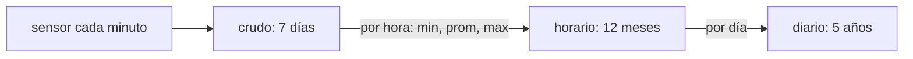

# Módulo 28: Bases de datos de grafos y búsqueda — Neptune y OpenSearch


## Aprende construyendo


### Tema 1: Bases de datos de grafos — cuando las relaciones son el dato · Avanzado · 35 min

<details open>
<summary><strong>Capa 1 — Lectura</strong></summary>

#### ► DE QUÉ TRATA
Al finalizar vas a reconocer, con el caso real de sugerir repartidores de respaldo, por qué esa pregunta no tiene una forma natural en DynamoDB. Prerrequisitos: Módulo 4 completo.

#### ► LA IDEA EN UNA FRASE
**Al finalizar vas a reconocer, con el caso real de sugerir repartidores de respaldo, por qué esa pregunta no tiene una forma natural en DynamoDB.**

#### ► POR QUÉ EXISTE ESTO
Resuelve un problema real de diseño o implementación y evita decisiones a ciegas.

#### ► LA ANALOGÍA
Piensa en bases de datos de grafos — cuando las relaciones son el dato como una herramienta de taller: útil cuando conoces su propósito y sus límites.
**Dónde se rompe la analogía:** en software, los efectos dependen del contexto, la escala y los trade-offs.

#### ► CÓMO FUNCIONA
1. Identifica el problema que bases de datos de grafos — cuando las relaciones son el dato resuelve.
2. Observa sus componentes y relaciones.
3. Aplica la opción más simple que funcione.
4. Verifica el resultado y los límites.

#### ► LO QUE PUEDE SALIR MAL
| Síntoma | Causa probable | Arreglo |
|---|---|---|
| Bases de datos de grafos — cuando las relaciones son el dato se aplica pero el resultado no mejora | Se usó sin medir el problema real | Mide antes y compara contra la alternativa simple |
| Aparece complejidad inesperada | Se adoptó la técnica sin comprender sus trade-offs | Vuelve a la sección de trade-offs y reduce el alcance |
| Falla en un caso límite | Se asumió un contexto que no se cumple | Prueba el caso límite y documenta cuándo NO usarlo |

#### ► TRADE-OFFS
| Opción | Cuándo usarla | Cuándo NO usarla |
|---|---|---|
| Usar Bases de datos de grafos — cuando las relaciones son el dato | Cuando el problema coincide con su propósito y el beneficio es observable | Cuando agrega complejidad sin resolver un problema real |
| Alternativa más simple | Cuando el contexto es pequeño, estable o fácil de razonar | Cuando ya demostró no escalar o no cumplir el requisito |
| Postergar la decisión | Cuando falta evidencia del problema | Cuando el costo de esperar es mayor que el costo de probar |

#### ► CUÁNDO NO USAR ESTO
No uses bases de datos de grafos — cuando las relaciones son el dato por defecto. Aplícalo cuando el problema lo justifique y puedas verificar el beneficio; si una alternativa más simple resuelve igual, prefiérela.

#### ► DE VUELTA A LA ANALOGÍA
Volviendo a la analogía: bases de datos de grafos — cuando las relaciones son el dato funciona como el modelo inicial, pero recuerda dónde se rompe: en producción importan la evidencia, la escala y el costo de equivocarte.

#### ► LO QUE DEBES RECORDAR
- Bases de datos de grafos — cuando las relaciones son el dato existe para resolver un problema específico.
- Mide antes de adoptar complejidad.
- Conoce el caso donde NO usarlo.
- Verifica con evidencia observable.

#### ► PREGUNTAS PARA PENSAR
1. ¿Qué problema concreto resuelve bases de datos de grafos — cuando las relaciones son el dato en tu contexto?
2. ¿Cómo sabrías que bases de datos de grafos — cuando las relaciones son el dato no está funcionando bien?
3. ¿Qué alternativa más simple considerarías antes de usar bases de datos de grafos — cuando las relaciones son el dato?

</details>

<details>
<summary><strong>Capa 2 — Construcción</strong></summary>

#### Código y verificación
```python
# archivo: src/labs/modulo-28/tema-1-por-que-un-grafo.py — ejecutar con: python tema-1-por-que-un-grafo.py
# Compara mentalmente: recuperar "quién entregó el pedido RF-001" es una
# consulta por clave (DynamoDB). Recuperar "todos los repartidores que
# alguna vez cubrieron la misma zona que Ana" es un recorrido multi-salto:
# exactamente el tipo de pregunta que justifica una base de grafos.
pregunta_por_clave = "SELECT * FROM entregas WHERE guia = 'RF-001'"
pregunta_multi_salto = "g.V().has('nombre','Ana').out('cubrio_zona').in('cubrio_zona').dedup()"
print("clave:", pregunta_por_clave)
print("grafo:", pregunta_multi_salto)
```

```bash
mkdir ejemplo && cd ejemplo && floci start
```

```bash
pregunta_por_clave="SELECT * FROM entregas WHERE guia = 'RF-001'"
pregunta_multi_salto="g.V().has('nombre','Ana').out('cubrio_zona').in('cubrio_zona').dedup()"
echo "clave: $pregunta_por_clave"
echo "grafo: $pregunta_multi_salto"
```

</details>

### Tema 2: Neptune en Floci — un servidor Gremlin real, no una simulación · Avanzado · 35 min

<details open>
<summary><strong>Capa 1 — Lectura</strong></summary>

#### ► DE QUÉ TRATA
Al finalizar vas a crear el clúster real donde RutaFlow modela qué repartidores cubrieron qué zonas (Tema 1). Prerrequisitos: Tema 1 de este módulo.

#### ► LA IDEA EN UNA FRASE
**Al finalizar vas a crear el clúster real donde RutaFlow modela qué repartidores cubrieron qué zonas (Tema 1).**

#### ► POR QUÉ EXISTE ESTO
Resuelve un problema real de diseño o implementación y evita decisiones a ciegas.

#### ► LA ANALOGÍA
Piensa en neptune en floci — un servidor gremlin real, no una simulación como una herramienta de taller: útil cuando conoces su propósito y sus límites.
**Dónde se rompe la analogía:** en software, los efectos dependen del contexto, la escala y los trade-offs.

#### ► CÓMO FUNCIONA
1. Identifica el problema que neptune en floci — un servidor gremlin real, no una simulación resuelve.
2. Observa sus componentes y relaciones.
3. Aplica la opción más simple que funcione.
4. Verifica el resultado y los límites.

#### ► LO QUE PUEDE SALIR MAL
| Síntoma | Causa probable | Arreglo |
|---|---|---|
| Neptune en Floci — un servidor Gremlin real, no una simulación se aplica pero el resultado no mejora | Se usó sin medir el problema real | Mide antes y compara contra la alternativa simple |
| Aparece complejidad inesperada | Se adoptó la técnica sin comprender sus trade-offs | Vuelve a la sección de trade-offs y reduce el alcance |
| Falla en un caso límite | Se asumió un contexto que no se cumple | Prueba el caso límite y documenta cuándo NO usarlo |

#### ► TRADE-OFFS
| Opción | Cuándo usarla | Cuándo NO usarla |
|---|---|---|
| Usar Neptune en Floci — un servidor Gremlin real, no una simulación | Cuando el problema coincide con su propósito y el beneficio es observable | Cuando agrega complejidad sin resolver un problema real |
| Alternativa más simple | Cuando el contexto es pequeño, estable o fácil de razonar | Cuando ya demostró no escalar o no cumplir el requisito |
| Postergar la decisión | Cuando falta evidencia del problema | Cuando el costo de esperar es mayor que el costo de probar |

#### ► CUÁNDO NO USAR ESTO
No uses neptune en floci — un servidor gremlin real, no una simulación por defecto. Aplícalo cuando el problema lo justifique y puedas verificar el beneficio; si una alternativa más simple resuelve igual, prefiérela.

#### ► DE VUELTA A LA ANALOGÍA
Volviendo a la analogía: neptune en floci — un servidor gremlin real, no una simulación funciona como el modelo inicial, pero recuerda dónde se rompe: en producción importan la evidencia, la escala y el costo de equivocarte.

#### ► LO QUE DEBES RECORDAR
- Neptune en Floci — un servidor Gremlin real, no una simulación existe para resolver un problema específico.
- Mide antes de adoptar complejidad.
- Conoce el caso donde NO usarlo.
- Verifica con evidencia observable.

#### ► PREGUNTAS PARA PENSAR
1. ¿Qué problema concreto resuelve neptune en floci — un servidor gremlin real, no una simulación en tu contexto?
2. ¿Cómo sabrías que neptune en floci — un servidor gremlin real, no una simulación no está funcionando bien?
3. ¿Qué alternativa más simple considerarías antes de usar neptune en floci — un servidor gremlin real, no una simulación?

</details>

<details>
<summary><strong>Capa 2 — Construcción</strong></summary>

#### Código y verificación
```bash
# archivo: src/labs/modulo-28/tema-2-neptune-real.sh — ejecutar con: bash tema-2-neptune-real.sh
aws neptune create-db-cluster --db-cluster-identifier demo-grafo --engine neptune
PUERTO=$(aws neptune describe-db-clusters --db-cluster-identifier demo-grafo \
  --query 'DBClusters[0].Port' --output text)
docker ps | grep gremlin
```

```bash
aws neptune create-db-cluster --db-cluster-identifier demo-grafo --engine neptune
PUERTO=$(aws neptune describe-db-clusters --db-cluster-identifier demo-grafo \
  --query 'DBClusters[0].Port' --output text)
docker ps | grep gremlin
```

</details>

### Tema 3: OpenSearch — modo simulado y modo real · Avanzado · 35 min

<details open>
<summary><strong>Capa 1 — Lectura</strong></summary>

#### ► DE QUÉ TRATA
Al finalizar vas a indexar la descripción de un paquete real de RutaFlow en OpenSearch y a confirmar la diferencia entre modo simulado y modo real. Prerrequisitos: Módulo 9 (los paquetes/tareas del proyecto final).

#### ► LA IDEA EN UNA FRASE
**Al finalizar vas a indexar la descripción de un paquete real de RutaFlow en OpenSearch y a confirmar la diferencia entre modo simulado y modo real.**

#### ► POR QUÉ EXISTE ESTO
Resuelve un problema real de diseño o implementación y evita decisiones a ciegas.

#### ► LA ANALOGÍA
Piensa en opensearch — modo simulado y modo real como una herramienta de taller: útil cuando conoces su propósito y sus límites.
**Dónde se rompe la analogía:** en software, los efectos dependen del contexto, la escala y los trade-offs.

#### ► CÓMO FUNCIONA
1. Identifica el problema que opensearch — modo simulado y modo real resuelve.
2. Observa sus componentes y relaciones.
3. Aplica la opción más simple que funcione.
4. Verifica el resultado y los límites.

#### ► LO QUE PUEDE SALIR MAL
| Síntoma | Causa probable | Arreglo |
|---|---|---|
| OpenSearch — modo simulado y modo real se aplica pero el resultado no mejora | Se usó sin medir el problema real | Mide antes y compara contra la alternativa simple |
| Aparece complejidad inesperada | Se adoptó la técnica sin comprender sus trade-offs | Vuelve a la sección de trade-offs y reduce el alcance |
| Falla en un caso límite | Se asumió un contexto que no se cumple | Prueba el caso límite y documenta cuándo NO usarlo |

#### ► TRADE-OFFS
| Opción | Cuándo usarla | Cuándo NO usarla |
|---|---|---|
| Usar OpenSearch — modo simulado y modo real | Cuando el problema coincide con su propósito y el beneficio es observable | Cuando agrega complejidad sin resolver un problema real |
| Alternativa más simple | Cuando el contexto es pequeño, estable o fácil de razonar | Cuando ya demostró no escalar o no cumplir el requisito |
| Postergar la decisión | Cuando falta evidencia del problema | Cuando el costo de esperar es mayor que el costo de probar |

#### ► CUÁNDO NO USAR ESTO
No uses opensearch — modo simulado y modo real por defecto. Aplícalo cuando el problema lo justifique y puedas verificar el beneficio; si una alternativa más simple resuelve igual, prefiérela.

#### ► DE VUELTA A LA ANALOGÍA
Volviendo a la analogía: opensearch — modo simulado y modo real funciona como el modelo inicial, pero recuerda dónde se rompe: en producción importan la evidencia, la escala y el costo de equivocarte.

#### ► LO QUE DEBES RECORDAR
- OpenSearch — modo simulado y modo real existe para resolver un problema específico.
- Mide antes de adoptar complejidad.
- Conoce el caso donde NO usarlo.
- Verifica con evidencia observable.

#### ► PREGUNTAS PARA PENSAR
1. ¿Qué problema concreto resuelve opensearch — modo simulado y modo real en tu contexto?
2. ¿Cómo sabrías que opensearch — modo simulado y modo real no está funcionando bien?
3. ¿Qué alternativa más simple considerarías antes de usar opensearch — modo simulado y modo real?

</details>

<details>
<summary><strong>Capa 2 — Construcción</strong></summary>

#### Código y verificación
```bash
# archivo: src/labs/modulo-28/tema-3-opensearch.sh — ejecutar con: bash tema-3-opensearch.sh
aws opensearch create-domain --domain-name demo-busqueda --engine-version "OpenSearch_2.11" \
  --cluster-config InstanceType=m5.large.search,InstanceCount=1 \
  --ebs-options EBSEnabled=true,VolumeType=gp2,VolumeSize=10
ENDPOINT=$(aws opensearch describe-domain --domain-name demo-busqueda --query 'DomainStatus.Endpoint' --output text)
curl -X POST "http://$ENDPOINT/paquetes/_doc/1" -H "Content-Type: application/json" \
  -d '{"guia": "RF-001", "descripcion": "caja fragil electronica"}'
curl "http://$ENDPOINT/paquetes/_search?q=fragil"
```

```bash
aws opensearch create-domain --domain-name demo-busqueda --engine-version "OpenSearch_2.11" \
  --cluster-config InstanceType=m5.large.search,InstanceCount=1 \
  --ebs-options EBSEnabled=true,VolumeType=gp2,VolumeSize=10
ENDPOINT=$(aws opensearch describe-domain --domain-name demo-busqueda --query 'DomainStatus.Endpoint' --output text)
curl -X POST "http://$ENDPOINT/paquetes/_doc/1" -H "Content-Type: application/json" \
  -d '{"guia": "RF-001", "descripcion": "caja fragil electronica"}'
curl "http://$ENDPOINT/paquetes/_search?q=fragil"
```

</details>

### Tema 4: Eligiendo entre Neptune, OpenSearch y DynamoDB · Avanzado · 35 min

<details open>
<summary><strong>Capa 1 — Lectura</strong></summary>

#### ► DE QUÉ TRATA
Al finalizar vas a mapear las tres preguntas reales de RutaFlow (buscar por guía, por relación, por texto) a los tres almacenes correctos. Prerrequisitos: Temas 1-3 de este módulo.

#### ► LA IDEA EN UNA FRASE
**Al finalizar vas a mapear las tres preguntas reales de RutaFlow (buscar por guía, por relación, por texto) a los tres almacenes correctos.**

#### ► POR QUÉ EXISTE ESTO
Resuelve un problema real de diseño o implementación y evita decisiones a ciegas.

#### ► LA ANALOGÍA
Piensa en eligiendo entre neptune, opensearch y dynamodb como una herramienta de taller: útil cuando conoces su propósito y sus límites.
**Dónde se rompe la analogía:** en software, los efectos dependen del contexto, la escala y los trade-offs.

#### ► CÓMO FUNCIONA
1. Identifica el problema que eligiendo entre neptune, opensearch y dynamodb resuelve.
2. Observa sus componentes y relaciones.
3. Aplica la opción más simple que funcione.
4. Verifica el resultado y los límites.

#### ► LO QUE PUEDE SALIR MAL
| Síntoma | Causa probable | Arreglo |
|---|---|---|
| Eligiendo entre Neptune, OpenSearch y DynamoDB se aplica pero el resultado no mejora | Se usó sin medir el problema real | Mide antes y compara contra la alternativa simple |
| Aparece complejidad inesperada | Se adoptó la técnica sin comprender sus trade-offs | Vuelve a la sección de trade-offs y reduce el alcance |
| Falla en un caso límite | Se asumió un contexto que no se cumple | Prueba el caso límite y documenta cuándo NO usarlo |

#### ► TRADE-OFFS
| Opción | Cuándo usarla | Cuándo NO usarla |
|---|---|---|
| Usar Eligiendo entre Neptune, OpenSearch y DynamoDB | Cuando el problema coincide con su propósito y el beneficio es observable | Cuando agrega complejidad sin resolver un problema real |
| Alternativa más simple | Cuando el contexto es pequeño, estable o fácil de razonar | Cuando ya demostró no escalar o no cumplir el requisito |
| Postergar la decisión | Cuando falta evidencia del problema | Cuando el costo de esperar es mayor que el costo de probar |

#### ► CUÁNDO NO USAR ESTO
No uses eligiendo entre neptune, opensearch y dynamodb por defecto. Aplícalo cuando el problema lo justifique y puedas verificar el beneficio; si una alternativa más simple resuelve igual, prefiérela.

#### ► DE VUELTA A LA ANALOGÍA
Volviendo a la analogía: eligiendo entre neptune, opensearch y dynamodb funciona como el modelo inicial, pero recuerda dónde se rompe: en producción importan la evidencia, la escala y el costo de equivocarte.

#### ► LO QUE DEBES RECORDAR
- Eligiendo entre Neptune, OpenSearch y DynamoDB existe para resolver un problema específico.
- Mide antes de adoptar complejidad.
- Conoce el caso donde NO usarlo.
- Verifica con evidencia observable.

#### ► PREGUNTAS PARA PENSAR
1. ¿Qué problema concreto resuelve eligiendo entre neptune, opensearch y dynamodb en tu contexto?
2. ¿Cómo sabrías que eligiendo entre neptune, opensearch y dynamodb no está funcionando bien?
3. ¿Qué alternativa más simple considerarías antes de usar eligiendo entre neptune, opensearch y dynamodb?

</details>

<details>
<summary><strong>Capa 2 — Construcción</strong></summary>

#### Código y verificación
```bash
# archivo: src/labs/modulo-28/tema-4-tres-vistas.sh — ejecutar con: bash tema-4-tres-vistas.sh
# El endpoint se recupera por nombre de dominio, no de la sesión del Tema 3.
ENDPOINT=$(aws opensearch describe-domain --domain-name demo-busqueda --query 'DomainStatus.Endpoint' --output text)

aws dynamodb get-item --table-name demo-entregas --key '{"guia":{"S":"RF-001"}}'
curl -s "http://$ENDPOINT/paquetes/_search?q=fragil" | head -c 200
echo
# equivalente conceptual en Gremlin: recorrer relaciones del mismo pedido
echo "g.V().has('guia','RF-001').out('procesado_por').values('nombre')"
```

```bash
mkdir ejemplo && cd ejemplo && floci start
```

```bash
aws dynamodb get-item --table-name ShipmentEvents --key '{"shipmentId":{"S":"env-4471"},"sequence":{"N":"1"}}'
curl "http://$ENDPOINT/paquetes/_search?q=fragil"
# (consulta Gremlin del Tema 1, vía gremlin-python contra el puerto de Neptune)
```

</details>

### Tema 5: Datos de series temporales: escritura por tiempo, reducción de resolución y retención · Avanzado · 40 min

<details open>
<summary><strong>Capa 1 — Lectura</strong></summary>

#### ► DE QUÉ TRATA
Usa Python 3.10 o superior (trae SQLite). Crea la carpeta academia-labs/cloud/series. No necesitas instalar nada.

#### ► LA IDEA EN UNA FRASE
**Usa Python 3.10 o superior (trae SQLite).**

#### ► POR QUÉ EXISTE ESTO
Resuelve un problema real de diseño o implementación y evita decisiones a ciegas.

#### ► LA ANALOGÍA
Piensa en datos de series temporales: escritura por tiempo, reducción de resolución y retención como una herramienta de taller: útil cuando conoces su propósito y sus límites.
**Dónde se rompe la analogía:** en software, los efectos dependen del contexto, la escala y los trade-offs.

#### ► CÓMO FUNCIONA


#### ► LO QUE PUEDE SALIR MAL
| Síntoma | Causa probable | Arreglo |
|---|---|---|
| Datos de series temporales: escritura por tiempo, reducción de resolución y retención se aplica pero el resultado no mejora | Se usó sin medir el problema real | Mide antes y compara contra la alternativa simple |
| Aparece complejidad inesperada | Se adoptó la técnica sin comprender sus trade-offs | Vuelve a la sección de trade-offs y reduce el alcance |
| Falla en un caso límite | Se asumió un contexto que no se cumple | Prueba el caso límite y documenta cuándo NO usarlo |

#### ► TRADE-OFFS
| Opción | Cuándo usarla | Cuándo NO usarla |
|---|---|---|
| Usar Datos de series temporales: escritura por tiempo, reducción de resolución y retención | Cuando el problema coincide con su propósito y el beneficio es observable | Cuando agrega complejidad sin resolver un problema real |
| Alternativa más simple | Cuando el contexto es pequeño, estable o fácil de razonar | Cuando ya demostró no escalar o no cumplir el requisito |
| Postergar la decisión | Cuando falta evidencia del problema | Cuando el costo de esperar es mayor que el costo de probar |

#### ► CUÁNDO NO USAR ESTO
No uses datos de series temporales: escritura por tiempo, reducción de resolución y retención por defecto. Aplícalo cuando el problema lo justifique y puedas verificar el beneficio; si una alternativa más simple resuelve igual, prefiérela.

#### ► DE VUELTA A LA ANALOGÍA
Volviendo a la analogía: datos de series temporales: escritura por tiempo, reducción de resolución y retención funciona como el modelo inicial, pero recuerda dónde se rompe: en producción importan la evidencia, la escala y el costo de equivocarte.

#### ► LO QUE DEBES RECORDAR
- Datos de series temporales: escritura por tiempo, reducción de resolución y retención existe para resolver un problema específico.
- Mide antes de adoptar complejidad.
- Conoce el caso donde NO usarlo.
- Verifica con evidencia observable.

#### ► PREGUNTAS PARA PENSAR
1. ¿Qué problema concreto resuelve datos de series temporales: escritura por tiempo, reducción de resolución y retención en tu contexto?
2. ¿Cómo sabrías que datos de series temporales: escritura por tiempo, reducción de resolución y retención no está funcionando bien?
3. ¿Qué alternativa más simple considerarías antes de usar datos de series temporales: escritura por tiempo, reducción de resolución y retención?

</details>

<details>
<summary><strong>Capa 2 — Construcción</strong></summary>

#### Código y verificación


```python
import sqlite3
from datetime import datetime, timedelta

db = sqlite3.connect(":memory:")
# Tabla típica de series temporales: tiempo + etiqueta + valor, ordenada por tiempo.
db.execute("CREATE TABLE temperatura (instante TEXT, camion TEXT, grados REAL)")
db.execute("CREATE INDEX idx_tiempo ON temperatura (camion, instante)")

inicio = datetime(2026, 11, 18, 8, 0)
lecturas = []
for minuto in range(180):  # 3 horas, una lectura por minuto
    grados = 4.0 + (minuto % 60) / 30  # sube durante cada hora y vuelve a bajar
    if minuto == 125:
        grados = 9.5                   # puerta abierta: pico
    lecturas.append(((inicio + timedelta(minutes=minuto)).isoformat(), "CAM-7", grados))
db.executemany("INSERT INTO temperatura VALUES (?, ?, ?)", lecturas)

# Reducción de resolución (downsampling): una fila por hora con mínimo, promedio y máximo.
filas = db.execute("""
    SELECT substr(instante, 1, 13) || ':00' AS hora,
           round(min(grados), 1), round(avg(grados), 1), round(max(grados), 1), count(*)
    FROM temperatura WHERE camion = 'CAM-7'
    GROUP BY hora ORDER BY hora
""").fetchall()

print(f"{len(lecturas)} lecturas crudas -> {len(filas)} filas por hora")
for hora, minimo, promedio, maximo, n in filas:
    alerta = "  <- revisar cadena de frío" if maximo > 8 else ""
    print(f"{hora}  min {minimo}  prom {promedio}  max {maximo}  ({n} lecturas){alerta}")
```

```bash
cd academia-labs/cloud/series
python3 series.py
```

```text
180 lecturas crudas -> 3 filas por hora
2026-11-18T08:00  min 4.0  prom 5.0  max 6.0  (60 lecturas)
2026-11-18T09:00  min 4.0  prom 5.0  max 6.0  (60 lecturas)
2026-11-18T10:00  min 4.0  prom 5.1  max 9.5  (60 lecturas)  <- revisar cadena de frío
```

</details>

### Laboratorio 28.1 — Grafo de relaciones con Neptune

<details open>
<summary><strong>Capa 1 — Lectura</strong></summary>

#### ► DE QUÉ TRATA
Este tema te guía por laboratorio 28.1 — grafo de relaciones con neptune con foco en comprensión antes de implementación.

#### ► LA IDEA EN UNA FRASE
**Entender laboratorio 28.1 — grafo de relaciones con neptune te permite tomar mejores decisiones técnicas.**

#### ► POR QUÉ EXISTE ESTO
Resuelve un problema real de diseño o implementación y evita decisiones a ciegas.

#### ► LA ANALOGÍA
Piensa en laboratorio 28.1 — grafo de relaciones con neptune como una herramienta de taller: útil cuando conoces su propósito y sus límites.
**Dónde se rompe la analogía:** en software, los efectos dependen del contexto, la escala y los trade-offs.

#### ► CÓMO FUNCIONA
1. Identifica el problema que laboratorio 28.1 — grafo de relaciones con neptune resuelve.
2. Observa sus componentes y relaciones.
3. Aplica la opción más simple que funcione.
4. Verifica el resultado y los límites.

#### ► LO QUE PUEDE SALIR MAL
| Síntoma | Causa probable | Arreglo |
|---|---|---|
| Laboratorio 28.1 — Grafo de relaciones con Neptune se aplica pero el resultado no mejora | Se usó sin medir el problema real | Mide antes y compara contra la alternativa simple |
| Aparece complejidad inesperada | Se adoptó la técnica sin comprender sus trade-offs | Vuelve a la sección de trade-offs y reduce el alcance |
| Falla en un caso límite | Se asumió un contexto que no se cumple | Prueba el caso límite y documenta cuándo NO usarlo |

#### ► TRADE-OFFS
| Opción | Cuándo usarla | Cuándo NO usarla |
|---|---|---|
| Usar Laboratorio 28.1 — Grafo de relaciones con Neptune | Cuando el problema coincide con su propósito y el beneficio es observable | Cuando agrega complejidad sin resolver un problema real |
| Alternativa más simple | Cuando el contexto es pequeño, estable o fácil de razonar | Cuando ya demostró no escalar o no cumplir el requisito |
| Postergar la decisión | Cuando falta evidencia del problema | Cuando el costo de esperar es mayor que el costo de probar |

#### ► CUÁNDO NO USAR ESTO
No uses laboratorio 28.1 — grafo de relaciones con neptune por defecto. Aplícalo cuando el problema lo justifique y puedas verificar el beneficio; si una alternativa más simple resuelve igual, prefiérela.

#### ► DE VUELTA A LA ANALOGÍA
Volviendo a la analogía: laboratorio 28.1 — grafo de relaciones con neptune funciona como el modelo inicial, pero recuerda dónde se rompe: en producción importan la evidencia, la escala y el costo de equivocarte.

#### ► LO QUE DEBES RECORDAR
- Laboratorio 28.1 — Grafo de relaciones con Neptune existe para resolver un problema específico.
- Mide antes de adoptar complejidad.
- Conoce el caso donde NO usarlo.
- Verifica con evidencia observable.

#### ► PREGUNTAS PARA PENSAR
1. ¿Qué problema concreto resuelve laboratorio 28.1 — grafo de relaciones con neptune en tu contexto?
2. ¿Cómo sabrías que laboratorio 28.1 — grafo de relaciones con neptune no está funcionando bien?
3. ¿Qué alternativa más simple considerarías antes de usar laboratorio 28.1 — grafo de relaciones con neptune?

</details>

<details>
<summary><strong>Capa 2 — Construcción</strong></summary>

#### Nota de construcción
Este tema es principalmente conceptual en esta versión. La verificación se realiza con las preguntas de comprensión y el criterio de cuándo NO usar laboratorio 28.1 — grafo de relaciones con neptune.

</details>

### Laboratorio 28.2 — Búsqueda de texto completo con OpenSearch

<details open>
<summary><strong>Capa 1 — Lectura</strong></summary>

#### ► DE QUÉ TRATA
Este tema te guía por laboratorio 28.2 — búsqueda de texto completo con opensearch con foco en comprensión antes de implementación.

#### ► LA IDEA EN UNA FRASE
**Entender laboratorio 28.2 — búsqueda de texto completo con opensearch te permite tomar mejores decisiones técnicas.**

#### ► POR QUÉ EXISTE ESTO
Resuelve un problema real de diseño o implementación y evita decisiones a ciegas.

#### ► LA ANALOGÍA
Piensa en laboratorio 28.2 — búsqueda de texto completo con opensearch como una herramienta de taller: útil cuando conoces su propósito y sus límites.
**Dónde se rompe la analogía:** en software, los efectos dependen del contexto, la escala y los trade-offs.

#### ► CÓMO FUNCIONA
1. Identifica el problema que laboratorio 28.2 — búsqueda de texto completo con opensearch resuelve.
2. Observa sus componentes y relaciones.
3. Aplica la opción más simple que funcione.
4. Verifica el resultado y los límites.

#### ► LO QUE PUEDE SALIR MAL
| Síntoma | Causa probable | Arreglo |
|---|---|---|
| Laboratorio 28.2 — Búsqueda de texto completo con OpenSearch se aplica pero el resultado no mejora | Se usó sin medir el problema real | Mide antes y compara contra la alternativa simple |
| Aparece complejidad inesperada | Se adoptó la técnica sin comprender sus trade-offs | Vuelve a la sección de trade-offs y reduce el alcance |
| Falla en un caso límite | Se asumió un contexto que no se cumple | Prueba el caso límite y documenta cuándo NO usarlo |

#### ► TRADE-OFFS
| Opción | Cuándo usarla | Cuándo NO usarla |
|---|---|---|
| Usar Laboratorio 28.2 — Búsqueda de texto completo con OpenSearch | Cuando el problema coincide con su propósito y el beneficio es observable | Cuando agrega complejidad sin resolver un problema real |
| Alternativa más simple | Cuando el contexto es pequeño, estable o fácil de razonar | Cuando ya demostró no escalar o no cumplir el requisito |
| Postergar la decisión | Cuando falta evidencia del problema | Cuando el costo de esperar es mayor que el costo de probar |

#### ► CUÁNDO NO USAR ESTO
No uses laboratorio 28.2 — búsqueda de texto completo con opensearch por defecto. Aplícalo cuando el problema lo justifique y puedas verificar el beneficio; si una alternativa más simple resuelve igual, prefiérela.

#### ► DE VUELTA A LA ANALOGÍA
Volviendo a la analogía: laboratorio 28.2 — búsqueda de texto completo con opensearch funciona como el modelo inicial, pero recuerda dónde se rompe: en producción importan la evidencia, la escala y el costo de equivocarte.

#### ► LO QUE DEBES RECORDAR
- Laboratorio 28.2 — Búsqueda de texto completo con OpenSearch existe para resolver un problema específico.
- Mide antes de adoptar complejidad.
- Conoce el caso donde NO usarlo.
- Verifica con evidencia observable.

#### ► PREGUNTAS PARA PENSAR
1. ¿Qué problema concreto resuelve laboratorio 28.2 — búsqueda de texto completo con opensearch en tu contexto?
2. ¿Cómo sabrías que laboratorio 28.2 — búsqueda de texto completo con opensearch no está funcionando bien?
3. ¿Qué alternativa más simple considerarías antes de usar laboratorio 28.2 — búsqueda de texto completo con opensearch?

</details>

<details>
<summary><strong>Capa 2 — Construcción</strong></summary>

#### Nota de construcción
Este tema es principalmente conceptual en esta versión. La verificación se realiza con las preguntas de comprensión y el criterio de cuándo NO usar laboratorio 28.2 — búsqueda de texto completo con opensearch.

</details>
