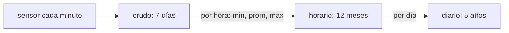

# Módulo 28: Bases de datos de grafos y búsqueda — Neptune y OpenSearch


## Aprende construyendo


### Tema 1: Bases de datos de grafos — cuando las relaciones son el dato · Avanzado · 35 min

<details open>
<summary><strong>Capa 1 — Lectura</strong></summary>

#### ► DE QUÉ TRATA
Al finalizar vas a reconocer, con el caso real de sugerir repartidores de respaldo, por qué esa pregunta no tiene una forma natural en DynamoDB. Prerrequisitos: Módulo 4 completo.

</details>

<details>
<summary><strong>Capa 2 — Construcción</strong></summary>

#### Código y verificación
```python
# archivo: src/labs/modulo-28/tema-1-por-que-un-grafo.py — ejecutar con: python tema-1-por-que-un-grafo.py
# Compara mentalmente: recuperar "quién entregó el pedido RF-001" es una
# consulta por clave (DynamoDB). Recuperar "todos los repartidores que
# alguna vez cubrieron la misma zona que Ana" es un recorrido multi-salto:
# exactamente el tipo de pregunta que justifica una base de grafos.
pregunta_por_clave = "SELECT * FROM entregas WHERE guia = 'RF-001'"
pregunta_multi_salto = "g.V().has('nombre','Ana').out('cubrio_zona').in('cubrio_zona').dedup()"
print("clave:", pregunta_por_clave)
print("grafo:", pregunta_multi_salto)
```

```bash
mkdir ejemplo && cd ejemplo && floci start
```

```bash
pregunta_por_clave="SELECT * FROM entregas WHERE guia = 'RF-001'"
pregunta_multi_salto="g.V().has('nombre','Ana').out('cubrio_zona').in('cubrio_zona').dedup()"
echo "clave: $pregunta_por_clave"
echo "grafo: $pregunta_multi_salto"
```

</details>

### Tema 2: Neptune en Floci — un servidor Gremlin real, no una simulación · Avanzado · 35 min

<details open>
<summary><strong>Capa 1 — Lectura</strong></summary>

#### ► DE QUÉ TRATA
Al finalizar vas a crear el clúster real donde RutaFlow modela qué repartidores cubrieron qué zonas (Tema 1). Prerrequisitos: Tema 1 de este módulo.

</details>

<details>
<summary><strong>Capa 2 — Construcción</strong></summary>

#### Código y verificación
```bash
# archivo: src/labs/modulo-28/tema-2-neptune-real.sh — ejecutar con: bash tema-2-neptune-real.sh
aws neptune create-db-cluster --db-cluster-identifier demo-grafo --engine neptune
PUERTO=$(aws neptune describe-db-clusters --db-cluster-identifier demo-grafo \
  --query 'DBClusters[0].Port' --output text)
docker ps | grep gremlin
```

```bash
aws neptune create-db-cluster --db-cluster-identifier demo-grafo --engine neptune
PUERTO=$(aws neptune describe-db-clusters --db-cluster-identifier demo-grafo \
  --query 'DBClusters[0].Port' --output text)
docker ps | grep gremlin
```

</details>

### Tema 3: OpenSearch — modo simulado y modo real · Avanzado · 35 min

<details open>
<summary><strong>Capa 1 — Lectura</strong></summary>

#### ► DE QUÉ TRATA
Al finalizar vas a indexar la descripción de un paquete real de RutaFlow en OpenSearch y a confirmar la diferencia entre modo simulado y modo real. Prerrequisitos: Módulo 9 (los paquetes/tareas del proyecto final).

</details>

<details>
<summary><strong>Capa 2 — Construcción</strong></summary>

#### Código y verificación
```bash
# archivo: src/labs/modulo-28/tema-3-opensearch.sh — ejecutar con: bash tema-3-opensearch.sh
aws opensearch create-domain --domain-name demo-busqueda --engine-version "OpenSearch_2.11" \
  --cluster-config InstanceType=m5.large.search,InstanceCount=1 \
  --ebs-options EBSEnabled=true,VolumeType=gp2,VolumeSize=10
ENDPOINT=$(aws opensearch describe-domain --domain-name demo-busqueda --query 'DomainStatus.Endpoint' --output text)
curl -X POST "http://$ENDPOINT/paquetes/_doc/1" -H "Content-Type: application/json" \
  -d '{"guia": "RF-001", "descripcion": "caja fragil electronica"}'
curl "http://$ENDPOINT/paquetes/_search?q=fragil"
```

```bash
aws opensearch create-domain --domain-name demo-busqueda --engine-version "OpenSearch_2.11" \
  --cluster-config InstanceType=m5.large.search,InstanceCount=1 \
  --ebs-options EBSEnabled=true,VolumeType=gp2,VolumeSize=10
ENDPOINT=$(aws opensearch describe-domain --domain-name demo-busqueda --query 'DomainStatus.Endpoint' --output text)
curl -X POST "http://$ENDPOINT/paquetes/_doc/1" -H "Content-Type: application/json" \
  -d '{"guia": "RF-001", "descripcion": "caja fragil electronica"}'
curl "http://$ENDPOINT/paquetes/_search?q=fragil"
```

</details>

### Tema 4: Eligiendo entre Neptune, OpenSearch y DynamoDB · Avanzado · 35 min

<details open>
<summary><strong>Capa 1 — Lectura</strong></summary>

#### ► DE QUÉ TRATA
Al finalizar vas a mapear las tres preguntas reales de RutaFlow (buscar por guía, por relación, por texto) a los tres almacenes correctos. Prerrequisitos: Temas 1-3 de este módulo.

</details>

<details>
<summary><strong>Capa 2 — Construcción</strong></summary>

#### Código y verificación
```bash
# archivo: src/labs/modulo-28/tema-4-tres-vistas.sh — ejecutar con: bash tema-4-tres-vistas.sh
# El endpoint se recupera por nombre de dominio, no de la sesión del Tema 3.
ENDPOINT=$(aws opensearch describe-domain --domain-name demo-busqueda --query 'DomainStatus.Endpoint' --output text)

aws dynamodb get-item --table-name demo-entregas --key '{"guia":{"S":"RF-001"}}'
curl -s "http://$ENDPOINT/paquetes/_search?q=fragil" | head -c 200
echo
# equivalente conceptual en Gremlin: recorrer relaciones del mismo pedido
echo "g.V().has('guia','RF-001').out('procesado_por').values('nombre')"
```

```bash
mkdir ejemplo && cd ejemplo && floci start
```

```bash
aws dynamodb get-item --table-name ShipmentEvents --key '{"shipmentId":{"S":"env-4471"},"sequence":{"N":"1"}}'
curl "http://$ENDPOINT/paquetes/_search?q=fragil"
# (consulta Gremlin del Tema 1, vía gremlin-python contra el puerto de Neptune)
```

</details>

### Tema 5: Datos de series temporales: escritura por tiempo, reducción de resolución y retención · Avanzado · 40 min

<details open>
<summary><strong>Capa 1 — Lectura</strong></summary>

#### ► DE QUÉ TRATA
Usa Python 3.10 o superior (trae SQLite). Crea la carpeta academia-labs/cloud/series. No necesitas instalar nada.

#### ► CÓMO FUNCIONA


</details>

<details>
<summary><strong>Capa 2 — Construcción</strong></summary>

#### Código y verificación

```python
import sqlite3
from datetime import datetime, timedelta

db = sqlite3.connect(":memory:")
# Tabla típica de series temporales: tiempo + etiqueta + valor, ordenada por tiempo.
db.execute("CREATE TABLE temperatura (instante TEXT, camion TEXT, grados REAL)")
db.execute("CREATE INDEX idx_tiempo ON temperatura (camion, instante)")

inicio = datetime(2026, 11, 18, 8, 0)
lecturas = []
for minuto in range(180):  # 3 horas, una lectura por minuto
    grados = 4.0 + (minuto % 60) / 30  # sube durante cada hora y vuelve a bajar
    if minuto == 125:
        grados = 9.5                   # puerta abierta: pico
    lecturas.append(((inicio + timedelta(minutes=minuto)).isoformat(), "CAM-7", grados))
db.executemany("INSERT INTO temperatura VALUES (?, ?, ?)", lecturas)

# Reducción de resolución (downsampling): una fila por hora con mínimo, promedio y máximo.
filas = db.execute("""
    SELECT substr(instante, 1, 13) || ':00' AS hora,
           round(min(grados), 1), round(avg(grados), 1), round(max(grados), 1), count(*)
    FROM temperatura WHERE camion = 'CAM-7'
    GROUP BY hora ORDER BY hora
""").fetchall()

print(f"{len(lecturas)} lecturas crudas -> {len(filas)} filas por hora")
for hora, minimo, promedio, maximo, n in filas:
    alerta = "  <- revisar cadena de frío" if maximo > 8 else ""
    print(f"{hora}  min {minimo}  prom {promedio}  max {maximo}  ({n} lecturas){alerta}")
```

```bash
cd academia-labs/cloud/series
python3 series.py
```

```text
180 lecturas crudas -> 3 filas por hora
2026-11-18T08:00  min 4.0  prom 5.0  max 6.0  (60 lecturas)
2026-11-18T09:00  min 4.0  prom 5.0  max 6.0  (60 lecturas)
2026-11-18T10:00  min 4.0  prom 5.1  max 9.5  (60 lecturas)  <- revisar cadena de frío
```

</details>

### Laboratorio 28.1 — Grafo de relaciones con Neptune

<details open>
<summary><strong>Capa 1 — Lectura</strong></summary>

</details>

<details>
<summary><strong>Capa 2 — Construcción</strong></summary>

#### Nota de construcción
Este tema es principalmente conceptual en esta versión. La verificación se realiza con las preguntas de comprensión y el criterio de cuándo NO usar laboratorio 28.1 — grafo de relaciones con neptune.

</details>

### Laboratorio 28.2 — Búsqueda de texto completo con OpenSearch

<details open>
<summary><strong>Capa 1 — Lectura</strong></summary>

</details>

<details>
<summary><strong>Capa 2 — Construcción</strong></summary>

#### Nota de construcción
Este tema es principalmente conceptual en esta versión. La verificación se realiza con las preguntas de comprensión y el criterio de cuándo NO usar laboratorio 28.2 — búsqueda de texto completo con opensearch.

</details>
