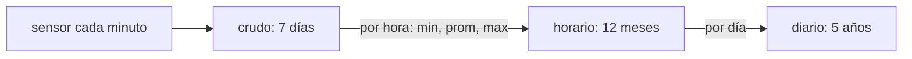

# Módulo 28: Bases de datos de grafos y búsqueda — Neptune y OpenSearch


## Aprende construyendo

### Tema 1: Bases de datos de grafos — cuando las relaciones son el dato

#### Paso 1 · Objetivo y preparación
Al finalizar vas a reconocer, con el caso real de sugerir repartidores de respaldo, por qué esa pregunta no tiene una forma natural en DynamoDB. Prerrequisitos: Módulo 4 completo.
#### Paso 2 · Contexto y caso real
RutaFlow necesita responder "¿qué repartidores cubrieron alguna vez la misma zona que Ana?" — una cadena de relaciones, no una búsqueda por clave como las que ya resolvés con `ShipmentEvents`.
#### Paso 3 · Teoría, modelo mental y analogía
El vértice es la entidad (un repartidor, una zona); la arista es la relación entre ellos (`cubrio_zona`); un recorrido es seguir esos enlaces, salto a salto.

**Conceptos clave:** vértice, arista, recorrido de grafo, consulta multi-salto.

Una base de datos relacional o de documentos modela relaciones mediante claves foráneas o referencias, pero seguir una cadena de relaciones —"amigos de mis amigos que también siguieron a esta cuenta"— requiere múltiples consultas o JOINs costosos que se vuelven progresivamente más lentos cuantos más "saltos" de relación necesitas recorrer. Una base de datos de grafos invierte esta prioridad: almacena vértices (entidades, como personas o productos) y aristas (las relaciones entre ellos, como "sigue a" o "compró") como ciudadanos de primera clase, optimizada específicamente para recorrer cadenas de relaciones de forma eficiente sin importar cuántos saltos tenga la consulta.

El caso de uso clásico que justifica esta elección son los grafos sociales (quién conoce a quién), los sistemas de recomendación (productos comprados por usuarios similares), y la detección de fraude (patrones de transacciones conectadas entre múltiples cuentas). Si tu consulta más común es "dame el registro con esta clave" o "dame todos los registros que cumplan este filtro", DynamoDB o RDS siguen siendo la elección correcta; si tu consulta más común es "sigue esta cadena de relaciones y dime qué encuentras al final", una base de grafos como Neptune es donde deberías estar mirando.

**Analogía:** una base de datos relacional es como una guía telefónica: excelente para buscar el número de una persona específica por su nombre, pero terrible para responder "¿quién conoce a alguien que conoce a Juan?". Una base de grafos es como un mapa de conexiones sociales dibujado a mano, donde seguir esa cadena de amistades es tan simple como seguir las líneas dibujadas.

**¿Por qué es importante?** Elegir la estructura de datos correcta para el patrón de consulta dominante de tu aplicación es una de las decisiones arquitectónicas con mayor impacto en rendimiento a largo plazo; forzar consultas de grafo complejas dentro de una base relacional es una fuente común de deuda técnica que se vuelve dolorosa exactamente cuando el sistema crece.

**Practícalo tú:**

```python
# archivo: src/labs/modulo-28/tema-1-por-que-un-grafo.py — ejecutar con: python tema-1-por-que-un-grafo.py
# Compara mentalmente: recuperar "quién entregó el pedido RF-001" es una
# consulta por clave (DynamoDB). Recuperar "todos los repartidores que
# alguna vez cubrieron la misma zona que Ana" es un recorrido multi-salto:
# exactamente el tipo de pregunta que justifica una base de grafos.
pregunta_por_clave = "SELECT * FROM entregas WHERE guia = 'RF-001'"
pregunta_multi_salto = "g.V().has('nombre','Ana').out('cubrio_zona').in('cubrio_zona').dedup()"
print("clave:", pregunta_por_clave)
print("grafo:", pregunta_multi_salto)
```

**Resultado esperado:** el script solo imprime ambas consultas lado a lado — el ejercicio es reconocer visualmente que la segunda no tiene una forma natural y eficiente de expresarse como JOIN repetido en SQL o como escaneo en DynamoDB.

**Modifica esto:** escribe una tercera pregunta que sí sea puramente de clave (por ejemplo, "el nombre del repartidor con id X") y clasifícala junto a las otras dos.

**Cuándo no usarlo:** no adoptes una base de grafos si tu aplicación nunca hace preguntas de "cadena de relaciones"; añadir Neptune sin ese patrón de acceso es complejidad sin beneficio.

**Cómo crece tu proyecto:** esta pregunta multi-salto es exactamente la que El proyecto necesita para sugerir repartidores de respaldo según zonas compartidas históricamente.

**Transferencia al proyecto integrador «Cloud local multi-nube»:** Modela almacenes, rutas y conexiones como un grafo pequeño. Consulta una relación de varios saltos y compara el resultado con una lista esperada de nodos, no solo con un conteo total.

#### Paso 4 · Demostración guiada
**Desde cero:** parte de una carpeta vacía, ejecuta el comando que aparece debajo y escribe el archivo que se muestra a continuación con el contenido de este tema.
```bash
mkdir ejemplo && cd ejemplo && floci start
```

```bash
pregunta_por_clave="SELECT * FROM entregas WHERE guia = 'RF-001'"
pregunta_multi_salto="g.V().has('nombre','Ana').out('cubrio_zona').in('cubrio_zona').dedup()"
echo "clave: $pregunta_por_clave"
echo "grafo: $pregunta_multi_salto"
```

**Ejecuta el ejemplo** (con Floci corriendo en local, ejecuta el comando contra el emulador):

```bash
floci up
aws --endpoint-url http://localhost:4566 sts get-caller-identity
```
Confirma la respuesta del servicio emulado.

Resultado esperado: las dos preguntas quedan lado a lado — la primera es exactamente lo que `ShipmentEvents` resuelve bien (Módulo 4); la segunda no tiene una forma natural y eficiente como JOIN repetido en SQL ni como escaneo en DynamoDB.
#### Paso 5 · Práctica guiada
Pista: intentá resolver la pregunta multi-salto con `ShipmentEvents` usando `Query` por `shipmentId` — ese es el fallo deliberado: no hay ningún `shipmentId` en la pregunta "repartidores que cubrieron la misma zona que Ana", porque la pregunta nunca fue sobre una clave conocida, es sobre seguir una cadena de relaciones que DynamoDB no modela como ciudadano de primera clase.
#### Paso 6 · Práctica independiente
Escribí una tercera pregunta puramente de clave (por ejemplo, "el nombre del repartidor con id c-891") y clasificala junto a las otras dos, confirmando que esa sí encaja perfecto en DynamoDB.
#### Paso 7 · Cierre
Entregá las dos preguntas comparadas del Paso 4, el intento fallido de forzarla en DynamoDB del Paso 5, y la pregunta de clave del Paso 6; explicá por qué forzar una consulta multi-salto dentro de una base relacional o NoSQL simple sería deuda técnica, no una solución. Siguiente paso: motor. Errores comunes: ciclos no controlados y recorridos sin límite. Fuente oficial: https://docs.aws.amazon.com/neptune/latest/userguide/intro.html.

### Tema 2: Neptune en Floci — un servidor Gremlin real, no una simulación

#### Paso 1 · Objetivo y preparación
Al finalizar vas a crear el clúster real donde RutaFlow modela qué repartidores cubrieron qué zonas (Tema 1). Prerrequisitos: Tema 1 de este módulo.
#### Paso 2 · Contexto y caso real
Para responder la pregunta multi-salto del Tema 1 de verdad, hace falta un motor de grafos real que sepa recorrer aristas eficientemente, no una simulación que solo gestione metadatos.
#### Paso 3 · Teoría, modelo mental y analogía
Gremlin es el lenguaje de recorrido (`g.V().out(...)`); el proxy WebSocket mantiene el canal de consulta abierto contra un servidor Gremlin real.

**Conceptos clave:** Apache TinkerPop Gremlin Server, `CreateDBCluster`, proxy WebSocket.

Igual que ElastiCache con Valkey, Neptune en Floci no simula el comportamiento de una base de grafos: gestiona un contenedor Docker real de Apache TinkerPop Gremlin Server —el motor de grafos de código abierto que Neptune usa internamente— y expone una conexión proxy hacia él en un puerto del rango configurado (por defecto 8182–8282, siguiendo el puerto estándar de Gremlin). Cuando creas un clúster con `CreateDBCluster`, Floci lanza este contenedor real; `DescribeDBClusters` te devuelve el endpoint y puerto donde conectarte con cualquier cliente Gremlin estándar, como la librería `gremlin-python`.

Esto significa que las consultas Gremlin que aprendas y practiques aquí —`g.addV()` para añadir un vértice, `g.V().has(...)` para buscar, `g.V().out(...)` para recorrer aristas salientes— son exactamente el mismo lenguaje de consulta que usarías contra un Neptune real en AWS, porque el motor de ejecución subyacente es idéntico.

**Analogía:** conectarte a Neptune en Floci es como practicar ajedrez contra un motor de ajedrez real instalado en tu computadora, en vez de contra un tablero de juguete que solo simula las reglas aproximadamente: las jugadas (consultas) que aprendes a hacer aquí funcionan exactamente igual en el motor real de producción.

**¿Por qué es importante?** Que el motor Gremlin sea real —no una reinterpretación aproximada— es lo que te permite aprender el lenguaje de consulta de grafos genuinamente, sin el riesgo de aprender comportamientos que luego no se replican contra un Neptune real en AWS.

**Practícalo tú:**

```bash
# archivo: src/labs/modulo-28/tema-2-neptune-real.sh — ejecutar con: bash tema-2-neptune-real.sh
aws neptune create-db-cluster --db-cluster-identifier demo-grafo --engine neptune
PUERTO=$(aws neptune describe-db-clusters --db-cluster-identifier demo-grafo \
  --query 'DBClusters[0].Port' --output text)
docker ps | grep gremlin
```

`--db-cluster-identifier` es la bandera que nombra el clúster, tanto al crearlo como al describirlo después para obtener su puerto.

**Resultado esperado:** `docker ps` muestra un contenedor real de Apache TinkerPop Gremlin Server corriendo — la misma prueba de "motor real, no simulación" que ya viste con EC2 y ElastiCache.

**Modifica esto:** conéctate con `gremlin-python` al puerto devuelto y ejecuta `g.V().count()` contra un clúster recién creado; confirma que devuelve `0` (grafo vacío, listo para poblar).

**Cuándo no usarlo:** no midas aquí rendimiento de un clúster Neptune distribuido con réplicas; este es un único contenedor Gremlin, útil para aprender el lenguaje de consulta, no para pruebas de carga.

**Cómo crece tu proyecto:** este clúster es donde El proyecto modela qué repartidores han cubierto qué zonas, la base del Tema 1.

**Transferencia al proyecto integrador «Cloud local multi-nube»:** Conecta el cliente Gremlin al entorno de laboratorio e inserta dos almacenes y una conexión. Consulta desde ambos extremos y registra qué persistencia ofrece el despliegue local utilizado.

#### Paso 4 · Demostración guiada
```bash
aws neptune create-db-cluster --db-cluster-identifier demo-grafo --engine neptune
PUERTO=$(aws neptune describe-db-clusters --db-cluster-identifier demo-grafo \
  --query 'DBClusters[0].Port' --output text)
docker ps | grep gremlin
```
Resultado esperado: `docker ps` muestra un contenedor real de Apache TinkerPop Gremlin Server corriendo — el mismo motor que usarías contra un Neptune real, no una reimplementación aproximada.
#### Paso 5 · Práctica guiada
Pista: conectate con `gremlin-python` al puerto devuelto y probá una consulta mal formada, como `g.V().has('nombre','Ana').outt('cubrio_zona')` (con el verbo `out` mal escrito) — ese es el fallo deliberado: el servidor Gremlin real rechaza la consulta con un error de sintaxis, exactamente igual que lo haría un Neptune real, porque es el mismo motor de ejecución.
#### Paso 6 · Práctica independiente
Corregí la consulta y ejecutá `g.V().count()` contra el clúster recién creado — confirmá que devuelve `0` (grafo vacío, listo para poblar con los vértices de repartidores y zonas del Tema 1).
#### Paso 7 · Cierre
Entregá el contenedor Gremlin real confirmado del Paso 4, el error de sintaxis del Paso 5, y el grafo vacío confirmado del Paso 6; explicá por qué que el motor sea real te deja aprender el lenguaje de consulta sin riesgo de que se comporte distinto contra un Neptune real. Siguiente paso: emulación. Errores comunes: conexiones abiertas y traversals costosos. Fuente oficial: https://tinkerpop.apache.org/gremlin.html.

### Tema 3: OpenSearch — modo simulado y modo real

#### Paso 1 · Objetivo y preparación
Al finalizar vas a indexar la descripción de un paquete real de RutaFlow en OpenSearch y a confirmar la diferencia entre modo simulado y modo real. Prerrequisitos: Módulo 9 (los paquetes/tareas del proyecto final).
#### Paso 2 · Contexto y caso real
El panel de soporte de RutaFlow necesita buscar paquetes por texto libre ("caja frágil") — y antes de medir eso de verdad, hay que confirmar si el dominio está corriendo en modo simulado (solo metadatos) o en modo real (motor completo).
#### Paso 3 · Teoría, modelo mental y analogía
El modo mock es una maqueta que no abre la llave de agua; `/_cluster/health` es el semáforo que confirma si el motor real ya está listo para recibir tráfico.

**Conceptos clave:** modo `mock`, dominio, versión de motor, `/_cluster/health`.

OpenSearch resuelve un problema distinto: búsqueda de texto completo (encontrar documentos que contienen ciertas palabras, con relevancia y tolerancia a errores tipográficos) y agregaciones analíticas sobre grandes volúmenes de documentos — piensa en la barra de búsqueda de un sitio de e-commerce, o en un panel de analítica de logs. Floci ofrece dos modos controlados por `FLOCI_SERVICES_OPENSEARCH_MOCK`: en modo simulado (`true`), solo se gestionan los metadatos del dominio en proceso, sin lanzar ningún contenedor — perfecto para pruebas de integración en CI donde solo te interesa validar que tu código de infraestructura crea el dominio correctamente, sin pagar el costo de tiempo de arranque de un motor de búsqueda completo. En modo real (`false`, el valor por defecto), Floci lanza un contenedor Docker completo de OpenSearch, eligiendo la imagen según la versión de motor solicitada, y espera a que `/_cluster/health` reporte un estado saludable antes de marcar el dominio como creado, momento en el cual puedes indexar y buscar documentos de verdad.

Un detalle útil: en modo real, todas las peticiones al plano de datos (`/_search`, `/_index`) funcionan contra el motor completo real, mientras que en modo simulado esos endpoints no responden — solo el plano de gestión (crear/describir/eliminar dominios) está disponible en ese modo.

**Analogía:** el modo simulado de OpenSearch es como probar que la tubería de agua de un edificio está correctamente instalada sin abrir la llave todavía; el modo real es abrir la llave y comprobar que efectivamente sale agua — ambas pruebas son útiles, pero responden preguntas distintas.

**¿Por qué es importante?** Elegir el modo correcto según el contexto —simulado para CI rápida donde solo validas configuración, real para desarrollo local donde necesitas probar búsquedas de verdad— es la misma disciplina de "usa la herramienta con el costo justo para la pregunta que estás respondiendo" que ya aplicaste en otros módulos.

**Practícalo tú:**

```bash
# archivo: src/labs/modulo-28/tema-3-opensearch.sh — ejecutar con: bash tema-3-opensearch.sh
aws opensearch create-domain --domain-name demo-busqueda --engine-version "OpenSearch_2.11" \
  --cluster-config InstanceType=m5.large.search,InstanceCount=1 \
  --ebs-options EBSEnabled=true,VolumeType=gp2,VolumeSize=10
ENDPOINT=$(aws opensearch describe-domain --domain-name demo-busqueda --query 'DomainStatus.Endpoint' --output text)
curl -X POST "http://$ENDPOINT/paquetes/_doc/1" -H "Content-Type: application/json" \
  -d '{"guia": "RF-001", "descripcion": "caja fragil electronica"}'
curl "http://$ENDPOINT/paquetes/_search?q=fragil"
```

`--engine-version` es la bandera que elige la versión de OpenSearch a correr; `--cluster-config` es la bandera que fija el hardware del clúster (tipo y cantidad de instancias); `--ebs-options` es la bandera que configura el disco asociado (tipo y tamaño del volumen EBS que respalda los datos).

**Resultado esperado:** el dominio pasa de `Processing: true` a `Created: true` con un `Endpoint` real; la búsqueda por `fragil` devuelve el documento indexado — el plano de datos completo respondiendo, no solo metadatos.

**Modifica esto:** repite el mismo flujo pero exportando `FLOCI_SERVICES_OPENSEARCH_MOCK=true` antes de crear el dominio, y confirma que `_search` esta vez no responde — solo el plano de gestión está disponible en modo simulado.

**Cuándo no usarlo:** no uses modo real en un pipeline de CI que solo necesita validar que tu Terraform crea el dominio correctamente; el arranque del contenedor completo es innecesariamente lento para esa pregunta.

**Cómo crece tu proyecto:** este dominio indexa la descripción de cada paquete para que el panel de soporte del proyecto pueda buscarlos por texto libre.

**Transferencia al proyecto integrador «Cloud local multi-nube»:** Indexa en OpenSearch la descripción de cada paquete de RutaFlow en modo real, y usa modo simulado específicamente en el pipeline de CI que solo valida que la infraestructura de búsqueda se crea correctamente, sin pagar el costo de arrancar el motor completo en cada corrida.

#### Paso 4 · Demostración guiada
```bash
aws opensearch create-domain --domain-name demo-busqueda --engine-version "OpenSearch_2.11" \
  --cluster-config InstanceType=m5.large.search,InstanceCount=1 \
  --ebs-options EBSEnabled=true,VolumeType=gp2,VolumeSize=10
ENDPOINT=$(aws opensearch describe-domain --domain-name demo-busqueda --query 'DomainStatus.Endpoint' --output text)
curl -X POST "http://$ENDPOINT/paquetes/_doc/1" -H "Content-Type: application/json" \
  -d '{"guia": "RF-001", "descripcion": "caja fragil electronica"}'
curl "http://$ENDPOINT/paquetes/_search?q=fragil"
```
Resultado esperado: la búsqueda por `fragil` devuelve el documento indexado — el plano de datos completo respondiendo de verdad, porque el dominio corre en modo real (el valor por defecto).
#### Paso 5 · Práctica guiada
Pista: exportá `FLOCI_SERVICES_OPENSEARCH_MOCK=true` y repetí la creación del dominio y la búsqueda — ese es el fallo deliberado si lo hacés sin darte cuenta: `_search` no responde en absoluto, porque en modo simulado solo el plano de gestión (crear/describir/eliminar dominios) está disponible, no el plano de datos.
#### Paso 6 · Práctica independiente
Consultá `/_cluster/health` contra el dominio en modo real y registrá el estado (`green`/`yellow`) junto con la versión del motor reportada; documentá por qué un pipeline de CI que solo valida que Terraform crea el dominio correctamente debería usar el modo simulado, no el real.
#### Paso 7 · Cierre
Entregá la búsqueda real exitosa del Paso 4, el `_search` sin respuesta en modo mock del Paso 5, y el health/versión registrados del Paso 6; explicá cuándo cada modo es la herramienta con el costo justo para la pregunta que estás respondiendo. Siguiente paso: patrones. Errores comunes: asumir que mock cubre latencia real y no verificar salud. Fuente oficial: https://docs.aws.amazon.com/neptune/latest/userguide/health-status.html.

### Tema 4: Eligiendo entre Neptune, OpenSearch y DynamoDB

#### Paso 1 · Objetivo y preparación
Al finalizar vas a mapear las tres preguntas reales de RutaFlow (buscar por guía, por relación, por texto) a los tres almacenes correctos. Prerrequisitos: Temas 1-3 de este módulo.
#### Paso 2 · Contexto y caso real
RutaFlow necesita "el envío con esta guía exacta" (`ShipmentEvents`), "repartidores que cubrieron la misma zona que Ana" (Neptune, Tema 1-2) y "paquetes cuya descripción menciona frágil" (OpenSearch, Tema 3) — tres preguntas, tres estructuras.
#### Paso 3 · Teoría, modelo mental y analogía
La estructura de datos debe seguir la pregunta dominante de cada parte del sistema, no una preferencia por una tecnología de moda aplicada a todo por igual.

**Conceptos clave:** patrón de acceso dominante, búsqueda por clave vs relación vs texto completo.

Con Neptune, OpenSearch y DynamoDB en tu caja de herramientas, la pregunta de diseño correcta no es "¿cuál es la mejor base de datos?" sino "¿cuál es el patrón de acceso dominante de esta parte específica de mi sistema?". Si necesitas recuperar un registro por su identificador de forma extremadamente rápida y predecible, DynamoDB. Si necesitas encontrar documentos que contengan ciertas palabras, con relevancia y tolerancia a errores de escritura, OpenSearch. Si necesitas recorrer cadenas de relaciones entre entidades —quién está conectado con quién, y a través de qué caminos—, Neptune.

En sistemas reales, es común usar los tres simultáneamente para distintas partes del mismo dominio: DynamoDB como fuente de verdad transaccional de tus datos de negocio, con un flujo de eventos (DynamoDB Streams, que ya viste en el Módulo 4) que replica cambios hacia OpenSearch para habilitar búsqueda, y hacia Neptune si además necesitas modelar relaciones complejas entre esas mismas entidades — una arquitectura de "múltiples vistas especializadas sobre los mismos datos", cada una optimizada para su propio patrón de consulta.

**Analogía:** elegir entre estas bases de datos es como elegir la herramienta correcta en un taller: un martillo (DynamoDB) para clavos, una sierra (OpenSearch) para cortes precisos, y una llave inglesa (Neptune) para tuercas — ninguna reemplaza completamente a las otras, y un proyecto complejo suele necesitar las tres.

**¿Por qué es importante?** Esta capacidad de "múltiples vistas especializadas sobre la misma fuente de verdad" es un patrón arquitectónico maduro (a veces llamado CQRS a nivel de almacenamiento) que separa correctamente la responsabilidad de "dónde vive la verdad" de "cómo se consulta eficientemente para cada caso de uso".

**Practícalo tú:**

```bash
# archivo: src/labs/modulo-28/tema-4-tres-vistas.sh — ejecutar con: bash tema-4-tres-vistas.sh
# El endpoint se recupera por nombre de dominio, no de la sesión del Tema 3.
ENDPOINT=$(aws opensearch describe-domain --domain-name demo-busqueda --query 'DomainStatus.Endpoint' --output text)

aws dynamodb get-item --table-name demo-entregas --key '{"guia":{"S":"RF-001"}}'
curl -s "http://$ENDPOINT/paquetes/_search?q=fragil" | head -c 200
echo
# equivalente conceptual en Gremlin: recorrer relaciones del mismo pedido
echo "g.V().has('guia','RF-001').out('procesado_por').values('nombre')"
```

En el comando de DynamoDB, `--table-name` es la bandera que indica en qué tabla buscar y `--key` es la bandera con el valor de la clave primaria del ítem que querés recuperar (aquí, el número de guía) — juntos son el equivalente de un `WHERE id = ...` pero para un almacén clave-valor.

**Resultado esperado:** los tres comandos muestran la misma entidad lógica (el pedido RF-001) consultada desde sus tres ángulos: por clave exacta (DynamoDB), por texto libre (OpenSearch) y por relación (Neptune) — la evidencia de que "múltiples vistas especializadas" no es solo teoría.

**Modifica esto:** dibuja el flujo de DynamoDB Streams (Módulo 4) que replicaría cada cambio en `demo-entregas` hacia OpenSearch y Neptune automáticamente, sin que tu aplicación escriba tres veces.

**Cuándo no usarlo:** no repliques a las tres bases si tu aplicación solo necesita una; cada vista adicional es infraestructura y sincronización que hay que operar y puede desincronizarse.

**Cómo crece tu proyecto:** este es el patrón completo que El proyecto usa: DynamoDB como fuente de verdad, OpenSearch para soporte y búsqueda, Neptune para análisis de cobertura de zonas.

---

**Transferencia al proyecto integrador «Cloud local multi-nube»:** Clasifica seguimiento por clave, búsqueda textual y relaciones entre almacenes. Asigna un motor a cada consulta con un ejemplo verificable y evita replicar todos los datos sin un caso de uso.

#### Paso 4 · Demostración guiada
**Desde cero:** parte de una carpeta vacía, ejecuta el comando que aparece debajo y escribe el archivo que se muestra a continuación con el contenido de este tema.
```bash
mkdir ejemplo && cd ejemplo && floci start
```

```bash
aws dynamodb get-item --table-name ShipmentEvents --key '{"shipmentId":{"S":"env-4471"},"sequence":{"N":"1"}}'
curl "http://$ENDPOINT/paquetes/_search?q=fragil"
# (consulta Gremlin del Tema 1, vía gremlin-python contra el puerto de Neptune)
```
Resultado esperado: cada consulta responde rápido y de forma natural en su propio almacén — la de DynamoDB por clave exacta, la de OpenSearch por texto con relevancia, la de Neptune por cadena de relaciones.
#### Paso 5 · Práctica guiada
Pista: intentá responder "paquetes cuya descripción menciona frágil" haciendo un `Scan` completo de una tabla DynamoDB filtrando con `contains()` sobre el atributo `descripcion` — ese es el fallo deliberado de rendimiento: funciona en una tabla de prueba con pocos items, pero escala pésimo (Módulo 4, Tema 6) comparado con la búsqueda de texto completo real que OpenSearch resuelve de forma nativa.
#### Paso 6 · Práctica independiente
Construí una tabla de tres filas (clave exacta / relación multi-salto / texto completo) con la columna "almacén correcto" y "por qué forzarlo en otro almacén sería más lento", usando los tres ejemplos reales de RutaFlow de este módulo.
#### Paso 7 · Cierre
Entregá las tres consultas nativas del Paso 4, el Scan forzado y lento del Paso 5, y la tabla de decisión del Paso 6; explicá por qué en sistemas reales es común usar los tres almacenes a la vez para distintas partes del mismo dominio, en vez de elegir uno solo "para todo". Siguiente paso: búsqueda. Errores comunes: modelar sin medir y olvidar cardinalidad. Fuente oficial: https://docs.aws.amazon.com/architecture-well-architected/latest/framework/welcome.html.

### Tema 5: Datos de series temporales: escritura por tiempo, reducción de resolución y retención · Intermedio · 40 min

**Prerrequisito:** tema «Eligiendo entre Neptune, OpenSearch…» de este módulo.

**Al finalizar podrás:** modelar lecturas de sensores como serie temporal, reducir su resolución por hora con mínimo, promedio y máximo, y decidir cuándo usar una base especializada (Timestream, InfluxDB) en lugar de una relacional.

**¿Por qué es importante?** Los camiones refrigerados de RutaFlow envían la temperatura cada minuto: medio millón de filas al día. Guardarlas todas para siempre y consultarlas con la misma resolución vuelve lentos los reportes y caro el almacenamiento.

#### Paso 1 · Objetivo y preparación

Usa Python 3.10 o superior (trae SQLite). Crea la carpeta `academia-labs/cloud/series`. No necesitas instalar nada.

#### Paso 2 · Contexto y caso real

Un cliente farmacéutico exige demostrar que su carga nunca superó 8 °C. El reporte mensual con lecturas por minuto tardaba minutos en generarse. Un resumen por hora con el máximo responde la pregunta en milisegundos sin perder el pico.

#### Paso 3 · Teoría, modelo mental y analogía

**Conceptos clave:** serie temporal, marca de tiempo, etiqueta (dimensión), reducción de resolución (*downsampling*), agregados, política de retención, almacenamiento por niveles.

Una **serie temporal** es una secuencia de valores con su instante y unas **etiquetas** (qué camión, qué sensor). Se escribe casi siempre al final (datos nuevos) y se consulta por rangos de tiempo.

Prácticas básicas:

- **Reducir la resolución:** guardar resúmenes por hora o por día con **mínimo, promedio y máximo**. El máximo conserva los picos que importan (la puerta abierta).
- **Retención por niveles:** datos crudos por días, resúmenes por hora por meses, por día por años.
- **Índice por etiqueta y tiempo**, porque casi todas las consultas filtran así.

| Base | Úsala cuando |
|---|---|
| relacional con índice | volumen moderado y pocas consultas de tiempo |
| Timestream, InfluxDB, TimescaleDB | millones de puntos al día, retención automática, funciones de tiempo |

**Analogía:** es el diario de temperatura de una nevera: no hace falta leer cada minuto del año, basta el resumen de cada hora; pero si una hora tuvo un pico, el resumen debe mostrarlo. La analogía falla en que el resumen se calcula solo, no a mano.

**Límite de uso:** el promedio solo esconde los picos: guarda siempre el máximo y el mínimo. Si borras los datos crudos, no podrás recalcular con otro intervalo; decide la retención con el área de negocio y la regulación.



#### Paso 4 · Demostración guiada desde cero

Archivo `academia-labs/cloud/series/series.py`:

```python
import sqlite3
from datetime import datetime, timedelta

db = sqlite3.connect(":memory:")
# Tabla típica de series temporales: tiempo + etiqueta + valor, ordenada por tiempo.
db.execute("CREATE TABLE temperatura (instante TEXT, camion TEXT, grados REAL)")
db.execute("CREATE INDEX idx_tiempo ON temperatura (camion, instante)")

inicio = datetime(2026, 11, 18, 8, 0)
lecturas = []
for minuto in range(180):  # 3 horas, una lectura por minuto
    grados = 4.0 + (minuto % 60) / 30  # sube durante cada hora y vuelve a bajar
    if minuto == 125:
        grados = 9.5                   # puerta abierta: pico
    lecturas.append(((inicio + timedelta(minutes=minuto)).isoformat(), "CAM-7", grados))
db.executemany("INSERT INTO temperatura VALUES (?, ?, ?)", lecturas)

# Reducción de resolución (downsampling): una fila por hora con mínimo, promedio y máximo.
filas = db.execute("""
    SELECT substr(instante, 1, 13) || ':00' AS hora,
           round(min(grados), 1), round(avg(grados), 1), round(max(grados), 1), count(*)
    FROM temperatura WHERE camion = 'CAM-7'
    GROUP BY hora ORDER BY hora
""").fetchall()

print(f"{len(lecturas)} lecturas crudas -> {len(filas)} filas por hora")
for hora, minimo, promedio, maximo, n in filas:
    alerta = "  <- revisar cadena de frío" if maximo > 8 else ""
    print(f"{hora}  min {minimo}  prom {promedio}  max {maximo}  ({n} lecturas){alerta}")
```

Ejecútalo:

```bash
cd academia-labs/cloud/series
python3 series.py
```

**Explicación por bloques:** La tabla tiene la forma típica: instante, etiqueta (`camion`) y valor, con un índice por etiqueta y tiempo. Se generan 180 lecturas de tres horas con un pico de 9,5 °C a los 125 minutos (una puerta abierta). La consulta agrupa por hora (los primeros 13 caracteres del instante) y calcula mínimo, promedio, máximo y cantidad. El promedio de las 10:00 apenas cambia (5,1), pero el máximo muestra el pico, y por eso la alerta se basa en el máximo.


**Resultado esperado:**

```text
180 lecturas crudas -> 3 filas por hora
2026-11-18T08:00  min 4.0  prom 5.0  max 6.0  (60 lecturas)
2026-11-18T09:00  min 4.0  prom 5.0  max 6.0  (60 lecturas)
2026-11-18T10:00  min 4.0  prom 5.1  max 9.5  (60 lecturas)  <- revisar cadena de frío
```

**Fallo deliberado:** quita `max(grados)` del resumen y alerta cuando el promedio pase de 8. **Error esperado:** ninguna hora genera alerta, aunque hubo 9,5 °C. **Diagnóstico:** el promedio esconde los picos. Para cumplimiento, guarda y revisa el máximo de cada periodo.

#### Paso 5 · Práctica guiada

1. **Reproducción:** ejecuta el script y ubica el pico en el resumen.
2. **Variación:** cambia el resumen a intervalos de 15 minutos y compara.
3. **Diagnóstico:** reproduce el fallo deliberado con el promedio.
4. **Integración:** agrega una tabla `temperatura_hora` y un paso que borre los datos crudos de más de 7 días después de resumirlos.
5. **Diseño:** escribe la política de retención de RutaFlow para temperatura y posiciones GPS.

**Pista:** antes de borrar datos crudos, pregunta qué consulta futura los necesitaría.

#### Paso 6 · Práctica independiente

Escribe la misma consulta para Amazon Timestream (`bin(time, 1h)`, `max`, `avg`) o InfluxDB (`aggregateWindow`) y compara con la de SQLite.

#### Paso 7 · Cierre

- [ ] Explicas instante, etiqueta y valor.
- [ ] El resumen muestra el pico de 9,5 °C.
- [ ] Reprodujiste la alerta perdida con el promedio.
- [ ] Tienes una política de retención por niveles.

Si fallas dos o más, vuelve al Paso 3. **Errores comunes:** resumir solo con promedio, guardar datos crudos para siempre y no indexar por etiqueta y tiempo. **Siguiente paso:** el tema «OpenSearch — modo simulado y modo real» busca dentro de registros de texto, otro tipo de dato que crece con el tiempo.

**Transferencia al proyecto integrador «RutaFlow»:** guarda la temperatura de los camiones de RutaFlow como serie temporal con resúmenes por hora y alertas por el máximo.

**Fuente oficial:** [Amazon Timestream — Concepts](https://docs.aws.amazon.com/timestream/latest/developerguide/concepts.html) y [InfluxDB — Downsample and retain data](https://docs.influxdata.com/influxdb/v2/process-data/common-tasks/downsample-data/).

## Laboratorio práctico

> Este laboratorio asume que ya ejecutaste `floci start` y `eval $(floci env)` (Módulo 1) en tu sesión de terminal, así que los comandos de `aws` no repiten `--endpoint-url`.

**Objetivo del laboratorio:** crear un clúster Neptune y modelar un pequeño grafo de relaciones con consultas Gremlin, y luego crear un dominio OpenSearch en modo real e indexar y buscar un documento.

**Requisitos previos:** el socket Docker montado y los rangos de puertos de Neptune (`8182-8282`) y OpenSearch (`9400-9499`) expuestos en tu `docker-compose.yml`. Necesitas la librería `gremlin-python` instalada (`pip install gremlinpython`) para el laboratorio de Neptune.

### Laboratorio 28.1 — Grafo de relaciones con Neptune

| Paso | Acción | Comando | Explicación | Salida esperada |
|---|---|---|---|---|
| 1 | Crea el clúster | `aws neptune create-db-cluster --db-cluster-identifier mi-grafo --engine neptune` | Lanza un contenedor Gremlin Server real | Confirmación con el `DBClusterIdentifier` |
| 2 | Obtén el puerto de conexión | `aws neptune describe-db-clusters --db-cluster-identifier mi-grafo --query 'DBClusters[0].Port' --output text` | El puerto real asignado dentro del rango | Un número de puerto, ej. `8182` |
| 3 | Añade vértices con gremlin-python | Script Python: `client.submit("g.addV('persona').property('nombre','Ana')").all().result()` y repite para "Beto" y "Carla" | Crea tres nodos en el grafo | Confirmación de cada vértice creado |
| 4 | Añade aristas de relación | `client.submit("g.V().has('nombre','Ana').addE('conoce').to(g.V().has('nombre','Beto'))").all().result()` | Conecta Ana con Beto mediante una relación "conoce" | Confirmación de la arista |
| 5 | Consulta el recorrido | `client.submit("g.V().has('nombre','Ana').out('conoce').values('nombre')").all().result()` | Recorre la relación desde Ana | `['Beto']` |

### Laboratorio 28.2 — Búsqueda de texto completo con OpenSearch

| Paso | Acción | Comando | Explicación | Salida esperada |
|---|---|---|---|---|
| 1 | Crea el dominio en modo real | `aws opensearch create-domain --domain-name mi-busqueda --engine-version "OpenSearch_2.11" --cluster-config InstanceType=m5.large.search,InstanceCount=1 --ebs-options EBSEnabled=true,VolumeType=gp2,VolumeSize=10` | Lanza un contenedor OpenSearch real | `Processing: true` inicialmente |
| 2 | Espera a que esté listo | `aws opensearch describe-domain --domain-name mi-busqueda` | Repite hasta que `Created: true` | `Created: true`, con un `Endpoint` asignado |
| 3 | Indexa un documento | `curl -X POST "http://<endpoint>/productos/_doc/1" -H "Content-Type: application/json" -d '{"nombre": "Laptop profesional", "categoria": "electronica"}'` | Escribe directamente al plano de datos real | Confirmación de indexación |
| 4 | Busca por texto | `curl "http://<endpoint>/productos/_search?q=laptop"` | Búsqueda de texto completo real | El documento indexado en los resultados |

**Verificación:** el laboratorio se considera exitoso si la consulta Gremlin `g.V().has('nombre','Ana').out('conoce').values('nombre')` devuelve `['Beto']`, confirmando que la relación se guardó y se puede recorrer, y si la búsqueda `_search?q=laptop` contra tu dominio OpenSearch en modo real devuelve el documento indexado en el paso anterior.

**Errores comunes y soluciones**

- **`gremlin-python` no puede conectar.** Verifica que estés usando el puerto exacto devuelto por `describe-db-clusters`, no el 8182 por defecto si tu clúster obtuvo un puerto distinto del rango.
- **El dominio OpenSearch se queda en `Processing: true` mucho tiempo.** El contenedor real puede tardar en arrancar completamente; verifica con `docker ps` que el contenedor está corriendo, y revisa sus logs si nunca reporta salud verde/amarilla en `/_cluster/health`.
- **Confundir cuándo usar Neptune vs simplemente relaciones en DynamoDB.** Si tu "relación" es siempre de un solo salto y conocido de antemano (por ejemplo, "el autor de este artículo"), una clave foránea simple en DynamoDB es suficiente; reserva Neptune para cuando realmente necesites recorrer cadenas de relaciones de profundidad variable.

---
