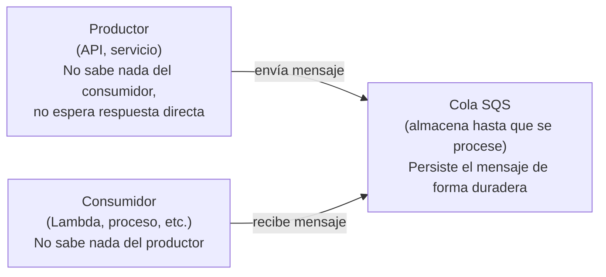
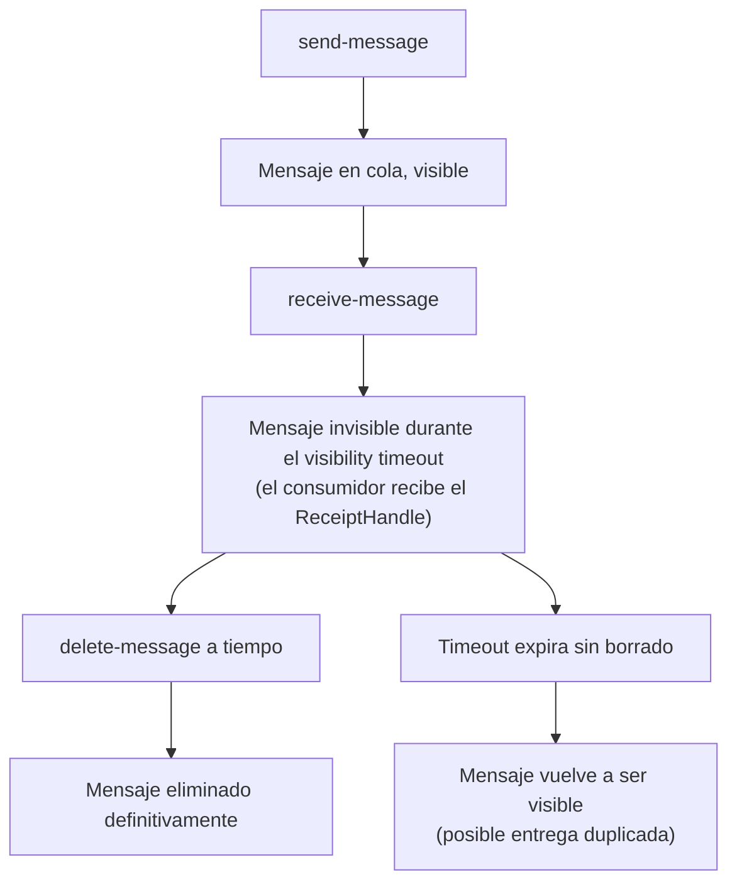
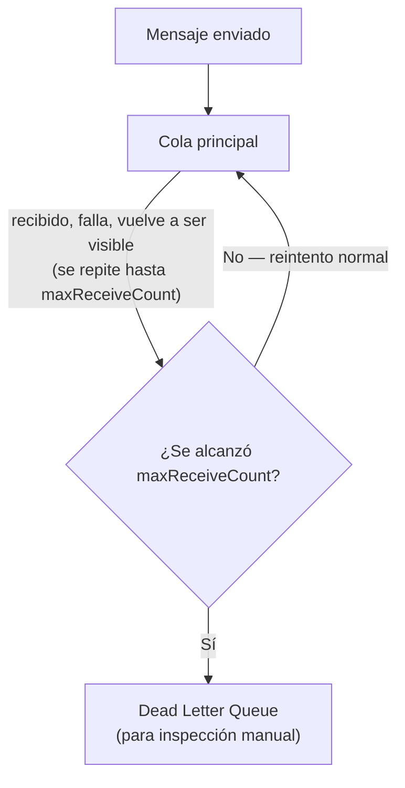
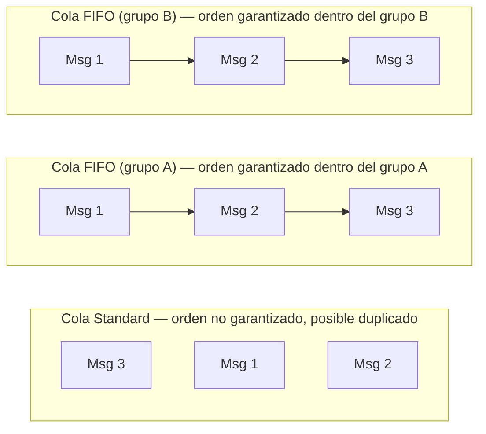

# Módulo 3: Mensajería asíncrona con SQS


## Aprende construyendo


### Tema 1: Colas, productores y consumidores · Intermedio · 40 min

<details open>
<summary><strong>Capa 1 — Lectura</strong></summary>

#### ► DE QUÉ TRATA
Al finalizar podrás enviar y recibir un mensaje real en una cola SQS. Prerrequisitos: Módulo 1 (floci start, eval $(floci env)).

#### ► CÓMO FUNCIONA


</details>

<details>
<summary><strong>Capa 2 — Construcción</strong></summary>

#### Código y verificación


```bash
QUEUE_URL=$(aws sqs create-queue --queue-name delivery-commands --query QueueUrl --output text)
aws sqs send-message --queue-url "$QUEUE_URL" --message-body '{"shipmentId":"env-4471","accion":"confirmar-entrega"}'
aws sqs receive-message --queue-url "$QUEUE_URL"
```

</details>

### Tema 2: Ciclo de vida de un mensaje · Intermedio · 40 min

<details open>
<summary><strong>Capa 1 — Lectura</strong></summary>

#### ► DE QUÉ TRATA
Al finalizar podrás procesar un mensaje sin perderlo ni duplicarlo por accidente. Prerrequisitos: Tema 1 completo (cola delivery-commands con al menos un mensaje).

#### ► CÓMO FUNCIONA


</details>

<details>
<summary><strong>Capa 2 — Construcción</strong></summary>

#### Código y verificación


```bash
mkdir ejemplo && cd ejemplo && floci start
```

```bash
QUEUE_URL=$(aws sqs create-queue --queue-name delivery-commands --query QueueUrl --output text)
aws sqs send-message --queue-url "$QUEUE_URL" --message-body '{"shipmentId":"env-4471"}'
RECEIPT=$(aws sqs receive-message --queue-url "$QUEUE_URL" --query 'Messages[0].ReceiptHandle' --output text)
aws sqs delete-message --queue-url "$QUEUE_URL" --receipt-handle "$RECEIPT"
aws sqs receive-message --queue-url "$QUEUE_URL"
```

</details>

### Tema 3: Dead Letter Queues (DLQ) · Intermedio · 40 min

<details open>
<summary><strong>Capa 1 — Lectura</strong></summary>

#### ► DE QUÉ TRATA
Al finalizar podrás comprobar que un mensaje problemático termina aislado en una DLQ real, sin bloquear el resto de la cola. Prerrequisitos: Tema 2 completo.

#### ► CÓMO FUNCIONA


</details>

<details>
<summary><strong>Capa 2 — Construcción</strong></summary>

#### Código y verificación


```bash
DLQ_URL=$(aws sqs create-queue --queue-name delivery-commands-dlq --query QueueUrl --output text)
DLQ_ARN=$(aws sqs get-queue-attributes --queue-url "$DLQ_URL" --attribute-names QueueArn --query Attributes.QueueArn --output text)
aws sqs set-queue-attributes --queue-url "$QUEUE_URL" --attributes "RedrivePolicy={\"deadLetterTargetArn\":\"$DLQ_ARN\",\"maxReceiveCount\":\"2\"}"
aws sqs send-message --queue-url "$QUEUE_URL" --message-body '{"shipmentId":"env-9999","accion":"comando-malformado"}'
```

```bash
aws sqs receive-message --queue-url "$DLQ_URL"
```

</details>

### Tema 4: Colas FIFO vs Standard · Intermedio · 40 min

<details open>
<summary><strong>Capa 1 — Lectura</strong></summary>

#### ► DE QUÉ TRATA
Al finalizar podrás decidir y probar cuándo RutaFlow necesita orden garantizado. Prerrequisitos: Tema 1 completo.

#### ► LA ANALOGÍA
FIFO es una fila única con turnos; Standard prioriza velocidad y no promete orden.

**Conceptos clave:** cola Standard, cola FIFO, orden garantizado, deduplicación, `MessageGroupId`, `MessageDeduplicationId`.

Una cola Standard prioriza el rendimiento y la disponibilidad por encima del orden estricto: puede entregar mensajes en un orden distinto al que se enviaron, y como viste en el Tema 2, puede entregar el mismo mensaje más de una vez en casos poco frecuentes. A cambio, ofrece un rendimiento prácticamente ilimitado en cuanto a mensajes por segundo, lo que la hace adecuada para la gran mayoría de los casos de uso donde el orden exacto de procesamiento no es crítico para la corrección del sistema (por ejemplo, procesar imágenes subidas por distintos usuarios: no importa si la imagen del usuario A se procesa antes o después que la del usuario B).

Una cola FIFO (First In, First Out, identificada porque su nombre debe terminar en `.fifo`) garantiza dos propiedades que Standard no garantiza: el orden estricto de entrega dentro de un mismo grupo de mensajes, y una deduplicación automática de mensajes idénticos enviados en una ventana corta de tiempo. Para lograr esto, una cola FIFO introduce dos conceptos nuevos: el `MessageGroupId`, que agrupa mensajes que deben procesarse en orden entre sí (mensajes de grupos distintos sí pueden procesarse en paralelo, sin orden relativo entre ellos), y el `MessageDeduplicationId`, que SQS usa para descartar automáticamente mensajes duplicados enviados dentro de una ventana de deduplicación (por defecto, cinco minutos).

El precio de estas garantías es un límite de rendimiento notablemente menor que el de una cola Standard (aunque las colas FIFO con procesamiento por lotes de alto rendimiento pueden alcanzar cifras mucho más altas que las FIFO clásicas, siguen estando por debajo del rendimiento prácticamente ilimitado de Standard), y la necesidad de pensar explícitamente en cómo agrupar tus mensajes mediante el `MessageGroupId` para no perder el paralelismo que sí necesitas entre grupos independientes.

La decisión entre FIFO y Standard depende enteramente de si tu caso de uso requiere orden estricto o tolera reordenamiento. Ejemplos típicos que sí necesitan FIFO: procesar las transacciones de una misma cuenta bancaria en el orden exacto en que ocurrieron (aplicar un cargo antes que un reembolso importa), o aplicar actualizaciones de estado de un mismo pedido en secuencia (no puedes marcar un pedido como "entregado" antes de procesar el evento de "enviado"). Ejemplos típicos que toleran Standard: procesar notificaciones push independientes a distintos usuarios, o encolar tareas de procesamiento de imágenes sin relación de orden entre sí.

**Analogía:** una cola Standard es como una fila de autoservicio en una tienda con varias cajas abiertas: es rápida y eficiente, pero no hay garantía de que quien llegó primero a la tienda sea necesariamente el primero en pagar si eligió una caja más lenta. Una cola FIFO es como una única fila estricta de un solo carril, donde el orden de llegada se respeta exactamente, a costa de que todo el mundo avanza a la velocidad de una sola caja (o de un carril concreto, si divides la fila en varios `MessageGroupId` independientes).

**¿Por qué es importante?** Elegir el tipo de cola equivocado tiene consecuencias distintas según el error: usar Standard cuando se necesitaba orden estricto puede introducir bugs sutiles y difíciles de reproducir (que dependen del orden de llegada, algo que rara vez se prueba explícitamente); usar FIFO cuando no se necesitaba puede introducir un cuello de botella de rendimiento innecesario. Entender esta disyuntiva desde el diseño inicial evita ambos problemas.

**Regla práctica:** si procesar un mensaje antes que otro del mismo grupo cambiaría el resultado correcto (cargos de una misma cuenta, estados de un mismo pedido), usa FIFO; si los mensajes son independientes entre sí, usa Standard y gana rendimiento prácticamente ilimitado.

**Diagrama:**



A y B se procesan en paralelo entre sí.

En el proyecto integrador RutaFlow, la tabla DynamoDB `ShipmentEvents` depende de que los
eventos `creado → asignado → en camino → entregado` de un mismo envío lleguen en orden — por eso
una futura cola de eventos de estado de ese mismo sistema debería declararse `.fifo` con
`MessageGroupId=shipmentId`, no Standard.

---

#### ► CÓMO FUNCIONA


</details>

<details>
<summary><strong>Capa 2 — Construcción</strong></summary>

#### Código y verificación


```bash
FIFO_URL=$(aws sqs create-queue --queue-name shipment-events.fifo --attributes FifoQueue=true --query QueueUrl --output text)
aws sqs send-message --queue-url "$FIFO_URL" --message-body "asignado" --message-group-id env-4471 --message-deduplication-id d1
aws sqs send-message --queue-url "$FIFO_URL" --message-body "en-camino" --message-group-id env-4471 --message-deduplication-id d2
aws sqs send-message --queue-url "$FIFO_URL" --message-body "entregado" --message-group-id env-4471 --message-deduplication-id d3
aws sqs receive-message --queue-url "$FIFO_URL" --max-number-of-messages 3
```

</details>

### Laboratorio 3.1 — Ciclo completo con cola Standard y DLQ

<details open>
<summary><strong>Capa 1 — Lectura</strong></summary>

</details>

<details>
<summary><strong>Capa 2 — Construcción</strong></summary>

#### Nota de construcción
Este tema es principalmente conceptual en esta versión. La verificación se realiza con las preguntas de comprensión y el criterio de cuándo NO usar laboratorio 3.1 — ciclo completo con cola standard y dlq.

</details>

### Laboratorio 3.2 — Cola FIFO con MessageGroupId

<details open>
<summary><strong>Capa 1 — Lectura</strong></summary>

</details>

<details>
<summary><strong>Capa 2 — Construcción</strong></summary>

#### Nota de construcción
Este tema es principalmente conceptual en esta versión. La verificación se realiza con las preguntas de comprensión y el criterio de cuándo NO usar laboratorio 3.2 — cola fifo con messagegroupid.

</details>
