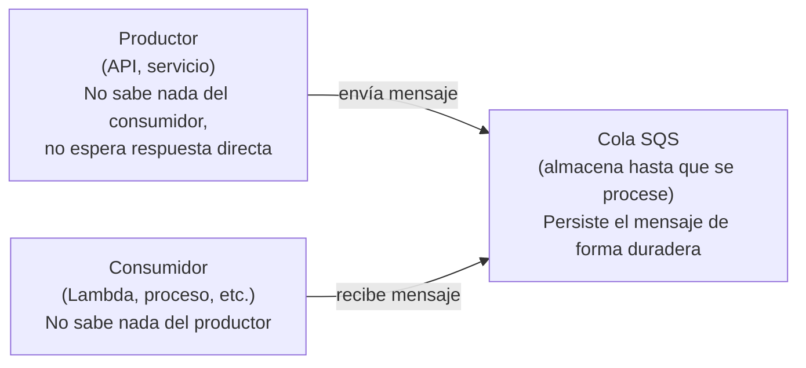
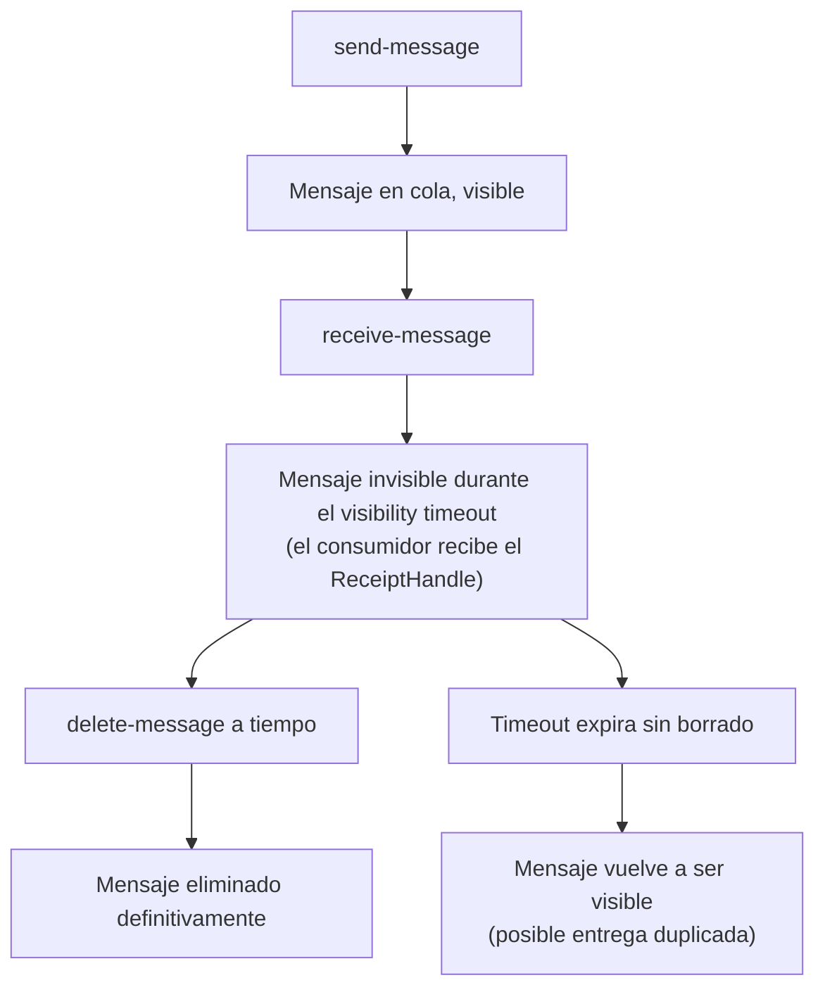
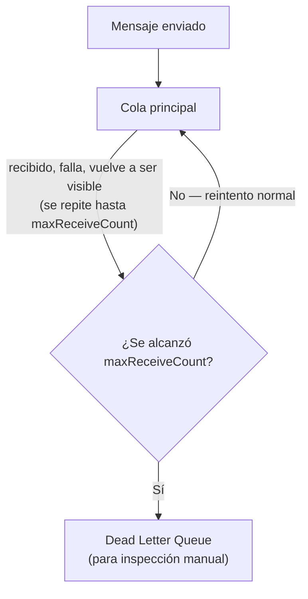
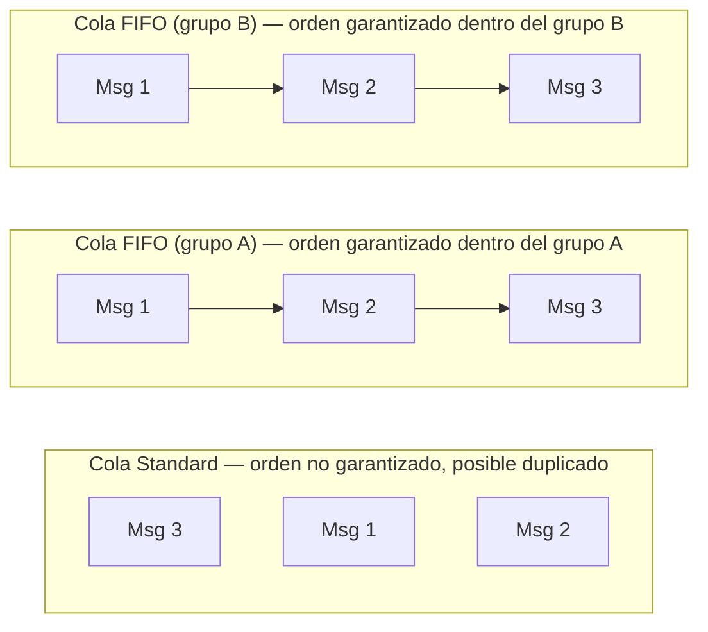

# Módulo 3: Mensajería asíncrona con SQS


## Aprende construyendo


### Tema 1: Colas, productores y consumidores · Intermedio · 40 min

<details open>
<summary><strong>Capa 1 — Lectura</strong></summary>

#### ► DE QUÉ TRATA
Al finalizar podrás enviar y recibir un mensaje real en una cola SQS. Prerrequisitos: Módulo 1 (floci start, eval $(floci env)).

#### ► LA IDEA EN UNA FRASE
**Al finalizar podrás enviar y recibir un mensaje real en una cola SQS.**

#### ► POR QUÉ EXISTE ESTO
Resuelve un problema real de diseño o implementación y evita decisiones a ciegas.

#### ► LA ANALOGÍA
Piensa en colas, productores y consumidores como una herramienta de taller: útil cuando conoces su propósito y sus límites.
**Dónde se rompe la analogía:** en software, los efectos dependen del contexto, la escala y los trade-offs.

#### ► CÓMO FUNCIONA


#### ► LO QUE PUEDE SALIR MAL
| Síntoma | Causa probable | Arreglo |
|---|---|---|
| Colas, productores y consumidores se aplica pero el resultado no mejora | Se usó sin medir el problema real | Mide antes y compara contra la alternativa simple |
| Aparece complejidad inesperada | Se adoptó la técnica sin comprender sus trade-offs | Vuelve a la sección de trade-offs y reduce el alcance |
| Falla en un caso límite | Se asumió un contexto que no se cumple | Prueba el caso límite y documenta cuándo NO usarlo |

#### ► TRADE-OFFS
| Opción | Cuándo usarla | Cuándo NO usarla |
|---|---|---|
| Usar Colas, productores y consumidores | Cuando el problema coincide con su propósito y el beneficio es observable | Cuando agrega complejidad sin resolver un problema real |
| Alternativa más simple | Cuando el contexto es pequeño, estable o fácil de razonar | Cuando ya demostró no escalar o no cumplir el requisito |
| Postergar la decisión | Cuando falta evidencia del problema | Cuando el costo de esperar es mayor que el costo de probar |

#### ► CUÁNDO NO USAR ESTO
No uses colas, productores y consumidores por defecto. Aplícalo cuando el problema lo justifique y puedas verificar el beneficio; si una alternativa más simple resuelve igual, prefiérela.

#### ► DE VUELTA A LA ANALOGÍA
Volviendo a la analogía: colas, productores y consumidores funciona como el modelo inicial, pero recuerda dónde se rompe: en producción importan la evidencia, la escala y el costo de equivocarte.

#### ► LO QUE DEBES RECORDAR
- Colas, productores y consumidores existe para resolver un problema específico.
- Mide antes de adoptar complejidad.
- Conoce el caso donde NO usarlo.
- Verifica con evidencia observable.

#### ► PREGUNTAS PARA PENSAR
1. ¿Qué problema concreto resuelve colas, productores y consumidores en tu contexto?
2. ¿Cómo sabrías que colas, productores y consumidores no está funcionando bien?
3. ¿Qué alternativa más simple considerarías antes de usar colas, productores y consumidores?

</details>

<details>
<summary><strong>Capa 2 — Construcción</strong></summary>

#### Código y verificación


```bash
QUEUE_URL=$(aws sqs create-queue --queue-name delivery-commands --query QueueUrl --output text)
aws sqs send-message --queue-url "$QUEUE_URL" --message-body '{"shipmentId":"env-4471","accion":"confirmar-entrega"}'
aws sqs receive-message --queue-url "$QUEUE_URL"
```

</details>

### Tema 2: Ciclo de vida de un mensaje · Intermedio · 40 min

<details open>
<summary><strong>Capa 1 — Lectura</strong></summary>

#### ► DE QUÉ TRATA
Al finalizar podrás procesar un mensaje sin perderlo ni duplicarlo por accidente. Prerrequisitos: Tema 1 completo (cola delivery-commands con al menos un mensaje).

#### ► LA IDEA EN UNA FRASE
**Al finalizar podrás procesar un mensaje sin perderlo ni duplicarlo por accidente.**

#### ► POR QUÉ EXISTE ESTO
Resuelve un problema real de diseño o implementación y evita decisiones a ciegas.

#### ► LA ANALOGÍA
Piensa en ciclo de vida de un mensaje como una herramienta de taller: útil cuando conoces su propósito y sus límites.
**Dónde se rompe la analogía:** en software, los efectos dependen del contexto, la escala y los trade-offs.

#### ► CÓMO FUNCIONA


#### ► LO QUE PUEDE SALIR MAL
| Síntoma | Causa probable | Arreglo |
|---|---|---|
| Ciclo de vida de un mensaje se aplica pero el resultado no mejora | Se usó sin medir el problema real | Mide antes y compara contra la alternativa simple |
| Aparece complejidad inesperada | Se adoptó la técnica sin comprender sus trade-offs | Vuelve a la sección de trade-offs y reduce el alcance |
| Falla en un caso límite | Se asumió un contexto que no se cumple | Prueba el caso límite y documenta cuándo NO usarlo |

#### ► TRADE-OFFS
| Opción | Cuándo usarla | Cuándo NO usarla |
|---|---|---|
| Usar Ciclo de vida de un mensaje | Cuando el problema coincide con su propósito y el beneficio es observable | Cuando agrega complejidad sin resolver un problema real |
| Alternativa más simple | Cuando el contexto es pequeño, estable o fácil de razonar | Cuando ya demostró no escalar o no cumplir el requisito |
| Postergar la decisión | Cuando falta evidencia del problema | Cuando el costo de esperar es mayor que el costo de probar |

#### ► CUÁNDO NO USAR ESTO
No uses ciclo de vida de un mensaje por defecto. Aplícalo cuando el problema lo justifique y puedas verificar el beneficio; si una alternativa más simple resuelve igual, prefiérela.

#### ► DE VUELTA A LA ANALOGÍA
Volviendo a la analogía: ciclo de vida de un mensaje funciona como el modelo inicial, pero recuerda dónde se rompe: en producción importan la evidencia, la escala y el costo de equivocarte.

#### ► LO QUE DEBES RECORDAR
- Ciclo de vida de un mensaje existe para resolver un problema específico.
- Mide antes de adoptar complejidad.
- Conoce el caso donde NO usarlo.
- Verifica con evidencia observable.

#### ► PREGUNTAS PARA PENSAR
1. ¿Qué problema concreto resuelve ciclo de vida de un mensaje en tu contexto?
2. ¿Cómo sabrías que ciclo de vida de un mensaje no está funcionando bien?
3. ¿Qué alternativa más simple considerarías antes de usar ciclo de vida de un mensaje?

</details>

<details>
<summary><strong>Capa 2 — Construcción</strong></summary>

#### Código y verificación


```bash
mkdir ejemplo && cd ejemplo && floci start
```

```bash
QUEUE_URL=$(aws sqs create-queue --queue-name delivery-commands --query QueueUrl --output text)
aws sqs send-message --queue-url "$QUEUE_URL" --message-body '{"shipmentId":"env-4471"}'
RECEIPT=$(aws sqs receive-message --queue-url "$QUEUE_URL" --query 'Messages[0].ReceiptHandle' --output text)
aws sqs delete-message --queue-url "$QUEUE_URL" --receipt-handle "$RECEIPT"
aws sqs receive-message --queue-url "$QUEUE_URL"
```

</details>

### Tema 3: Dead Letter Queues (DLQ) · Intermedio · 40 min

<details open>
<summary><strong>Capa 1 — Lectura</strong></summary>

#### ► DE QUÉ TRATA
Al finalizar podrás comprobar que un mensaje problemático termina aislado en una DLQ real, sin bloquear el resto de la cola. Prerrequisitos: Tema 2 completo.

#### ► LA IDEA EN UNA FRASE
**Al finalizar podrás comprobar que un mensaje problemático termina aislado en una DLQ real, sin bloquear el resto de la cola.**

#### ► POR QUÉ EXISTE ESTO
Resuelve un problema real de diseño o implementación y evita decisiones a ciegas.

#### ► LA ANALOGÍA
Piensa en dead letter queues (dlq) como una herramienta de taller: útil cuando conoces su propósito y sus límites.
**Dónde se rompe la analogía:** en software, los efectos dependen del contexto, la escala y los trade-offs.

#### ► CÓMO FUNCIONA


#### ► LO QUE PUEDE SALIR MAL
| Síntoma | Causa probable | Arreglo |
|---|---|---|
| Dead Letter Queues (DLQ) se aplica pero el resultado no mejora | Se usó sin medir el problema real | Mide antes y compara contra la alternativa simple |
| Aparece complejidad inesperada | Se adoptó la técnica sin comprender sus trade-offs | Vuelve a la sección de trade-offs y reduce el alcance |
| Falla en un caso límite | Se asumió un contexto que no se cumple | Prueba el caso límite y documenta cuándo NO usarlo |

#### ► TRADE-OFFS
| Opción | Cuándo usarla | Cuándo NO usarla |
|---|---|---|
| Usar Dead Letter Queues (DLQ) | Cuando el problema coincide con su propósito y el beneficio es observable | Cuando agrega complejidad sin resolver un problema real |
| Alternativa más simple | Cuando el contexto es pequeño, estable o fácil de razonar | Cuando ya demostró no escalar o no cumplir el requisito |
| Postergar la decisión | Cuando falta evidencia del problema | Cuando el costo de esperar es mayor que el costo de probar |

#### ► CUÁNDO NO USAR ESTO
No uses dead letter queues (dlq) por defecto. Aplícalo cuando el problema lo justifique y puedas verificar el beneficio; si una alternativa más simple resuelve igual, prefiérela.

#### ► DE VUELTA A LA ANALOGÍA
Volviendo a la analogía: dead letter queues (dlq) funciona como el modelo inicial, pero recuerda dónde se rompe: en producción importan la evidencia, la escala y el costo de equivocarte.

#### ► LO QUE DEBES RECORDAR
- Dead Letter Queues (DLQ) existe para resolver un problema específico.
- Mide antes de adoptar complejidad.
- Conoce el caso donde NO usarlo.
- Verifica con evidencia observable.

#### ► PREGUNTAS PARA PENSAR
1. ¿Qué problema concreto resuelve dead letter queues (dlq) en tu contexto?
2. ¿Cómo sabrías que dead letter queues (dlq) no está funcionando bien?
3. ¿Qué alternativa más simple considerarías antes de usar dead letter queues (dlq)?

</details>

<details>
<summary><strong>Capa 2 — Construcción</strong></summary>

#### Código y verificación


```bash
DLQ_URL=$(aws sqs create-queue --queue-name delivery-commands-dlq --query QueueUrl --output text)
DLQ_ARN=$(aws sqs get-queue-attributes --queue-url "$DLQ_URL" --attribute-names QueueArn --query Attributes.QueueArn --output text)
aws sqs set-queue-attributes --queue-url "$QUEUE_URL" --attributes "RedrivePolicy={\"deadLetterTargetArn\":\"$DLQ_ARN\",\"maxReceiveCount\":\"2\"}"
aws sqs send-message --queue-url "$QUEUE_URL" --message-body '{"shipmentId":"env-9999","accion":"comando-malformado"}'
```

```bash
aws sqs receive-message --queue-url "$DLQ_URL"
```

</details>

### Tema 4: Colas FIFO vs Standard · Intermedio · 40 min

<details open>
<summary><strong>Capa 1 — Lectura</strong></summary>

#### ► DE QUÉ TRATA
Al finalizar podrás decidir y probar cuándo RutaFlow necesita orden garantizado. Prerrequisitos: Tema 1 completo.

#### ► LA IDEA EN UNA FRASE
**Al finalizar podrás decidir y probar cuándo RutaFlow necesita orden garantizado.**

#### ► POR QUÉ EXISTE ESTO
Resuelve un problema real de diseño o implementación y evita decisiones a ciegas.

#### ► LA ANALOGÍA
FIFO es una fila única con turnos; Standard prioriza velocidad y no promete orden.

**Conceptos clave:** cola Standard, cola FIFO, orden garantizado, deduplicación, `MessageGroupId`, `MessageDeduplicationId`.

Una cola Standard prioriza el rendimiento y la disponibilidad por encima del orden estricto: puede entregar mensajes en un orden distinto al que se enviaron, y como viste en el Tema 2, puede entregar el mismo mensaje más de una vez en casos poco frecuentes. A cambio, ofrece un rendimiento prácticamente ilimitado en cuanto a mensajes por segundo, lo que la hace adecuada para la gran mayoría de los casos de uso donde el orden exacto de procesamiento no es crítico para la corrección del sistema (por ejemplo, procesar imágenes subidas por distintos usuarios: no importa si la imagen del usuario A se procesa antes o después que la del usuario B).

Una cola FIFO (First In, First Out, identificada porque su nombre debe terminar en `.fifo`) garantiza dos propiedades que Standard no garantiza: el orden estricto de entrega dentro de un mismo grupo de mensajes, y una deduplicación automática de mensajes idénticos enviados en una ventana corta de tiempo. Para lograr esto, una cola FIFO introduce dos conceptos nuevos: el `MessageGroupId`, que agrupa mensajes que deben procesarse en orden entre sí (mensajes de grupos distintos sí pueden procesarse en paralelo, sin orden relativo entre ellos), y el `MessageDeduplicationId`, que SQS usa para descartar automáticamente mensajes duplicados enviados dentro de una ventana de deduplicación (por defecto, cinco minutos).

El precio de estas garantías es un límite de rendimiento notablemente menor que el de una cola Standard (aunque las colas FIFO con procesamiento por lotes de alto rendimiento pueden alcanzar cifras mucho más altas que las FIFO clásicas, siguen estando por debajo del rendimiento prácticamente ilimitado de Standard), y la necesidad de pensar explícitamente en cómo agrupar tus mensajes mediante el `MessageGroupId` para no perder el paralelismo que sí necesitas entre grupos independientes.

La decisión entre FIFO y Standard depende enteramente de si tu caso de uso requiere orden estricto o tolera reordenamiento. Ejemplos típicos que sí necesitan FIFO: procesar las transacciones de una misma cuenta bancaria en el orden exacto en que ocurrieron (aplicar un cargo antes que un reembolso importa), o aplicar actualizaciones de estado de un mismo pedido en secuencia (no puedes marcar un pedido como "entregado" antes de procesar el evento de "enviado"). Ejemplos típicos que toleran Standard: procesar notificaciones push independientes a distintos usuarios, o encolar tareas de procesamiento de imágenes sin relación de orden entre sí.

**Analogía:** una cola Standard es como una fila de autoservicio en una tienda con varias cajas abiertas: es rápida y eficiente, pero no hay garantía de que quien llegó primero a la tienda sea necesariamente el primero en pagar si eligió una caja más lenta. Una cola FIFO es como una única fila estricta de un solo carril, donde el orden de llegada se respeta exactamente, a costa de que todo el mundo avanza a la velocidad de una sola caja (o de un carril concreto, si divides la fila en varios `MessageGroupId` independientes).

**¿Por qué es importante?** Elegir el tipo de cola equivocado tiene consecuencias distintas según el error: usar Standard cuando se necesitaba orden estricto puede introducir bugs sutiles y difíciles de reproducir (que dependen del orden de llegada, algo que rara vez se prueba explícitamente); usar FIFO cuando no se necesitaba puede introducir un cuello de botella de rendimiento innecesario. Entender esta disyuntiva desde el diseño inicial evita ambos problemas.

**Diagrama:**



A y B se procesan en paralelo entre sí.

En el proyecto integrador RutaFlow, la tabla DynamoDB `ShipmentEvents` depende de que los
eventos `creado → asignado → en camino → entregado` de un mismo envío lleguen en orden — por eso
una futura cola de eventos de estado de ese mismo sistema debería declararse `.fifo` con
`MessageGroupId=shipmentId`, no Standard.

---

**Dónde se rompe la analogía:** el modelo simplifica la realidad; en producción influyen escala, fallos, costo y contexto.

#### ► CÓMO FUNCIONA


#### ► LO QUE PUEDE SALIR MAL
| Síntoma | Causa probable | Arreglo |
|---|---|---|
| Colas FIFO vs Standard se aplica pero el resultado no mejora | Se usó sin medir el problema real | Mide antes y compara contra la alternativa simple |
| Aparece complejidad inesperada | Se adoptó la técnica sin comprender sus trade-offs | Vuelve a la sección de trade-offs y reduce el alcance |
| Falla en un caso límite | Se asumió un contexto que no se cumple | Prueba el caso límite y documenta cuándo NO usarlo |

#### ► TRADE-OFFS
| Opción | Cuándo usarla | Cuándo NO usarla |
|---|---|---|
| Usar Colas FIFO vs Standard | Cuando el problema coincide con su propósito y el beneficio es observable | Cuando agrega complejidad sin resolver un problema real |
| Alternativa más simple | Cuando el contexto es pequeño, estable o fácil de razonar | Cuando ya demostró no escalar o no cumplir el requisito |
| Postergar la decisión | Cuando falta evidencia del problema | Cuando el costo de esperar es mayor que el costo de probar |

#### ► CUÁNDO NO USAR ESTO
No uses colas fifo vs standard por defecto. Aplícalo cuando el problema lo justifique y puedas verificar el beneficio; si una alternativa más simple resuelve igual, prefiérela.

#### ► DE VUELTA A LA ANALOGÍA
Volviendo a la analogía: colas fifo vs standard funciona como el modelo inicial, pero recuerda dónde se rompe: en producción importan la evidencia, la escala y el costo de equivocarte.

#### ► LO QUE DEBES RECORDAR
- Colas FIFO vs Standard existe para resolver un problema específico.
- Mide antes de adoptar complejidad.
- Conoce el caso donde NO usarlo.
- Verifica con evidencia observable.

#### ► PREGUNTAS PARA PENSAR
1. ¿Qué problema concreto resuelve colas fifo vs standard en tu contexto?
2. ¿Cómo sabrías que colas fifo vs standard no está funcionando bien?
3. ¿Qué alternativa más simple considerarías antes de usar colas fifo vs standard?

</details>

<details>
<summary><strong>Capa 2 — Construcción</strong></summary>

#### Código y verificación


```bash
FIFO_URL=$(aws sqs create-queue --queue-name shipment-events.fifo --attributes FifoQueue=true --query QueueUrl --output text)
aws sqs send-message --queue-url "$FIFO_URL" --message-body "asignado" --message-group-id env-4471 --message-deduplication-id d1
aws sqs send-message --queue-url "$FIFO_URL" --message-body "en-camino" --message-group-id env-4471 --message-deduplication-id d2
aws sqs send-message --queue-url "$FIFO_URL" --message-body "entregado" --message-group-id env-4471 --message-deduplication-id d3
aws sqs receive-message --queue-url "$FIFO_URL" --max-number-of-messages 3
```

</details>

### Laboratorio 3.1 — Ciclo completo con cola Standard y DLQ

<details open>
<summary><strong>Capa 1 — Lectura</strong></summary>

#### ► DE QUÉ TRATA
Este tema te guía por laboratorio 3.1 — ciclo completo con cola standard y dlq con foco en comprensión antes de implementación.

#### ► LA IDEA EN UNA FRASE
**Entender laboratorio 3.1 — ciclo completo con cola standard y dlq te permite tomar mejores decisiones técnicas.**

#### ► POR QUÉ EXISTE ESTO
Resuelve un problema real de diseño o implementación y evita decisiones a ciegas.

#### ► LA ANALOGÍA
Piensa en laboratorio 3.1 — ciclo completo con cola standard y dlq como una herramienta de taller: útil cuando conoces su propósito y sus límites.
**Dónde se rompe la analogía:** en software, los efectos dependen del contexto, la escala y los trade-offs.

#### ► CÓMO FUNCIONA
1. Identifica el problema que laboratorio 3.1 — ciclo completo con cola standard y dlq resuelve.
2. Observa sus componentes y relaciones.
3. Aplica la opción más simple que funcione.
4. Verifica el resultado y los límites.

#### ► LO QUE PUEDE SALIR MAL
| Síntoma | Causa probable | Arreglo |
|---|---|---|
| Laboratorio 3.1 — Ciclo completo con cola Standard y DLQ se aplica pero el resultado no mejora | Se usó sin medir el problema real | Mide antes y compara contra la alternativa simple |
| Aparece complejidad inesperada | Se adoptó la técnica sin comprender sus trade-offs | Vuelve a la sección de trade-offs y reduce el alcance |
| Falla en un caso límite | Se asumió un contexto que no se cumple | Prueba el caso límite y documenta cuándo NO usarlo |

#### ► TRADE-OFFS
| Opción | Cuándo usarla | Cuándo NO usarla |
|---|---|---|
| Usar Laboratorio 3.1 — Ciclo completo con cola Standard y DLQ | Cuando el problema coincide con su propósito y el beneficio es observable | Cuando agrega complejidad sin resolver un problema real |
| Alternativa más simple | Cuando el contexto es pequeño, estable o fácil de razonar | Cuando ya demostró no escalar o no cumplir el requisito |
| Postergar la decisión | Cuando falta evidencia del problema | Cuando el costo de esperar es mayor que el costo de probar |

#### ► CUÁNDO NO USAR ESTO
No uses laboratorio 3.1 — ciclo completo con cola standard y dlq por defecto. Aplícalo cuando el problema lo justifique y puedas verificar el beneficio; si una alternativa más simple resuelve igual, prefiérela.

#### ► DE VUELTA A LA ANALOGÍA
Volviendo a la analogía: laboratorio 3.1 — ciclo completo con cola standard y dlq funciona como el modelo inicial, pero recuerda dónde se rompe: en producción importan la evidencia, la escala y el costo de equivocarte.

#### ► LO QUE DEBES RECORDAR
- Laboratorio 3.1 — Ciclo completo con cola Standard y DLQ existe para resolver un problema específico.
- Mide antes de adoptar complejidad.
- Conoce el caso donde NO usarlo.
- Verifica con evidencia observable.

#### ► PREGUNTAS PARA PENSAR
1. ¿Qué problema concreto resuelve laboratorio 3.1 — ciclo completo con cola standard y dlq en tu contexto?
2. ¿Cómo sabrías que laboratorio 3.1 — ciclo completo con cola standard y dlq no está funcionando bien?
3. ¿Qué alternativa más simple considerarías antes de usar laboratorio 3.1 — ciclo completo con cola standard y dlq?

</details>

<details>
<summary><strong>Capa 2 — Construcción</strong></summary>

#### Nota de construcción
Este tema es principalmente conceptual en esta versión. La verificación se realiza con las preguntas de comprensión y el criterio de cuándo NO usar laboratorio 3.1 — ciclo completo con cola standard y dlq.

</details>

### Laboratorio 3.2 — Cola FIFO con MessageGroupId

<details open>
<summary><strong>Capa 1 — Lectura</strong></summary>

#### ► DE QUÉ TRATA
Este tema te guía por laboratorio 3.2 — cola fifo con messagegroupid con foco en comprensión antes de implementación.

#### ► LA IDEA EN UNA FRASE
**Entender laboratorio 3.2 — cola fifo con messagegroupid te permite tomar mejores decisiones técnicas.**

#### ► POR QUÉ EXISTE ESTO
Resuelve un problema real de diseño o implementación y evita decisiones a ciegas.

#### ► LA ANALOGÍA
Piensa en laboratorio 3.2 — cola fifo con messagegroupid como una herramienta de taller: útil cuando conoces su propósito y sus límites.
**Dónde se rompe la analogía:** en software, los efectos dependen del contexto, la escala y los trade-offs.

#### ► CÓMO FUNCIONA
1. Identifica el problema que laboratorio 3.2 — cola fifo con messagegroupid resuelve.
2. Observa sus componentes y relaciones.
3. Aplica la opción más simple que funcione.
4. Verifica el resultado y los límites.

#### ► LO QUE PUEDE SALIR MAL
| Síntoma | Causa probable | Arreglo |
|---|---|---|
| Laboratorio 3.2 — Cola FIFO con MessageGroupId se aplica pero el resultado no mejora | Se usó sin medir el problema real | Mide antes y compara contra la alternativa simple |
| Aparece complejidad inesperada | Se adoptó la técnica sin comprender sus trade-offs | Vuelve a la sección de trade-offs y reduce el alcance |
| Falla en un caso límite | Se asumió un contexto que no se cumple | Prueba el caso límite y documenta cuándo NO usarlo |

#### ► TRADE-OFFS
| Opción | Cuándo usarla | Cuándo NO usarla |
|---|---|---|
| Usar Laboratorio 3.2 — Cola FIFO con MessageGroupId | Cuando el problema coincide con su propósito y el beneficio es observable | Cuando agrega complejidad sin resolver un problema real |
| Alternativa más simple | Cuando el contexto es pequeño, estable o fácil de razonar | Cuando ya demostró no escalar o no cumplir el requisito |
| Postergar la decisión | Cuando falta evidencia del problema | Cuando el costo de esperar es mayor que el costo de probar |

#### ► CUÁNDO NO USAR ESTO
No uses laboratorio 3.2 — cola fifo con messagegroupid por defecto. Aplícalo cuando el problema lo justifique y puedas verificar el beneficio; si una alternativa más simple resuelve igual, prefiérela.

#### ► DE VUELTA A LA ANALOGÍA
Volviendo a la analogía: laboratorio 3.2 — cola fifo con messagegroupid funciona como el modelo inicial, pero recuerda dónde se rompe: en producción importan la evidencia, la escala y el costo de equivocarte.

#### ► LO QUE DEBES RECORDAR
- Laboratorio 3.2 — Cola FIFO con MessageGroupId existe para resolver un problema específico.
- Mide antes de adoptar complejidad.
- Conoce el caso donde NO usarlo.
- Verifica con evidencia observable.

#### ► PREGUNTAS PARA PENSAR
1. ¿Qué problema concreto resuelve laboratorio 3.2 — cola fifo con messagegroupid en tu contexto?
2. ¿Cómo sabrías que laboratorio 3.2 — cola fifo con messagegroupid no está funcionando bien?
3. ¿Qué alternativa más simple considerarías antes de usar laboratorio 3.2 — cola fifo con messagegroupid?

</details>

<details>
<summary><strong>Capa 2 — Construcción</strong></summary>

#### Nota de construcción
Este tema es principalmente conceptual en esta versión. La verificación se realiza con las preguntas de comprensión y el criterio de cuándo NO usar laboratorio 3.2 — cola fifo con messagegroupid.

</details>
