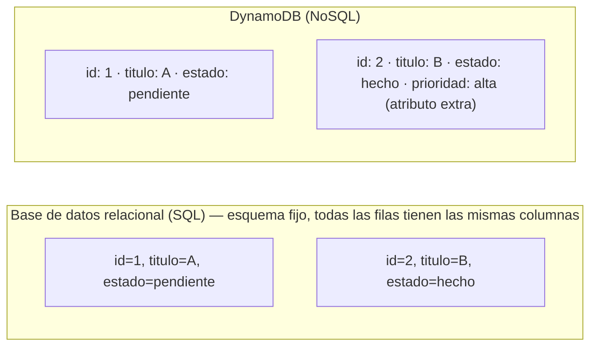
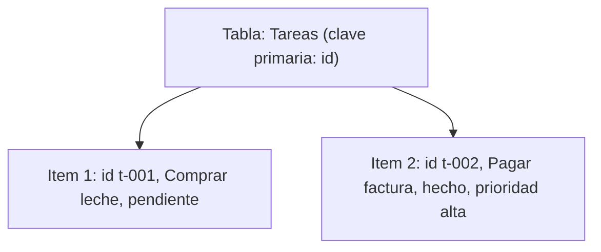
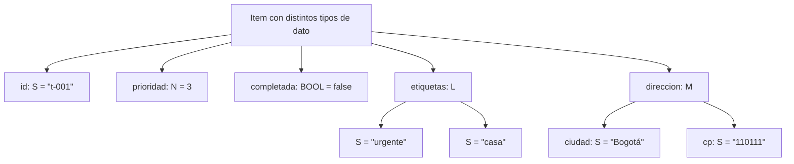
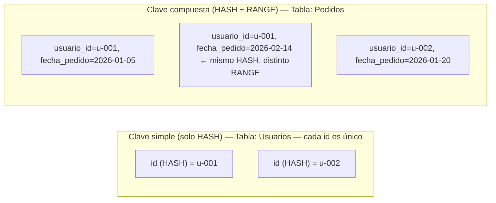
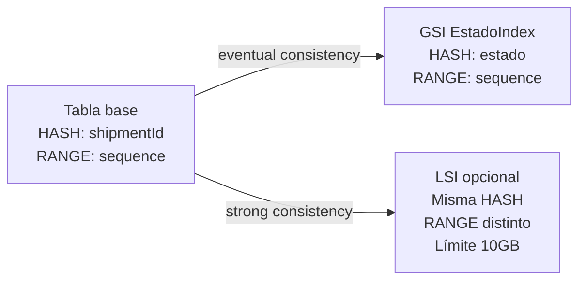
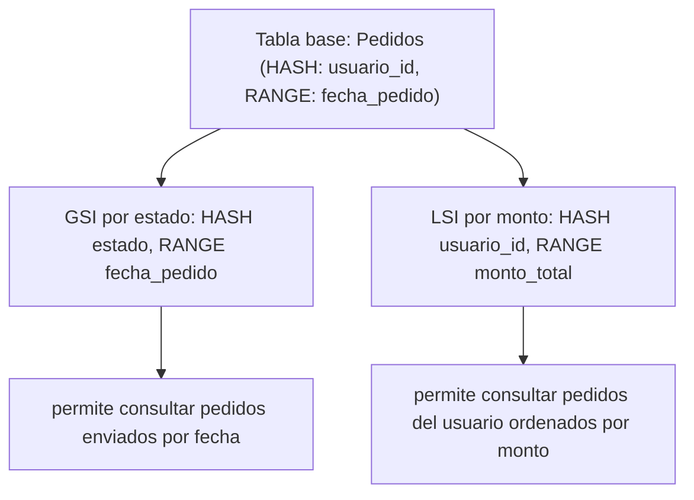
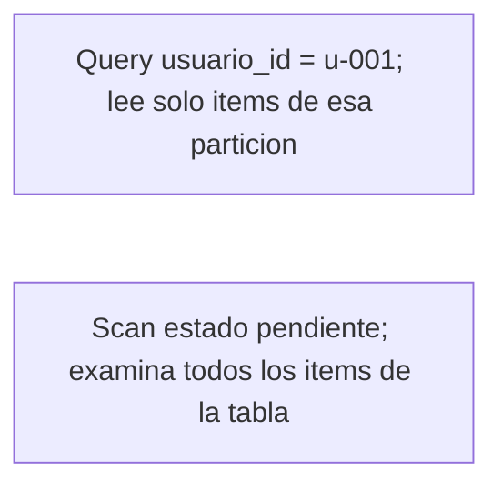

# Módulo 3: Bases de datos NoSQL con DynamoDB


## Aprende construyendo


### Tema 1: Qué es NoSQL y cuándo usarlo · Intermedio · 30 min

<details open>
<summary><strong>Capa 1 — Lectura</strong></summary>

#### ► DE QUÉ TRATA
Al finalizar podrás comprobar en vivo, con datos reales, por qué DynamoDB no obliga a un esquema fijo. Prerrequisitos: Módulo 1 (floci start, eval $(floci env)).

#### ► CÓMO FUNCIONA


</details>

<details>
<summary><strong>Capa 2 — Construcción</strong></summary>

#### Código y verificación
```error-output
An error occurred (ValidationException) when calling the PutItem operation: One or more parameter values were invalid: Missing the key sequence in the item
```

```bash
# ❌ INCORRECTO: falta 'sequence'
aws dynamodb put-item --table-name ShipmentEvents --item \
  '{"shipmentId":{"S":"env-4471"},"tipo":{"S":"creado"}}'

# ✅ CORRECTO: ambas claves presentes
aws dynamodb put-item --table-name ShipmentEvents --item \
  '{"shipmentId":{"S":"env-4471"},"sequence":{"N":"1"},"tipo":{"S":"creado"}}'
```


```bash
aws dynamodb create-table --table-name ShipmentEvents \
  --attribute-definitions AttributeName=shipmentId,AttributeType=S AttributeName=sequence,AttributeType=N \
  --key-schema AttributeName=shipmentId,KeyType=HASH AttributeName=sequence,KeyType=RANGE \
  --billing-mode PAY_PER_REQUEST
aws dynamodb put-item --table-name ShipmentEvents --item \
  '{"shipmentId":{"S":"env-4471"},"sequence":{"N":"1"},"tipo":{"S":"creado"},"origen":{"S":"bodega-norte"}}'
aws dynamodb put-item --table-name ShipmentEvents --item \
  '{"shipmentId":{"S":"env-4471"},"sequence":{"N":"2"},"tipo":{"S":"entregado"},"fotoKey":{"S":"envio-4471/entrega-001.jpg"},"firmaCliente":{"BOOL":true}}'
```

</details>

### Tema 2: Tablas, items y atributos · Intermedio · 30 min

<details open>
<summary><strong>Capa 1 — Lectura</strong></summary>

#### ► DE QUÉ TRATA
Al finalizar vas a distinguir, sobre la tabla ShipmentEvents que ya creaste, qué es obligatorio en un item y qué no. Prerrequisitos: Módulo 1 (floci start, eval $(floci env)), Tema 1 de este módulo.

#### ► CÓMO FUNCIONA


</details>

<details>
<summary><strong>Capa 2 — Construcción</strong></summary>

#### Código y verificación
```
Clave elegida (Primaria o GSI): ________
HASH: ________
RANGE: ________ (o NONE si solo HASH)
Justificación en 2 líneas: ________
Unidades de lectura Scan vs Query: ________ vs ________
```


```bash
aws dynamodb list-tables
aws dynamodb describe-table --table-name ShipmentEvents --query "Table.KeySchema"
aws dynamodb get-item --table-name ShipmentEvents \
  --key '{"shipmentId":{"S":"env-4471"},"sequence":{"N":"1"}}'
```

</details>

### Tema 3: Tipos de datos — S, N, B, BOOL, NULL, L, M · Intermedio · 30 min

<details open>
<summary><strong>Capa 1 — Lectura</strong></summary>

#### ► DE QUÉ TRATA
Al finalizar podrás modelar un evento de entrega real con tipos anidados (lista y mapa). Prerrequisitos: Módulo 1 (floci start, eval $(floci env)), Temas 1-2 de este módulo.

#### ► CÓMO FUNCIONA


</details>

<details>
<summary><strong>Capa 2 — Construcción</strong></summary>

#### Código y verificación
```
Foto 1: { formato: "jpg", tamaño: 1243 bytes, timestamp: "2026-10-06T14:23:15Z", resolucion: "1920x1080" }
Foto 2: { formato: "webp", tamaño: 891 bytes, timestamp: "2026-10-06T14:23:22Z", resolucion: "1920x1080" }
```

```json
{
  "shipmentId": { "S": "env-4471" },
  "fotos": {
    "L": [
      {
        "M": {
          "ruta": { "S": "envio-4471/entrega-001.jpg" },
          "formato": { "S": "jpg" },
          "tamaño": { "N": "1243" },
          "timestamp": { "S": "2026-10-06T14:23:15Z" },
          "resolucion": { "S": "1920x1080" }
        }
      },
      ...
    ]
  }
}
```

```error-output
# Sin error en put-item (DynamoDB lo acepta)
# Pero error cuando intentas ordenar:
aws dynamodb query --table-name ShipmentEvents \
  --key-condition-expression "shipmentId = :id AND #s BETWEEN :start AND :end" \
  --expression-attribute-names '{"#s":"sequence"}' \
  --expression-attribute-values '{":id":{"S":"env-4471"},":start":{"N":"1"},":end":{"N":"10"}}' 

# El problema: si guardaste sequence como {"S":"2"} en vez de {"N":"2"},
# el BETWEEN falla en comparar números correctamente (ordena "10" < "2" lexicográficamente)
```

```bash
# ❌ INCORRECTO: tipo mismatch
aws dynamodb put-item --table-name ShipmentEvents --item \
  '{"shipmentId":{"S":"env-4471"},"sequence":{"S":"2"}}'  # String, no número!

# ✅ CORRECTO: tipo correcto
aws dynamodb put-item --table-name ShipmentEvents --item \
  '{"shipmentId":{"S":"env-4471"},"sequence":{"N":"2"}}'  # Número
```

```bash
# Si guardaste sequence como S y luego haces:
aws dynamodb query --table-name ShipmentEvents \
  --key-condition-expression "sequence BETWEEN :s1 AND :s10" \
  --expression-attribute-values '{":s1":{"N":"1"},":s10":{"N":"10"}}'

# Resultado INCORRECTO: ordena lexicográficamente
# Devuelve: "1", "10", "2", "3", etc. (como strings)
# Esperado: 1, 2, 3, ..., 10 (números)
```

```bash
# Scan para traer items problemáticos
aws dynamodb scan --table-name ShipmentEvents \
  --projection-expression "shipmentId, #s" \
  --expression-attribute-names '{"#s":"sequence"}' > items.json

# Reescribir con el tipo correcto: cada item vuelve con sequence como número (N)
jq -c '.Items[] | {shipmentId, sequence: {N: (.sequence.S // .sequence.N)}}' items.json |
while read -r item; do
  aws dynamodb put-item --table-name ShipmentEvents --item "$item"
done
```

</details>

### Tema 4: Clave primaria simple (HASH) vs compuesta (HASH + RANGE) · Intermedio · 30 min

<details open>
<summary><strong>Capa 1 — Lectura</strong></summary>

#### ► DE QUÉ TRATA
Al finalizar vas a comprobar en la propia tabla ShipmentEvents por qué necesita clave compuesta y no una clave simple. Prerrequisitos: Módulo 1 (floci start, eval $(floci env)), Temas 1-3 de este módulo.

#### ► CÓMO FUNCIONA


#### ► REGLA PRÁCTICA
Usa clave simple (solo HASH) cuando cada entidad es un único ítem identificado por un valor único, como Usuarios; usa clave compuesta (HASH + RANGE) cuando un mismo HASH agrupa varios ítems relacionados que necesitas ordenar o filtrar, como los pedidos de un mismo usuario por fecha.

</details>

<details>
<summary><strong>Capa 2 — Construcción</strong></summary>

#### Código y verificación

```bash
aws dynamodb query --table-name ShipmentEvents \
  --key-condition-expression "shipmentId = :id" \
  --expression-attribute-values '{":id":{"S":"env-4471"}}'
```

</details>

### Tema 5: Índices secundarios globales (GSI) y locales (LSI) · Intermedio · 30 min

<details open>
<summary><strong>Capa 1 — Lectura</strong></summary>

#### ► DE QUÉ TRATA
Al finalizar vas a crear y usar el índice EstadoIndex que ya está declarado en template.yaml sobre ShipmentEvents. Prerrequisitos: Módulo 1 (floci start, eval $(floci env)), Tema 4 de este módulo.

#### ► CÓMO FUNCIONA


</details>

<details>
<summary><strong>Capa 2 — Construcción</strong></summary>

#### Código y verificación




```bash
aws dynamodb update-table --table-name ShipmentEvents \
  --attribute-definitions AttributeName=shipmentId,AttributeType=S AttributeName=sequence,AttributeType=N AttributeName=estado,AttributeType=S \
  --global-secondary-index-updates '[{"Create":{"IndexName":"EstadoIndex","KeySchema":[{"AttributeName":"estado","KeyType":"HASH"},{"AttributeName":"sequence","KeyType":"RANGE"}],"Projection":{"ProjectionType":"ALL"}}}]'
aws dynamodb put-item --table-name ShipmentEvents --item \
  '{"shipmentId":{"S":"env-4471"},"sequence":{"N":"4"},"tipo":{"S":"entregado"},"estado":{"S":"entregado"}}'
aws dynamodb query --table-name ShipmentEvents --index-name EstadoIndex \
  --key-condition-expression "estado = :e" --expression-attribute-values '{":e":{"S":"entregado"}}'
```

</details>

### Tema 6: Query vs Scan · Intermedio · 30 min

<details open>
<summary><strong>Capa 1 — Lectura</strong></summary>

#### ► DE QUÉ TRATA
Al finalizar vas a medir, con números reales, la diferencia de costo entre Query y Scan sobre ShipmentEvents. Prerrequisitos: Módulo 1 (floci start, eval $(floci env)), Temas 2 y 4 de este módulo.

#### ► CÓMO FUNCIONA


#### ► REGLA PRÁCTICA
Si conoces la clave de partición que buscas, usa Query: lee solo esa partición. Si necesitas filtrar por un atributo que no es la clave, un Scan examina toda la tabla antes de filtrar — suele ser la señal de que falta un índice secundario adecuado.

</details>

<details>
<summary><strong>Capa 2 — Construcción</strong></summary>

#### Código y verificación
```
Nombre del GSI: ________
HASH: ________
RANGE: ________
Justificación: ________
Costo estimado Scan vs Query: ________
```


```bash
aws dynamodb scan --table-name ShipmentEvents --select COUNT
aws dynamodb query --table-name ShipmentEvents \
  --key-condition-expression "shipmentId = :id" \
  --expression-attribute-values '{":id":{"S":"env-4471"}}' --select COUNT
```

</details>

### Laboratorio 4.1 — CRUD completo

<details open>
<summary><strong>Capa 1 — Lectura</strong></summary>

</details>

<details>
<summary><strong>Capa 2 — Construcción</strong></summary>

#### Nota de construcción
Este tema es principalmente conceptual en esta versión. La verificación se realiza con las preguntas de comprensión y el criterio de cuándo NO usar laboratorio 4.1 — crud completo.

</details>

### Laboratorio 4.2 — Query vs Scan

<details open>
<summary><strong>Capa 1 — Lectura</strong></summary>

</details>

<details>
<summary><strong>Capa 2 — Construcción</strong></summary>

#### Nota de construcción
Este tema es principalmente conceptual en esta versión. La verificación se realiza con las preguntas de comprensión y el criterio de cuándo NO usar laboratorio 4.2 — query vs scan.

</details>
