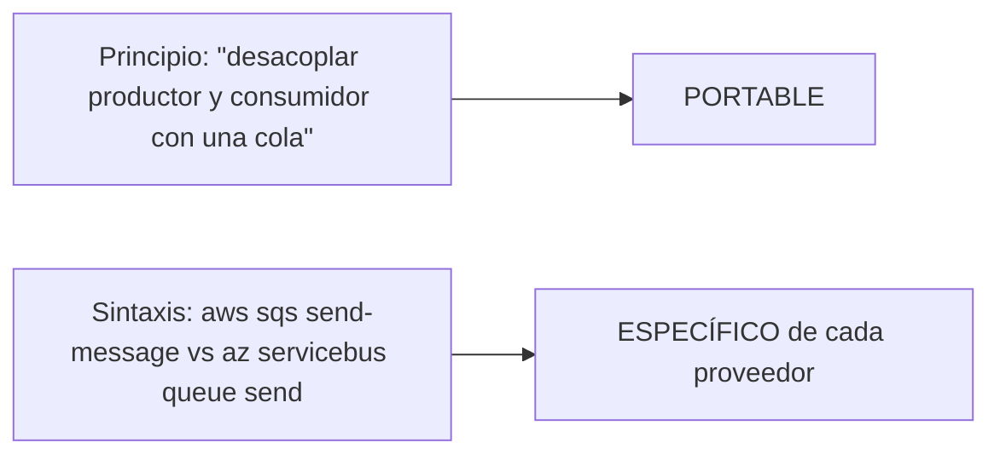
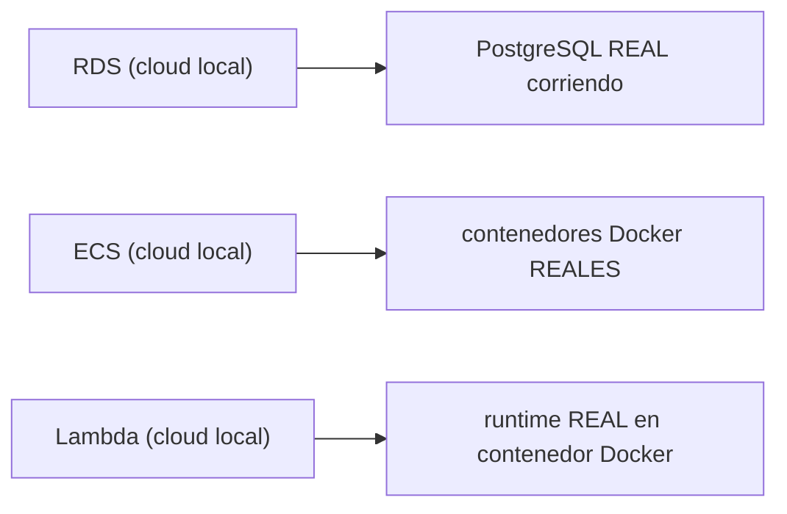
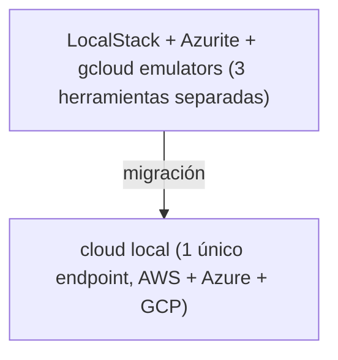
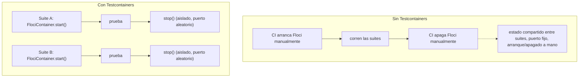
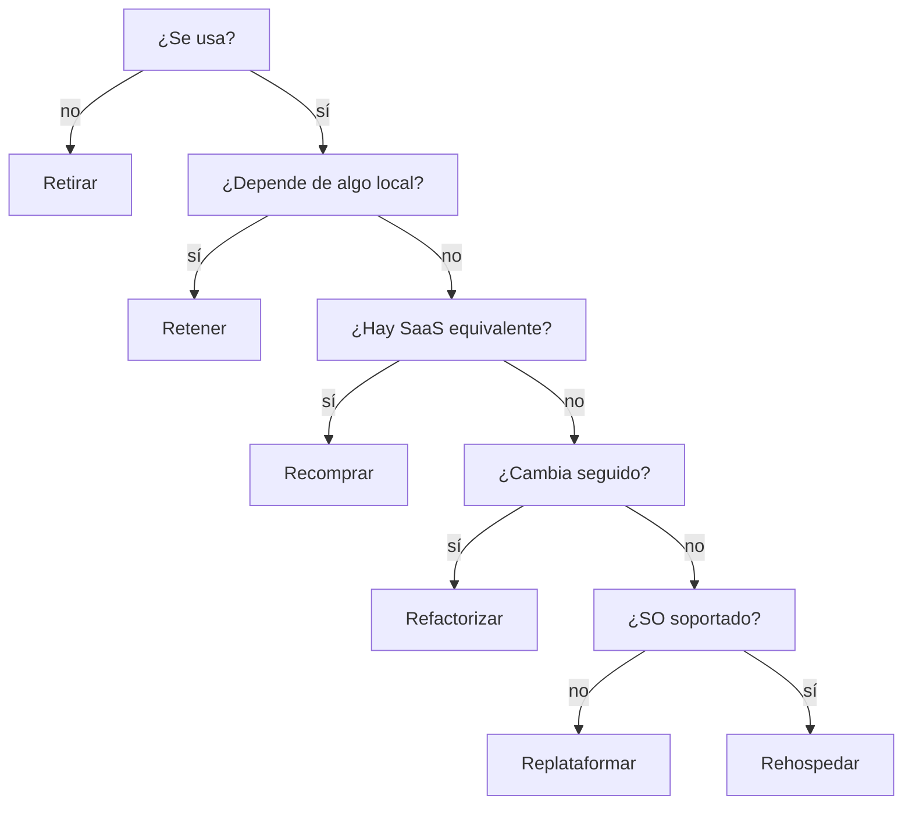
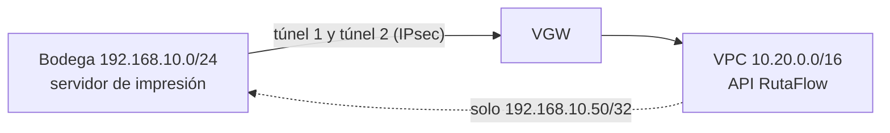

# Módulo 30: Proyecto integrador: API multi-nube con AWS, Azure y GCP


## Aprende construyendo


### Tema 1: Arquitectura multi-nube y portabilidad de conocimiento · Avanzado · 45 min

<details open>
<summary><strong>Capa 1 — Lectura</strong></summary>

#### ► DE QUÉ TRATA
Al finalizar vas a escribir y probar un confirmDelivery de RutaFlow diseñado contra un puerto DeliveryRepository, no contra un proveedor cloud específico, y lo ejecutarás con dos adaptadores creados por ti. Prerrequisitos: Módulo 5 completo y Node.js.

#### ► CÓMO FUNCIONA


</details>

<details>
<summary><strong>Capa 2 — Construcción</strong></summary>

#### Código y verificación
```
AWS: API Gateway → Lambda → DynamoDB / SQS / S3, protegido con Cognito, desplegado con CloudFormation
Azure: Functions → Cosmos DB / Service Bus / Blob Storage local
GCP: Firestore + Cloud Storage + Pub/Sub local (solo lectura)
```


```bash
mkdir rutaflow-puertos
cd rutaflow-puertos
npm init -y
npm install --save-dev tsx
mkdir src tests
```

```ts
export type ConfirmDeliveryCommand = {
  shipmentId: string;
  commandId: string;
  recipientPin: string;
};

export type DeliveryResult = {
  shipmentId: string;
  commandId: string;
  status: 'confirmed';
};

export interface DeliveryRepository {
  findCommandResult(commandId: string): Promise<DeliveryResult | undefined>;
  confirm(command: ConfirmDeliveryCommand): Promise<DeliveryResult>;
}

export async function confirmDelivery(
  command: ConfirmDeliveryCommand,
  repository: DeliveryRepository
): Promise<DeliveryResult> {
  if (!command.shipmentId) throw new TypeError('shipmentId es obligatorio');
  if (!/^\d{6}$/.test(command.recipientPin)) {
    throw new TypeError('recipientPin debe tener 6 dígitos');
  }

  const previous = await repository.findCommandResult(command.commandId);
  if (previous) return previous;
  return repository.confirm(command);
}
```

```ts
import type {
  ConfirmDeliveryCommand,
  DeliveryRepository,
  DeliveryResult
} from './confirm-delivery';

export class MemoryDeliveryRepository implements DeliveryRepository {
  private readonly results = new Map<string, DeliveryResult>();
  confirmCalls = 0;

  async findCommandResult(commandId: string): Promise<DeliveryResult | undefined> {
    return this.results.get(commandId);
  }

  async confirm(command: ConfirmDeliveryCommand): Promise<DeliveryResult> {
    this.confirmCalls += 1;
    const result: DeliveryResult = {
      shipmentId: command.shipmentId,
      commandId: command.commandId,
      status: 'confirmed'
    };
    this.results.set(command.commandId, result);
    return result;
  }
}
```

```ts
import test from 'node:test';
import assert from 'node:assert/strict';
import { confirmDelivery } from '../src/confirm-delivery';
import { MemoryDeliveryRepository } from '../src/memory-delivery-repository';

const command = {
  shipmentId: 'env-4471',
  commandId: 'cmd-001',
  recipientPin: '837201'
};

test('confirma una sola vez por commandId', async () => {
  const repository = new MemoryDeliveryRepository();
  const first = await confirmDelivery(command, repository);
  const second = await confirmDelivery(command, repository);
  assert.deepEqual(second, first);
  assert.equal(repository.confirmCalls, 1);
});

test('rechaza un PIN inválido antes de escribir', async () => {
  const repository = new MemoryDeliveryRepository();
  await assert.rejects(
    confirmDelivery({ ...command, recipientPin: '1234' }, repository),
    /6 dígitos/
  );
  assert.equal(repository.confirmCalls, 0);
});
```

</details>

### Tema 2: Arquitectura interna de cloud local y su uso en CI/CD · Avanzado · 45 min

<details open>
<summary><strong>Capa 1 — Lectura</strong></summary>

#### ► DE QUÉ TRATA
Al finalizar podrás probar contra motores reales desde cero. Prerrequisitos: Docker, y JDK 21 con Gradle o Node.js según el lenguaje; verifica `java --version` o `node --version`.

#### ► CÓMO FUNCIONA


</details>

<details>
<summary><strong>Capa 2 — Construcción</strong></summary>

#### Código y verificación

```bash
mkdir ejemplo-ci && cd ejemplo-ci
```

Crea el archivo `ci-integracion.sh`:

```bash
#!/usr/bin/env bash
set -euo pipefail
NOMBRE=floci-ci-$$
docker run -d --rm --name "$NOMBRE" -p 4566:4566 floci/floci:2.2.0 > /dev/null
trap 'docker stop "$NOMBRE" > /dev/null; echo "limpieza: $NOMBRE detenido"' EXIT
for intento in $(seq 1 30); do
  curl -sf http://localhost:4566/_floci/health > /dev/null && break
  sleep 1
done
export AWS_ENDPOINT_URL=http://localhost:4566 AWS_ACCESS_KEY_ID=test AWS_SECRET_ACCESS_KEY=test AWS_DEFAULT_REGION=us-east-1
aws s3 mb "s3://ci-evidencias-$$"
aws s3 ls | grep -q "ci-evidencias-$$" && echo "prueba de integración: ok"
```

```bash
bash ci-integracion.sh
```

</details>

### Tema 3: Migración desde otros emuladores, y límites de un emulador · Avanzado · 45 min

<details open>
<summary><strong>Capa 1 — Lectura</strong></summary>

#### ► DE QUÉ TRATA
Al finalizar vas a levantar Floci con un único docker-compose.yml y a confirmar en vivo un límite real documentado, en vez de asumir paridad total con AWS. Prerrequisitos: Módulo 30 completo.

#### ► CÓMO FUNCIONA


</details>

<details>
<summary><strong>Capa 2 — Construcción</strong></summary>

#### Código y verificación


```bash
mkdir ejemplo && cd ejemplo && floci start
```

```bash
docker compose up -d
eval $(floci env)
aws s3 mb s3://demo-multi-nube
```

</details>

### Tema 4: Testcontainers — pruebas de integración automatizadas · Avanzado · 45 min

<details open>
<summary><strong>Capa 1 — Lectura</strong></summary>

#### ► DE QUÉ TRATA
Al finalizar podrás aislar suites de prueba desde cero. Prerrequisitos: Docker, y JDK 21 con Gradle o Node.js según el lenguaje; verifica `java --version` o `node --version`.

#### ► LA ANALOGÍA
El módulo gestiona ciclo de vida como un técnico que prepara y limpia el laboratorio.

**Conceptos clave:** módulo Testcontainers oficial por lenguaje, ciclo de vida gestionado automáticamente, sin puerto fijo ni contenedor persistente entre suites.

Floci publica módulos Testcontainers propios para los lenguajes SDK principales: `io.floci:testcontainers-floci` en Maven Central (Java) y `@floci/testcontainers` en npm (Node.js/TypeScript); también hay versiones para Python y .NET. Cada módulo expone una clase `FlociContainer` que envuelve la imagen `floci/floci:latest`: al arrancar, espera a que el puerto 4566 esté listo dentro del contenedor y expone cuatro métodos — `getEndpoint()`, `getRegion()`, `getAccessKey()` y `getSecretKey()` — que se pasan directamente al cliente del SDK que estés probando, sin variables de entorno ni configuración manual del endpoint.

La diferencia frente a levantar Floci con `floci start` o Docker Compose (como hiciste en el resto del track) es el ciclo de vida: Testcontainers arranca un contenedor Floci **nuevo y aislado** para cada suite de pruebas (o para toda la sesión de pruebas, según el scope que elijas) y lo destruye automáticamente al terminar. Esto elimina dos problemas típicos de compartir un único Floci de larga duración entre suites de test: estado que se filtra de una prueba a otra (un bucket creado en el test A todavía existe cuando corre el test B), y conflictos de puerto cuando varias suites corren en paralelo (Testcontainers asigna un puerto de host aleatorio y disponible en cada arranque, expuesto vía `getEndpoint()`).

**Ejemplo en Java (JUnit 5):**

```java
import io.floci.testcontainers.FlociContainer;
import org.junit.jupiter.api.Test;
import org.testcontainers.junit.jupiter.Container;
import org.testcontainers.junit.jupiter.Testcontainers;
import software.amazon.awssdk.auth.credentials.AwsBasicCredentials;
import software.amazon.awssdk.auth.credentials.StaticCredentialsProvider;
import software.amazon.awssdk.regions.Region;
import software.amazon.awssdk.services.s3.S3Client;

import java.net.URI;

import static org.assertj.core.api.Assertions.assertThat;

@Testcontainers
class S3IntegrationTest {

    @Container
    static FlociContainer floci = new FlociContainer();

    @Test
    void shouldCreateBucket() {
        S3Client s3 = S3Client.builder()
                .endpointOverride(URI.create(floci.getEndpoint()))
                .region(Region.of(floci.getRegion()))
                .credentialsProvider(StaticCredentialsProvider.create(
                        AwsBasicCredentials.create(floci.getAccessKey(), floci.getSecretKey())))
                .forcePathStyle(true)
                .build();

        s3.createBucket(b -> b.bucket("my-bucket"));

        assertThat(s3.listBuckets().buckets())
                .anyMatch(b -> b.name().equals("my-bucket"));
    }
}
```

**Ejemplo en Node.js (Jest):**

```typescript
import { FlociContainer } from "@floci/testcontainers";
import { S3Client, CreateBucketCommand, ListBucketsCommand } from "@aws-sdk/client-s3";

describe("S3", () => {
    let floci: FlociContainer;

    beforeAll(async () => {
        floci = await new FlociContainer().start();
    });

    afterAll(async () => {
        await floci.stop();
    });

    it("should create and list a bucket", async () => {
        const s3 = new S3Client({
            endpoint: floci.getEndpoint(),
            region: floci.getRegion(),
            credentials: {
                accessKeyId: floci.getAccessKey(),
                secretAccessKey: floci.getSecretKey(),
            },
            forcePathStyle: true,
        });

        await s3.send(new CreateBucketCommand({ Bucket: "my-bucket" }));

        const { Buckets } = await s3.send(new ListBucketsCommand({}));
        expect(Buckets?.some(b => b.Name === "my-bucket")).toBe(true);
    });
});
```

Fíjate en el patrón compartido por los dos lenguajes: el contenedor se declara una sola vez con alcance de clase o de suite (`@Container static` en Java, `beforeAll`/`afterAll` en Jest), no dentro de cada test individual — arrancar un contenedor Docker por cada test sería innecesariamente lento. El módulo Go equivalente (`testcontainers-floci-go`) está en desarrollo activo en el momento de escribir esto; para Go, sigue usando el patrón manual del Módulo 1 (`floci start` + variables de entorno) en tus pruebas de integración.

**Analogía:** un Floci levantado con `floci start` para desarrollo diario es como la cocina de tu propia casa: siempre está ahí, acumula lo que vas dejando en ella entre una comida y otra. Un Floci gestionado por Testcontainers es como una cocina de alquiler por horas que llega completamente limpia y vacía para cada evento, y se desmonta por completo al terminar — ideal precisamente porque ninguna prueba puede heredar por accidente algo que dejó la prueba anterior.

**¿Por qué es importante?** Los módulos Testcontainers oficiales convierten "prueba de integración contra Floci" en una línea de configuración dentro del propio código de test, sin depender de que un Floci externo esté corriendo de antemano (ni en tu máquina ni en el runner de CI) ni de gestionar manualmente su ciclo de vida — el mismo patrón que ya usaste conceptualmente en el Módulo 9 al mencionar CI/CD, pero ahora con el contenedor arrancando y destruyéndose automáticamente alrededor de cada suite.

**Diagrama:**



---

**Transferencia al proyecto integrador «Cloud local multi-nube»:** Crea recursos únicos por prueba de integración y consulta una evidencia recién almacenada. Ejecuta dos pruebas en paralelo y demuestra que no comparten nombres ni dejan recursos tras un fallo.

#### ► CÓMO FUNCIONA


</details>

<details>
<summary><strong>Capa 2 — Construcción</strong></summary>

#### Código y verificación
```java
import io.floci.testcontainers.FlociContainer;
import org.junit.jupiter.api.Test;
import org.testcontainers.junit.jupiter.Container;
import org.testcontainers.junit.jupiter.Testcontainers;
import software.amazon.awssdk.auth.credentials.AwsBasicCredentials;
import software.amazon.awssdk.auth.credentials.StaticCredentialsProvider;
import software.amazon.awssdk.regions.Region;
import software.amazon.awssdk.services.s3.S3Client;

import java.net.URI;

import static org.assertj.core.api.Assertions.assertThat;

@Testcontainers
class S3IntegrationTest {

    @Container
    static FlociContainer floci = new FlociContainer();

    @Test
    void shouldCreateBucket() {
        S3Client s3 = S3Client.builder()
                .endpointOverride(URI.create(floci.getEndpoint()))
                .region(Region.of(floci.getRegion()))
                .credentialsProvider(StaticCredentialsProvider.create(
                        AwsBasicCredentials.create(floci.getAccessKey(), floci.getSecretKey())))
                .forcePathStyle(true)
                .build();

        s3.createBucket(b -> b.bucket("my-bucket"));

        assertThat(s3.listBuckets().buckets())
                .anyMatch(b -> b.name().equals("my-bucket"));
    }
}
```

```typescript
import { FlociContainer } from "@floci/testcontainers";
import { S3Client, CreateBucketCommand, ListBucketsCommand } from "@aws-sdk/client-s3";

describe("S3", () => {
    let floci: FlociContainer;

    beforeAll(async () => {
        floci = await new FlociContainer().start();
    });

    afterAll(async () => {
        await floci.stop();
    });

    it("should create and list a bucket", async () => {
        const s3 = new S3Client({
            endpoint: floci.getEndpoint(),
            region: floci.getRegion(),
            credentials: {
                accessKeyId: floci.getAccessKey(),
                secretAccessKey: floci.getSecretKey(),
            },
            forcePathStyle: true,
        });

        await s3.send(new CreateBucketCommand({ Bucket: "my-bucket" }));

        const { Buckets } = await s3.send(new ListBucketsCommand({}));
        expect(Buckets?.some(b => b.Name === "my-bucket")).toBe(true);
    });
});
```


Crea el proyecto con este `build.gradle.kts`:

```kotlin
plugins { java }

java { toolchain { languageVersion = JavaLanguageVersion.of(21) } }

repositories { mavenCentral() }

dependencies {
    testImplementation(platform("software.amazon.awssdk:bom:2.55.6"))
    testImplementation("software.amazon.awssdk:s3")
    testImplementation("io.floci:testcontainers-floci:2.11.0")
    testImplementation("org.testcontainers:testcontainers-junit-jupiter:2.0.5")
    testImplementation(platform("org.junit:junit-bom:5.13.4"))
    testImplementation("org.junit.jupiter:junit-jupiter")
    testRuntimeOnly("org.junit.platform:junit-platform-launcher")
}

tasks.test { useJUnitPlatform() }
```

Y la prueba en `src/test/java/AisladoTest.java`:

```java
import io.floci.testcontainers.FlociContainer;
import org.junit.jupiter.api.BeforeAll;
import org.junit.jupiter.api.Test;
import org.testcontainers.junit.jupiter.Container;
import org.testcontainers.junit.jupiter.Testcontainers;
import software.amazon.awssdk.auth.credentials.AwsBasicCredentials;
import software.amazon.awssdk.auth.credentials.StaticCredentialsProvider;
import software.amazon.awssdk.core.sync.RequestBody;
import software.amazon.awssdk.regions.Region;
import software.amazon.awssdk.services.s3.S3Client;

import java.net.URI;
import java.util.UUID;

import static org.junit.jupiter.api.Assertions.assertEquals;

@Testcontainers
class AisladoTest {

    @Container
    static FlociContainer floci = new FlociContainer();   // un contenedor para toda la clase

    static S3Client s3;

    @BeforeAll
    static void cliente() {
        s3 = S3Client.builder()
                .endpointOverride(URI.create(floci.getEndpoint()))
                .region(Region.of(floci.getRegion()))
                .credentialsProvider(StaticCredentialsProvider.create(
                        AwsBasicCredentials.create(floci.getAccessKey(), floci.getSecretKey())))
                .forcePathStyle(true)
                .build();
    }

    /** Cada prueba usa su propio bucket: ninguna depende de lo que dejó otra. */
    static String bucketUnico() {
        return "evidencias-" + UUID.randomUUID().toString().substring(0, 12);
    }

    @Test
    void guardaEvidencia() {
        String bucket = bucketUnico();
        s3.createBucket(b -> b.bucket(bucket));
        s3.putObject(b -> b.bucket(bucket).key("RF-101.json"), RequestBody.fromString("{\"estado\":\"entregado\"}"));
        String leido = s3.getObjectAsBytes(b -> b.bucket(bucket).key("RF-101.json")).asUtf8String();
        assertEquals("{\"estado\":\"entregado\"}", leido);
    }

    @Test
    void bucketNuevoEstaVacio() {
        String bucket = bucketUnico();
        s3.createBucket(b -> b.bucket(bucket));
        assertEquals(0, s3.listObjectsV2(b -> b.bucket(bucket)).keyCount());
    }
}
```

```bash
mkdir -p ejemplo-isolated-tests/src/test/java && cd ejemplo-isolated-tests
touch settings.gradle.kts            # proyecto de un solo módulo
gradle wrapper && ./gradlew test     # con Docker en marcha
```

Las dos pruebas pasan aunque se ejecuten en cualquier orden: cada una crea su bucket con un nombre aleatorio y
`bucketNuevoEstaVacio` no ve el objeto que guardó `guardaEvidencia`.

</details>

### Tema 5: Migrar a la nube: las 7 R para decidir qué hacer con cada aplicación · Avanzado · 40 min

<details open>
<summary><strong>Capa 1 — Lectura</strong></summary>

#### ► DE QUÉ TRATA
Usa JDK 21 o superior. Crea la carpeta academia-labs/cloud/migracion. Prepara una lista de las aplicaciones de tu organización (o usa la del ejemplo).

#### ► CÓMO FUNCIONA


</details>

<details>
<summary><strong>Capa 2 — Construcción</strong></summary>

#### Código y verificación


```java
// SieteR.java — decide qué hacer con cada aplicación al migrar, de la pregunta más barata a la más cara
import java.util.List;

public class SieteR {
    record Aplicacion(String nombre, boolean seUsa, boolean tieneSaasEquivalente, boolean cambiaSeguido,
                      boolean dependeDeHardwareLocal, boolean sistemaOperativoSoportado) {}

    static String decidir(Aplicacion app) {
        if (!app.seUsa()) return "Retirar (retire)";
        if (app.dependeDeHardwareLocal()) return "Retener (retain): revisar en 12 meses";
        if (app.tieneSaasEquivalente()) return "Recomprar (repurchase): reemplazar por SaaS";
        if (app.cambiaSeguido()) return "Refactorizar (refactor): rediseñar para la nube";
        if (!app.sistemaOperativoSoportado()) return "Replataformar (replatform): cambiar la base, no el código";
        return "Rehospedar (rehost): mover tal cual";
    }

    public static void main(String[] args) {
        List<Aplicacion> inventario = List.of(
                new Aplicacion("reportes-2015", false, false, false, false, true),
                new Aplicacion("impresora-etiquetas", true, false, false, true, true),
                new Aplicacion("correo-interno", true, true, false, false, true),
                new Aplicacion("api-rutas", true, false, true, false, true),
                new Aplicacion("facturacion", true, false, false, false, false),
                new Aplicacion("intranet", true, false, false, false, true));
        for (Aplicacion app : inventario) System.out.printf("%-20s -> %s%n", app.nombre(), decidir(app));
    }
}
```

```bash
cd academia-labs/cloud/migracion
java SieteR.java
```

```text
reportes-2015        -> Retirar (retire)
impresora-etiquetas  -> Retener (retain): revisar en 12 meses
correo-interno       -> Recomprar (repurchase): reemplazar por SaaS
api-rutas            -> Refactorizar (refactor): rediseñar para la nube
facturacion          -> Replataformar (replatform): cambiar la base, no el código
intranet             -> Rehospedar (rehost): mover tal cual
```

</details>

### Tema 6: Nube híbrida: conectar el centro de datos con la nube de forma segura y medible · Avanzado · 45 min

<details open>
<summary><strong>Capa 1 — Lectura</strong></summary>

#### ► DE QUÉ TRATA
Usa Terraform con el proveedor AWS. La VPN real necesita un equipo o software VPN del lado local (por ejemplo, strongSwan); puedes practicar el plan y el diseño de rutas sin él.

#### ► CÓMO FUNCIONA


</details>

<details>
<summary><strong>Capa 2 — Construcción</strong></summary>

#### Código y verificación


```hcl
resource "aws_vpn_gateway" "vgw" {
  vpc_id = aws_vpc.principal.id # VPC 10.20.0.0/16
}

resource "aws_customer_gateway" "bodega" {
  bgp_asn    = 65010
  ip_address = "203.0.113.20" # IP pública del equipo VPN de la bodega
  type       = "ipsec.1"
}

resource "aws_vpn_connection" "bodega" {
  vpn_gateway_id      = aws_vpn_gateway.vgw.id
  customer_gateway_id = aws_customer_gateway.bodega.id
  type                = "ipsec.1"
  static_routes_only  = true
}

# Solo el servidor de impresión, no toda la red de la bodega.
resource "aws_vpn_connection_route" "impresion" {
  vpn_connection_id      = aws_vpn_connection.bodega.id
  destination_cidr_block = "192.168.10.50/32"
}

resource "aws_route" "hacia_impresion" {
  route_table_id         = aws_route_table.privada.id
  destination_cidr_block = "192.168.10.50/32"
  gateway_id             = aws_vpn_gateway.vgw.id
}
```

```bash
terraform -chdir=infra plan
# después del apply, descarga la configuración de los dos túneles para el equipo local:
aws ec2 describe-vpn-connections --query "VpnConnections[0].VgwTelemetry[].[OutsideIpAddress,Status]" --output table
```

```text
terraform plan: «Plan: 5 to add» (VGW, CGW, conexión VPN, ruta de la VPN y ruta de la tabla).
describe-vpn-connections muestra dos filas, una por túnel, con estado UP cuando el equipo local está configurado.
```

</details>
