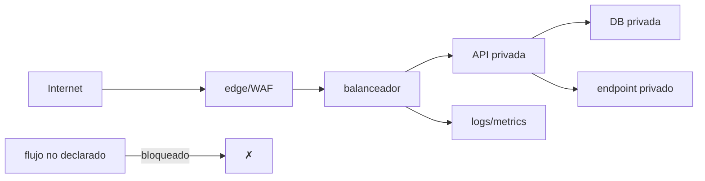
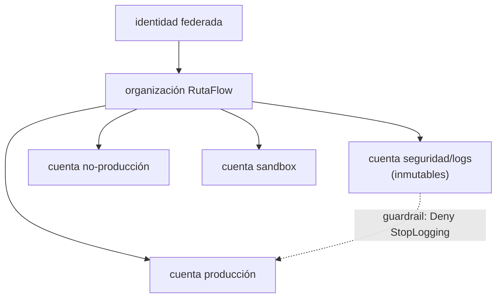
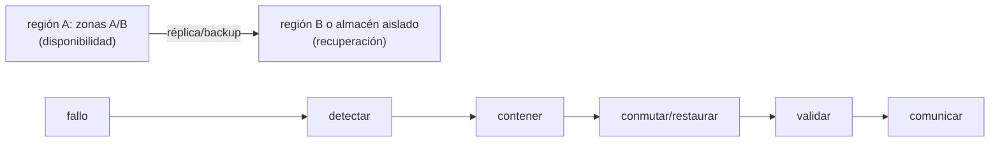
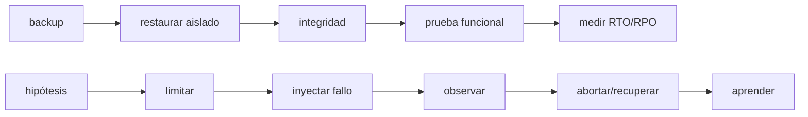
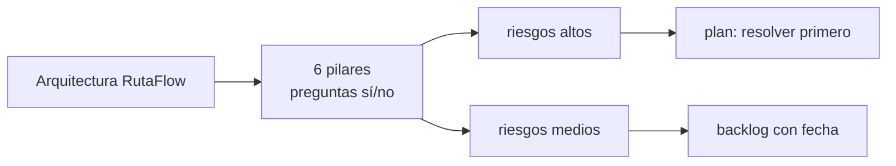
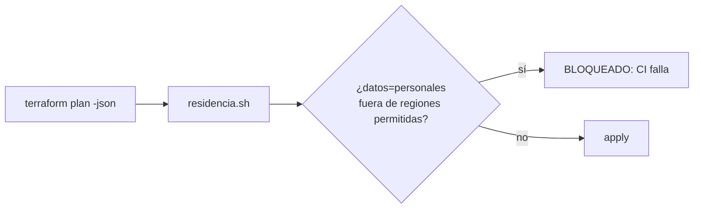

# Módulo 31: Arquitectura cloud resiliente — redes, landing zones y recuperación

Una colección de servicios funcionales todavía puede fallar como sistema. La arquitectura experta hace explícitas las fronteras de red y gobierno, conecta disponibilidad con necesidades del negocio y demuestra recuperación mediante experimentos. El objetivo no es dibujar nubes redundantes, sino justificar y verificar qué ocurre cuando una zona, una identidad o un conjunto de datos deja de estar disponible.


## Aprende construyendo


### Tema 1: Una red segura empieza por flujos, no por subredes · Avanzado · 45 min

<details open>
<summary><strong>Capa 1 — Lectura</strong></summary>

#### ► DE QUÉ TRATA
Al finalizar vas a declarar el flujo real que demo-nodo (Módulo 21) necesita hacia la base de datos de facturación (Módulo 13), por referencia de grupo, no por rango abierto. Prerrequisitos: Módulos 13 y 21 completos.

#### ► CÓMO FUNCIONA


</details>

<details>
<summary><strong>Capa 2 — Construcción</strong></summary>

#### Código y verificación
```hcl
resource "aws_security_group_rule" "api_to_db" {
  type                     = "ingress"
  security_group_id        = aws_security_group.db.id
  source_security_group_id = aws_security_group.api.id
  from_port                = 5432
  to_port                  = 5432
  protocol                 = "tcp"
  description              = "Solo la API accede a PostgreSQL"
}
```


```bash
DB_SG=$(aws ec2 create-security-group --group-name rutaflow-db-interna \
  --description "Solo accesible desde demo-nodo" --query GroupId --output text)
aws ec2 authorize-security-group-ingress --group-id "$DB_SG" --protocol tcp --port 5432 \
  --source-group demo-nodo
```

</details>

### Tema 2: Una landing zone convierte gobierno en una base repetible · Avanzado · 45 min

<details open>
<summary><strong>Capa 1 — Lectura</strong></summary>

#### ► DE QUÉ TRATA
Al finalizar vas a escribir el guardrail real que impediría que alguien desactive CloudTrail en la cuenta de producción de RutaFlow. Prerrequisitos: Módulo 29 (STS, cuentas).

#### ► CÓMO FUNCIONA


</details>

<details>
<summary><strong>Capa 2 — Construcción</strong></summary>

#### Código y verificación
```json
{
  "Version": "2012-10-17",
  "Statement": [{
    "Effect": "Deny",
    "Action": "cloudtrail:StopLogging",
    "Resource": "*",
    "Condition": {"StringNotLike": {"aws:PrincipalArn": "*/SecurityAutomation"}}
  }]
}
```


```bash
mkdir ejemplo && cd ejemplo && floci start
```

Crea el archivo `guardrail-cloudtrail.json`:

```json
{"Version":"2012-10-17","Statement":[{"Effect":"Deny","Action":"cloudtrail:StopLogging","Resource":"*",
  "Condition":{"StringNotLike":{"aws:PrincipalArn":"*/SecurityAutomation"}}}]}
```

```bash
aws iam simulate-custom-policy --policy-input-list file://guardrail-cloudtrail.json \
  --action-names cloudtrail:StopLogging --resource-arns "*"
```

</details>

### Tema 3: Disponibilidad y recuperación responden preguntas distintas · Avanzado · 45 min

<details open>
<summary><strong>Capa 1 — Lectura</strong></summary>

#### ► DE QUÉ TRATA
Al finalizar vas a asignar un RTO y un RPO reales a tres servicios concretos de RutaFlow, no un "lo más rápido posible" genérico. Prerrequisitos: Módulos 4 y 13 completos.

#### ► CÓMO FUNCIONA


</details>

<details>
<summary><strong>Capa 2 — Construcción</strong></summary>

#### Código y verificación
```text
Servicio         RTO       RPO       Estrategia
catálogo         4 h       24 h      reconstruir + backup
pedidos          30 min    5 min     warm standby + réplica
pagos            5 min     ~0        proveedor idempotente + failover ensayado
```


```bash
mkdir ejemplo && cd ejemplo && floci start
```

```text
Servicio                  RTO       RPO       Estrategia
confirmar-entrega         5 min     ~0        rol IAM temporal + reintentos (Módulo 5), sin estado propio que perder
ShipmentEvents            30 min    5 min     PITR de DynamoDB (Módulo 4) + réplica
rutaflow-facturacion      4 h       24 h      snapshot diario (Módulo 13) + restore probado
```

</details>

### Tema 4: Un backup solo existe operativamente después de restaurarlo · Avanzado · 45 min

<details open>
<summary><strong>Capa 1 — Lectura</strong></summary>

#### ► DE QUÉ TRATA
Al finalizar vas a restaurar de verdad el snapshot de rutaflow-facturacion (Módulo 13) y a medir si el RTO del Tema 3 se cumple en la práctica, no solo en la tabla. Prerrequisitos: Módulo 13 Tema 2, Tema 3 de este módulo.

#### ► CÓMO FUNCIONA


</details>

<details>
<summary><strong>Capa 2 — Construcción</strong></summary>

#### Código y verificación
```yaml
experiment:
  hypothesis: "La API conserva su SLO al perder una réplica"
  steady_state: "success_rate >= 0.99 and p95_ms < 500"
  action: "terminar una réplica no líder"
  abort: "error_rate > 0.05 for 2m"
  verify: ["alarm fired", "traffic shifted", "capacity recovered"]
```


```bash
mkdir ejemplo && cd ejemplo && floci start
```

```bash
time aws rds restore-db-instance-from-db-snapshot --db-instance-identifier rutaflow-facturacion-gameday \
  --db-snapshot-identifier snap-facturacion-001
aws rds wait db-instance-available --db-instance-identifier rutaflow-facturacion-gameday
psql -h localhost -U admin -d postgres -c "SELECT count(*) FROM facturas;"
```

</details>

### Tema 5: Well-Architected: revisar una arquitectura con los seis pilares · Avanzado · 45 min

<details open>
<summary><strong>Capa 1 — Lectura</strong></summary>

#### ► DE QUÉ TRATA
Usa JDK 21 o superior. Crea la carpeta academia-labs/cloud/well-architected. Ten a mano el diagrama de la arquitectura del proyecto integrador.

#### ► CÓMO FUNCIONA


</details>

<details>
<summary><strong>Capa 2 — Construcción</strong></summary>

#### Código y verificación

```java
// RevisionWa.java — revisión ligera de Well-Architected: cada pilar con preguntas de sí/no y su riesgo
import java.util.*;
import java.util.stream.Collectors;

public class RevisionWa {
    public static void main(String[] args) {
        Map<String, Map<String, Boolean>> revision = new LinkedHashMap<>();   // conserva el orden de los pilares
        revision.put("Excelencia operativa", mapa("runbooks versionados", true, "despliegues automatizados", true));
        revision.put("Seguridad", mapa("MFA en todas las cuentas", true, "cifrado en reposo", true,
                "mínimo privilegio revisado", false));
        revision.put("Confiabilidad", mapa("multi-AZ en la base", false, "respaldos restaurados en prueba", true));
        revision.put("Eficiencia de rendimiento", mapa("pruebas de carga recientes", false, "caché frente a la base", true));
        revision.put("Optimización de costos", mapa("etiquetas de costo", true, "presupuestos con alerta", true));
        revision.put("Sostenibilidad", mapa("apagado nocturno de entornos de prueba", false,
                "instancias Graviton evaluadas", true));
        Set<String> altoRiesgo = Set.of("multi-AZ en la base", "mínimo privilegio revisado");

        int altos = 0;
        for (var pilar : revision.entrySet()) {
            Map<String, Boolean> preguntas = pilar.getValue();
            List<String> faltan = preguntas.entrySet().stream().filter(p -> !p.getValue()).map(Map.Entry::getKey).toList();
            long cumplidas = preguntas.size() - faltan.size();
            String detalle = faltan.isEmpty() ? "" : " · falta: " + faltan.stream()
                    .map(p -> p + (altoRiesgo.contains(p) ? " (riesgo alto)" : "")).collect(Collectors.joining(", "));
            System.out.printf("%s%s: %d/%d%s%n", faltan.isEmpty() ? "OK " : "!! ", pilar.getKey(), cumplidas,
                    preguntas.size(), detalle);
            altos += (int) faltan.stream().filter(altoRiesgo::contains).count();
        }
        System.out.println("Riesgos altos a resolver primero: " + altos);
    }

    /** Pares pregunta, respuesta en el orden en que se escriben. */
    static Map<String, Boolean> mapa(Object... pares) {
        Map<String, Boolean> m = new LinkedHashMap<>();
        for (int i = 0; i < pares.length; i += 2) m.put((String) pares[i], (Boolean) pares[i + 1]);
        return m;
    }
}
```

```bash
cd academia-labs/cloud/well-architected
java RevisionWa.java
```

```text
OK Excelencia operativa: 2/2
!! Seguridad: 2/3 · falta: mínimo privilegio revisado (riesgo alto)
!! Confiabilidad: 1/2 · falta: multi-AZ en la base (riesgo alto)
!! Eficiencia de rendimiento: 1/2 · falta: pruebas de carga recientes
OK Optimización de costos: 2/2
!! Sostenibilidad: 1/2 · falta: apagado nocturno de entornos de prueba
Riesgos altos a resolver primero: 2
```

</details>

### Tema 6: Residencia y soberanía de datos: que los datos personales vivan donde la ley permite · Avanzado · 40 min

<details open>
<summary><strong>Capa 1 — Lectura</strong></summary>

#### ► DE QUÉ TRATA
Necesitas `jq` 1.6 o superior. Crea academia-labs/cloud/residencia. En un proyecto real, genera el plan con terraform show -json plan.out > plan.json; aquí usarás un plan de ejemplo.

#### ► CÓMO FUNCIONA


</details>

<details>
<summary><strong>Capa 2 — Construcción</strong></summary>

#### Código y verificación


Crea `residencia.sh`. `jq` recorre los cambios del plan de Terraform y la salida decide si el CI falla:

```bash
#!/usr/bin/env bash
# residencia.sh — falla si un recurso con datos personales queda fuera de las regiones permitidas
# Regla acordada con el área legal: los datos personales de clientes de Colombia solo viven en estas regiones.
REGIONES_PERMITIDAS='["us-east-1", "sa-east-1"]'
salida=$(jq -r --argjson permitidas "$REGIONES_PERMITIDAS" '
  .region as $defecto
  | [ .resource_changes[]
      | (.change.after // {}) as $despues
      | select(($despues.tags_all // {}).datos == "personales")    # la etiqueta datos=personales marca PII
      | ($despues.region // $defecto) as $region
      | select($permitidas | index($region) | not)
      | "\(.address): datos personales en \($region)" ] as $hallazgos
  | ($hallazgos[] | "BLOQUEADO \(.)"), "\($hallazgos | length) problema(s) de residencia"
' "$1")
echo "$salida"
! grep -q '^BLOQUEADO' <<<"$salida"
```

```json
{
  "region": "us-east-1",
  "resource_changes": [
    {"address": "aws_s3_bucket.fotos", "change": {"after": {"tags_all": {"datos": "personales"}}}},
    {"address": "aws_s3_bucket.respaldo_eu", "change": {"after": {"region": "eu-west-1", "tags_all": {"datos": "personales"}}}},
    {"address": "aws_s3_bucket.logs_eu", "change": {"after": {"region": "eu-west-1", "tags_all": {"datos": "tecnicos"}}}}
  ]
}
```

```bash
cd academia-labs/cloud/residencia
chmod +x residencia.sh
./residencia.sh plan.json; echo "salida: $?"
```

```text
BLOQUEADO aws_s3_bucket.respaldo_eu: datos personales en eu-west-1
1 problema(s) de residencia
salida: 1
```

</details>

### Nube de evolución continua y vigilancia de retiros

<details open>
<summary><strong>Capa 1 — Lectura</strong></summary>

</details>

<details>
<summary><strong>Capa 2 — Construcción</strong></summary>

#### Nota de construcción
Este tema es principalmente conceptual en esta versión. La verificación se realiza con las preguntas de comprensión y el criterio de cuándo NO usar nube de evolución continua y vigilancia de retiros.

</details>

### Método de estudio y proyecto de ampliación

<details open>
<summary><strong>Capa 1 — Lectura</strong></summary>

</details>

<details>
<summary><strong>Capa 2 — Construcción</strong></summary>

#### Nota de construcción
Este tema es principalmente conceptual en esta versión. La verificación se realiza con las preguntas de comprensión y el criterio de cuándo NO usar método de estudio y proyecto de ampliación.

</details>
