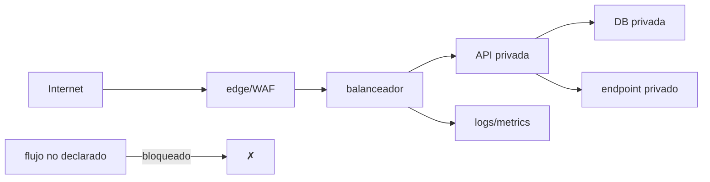
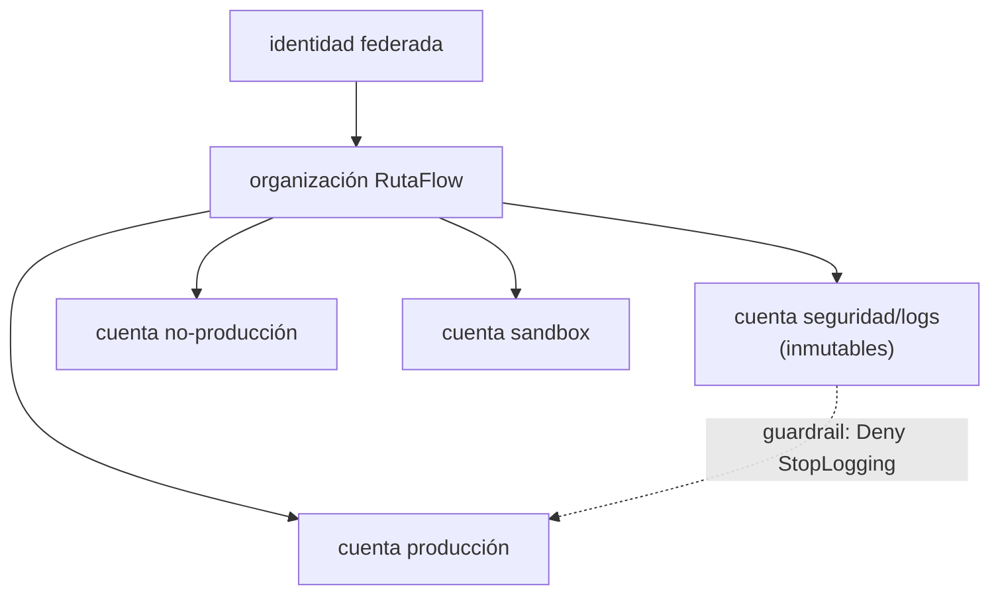
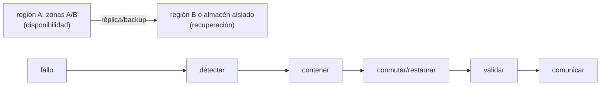
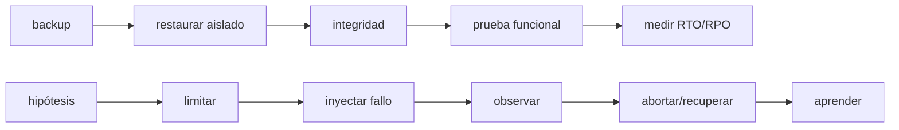
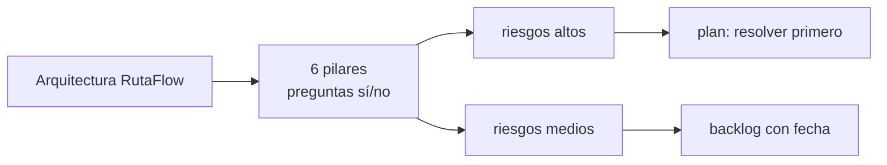
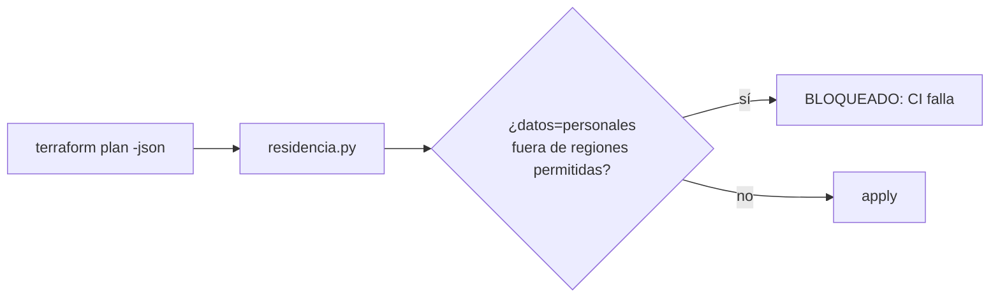

# Módulo 32: Arquitectura cloud resiliente — redes, landing zones y recuperación

Una colección de servicios funcionales todavía puede fallar como sistema. La arquitectura experta hace explícitas las fronteras de red y gobierno, conecta disponibilidad con necesidades del negocio y demuestra recuperación mediante experimentos. El objetivo no es dibujar nubes redundantes, sino justificar y verificar qué ocurre cuando una zona, una identidad o un conjunto de datos deja de estar disponible.


## Aprende construyendo

### Tema 1: Una red segura empieza por flujos, no por subredes

#### Paso 1 · Objetivo y preparación
Al finalizar vas a declarar el flujo real que `demo-nodo` (Módulo 21) necesita hacia la base de datos de facturación (Módulo 13), por referencia de grupo, no por rango abierto. Prerrequisitos: Módulos 13 y 21 completos.
#### Paso 2 · Contexto y caso real
RutaFlow necesita que solo los nodos de reparto (`demo-nodo`) hablen con `rutaflow-facturacion`, nunca cualquier IP pública — el diseño empieza por esa comunicación concreta, no por dibujar subredes primero.
#### Paso 3 · Teoría, modelo mental y analogía
La red es una ciudad: las subredes son barrios, pero lo que de verdad importa es qué flujos de tráfico están permitidos entre ellos, no solo quién vive cerca de quién.

**Conceptos clave:** VPC/VNet, CIDR, subnet, route table, availability zone, internet gateway, NAT, private endpoint, security group, firewall, north-south, east-west, DNS y zero trust.

Empieza con actores y comunicaciones necesarias: usuario→edge, edge→API, API→base y operadores→plano de control. Luego asigna zonas, rutas y controles. “Público” significa que existe ruta desde Internet, no que todo tráfico esté permitido. Una base privada necesita retorno, resolución DNS y endpoints para servicios; esconderla en una subred no reemplaza autenticación ni cifrado.

Los security groups son controles de flujo con estado; las ACL y firewalls tienen otros alcances. Usa referencias entre identidades/grupos cuando sea posible y evita rangos amplios. Un NAT permite salida, no convierte mágicamente una carga en privada ni inspecciona intención. Private endpoints reducen tránsito público, pero requieren políticas de recurso y DNS correctos.

```hcl
resource "aws_security_group_rule" "api_to_db" {
  type                     = "ingress"
  security_group_id        = aws_security_group.db.id
  source_security_group_id = aws_security_group.api.id
  from_port                = 5432
  to_port                  = 5432
  protocol                 = "tcp"
  description              = "Solo la API accede a PostgreSQL"
}
```

Registra flow logs y prueba rutas positivas y negativas. Documenta dependencia de DNS, certificados, egress y proveedor de identidad: son puntos de fallo frecuentes que un diagrama de tres capas suele omitir.

**Analogía:** una red es una ciudad; las subredes son barrios, las rutas son carreteras y los controles son accesos. Vivir lejos del centro no sustituye cerrar la puerta.

**¿Por qué es importante?** porque la conectividad excesiva aumenta radio de ataque y la conectividad incompleta causa fallos difíciles de diagnosticar.

**Casos de uso reales:** base con IP pública, regla `0.0.0.0/0`, DNS privado inconsistente, dependencia sin egress y única NAT gateway como punto de fallo.

**Diagrama:**



Guardá la regla `api_to_db` de arriba en un archivo `infra/network.tf` que crees en tu proyecto,
no como un comando `aws ec2` suelto corrido una sola vez: en el proyecto integrador RutaFlow, esa
es la diferencia entre una regla documentada y versionada junto a tu propia `template.yaml`, y una
que alguien aplicó manualmente y nadie puede reproducir. El límite real de `--source-group` frente
a un CIDR es que no conviene usarlo cuando el otro extremo vive fuera de tu VPC (un servicio de
terceros, por ejemplo): ahí sí necesitás un rango de IP explícito, no una referencia de grupo.

#### Paso 4 · Demostración guiada
```bash
DB_SG=$(aws ec2 create-security-group --group-name rutaflow-db-interna \
  --description "Solo accesible desde demo-nodo" --query GroupId --output text)
aws ec2 authorize-security-group-ingress --group-id "$DB_SG" --protocol tcp --port 5432 \
  --source-group demo-nodo
```
Resultado esperado: la regla de ingreso usa `--source-group demo-nodo` (una referencia a otro grupo de seguridad), no un CIDR — solo instancias que pertenezcan a `demo-nodo` pueden llegar al puerto 5432, sin importar qué IP tengan.
#### Paso 5 · Práctica guiada
Pista: creá dos VPCs con el mismo rango CIDR (`aws ec2 create-vpc --cidr-block 10.0.0.0/16` dos veces) y después intentá emparejarlas con `create-vpc-peering-connection` — ese es el fallo deliberado: un peering entre dos VPCs con CIDR solapado no tiene forma de enrutar el tráfico sin ambigüedad, y la operación queda inutilizable aunque la llamada en sí no siempre falle de inmediato.
#### Paso 6 · Práctica independiente
Documentá, para `rutaflow-db-interna`, por qué una regla con `--cidr 0.0.0.0/0` en el puerto 5432 sería exactamente el error que este Tema busca evitar, aunque "funcionara" en una demo rápida.
#### Paso 7 · Cierre
Entregá la regla por referencia de grupo del Paso 4, el CIDR solapado del Paso 5, y la explicación del riesgo de `0.0.0.0/0` del Paso 6; explicá por qué "público" significa que existe una ruta desde Internet, no que todo el tráfico esté permitido. Siguiente paso: gobierno. Errores comunes: subnets sin rutas y 0.0.0.0/0 innecesario. Fuente oficial: https://docs.aws.amazon.com/vpc/latest/userguide/what-is-amazon-vpc.html.

### Tema 2: Una landing zone convierte gobierno en una base repetible

#### Paso 1 · Objetivo y preparación
Al finalizar vas a escribir el guardrail real que impediría que alguien desactive CloudTrail en la cuenta de producción de RutaFlow. Prerrequisitos: Módulo 29 (STS, cuentas).
#### Paso 2 · Contexto y caso real
Si RutaFlow separa sus cuentas en producción, no-producción y seguridad (Módulo 29), necesita que ningún rol fuera del equipo de seguridad pueda apagar la auditoría de la cuenta de producción, aunque tenga permisos amplios para todo lo demás.
#### Paso 3 · Teoría, modelo mental y analogía
La jerarquía de cuentas es un edificio de oficinas con políticas centrales y responsables; una landing zone instala esas reglas antes de que lleguen las cargas de trabajo, no después.

**Conceptos clave:** organization, account/project/subscription, management group, folder, identity federation, break-glass, guardrail, policy, centralized logging, audit trail, quota, tagging y blast radius.

Separa producción, no producción, seguridad y logs en cuentas/proyectos cuando el riesgo lo justifique. Esa frontera limita cuotas, facturación, credenciales y efectos de una configuración errónea. Evita usuarios permanentes y access keys personales: federa identidad, usa roles temporales y registra elevación. La cuenta break-glass se prueba y vigila sin convertirla en atajo cotidiano.

Una landing zone instala antes de las cargas: regiones permitidas, prohibición de recursos públicos, cifrado, logs inmutables, contactos, presupuestos y etiquetas. Los controles preventivos bloquean; los detectivos encuentran; los correctivos reparan. Ninguno debe desplegarse sin pruebas y proceso de excepción con dueño y vencimiento.

```json
{
  "Version": "2012-10-17",
  "Statement": [{
    "Effect": "Deny",
    "Action": "cloudtrail:StopLogging",
    "Resource": "*",
    "Condition": {"StringNotLike": {"aws:PrincipalArn": "*/SecurityAutomation"}}
  }]
}
```

Centraliza auditoría en un destino que las cuentas de aplicaciones no puedan borrar. Gestiona IaC como producto versionado y prueba cambios en una organización de laboratorio. AWS Organizations/Control Tower, Azure Landing Zones y Google Cloud enterprise foundations expresan patrones equivalentes con semántica diferente.

**Analogía:** la landing zone son cimientos, servicios públicos y normas del barrio antes de construir casas; añadirlos después obliga a mover estructuras habitadas.

**¿Por qué es importante?** porque el gobierno manual diverge y un compromiso de una cuenta no debe controlar toda la organización.

**Casos de uso reales:** logs borrables por administrador de aplicación, credencial compartida, región no aprobada, producción mezclada con sandbox y excepción sin caducidad.

**Diagrama:**



En el proyecto integrador RutaFlow, este guardrail viviría junto a la infraestructura de tu
propia `template.yaml`, en un archivo `infra/guardrails.json` que crees manualmente, aplicado a la
cuenta de producción antes de que exista ningún recurso de aplicación — ese orden (gobierno antes
que carga de trabajo) es justamente lo que distingue una landing zone de un control agregado
después de un incidente.

**Límites y decisión de uso:** Una landing zone establece controles iniciales, pero no sustituye autorización dentro de cada aplicación ni evita toda configuración insegura. Revisa excepciones, cuentas nuevas y cambios de políticas de forma continua, con responsables y evidencias.

#### Paso 4 · Demostración guiada
**Desde cero:** parte de una carpeta vacía, ejecuta el comando que aparece debajo y escribe el archivo que se muestra a continuación con el contenido de este tema.
```bash
mkdir ejemplo && cd ejemplo && floci start
```

```bash
cat > guardrail-cloudtrail.json <<'EOF'
{"Version":"2012-10-17","Statement":[{"Effect":"Deny","Action":"cloudtrail:StopLogging","Resource":"*",
  "Condition":{"StringNotLike":{"aws:PrincipalArn":"*/SecurityAutomation"}}}]}
EOF
aws iam simulate-custom-policy --policy-input-list file://guardrail-cloudtrail.json \
  --action-names cloudtrail:StopLogging --resource-arns "*"
```
Resultado esperado: el simulador confirma que esta política deniega `cloudtrail:StopLogging` para cualquier principal que no termine en `/SecurityAutomation` — un `Deny` explícito que ningún `Allow` concedido después puede anular, el mismo principio del Módulo 7.
#### Paso 5 · Práctica guiada
Pista: creá una segunda cuenta (simulada, cambiando `AWS_ACCESS_KEY_ID` como en el Módulo 29) sin aplicarle este guardrail — ese es el fallo deliberado: cualquier rol con permisos administrativos en esa cuenta puede apagar su propio CloudTrail sin que nada lo impida, exactamente la cuenta "sin guardrail" que este Tema advierte.
#### Paso 6 · Práctica independiente
Documentá, para la organización de RutaFlow, a dónde iría el destino centralizado e inmutable de logs (que las cuentas de aplicación no puedan borrar), qué cuota pondrías por cuenta, y bajo qué condición se usaría una cuenta break-glass sin que se vuelva un atajo cotidiano.
#### Paso 7 · Cierre
Entregá el guardrail simulado del Paso 4, la cuenta sin protección del Paso 5, y el diseño de logging/cuotas/break-glass del Paso 6; explicá por qué un compromiso de una sola cuenta no debería poder controlar toda la organización. Siguiente paso: resiliencia. Errores comunes: cuentas sin dueño y privilegio global. Fuente oficial: https://docs.aws.amazon.com/organizations/latest/userguide/orgs_introduction.html.

### Tema 3: Disponibilidad y recuperación responden preguntas distintas

#### Paso 1 · Objetivo y preparación
Al finalizar vas a asignar un RTO y un RPO reales a tres servicios concretos de RutaFlow, no un "lo más rápido posible" genérico. Prerrequisitos: Módulos 4 y 13 completos.
#### Paso 2 · Contexto y caso real
Una caída regional no debería borrar `ShipmentEvents` ni detener la confirmación de entregas críticas — pero el nivel de protección que vale la pena pagar no es el mismo para el historial de ubicaciones que para los pagos.
#### Paso 3 · Teoría, modelo mental y analogía
RTO es cuánto tiempo tolerás estar caído; RPO es cuántos datos tolerás perder — el cinturón de seguridad evita el accidente, el plan de rescate actúa cuando ya ocurrió, y ambos responden preguntas distintas.

**Conceptos clave:** fault domain, multi-AZ, multi-region, redundancy, quorum, graceful degradation, RTO, RPO, backup, replication, pilot light, warm standby, active-active y consistency.

Alta disponibilidad mantiene el servicio ante fallos previstos; disaster recovery restaura después de un desastre. Define por viaje de usuario: RTO es tiempo máximo aceptable para recuperar; RPO es pérdida temporal máxima de datos. “Cero” tiene costos y complejidad enormes. Alinea objetivos con impacto, no con entusiasmo técnico.

Multi-AZ suele reducir fallos de infraestructura dentro de región. Multi-región añade protección, pero también latencia, replicación, conflictos, claves, cuotas y operación. Backup/restore es económico y lento; pilot light conserva núcleo; warm standby mantiene capacidad reducida; active-active ofrece tiempos bajos a cambio de coordinación intensa.

```text
Servicio         RTO       RPO       Estrategia
catálogo         4 h       24 h      reconstruir + backup
pedidos          30 min    5 min     warm standby + réplica
pagos            5 min     ~0        proveedor idempotente + failover ensayado
```

Diseña degradación: si recomendaciones fallan, compra puede continuar; si identidad falla, una sesión válida quizá opere de forma limitada según riesgo. Evita reintentos en cascada mediante deadlines, backoff, jitter y circuit breakers. Prueba capacidad de la región secundaria y dependencias globales.

**Analogía:** el cinturón evita daños en muchos accidentes; el plan de rescate actúa cuando el accidente ya ocurrió. Ambos importan, pero resuelven momentos distintos.

**¿Por qué es importante?** porque redundancia no garantiza datos correctos y replicación puede copiar corrupción inmediatamente.

**Casos de uso reales:** caída de zona, borrado lógico replicado, secundario sin cuota, DNS con TTL excesivo y active-active con escrituras conflictivas.

**Diagrama:**



En el proyecto integrador RutaFlow, esta misma tabla de RTO/RPO es la que justificaría, sobre los
recursos que declares en tu propia `template.yaml`, por qué `ShipmentEvents` usa PITR de DynamoDB
y `rutaflow-facturacion` (Módulo 13) usa snapshot diario en vez de una única estrategia genérica
aplicada a todo por igual.

#### Paso 4 · Demostración guiada
**Desde cero:** parte de una carpeta vacía, ejecuta el comando que aparece debajo y escribe el archivo que se muestra a continuación con el contenido de este tema.
```bash
mkdir ejemplo && cd ejemplo && floci start
```

```text
Servicio                  RTO       RPO       Estrategia
confirmar-entrega         5 min     ~0        rol IAM temporal + reintentos (Módulo 5), sin estado propio que perder
ShipmentEvents            30 min    5 min     PITR de DynamoDB (Módulo 4) + réplica
rutaflow-facturacion      4 h       24 h      snapshot diario (Módulo 13) + restore probado
```

**Ejecuta el ejemplo** (con Floci corriendo en local, ejecuta el comando contra el emulador):

```bash
floci up
aws --endpoint-url http://localhost:4566 sts get-caller-identity
```
Confirma la respuesta del servicio emulado.

Resultado esperado: tres servicios reales de RutaFlow, tres combinaciones de RTO/RPO distintas — ninguna es "cero" porque cero tiene un costo y una complejidad que ningún servicio de este curso justifica todavía.
#### Paso 5 · Práctica guiada
Pista: eliminá el punto de recuperación más reciente de `rutaflow-facturacion` (Módulo 13) y recién después intentá cumplir el RPO de 24 horas de la tabla — ese es el fallo deliberado: sin ese punto de recuperación, el RPO real que podés cumplir es el del snapshot anterior, potencialmente mucho más viejo que las 24 horas prometidas.
#### Paso 6 · Práctica independiente
Compará, para `ShipmentEvents`, qué cambiaría si en vez de PITR + réplica usaras pilot light (solo el núcleo mínimo activo) o active-active (dos regiones escribiendo a la vez) — documentá qué complejidad operativa nueva introduce cada opción frente a la estrategia actual.
#### Paso 7 · Cierre
Entregá la tabla de RTO/RPO real del Paso 4, el punto de recuperación faltante del Paso 5, y la comparación de estrategias del Paso 6; explicá por qué alinear estos objetivos con el impacto de negocio, no con el entusiasmo técnico, es la decisión central de este Tema. Siguiente paso: recuperación. Errores comunes: replicar sin probar y confundir RPO con RTO. Fuente oficial: https://docs.aws.amazon.com/wellarchitected/latest/reliability-pillar/welcome.html.

### Tema 4: Un backup solo existe operativamente después de restaurarlo

#### Paso 1 · Objetivo y preparación
Al finalizar vas a restaurar de verdad el snapshot de `rutaflow-facturacion` (Módulo 13) y a medir si el RTO del Tema 3 se cumple en la práctica, no solo en la tabla. Prerrequisitos: Módulo 13 Tema 2, Tema 3 de este módulo.
#### Paso 2 · Contexto y caso real
El plan del Tema 3 promete un RTO de 4 horas para `rutaflow-facturacion` — pero esa promesa no vale nada hasta que alguien efectivamente restaure el snapshot y cronometre cuánto tardó de verdad.
#### Paso 3 · Teoría, modelo mental y analogía
Un backup solo existe operativamente después de restaurarlo: guardar un paracaídas no demuestra que abre, hay que inspeccionarlo y ensayarlo.

**Conceptos clave:** restore test, immutability, retention, encryption key, integrity, dependency order, runbook, chaos experiment, steady state, hypothesis, abort condition, evidence y game day.

Verifica que el backup contiene datos, que la clave está disponible, que versiones son compatibles y que la aplicación funciona. Restaura en entorno aislado, ejecuta consultas de integridad y un recorrido de usuario. Mide tiempo real y compáralo con RTO/RPO. Conserva copias inmutables o aisladas para ransomware y borrado administrativo.

Un experimento de caos empieza con estado estable y una hipótesis: “si perdemos una instancia/zona, 99% de solicitudes seguirá correcto y la latencia p95 permanecerá bajo 500 ms”. Limita alcance, define abort conditions, confirma observabilidad y autoridad. Empieza en laboratorio y avanza según evidencia; caos no significa romper sin control.

```yaml
experiment:
  hypothesis: "La API conserva su SLO al perder una réplica"
  steady_state: "success_rate >= 0.99 and p95_ms < 500"
  action: "terminar una réplica no líder"
  abort: "error_rate > 0.05 for 2m"
  verify: ["alarm fired", "traffic shifted", "capacity recovered"]
```

El runbook especifica disparador, roles, comandos seguros, comprobaciones, comunicación, rollback y escalamiento. Evita placeholders y pasos destructivos ambiguos. Después del game day registra diferencias entre diseño y realidad y convierte hallazgos en acciones con responsable.

**Analogía:** guardar un paracaídas no demuestra que abre; se inspecciona, se ensaya y se conoce cuándo usarlo.

**¿Por qué es importante?** porque permisos, claves, cuotas y dependencias suelen fallar precisamente durante la recuperación.

**Casos de uso reales:** backup cifrado sin clave, restauración que excede RTO, runbook obsoleto, alarma que no pagina y failover que sobrecarga el secundario.

**Diagrama:**



En el proyecto integrador RutaFlow, este game day correría exactamente contra el snapshot de
`rutaflow-facturacion` que creaste en el Módulo 13 — el runbook del Paso 6 documentaría ese mismo
comando `restore-db-instance-from-db-snapshot` con el cronómetro corriendo, no una versión
hipotética sin tiempos medidos. Conserva el runbook junto a tu propia `template.yaml`.

#### Paso 4 · Demostración guiada
**Desde cero:** parte de una carpeta vacía, ejecuta el comando que aparece debajo y escribe el archivo que se muestra a continuación con el contenido de este tema.
```bash
mkdir ejemplo && cd ejemplo && floci start
```

```bash
time aws rds restore-db-instance-from-db-snapshot --db-instance-identifier rutaflow-facturacion-gameday \
  --db-snapshot-identifier snap-facturacion-001
aws rds wait db-instance-available --db-instance-identifier rutaflow-facturacion-gameday
psql -h localhost -U admin -d postgres -c "SELECT count(*) FROM facturas;"
```
Resultado esperado: `time` reporta cuánto tardó de verdad la restauración completa hasta que la instancia quedó disponible y consultable — comparalo directamente contra las 4 horas de RTO prometidas en el Tema 3, no contra una estimación.
#### Paso 5 · Práctica guiada
Pista: intentá restaurar primero `facturas` y recién después `clientes`/`pagos` (las tablas con las que tiene foreign keys, Módulo 13 Tema 1) en un escenario donde las tres vinieran de exports separados — ese es el fallo deliberado: restaurar en el orden de dependencia incorrecto rompe las referencias foráneas a mitad de camino, incluso cuando cada export individual es válido.
#### Paso 6 · Práctica independiente
Escribí el runbook de este game day: quién lo dispara, qué comandos corre exactamente, qué condición de aborto lo detendría (por ejemplo, si la restauración supera el doble del RTO prometido), y qué evidencia queda registrada al final.
#### Paso 7 · Cierre
Entregá el tiempo real medido del Paso 4, el orden de restauración incorrecto del Paso 5, y el runbook del Paso 6; explicá por qué permisos, claves y dependencias suelen fallar precisamente durante la recuperación, no durante el respaldo. Siguiente paso: plataforma. Errores comunes: no probar integridad y conservar backups mutables. Fuente oficial: https://sre.google/sre-book/testing-reliability/.

### Tema 5: Well-Architected: revisar una arquitectura con los seis pilares · Avanzado · 45 min

**Prerrequisito:** temas «Una red segura empieza por flujos» y «Disponibilidad y recuperación responden preguntas» de este módulo.

**Al finalizar podrás:** revisar la arquitectura de RutaFlow con los seis pilares de Well-Architected, puntuar cada pilar con preguntas concretas y ordenar los hallazgos por riesgo.

**¿Por qué es importante?** Sin un marco, las revisiones de arquitectura dependen de quién esté en la reunión. Los seis pilares obligan a mirar también lo que nadie quiere mirar: costos, rendimiento medido y sostenibilidad.

#### Paso 1 · Objetivo y preparación

Usa Python 3.10 o superior. Crea la carpeta `academia-labs/cloud/well-architected`. Ten a mano el diagrama de la arquitectura del proyecto integrador.

#### Paso 2 · Contexto y caso real

RutaFlow pasó una revisión de seguridad y se sentía lista para producción. Una revisión con los seis pilares encontró que la base de datos estaba en una sola zona y que nunca se habían hecho pruebas de carga: dos riesgos que la revisión de seguridad no miraba.

#### Paso 3 · Teoría, modelo mental y analogía

**Conceptos clave:** Well-Architected Framework, pilar, excelencia operativa, seguridad, confiabilidad, eficiencia de rendimiento, optimización de costos, sostenibilidad, riesgo alto (HRI).

| Pilar | Pregunta central |
|---|---|
| Excelencia operativa | ¿Podemos desplegar, observar y corregir sin heroísmos? |
| Seguridad | ¿Protegemos datos, identidades y sistemas? |
| Confiabilidad | ¿Nos recuperamos de fallas y cumplimos el SLO? |
| **Eficiencia de rendimiento** | ¿Usamos los recursos adecuados y lo medimos con carga real? |
| Optimización de costos | ¿Pagamos solo por lo que aporta valor? |
| **Sostenibilidad** | ¿Reducimos el consumo de energía y recursos de lo que construimos? |

La revisión no da una nota final: produce una lista de **riesgos altos** (HRI) que se resuelven primero, y riesgos medios que se planean. Se repite cuando la arquitectura cambia.

**Rendimiento** y **sostenibilidad** suelen ir juntos: menos recursos ociosos y procesadores más eficientes (como ARM/Graviton) bajan costo, energía y a veces latencia.

**Analogía:** es la revisión técnico-mecánica del carro: no basta con que los frenos funcionen si las llantas están lisas. La analogía falla en que aquí tú mismo eliges las preguntas detalladas de cada pilar según tu sistema.

**Límite de uso:** la revisión no reemplaza pruebas reales (carga, restauración, caos): es una guía para decidir qué probar. Un pilar perfecto a costa de otro (máxima confiabilidad sin mirar costo) también es un hallazgo.



#### Paso 4 · Demostración guiada desde cero

Archivo `academia-labs/cloud/well-architected/revision_wa.py`:

```python
# Revisión ligera de Well-Architected: cada pilar con preguntas de sí/no y su riesgo.
REVISION = {
    "Excelencia operativa": {"runbooks versionados": True, "despliegues automatizados": True},
    "Seguridad": {"MFA en todas las cuentas": True, "cifrado en reposo": True, "mínimo privilegio revisado": False},
    "Confiabilidad": {"multi-AZ en la base": False, "respaldos restaurados en prueba": True},
    "Eficiencia de rendimiento": {"pruebas de carga recientes": False, "caché frente a la base": True},
    "Optimización de costos": {"etiquetas de costo": True, "presupuestos con alerta": True},
    "Sostenibilidad": {"apagado nocturno de entornos de prueba": False, "instancias Graviton evaluadas": True},
}
ALTO_RIESGO = {"multi-AZ en la base", "mínimo privilegio revisado"}

for pilar, preguntas in REVISION.items():
    cumplidas = sum(preguntas.values())
    faltan = [p for p, ok in preguntas.items() if not ok]
    marca = "OK " if not faltan else "!! "
    detalle = "" if not faltan else " · falta: " + ", ".join(
        f"{p}{' (riesgo alto)' if p in ALTO_RIESGO else ''}" for p in faltan)
    print(f"{marca}{pilar}: {cumplidas}/{len(preguntas)}{detalle}")

altos = [p for preguntas in REVISION.values() for p, ok in preguntas.items() if not ok and p in ALTO_RIESGO]
print(f"Riesgos altos a resolver primero: {len(altos)}")
```

Ejecútalo:

```bash
cd academia-labs/cloud/well-architected
python3 revision_wa.py
```

**Explicación por bloques:** `REVISION` guarda, por pilar, preguntas concretas de RutaFlow con su respuesta actual. `ALTO_RIESGO` marca las que, si fallan, pueden causar una pérdida grave (datos o servicio). El bucle cuenta cuántas cumple cada pilar y lista lo que falta, señalando los riesgos altos. La última línea dice cuántos riesgos altos hay que resolver antes que nada. Las preguntas son un ejemplo: cada equipo escribe las suyas a partir de las guías oficiales de cada pilar.


**Resultado esperado:**

```text
OK Excelencia operativa: 2/2
!! Seguridad: 2/3 · falta: mínimo privilegio revisado (riesgo alto)
!! Confiabilidad: 1/2 · falta: multi-AZ en la base (riesgo alto)
!! Eficiencia de rendimiento: 1/2 · falta: pruebas de carga recientes
OK Optimización de costos: 2/2
!! Sostenibilidad: 1/2 · falta: apagado nocturno de entornos de prueba
Riesgos altos a resolver primero: 2
```

**Fallo deliberado:** marca todas las respuestas como `True` sin evidencia. **Error esperado:** el script imprime todo en OK y cero riesgos, pero la base sigue en una sola zona. **Diagnóstico:** una revisión sin evidencia no sirve. Para cada `True`, anota el enlace a la prueba (un runbook, un reporte de carga, una restauración hecha).

#### Paso 5 · Práctica guiada

1. **Reproducción:** ejecuta la revisión y explica los dos riesgos altos.
2. **Variación:** agrega dos preguntas al pilar de rendimiento (por ejemplo, «p95 medido en producción»).
3. **Diagnóstico:** reproduce el fallo deliberado y agrega un campo de evidencia a cada respuesta.
4. **Integración:** resuelve un riesgo (por ejemplo, multi-AZ en el emulador) y vuelve a ejecutar.
5. **Diseño:** escribe el plan de los tres hallazgos más importantes con responsable y fecha.

**Pista:** una pregunta buena se responde con una evidencia que alguien más puede abrir.

#### Paso 6 · Práctica independiente

Haz una revisión de los seis pilares para un proyecto propio con al menos dos preguntas por pilar y entrégala con las evidencias.

#### Paso 7 · Cierre

- [ ] Nombras los seis pilares y su pregunta central.
- [ ] La revisión lista los dos riesgos altos.
- [ ] Cada respuesta positiva tiene evidencia.
- [ ] Hay un plan con responsables para los riesgos altos.

Si fallas dos o más, vuelve al Paso 3. **Errores comunes:** responder sin evidencia, revisar solo seguridad y tratar la revisión como un examen que se aprueba una vez. **Siguiente paso:** el tema «Un backup solo existe operativamente después de restaurarlo» profundiza el pilar de confiabilidad.

**Transferencia al proyecto integrador «RutaFlow»:** haz la revisión Well-Architected de RutaFlow, resuelve los riesgos altos y repite la revisión después de cada cambio grande.

**Fuente oficial:** [AWS — Well-Architected Framework](https://docs.aws.amazon.com/wellarchitected/latest/framework/welcome.html) y [AWS — Sustainability Pillar](https://docs.aws.amazon.com/wellarchitected/latest/sustainability-pillar/sustainability-pillar.html).

### Tema 6: Residencia y soberanía de datos: que los datos personales vivan donde la ley permite · Avanzado · 40 min

**Prerrequisito:** tema «Una landing zone convierte gobierno en una base reutilizable» de este módulo.

**Al finalizar podrás:** marcar con etiquetas los recursos que guardan datos personales y bloquear en CI cualquier plan de Terraform que los cree en una región no permitida.

**¿Por qué es importante?** Las leyes de protección de datos pueden limitar dónde se guardan los datos personales. Un respaldo creado «temporalmente» en otra región puede ser un incumplimiento. Revisarlo antes de crear el recurso es mucho más barato que corregirlo después.

#### Paso 1 · Objetivo y preparación

Usa Python 3.10 o superior. Crea `academia-labs/cloud/residencia`. En un proyecto real, genera el plan con `terraform show -json plan.out > plan.json`; aquí usarás un plan de ejemplo.

#### Paso 2 · Contexto y caso real

Un desarrollador de RutaFlow creó un bucket de respaldo en Europa para probar la recuperación. El bucket recibió copias de las fotos de entrega, que incluyen datos personales. El área legal pidió borrar el bucket y explicar por qué el pipeline lo permitió.

#### Paso 3 · Teoría, modelo mental y analogía

**Conceptos clave:** residencia de datos, soberanía, dato personal, clasificación por etiqueta, región permitida, política en CI, SCP de región.

- **Residencia:** en qué país o región físicamente están los datos.
- **Soberanía:** qué leyes aplican a esos datos y qué autoridades pueden pedirlos.

Las regiones permitidas las define el área legal, no el equipo técnico. El equipo técnico las hace cumplir en tres niveles:

| Nivel | Herramienta |
|---|---|
| antes de crear | revisión del plan de Terraform en CI (este tema) |
| al crear | políticas de la organización que niegan regiones (SCP en AWS, Organization Policy en GCP) |
| después | inventario y alertas (AWS Config, Security Hub) |

Para que una revisión automática funcione, cada recurso debe estar **clasificado**: una etiqueta como `datos = personales` dice qué tipo de dato guarda.

**Analogía:** es la regla de un archivo clínico: las historias de los pacientes no salen del edificio. La etiqueta es el sello «confidencial» en la carpeta; sin sello, nadie sabe que esa carpeta no puede salir.

**Límite de uso:** las etiquetas solo sirven si se ponen siempre: combínalas con una política que exija la etiqueta. Residencia no es lo mismo que seguridad: un dato en la región correcta también debe estar cifrado y con acceso mínimo. Este tema no es asesoría legal.



#### Paso 4 · Demostración guiada desde cero

Archivo `academia-labs/cloud/residencia/residencia.py`:

```python
import json
import sys

# Regla de residencia: los datos personales de clientes de Colombia solo pueden vivir en estas regiones.
REGIONES_PERMITIDAS = {"us-east-1", "sa-east-1"}  # acordadas con el área legal
ETIQUETA = "datos"  # valor "personales" marca recursos con datos personales

def revisar(plan: dict) -> list[str]:
    hallazgos = []
    for recurso in plan["resource_changes"]:
        despues = recurso["change"]["after"] or {}
        etiquetas = despues.get("tags_all") or {}
        if etiquetas.get(ETIQUETA) != "personales":
            continue
        region = despues.get("region", plan["region"])
        if region not in REGIONES_PERMITIDAS:
            hallazgos.append(f"{recurso['address']}: datos personales en {region}")
    return hallazgos

plan = json.load(open(sys.argv[1]))
hallazgos = revisar(plan)
for h in hallazgos:
    print("BLOQUEADO", h)
print(f"{len(hallazgos)} problema(s) de residencia")
sys.exit(1 if hallazgos else 0)
```

Archivo `academia-labs/cloud/residencia/plan.json`:

```json
{
  "region": "us-east-1",
  "resource_changes": [
    {"address": "aws_s3_bucket.fotos", "change": {"after": {"tags_all": {"datos": "personales"}}}},
    {"address": "aws_s3_bucket.respaldo_eu", "change": {"after": {"region": "eu-west-1", "tags_all": {"datos": "personales"}}}},
    {"address": "aws_s3_bucket.logs_eu", "change": {"after": {"region": "eu-west-1", "tags_all": {"datos": "tecnicos"}}}}
  ]
}
```

Ejecútalo:

```bash
cd academia-labs/cloud/residencia
python3 residencia.py plan.json; echo "salida: $?"
```

**Explicación por bloques:** `REGIONES_PERMITIDAS` es la lista acordada con legal. `revisar` recorre los cambios del plan, ignora los recursos que no están etiquetados como datos personales y, para los que sí, toma la región del recurso o, si no la tiene, la del proveedor. El plan de ejemplo tiene tres buckets: el de fotos (región por defecto, permitida), un respaldo con datos personales en Europa y unos logs técnicos en Europa. Solo el respaldo se bloquea, y el código de salida 1 hace fallar el CI.


**Resultado esperado:**

```text
BLOQUEADO aws_s3_bucket.respaldo_eu: datos personales en eu-west-1
1 problema(s) de residencia
salida: 1
```

**Fallo deliberado:** quita la etiqueta `datos` del respaldo en `plan.json`. **Error esperado:** el script dice «0 problema(s)» y termina con 0, aunque el respaldo sigue en Europa con datos personales. **Diagnóstico:** sin clasificación, la regla no sabe qué proteger. Exige la etiqueta `datos` en todos los recursos de almacenamiento (por ejemplo, con otra regla que falle si falta).

#### Paso 5 · Práctica guiada

1. **Reproducción:** ejecuta el script y explica por qué los logs en Europa no se bloquean.
2. **Variación:** agrega `sa-east-1` y un recurso ahí con datos personales; comprueba que pasa.
3. **Diagnóstico:** reproduce el fallo deliberado sin etiqueta.
4. **Integración:** agrega una regla que falle si un bucket no tiene la etiqueta `datos`.
5. **Diseño:** escribe la SCP de AWS que niega crear recursos fuera de las regiones permitidas (`aws:RequestedRegion`).

**Pista:** primero clasifica, después restringe: una regla sobre datos sin clasificar no protege nada.

#### Paso 6 · Práctica independiente

Convierte la regla en una política Rego para Conftest (como en el tema de policy as code del track de DevOps) y compara las dos versiones.

#### Paso 7 · Cierre

- [ ] Distingues residencia y soberanía.
- [ ] El script bloquea el respaldo en Europa.
- [ ] Reprodujiste el fallo de un recurso sin clasificar.
- [ ] Conoces los tres niveles de control.

Si fallas dos o más, vuelve al Paso 3. **Errores comunes:** confiar solo en la revisión del plan, no clasificar los recursos y decidir las regiones sin el área legal. **Siguiente paso:** el tema «Disponibilidad y recuperación responden preguntas» debe respetar estas regiones al elegir dónde replicar.

**Transferencia al proyecto integrador «RutaFlow»:** agrega la revisión de residencia al pipeline de infraestructura de RutaFlow y exige la etiqueta `datos` en todos los almacenamientos.

**Fuente oficial:** [AWS — Data residency](https://aws.amazon.com/compliance/data-residency/) y [AWS Organizations — Deny access based on the requested Region](https://docs.aws.amazon.com/organizations/latest/userguide/orgs_manage_policies_scps_examples_general.html).

## Revisión oficial de plataforma — julio de 2026

### Nube de evolución continua y vigilancia de retiros

No existe una versión única de AWS, Azure o Google Cloud. La revisión periódica consulta **AWS What's New**, **Azure Updates** y **Google Cloud release notes**, además de avisos de seguridad, cuotas, precios, regiones y retiros. Una novedad en preview no se convierte en arquitectura base; primero se valida disponibilidad regional, SLA, límites, IaC, observabilidad, coste, portabilidad y plan de salida. El laboratorio Floci/StackPort enseña contratos, pero las diferencias con el proveedor real se mantienen documentadas.

**Aplicación al proyecto:** selecciona tres servicios usados, registra fecha/estado/región, identifica un retiro o cambio incompatible, ejecuta pruebas contra emulador y entorno real acotado, y abre una decisión de migración con coste y rollback.


## Laboratorio práctico

1. Dibuja flujos y fronteras de tu proyecto multi-cloud; prueba cinco comunicaciones permitidas y cinco denegadas.
2. Diseña una landing zone equivalente para AWS, Azure y GCP con separación, identidad, logs y políticas.
3. Define RTO/RPO para tres recorridos y elige estrategia justificando costo, consistencia y complejidad.
4. Crea backup, simula pérdida y restaura en entorno aislado. Ejecuta pruebas funcionales y mide tiempos.
5. Ejecuta un experimento de pérdida de instancia/dependencia con hipótesis y abort condition.
6. Entrega runbook, timeline, resultados, brechas y acciones con dueño.

**Verificación:** las diez comunicaciones producen exactamente cinco permisos y cinco denegaciones justificadas; la restauración recupera los tres recorridos dentro de sus RTO/RPO declarados; el experimento se detiene al alcanzar la condición de aborto; y el runbook permite que otra persona repita la pérdida y recuperación. Conserva tiempos medidos, logs, comprobaciones funcionales y diferencias frente al diseño como evidencia.

<!-- OFFICIAL-TOPIC-ATLAS:START -->
## Atlas completo de temas oficiales

Derivado de la [documentación oficial](https://docs.aws.amazon.com/wellarchitected/latest/framework/welcome.html), sus referencias, migraciones y guías de operación. Inventariar no equivale a dominar: cada selección se demuestra con código, prueba, medición y explicación. **Cobertura: 60 temas.**

| Área | Temas que deben poder explicarse y aplicarse | Resultado verificable |
|---|---|---|
| Fundamentos | `IaaS PaaS SaaS` · `regions and zones` · `shared responsibility` · `identity` · `networks` · `compute` · `storage` · `databases` | arquitectura |
| Arquitecturas | `Well-Architected` · `landing zones` · `multi-account` · `serverless` · `containers` · `event-driven` · `microservices` · `batch` · `edge` | arquitectura |
| Datos | `relational` · `key-value` · `document` · `graph` · `time-series` · `object storage` · `lakehouse` · `streaming` · `governance` · `residency` | arquitectura |
| Seguridad | `IAM and federation` · `zero trust` · `KMS` · `secrets` · `WAF and DDoS` · `posture` · `audit` · `threat detection` · `supply chain` · `compliance` | arquitectura |
| Confiabilidad | `HA` · `quorum` · `retries` · `idempotency` · `queues` · `circuit breaker` · `autoscaling` · `multi-region` · `backup` · `restore` · `RPO RTO` · `chaos` | arquitectura |
| Operación | `observability` · `SLO` · `IaC` · `policy` · `FinOps` · `sustainability` · `performance` · `migration` · `hybrid` · `AI ML governance` · `deprecations` | arquitectura |

### Método de estudio y proyecto de ampliación

Para cada tema responde qué problema resuelve, cuál es su modelo mental, cómo falla, cómo se verifica y cuándo no conviene. Elige uno por área e intégralos en un proyecto propio de ampliación. Entrega diagrama, ADR, pruebas de éxito y fallo, una medición, una amenaza y el enlace oficial con versión y fecha. Una API preview se aísla en laboratorio y nunca se presenta como base estable.
<!-- OFFICIAL-TOPIC-ATLAS:END -->
