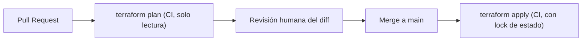
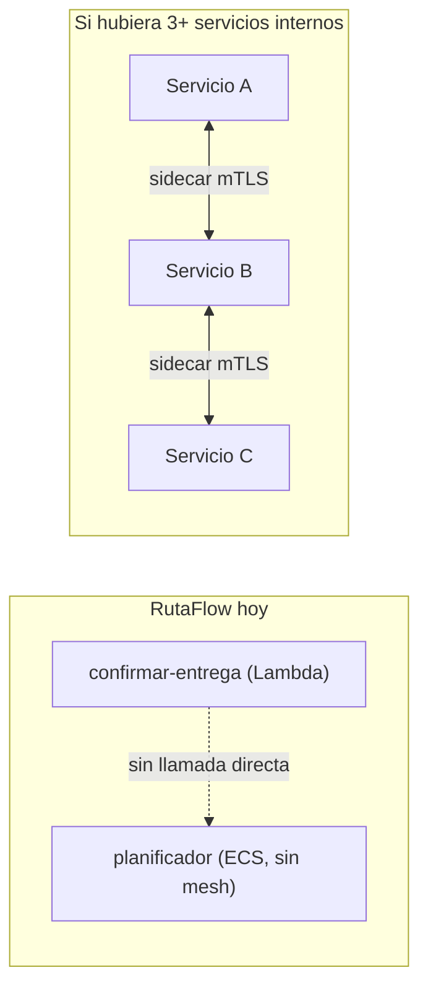
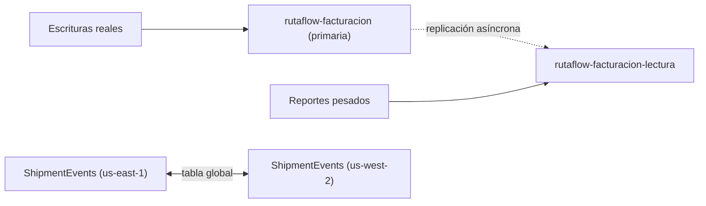
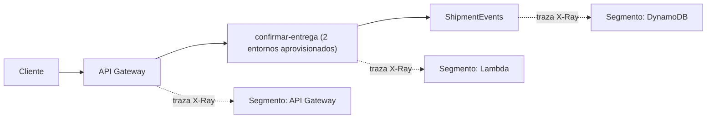
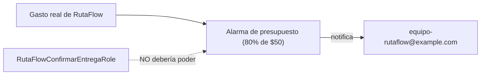
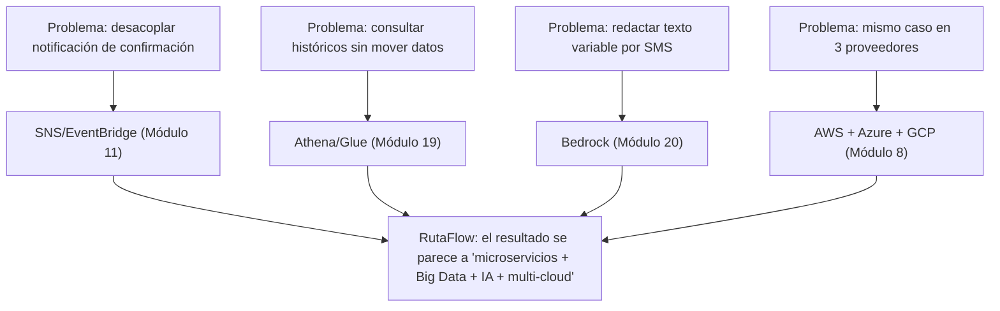
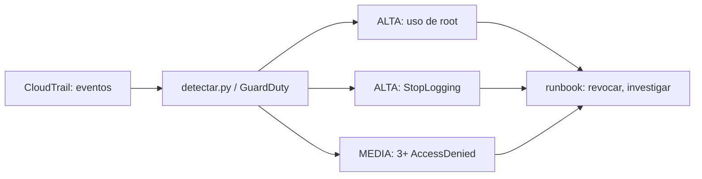

# Módulo 33: Cloud Master: plataforma, seguridad, datos y FinOps


## Aprende construyendo


### Tema 1: Terraform avanzado y CI/CD cloud · Avanzado · 45 min

<details open>
<summary><strong>Capa 1 — Lectura</strong></summary>

#### ► DE QUÉ TRATA
Al finalizar vas a versionar como código ShipmentEvents (Módulo 4) y confirmar-entrega (Módulo 5), con estado remoto bloqueado, y a engancharlo al pipeline real del Módulo 24. Prerrequisitos: Módulos 4, 5 y 24 completos.

#### ► LA IDEA EN UNA FRASE
**Al finalizar vas a versionar como código ShipmentEvents (Módulo 4) y confirmar-entrega (Módulo 5), con estado remoto bloqueado, y a engancharlo al pipeline real del Módulo 24.**

#### ► POR QUÉ EXISTE ESTO
Resuelve un problema real de diseño o implementación y evita decisiones a ciegas.

#### ► LA ANALOGÍA
Piensa en terraform avanzado y ci/cd cloud como una herramienta de taller: útil cuando conoces su propósito y sus límites.
**Dónde se rompe la analogía:** en software, los efectos dependen del contexto, la escala y los trade-offs.

#### ► CÓMO FUNCIONA


#### ► LO QUE PUEDE SALIR MAL
| Síntoma | Causa probable | Arreglo |
|---|---|---|
| Terraform avanzado y CI/CD cloud se aplica pero el resultado no mejora | Se usó sin medir el problema real | Mide antes y compara contra la alternativa simple |
| Aparece complejidad inesperada | Se adoptó la técnica sin comprender sus trade-offs | Vuelve a la sección de trade-offs y reduce el alcance |
| Falla en un caso límite | Se asumió un contexto que no se cumple | Prueba el caso límite y documenta cuándo NO usarlo |

#### ► TRADE-OFFS
| Opción | Cuándo usarla | Cuándo NO usarla |
|---|---|---|
| Usar Terraform avanzado y CI/CD cloud | Cuando el problema coincide con su propósito y el beneficio es observable | Cuando agrega complejidad sin resolver un problema real |
| Alternativa más simple | Cuando el contexto es pequeño, estable o fácil de razonar | Cuando ya demostró no escalar o no cumplir el requisito |
| Postergar la decisión | Cuando falta evidencia del problema | Cuando el costo de esperar es mayor que el costo de probar |

#### ► CUÁNDO NO USAR ESTO
No uses terraform avanzado y ci/cd cloud por defecto. Aplícalo cuando el problema lo justifique y puedas verificar el beneficio; si una alternativa más simple resuelve igual, prefiérela.

#### ► DE VUELTA A LA ANALOGÍA
Volviendo a la analogía: terraform avanzado y ci/cd cloud funciona como el modelo inicial, pero recuerda dónde se rompe: en producción importan la evidencia, la escala y el costo de equivocarte.

#### ► LO QUE DEBES RECORDAR
- Terraform avanzado y CI/CD cloud existe para resolver un problema específico.
- Mide antes de adoptar complejidad.
- Conoce el caso donde NO usarlo.
- Verifica con evidencia observable.

#### ► PREGUNTAS PARA PENSAR
1. ¿Qué problema concreto resuelve terraform avanzado y ci/cd cloud en tu contexto?
2. ¿Cómo sabrías que terraform avanzado y ci/cd cloud no está funcionando bien?
3. ¿Qué alternativa más simple considerarías antes de usar terraform avanzado y ci/cd cloud?

</details>

<details>
<summary><strong>Capa 2 — Construcción</strong></summary>

#### Código y verificación


```hcl
terraform {
  backend "s3" {
    bucket         = "demo-terraform-state"
    key            = "rutaflow/terraform.tfstate"
    region         = "us-east-1"
    dynamodb_table = "demo-terraform-locks"
  }
}
resource "aws_dynamodb_table" "shipment_events" {
  name         = "ShipmentEvents"
  billing_mode = "PAY_PER_REQUEST"
  hash_key     = "shipmentId"
  range_key    = "sequence"
  attribute { name = "shipmentId"; type = "S" }
  attribute { name = "sequence"; type = "N" }
}
```

```bash
aws s3 mb s3://demo-terraform-state
aws dynamodb create-table --table-name demo-terraform-locks \
  --attribute-definitions AttributeName=LockID,AttributeType=S \
  --key-schema AttributeName=LockID,KeyType=HASH --billing-mode PAY_PER_REQUEST
terraform init && terraform plan
```

</details>

### Tema 2: Kubernetes administrado, ECS y Service Mesh · Avanzado · 45 min

<details open>
<summary><strong>Capa 1 — Lectura</strong></summary>

#### ► DE QUÉ TRATA
Al finalizar vas a decidir si el planificador de rutas (Módulo 14, ECS) necesitaría EKS o un service mesh, y por qué todavía no. Prerrequisitos: Módulo 14 completo.

#### ► LA IDEA EN UNA FRASE
**Al finalizar vas a decidir si el planificador de rutas (Módulo 14, ECS) necesitaría EKS o un service mesh, y por qué todavía no.**

#### ► POR QUÉ EXISTE ESTO
Resuelve un problema real de diseño o implementación y evita decisiones a ciegas.

#### ► LA ANALOGÍA
Piensa en kubernetes administrado, ecs y service mesh como una herramienta de taller: útil cuando conoces su propósito y sus límites.
**Dónde se rompe la analogía:** en software, los efectos dependen del contexto, la escala y los trade-offs.

#### ► CÓMO FUNCIONA


#### ► LO QUE PUEDE SALIR MAL
| Síntoma | Causa probable | Arreglo |
|---|---|---|
| Kubernetes administrado, ECS y Service Mesh se aplica pero el resultado no mejora | Se usó sin medir el problema real | Mide antes y compara contra la alternativa simple |
| Aparece complejidad inesperada | Se adoptó la técnica sin comprender sus trade-offs | Vuelve a la sección de trade-offs y reduce el alcance |
| Falla en un caso límite | Se asumió un contexto que no se cumple | Prueba el caso límite y documenta cuándo NO usarlo |

#### ► TRADE-OFFS
| Opción | Cuándo usarla | Cuándo NO usarla |
|---|---|---|
| Usar Kubernetes administrado, ECS y Service Mesh | Cuando el problema coincide con su propósito y el beneficio es observable | Cuando agrega complejidad sin resolver un problema real |
| Alternativa más simple | Cuando el contexto es pequeño, estable o fácil de razonar | Cuando ya demostró no escalar o no cumplir el requisito |
| Postergar la decisión | Cuando falta evidencia del problema | Cuando el costo de esperar es mayor que el costo de probar |

#### ► CUÁNDO NO USAR ESTO
No uses kubernetes administrado, ecs y service mesh por defecto. Aplícalo cuando el problema lo justifique y puedas verificar el beneficio; si una alternativa más simple resuelve igual, prefiérela.

#### ► DE VUELTA A LA ANALOGÍA
Volviendo a la analogía: kubernetes administrado, ecs y service mesh funciona como el modelo inicial, pero recuerda dónde se rompe: en producción importan la evidencia, la escala y el costo de equivocarte.

#### ► LO QUE DEBES RECORDAR
- Kubernetes administrado, ECS y Service Mesh existe para resolver un problema específico.
- Mide antes de adoptar complejidad.
- Conoce el caso donde NO usarlo.
- Verifica con evidencia observable.

#### ► PREGUNTAS PARA PENSAR
1. ¿Qué problema concreto resuelve kubernetes administrado, ecs y service mesh en tu contexto?
2. ¿Cómo sabrías que kubernetes administrado, ecs y service mesh no está funcionando bien?
3. ¿Qué alternativa más simple considerarías antes de usar kubernetes administrado, ecs y service mesh?

</details>

<details>
<summary><strong>Capa 2 — Construcción</strong></summary>

#### Código y verificación


```bash
mkdir ejemplo && cd ejemplo && floci start
```

```bash
aws ecs describe-services --cluster rutaflow-cluster --services demo-planificador-service \
  --query 'services[0].{Lanzamiento:launchType,Deployment:deploymentController}'
```

</details>

### Tema 3: EC2, VPC, RDS, S3 y DynamoDB avanzados · Avanzado · 45 min

<details open>
<summary><strong>Capa 1 — Lectura</strong></summary>

#### ► DE QUÉ TRATA
Al finalizar vas a agregarle a ShipmentEvents una tabla global multi-región y a rutaflow-facturacion una réplica de lectura, dos técnicas avanzadas que ningún módulo anterior cubrió. Prerrequisitos: Módulos 4 y 13 completos.

#### ► LA IDEA EN UNA FRASE
**Al finalizar vas a agregarle a ShipmentEvents una tabla global multi-región y a rutaflow-facturacion una réplica de lectura, dos técnicas avanzadas que ningún módulo anterior cubrió.**

#### ► POR QUÉ EXISTE ESTO
Resuelve un problema real de diseño o implementación y evita decisiones a ciegas.

#### ► LA ANALOGÍA
Piensa en ec2, vpc, rds, s3 y dynamodb avanzados como una herramienta de taller: útil cuando conoces su propósito y sus límites.
**Dónde se rompe la analogía:** en software, los efectos dependen del contexto, la escala y los trade-offs.

#### ► CÓMO FUNCIONA


#### ► LO QUE PUEDE SALIR MAL
| Síntoma | Causa probable | Arreglo |
|---|---|---|
| EC2, VPC, RDS, S3 y DynamoDB avanzados se aplica pero el resultado no mejora | Se usó sin medir el problema real | Mide antes y compara contra la alternativa simple |
| Aparece complejidad inesperada | Se adoptó la técnica sin comprender sus trade-offs | Vuelve a la sección de trade-offs y reduce el alcance |
| Falla en un caso límite | Se asumió un contexto que no se cumple | Prueba el caso límite y documenta cuándo NO usarlo |

#### ► TRADE-OFFS
| Opción | Cuándo usarla | Cuándo NO usarla |
|---|---|---|
| Usar EC2, VPC, RDS, S3 y DynamoDB avanzados | Cuando el problema coincide con su propósito y el beneficio es observable | Cuando agrega complejidad sin resolver un problema real |
| Alternativa más simple | Cuando el contexto es pequeño, estable o fácil de razonar | Cuando ya demostró no escalar o no cumplir el requisito |
| Postergar la decisión | Cuando falta evidencia del problema | Cuando el costo de esperar es mayor que el costo de probar |

#### ► CUÁNDO NO USAR ESTO
No uses ec2, vpc, rds, s3 y dynamodb avanzados por defecto. Aplícalo cuando el problema lo justifique y puedas verificar el beneficio; si una alternativa más simple resuelve igual, prefiérela.

#### ► DE VUELTA A LA ANALOGÍA
Volviendo a la analogía: ec2, vpc, rds, s3 y dynamodb avanzados funciona como el modelo inicial, pero recuerda dónde se rompe: en producción importan la evidencia, la escala y el costo de equivocarte.

#### ► LO QUE DEBES RECORDAR
- EC2, VPC, RDS, S3 y DynamoDB avanzados existe para resolver un problema específico.
- Mide antes de adoptar complejidad.
- Conoce el caso donde NO usarlo.
- Verifica con evidencia observable.

#### ► PREGUNTAS PARA PENSAR
1. ¿Qué problema concreto resuelve ec2, vpc, rds, s3 y dynamodb avanzados en tu contexto?
2. ¿Cómo sabrías que ec2, vpc, rds, s3 y dynamodb avanzados no está funcionando bien?
3. ¿Qué alternativa más simple considerarías antes de usar ec2, vpc, rds, s3 y dynamodb avanzados?

</details>

<details>
<summary><strong>Capa 2 — Construcción</strong></summary>

#### Código y verificación


```bash
aws autoscaling put-scaling-policy --auto-scaling-group-name rutaflow-workers \
  --policy-name escalar-por-cpu --policy-type TargetTrackingScaling \
  --target-tracking-configuration '{"PredefinedMetricSpecification":{"PredefinedMetricType":"ASGAverageCPUUtilization"},"TargetValue":60.0}'
```

```bash
aws ec2 create-vpc-endpoint --vpc-id vpc-0123456789 --service-name com.amazonaws.us-east-1.dynamodb \
  --route-table-ids rtb-0123456789 --vpc-endpoint-type Gateway
```

```bash
aws s3api put-bucket-lifecycle-configuration --bucket rutaflow-pruebas-entrega --lifecycle-configuration '{
  "Rules": [{"ID": "archivar-evidencia-antigua", "Status": "Enabled",
    "Filter": {"Prefix": "evidencia/"},
    "Transitions": [{"Days": 90, "StorageClass": "GLACIER_IR"}]}]}'
```

```bash
aws dynamodb update-table --table-name ShipmentEvents \
  --replica-updates '[{"Create":{"RegionName":"us-west-2"}}]'
aws rds create-db-instance-read-replica --db-instance-identifier rutaflow-facturacion-lectura \
  --source-db-instance-identifier rutaflow-facturacion
```

</details>

### Tema 4: Lambda, API Gateway y observabilidad avanzada · Avanzado · 45 min

<details open>
<summary><strong>Capa 1 — Lectura</strong></summary>

#### ► DE QUÉ TRATA
Al finalizar vas a reducir el cold start de confirmar-entrega con concurrencia aprovisionada, y a trazar con X-Ray una petición completa a través de API Gateway. Prerrequisitos: Módulos 5, 6 y 12 completos.

#### ► LA IDEA EN UNA FRASE
**Al finalizar vas a reducir el cold start de confirmar-entrega con concurrencia aprovisionada, y a trazar con X-Ray una petición completa a través de API Gateway.**

#### ► POR QUÉ EXISTE ESTO
Resuelve un problema real de diseño o implementación y evita decisiones a ciegas.

#### ► LA ANALOGÍA
Piensa en lambda, api gateway y observabilidad avanzada como una herramienta de taller: útil cuando conoces su propósito y sus límites.
**Dónde se rompe la analogía:** en software, los efectos dependen del contexto, la escala y los trade-offs.

#### ► CÓMO FUNCIONA


#### ► LO QUE PUEDE SALIR MAL
| Síntoma | Causa probable | Arreglo |
|---|---|---|
| Lambda, API Gateway y observabilidad avanzada se aplica pero el resultado no mejora | Se usó sin medir el problema real | Mide antes y compara contra la alternativa simple |
| Aparece complejidad inesperada | Se adoptó la técnica sin comprender sus trade-offs | Vuelve a la sección de trade-offs y reduce el alcance |
| Falla en un caso límite | Se asumió un contexto que no se cumple | Prueba el caso límite y documenta cuándo NO usarlo |

#### ► TRADE-OFFS
| Opción | Cuándo usarla | Cuándo NO usarla |
|---|---|---|
| Usar Lambda, API Gateway y observabilidad avanzada | Cuando el problema coincide con su propósito y el beneficio es observable | Cuando agrega complejidad sin resolver un problema real |
| Alternativa más simple | Cuando el contexto es pequeño, estable o fácil de razonar | Cuando ya demostró no escalar o no cumplir el requisito |
| Postergar la decisión | Cuando falta evidencia del problema | Cuando el costo de esperar es mayor que el costo de probar |

#### ► CUÁNDO NO USAR ESTO
No uses lambda, api gateway y observabilidad avanzada por defecto. Aplícalo cuando el problema lo justifique y puedas verificar el beneficio; si una alternativa más simple resuelve igual, prefiérela.

#### ► DE VUELTA A LA ANALOGÍA
Volviendo a la analogía: lambda, api gateway y observabilidad avanzada funciona como el modelo inicial, pero recuerda dónde se rompe: en producción importan la evidencia, la escala y el costo de equivocarte.

#### ► LO QUE DEBES RECORDAR
- Lambda, API Gateway y observabilidad avanzada existe para resolver un problema específico.
- Mide antes de adoptar complejidad.
- Conoce el caso donde NO usarlo.
- Verifica con evidencia observable.

#### ► PREGUNTAS PARA PENSAR
1. ¿Qué problema concreto resuelve lambda, api gateway y observabilidad avanzada en tu contexto?
2. ¿Cómo sabrías que lambda, api gateway y observabilidad avanzada no está funcionando bien?
3. ¿Qué alternativa más simple considerarías antes de usar lambda, api gateway y observabilidad avanzada?

</details>

<details>
<summary><strong>Capa 2 — Construcción</strong></summary>

#### Código y verificación


```bash
aws logs start-query --log-group-name /aws/lambda/confirmar-entrega \
  --start-time $(date -d '-1 hour' +%s) --end-time $(date +%s) \
  --query-string 'fields @timestamp, @duration | filter @duration > 1000 | sort @duration desc | limit 5'
```

```bash
aws lambda put-provisioned-concurrency-config --function-name confirmar-entrega \
  --qualifier produccion --provisioned-concurrent-executions 2
time aws lambda invoke --function-name confirmar-entrega:produccion \
  --payload '{"shipmentId":"env-9001","recipientPin":"837201"}' salida.json
```

</details>

### Tema 5: Seguridad, auditoría y FinOps · Avanzado · 45 min

<details open>
<summary><strong>Capa 1 — Lectura</strong></summary>

#### ► DE QUÉ TRATA
Al finalizar vas a conectar una alarma de presupuesto real sobre el gasto sintetizado de RutaFlow (Módulo 29) con una auditoría de qué rol la dispararía. Prerrequisitos: Módulos 7 y 29 completos.

#### ► LA IDEA EN UNA FRASE
**Al finalizar vas a conectar una alarma de presupuesto real sobre el gasto sintetizado de RutaFlow (Módulo 29) con una auditoría de qué rol la dispararía.**

#### ► POR QUÉ EXISTE ESTO
Resuelve un problema real de diseño o implementación y evita decisiones a ciegas.

#### ► LA ANALOGÍA
Una alarma de presupuesto es un sensor de humo conectado al costo, no al fuego: avisa por un umbral cruzado, antes de que el incendio (la factura) ya esté completo.

**Conceptos clave:** alarma de presupuesto, umbral de notificación, mínimo privilegio aplicado a FinOps, responsable de alarma.

Seguridad y FinOps convergen en un mismo principio: ambos dependen de saber qué está pasando antes de que el daño (una brecha, una factura inesperada) ya esté hecho. Una alarma de presupuesto sin nadie asignado a revisarla es equivalente a un rol con permisos excesivos que nadie audita — ambos "existen" pero no protegen nada en la práctica.

Aplicar mínimo privilegio también al gobierno financiero (quién puede crear, modificar o silenciar una alarma de presupuesto) cierra un hueco real: si cualquier rol operativo pudiera apagar sus propias alarmas de costo, la alarma deja de ser una garantía y se vuelve una sugerencia que un bug (o un atacante) podría desactivar.

**Analogía:** una alarma de presupuesto es un sensor de humo; sirve para avisar antes del incendio completo, no para apagarlo. Que cualquiera pueda desconectar el sensor porque "molesta" es tan peligroso como no instalarlo.

**¿Por qué es importante?** La seguridad y el costo de una cuenta cloud se degradan de la misma forma: lentamente, sin que nadie lo note, hasta que una auditoría o una factura grande fuerza a mirar. Las alarmas y el mínimo privilegio son las dos defensas que evitan depender de esa revisión tardía.

**Casos de uso reales:** presupuesto cruzado por un bug real, alarma sin responsable asignado, rol operativo con permiso de apagar su propia alarma, y una auditoría que detecta el permiso excesivo antes de que se use.

**Diagrama:**



En el proyecto integrador RutaFlow, este presupuesto vigilaría exactamente los recursos que
declares en tu propia `template.yaml` — `DeliveryCommands`, `ShipmentEvents`, `PruebasEntrega` y
`ConfirmarEntregaFn` — para que un bug de cualquiera de ellos se detecte por costo antes de
descubrirse en la factura final.

**Dónde se rompe la analogía:** el modelo simplifica la realidad; en producción influyen escala, fallos, costo y contexto.

#### ► CÓMO FUNCIONA


#### ► LO QUE PUEDE SALIR MAL
| Síntoma | Causa probable | Arreglo |
|---|---|---|
| Seguridad, auditoría y FinOps se aplica pero el resultado no mejora | Se usó sin medir el problema real | Mide antes y compara contra la alternativa simple |
| Aparece complejidad inesperada | Se adoptó la técnica sin comprender sus trade-offs | Vuelve a la sección de trade-offs y reduce el alcance |
| Falla en un caso límite | Se asumió un contexto que no se cumple | Prueba el caso límite y documenta cuándo NO usarlo |

#### ► TRADE-OFFS
| Opción | Cuándo usarla | Cuándo NO usarla |
|---|---|---|
| Usar Seguridad, auditoría y FinOps | Cuando el problema coincide con su propósito y el beneficio es observable | Cuando agrega complejidad sin resolver un problema real |
| Alternativa más simple | Cuando el contexto es pequeño, estable o fácil de razonar | Cuando ya demostró no escalar o no cumplir el requisito |
| Postergar la decisión | Cuando falta evidencia del problema | Cuando el costo de esperar es mayor que el costo de probar |

#### ► CUÁNDO NO USAR ESTO
No uses seguridad, auditoría y finops por defecto. Aplícalo cuando el problema lo justifique y puedas verificar el beneficio; si una alternativa más simple resuelve igual, prefiérela.

#### ► DE VUELTA A LA ANALOGÍA
Volviendo a la analogía: seguridad, auditoría y finops funciona como el modelo inicial, pero recuerda dónde se rompe: en producción importan la evidencia, la escala y el costo de equivocarte.

#### ► LO QUE DEBES RECORDAR
- Seguridad, auditoría y FinOps existe para resolver un problema específico.
- Mide antes de adoptar complejidad.
- Conoce el caso donde NO usarlo.
- Verifica con evidencia observable.

#### ► PREGUNTAS PARA PENSAR
1. ¿Qué problema concreto resuelve seguridad, auditoría y finops en tu contexto?
2. ¿Cómo sabrías que seguridad, auditoría y finops no está funcionando bien?
3. ¿Qué alternativa más simple considerarías antes de usar seguridad, auditoría y finops?

</details>

<details>
<summary><strong>Capa 2 — Construcción</strong></summary>

#### Código y verificación


```bash
aws cloudtrail lookup-events --lookup-attributes AttributeKey=EventName,AttributeValue=ModifyBudget \
  --start-time $(date -d '-7 days' +%Y-%m-%dT%H:%M:%SZ)
```

```bash
aws budgets create-budget --account-id 000000000000 --budget \
  '{"BudgetName":"rutaflow-mensual","BudgetLimit":{"Amount":"50","Unit":"USD"},"TimeUnit":"MONTHLY","BudgetType":"COST"}' \
  --notifications-with-subscribers '[{"Notification":{"NotificationType":"ACTUAL","ComparisonOperator":"GREATER_THAN","Threshold":80},"Subscribers":[{"SubscriptionType":"EMAIL","Address":"equipo-rutaflow@example.com"}]}]'
```

</details>

### Tema 6: Microservicios, Big Data, AI/ML y multi-cloud · Avanzado · 45 min

<details open>
<summary><strong>Capa 1 — Lectura</strong></summary>

#### ► DE QUÉ TRATA
Al finalizar vas a trazar, en un solo diagrama real, cómo los microservicios de RutaFlow, su analítica de Big Data y su capa de IA ya conviven hoy, módulo por módulo. Prerrequisitos: Módulos 11, 19, 20 y 31 completos.

#### ► LA IDEA EN UNA FRASE
**Al finalizar vas a trazar, en un solo diagrama real, cómo los microservicios de RutaFlow, su analítica de Big Data y su capa de IA ya conviven hoy, módulo por módulo.**

#### ► POR QUÉ EXISTE ESTO
Resuelve un problema real de diseño o implementación y evita decisiones a ciegas.

#### ► LA ANALOGÍA
Piensa en microservicios, big data, ai/ml y multi-cloud como una herramienta de taller: útil cuando conoces su propósito y sus límites.
**Dónde se rompe la analogía:** en software, los efectos dependen del contexto, la escala y los trade-offs.

#### ► CÓMO FUNCIONA


#### ► LO QUE PUEDE SALIR MAL
| Síntoma | Causa probable | Arreglo |
|---|---|---|
| Microservicios, Big Data, AI/ML y multi-cloud se aplica pero el resultado no mejora | Se usó sin medir el problema real | Mide antes y compara contra la alternativa simple |
| Aparece complejidad inesperada | Se adoptó la técnica sin comprender sus trade-offs | Vuelve a la sección de trade-offs y reduce el alcance |
| Falla en un caso límite | Se asumió un contexto que no se cumple | Prueba el caso límite y documenta cuándo NO usarlo |

#### ► TRADE-OFFS
| Opción | Cuándo usarla | Cuándo NO usarla |
|---|---|---|
| Usar Microservicios, Big Data, AI/ML y multi-cloud | Cuando el problema coincide con su propósito y el beneficio es observable | Cuando agrega complejidad sin resolver un problema real |
| Alternativa más simple | Cuando el contexto es pequeño, estable o fácil de razonar | Cuando ya demostró no escalar o no cumplir el requisito |
| Postergar la decisión | Cuando falta evidencia del problema | Cuando el costo de esperar es mayor que el costo de probar |

#### ► CUÁNDO NO USAR ESTO
No uses microservicios, big data, ai/ml y multi-cloud por defecto. Aplícalo cuando el problema lo justifique y puedas verificar el beneficio; si una alternativa más simple resuelve igual, prefiérela.

#### ► DE VUELTA A LA ANALOGÍA
Volviendo a la analogía: microservicios, big data, ai/ml y multi-cloud funciona como el modelo inicial, pero recuerda dónde se rompe: en producción importan la evidencia, la escala y el costo de equivocarte.

#### ► LO QUE DEBES RECORDAR
- Microservicios, Big Data, AI/ML y multi-cloud existe para resolver un problema específico.
- Mide antes de adoptar complejidad.
- Conoce el caso donde NO usarlo.
- Verifica con evidencia observable.

#### ► PREGUNTAS PARA PENSAR
1. ¿Qué problema concreto resuelve microservicios, big data, ai/ml y multi-cloud en tu contexto?
2. ¿Cómo sabrías que microservicios, big data, ai/ml y multi-cloud no está funcionando bien?
3. ¿Qué alternativa más simple considerarías antes de usar microservicios, big data, ai/ml y multi-cloud?

</details>

<details>
<summary><strong>Capa 2 — Construcción</strong></summary>

#### Código y verificación


```bash
aws events list-rules --event-bus-name rutaflow-eventos --query 'Rules[].Name'
aws athena list-query-executions --query 'QueryExecutionIds[0:3]'
aws bedrock-runtime invoke-model --model-id anthropic.claude-sonnet-5 \
  --body '{"prompt":"test","max_tokens":5}' --cli-binary-format raw-in-base64-out /tmp/out.json
```

</details>

### Tema 7: Detección de amenazas: leer registros de auditoría y alertar sobre comportamiento sospechoso · Avanzado · 45 min

<details open>
<summary><strong>Capa 1 — Lectura</strong></summary>

#### ► DE QUÉ TRATA
Usa Python 3.10 o superior. Crea academia-labs/cloud/amenazas. Los eventos son un ejemplo con la estructura real de CloudTrail; en una cuenta, se exportan desde CloudTrail o se consultan con Athena.

#### ► LA IDEA EN UNA FRASE
**Usa Python 3.10 o superior.**

#### ► POR QUÉ EXISTE ESTO
Resuelve un problema real de diseño o implementación y evita decisiones a ciegas.

#### ► LA ANALOGÍA
Piensa en detección de amenazas: leer registros de auditoría y alertar sobre comportamiento sospechoso como una herramienta de taller: útil cuando conoces su propósito y sus límites.
**Dónde se rompe la analogía:** en software, los efectos dependen del contexto, la escala y los trade-offs.

#### ► CÓMO FUNCIONA


#### ► LO QUE PUEDE SALIR MAL
| Síntoma | Causa probable | Arreglo |
|---|---|---|
| Detección de amenazas: leer registros de auditoría y alertar sobre comportamiento sospechoso se aplica pero el resultado no mejora | Se usó sin medir el problema real | Mide antes y compara contra la alternativa simple |
| Aparece complejidad inesperada | Se adoptó la técnica sin comprender sus trade-offs | Vuelve a la sección de trade-offs y reduce el alcance |
| Falla en un caso límite | Se asumió un contexto que no se cumple | Prueba el caso límite y documenta cuándo NO usarlo |

#### ► TRADE-OFFS
| Opción | Cuándo usarla | Cuándo NO usarla |
|---|---|---|
| Usar Detección de amenazas: leer registros de auditoría y alertar sobre comportamiento sospechoso | Cuando el problema coincide con su propósito y el beneficio es observable | Cuando agrega complejidad sin resolver un problema real |
| Alternativa más simple | Cuando el contexto es pequeño, estable o fácil de razonar | Cuando ya demostró no escalar o no cumplir el requisito |
| Postergar la decisión | Cuando falta evidencia del problema | Cuando el costo de esperar es mayor que el costo de probar |

#### ► CUÁNDO NO USAR ESTO
No uses detección de amenazas: leer registros de auditoría y alertar sobre comportamiento sospechoso por defecto. Aplícalo cuando el problema lo justifique y puedas verificar el beneficio; si una alternativa más simple resuelve igual, prefiérela.

#### ► DE VUELTA A LA ANALOGÍA
Volviendo a la analogía: detección de amenazas: leer registros de auditoría y alertar sobre comportamiento sospechoso funciona como el modelo inicial, pero recuerda dónde se rompe: en producción importan la evidencia, la escala y el costo de equivocarte.

#### ► LO QUE DEBES RECORDAR
- Detección de amenazas: leer registros de auditoría y alertar sobre comportamiento sospechoso existe para resolver un problema específico.
- Mide antes de adoptar complejidad.
- Conoce el caso donde NO usarlo.
- Verifica con evidencia observable.

#### ► PREGUNTAS PARA PENSAR
1. ¿Qué problema concreto resuelve detección de amenazas: leer registros de auditoría y alertar sobre comportamiento sospechoso en tu contexto?
2. ¿Cómo sabrías que detección de amenazas: leer registros de auditoría y alertar sobre comportamiento sospechoso no está funcionando bien?
3. ¿Qué alternativa más simple considerarías antes de usar detección de amenazas: leer registros de auditoría y alertar sobre comportamiento sospechoso?

</details>

<details>
<summary><strong>Capa 2 — Construcción</strong></summary>

#### Código y verificación


```json
[
  {"eventName": "ConsoleLogin", "userIdentity": {"type": "Root"}, "sourceIPAddress": "203.0.113.7", "additionalEventData": {"MFAUsed": "No"}},
  {"eventName": "GetObject", "userIdentity": {"type": "AssumedRole", "arn": "arn:aws:sts::111:assumed-role/api/ses"}, "sourceIPAddress": "10.0.1.5"},
  {"eventName": "ListBuckets", "userIdentity": {"type": "IAMUser", "arn": "arn:aws:iam::111:user/ci"}, "sourceIPAddress": "198.51.100.9", "errorCode": "AccessDenied"},
  {"eventName": "ListUsers", "userIdentity": {"type": "IAMUser", "arn": "arn:aws:iam::111:user/ci"}, "sourceIPAddress": "198.51.100.9", "errorCode": "AccessDenied"},
  {"eventName": "GetSecretValue", "userIdentity": {"type": "IAMUser", "arn": "arn:aws:iam::111:user/ci"}, "sourceIPAddress": "198.51.100.9", "errorCode": "AccessDenied"},
  {"eventName": "StopLogging", "userIdentity": {"type": "IAMUser", "arn": "arn:aws:iam::111:user/ci"}, "sourceIPAddress": "198.51.100.9"}
]
```

```python
import json
from collections import Counter

eventos = json.load(open("eventos.json"))
alertas = []

for e in eventos:
    quien = e["userIdentity"].get("arn", e["userIdentity"]["type"])
    # 1) Uso de la cuenta root: casi nunca debería ocurrir.
    if e["userIdentity"]["type"] == "Root":
        mfa = e.get("additionalEventData", {}).get("MFAUsed", "?")
        alertas.append(("ALTA", f"uso de root ({e['eventName']}) desde {e['sourceIPAddress']}, MFA={mfa}"))
    # 2) Alguien intenta apagar la auditoría.
    if e["eventName"] in {"StopLogging", "DeleteTrail"}:
        alertas.append(("ALTA", f"{quien} intentó {e['eventName']}"))

# 3) Muchos AccessDenied de la misma identidad: posible reconocimiento con credenciales robadas.
denegados = Counter(e["userIdentity"].get("arn") for e in eventos if e.get("errorCode") == "AccessDenied")
for identidad, total in denegados.items():
    if total >= 3:
        alertas.append(("MEDIA", f"{identidad}: {total} accesos denegados seguidos"))

for nivel, texto in alertas:
    print(f"[{nivel}] {texto}")
print(f"{len(alertas)} alerta(s) de {len(eventos)} eventos")
```

```bash
cd academia-labs/cloud/amenazas
python3 detectar.py
```

```text
[ALTA] uso de root (ConsoleLogin) desde 203.0.113.7, MFA=No
[ALTA] arn:aws:iam::111:user/ci intentó StopLogging
[MEDIA] arn:aws:iam::111:user/ci: 3 accesos denegados seguidos
3 alerta(s) de 6 eventos
```

</details>
