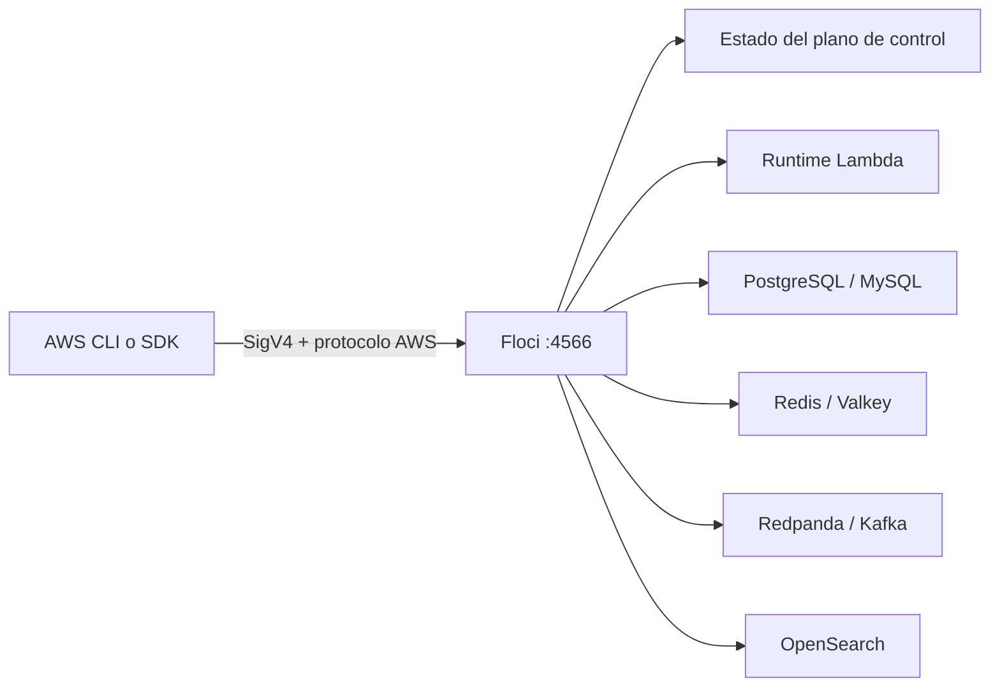
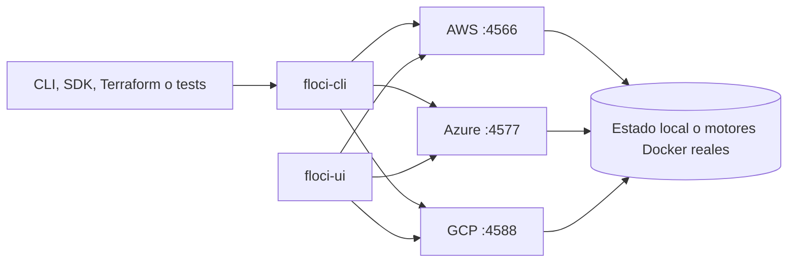
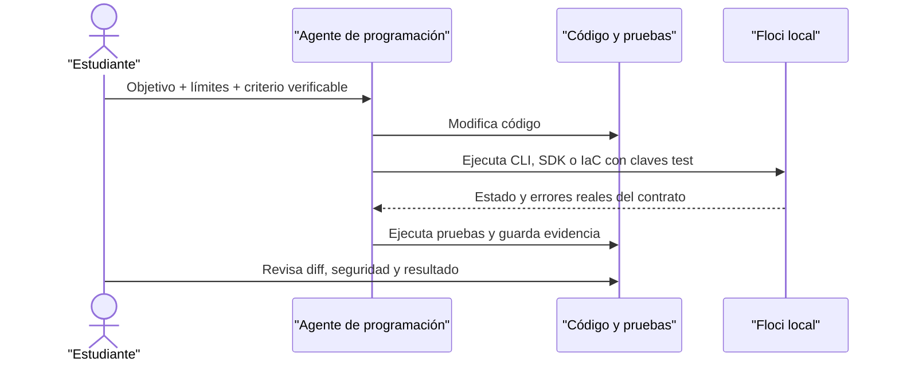
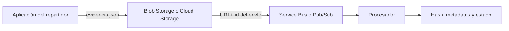
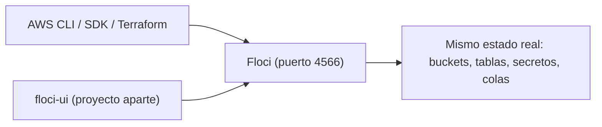

# Módulo 34: Floci oficial completo — plataforma, servicios y laboratorios

## Qué construirás y por qué importa

Crearás un laboratorio local multi-nube reproducible. Al terminar podrás instalar Floci desde cero, iniciar los tres proveedores, inspeccionarlos visualmente, conservar o aislar estado, ejecutar pruebas automatizadas y explicar con precisión qué valida el emulador y qué todavía debe comprobarse en una cuenta real.

Las fuentes principales son la [portada multi-nube](https://floci.io/), [Floci AWS](https://floci.io/aws/), [Floci Azure](https://floci.io/az/), [Floci GCP](https://floci.io/gcp/) y los [laboratorios 101](https://floci.io/labs/). También se consultan los repositorios mantenidos por `floci`, `floci-az`, `floci-gcp`, `floci-cli` y `floci-ui`. Esta lección no copia sus textos: reorganiza y explica sus capacidades en español con un recorrido educativo propio.


## Antes de empezar

- Docker debe responder a `docker version`.
- Debes reconocer una terminal y una variable de entorno.
- Crea una carpeta vacía `floci-oficial/` con `mkdir floci-oficial && cd floci-oficial` para guardar los comandos, archivos, resultados y errores que escribas durante el módulo.
- Nunca uses credenciales de producción. Los valores locales `test` no conceden acceso a AWS.

## Aprende construyendo


### Tema 1: Instalación en macOS, Linux y Windows · Avanzado · 45 min

<details open>
<summary><strong>Capa 1 — Lectura</strong></summary>

#### ► DE QUÉ TRATA
Al finalizar instalarás el entorno desde cero. Prerrequisitos: Docker y terminal; verifica docker --version.

#### ► LA IDEA EN UNA FRASE
**Al finalizar instalarás el entorno desde cero.**

#### ► POR QUÉ EXISTE ESTO
Resuelve un problema real de diseño o implementación y evita decisiones a ciegas.

#### ► LA ANALOGÍA
Piensa en instalación en macos, linux y windows como una herramienta de taller: útil cuando conoces su propósito y sus límites.
**Dónde se rompe la analogía:** en software, los efectos dependen del contexto, la escala y los trade-offs.

#### ► CÓMO FUNCIONA
1. Identifica el problema que instalación en macos, linux y windows resuelve.
2. Observa sus componentes y relaciones.
3. Aplica la opción más simple que funcione.
4. Verifica el resultado y los límites.

#### ► LO QUE PUEDE SALIR MAL
| Síntoma | Causa probable | Arreglo |
|---|---|---|
| Instalación en macOS, Linux y Windows se aplica pero el resultado no mejora | Se usó sin medir el problema real | Mide antes y compara contra la alternativa simple |
| Aparece complejidad inesperada | Se adoptó la técnica sin comprender sus trade-offs | Vuelve a la sección de trade-offs y reduce el alcance |
| Falla en un caso límite | Se asumió un contexto que no se cumple | Prueba el caso límite y documenta cuándo NO usarlo |

#### ► TRADE-OFFS
| Opción | Cuándo usarla | Cuándo NO usarla |
|---|---|---|
| Usar Instalación en macOS, Linux y Windows | Cuando el problema coincide con su propósito y el beneficio es observable | Cuando agrega complejidad sin resolver un problema real |
| Alternativa más simple | Cuando el contexto es pequeño, estable o fácil de razonar | Cuando ya demostró no escalar o no cumplir el requisito |
| Postergar la decisión | Cuando falta evidencia del problema | Cuando el costo de esperar es mayor que el costo de probar |

#### ► CUÁNDO NO USAR ESTO
No uses instalación en macos, linux y windows por defecto. Aplícalo cuando el problema lo justifique y puedas verificar el beneficio; si una alternativa más simple resuelve igual, prefiérela.

#### ► DE VUELTA A LA ANALOGÍA
Volviendo a la analogía: instalación en macos, linux y windows funciona como el modelo inicial, pero recuerda dónde se rompe: en producción importan la evidencia, la escala y el costo de equivocarte.

#### ► LO QUE DEBES RECORDAR
- Instalación en macOS, Linux y Windows existe para resolver un problema específico.
- Mide antes de adoptar complejidad.
- Conoce el caso donde NO usarlo.
- Verifica con evidencia observable.

#### ► PREGUNTAS PARA PENSAR
1. ¿Qué problema concreto resuelve instalación en macos, linux y windows en tu contexto?
2. ¿Cómo sabrías que instalación en macos, linux y windows no está funcionando bien?
3. ¿Qué alternativa más simple considerarías antes de usar instalación en macos, linux y windows?

</details>

<details>
<summary><strong>Capa 2 — Construcción</strong></summary>

#### Código y verificación
```bash
mkdir floci-install && cd floci-install
# guarda aquí el bloque «Practícalo tú» como tema-1-diagnostico.sh
bash tema-1-diagnostico.sh | tee install.md
```

```bash
# archivo: tema-1-diagnostico.sh — ejecutar con: bash tema-1-diagnostico.sh
docker version --format '{{.Server.Version}}'
floci version
floci doctor
```

</details>

### Tema 2: Modelo mental de la plataforma · Avanzado · 45 min

<details open>
<summary><strong>Capa 1 — Lectura</strong></summary>

#### ► DE QUÉ TRATA
Al finalizar explicarás la plataforma desde cero. Prerrequisitos: Docker y terminal; verifica docker --version.

#### ► LA IDEA EN UNA FRASE
**Al finalizar explicarás la plataforma desde cero.**

#### ► POR QUÉ EXISTE ESTO
Resuelve un problema real de diseño o implementación y evita decisiones a ciegas.

#### ► LA ANALOGÍA
Piensa en modelo mental de la plataforma como una herramienta de taller: útil cuando conoces su propósito y sus límites.
**Dónde se rompe la analogía:** en software, los efectos dependen del contexto, la escala y los trade-offs.

#### ► CÓMO FUNCIONA


#### ► LO QUE PUEDE SALIR MAL
| Síntoma | Causa probable | Arreglo |
|---|---|---|
| Modelo mental de la plataforma se aplica pero el resultado no mejora | Se usó sin medir el problema real | Mide antes y compara contra la alternativa simple |
| Aparece complejidad inesperada | Se adoptó la técnica sin comprender sus trade-offs | Vuelve a la sección de trade-offs y reduce el alcance |
| Falla en un caso límite | Se asumió un contexto que no se cumple | Prueba el caso límite y documenta cuándo NO usarlo |

#### ► TRADE-OFFS
| Opción | Cuándo usarla | Cuándo NO usarla |
|---|---|---|
| Usar Modelo mental de la plataforma | Cuando el problema coincide con su propósito y el beneficio es observable | Cuando agrega complejidad sin resolver un problema real |
| Alternativa más simple | Cuando el contexto es pequeño, estable o fácil de razonar | Cuando ya demostró no escalar o no cumplir el requisito |
| Postergar la decisión | Cuando falta evidencia del problema | Cuando el costo de esperar es mayor que el costo de probar |

#### ► CUÁNDO NO USAR ESTO
No uses modelo mental de la plataforma por defecto. Aplícalo cuando el problema lo justifique y puedas verificar el beneficio; si una alternativa más simple resuelve igual, prefiérela.

#### ► DE VUELTA A LA ANALOGÍA
Volviendo a la analogía: modelo mental de la plataforma funciona como el modelo inicial, pero recuerda dónde se rompe: en producción importan la evidencia, la escala y el costo de equivocarte.

#### ► LO QUE DEBES RECORDAR
- Modelo mental de la plataforma existe para resolver un problema específico.
- Mide antes de adoptar complejidad.
- Conoce el caso donde NO usarlo.
- Verifica con evidencia observable.

#### ► PREGUNTAS PARA PENSAR
1. ¿Qué problema concreto resuelve modelo mental de la plataforma en tu contexto?
2. ¿Cómo sabrías que modelo mental de la plataforma no está funcionando bien?
3. ¿Qué alternativa más simple considerarías antes de usar modelo mental de la plataforma?

</details>

<details>
<summary><strong>Capa 2 — Construcción</strong></summary>

#### Código y verificación




```bash
mkdir floci-model && cd floci-model
eval "$(floci env)"
QUEUE_URL=$(aws sqs create-queue --queue-name modelo-mental --query QueueUrl --output text)   # plano de gestión
aws sqs send-message --queue-url "$QUEUE_URL" --message-body "hola desde el plano de datos"  # plano de datos
aws sqs receive-message --queue-url "$QUEUE_URL" --query 'Messages[0].Body' --output text
```

</details>

### Tema 3: AWS CLI y SDK, Azure CLI y SDK, GCP CLI y SDK · Avanzado · 45 min

<details open>
<summary><strong>Capa 1 — Lectura</strong></summary>

#### ► DE QUÉ TRATA
Al finalizar vas a confirmar, en una sola sesión, que las tres CLI oficiales (AWS, Azure, GCP) apuntan de verdad a Floci y no a la nube real. Prerrequisitos: Módulo 0 completo.

#### ► LA IDEA EN UNA FRASE
**Al finalizar vas a confirmar, en una sola sesión, que las tres CLI oficiales (AWS, Azure, GCP) apuntan de verdad a Floci y no a la nube real.**

#### ► POR QUÉ EXISTE ESTO
Resuelve un problema real de diseño o implementación y evita decisiones a ciegas.

#### ► LA ANALOGÍA
Piensa en aws cli y sdk, azure cli y sdk, gcp cli y sdk como una herramienta de taller: útil cuando conoces su propósito y sus límites.
**Dónde se rompe la analogía:** en software, los efectos dependen del contexto, la escala y los trade-offs.

#### ► CÓMO FUNCIONA
1. Identifica el problema que aws cli y sdk, azure cli y sdk, gcp cli y sdk resuelve.
2. Observa sus componentes y relaciones.
3. Aplica la opción más simple que funcione.
4. Verifica el resultado y los límites.

#### ► LO QUE PUEDE SALIR MAL
| Síntoma | Causa probable | Arreglo |
|---|---|---|
| AWS CLI y SDK, Azure CLI y SDK, GCP CLI y SDK se aplica pero el resultado no mejora | Se usó sin medir el problema real | Mide antes y compara contra la alternativa simple |
| Aparece complejidad inesperada | Se adoptó la técnica sin comprender sus trade-offs | Vuelve a la sección de trade-offs y reduce el alcance |
| Falla en un caso límite | Se asumió un contexto que no se cumple | Prueba el caso límite y documenta cuándo NO usarlo |

#### ► TRADE-OFFS
| Opción | Cuándo usarla | Cuándo NO usarla |
|---|---|---|
| Usar AWS CLI y SDK, Azure CLI y SDK, GCP CLI y SDK | Cuando el problema coincide con su propósito y el beneficio es observable | Cuando agrega complejidad sin resolver un problema real |
| Alternativa más simple | Cuando el contexto es pequeño, estable o fácil de razonar | Cuando ya demostró no escalar o no cumplir el requisito |
| Postergar la decisión | Cuando falta evidencia del problema | Cuando el costo de esperar es mayor que el costo de probar |

#### ► CUÁNDO NO USAR ESTO
No uses aws cli y sdk, azure cli y sdk, gcp cli y sdk por defecto. Aplícalo cuando el problema lo justifique y puedas verificar el beneficio; si una alternativa más simple resuelve igual, prefiérela.

#### ► DE VUELTA A LA ANALOGÍA
Volviendo a la analogía: aws cli y sdk, azure cli y sdk, gcp cli y sdk funciona como el modelo inicial, pero recuerda dónde se rompe: en producción importan la evidencia, la escala y el costo de equivocarte.

#### ► LO QUE DEBES RECORDAR
- AWS CLI y SDK, Azure CLI y SDK, GCP CLI y SDK existe para resolver un problema específico.
- Mide antes de adoptar complejidad.
- Conoce el caso donde NO usarlo.
- Verifica con evidencia observable.

#### ► PREGUNTAS PARA PENSAR
1. ¿Qué problema concreto resuelve aws cli y sdk, azure cli y sdk, gcp cli y sdk en tu contexto?
2. ¿Cómo sabrías que aws cli y sdk, azure cli y sdk, gcp cli y sdk no está funcionando bien?
3. ¿Qué alternativa más simple considerarías antes de usar aws cli y sdk, azure cli y sdk, gcp cli y sdk?

</details>

<details>
<summary><strong>Capa 2 — Construcción</strong></summary>

#### Código y verificación
```bash
mkdir ejemplo && cd ejemplo && floci start
```

```bash
eval "$(floci env)"
echo "AWS -> $AWS_ENDPOINT_URL"
eval "$(floci az env)"
echo "Azure -> $AZURE_STORAGE_CONNECTION_STRING" | grep -o 'BlobEndpoint=[^;]*'
eval "$(floci gcp env)"
echo "GCP storage -> $STORAGE_EMULATOR_HOST"
```

```bash
# archivo: tema-3-tres-clis.sh — ejecutar con: bash tema-3-tres-clis.sh
eval "$(floci env)"
echo "AWS -> $AWS_ENDPOINT_URL"
eval "$(floci az env)"
echo "Azure -> $AZURE_STORAGE_CONNECTION_STRING" | grep -o 'BlobEndpoint=[^;]*'
eval "$(floci gcp env)"
echo "GCP storage -> $STORAGE_EMULATOR_HOST"
```

</details>

### Tema 4: Configuración avanzada y ciclo de vida · Avanzado · 45 min

<details open>
<summary><strong>Capa 1 — Lectura</strong></summary>

#### ► DE QUÉ TRATA
Al finalizar administrarás configuración desde cero. Prerrequisitos: Docker y terminal; verifica docker --version.

#### ► LA IDEA EN UNA FRASE
**Al finalizar administrarás configuración desde cero.**

#### ► POR QUÉ EXISTE ESTO
Resuelve un problema real de diseño o implementación y evita decisiones a ciegas.

#### ► LA ANALOGÍA
Piensa en configuración avanzada y ciclo de vida como una herramienta de taller: útil cuando conoces su propósito y sus límites.
**Dónde se rompe la analogía:** en software, los efectos dependen del contexto, la escala y los trade-offs.

#### ► CÓMO FUNCIONA
1. Identifica el problema que configuración avanzada y ciclo de vida resuelve.
2. Observa sus componentes y relaciones.
3. Aplica la opción más simple que funcione.
4. Verifica el resultado y los límites.

#### ► LO QUE PUEDE SALIR MAL
| Síntoma | Causa probable | Arreglo |
|---|---|---|
| Configuración avanzada y ciclo de vida se aplica pero el resultado no mejora | Se usó sin medir el problema real | Mide antes y compara contra la alternativa simple |
| Aparece complejidad inesperada | Se adoptó la técnica sin comprender sus trade-offs | Vuelve a la sección de trade-offs y reduce el alcance |
| Falla en un caso límite | Se asumió un contexto que no se cumple | Prueba el caso límite y documenta cuándo NO usarlo |

#### ► TRADE-OFFS
| Opción | Cuándo usarla | Cuándo NO usarla |
|---|---|---|
| Usar Configuración avanzada y ciclo de vida | Cuando el problema coincide con su propósito y el beneficio es observable | Cuando agrega complejidad sin resolver un problema real |
| Alternativa más simple | Cuando el contexto es pequeño, estable o fácil de razonar | Cuando ya demostró no escalar o no cumplir el requisito |
| Postergar la decisión | Cuando falta evidencia del problema | Cuando el costo de esperar es mayor que el costo de probar |

#### ► CUÁNDO NO USAR ESTO
No uses configuración avanzada y ciclo de vida por defecto. Aplícalo cuando el problema lo justifique y puedas verificar el beneficio; si una alternativa más simple resuelve igual, prefiérela.

#### ► DE VUELTA A LA ANALOGÍA
Volviendo a la analogía: configuración avanzada y ciclo de vida funciona como el modelo inicial, pero recuerda dónde se rompe: en producción importan la evidencia, la escala y el costo de equivocarte.

#### ► LO QUE DEBES RECORDAR
- Configuración avanzada y ciclo de vida existe para resolver un problema específico.
- Mide antes de adoptar complejidad.
- Conoce el caso donde NO usarlo.
- Verifica con evidencia observable.

#### ► PREGUNTAS PARA PENSAR
1. ¿Qué problema concreto resuelve configuración avanzada y ciclo de vida en tu contexto?
2. ¿Cómo sabrías que configuración avanzada y ciclo de vida no está funcionando bien?
3. ¿Qué alternativa más simple considerarías antes de usar configuración avanzada y ciclo de vida?

</details>

<details>
<summary><strong>Capa 2 — Construcción</strong></summary>

#### Código y verificación
```bash
# archivo: tema-4-persistencia.sh — ejecutar con: bash tema-4-persistencia.sh
floci start --persist ./data
aws s3 mb s3://demo-persistente
floci snapshot save antes-de-reiniciar
floci stop && floci start --persist ./data
aws s3 ls | grep demo-persistente
```

```bash
mkdir floci-lifecycle && cd floci-lifecycle
eval "$(floci env)"
# guarda aquí el bloque «Practícalo tú» como tema-4-persistencia.sh
bash tema-4-persistencia.sh | tee lifecycle.md
```

</details>

### Tema 5: Automatización, UI y agentes · Avanzado · 45 min

<details open>
<summary><strong>Capa 1 — Lectura</strong></summary>

#### ► DE QUÉ TRATA
Al finalizar vas a darle a un agente de programación un entorno local seguro para operar sobre RutaFlow, con un contrato verificable y sin credenciales reales. Prerrequisitos: Tema 3 de este módulo.

#### ► LA IDEA EN UNA FRASE
**Al finalizar vas a darle a un agente de programación un entorno local seguro para operar sobre RutaFlow, con un contrato verificable y sin credenciales reales.**

#### ► POR QUÉ EXISTE ESTO
Resuelve un problema real de diseño o implementación y evita decisiones a ciegas.

#### ► LA ANALOGÍA
Piensa en automatización, ui y agentes como una herramienta de taller: útil cuando conoces su propósito y sus límites.
**Dónde se rompe la analogía:** en software, los efectos dependen del contexto, la escala y los trade-offs.

#### ► CÓMO FUNCIONA


#### ► LO QUE PUEDE SALIR MAL
| Síntoma | Causa probable | Arreglo |
|---|---|---|
| Automatización, UI y agentes se aplica pero el resultado no mejora | Se usó sin medir el problema real | Mide antes y compara contra la alternativa simple |
| Aparece complejidad inesperada | Se adoptó la técnica sin comprender sus trade-offs | Vuelve a la sección de trade-offs y reduce el alcance |
| Falla en un caso límite | Se asumió un contexto que no se cumple | Prueba el caso límite y documenta cuándo NO usarlo |

#### ► TRADE-OFFS
| Opción | Cuándo usarla | Cuándo NO usarla |
|---|---|---|
| Usar Automatización, UI y agentes | Cuando el problema coincide con su propósito y el beneficio es observable | Cuando agrega complejidad sin resolver un problema real |
| Alternativa más simple | Cuando el contexto es pequeño, estable o fácil de razonar | Cuando ya demostró no escalar o no cumplir el requisito |
| Postergar la decisión | Cuando falta evidencia del problema | Cuando el costo de esperar es mayor que el costo de probar |

#### ► CUÁNDO NO USAR ESTO
No uses automatización, ui y agentes por defecto. Aplícalo cuando el problema lo justifique y puedas verificar el beneficio; si una alternativa más simple resuelve igual, prefiérela.

#### ► DE VUELTA A LA ANALOGÍA
Volviendo a la analogía: automatización, ui y agentes funciona como el modelo inicial, pero recuerda dónde se rompe: en producción importan la evidencia, la escala y el costo de equivocarte.

#### ► LO QUE DEBES RECORDAR
- Automatización, UI y agentes existe para resolver un problema específico.
- Mide antes de adoptar complejidad.
- Conoce el caso donde NO usarlo.
- Verifica con evidencia observable.

#### ► PREGUNTAS PARA PENSAR
1. ¿Qué problema concreto resuelve automatización, ui y agentes en tu contexto?
2. ¿Cómo sabrías que automatización, ui y agentes no está funcionando bien?
3. ¿Qué alternativa más simple considerarías antes de usar automatización, ui y agentes?

</details>

<details>
<summary><strong>Capa 2 — Construcción</strong></summary>

#### Código y verificación
```dotenv
AWS_ENDPOINT_URL=http://localhost:4566
AWS_DEFAULT_REGION=us-east-1
AWS_ACCESS_KEY_ID=test
AWS_SECRET_ACCESS_KEY=test
```

```bash
floci start
eval "$(floci env)"
test "$AWS_ENDPOINT_URL" = "http://localhost:4566"
aws s3 mb s3://agente-seguro
aws s3api head-bucket --bucket agente-seguro
```


```bash
mkdir ejemplo && cd ejemplo && floci start
```

```bash
floci start
eval "$(floci env)"
test "$AWS_ENDPOINT_URL" = "http://localhost:4566"
aws s3 mb s3://agente-seguro
aws s3api head-bucket --bucket agente-seguro
```

</details>

### Tema 6: Servicios AWS incorporados en la documentación actual · Avanzado · 45 min

<details open>
<summary><strong>Capa 1 — Lectura</strong></summary>

#### ► DE QUÉ TRATA
Al finalizar vas a probar un servicio AWS que ningún módulo anterior cubrió (AWS Batch), aplicando el mismo patrón crear→describir que ya usaste una docena de veces en este track. Prerrequisitos: Módulo 14 completo.

#### ► LA IDEA EN UNA FRASE
**Al finalizar vas a probar un servicio AWS que ningún módulo anterior cubrió (AWS Batch), aplicando el mismo patrón crear→describir que ya usaste una docena de veces en este track.**

#### ► POR QUÉ EXISTE ESTO
Resuelve un problema real de diseño o implementación y evita decisiones a ciegas.

#### ► LA ANALOGÍA
Piensa en servicios aws incorporados en la documentación actual como una herramienta de taller: útil cuando conoces su propósito y sus límites.
**Dónde se rompe la analogía:** en software, los efectos dependen del contexto, la escala y los trade-offs.

#### ► CÓMO FUNCIONA
1. Identifica el problema que servicios aws incorporados en la documentación actual resuelve.
2. Observa sus componentes y relaciones.
3. Aplica la opción más simple que funcione.
4. Verifica el resultado y los límites.

#### ► LO QUE PUEDE SALIR MAL
| Síntoma | Causa probable | Arreglo |
|---|---|---|
| Servicios AWS incorporados en la documentación actual se aplica pero el resultado no mejora | Se usó sin medir el problema real | Mide antes y compara contra la alternativa simple |
| Aparece complejidad inesperada | Se adoptó la técnica sin comprender sus trade-offs | Vuelve a la sección de trade-offs y reduce el alcance |
| Falla en un caso límite | Se asumió un contexto que no se cumple | Prueba el caso límite y documenta cuándo NO usarlo |

#### ► TRADE-OFFS
| Opción | Cuándo usarla | Cuándo NO usarla |
|---|---|---|
| Usar Servicios AWS incorporados en la documentación actual | Cuando el problema coincide con su propósito y el beneficio es observable | Cuando agrega complejidad sin resolver un problema real |
| Alternativa más simple | Cuando el contexto es pequeño, estable o fácil de razonar | Cuando ya demostró no escalar o no cumplir el requisito |
| Postergar la decisión | Cuando falta evidencia del problema | Cuando el costo de esperar es mayor que el costo de probar |

#### ► CUÁNDO NO USAR ESTO
No uses servicios aws incorporados en la documentación actual por defecto. Aplícalo cuando el problema lo justifique y puedas verificar el beneficio; si una alternativa más simple resuelve igual, prefiérela.

#### ► DE VUELTA A LA ANALOGÍA
Volviendo a la analogía: servicios aws incorporados en la documentación actual funciona como el modelo inicial, pero recuerda dónde se rompe: en producción importan la evidencia, la escala y el costo de equivocarte.

#### ► LO QUE DEBES RECORDAR
- Servicios AWS incorporados en la documentación actual existe para resolver un problema específico.
- Mide antes de adoptar complejidad.
- Conoce el caso donde NO usarlo.
- Verifica con evidencia observable.

#### ► PREGUNTAS PARA PENSAR
1. ¿Qué problema concreto resuelve servicios aws incorporados en la documentación actual en tu contexto?
2. ¿Cómo sabrías que servicios aws incorporados en la documentación actual no está funcionando bien?
3. ¿Qué alternativa más simple considerarías antes de usar servicios aws incorporados en la documentación actual?

</details>

<details>
<summary><strong>Capa 2 — Construcción</strong></summary>

#### Código y verificación
```bash
# archivo: tema-6-servicio-nuevo.sh — ejecutar con: bash tema-6-servicio-nuevo.sh
aws batch create-compute-environment --compute-environment-name demo-batch \
  --type MANAGED --state ENABLED
aws batch describe-compute-environments --compute-environments demo-batch \
  --query 'computeEnvironments[0].state'
```

```bash
aws batch create-compute-environment --compute-environment-name demo-batch \
  --type MANAGED --state ENABLED
aws batch describe-compute-environments --compute-environments demo-batch \
  --query 'computeEnvironments[0].state'
```

</details>

### Tema 7: Servicios Azure que completan el recorrido · Avanzado · 45 min

<details open>
<summary><strong>Capa 1 — Lectura</strong></summary>

#### ► DE QUÉ TRATA
Al finalizar vas a guardar y recuperar una evidencia real de entrega (RF-101) en Azure Blob Storage, confirmando que el ciclo completo funciona local. Prerrequisitos: Módulo 8 completo.

#### ► LA IDEA EN UNA FRASE
**Al finalizar vas a guardar y recuperar una evidencia real de entrega (RF-101) en Azure Blob Storage, confirmando que el ciclo completo funciona local.**

#### ► POR QUÉ EXISTE ESTO
Resuelve un problema real de diseño o implementación y evita decisiones a ciegas.

#### ► LA ANALOGÍA
Piensa en servicios azure que completan el recorrido como una herramienta de taller: útil cuando conoces su propósito y sus límites.
**Dónde se rompe la analogía:** en software, los efectos dependen del contexto, la escala y los trade-offs.

#### ► CÓMO FUNCIONA
1. Identifica el problema que servicios azure que completan el recorrido resuelve.
2. Observa sus componentes y relaciones.
3. Aplica la opción más simple que funcione.
4. Verifica el resultado y los límites.

#### ► LO QUE PUEDE SALIR MAL
| Síntoma | Causa probable | Arreglo |
|---|---|---|
| Servicios Azure que completan el recorrido se aplica pero el resultado no mejora | Se usó sin medir el problema real | Mide antes y compara contra la alternativa simple |
| Aparece complejidad inesperada | Se adoptó la técnica sin comprender sus trade-offs | Vuelve a la sección de trade-offs y reduce el alcance |
| Falla en un caso límite | Se asumió un contexto que no se cumple | Prueba el caso límite y documenta cuándo NO usarlo |

#### ► TRADE-OFFS
| Opción | Cuándo usarla | Cuándo NO usarla |
|---|---|---|
| Usar Servicios Azure que completan el recorrido | Cuando el problema coincide con su propósito y el beneficio es observable | Cuando agrega complejidad sin resolver un problema real |
| Alternativa más simple | Cuando el contexto es pequeño, estable o fácil de razonar | Cuando ya demostró no escalar o no cumplir el requisito |
| Postergar la decisión | Cuando falta evidencia del problema | Cuando el costo de esperar es mayor que el costo de probar |

#### ► CUÁNDO NO USAR ESTO
No uses servicios azure que completan el recorrido por defecto. Aplícalo cuando el problema lo justifique y puedas verificar el beneficio; si una alternativa más simple resuelve igual, prefiérela.

#### ► DE VUELTA A LA ANALOGÍA
Volviendo a la analogía: servicios azure que completan el recorrido funciona como el modelo inicial, pero recuerda dónde se rompe: en producción importan la evidencia, la escala y el costo de equivocarte.

#### ► LO QUE DEBES RECORDAR
- Servicios Azure que completan el recorrido existe para resolver un problema específico.
- Mide antes de adoptar complejidad.
- Conoce el caso donde NO usarlo.
- Verifica con evidencia observable.

#### ► PREGUNTAS PARA PENSAR
1. ¿Qué problema concreto resuelve servicios azure que completan el recorrido en tu contexto?
2. ¿Cómo sabrías que servicios azure que completan el recorrido no está funcionando bien?
3. ¿Qué alternativa más simple considerarías antes de usar servicios azure que completan el recorrido?

</details>

<details>
<summary><strong>Capa 2 — Construcción</strong></summary>

#### Código y verificación
```bash
mkdir azure-blob
cd azure-blob
printf '{"envio":"RF-101","estado":"recibido"}\n' > evidencia.json
az storage container create --name evidencias --connection-string "$AZURE_STORAGE_CONNECTION_STRING"
az storage blob upload --container-name evidencias --name RF-101.json --file evidencia.json --connection-string "$AZURE_STORAGE_CONNECTION_STRING"
az storage blob download --container-name evidencias --name RF-101.json --file recuperada.json --connection-string "$AZURE_STORAGE_CONNECTION_STRING"
cmp evidencia.json recuperada.json
```

```bash
mkdir ejemplo && cd ejemplo && floci start
```

```bash
eval "$(floci az env)"
mkdir azure-blob && cd azure-blob
printf '{"envio":"RF-101","estado":"recibido"}\n' > evidencia.json
az storage container create --name evidencias --connection-string "$AZURE_STORAGE_CONNECTION_STRING"
az storage blob upload --container-name evidencias --name RF-101.json --file evidencia.json --connection-string "$AZURE_STORAGE_CONNECTION_STRING"
az storage blob download --container-name evidencias --name RF-101.json --file recuperada.json --connection-string "$AZURE_STORAGE_CONNECTION_STRING"
cmp evidencia.json recuperada.json
```

</details>

### Tema 8: Servicios GCP que completan el recorrido · Avanzado · 45 min

<details open>
<summary><strong>Capa 1 — Lectura</strong></summary>

#### ► DE QUÉ TRATA
Al finalizar vas a guardar y recuperar el evento RF-102 en Cloud Storage con un proyecto local explícito, sin que gcloud intente autenticarse contra GCP real. Prerrequisitos: Módulo 8 completo.

#### ► LA IDEA EN UNA FRASE
**Al finalizar vas a guardar y recuperar el evento RF-102 en Cloud Storage con un proyecto local explícito, sin que gcloud intente autenticarse contra GCP real.**

#### ► POR QUÉ EXISTE ESTO
Resuelve un problema real de diseño o implementación y evita decisiones a ciegas.

#### ► LA ANALOGÍA
Piensa en servicios gcp que completan el recorrido como una herramienta de taller: útil cuando conoces su propósito y sus límites.
**Dónde se rompe la analogía:** en software, los efectos dependen del contexto, la escala y los trade-offs.

#### ► CÓMO FUNCIONA


#### ► LO QUE PUEDE SALIR MAL
| Síntoma | Causa probable | Arreglo |
|---|---|---|
| Servicios GCP que completan el recorrido se aplica pero el resultado no mejora | Se usó sin medir el problema real | Mide antes y compara contra la alternativa simple |
| Aparece complejidad inesperada | Se adoptó la técnica sin comprender sus trade-offs | Vuelve a la sección de trade-offs y reduce el alcance |
| Falla en un caso límite | Se asumió un contexto que no se cumple | Prueba el caso límite y documenta cuándo NO usarlo |

#### ► TRADE-OFFS
| Opción | Cuándo usarla | Cuándo NO usarla |
|---|---|---|
| Usar Servicios GCP que completan el recorrido | Cuando el problema coincide con su propósito y el beneficio es observable | Cuando agrega complejidad sin resolver un problema real |
| Alternativa más simple | Cuando el contexto es pequeño, estable o fácil de razonar | Cuando ya demostró no escalar o no cumplir el requisito |
| Postergar la decisión | Cuando falta evidencia del problema | Cuando el costo de esperar es mayor que el costo de probar |

#### ► CUÁNDO NO USAR ESTO
No uses servicios gcp que completan el recorrido por defecto. Aplícalo cuando el problema lo justifique y puedas verificar el beneficio; si una alternativa más simple resuelve igual, prefiérela.

#### ► DE VUELTA A LA ANALOGÍA
Volviendo a la analogía: servicios gcp que completan el recorrido funciona como el modelo inicial, pero recuerda dónde se rompe: en producción importan la evidencia, la escala y el costo de equivocarte.

#### ► LO QUE DEBES RECORDAR
- Servicios GCP que completan el recorrido existe para resolver un problema específico.
- Mide antes de adoptar complejidad.
- Conoce el caso donde NO usarlo.
- Verifica con evidencia observable.

#### ► PREGUNTAS PARA PENSAR
1. ¿Qué problema concreto resuelve servicios gcp que completan el recorrido en tu contexto?
2. ¿Cómo sabrías que servicios gcp que completan el recorrido no está funcionando bien?
3. ¿Qué alternativa más simple considerarías antes de usar servicios gcp que completan el recorrido?

</details>

<details>
<summary><strong>Capa 2 — Construcción</strong></summary>

#### Código y verificación
```bash
export CLOUDSDK_API_ENDPOINT_OVERRIDES_STORAGE=http://localhost:4588/   # gcloud ignora STORAGE_EMULATOR_HOST
export CLOUDSDK_CORE_PROJECT=floci-local CLOUDSDK_AUTH_ACCESS_TOKEN=floci
mkdir gcp-storage
cd gcp-storage
printf '{"envio":"RF-102","estado":"en-ruta"}\n' > evento.json
gcloud storage buckets create gs://demo-local
gcloud storage cp evento.json gs://demo-local/eventos/RF-102.json
gcloud storage ls gs://demo-local/eventos/
gcloud storage cp gs://demo-local/eventos/RF-102.json recuperado.json
cmp evento.json recuperado.json
```


```bash
eval "$(floci gcp env)"
export CLOUDSDK_API_ENDPOINT_OVERRIDES_STORAGE=http://localhost:4588/   # gcloud ignora STORAGE_EMULATOR_HOST
export CLOUDSDK_CORE_PROJECT=floci-local CLOUDSDK_AUTH_ACCESS_TOKEN=floci
mkdir gcp-storage && cd gcp-storage
printf '{"envio":"RF-102","estado":"en-ruta"}\n' > evento.json
gcloud storage buckets create gs://demo-local
gcloud storage cp evento.json gs://demo-local/eventos/RF-102.json
gcloud storage cp gs://demo-local/eventos/RF-102.json recuperado.json
cmp evento.json recuperado.json
```

</details>

### Tema 9: floci-ui — explorador visual multi-nube · Avanzado · 45 min

<details open>
<summary><strong>Capa 1 — Lectura</strong></summary>

#### ► DE QUÉ TRATA
Al finalizar vas a conectar floci-ui (el panel oficial, un repositorio separado del propio Floci) al runtime local que ya tenés corriendo, crear un secreto en Secrets Manager desde CLI, y editarlo visualmente con el editor JSON clave-valor de la UI — confirmando que ambas vías op…

#### ► LA IDEA EN UNA FRASE
**Al finalizar vas a conectar floci-ui (el panel oficial, un repositorio separado del propio Floci) al runtime local que ya tenés corriendo, crear un secreto en Secrets Manager desde CLI, y editarlo visualmente con el editor JSON clave-valor de la UI — confirmando que ambas vías operan sobre el mismo estado real, no datos de muestra.**

#### ► POR QUÉ EXISTE ESTO
Resuelve un problema real de diseño o implementación y evita decisiones a ciegas.

#### ► LA ANALOGÍA
Piensa en floci-ui — explorador visual multi-nube como una herramienta de taller: útil cuando conoces su propósito y sus límites.
**Dónde se rompe la analogía:** en software, los efectos dependen del contexto, la escala y los trade-offs.

#### ► CÓMO FUNCIONA


#### ► LO QUE PUEDE SALIR MAL
| Síntoma | Causa probable | Arreglo |
|---|---|---|
| floci-ui — explorador visual multi-nube se aplica pero el resultado no mejora | Se usó sin medir el problema real | Mide antes y compara contra la alternativa simple |
| Aparece complejidad inesperada | Se adoptó la técnica sin comprender sus trade-offs | Vuelve a la sección de trade-offs y reduce el alcance |
| Falla en un caso límite | Se asumió un contexto que no se cumple | Prueba el caso límite y documenta cuándo NO usarlo |

#### ► TRADE-OFFS
| Opción | Cuándo usarla | Cuándo NO usarla |
|---|---|---|
| Usar floci-ui — explorador visual multi-nube | Cuando el problema coincide con su propósito y el beneficio es observable | Cuando agrega complejidad sin resolver un problema real |
| Alternativa más simple | Cuando el contexto es pequeño, estable o fácil de razonar | Cuando ya demostró no escalar o no cumplir el requisito |
| Postergar la decisión | Cuando falta evidencia del problema | Cuando el costo de esperar es mayor que el costo de probar |

#### ► CUÁNDO NO USAR ESTO
No uses floci-ui — explorador visual multi-nube por defecto. Aplícalo cuando el problema lo justifique y puedas verificar el beneficio; si una alternativa más simple resuelve igual, prefiérela.

#### ► DE VUELTA A LA ANALOGÍA
Volviendo a la analogía: floci-ui — explorador visual multi-nube funciona como el modelo inicial, pero recuerda dónde se rompe: en producción importan la evidencia, la escala y el costo de equivocarte.

#### ► LO QUE DEBES RECORDAR
- floci-ui — explorador visual multi-nube existe para resolver un problema específico.
- Mide antes de adoptar complejidad.
- Conoce el caso donde NO usarlo.
- Verifica con evidencia observable.

#### ► PREGUNTAS PARA PENSAR
1. ¿Qué problema concreto resuelve floci-ui — explorador visual multi-nube en tu contexto?
2. ¿Cómo sabrías que floci-ui — explorador visual multi-nube no está funcionando bien?
3. ¿Qué alternativa más simple considerarías antes de usar floci-ui — explorador visual multi-nube?

</details>

<details>
<summary><strong>Capa 2 — Construcción</strong></summary>

#### Código y verificación


```bash
# en una carpeta aparte, fuera de este repo
git clone https://github.com/floci-io/floci-ui
cd floci-ui
docker compose up
```

```bash
aws secretsmanager create-secret --name rutaflow/api-key --secret-string '{"key":"valor-inicial"}'
```

</details>

### Tema 10: Laboratorios oficiales reconstruidos en español · Avanzado · 45 min

<details open>
<summary><strong>Capa 1 — Lectura</strong></summary>

#### ► DE QUÉ TRATA
Al finalizar completarás un laboratorio desde cero. Prerrequisitos: Docker y terminal; verifica docker --version.

#### ► LA IDEA EN UNA FRASE
**Al finalizar completarás un laboratorio desde cero.**

#### ► POR QUÉ EXISTE ESTO
Resuelve un problema real de diseño o implementación y evita decisiones a ciegas.

#### ► LA ANALOGÍA
Piensa en laboratorios oficiales reconstruidos en español como una herramienta de taller: útil cuando conoces su propósito y sus límites.
**Dónde se rompe la analogía:** en software, los efectos dependen del contexto, la escala y los trade-offs.

#### ► CÓMO FUNCIONA
1. Identifica el problema que laboratorios oficiales reconstruidos en español resuelve.
2. Observa sus componentes y relaciones.
3. Aplica la opción más simple que funcione.
4. Verifica el resultado y los límites.

#### ► LO QUE PUEDE SALIR MAL
| Síntoma | Causa probable | Arreglo |
|---|---|---|
| Laboratorios oficiales reconstruidos en español se aplica pero el resultado no mejora | Se usó sin medir el problema real | Mide antes y compara contra la alternativa simple |
| Aparece complejidad inesperada | Se adoptó la técnica sin comprender sus trade-offs | Vuelve a la sección de trade-offs y reduce el alcance |
| Falla en un caso límite | Se asumió un contexto que no se cumple | Prueba el caso límite y documenta cuándo NO usarlo |

#### ► TRADE-OFFS
| Opción | Cuándo usarla | Cuándo NO usarla |
|---|---|---|
| Usar Laboratorios oficiales reconstruidos en español | Cuando el problema coincide con su propósito y el beneficio es observable | Cuando agrega complejidad sin resolver un problema real |
| Alternativa más simple | Cuando el contexto es pequeño, estable o fácil de razonar | Cuando ya demostró no escalar o no cumplir el requisito |
| Postergar la decisión | Cuando falta evidencia del problema | Cuando el costo de esperar es mayor que el costo de probar |

#### ► CUÁNDO NO USAR ESTO
No uses laboratorios oficiales reconstruidos en español por defecto. Aplícalo cuando el problema lo justifique y puedas verificar el beneficio; si una alternativa más simple resuelve igual, prefiérela.

#### ► DE VUELTA A LA ANALOGÍA
Volviendo a la analogía: laboratorios oficiales reconstruidos en español funciona como el modelo inicial, pero recuerda dónde se rompe: en producción importan la evidencia, la escala y el costo de equivocarte.

#### ► LO QUE DEBES RECORDAR
- Laboratorios oficiales reconstruidos en español existe para resolver un problema específico.
- Mide antes de adoptar complejidad.
- Conoce el caso donde NO usarlo.
- Verifica con evidencia observable.

#### ► PREGUNTAS PARA PENSAR
1. ¿Qué problema concreto resuelve laboratorios oficiales reconstruidos en español en tu contexto?
2. ¿Cómo sabrías que laboratorios oficiales reconstruidos en español no está funcionando bien?
3. ¿Qué alternativa más simple considerarías antes de usar laboratorios oficiales reconstruidos en español?

</details>

<details>
<summary><strong>Capa 2 — Construcción</strong></summary>

#### Código y verificación
```bash
mkdir floci-lab && cd floci-lab
eval "$(floci env)"
# guarda aquí el bloque «Practícalo tú» como tema-10-s3-101.sh
bash tema-10-s3-101.sh | tee lab.md
aws s3 rb s3://demo-101 --force   # limpieza
```

```bash
# archivo: tema-10-s3-101.sh — ejecutar con: bash tema-10-s3-101.sh
aws s3 mb s3://demo-101
echo "manifiesto de prueba" > manifiesto.txt
aws s3 cp manifiesto.txt s3://demo-101/
URL=$(aws s3 presign s3://demo-101/manifiesto.txt --expires-in 30)
curl -s -o /dev/null -w "%{http_code}\n" "$URL"
sleep 31
curl -s -o /dev/null -w "%{http_code}\n" "$URL"
```

</details>

### Tema 11: Límites y transferencia a producción · Avanzado · 45 min

<details open>
<summary><strong>Capa 1 — Lectura</strong></summary>

#### ► DE QUÉ TRATA
Al finalizar podrás decidir qué validar en producción desde cero. Prerrequisitos: Docker y Node.js; verifica node --version.

#### ► LA IDEA EN UNA FRASE
**Al finalizar podrás decidir qué validar en producción desde cero.**

#### ► POR QUÉ EXISTE ESTO
Resuelve un problema real de diseño o implementación y evita decisiones a ciegas.

#### ► LA ANALOGÍA
Piensa en límites y transferencia a producción como una herramienta de taller: útil cuando conoces su propósito y sus límites.
**Dónde se rompe la analogía:** en software, los efectos dependen del contexto, la escala y los trade-offs.

#### ► CÓMO FUNCIONA
1. Identifica el problema que límites y transferencia a producción resuelve.
2. Observa sus componentes y relaciones.
3. Aplica la opción más simple que funcione.
4. Verifica el resultado y los límites.

#### ► LO QUE PUEDE SALIR MAL
| Síntoma | Causa probable | Arreglo |
|---|---|---|
| Límites y transferencia a producción se aplica pero el resultado no mejora | Se usó sin medir el problema real | Mide antes y compara contra la alternativa simple |
| Aparece complejidad inesperada | Se adoptó la técnica sin comprender sus trade-offs | Vuelve a la sección de trade-offs y reduce el alcance |
| Falla en un caso límite | Se asumió un contexto que no se cumple | Prueba el caso límite y documenta cuándo NO usarlo |

#### ► TRADE-OFFS
| Opción | Cuándo usarla | Cuándo NO usarla |
|---|---|---|
| Usar Límites y transferencia a producción | Cuando el problema coincide con su propósito y el beneficio es observable | Cuando agrega complejidad sin resolver un problema real |
| Alternativa más simple | Cuando el contexto es pequeño, estable o fácil de razonar | Cuando ya demostró no escalar o no cumplir el requisito |
| Postergar la decisión | Cuando falta evidencia del problema | Cuando el costo de esperar es mayor que el costo de probar |

#### ► CUÁNDO NO USAR ESTO
No uses límites y transferencia a producción por defecto. Aplícalo cuando el problema lo justifique y puedas verificar el beneficio; si una alternativa más simple resuelve igual, prefiérela.

#### ► DE VUELTA A LA ANALOGÍA
Volviendo a la analogía: límites y transferencia a producción funciona como el modelo inicial, pero recuerda dónde se rompe: en producción importan la evidencia, la escala y el costo de equivocarte.

#### ► LO QUE DEBES RECORDAR
- Límites y transferencia a producción existe para resolver un problema específico.
- Mide antes de adoptar complejidad.
- Conoce el caso donde NO usarlo.
- Verifica con evidencia observable.

#### ► PREGUNTAS PARA PENSAR
1. ¿Qué problema concreto resuelve límites y transferencia a producción en tu contexto?
2. ¿Cómo sabrías que límites y transferencia a producción no está funcionando bien?
3. ¿Qué alternativa más simple considerarías antes de usar límites y transferencia a producción?

</details>

<details>
<summary><strong>Capa 2 — Construcción</strong></summary>

#### Código y verificación
```bash
mkdir floci-limits && cd floci-limits
# guarda aquí el bloque «Practícalo tú» como tema-11-matriz-de-limites.sh
bash tema-11-matriz-de-limites.sh
```

```bash
# archivo: tema-11-matriz-de-limites.sh — ejecutar con: bash tema-11-matriz-de-limites.sh
cat <<'EOF' > matriz-limites.md
| Capacidad | Validado localmente | Requiere nube real | Riesgo si se omite |
|---|---|---|---|
| Contrato SDK/CLI de S3 | Sí | No | Bajo |
| Latencia multi-región | No | Sí | Medio |
| IAM organizacional y SCPs | No | Sí | Alto |
| Facturación real | No | Sí | Alto |
EOF
cat matriz-limites.md
```

</details>
