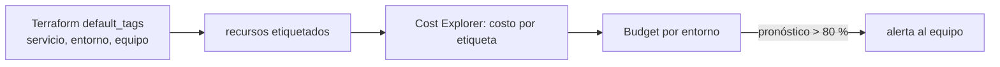

# Módulo 34: DevOps y este curso — del laboratorio a la nube


## Aprende construyendo


### Tema 1: De cloud local a un proveedor cloud real · Avanzado · 20 min

<details open>
<summary><strong>Capa 1 — Lectura</strong></summary>

#### ► DE QUÉ TRATA
Al finalizar podrás identificar exactamente qué dos configuraciones cambian al migrar un proyecto Terraform de Floci (local) a un proveedor cloud real.

</details>

<details>
<summary><strong>Capa 2 — Construcción</strong></summary>

#### Código y verificación
```
┌── Terraform contra Floci (local) ────────┐   ┌── Terraform contra AWS real ─────────┐
│ endpoints = { s3 = "http://localhost:4566" } │   │ region = "us-east-1"                        │
│ credenciales: test/test                          │   │ (sin endpoint personalizado: apunta directo) │
└─────────────────────────────────┘   │ credenciales: IAM reales, mínimo privilegio    │
                                                 └─────────────────────────────────┘
```

```bash
mkdir -p academia-devops/src/modulo12/floci-a-real
cd academia-devops/src/modulo12/floci-a-real
```

Crea el archivo `floci.tf`:

```hcl
terraform {
  required_providers { local = { source = "hashicorp/local" } }
}
variable "endpoint" { default = "http://localhost:4566" }
variable "credenciales" { default = "test/test (marcador de posicion, Floci no las valida)" }
resource "local_file" "config_bucket" {
  filename = "bucket-config-floci.txt"
  content  = "endpoint=${var.endpoint}\ncredenciales=${var.credenciales}\n"
}
```

Crea el archivo `produccion.tf.ejemplo`:

```text
terraform {
  required_providers { local = { source = "hashicorp/local" } }
}
variable "region" { default = "us-east-1" }
variable "credenciales" { default = "IAM real, rol con minimo privilegio (Modulo 11)" }
resource "local_file" "config_bucket" {
  filename = "bucket-config-produccion.txt"
  content  = "region=${var.region}\ncredenciales=${var.credenciales}\n(sin endpoint personalizado: apunta directo a AWS real)\n"
}
```

```bash
docker run --rm -v "$(pwd)":/trabajo -w /trabajo hashicorp/terraform:1.9 init >/dev/null
docker run --rm -v "$(pwd)":/trabajo -w /trabajo hashicorp/terraform:1.9 apply -auto-approve
```

```bash
mkdir -p ../produccion-preview
cp produccion.tf.ejemplo ../produccion-preview/produccion.tf
(cd ../produccion-preview && \
  docker run --rm -v "$(pwd)":/trabajo -w /trabajo hashicorp/terraform:1.9 init >/dev/null && \
  docker run --rm -v "$(pwd)":/trabajo -w /trabajo hashicorp/terraform:1.9 apply -auto-approve >/dev/null)
cp ../produccion-preview/bucket-config-produccion.txt .
diff <(grep -v '^$' bucket-config-floci.txt) <(sed 's/produccion/floci/' bucket-config-produccion.txt)
cat bucket-config-floci.txt
```

</details>

### Tema 2: Gestión de secretos cloud-native · Avanzado · 20 min

<details open>
<summary><strong>Capa 1 — Lectura</strong></summary>

#### ► DE QUÉ TRATA
Al finalizar podrás describir el flujo completo de un secreto gestionado de forma nativa por un proveedor cloud, desde su almacenamiento hasta su inyección en el pipeline de despliegue.

</details>

<details>
<summary><strong>Capa 2 — Construcción</strong></summary>

#### Código y verificación
```
┌── Desarrollo local (Módulo 3) ────┐   ┌── Producción real (este tema) ──────────┐
│ .env (archivo local, nunca            │   │ Secrets Manager / Key Vault / Secret Manager │
│ versionado)                                 │                                                    │
│      │                                        │      │                                            │
│ Docker Compose lo lee                    │   │ Pipeline con rol IAM consulta el secreto      │
│ directamente                                 │   │ en el momento exacto del despliegue              │
└─────────────────────────┘   └───────────────────────────────┘
```

```bash
mkdir -p academia-devops/src/modulo12/secretos-cloud-native
cd academia-devops/src/modulo12/secretos-cloud-native
docker run -d --name localstack-secretos -p 4566:4566 localstack/localstack:3.7
sleep 8
docker run --rm --network host -e AWS_ACCESS_KEY_ID=test -e AWS_SECRET_ACCESS_KEY=test \
  amazon/aws-cli --endpoint-url=http://localhost:4566 secretsmanager create-secret \
  --name mi-api/api-key --secret-string "sk-real-gestionado-por-secrets-manager"
```

```bash
SECRETO=$(docker run --rm --network host -e AWS_ACCESS_KEY_ID=test -e AWS_SECRET_ACCESS_KEY=test \
  amazon/aws-cli --endpoint-url=http://localhost:4566 secretsmanager get-secret-value \
  --secret-id mi-api/api-key --query SecretString --output text)
docker run --rm -e API_KEY="$SECRETO" node:22-alpine node -e "console.log('API_KEY inyectada, longitud:', process.env.API_KEY.length)"
grep -r "sk-real-gestionado-por-secrets-manager" . 2>/dev/null || echo "no encontrado en ningún archivo versionado"
```

</details>

### Tema 3: IaC multi-nube · Avanzado · 20 min

<details open>
<summary><strong>Capa 1 — Lectura</strong></summary>

#### ► DE QUÉ TRATA
Al finalizar podrás distinguir entre "Terraform soporta múltiples proveedores" y "mi infraestructura es realmente portable entre proveedores", construyendo un módulo con la misma interfaz para dos proveedores distintos.

</details>

<details>
<summary><strong>Capa 2 — Construcción</strong></summary>

#### Código y verificación
```
┌── "Terraform soporta múltiples providers" ┐   ┌── "Mi infraestructura es realmente portable" ┐
│ Puedo escribir código para AWS Y Azure          │   │ Requiere módulos con la MISMA interfaz               │
│ en el mismo proyecto (verdad técnica trivial)     │ ≠ │ (variables/outputs) que internamente implementan │
│                                                        │   │ cada proveedor por separado                              │
└─────────────────────────────────────┘   └───────────────────────────────────────┘
```

```bash
mkdir -p academia-devops/src/modulo12/iac-multi-nube/modulos/almacenamiento-proveedor-a
mkdir -p academia-devops/src/modulo12/iac-multi-nube/modulos/almacenamiento-proveedor-b
cd academia-devops/src/modulo12/iac-multi-nube
```

Crea el archivo `modulos/almacenamiento-proveedor-a/main.tf`:

```hcl
variable "nombre_archivo" {}
variable "contenido" {}
resource "local_file" "almacenamiento" {
  filename = "${path.root}/salida-proveedor-a-${var.nombre_archivo}"
  content  = "proveedor=A\n${var.contenido}"
}
output "ruta" { value = local_file.almacenamiento.filename }
```

Crea el archivo `modulos/almacenamiento-proveedor-b/main.tf`:

```hcl
variable "nombre_archivo" {}
variable "contenido" {}
resource "local_file" "almacenamiento" {
  filename = "${path.root}/objeto-proveedor-b-${var.nombre_archivo}"
  content  = "proveedor=B (nombres de recurso y de archivo distintos)\n${var.contenido}"
}
output "ruta" { value = local_file.almacenamiento.filename }
```

Crea el archivo `main.tf`:

```hcl
terraform { required_providers { local = { source = "hashicorp/local" } } }
module "almacen_a" {
  source         = "./modulos/almacenamiento-proveedor-a"
  nombre_archivo = "config.txt"
  contenido      = "misma interfaz de entrada para ambos módulos"
}
module "almacen_b" {
  source         = "./modulos/almacenamiento-proveedor-b"
  nombre_archivo = "config.txt"
  contenido      = "misma interfaz de entrada para ambos módulos"
}
output "ruta_a" { value = module.almacen_a.ruta }
output "ruta_b" { value = module.almacen_b.ruta }
```

```bash
docker run --rm -v "$(pwd)":/trabajo -w /trabajo hashicorp/terraform:1.9 init >/dev/null
docker run --rm -v "$(pwd)":/trabajo -w /trabajo hashicorp/terraform:1.9 apply -auto-approve
```

```bash
cat salida-proveedor-a-config.txt
cat objeto-proveedor-b-config.txt
docker run --rm -v "$(pwd)":/trabajo -w /trabajo hashicorp/terraform:1.9 output -json | python3 -m json.tool
```

</details>

### Tema 4: Checklist de salida a producción · Avanzado · 20 min

<details open>
<summary><strong>Capa 1 — Lectura</strong></summary>

#### ► DE QUÉ TRATA
Al finalizar podrás construir y ejecutar una checklist verificable de salida a producción que cubra observabilidad, seguridad, resiliencia, costos y documentación.

</details>

<details>
<summary><strong>Capa 2 — Construcción</strong></summary>

#### Código y verificación
```
┌──────────────────────────────────────────┐
│      Checklist de salida a producción         │
├──────────────────────────────────────────┤
│ [ ] Observabilidad: logs, métricas, alerta   │
│ [ ] Seguridad: secretos fuera, imagen escaneada │
│ [ ] Resiliencia: healthchecks, rollback PROBADO │
│ [ ] Costos: límites de autoscaling, tags          │
│ [ ] Documentación: runbook de incidentes            │
└──────────────────────────────────────────┘
```

```bash
mkdir -p academia-devops/src/modulo12/checklist-produccion
cd academia-devops/src/modulo12/checklist-produccion
docker pull python:3.12-slim >/dev/null
mkdir -p proyecto-simulado
echo '{"level":"info","service":"api"}' > proyecto-simulado/ejemplo.log
```

Crea el archivo `verificar-checklist.py`:

```python
import os, sys

items = {
    "observabilidad_logs_estructurados": os.path.exists("proyecto-simulado/ejemplo.log")
        and open("proyecto-simulado/ejemplo.log").read().strip().startswith("{"),
    "seguridad_sin_env_versionado": not os.path.exists("proyecto-simulado/.env"),
    "resiliencia_healthcheck_documentado": os.path.exists("proyecto-simulado/healthcheck.md"),
    "documentacion_runbook_existe": os.path.exists("proyecto-simulado/runbook.md"),
}
for nombre, cumplido in items.items():
    estado = "CUMPLE" if cumplido else "NO CUMPLE"
    print(f"[{estado}] {nombre}")

total = len(items)
cumplidos = sum(items.values())
print(f"\nResumen: {cumplidos}/{total} items cumplidos")
if cumplidos < total:
    sys.exit(1)
```

```bash
docker run --rm -v "$(pwd)":/trabajo -w /trabajo python:3.12-slim python3 verificar-checklist.py
echo "código de salida: $?"
```

</details>

### Tema 5: GitOps con ArgoCD y FluxCD · Avanzado · 20 min

<details open>
<summary><strong>Capa 1 — Lectura</strong></summary>

#### ► DE QUÉ TRATA
Al finalizar podrás explicar el modelo de reconciliación pull-based de GitOps y demostrar cómo corrige automáticamente una deriva manual no autorizada.

</details>

<details>
<summary><strong>Capa 2 — Construcción</strong></summary>

#### Código y verificación
```
┌── CD tradicional (push) ──────────────┐   ┌── GitOps (pull) ────────────────────┐
│ Pipeline CI/CD ──▶ kubectl apply           │   │ Repositorio Git (estado deseado)         │
│ (necesita credenciales de escritura          │   │        ▲                                    │
│  sobre el clúster)                                │   │        │ el agente CONSULTA continuamente   │
└─────────────────────────────────┘   │ ArgoCD/FluxCD (dentro del clúster)          │
                                                  │ reconcilia y revierte cambios manuales   │
                                                  └───────────────────────────────┘
```

```bash
mkdir -p academia-devops/src/modulo12/gitops-reconciliacion
cd academia-devops/src/modulo12/gitops-reconciliacion
docker run --rm -u "$(id -u):$(id -g)" -v "$(pwd)":/repo -w /repo --entrypoint sh alpine/git:2.45.2 -c "
  git init -q -b main &&
  git config user.email a@a.com && git config user.name a &&
  echo 'replicas: 3' > deployment-mi-api.yaml &&
  git add -A && git commit -q -m 'estado deseado inicial: 3 replicas'
"
cp deployment-mi-api.yaml estado-real-clúster.yaml
```

Crea el archivo `reconciliar.sh`:

```bash
#!/bin/sh
if ! diff -q deployment-mi-api.yaml estado-real-clúster.yaml >/dev/null 2>&1; then
  echo "DERIVA DETECTADA: el estado real no coincide con Git. Reconciliando..."
  cp deployment-mi-api.yaml estado-real-clúster.yaml
  echo "Reconciliado: estado real ahora coincide con Git."
else
  echo "Sin deriva: el estado real ya coincide con el declarado en Git."
fi
```

```bash
chmod +x reconciliar.sh
./reconciliar.sh
```

```bash
echo "replicas: 99" > estado-real-clúster.yaml
echo "--- cambio manual aplicado directamente al clúster, saltándose Git ---"
cat estado-real-clúster.yaml
./reconciliar.sh
cat estado-real-clúster.yaml
```

</details>

### Tema 6: Platform Engineering — Internal Developer Platforms (IDPs) · Avanzado · 20 min

<details open>
<summary><strong>Capa 1 — Lectura</strong></summary>

#### ► DE QUÉ TRATA
Al finalizar podrás explicar el problema que resuelve una Internal Developer Platform y diseñar una interfaz mínima de autoservicio para una tarea común de despliegue.

</details>

<details>
<summary><strong>Capa 2 — Construcción</strong></summary>

#### Código y verificación
```
┌── Sin IDP ──────────────────────────┐   ┌── Con IDP ───────────────────────────┐
│ Equipo A construye su pipeline desde cero  │   │ Equipos A, B y C usan la MISMA plataforma  │
│ Equipo B construye el suyo, distinto           │   │ de autoservicio (orquesta Kubernetes,        │
│ Equipo C construye el suyo, inconsistente       │ ≠ │ Terraform, CI/CD, observabilidad, seguridad)  │
│ Resultado: inconsistencia, duplicación             │   │ Resultado: consistencia, menor fricción         │
└─────────────────────────────────┘   └───────────────────────────────────┘
```

```bash
mkdir -p academia-devops/src/modulo12/idp-minima
cd academia-devops/src/modulo12/idp-minima
```

Crea el archivo `crear-servicio.sh`:

```bash
#!/bin/sh
NOMBRE_SERVICIO=$1
if [ -z "$NOMBRE_SERVICIO" ]; then
  echo "Uso: ./crear-servicio.sh <nombre-del-servicio>"
  exit 1
fi
mkdir -p "servicios/$NOMBRE_SERVICIO/.github/workflows"
python3 -c "import pathlib; pathlib.Path("\"servicios/$NOMBRE_SERVICIO/Dockerfile\"").write_text("FROM node:22-alpine\nWORKDIR /app\nCMD [\"node\", \"-e\", \"console.log('$NOMBRE_SERVICIO activo')\"]\n")"
python3 -c "import pathlib; pathlib.Path("\"servicios/$NOMBRE_SERVICIO/.github/workflows/ci.yml\"").write_text("name: CI de $NOMBRE_SERVICIO\non: [pull_request]\njobs:\n  escaneo-seguridad:\n    runs-on: ubuntu-latest\n    steps:\n      - run: echo \"escaneo estandar de la plataforma (Modulo 11)\"\n")"
python3 -c "import pathlib; pathlib.Path("\"servicios/$NOMBRE_SERVICIO/deployment.yaml\"").write_text("apiVersion: apps/v1\nkind: Deployment\nmetadata:\n  name: $NOMBRE_SERVICIO\nspec:\n  replicas: 2\n  template:\n    spec:\n      containers:\n        - name: $NOMBRE_SERVICIO\n          livenessProbe: { httpGet: { path: /health, port: 3000 } }\n")"
echo "Servicio '$NOMBRE_SERVICIO' creado con CI, seguridad y healthchecks preconfigurados."
```

```bash
chmod +x crear-servicio.sh
./crear-servicio.sh mi-nuevo-servicio
find servicios -type f
```

```bash
./crear-servicio.sh servicio-equipo-b
diff servicios/mi-nuevo-servicio/.github/workflows/ci.yml servicios/servicio-equipo-b/.github/workflows/ci.yml | grep -v "^[<>] name:"
echo "diferencias fuera del nombre del servicio: (vacío si son consistentes)"
```

</details>

### Tema 7: FinOps: costos visibles por servicio, etiquetas obligatorias y presupuestos con alertas · Avanzado · 40 min

<details open>
<summary><strong>Capa 1 — Lectura</strong></summary>

#### ► DE QUÉ TRATA
Usa Terraform con el proveedor AWS. Para practicar sin costo, usa el emulador local del track de cloud (que incluye un Cost Explorer simulado) o una cuenta de pruebas con créditos.

#### ► CÓMO FUNCIONA


</details>

<details>
<summary><strong>Capa 2 — Construcción</strong></summary>

#### Código y verificación

```hcl
provider "aws" {
  region = "us-east-1"
  default_tags {
    tags = {
      proyecto = "rutaflow"
      entorno  = var.entorno
      equipo   = "plataforma"
    }
  }
}

variable "entorno" { type = string }
```

```hcl
resource "aws_budgets_budget" "entorno" {
  name         = "rutaflow-${var.entorno}"
  budget_type  = "COST"
  limit_amount = var.entorno == "produccion" ? "800" : "150"
  limit_unit   = "USD"
  time_unit    = "MONTHLY"

  cost_filter {
    name   = "TagKeyValue"
    values = [format("user:entorno$%s", var.entorno)]
  }

  notification {
    comparison_operator        = "GREATER_THAN"
    threshold                  = 80
    threshold_type             = "PERCENTAGE"
    notification_type          = "FORECASTED" # avisa por el ritmo, antes de pasarse
    subscriber_email_addresses = ["plataforma@rutaflow.co"]
  }
}
```

```bash
cd infra
terraform plan -var entorno=pruebas
aws ce get-cost-and-usage --time-period Start=2026-11-01,End=2026-11-18 \
  --granularity MONTHLY --metrics UnblendedCost --group-by Type=TAG,Key=entorno
```

```text
terraform plan muestra los recursos con tags_all que incluyen proyecto = "rutaflow", entorno = "pruebas" y equipo = "plataforma", y el presupuesto rutaflow-pruebas con límite 150 USD.
La consulta de costos devuelve un grupo por valor de la etiqueta entorno (por ejemplo, entorno$produccion y entorno$pruebas) con su UnblendedCost.
```

</details>
