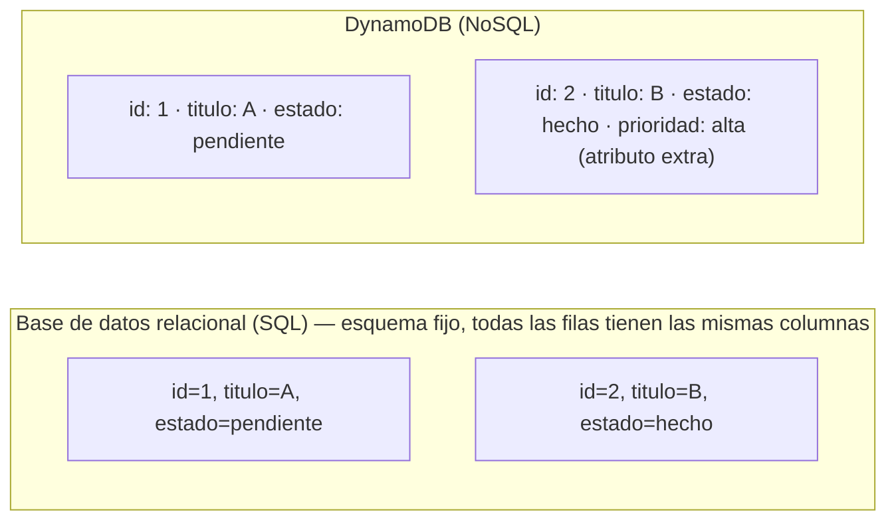
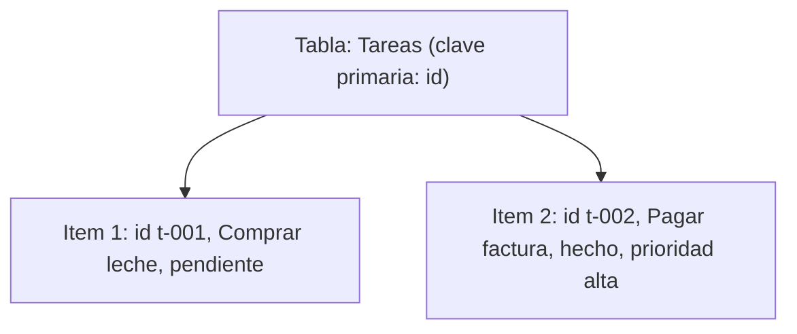
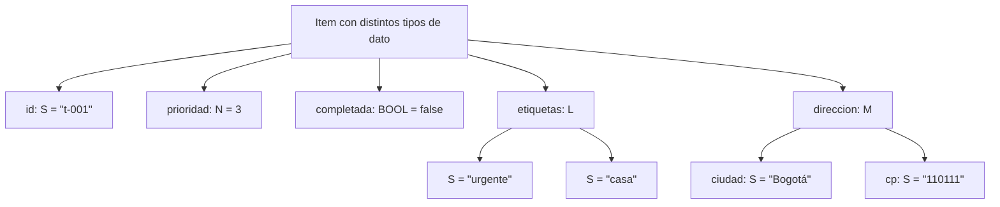
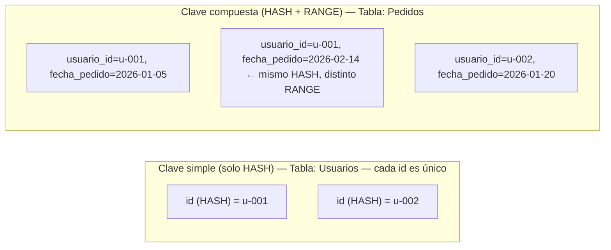
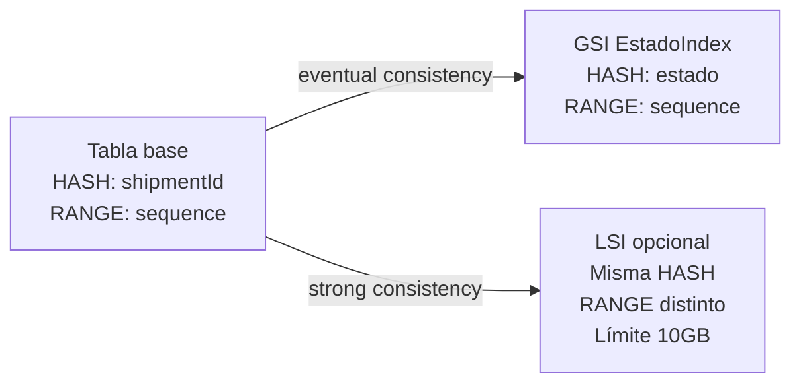
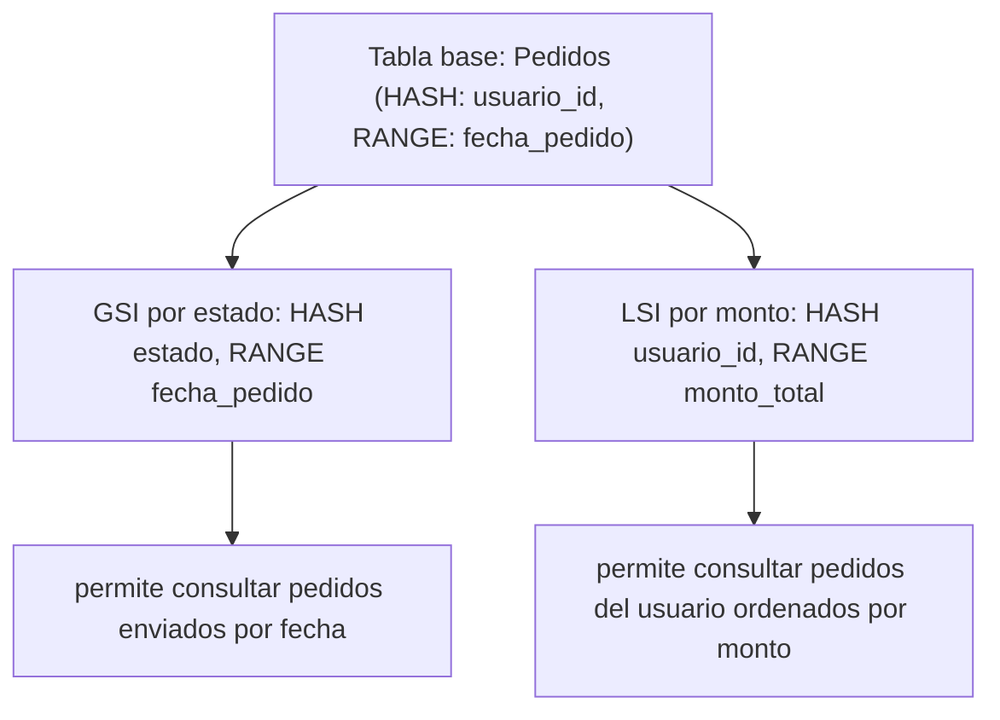
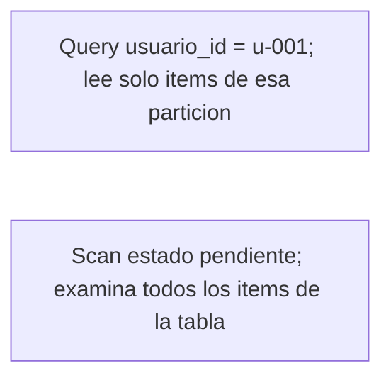

# Módulo 4: Bases de datos NoSQL con DynamoDB


## Aprende construyendo


### Tema 1: Qué es NoSQL y cuándo usarlo · Intermedio · 30 min

<details open>
<summary><strong>Capa 1 — Lectura</strong></summary>

#### ► DE QUÉ TRATA
Al finalizar podrás comprobar en vivo, con datos reales, por qué DynamoDB no obliga a un esquema fijo. Prerrequisitos: Módulo 1 (floci start, eval $(floci env)).

#### ► LA IDEA EN UNA FRASE
**Al finalizar podrás comprobar en vivo, con datos reales, por qué DynamoDB no obliga a un esquema fijo.**

#### ► POR QUÉ EXISTE ESTO
Resuelve un problema real de diseño o implementación y evita decisiones a ciegas.

#### ► LA ANALOGÍA
Piensa en qué es nosql y cuándo usarlo como una herramienta de taller: útil cuando conoces su propósito y sus límites.
**Dónde se rompe la analogía:** en software, los efectos dependen del contexto, la escala y los trade-offs.

#### ► CÓMO FUNCIONA


#### ► LO QUE PUEDE SALIR MAL
| Síntoma | Causa probable | Arreglo |
|---|---|---|
| Qué es NoSQL y cuándo usarlo se aplica pero el resultado no mejora | Se usó sin medir el problema real | Mide antes y compara contra la alternativa simple |
| Aparece complejidad inesperada | Se adoptó la técnica sin comprender sus trade-offs | Vuelve a la sección de trade-offs y reduce el alcance |
| Falla en un caso límite | Se asumió un contexto que no se cumple | Prueba el caso límite y documenta cuándo NO usarlo |

#### ► TRADE-OFFS
| Opción | Cuándo usarla | Cuándo NO usarla |
|---|---|---|
| Usar Qué es NoSQL y cuándo usarlo | Cuando el problema coincide con su propósito y el beneficio es observable | Cuando agrega complejidad sin resolver un problema real |
| Alternativa más simple | Cuando el contexto es pequeño, estable o fácil de razonar | Cuando ya demostró no escalar o no cumplir el requisito |
| Postergar la decisión | Cuando falta evidencia del problema | Cuando el costo de esperar es mayor que el costo de probar |

#### ► CUÁNDO NO USAR ESTO
No uses qué es nosql y cuándo usarlo por defecto. Aplícalo cuando el problema lo justifique y puedas verificar el beneficio; si una alternativa más simple resuelve igual, prefiérela.

#### ► DE VUELTA A LA ANALOGÍA
Volviendo a la analogía: qué es nosql y cuándo usarlo funciona como el modelo inicial, pero recuerda dónde se rompe: en producción importan la evidencia, la escala y el costo de equivocarte.

#### ► LO QUE DEBES RECORDAR
- Qué es NoSQL y cuándo usarlo existe para resolver un problema específico.
- Mide antes de adoptar complejidad.
- Conoce el caso donde NO usarlo.
- Verifica con evidencia observable.

#### ► PREGUNTAS PARA PENSAR
1. ¿Qué problema concreto resuelve qué es nosql y cuándo usarlo en tu contexto?
2. ¿Cómo sabrías que qué es nosql y cuándo usarlo no está funcionando bien?
3. ¿Qué alternativa más simple considerarías antes de usar qué es nosql y cuándo usarlo?

</details>

<details>
<summary><strong>Capa 2 — Construcción</strong></summary>

#### Código y verificación
```error-output
An error occurred (ValidationException) when calling the PutItem operation: One or more parameter values were invalid: Missing the key sequence in the item
```

```bash
# ❌ INCORRECTO: falta 'sequence'
aws dynamodb put-item --table-name ShipmentEvents --item \
  '{"shipmentId":{"S":"env-4471"},"tipo":{"S":"creado"}}'

# ✅ CORRECTO: ambas claves presentes
aws dynamodb put-item --table-name ShipmentEvents --item \
  '{"shipmentId":{"S":"env-4471"},"sequence":{"N":"1"},"tipo":{"S":"creado"}}'
```


```bash
aws dynamodb create-table --table-name ShipmentEvents \
  --attribute-definitions AttributeName=shipmentId,AttributeType=S AttributeName=sequence,AttributeType=N \
  --key-schema AttributeName=shipmentId,KeyType=HASH AttributeName=sequence,KeyType=RANGE \
  --billing-mode PAY_PER_REQUEST
aws dynamodb put-item --table-name ShipmentEvents --item \
  '{"shipmentId":{"S":"env-4471"},"sequence":{"N":"1"},"tipo":{"S":"creado"},"origen":{"S":"bodega-norte"}}'
aws dynamodb put-item --table-name ShipmentEvents --item \
  '{"shipmentId":{"S":"env-4471"},"sequence":{"N":"2"},"tipo":{"S":"entregado"},"fotoKey":{"S":"envio-4471/entrega-001.jpg"},"firmaCliente":{"BOOL":true}}'
```

</details>

### Tema 2: Tablas, items y atributos · Intermedio · 30 min

<details open>
<summary><strong>Capa 1 — Lectura</strong></summary>

#### ► DE QUÉ TRATA
Al finalizar vas a distinguir, sobre la tabla ShipmentEvents que ya creaste, qué es obligatorio en un item y qué no. Prerrequisitos: Módulo 1 (floci start, eval $(floci env)), Tema 1 de este módulo.

#### ► LA IDEA EN UNA FRASE
**Al finalizar vas a distinguir, sobre la tabla ShipmentEvents que ya creaste, qué es obligatorio en un item y qué no.**

#### ► POR QUÉ EXISTE ESTO
Resuelve un problema real de diseño o implementación y evita decisiones a ciegas.

#### ► LA ANALOGÍA
Piensa en tablas, items y atributos como una herramienta de taller: útil cuando conoces su propósito y sus límites.
**Dónde se rompe la analogía:** en software, los efectos dependen del contexto, la escala y los trade-offs.

#### ► CÓMO FUNCIONA


#### ► LO QUE PUEDE SALIR MAL
| Síntoma | Causa probable | Arreglo |
|---|---|---|
| Tablas, items y atributos se aplica pero el resultado no mejora | Se usó sin medir el problema real | Mide antes y compara contra la alternativa simple |
| Aparece complejidad inesperada | Se adoptó la técnica sin comprender sus trade-offs | Vuelve a la sección de trade-offs y reduce el alcance |
| Falla en un caso límite | Se asumió un contexto que no se cumple | Prueba el caso límite y documenta cuándo NO usarlo |

#### ► TRADE-OFFS
| Opción | Cuándo usarla | Cuándo NO usarla |
|---|---|---|
| Usar Tablas, items y atributos | Cuando el problema coincide con su propósito y el beneficio es observable | Cuando agrega complejidad sin resolver un problema real |
| Alternativa más simple | Cuando el contexto es pequeño, estable o fácil de razonar | Cuando ya demostró no escalar o no cumplir el requisito |
| Postergar la decisión | Cuando falta evidencia del problema | Cuando el costo de esperar es mayor que el costo de probar |

#### ► CUÁNDO NO USAR ESTO
No uses tablas, items y atributos por defecto. Aplícalo cuando el problema lo justifique y puedas verificar el beneficio; si una alternativa más simple resuelve igual, prefiérela.

#### ► DE VUELTA A LA ANALOGÍA
Volviendo a la analogía: tablas, items y atributos funciona como el modelo inicial, pero recuerda dónde se rompe: en producción importan la evidencia, la escala y el costo de equivocarte.

#### ► LO QUE DEBES RECORDAR
- Tablas, items y atributos existe para resolver un problema específico.
- Mide antes de adoptar complejidad.
- Conoce el caso donde NO usarlo.
- Verifica con evidencia observable.

#### ► PREGUNTAS PARA PENSAR
1. ¿Qué problema concreto resuelve tablas, items y atributos en tu contexto?
2. ¿Cómo sabrías que tablas, items y atributos no está funcionando bien?
3. ¿Qué alternativa más simple considerarías antes de usar tablas, items y atributos?

</details>

<details>
<summary><strong>Capa 2 — Construcción</strong></summary>

#### Código y verificación
```
Clave elegida (Primaria o GSI): ________
HASH: ________
RANGE: ________ (o NONE si solo HASH)
Justificación en 2 líneas: ________
Unidades de lectura Scan vs Query: ________ vs ________
```


```bash
aws dynamodb list-tables
aws dynamodb describe-table --table-name ShipmentEvents --query "Table.KeySchema"
aws dynamodb get-item --table-name ShipmentEvents \
  --key '{"shipmentId":{"S":"env-4471"},"sequence":{"N":"1"}}'
```

</details>

### Tema 3: Tipos de datos — S, N, B, BOOL, NULL, L, M · Intermedio · 30 min

<details open>
<summary><strong>Capa 1 — Lectura</strong></summary>

#### ► DE QUÉ TRATA
Al finalizar podrás modelar un evento de entrega real con tipos anidados (lista y mapa). Prerrequisitos: Módulo 1 (floci start, eval $(floci env)), Temas 1-2 de este módulo.

#### ► LA IDEA EN UNA FRASE
**Al finalizar podrás modelar un evento de entrega real con tipos anidados (lista y mapa).**

#### ► POR QUÉ EXISTE ESTO
Resuelve un problema real de diseño o implementación y evita decisiones a ciegas.

#### ► LA ANALOGÍA
Piensa en tipos de datos — s, n, b, bool, null, l, m como una herramienta de taller: útil cuando conoces su propósito y sus límites.
**Dónde se rompe la analogía:** en software, los efectos dependen del contexto, la escala y los trade-offs.

#### ► CÓMO FUNCIONA


#### ► LO QUE PUEDE SALIR MAL
| Síntoma | Causa probable | Arreglo |
|---|---|---|
| Tipos de datos — S, N, B, BOOL, NULL, L, M se aplica pero el resultado no mejora | Se usó sin medir el problema real | Mide antes y compara contra la alternativa simple |
| Aparece complejidad inesperada | Se adoptó la técnica sin comprender sus trade-offs | Vuelve a la sección de trade-offs y reduce el alcance |
| Falla en un caso límite | Se asumió un contexto que no se cumple | Prueba el caso límite y documenta cuándo NO usarlo |

#### ► TRADE-OFFS
| Opción | Cuándo usarla | Cuándo NO usarla |
|---|---|---|
| Usar Tipos de datos — S, N, B, BOOL, NULL, L, M | Cuando el problema coincide con su propósito y el beneficio es observable | Cuando agrega complejidad sin resolver un problema real |
| Alternativa más simple | Cuando el contexto es pequeño, estable o fácil de razonar | Cuando ya demostró no escalar o no cumplir el requisito |
| Postergar la decisión | Cuando falta evidencia del problema | Cuando el costo de esperar es mayor que el costo de probar |

#### ► CUÁNDO NO USAR ESTO
No uses tipos de datos — s, n, b, bool, null, l, m por defecto. Aplícalo cuando el problema lo justifique y puedas verificar el beneficio; si una alternativa más simple resuelve igual, prefiérela.

#### ► DE VUELTA A LA ANALOGÍA
Volviendo a la analogía: tipos de datos — s, n, b, bool, null, l, m funciona como el modelo inicial, pero recuerda dónde se rompe: en producción importan la evidencia, la escala y el costo de equivocarte.

#### ► LO QUE DEBES RECORDAR
- Tipos de datos — S, N, B, BOOL, NULL, L, M existe para resolver un problema específico.
- Mide antes de adoptar complejidad.
- Conoce el caso donde NO usarlo.
- Verifica con evidencia observable.

#### ► PREGUNTAS PARA PENSAR
1. ¿Qué problema concreto resuelve tipos de datos — s, n, b, bool, null, l, m en tu contexto?
2. ¿Cómo sabrías que tipos de datos — s, n, b, bool, null, l, m no está funcionando bien?
3. ¿Qué alternativa más simple considerarías antes de usar tipos de datos — s, n, b, bool, null, l, m?

</details>

<details>
<summary><strong>Capa 2 — Construcción</strong></summary>

#### Código y verificación
```
Foto 1: { formato: "jpg", tamaño: 1243 bytes, timestamp: "2026-10-06T14:23:15Z", resolucion: "1920x1080" }
Foto 2: { formato: "webp", tamaño: 891 bytes, timestamp: "2026-10-06T14:23:22Z", resolucion: "1920x1080" }
```

```json
{
  "shipmentId": { "S": "env-4471" },
  "fotos": {
    "L": [
      {
        "M": {
          "ruta": { "S": "envio-4471/entrega-001.jpg" },
          "formato": { "S": "jpg" },
          "tamaño": { "N": "1243" },
          "timestamp": { "S": "2026-10-06T14:23:15Z" },
          "resolucion": { "S": "1920x1080" }
        }
      },
      ...
    ]
  }
}
```

```error-output
# Sin error en put-item (DynamoDB lo acepta)
# Pero error cuando intentas ordenar:
aws dynamodb query --table-name ShipmentEvents \
  --key-condition-expression "shipmentId = :id AND #s BETWEEN :start AND :end" \
  --expression-attribute-names '{"#s":"sequence"}' \
  --expression-attribute-values '{":id":{"S":"env-4471"},":start":{"N":"1"},":end":{"N":"10"}}' 

# El problema: si guardaste sequence como {"S":"2"} en vez de {"N":"2"},
# el BETWEEN falla en comparar números correctamente (ordena "10" < "2" lexicográficamente)
```

```bash
# ❌ INCORRECTO: tipo mismatch
aws dynamodb put-item --table-name ShipmentEvents --item \
  '{"shipmentId":{"S":"env-4471"},"sequence":{"S":"2"}}'  # String, no número!

# ✅ CORRECTO: tipo correcto
aws dynamodb put-item --table-name ShipmentEvents --item \
  '{"shipmentId":{"S":"env-4471"},"sequence":{"N":"2"}}'  # Número
```

```bash
# Si guardaste sequence como S y luego haces:
aws dynamodb query --table-name ShipmentEvents \
  --key-condition-expression "sequence BETWEEN :s1 AND :s10" \
  --expression-attribute-values '{":s1":{"N":"1"},":s10":{"N":"10"}}'

# Resultado INCORRECTO: ordena lexicográficamente
# Devuelve: "1", "10", "2", "3", etc. (como strings)
# Esperado: 1, 2, 3, ..., 10 (números)
```

```bash
# Scan para traer items problemáticos
aws dynamodb scan --table-name ShipmentEvents \
  --projection-expression "shipmentId, #s" \
  --expression-attribute-names '{"#s":"sequence"}' > items.json

# Reescribir con tipo correcto (script en Python):
python3 << 'EOF'
import json, boto3
ddb = boto3.client('dynamodb')

for item in json.load(open('items.json'))['Items']:
    # Fijar: convertir sequence de S a N
    shipmentId = item['shipmentId']
    sequence_value = item['sequence'].get('S') or item['sequence'].get('N')
    
    ddb.put_item(TableName='ShipmentEvents', Item={
        'shipmentId': shipmentId,
        'sequence': {'N': str(sequence_value)}  # Fuerza N
    })
EOF
```

</details>

### Tema 4: Clave primaria simple (HASH) vs compuesta (HASH + RANGE) · Intermedio · 30 min

<details open>
<summary><strong>Capa 1 — Lectura</strong></summary>

#### ► DE QUÉ TRATA
Al finalizar vas a comprobar en la propia tabla ShipmentEvents por qué necesita clave compuesta y no una clave simple. Prerrequisitos: Módulo 1 (floci start, eval $(floci env)), Temas 1-3 de este módulo.

#### ► LA IDEA EN UNA FRASE
**Al finalizar vas a comprobar en la propia tabla ShipmentEvents por qué necesita clave compuesta y no una clave simple.**

#### ► POR QUÉ EXISTE ESTO
Resuelve un problema real de diseño o implementación y evita decisiones a ciegas.

#### ► LA ANALOGÍA
Piensa en clave primaria simple (hash) vs compuesta (hash + range) como una herramienta de taller: útil cuando conoces su propósito y sus límites.
**Dónde se rompe la analogía:** en software, los efectos dependen del contexto, la escala y los trade-offs.

#### ► CÓMO FUNCIONA


#### ► LO QUE PUEDE SALIR MAL
| Síntoma | Causa probable | Arreglo |
|---|---|---|
| Clave primaria simple (HASH) vs compuesta (HASH + RANGE) se aplica pero el resultado no mejora | Se usó sin medir el problema real | Mide antes y compara contra la alternativa simple |
| Aparece complejidad inesperada | Se adoptó la técnica sin comprender sus trade-offs | Vuelve a la sección de trade-offs y reduce el alcance |
| Falla en un caso límite | Se asumió un contexto que no se cumple | Prueba el caso límite y documenta cuándo NO usarlo |

#### ► TRADE-OFFS
| Opción | Cuándo usarla | Cuándo NO usarla |
|---|---|---|
| Usar Clave primaria simple (HASH) vs compuesta (HASH + RANGE) | Cuando el problema coincide con su propósito y el beneficio es observable | Cuando agrega complejidad sin resolver un problema real |
| Alternativa más simple | Cuando el contexto es pequeño, estable o fácil de razonar | Cuando ya demostró no escalar o no cumplir el requisito |
| Postergar la decisión | Cuando falta evidencia del problema | Cuando el costo de esperar es mayor que el costo de probar |

#### ► CUÁNDO NO USAR ESTO
No uses clave primaria simple (hash) vs compuesta (hash + range) por defecto. Aplícalo cuando el problema lo justifique y puedas verificar el beneficio; si una alternativa más simple resuelve igual, prefiérela.

#### ► DE VUELTA A LA ANALOGÍA
Volviendo a la analogía: clave primaria simple (hash) vs compuesta (hash + range) funciona como el modelo inicial, pero recuerda dónde se rompe: en producción importan la evidencia, la escala y el costo de equivocarte.

#### ► LO QUE DEBES RECORDAR
- Clave primaria simple (HASH) vs compuesta (HASH + RANGE) existe para resolver un problema específico.
- Mide antes de adoptar complejidad.
- Conoce el caso donde NO usarlo.
- Verifica con evidencia observable.

#### ► PREGUNTAS PARA PENSAR
1. ¿Qué problema concreto resuelve clave primaria simple (hash) vs compuesta (hash + range) en tu contexto?
2. ¿Cómo sabrías que clave primaria simple (hash) vs compuesta (hash + range) no está funcionando bien?
3. ¿Qué alternativa más simple considerarías antes de usar clave primaria simple (hash) vs compuesta (hash + range)?

</details>

<details>
<summary><strong>Capa 2 — Construcción</strong></summary>

#### Código y verificación


```bash
aws dynamodb query --table-name ShipmentEvents \
  --key-condition-expression "shipmentId = :id" \
  --expression-attribute-values '{":id":{"S":"env-4471"}}'
```

</details>

### Tema 5: Índices secundarios globales (GSI) y locales (LSI) · Intermedio · 30 min

<details open>
<summary><strong>Capa 1 — Lectura</strong></summary>

#### ► DE QUÉ TRATA
Al finalizar vas a crear y usar el índice EstadoIndex que ya está declarado en template.yaml sobre ShipmentEvents. Prerrequisitos: Módulo 1 (floci start, eval $(floci env)), Tema 4 de este módulo.

#### ► LA IDEA EN UNA FRASE
**Al finalizar vas a crear y usar el índice EstadoIndex que ya está declarado en template.yaml sobre ShipmentEvents.**

#### ► POR QUÉ EXISTE ESTO
Resuelve un problema real de diseño o implementación y evita decisiones a ciegas.

#### ► LA ANALOGÍA
Piensa en índices secundarios globales (gsi) y locales (lsi) como una herramienta de taller: útil cuando conoces su propósito y sus límites.
**Dónde se rompe la analogía:** en software, los efectos dependen del contexto, la escala y los trade-offs.

#### ► CÓMO FUNCIONA


#### ► LO QUE PUEDE SALIR MAL
| Síntoma | Causa probable | Arreglo |
|---|---|---|
| Índices secundarios globales (GSI) y locales (LSI) se aplica pero el resultado no mejora | Se usó sin medir el problema real | Mide antes y compara contra la alternativa simple |
| Aparece complejidad inesperada | Se adoptó la técnica sin comprender sus trade-offs | Vuelve a la sección de trade-offs y reduce el alcance |
| Falla en un caso límite | Se asumió un contexto que no se cumple | Prueba el caso límite y documenta cuándo NO usarlo |

#### ► TRADE-OFFS
| Opción | Cuándo usarla | Cuándo NO usarla |
|---|---|---|
| Usar Índices secundarios globales (GSI) y locales (LSI) | Cuando el problema coincide con su propósito y el beneficio es observable | Cuando agrega complejidad sin resolver un problema real |
| Alternativa más simple | Cuando el contexto es pequeño, estable o fácil de razonar | Cuando ya demostró no escalar o no cumplir el requisito |
| Postergar la decisión | Cuando falta evidencia del problema | Cuando el costo de esperar es mayor que el costo de probar |

#### ► CUÁNDO NO USAR ESTO
No uses índices secundarios globales (gsi) y locales (lsi) por defecto. Aplícalo cuando el problema lo justifique y puedas verificar el beneficio; si una alternativa más simple resuelve igual, prefiérela.

#### ► DE VUELTA A LA ANALOGÍA
Volviendo a la analogía: índices secundarios globales (gsi) y locales (lsi) funciona como el modelo inicial, pero recuerda dónde se rompe: en producción importan la evidencia, la escala y el costo de equivocarte.

#### ► LO QUE DEBES RECORDAR
- Índices secundarios globales (GSI) y locales (LSI) existe para resolver un problema específico.
- Mide antes de adoptar complejidad.
- Conoce el caso donde NO usarlo.
- Verifica con evidencia observable.

#### ► PREGUNTAS PARA PENSAR
1. ¿Qué problema concreto resuelve índices secundarios globales (gsi) y locales (lsi) en tu contexto?
2. ¿Cómo sabrías que índices secundarios globales (gsi) y locales (lsi) no está funcionando bien?
3. ¿Qué alternativa más simple considerarías antes de usar índices secundarios globales (gsi) y locales (lsi)?

</details>

<details>
<summary><strong>Capa 2 — Construcción</strong></summary>

#### Código y verificación




```bash
aws dynamodb update-table --table-name ShipmentEvents \
  --attribute-definitions AttributeName=shipmentId,AttributeType=S AttributeName=sequence,AttributeType=N AttributeName=estado,AttributeType=S \
  --global-secondary-index-updates '[{"Create":{"IndexName":"EstadoIndex","KeySchema":[{"AttributeName":"estado","KeyType":"HASH"},{"AttributeName":"sequence","KeyType":"RANGE"}],"Projection":{"ProjectionType":"ALL"}}}]'
aws dynamodb put-item --table-name ShipmentEvents --item \
  '{"shipmentId":{"S":"env-4471"},"sequence":{"N":"4"},"tipo":{"S":"entregado"},"estado":{"S":"entregado"}}'
aws dynamodb query --table-name ShipmentEvents --index-name EstadoIndex \
  --key-condition-expression "estado = :e" --expression-attribute-values '{":e":{"S":"entregado"}}'
```

</details>

### Tema 6: Query vs Scan · Intermedio · 30 min

<details open>
<summary><strong>Capa 1 — Lectura</strong></summary>

#### ► DE QUÉ TRATA
Al finalizar vas a medir, con números reales, la diferencia de costo entre Query y Scan sobre ShipmentEvents. Prerrequisitos: Módulo 1 (floci start, eval $(floci env)), Temas 2 y 4 de este módulo.

#### ► LA IDEA EN UNA FRASE
**Al finalizar vas a medir, con números reales, la diferencia de costo entre Query y Scan sobre ShipmentEvents.**

#### ► POR QUÉ EXISTE ESTO
Resuelve un problema real de diseño o implementación y evita decisiones a ciegas.

#### ► LA ANALOGÍA
Piensa en query vs scan como una herramienta de taller: útil cuando conoces su propósito y sus límites.
**Dónde se rompe la analogía:** en software, los efectos dependen del contexto, la escala y los trade-offs.

#### ► CÓMO FUNCIONA


#### ► LO QUE PUEDE SALIR MAL
| Síntoma | Causa probable | Arreglo |
|---|---|---|
| Query vs Scan se aplica pero el resultado no mejora | Se usó sin medir el problema real | Mide antes y compara contra la alternativa simple |
| Aparece complejidad inesperada | Se adoptó la técnica sin comprender sus trade-offs | Vuelve a la sección de trade-offs y reduce el alcance |
| Falla en un caso límite | Se asumió un contexto que no se cumple | Prueba el caso límite y documenta cuándo NO usarlo |

#### ► TRADE-OFFS
| Opción | Cuándo usarla | Cuándo NO usarla |
|---|---|---|
| Usar Query vs Scan | Cuando el problema coincide con su propósito y el beneficio es observable | Cuando agrega complejidad sin resolver un problema real |
| Alternativa más simple | Cuando el contexto es pequeño, estable o fácil de razonar | Cuando ya demostró no escalar o no cumplir el requisito |
| Postergar la decisión | Cuando falta evidencia del problema | Cuando el costo de esperar es mayor que el costo de probar |

#### ► CUÁNDO NO USAR ESTO
No uses query vs scan por defecto. Aplícalo cuando el problema lo justifique y puedas verificar el beneficio; si una alternativa más simple resuelve igual, prefiérela.

#### ► DE VUELTA A LA ANALOGÍA
Volviendo a la analogía: query vs scan funciona como el modelo inicial, pero recuerda dónde se rompe: en producción importan la evidencia, la escala y el costo de equivocarte.

#### ► LO QUE DEBES RECORDAR
- Query vs Scan existe para resolver un problema específico.
- Mide antes de adoptar complejidad.
- Conoce el caso donde NO usarlo.
- Verifica con evidencia observable.

#### ► PREGUNTAS PARA PENSAR
1. ¿Qué problema concreto resuelve query vs scan en tu contexto?
2. ¿Cómo sabrías que query vs scan no está funcionando bien?
3. ¿Qué alternativa más simple considerarías antes de usar query vs scan?

</details>

<details>
<summary><strong>Capa 2 — Construcción</strong></summary>

#### Código y verificación
```
Nombre del GSI: ________
HASH: ________
RANGE: ________
Justificación: ________
Costo estimado Scan vs Query: ________
```


```bash
aws dynamodb scan --table-name ShipmentEvents --select COUNT
aws dynamodb query --table-name ShipmentEvents \
  --key-condition-expression "shipmentId = :id" \
  --expression-attribute-values '{":id":{"S":"env-4471"}}' --select COUNT
```

</details>

### Laboratorio 4.1 — CRUD completo

<details open>
<summary><strong>Capa 1 — Lectura</strong></summary>

#### ► DE QUÉ TRATA
Este tema te guía por laboratorio 4.1 — crud completo con foco en comprensión antes de implementación.

#### ► LA IDEA EN UNA FRASE
**Entender laboratorio 4.1 — crud completo te permite tomar mejores decisiones técnicas.**

#### ► POR QUÉ EXISTE ESTO
Resuelve un problema real de diseño o implementación y evita decisiones a ciegas.

#### ► LA ANALOGÍA
Piensa en laboratorio 4.1 — crud completo como una herramienta de taller: útil cuando conoces su propósito y sus límites.
**Dónde se rompe la analogía:** en software, los efectos dependen del contexto, la escala y los trade-offs.

#### ► CÓMO FUNCIONA
1. Identifica el problema que laboratorio 4.1 — crud completo resuelve.
2. Observa sus componentes y relaciones.
3. Aplica la opción más simple que funcione.
4. Verifica el resultado y los límites.

#### ► LO QUE PUEDE SALIR MAL
| Síntoma | Causa probable | Arreglo |
|---|---|---|
| Laboratorio 4.1 — CRUD completo se aplica pero el resultado no mejora | Se usó sin medir el problema real | Mide antes y compara contra la alternativa simple |
| Aparece complejidad inesperada | Se adoptó la técnica sin comprender sus trade-offs | Vuelve a la sección de trade-offs y reduce el alcance |
| Falla en un caso límite | Se asumió un contexto que no se cumple | Prueba el caso límite y documenta cuándo NO usarlo |

#### ► TRADE-OFFS
| Opción | Cuándo usarla | Cuándo NO usarla |
|---|---|---|
| Usar Laboratorio 4.1 — CRUD completo | Cuando el problema coincide con su propósito y el beneficio es observable | Cuando agrega complejidad sin resolver un problema real |
| Alternativa más simple | Cuando el contexto es pequeño, estable o fácil de razonar | Cuando ya demostró no escalar o no cumplir el requisito |
| Postergar la decisión | Cuando falta evidencia del problema | Cuando el costo de esperar es mayor que el costo de probar |

#### ► CUÁNDO NO USAR ESTO
No uses laboratorio 4.1 — crud completo por defecto. Aplícalo cuando el problema lo justifique y puedas verificar el beneficio; si una alternativa más simple resuelve igual, prefiérela.

#### ► DE VUELTA A LA ANALOGÍA
Volviendo a la analogía: laboratorio 4.1 — crud completo funciona como el modelo inicial, pero recuerda dónde se rompe: en producción importan la evidencia, la escala y el costo de equivocarte.

#### ► LO QUE DEBES RECORDAR
- Laboratorio 4.1 — CRUD completo existe para resolver un problema específico.
- Mide antes de adoptar complejidad.
- Conoce el caso donde NO usarlo.
- Verifica con evidencia observable.

#### ► PREGUNTAS PARA PENSAR
1. ¿Qué problema concreto resuelve laboratorio 4.1 — crud completo en tu contexto?
2. ¿Cómo sabrías que laboratorio 4.1 — crud completo no está funcionando bien?
3. ¿Qué alternativa más simple considerarías antes de usar laboratorio 4.1 — crud completo?

</details>

<details>
<summary><strong>Capa 2 — Construcción</strong></summary>

#### Nota de construcción
Este tema es principalmente conceptual en esta versión. La verificación se realiza con las preguntas de comprensión y el criterio de cuándo NO usar laboratorio 4.1 — crud completo.

</details>

### Laboratorio 4.2 — Query vs Scan

<details open>
<summary><strong>Capa 1 — Lectura</strong></summary>

#### ► DE QUÉ TRATA
Este tema te guía por laboratorio 4.2 — query vs scan con foco en comprensión antes de implementación.

#### ► LA IDEA EN UNA FRASE
**Entender laboratorio 4.2 — query vs scan te permite tomar mejores decisiones técnicas.**

#### ► POR QUÉ EXISTE ESTO
Resuelve un problema real de diseño o implementación y evita decisiones a ciegas.

#### ► LA ANALOGÍA
Piensa en laboratorio 4.2 — query vs scan como una herramienta de taller: útil cuando conoces su propósito y sus límites.
**Dónde se rompe la analogía:** en software, los efectos dependen del contexto, la escala y los trade-offs.

#### ► CÓMO FUNCIONA
1. Identifica el problema que laboratorio 4.2 — query vs scan resuelve.
2. Observa sus componentes y relaciones.
3. Aplica la opción más simple que funcione.
4. Verifica el resultado y los límites.

#### ► LO QUE PUEDE SALIR MAL
| Síntoma | Causa probable | Arreglo |
|---|---|---|
| Laboratorio 4.2 — Query vs Scan se aplica pero el resultado no mejora | Se usó sin medir el problema real | Mide antes y compara contra la alternativa simple |
| Aparece complejidad inesperada | Se adoptó la técnica sin comprender sus trade-offs | Vuelve a la sección de trade-offs y reduce el alcance |
| Falla en un caso límite | Se asumió un contexto que no se cumple | Prueba el caso límite y documenta cuándo NO usarlo |

#### ► TRADE-OFFS
| Opción | Cuándo usarla | Cuándo NO usarla |
|---|---|---|
| Usar Laboratorio 4.2 — Query vs Scan | Cuando el problema coincide con su propósito y el beneficio es observable | Cuando agrega complejidad sin resolver un problema real |
| Alternativa más simple | Cuando el contexto es pequeño, estable o fácil de razonar | Cuando ya demostró no escalar o no cumplir el requisito |
| Postergar la decisión | Cuando falta evidencia del problema | Cuando el costo de esperar es mayor que el costo de probar |

#### ► CUÁNDO NO USAR ESTO
No uses laboratorio 4.2 — query vs scan por defecto. Aplícalo cuando el problema lo justifique y puedas verificar el beneficio; si una alternativa más simple resuelve igual, prefiérela.

#### ► DE VUELTA A LA ANALOGÍA
Volviendo a la analogía: laboratorio 4.2 — query vs scan funciona como el modelo inicial, pero recuerda dónde se rompe: en producción importan la evidencia, la escala y el costo de equivocarte.

#### ► LO QUE DEBES RECORDAR
- Laboratorio 4.2 — Query vs Scan existe para resolver un problema específico.
- Mide antes de adoptar complejidad.
- Conoce el caso donde NO usarlo.
- Verifica con evidencia observable.

#### ► PREGUNTAS PARA PENSAR
1. ¿Qué problema concreto resuelve laboratorio 4.2 — query vs scan en tu contexto?
2. ¿Cómo sabrías que laboratorio 4.2 — query vs scan no está funcionando bien?
3. ¿Qué alternativa más simple considerarías antes de usar laboratorio 4.2 — query vs scan?

</details>

<details>
<summary><strong>Capa 2 — Construcción</strong></summary>

#### Nota de construcción
Este tema es principalmente conceptual en esta versión. La verificación se realiza con las preguntas de comprensión y el criterio de cuándo NO usar laboratorio 4.2 — query vs scan.

</details>
