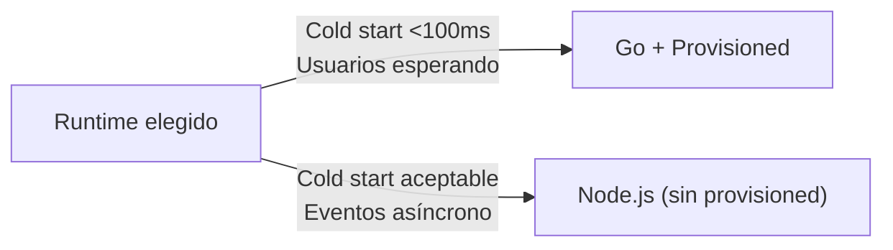
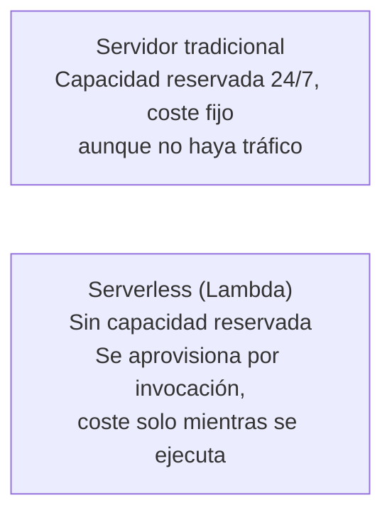
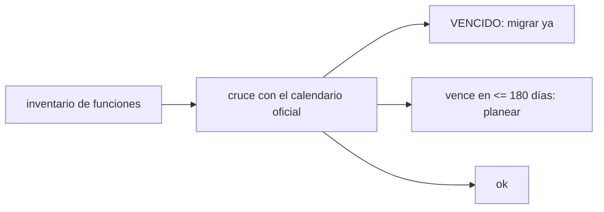

# Módulo 5: Serverless con Lambda


## Aprende construyendo


### Tema 1: Qué es serverless — ventajas y desventajas · Avanzado · 25 min

<details open>
<summary><strong>Capa 1 — Lectura</strong></summary>

#### ► DE QUÉ TRATA
Al finalizar vas a desplegar la función confirmar-entrega del proyecto integrador RutaFlow y a medir con números reales la diferencia entre su primera invocación y las siguientes. Prerrequisitos: Módulo 1 (floci start, eval $(floci env)).

#### ► LA IDEA EN UNA FRASE
**Al finalizar vas a desplegar la función confirmar-entrega del proyecto integrador RutaFlow y a medir con números reales la diferencia entre su primera invocación y las siguientes.**

#### ► POR QUÉ EXISTE ESTO
Resuelve un problema real de diseño o implementación y evita decisiones a ciegas.

#### ► LA ANALOGÍA
Piensa en qué es serverless — ventajas y desventajas como una herramienta de taller: útil cuando conoces su propósito y sus límites.
**Dónde se rompe la analogía:** en software, los efectos dependen del contexto, la escala y los trade-offs.

#### ► CÓMO FUNCIONA


#### ► LO QUE PUEDE SALIR MAL
| Síntoma | Causa probable | Arreglo |
|---|---|---|
| Qué es serverless — ventajas y desventajas se aplica pero el resultado no mejora | Se usó sin medir el problema real | Mide antes y compara contra la alternativa simple |
| Aparece complejidad inesperada | Se adoptó la técnica sin comprender sus trade-offs | Vuelve a la sección de trade-offs y reduce el alcance |
| Falla en un caso límite | Se asumió un contexto que no se cumple | Prueba el caso límite y documenta cuándo NO usarlo |

#### ► TRADE-OFFS
| Opción | Cuándo usarla | Cuándo NO usarla |
|---|---|---|
| Usar Qué es serverless — ventajas y desventajas | Cuando el problema coincide con su propósito y el beneficio es observable | Cuando agrega complejidad sin resolver un problema real |
| Alternativa más simple | Cuando el contexto es pequeño, estable o fácil de razonar | Cuando ya demostró no escalar o no cumplir el requisito |
| Postergar la decisión | Cuando falta evidencia del problema | Cuando el costo de esperar es mayor que el costo de probar |

#### ► CUÁNDO NO USAR ESTO
Escenario: RutaFlow considera cambiar confirmar-entrega de Node.js a Go para reducir cold start en una nueva función: "api-rastreo" que usuarios llaman directamente (esperan &lt;100ms).

#### ► DE VUELTA A LA ANALOGÍA
Volviendo a la analogía: qué es serverless — ventajas y desventajas funciona como el modelo inicial, pero recuerda dónde se rompe: en producción importan la evidencia, la escala y el costo de equivocarte.

#### ► LO QUE DEBES RECORDAR
- Qué es serverless — ventajas y desventajas existe para resolver un problema específico.
- Mide antes de adoptar complejidad.
- Conoce el caso donde NO usarlo.
- Verifica con evidencia observable.

#### ► PREGUNTAS PARA PENSAR
1. ¿Qué problema concreto resuelve qué es serverless — ventajas y desventajas en tu contexto?
2. ¿Cómo sabrías que qué es serverless — ventajas y desventajas no está funcionando bien?
3. ¿Qué alternativa más simple considerarías antes de usar qué es serverless — ventajas y desventajas?

</details>

<details>
<summary><strong>Capa 2 — Construcción</strong></summary>

#### Código y verificación
```error-output
{
  "errorMessage": "index.handler is undefined or not exported",
  "errorType": "Runtime.HandlerNotFound",
  "stackTrace": []
}
```

```bash
# ❌ INCORRECTO: ZIP vacío
zip funcion-vacio.zip
# Sin agregar index.js

aws lambda create-function --function-name confirmar-entrega \
  --runtime nodejs24.x \
  --handler index.handler \
  --zip-file fileb://funcion-vacio.zip \
  --role arn:aws:iam::000000000000:role/lambda-role

# create-function FUNCIONA (sin error)
# Pero invoke FALLA con Runtime.HandlerNotFound

aws lambda invoke --function-name confirmar-entrega salida.json
# → Runtime.HandlerNotFound en salida.json
```

```bash
# ✅ CORRECTO: Crear el archivo ANTES del ZIP
echo 'exports.handler = async () => ({ mensaje: "ok" });' > index.js
zip funcion.zip index.js
# Ahora sí la estructura es válida
```

```bash
   time aws lambda invoke --function-name confirmar-entrega ... salida.json
   ```




</details>

### Tema 2: Estructura de una función Lambda · Avanzado · 25 min

<details open>
<summary><strong>Capa 1 — Lectura</strong></summary>

#### ► DE QUÉ TRATA
Al finalizar vas a hacer que confirmar-entrega reciba y valide un comando real de entrega con el contrato shipmentId + recipientPin que escribirás en tu propio handler. Prerrequisitos: Tema 1 de este módulo.

#### ► LA IDEA EN UNA FRASE
**Al finalizar vas a hacer que confirmar-entrega reciba y valide un comando real de entrega con el contrato shipmentId + recipientPin que escribirás en tu propio handler.**

#### ► POR QUÉ EXISTE ESTO
Resuelve un problema real de diseño o implementación y evita decisiones a ciegas.

#### ► LA ANALOGÍA
Piensa en estructura de una función lambda como una herramienta de taller: útil cuando conoces su propósito y sus límites.
**Dónde se rompe la analogía:** en software, los efectos dependen del contexto, la escala y los trade-offs.

#### ► CÓMO FUNCIONA
1. Identifica el problema que estructura de una función lambda resuelve.
2. Observa sus componentes y relaciones.
3. Aplica la opción más simple que funcione.
4. Verifica el resultado y los límites.

#### ► LO QUE PUEDE SALIR MAL
| Síntoma | Causa probable | Arreglo |
|---|---|---|
| Estructura de una función Lambda se aplica pero el resultado no mejora | Se usó sin medir el problema real | Mide antes y compara contra la alternativa simple |
| Aparece complejidad inesperada | Se adoptó la técnica sin comprender sus trade-offs | Vuelve a la sección de trade-offs y reduce el alcance |
| Falla en un caso límite | Se asumió un contexto que no se cumple | Prueba el caso límite y documenta cuándo NO usarlo |

#### ► TRADE-OFFS
| Opción | Cuándo usarla | Cuándo NO usarla |
|---|---|---|
| Usar Estructura de una función Lambda | Cuando el problema coincide con su propósito y el beneficio es observable | Cuando agrega complejidad sin resolver un problema real |
| Alternativa más simple | Cuando el contexto es pequeño, estable o fácil de razonar | Cuando ya demostró no escalar o no cumplir el requisito |
| Postergar la decisión | Cuando falta evidencia del problema | Cuando el costo de esperar es mayor que el costo de probar |

#### ► CUÁNDO NO USAR ESTO
No uses estructura de una función lambda por defecto. Aplícalo cuando el problema lo justifique y puedas verificar el beneficio; si una alternativa más simple resuelve igual, prefiérela.

#### ► DE VUELTA A LA ANALOGÍA
Volviendo a la analogía: estructura de una función lambda funciona como el modelo inicial, pero recuerda dónde se rompe: en producción importan la evidencia, la escala y el costo de equivocarte.

#### ► LO QUE DEBES RECORDAR
- Estructura de una función Lambda existe para resolver un problema específico.
- Mide antes de adoptar complejidad.
- Conoce el caso donde NO usarlo.
- Verifica con evidencia observable.

#### ► PREGUNTAS PARA PENSAR
1. ¿Qué problema concreto resuelve estructura de una función lambda en tu contexto?
2. ¿Cómo sabrías que estructura de una función lambda no está funcionando bien?
3. ¿Qué alternativa más simple considerarías antes de usar estructura de una función lambda?

</details>

<details>
<summary><strong>Capa 2 — Construcción</strong></summary>

#### Código y verificación
```bash
npm init -y
npm install --save-dev jest

cat > index.test.js <<'EOF'
const { handler } = require('./index');

describe('confirmar-entrega handler', () => {
  test('acepta shipmentId + PIN válido de 6 dígitos', async () => {
    const result = await handler({
      shipmentId: 'env-4471',
      recipientPin: '837201'
    });
    expect(result.shipmentId).toBe('env-4471');
    expect(result.status).toBe('delivered');
  });

  test('rechaza PIN corto (< 6 dígitos)', async () => {
    const promise = handler({
      shipmentId: 'env-4471',
      recipientPin: '1234'
    });
    await expect(promise).rejects.toThrow('comando de entrega inválido');
  });

  test('rechaza shipmentId faltante', async () => {
    const promise = handler({
      recipientPin: '837201'
    });
    await expect(promise).rejects.toThrow('comando de entrega inválido');
  });

  test('rechaza PIN no-numérico', async () => {
    const promise = handler({
      shipmentId: 'env-4471',
      recipientPin: 'abcdef'
    });
    await expect(promise).rejects.toThrow('comando de entrega inválido');
  });
});
EOF

# Ejecuta las pruebas
npm test

# Resultado esperado:
# PASS  ./index.test.js
#   confirmar-entrega handler
#     ✓ acepta shipmentId + PIN válido de 6 dígitos (5ms)
#     ✓ rechaza PIN corto (2ms)
#     ✓ rechaza shipmentId faltante (1ms)
#     ✓ rechaza PIN no-numérico (1ms)
# 
# Test Suites: 1 passed, 1 total
# Tests:       4 passed, 4 total
```

```bash
aws lambda invoke --function-name confirmar-entrega \
  --payload '{"shipmentId":"env-4471","recipientPin":"1234"}' \
  --cli-binary-format raw-in-base64-out salida.json

cat salida.json
# {"errorType":"TypeError","errorMessage":"comando de entrega inválido"}

# Pero también en CloudWatch:
# [ERROR] TypeError: comando de entrega inválido
#     at Runtime.exports.handler (/var/task/index.js:7:5)
```

```
Invocación de una Lambda
┌──────────────────────────────────────────────┐
│  handler(event, context)                        │
│    event:   datos de negocio de ESTA invocación   │
│    context: metadatos de ESTA ejecución            │
│                                                    │
│  return { ... }  ← se devuelve al invocador        │
│                                                    │
│  (nada garantiza que una variable en memoria        │
│   sobreviva hasta la siguiente invocación)          │
└──────────────────────────────────────────────┘
```

```bash
cat > index.js <<'EOF'
exports.handler = async (event) => {
  if (!event.shipmentId || !/^\d{6}$/.test(event.recipientPin)) {
    throw new TypeError('comando de entrega inválido');
  }
  return { shipmentId: event.shipmentId, status: 'delivered' };
};
EOF
zip funcion.zip index.js
aws lambda update-function-code --function-name confirmar-entrega --zip-file fileb://funcion.zip
aws lambda invoke --function-name confirmar-entrega --payload '{"shipmentId":"env-4471","recipientPin":"837201"}' \
  --cli-binary-format raw-in-base64-out salida.json && cat salida.json
```

</details>

### Tema 3: Runtimes — Node.js, Python, Java, Go · Avanzado · 25 min

<details open>
<summary><strong>Capa 1 — Lectura</strong></summary>

#### ► DE QUÉ TRATA
Al finalizar vas a comprobar en vivo qué pasa cuando el código de confirmar-entrega necesita una dependencia que el runtime de Node.js no trae incluida, y aprenderás a empaquetar correctamente con dependencias REALES del proyecto integrador. Prerrequisitos: Tema 2 de este módulo.

#### ► LA IDEA EN UNA FRASE
**Al finalizar vas a comprobar en vivo qué pasa cuando el código de confirmar-entrega necesita una dependencia que el runtime de Node.js no trae incluida, y aprenderás a empaquetar correctamente con dependencias REALES del proyecto integrador.**

#### ► POR QUÉ EXISTE ESTO
Resuelve un problema real de diseño o implementación y evita decisiones a ciegas.

#### ► LA ANALOGÍA
Piensa en runtimes — node.js, python, java, go como una herramienta de taller: útil cuando conoces su propósito y sus límites.
**Dónde se rompe la analogía:** en software, los efectos dependen del contexto, la escala y los trade-offs.

#### ► CÓMO FUNCIONA
1. Identifica el problema que runtimes — node.js, python, java, go resuelve.
2. Observa sus componentes y relaciones.
3. Aplica la opción más simple que funcione.
4. Verifica el resultado y los límites.

#### ► LO QUE PUEDE SALIR MAL
| Síntoma | Causa probable | Arreglo |
|---|---|---|
| Runtimes — Node.js, Python, Java, Go se aplica pero el resultado no mejora | Se usó sin medir el problema real | Mide antes y compara contra la alternativa simple |
| Aparece complejidad inesperada | Se adoptó la técnica sin comprender sus trade-offs | Vuelve a la sección de trade-offs y reduce el alcance |
| Falla en un caso límite | Se asumió un contexto que no se cumple | Prueba el caso límite y documenta cuándo NO usarlo |

#### ► TRADE-OFFS
| Opción | Cuándo usarla | Cuándo NO usarla |
|---|---|---|
| Usar Runtimes — Node.js, Python, Java, Go | Cuando el problema coincide con su propósito y el beneficio es observable | Cuando agrega complejidad sin resolver un problema real |
| Alternativa más simple | Cuando el contexto es pequeño, estable o fácil de razonar | Cuando ya demostró no escalar o no cumplir el requisito |
| Postergar la decisión | Cuando falta evidencia del problema | Cuando el costo de esperar es mayor que el costo de probar |

#### ► CUÁNDO NO USAR ESTO
No uses runtimes — node.js, python, java, go por defecto. Aplícalo cuando el problema lo justifique y puedas verificar el beneficio; si una alternativa más simple resuelve igual, prefiérela.

#### ► DE VUELTA A LA ANALOGÍA
Volviendo a la analogía: runtimes — node.js, python, java, go funciona como el modelo inicial, pero recuerda dónde se rompe: en producción importan la evidencia, la escala y el costo de equivocarte.

#### ► LO QUE DEBES RECORDAR
- Runtimes — Node.js, Python, Java, Go existe para resolver un problema específico.
- Mide antes de adoptar complejidad.
- Conoce el caso donde NO usarlo.
- Verifica con evidencia observable.

#### ► PREGUNTAS PARA PENSAR
1. ¿Qué problema concreto resuelve runtimes — node.js, python, java, go en tu contexto?
2. ¿Cómo sabrías que runtimes — node.js, python, java, go no está funcionando bien?
3. ¿Qué alternativa más simple considerarías antes de usar runtimes — node.js, python, java, go?

</details>

<details>
<summary><strong>Capa 2 — Construcción</strong></summary>

#### Código y verificación
```
Tu código (handler + dependencias)
          │
          ▼
┌───────────────────────────────────┐
│  Runtime de Lambda (Node.js/Python/ │
│  Java/Go/...) traduce el evento      │
│  entrante a tu lenguaje, invoca tu    │
│  handler, y traduce tu respuesta       │
│  de vuelta al formato esperado         │
└───────────────────────────────────┘
```

```bash
# Primero, crea el handler que ESÍ ESCRIBE EN DYNAMODB (como RutaFlow real)
cat > index.js <<'EOF'
const { DynamoDBClient, PutItemCommand } = require("@aws-sdk/client-dynamodb");

// El cliente usa variables de entorno que Floci configura automáticamente
const client = new DynamoDBClient({
  endpoint: process.env.AWS_ENDPOINT_URL,
  region: 'us-east-1'
});

exports.handler = async (event) => {
  if (!event.shipmentId || !/^\d{6}$/.test(event.recipientPin)) {
    throw new TypeError('comando de entrega inválido');
  }
  
  // Escribe en ShipmentEvents — la misma tabla de Módulo 4
  try {
    await client.send(new PutItemCommand({
      TableName: 'ShipmentEvents',
      Item: {
        shipmentId: { S: event.shipmentId },
        sequence: { N: String(Date.now()) },
        tipo: { S: 'entregado' },
        recipientPin: { S: event.recipientPin },
        timestamp: { S: new Date().toISOString() }
      }
    }));
  } catch (error) {
    if (error.name === 'ValidationException' || error.name === 'ResourceNotFoundException') {
      return { statusCode: 400, errorType: 'ClientError', errorMessage: error.message };
    }
    throw error;  // Re-lanza errores de infraestructura (5xx)
  }
  
  return { shipmentId: event.shipmentId, status: 'delivered' };
};
EOF

# Inicializa npm e instala la dependencia REAL
npm init -y
npm install @aws-sdk/client-dynamodb

# Empaqueta código + dependencias
zip funcion.zip index.js
zip -r funcion.zip node_modules/

# Actualiza la función y prueba
aws lambda update-function-code --function-name confirmar-entrega --zip-file fileb://funcion.zip
aws lambda invoke --function-name confirmar-entrega \
  --payload '{"shipmentId":"env-4471","recipientPin":"837201"}' \
  --cli-binary-format raw-in-base64-out salida.json && cat salida.json
```

</details>

### Tema 4: Payload de entrada y respuesta · Avanzado · 25 min

<details open>
<summary><strong>Capa 1 — Lectura</strong></summary>

#### ► DE QUÉ TRATA
Al finalizar vas a envolver confirmar-entrega en el formato de respuesta que va a exigir API Gateway en el Módulo 6, siempre dentro del proyecto integrador RutaFlow. Prerrequisitos: Temas 2-3 de este módulo.

#### ► LA IDEA EN UNA FRASE
**Al finalizar vas a envolver confirmar-entrega en el formato de respuesta que va a exigir API Gateway en el Módulo 6, siempre dentro del proyecto integrador RutaFlow.**

#### ► POR QUÉ EXISTE ESTO
Resuelve un problema real de diseño o implementación y evita decisiones a ciegas.

#### ► LA ANALOGÍA
Piensa en payload de entrada y respuesta como una herramienta de taller: útil cuando conoces su propósito y sus límites.
**Dónde se rompe la analogía:** en software, los efectos dependen del contexto, la escala y los trade-offs.

#### ► CÓMO FUNCIONA
1. Identifica el problema que payload de entrada y respuesta resuelve.
2. Observa sus componentes y relaciones.
3. Aplica la opción más simple que funcione.
4. Verifica el resultado y los límites.

#### ► LO QUE PUEDE SALIR MAL
| Síntoma | Causa probable | Arreglo |
|---|---|---|
| Payload de entrada y respuesta se aplica pero el resultado no mejora | Se usó sin medir el problema real | Mide antes y compara contra la alternativa simple |
| Aparece complejidad inesperada | Se adoptó la técnica sin comprender sus trade-offs | Vuelve a la sección de trade-offs y reduce el alcance |
| Falla en un caso límite | Se asumió un contexto que no se cumple | Prueba el caso límite y documenta cuándo NO usarlo |

#### ► TRADE-OFFS
| Opción | Cuándo usarla | Cuándo NO usarla |
|---|---|---|
| Usar Payload de entrada y respuesta | Cuando el problema coincide con su propósito y el beneficio es observable | Cuando agrega complejidad sin resolver un problema real |
| Alternativa más simple | Cuando el contexto es pequeño, estable o fácil de razonar | Cuando ya demostró no escalar o no cumplir el requisito |
| Postergar la decisión | Cuando falta evidencia del problema | Cuando el costo de esperar es mayor que el costo de probar |

#### ► CUÁNDO NO USAR ESTO
No uses payload de entrada y respuesta por defecto. Aplícalo cuando el problema lo justifique y puedas verificar el beneficio; si una alternativa más simple resuelve igual, prefiérela.

#### ► DE VUELTA A LA ANALOGÍA
Volviendo a la analogía: payload de entrada y respuesta funciona como el modelo inicial, pero recuerda dónde se rompe: en producción importan la evidencia, la escala y el costo de equivocarte.

#### ► LO QUE DEBES RECORDAR
- Payload de entrada y respuesta existe para resolver un problema específico.
- Mide antes de adoptar complejidad.
- Conoce el caso donde NO usarlo.
- Verifica con evidencia observable.

#### ► PREGUNTAS PARA PENSAR
1. ¿Qué problema concreto resuelve payload de entrada y respuesta en tu contexto?
2. ¿Cómo sabrías que payload de entrada y respuesta no está funcionando bien?
3. ¿Qué alternativa más simple considerarías antes de usar payload de entrada y respuesta?

</details>

<details>
<summary><strong>Capa 2 — Construcción</strong></summary>

#### Código y verificación
```javascript
exports.handler = async (event) => {
  const errors = [];
  
  // Validación: el cliente mandó mal el request
  if (!event.shipmentId) {
    errors.push({ field: 'shipmentId', reason: 'requerido' });
  }
  if (!event.recipientPin) {
    errors.push({ field: 'recipientPin', reason: 'requerido' });
  } else if (!/^\d{6}$/.test(event.recipientPin)) {
    errors.push({ 
      field: 'recipientPin', 
      reason: 'debe ser 6 dígitos, recibido: ' + event.recipientPin 
    });
  }
  
  // Si hay errores de validación, responde 400 (culpa del cliente)
  if (errors.length > 0) {
    return {
      statusCode: 400,
      body: JSON.stringify({
        error: 'validación fallida',
        details: errors,
        timestamp: new Date().toISOString(),
        requestId: event.requestId || 'unknown'
      })
    };
  }
  
  try {
    // Lógica de negocio aquí
    return { 
      statusCode: 200, 
      body: JSON.stringify({ 
        shipmentId: event.shipmentId, 
        status: 'delivered' 
      }) 
    };
  } catch (error) {
    // Error interno: loguea contexto pero NO devuelves detalles internos
    console.error('Error procesando entrega:', {
      shipmentId: event.shipmentId,
      error: error.message,
      stack: error.stack,
      timestamp: new Date().toISOString()
    });
    
    // Responde genérico (no reveles secretos ni stack traces)
    return {
      statusCode: 500,
      body: JSON.stringify({
        error: 'error interno del servidor',
        requestId: event.requestId || 'unknown'
      })
    };
  }
};
```

```
Invocación directa:                    Vía API Gateway (proxy):
event = {"nombre": "Ana"}              event = { httpMethod, path,
    │                                            headers, body, ... }
    ▼                                      │
return {"saludo": "Hola Ana"}              ▼
                                        return {
                                          "statusCode": 200,
                                          "headers": {...},
                                          "body": "{\"saludo\":\"Hola Ana\"}"
                                        }
```

```bash
cat > index.js <<'EOF'
exports.handler = async (event) => {
  if (!event.shipmentId || !/^\d{6}$/.test(event.recipientPin || '')) {
    return { statusCode: 400, body: JSON.stringify({ error: 'comando inválido' }) };
  }
  return { statusCode: 200, body: JSON.stringify({ shipmentId: event.shipmentId, status: 'delivered' }) };
};
EOF
zip funcion.zip index.js
aws lambda update-function-code --function-name confirmar-entrega --zip-file fileb://funcion.zip
aws lambda invoke --function-name confirmar-entrega --payload '{"shipmentId":"env-4471","recipientPin":"837201"}' \
  --cli-binary-format raw-in-base64-out salida.json && cat salida.json
```

</details>

### Tema 5: Versionado y alias · Avanzado · 25 min

<details open>
<summary><strong>Capa 1 — Lectura</strong></summary>

#### ► DE QUÉ TRATA
Al finalizar vas a publicar una versión fija de confirmar-entrega y a mover un alias produccion entre versiones, simulando un rollback real en el proyecto integrador. Prerrequisitos: Temas 1-4 de este módulo.

#### ► LA IDEA EN UNA FRASE
**Al finalizar vas a publicar una versión fija de confirmar-entrega y a mover un alias produccion entre versiones, simulando un rollback real en el proyecto integrador.**

#### ► POR QUÉ EXISTE ESTO
Resuelve un problema real de diseño o implementación y evita decisiones a ciegas.

#### ► LA ANALOGÍA
Piensa en versionado y alias como una herramienta de taller: útil cuando conoces su propósito y sus límites.
**Dónde se rompe la analogía:** en software, los efectos dependen del contexto, la escala y los trade-offs.

#### ► CÓMO FUNCIONA
1. Identifica el problema que versionado y alias resuelve.
2. Observa sus componentes y relaciones.
3. Aplica la opción más simple que funcione.
4. Verifica el resultado y los límites.

#### ► LO QUE PUEDE SALIR MAL
| Síntoma | Causa probable | Arreglo |
|---|---|---|
| Versionado y alias se aplica pero el resultado no mejora | Se usó sin medir el problema real | Mide antes y compara contra la alternativa simple |
| Aparece complejidad inesperada | Se adoptó la técnica sin comprender sus trade-offs | Vuelve a la sección de trade-offs y reduce el alcance |
| Falla en un caso límite | Se asumió un contexto que no se cumple | Prueba el caso límite y documenta cuándo NO usarlo |

#### ► TRADE-OFFS
| Opción | Cuándo usarla | Cuándo NO usarla |
|---|---|---|
| Usar Versionado y alias | Cuando el problema coincide con su propósito y el beneficio es observable | Cuando agrega complejidad sin resolver un problema real |
| Alternativa más simple | Cuando el contexto es pequeño, estable o fácil de razonar | Cuando ya demostró no escalar o no cumplir el requisito |
| Postergar la decisión | Cuando falta evidencia del problema | Cuando el costo de esperar es mayor que el costo de probar |

#### ► CUÁNDO NO USAR ESTO
No uses versionado y alias por defecto. Aplícalo cuando el problema lo justifique y puedas verificar el beneficio; si una alternativa más simple resuelve igual, prefiérela.

#### ► DE VUELTA A LA ANALOGÍA
Volviendo a la analogía: versionado y alias funciona como el modelo inicial, pero recuerda dónde se rompe: en producción importan la evidencia, la escala y el costo de equivocarte.

#### ► LO QUE DEBES RECORDAR
- Versionado y alias existe para resolver un problema específico.
- Mide antes de adoptar complejidad.
- Conoce el caso donde NO usarlo.
- Verifica con evidencia observable.

#### ► PREGUNTAS PARA PENSAR
1. ¿Qué problema concreto resuelve versionado y alias en tu contexto?
2. ¿Cómo sabrías que versionado y alias no está funcionando bien?
3. ¿Qué alternativa más simple considerarías antes de usar versionado y alias?

</details>

<details>
<summary><strong>Capa 2 — Construcción</strong></summary>

#### Código y verificación
```bash
aws lambda publish-version --function-name confirmar-entrega
# Devuelve: "Version": "2"

aws lambda create-alias --function-name confirmar-entrega \
  --name canary --function-version 1 \
  --routing-config AdditionalVersionWeight={"2"=0.10}
```

```
$LATEST (mutable, cambia con cada actualización de código)
   │
   │  publish-version
   ▼
Versión 1 (fija)   Versión 2 (fija)   Versión 3 (fija, la más reciente publicada)
                                             ▲
                            alias "produccion" apunta aquí
                            (se puede mover a otra versión
                             en cualquier momento)
```

```bash
aws lambda publish-version --function-name confirmar-entrega --description "payload con statusCode/body"
aws lambda create-alias --function-name confirmar-entrega --name produccion --function-version 1
aws lambda invoke --function-name confirmar-entrega:produccion \
  --payload '{"shipmentId":"env-4471","recipientPin":"837201"}' \
  --cli-binary-format raw-in-base64-out salida.json && cat salida.json
```

</details>

### Tema 6: Integración con S3, DynamoDB Streams y API Gateway · Avanzado · 25 min

<details open>
<summary><strong>Capa 1 — Lectura</strong></summary>

#### ► DE QUÉ TRATA
Al finalizar vas a cerrar el ciclo completo del proyecto integrador RutaFlow: conectar DeliveryCommands (Módulo 3) para que dispare confirmar-entrega automáticamente, sin que nadie la invoque a mano. Prerrequisitos: Módulo 3 completo, Temas 1-5 de este módulo.

#### ► LA IDEA EN UNA FRASE
**Al finalizar vas a cerrar el ciclo completo del proyecto integrador RutaFlow: conectar DeliveryCommands (Módulo 3) para que dispare confirmar-entrega automáticamente, sin que nadie la invoque a mano.**

#### ► POR QUÉ EXISTE ESTO
Resuelve un problema real de diseño o implementación y evita decisiones a ciegas.

#### ► LA ANALOGÍA
Piensa en integración con s3, dynamodb streams y api gateway como una herramienta de taller: útil cuando conoces su propósito y sus límites.
**Dónde se rompe la analogía:** en software, los efectos dependen del contexto, la escala y los trade-offs.

#### ► CÓMO FUNCIONA
1. Identifica el problema que integración con s3, dynamodb streams y api gateway resuelve.
2. Observa sus componentes y relaciones.
3. Aplica la opción más simple que funcione.
4. Verifica el resultado y los límites.

#### ► LO QUE PUEDE SALIR MAL
| Síntoma | Causa probable | Arreglo |
|---|---|---|
| Integración con S3, DynamoDB Streams y API Gateway se aplica pero el resultado no mejora | Se usó sin medir el problema real | Mide antes y compara contra la alternativa simple |
| Aparece complejidad inesperada | Se adoptó la técnica sin comprender sus trade-offs | Vuelve a la sección de trade-offs y reduce el alcance |
| Falla en un caso límite | Se asumió un contexto que no se cumple | Prueba el caso límite y documenta cuándo NO usarlo |

#### ► TRADE-OFFS
| Opción | Cuándo usarla | Cuándo NO usarla |
|---|---|---|
| Usar Integración con S3, DynamoDB Streams y API Gateway | Cuando el problema coincide con su propósito y el beneficio es observable | Cuando agrega complejidad sin resolver un problema real |
| Alternativa más simple | Cuando el contexto es pequeño, estable o fácil de razonar | Cuando ya demostró no escalar o no cumplir el requisito |
| Postergar la decisión | Cuando falta evidencia del problema | Cuando el costo de esperar es mayor que el costo de probar |

#### ► CUÁNDO NO USAR ESTO
No uses integración con s3, dynamodb streams y api gateway por defecto. Aplícalo cuando el problema lo justifique y puedas verificar el beneficio; si una alternativa más simple resuelve igual, prefiérela.

#### ► DE VUELTA A LA ANALOGÍA
Volviendo a la analogía: integración con s3, dynamodb streams y api gateway funciona como el modelo inicial, pero recuerda dónde se rompe: en producción importan la evidencia, la escala y el costo de equivocarte.

#### ► LO QUE DEBES RECORDAR
- Integración con S3, DynamoDB Streams y API Gateway existe para resolver un problema específico.
- Mide antes de adoptar complejidad.
- Conoce el caso donde NO usarlo.
- Verifica con evidencia observable.

#### ► PREGUNTAS PARA PENSAR
1. ¿Qué problema concreto resuelve integración con s3, dynamodb streams y api gateway en tu contexto?
2. ¿Cómo sabrías que integración con s3, dynamodb streams y api gateway no está funcionando bien?
3. ¿Qué alternativa más simple considerarías antes de usar integración con s3, dynamodb streams y api gateway?

</details>

<details>
<summary><strong>Capa 2 — Construcción</strong></summary>

#### Código y verificación
```bash
> aws sqs create-queue --queue-name DeliveryCommands-DLQ
> # Obtén DLQ ARN, configura el mapping:
> aws lambda update-event-source-mapping --uuid <mapping-uuid> \
>   --function-response-types ReportBatchItemFailures \
>   --on-failure '{"Destination":"arn:aws:sqs:...DeliveryCommands-DLQ"}'
> ```

```
Trigger S3 (asíncrono)          DynamoDB Streams (asíncrono)     API Gateway (síncrono)
┌───────────────┐              ┌───────────────────┐          ┌──────────────────┐
│ Sube archivo     │             │ Item modificado      │          │ Petición HTTP        │
│      │           │             │      │               │          │      │               │
│      ▼           │             │      ▼               │          │      ▼               │
│ Invoca Lambda     │             │ Invoca Lambda con     │          │ Invoca Lambda,        │
│ (sin esperar        │           │ lote de cambios         │          │ ESPERA la respuesta    │
│  respuesta directa)  │          │ (sin esperar respuesta)  │         │ (statusCode/body)       │
└───────────────┘              └───────────────────┘          └──────────────────┘
```

```bash
QUEUE_ARN=$(aws sqs get-queue-attributes --queue-url "$QUEUE_URL" --attribute-names QueueArn --query Attributes.QueueArn --output text)
aws lambda create-event-source-mapping --function-name confirmar-entrega --event-source-arn "$QUEUE_ARN" --batch-size 5
aws sqs send-message --queue-url "$QUEUE_URL" --message-body '{"shipmentId":"env-4471","recipientPin":"837201"}'
sleep 2
aws dynamodb query --table-name ShipmentEvents --key-condition-expression "shipmentId = :id" \
  --expression-attribute-values '{":id":{"S":"env-4471"}}'
```

</details>

### Tema 7: Deprecaciones en la nube: encontrar a tiempo runtimes y versiones que dejan de tener soporte · Avanzado · 35 min

<details open>
<summary><strong>Capa 1 — Lectura</strong></summary>

#### ► DE QUÉ TRATA
Usa Python 3.10 o superior. Crea academia-labs/cloud/deprecaciones. En una cuenta real, el inventario sale de aws lambda list-functions y el calendario de la tabla oficial de runtimes de Lambda.

#### ► LA IDEA EN UNA FRASE
**Usa Python 3.10 o superior.**

#### ► POR QUÉ EXISTE ESTO
Resuelve un problema real de diseño o implementación y evita decisiones a ciegas.

#### ► LA ANALOGÍA
Piensa en deprecaciones en la nube: encontrar a tiempo runtimes y versiones que dejan de tener soporte como una herramienta de taller: útil cuando conoces su propósito y sus límites.
**Dónde se rompe la analogía:** en software, los efectos dependen del contexto, la escala y los trade-offs.

#### ► CÓMO FUNCIONA


#### ► LO QUE PUEDE SALIR MAL
| Síntoma | Causa probable | Arreglo |
|---|---|---|
| Deprecaciones en la nube: encontrar a tiempo runtimes y versiones que dejan de tener soporte se aplica pero el resultado no mejora | Se usó sin medir el problema real | Mide antes y compara contra la alternativa simple |
| Aparece complejidad inesperada | Se adoptó la técnica sin comprender sus trade-offs | Vuelve a la sección de trade-offs y reduce el alcance |
| Falla en un caso límite | Se asumió un contexto que no se cumple | Prueba el caso límite y documenta cuándo NO usarlo |

#### ► TRADE-OFFS
| Opción | Cuándo usarla | Cuándo NO usarla |
|---|---|---|
| Usar Deprecaciones en la nube: encontrar a tiempo runtimes y versiones que dejan de tener soporte | Cuando el problema coincide con su propósito y el beneficio es observable | Cuando agrega complejidad sin resolver un problema real |
| Alternativa más simple | Cuando el contexto es pequeño, estable o fácil de razonar | Cuando ya demostró no escalar o no cumplir el requisito |
| Postergar la decisión | Cuando falta evidencia del problema | Cuando el costo de esperar es mayor que el costo de probar |

#### ► CUÁNDO NO USAR ESTO
No uses deprecaciones en la nube: encontrar a tiempo runtimes y versiones que dejan de tener soporte por defecto. Aplícalo cuando el problema lo justifique y puedas verificar el beneficio; si una alternativa más simple resuelve igual, prefiérela.

#### ► DE VUELTA A LA ANALOGÍA
Volviendo a la analogía: deprecaciones en la nube: encontrar a tiempo runtimes y versiones que dejan de tener soporte funciona como el modelo inicial, pero recuerda dónde se rompe: en producción importan la evidencia, la escala y el costo de equivocarte.

#### ► LO QUE DEBES RECORDAR
- Deprecaciones en la nube: encontrar a tiempo runtimes y versiones que dejan de tener soporte existe para resolver un problema específico.
- Mide antes de adoptar complejidad.
- Conoce el caso donde NO usarlo.
- Verifica con evidencia observable.

#### ► PREGUNTAS PARA PENSAR
1. ¿Qué problema concreto resuelve deprecaciones en la nube: encontrar a tiempo runtimes y versiones que dejan de tener soporte en tu contexto?
2. ¿Cómo sabrías que deprecaciones en la nube: encontrar a tiempo runtimes y versiones que dejan de tener soporte no está funcionando bien?
3. ¿Qué alternativa más simple considerarías antes de usar deprecaciones en la nube: encontrar a tiempo runtimes y versiones que dejan de tener soporte?

</details>

<details>
<summary><strong>Capa 2 — Construcción</strong></summary>

#### Código y verificación


```json
{
  "_fuente": "Copia las fechas de la tabla oficial de runtimes de AWS Lambda; estas son de ejemplo para el ejercicio.",
  "nodejs18.x": "2025-09-01",
  "python3.9": "2025-12-15",
  "python3.12": "2028-10-31",
  "java21": "2029-06-30",
  "nodejs22.x": "2027-04-30"
}
```

```json
[
  {
    "funcion": "cotizar-envio",
    "runtime": "nodejs18.x"
  },
  {
    "funcion": "generar-guia",
    "runtime": "python3.9"
  },
  {
    "funcion": "notificar-cliente",
    "runtime": "nodejs22.x"
  },
  {
    "funcion": "procesar-foto",
    "runtime": "python3.12"
  },
  {
    "funcion": "liquidar",
    "runtime": "java21"
  }
]
```

```python
import json
from datetime import date

HOY = date(2026, 11, 18)         # fija para que el ejercicio sea reproducible; en producción usa date.today()
AVISO_DIAS = 180                 # avisar con seis meses de anticipación

calendario = {k: date.fromisoformat(v) for k, v in json.load(open("calendario.json")).items() if not k.startswith("_")}
inventario = json.load(open("inventario.json"))

def estado(runtime: str) -> tuple[int, str]:
    fin = calendario.get(runtime)
    if fin is None:
        return (0, "DESCONOCIDO: agrégalo al calendario")
    dias = (fin - HOY).days
    if dias < 0:
        return (1, f"VENCIDO hace {-dias} días")
    if dias <= AVISO_DIAS:
        return (2, f"vence en {dias} días: planear migración")
    return (3, f"ok hasta {fin.isoformat()}")

# Ordena por urgencia: desconocidos y vencidos primero.
for f in sorted(inventario, key=lambda f: estado(f["runtime"])[0]):
    print(f"{f['funcion']:<18} {f['runtime']:<12} {estado(f['runtime'])[1]}")
```

```bash
cd academia-labs/cloud/deprecaciones
# en una cuenta real, genera el inventario así:
# aws lambda list-functions --query "Functions[].{funcion:FunctionName,runtime:Runtime}" > inventario.json
python3 deprecaciones.py
```

```text
cotizar-envio      nodejs18.x   VENCIDO hace 443 días
generar-guia       python3.9    VENCIDO hace 338 días
notificar-cliente  nodejs22.x   vence en 163 días: planear migración
procesar-foto      python3.12   ok hasta 2028-10-31
liquidar           java21       ok hasta 2029-06-30
```

</details>

### Laboratorio 5.1 — Desplegar e invocar

<details open>
<summary><strong>Capa 1 — Lectura</strong></summary>

#### ► DE QUÉ TRATA
Este tema te guía por laboratorio 5.1 — desplegar e invocar con foco en comprensión antes de implementación.

#### ► LA IDEA EN UNA FRASE
**Entender laboratorio 5.1 — desplegar e invocar te permite tomar mejores decisiones técnicas.**

#### ► POR QUÉ EXISTE ESTO
Resuelve un problema real de diseño o implementación y evita decisiones a ciegas.

#### ► LA ANALOGÍA
Piensa en laboratorio 5.1 — desplegar e invocar como una herramienta de taller: útil cuando conoces su propósito y sus límites.
**Dónde se rompe la analogía:** en software, los efectos dependen del contexto, la escala y los trade-offs.

#### ► CÓMO FUNCIONA
1. Identifica el problema que laboratorio 5.1 — desplegar e invocar resuelve.
2. Observa sus componentes y relaciones.
3. Aplica la opción más simple que funcione.
4. Verifica el resultado y los límites.

#### ► LO QUE PUEDE SALIR MAL
| Síntoma | Causa probable | Arreglo |
|---|---|---|
| Laboratorio 5.1 — Desplegar e invocar se aplica pero el resultado no mejora | Se usó sin medir el problema real | Mide antes y compara contra la alternativa simple |
| Aparece complejidad inesperada | Se adoptó la técnica sin comprender sus trade-offs | Vuelve a la sección de trade-offs y reduce el alcance |
| Falla en un caso límite | Se asumió un contexto que no se cumple | Prueba el caso límite y documenta cuándo NO usarlo |

#### ► TRADE-OFFS
| Opción | Cuándo usarla | Cuándo NO usarla |
|---|---|---|
| Usar Laboratorio 5.1 — Desplegar e invocar | Cuando el problema coincide con su propósito y el beneficio es observable | Cuando agrega complejidad sin resolver un problema real |
| Alternativa más simple | Cuando el contexto es pequeño, estable o fácil de razonar | Cuando ya demostró no escalar o no cumplir el requisito |
| Postergar la decisión | Cuando falta evidencia del problema | Cuando el costo de esperar es mayor que el costo de probar |

#### ► CUÁNDO NO USAR ESTO
No uses laboratorio 5.1 — desplegar e invocar por defecto. Aplícalo cuando el problema lo justifique y puedas verificar el beneficio; si una alternativa más simple resuelve igual, prefiérela.

#### ► DE VUELTA A LA ANALOGÍA
Volviendo a la analogía: laboratorio 5.1 — desplegar e invocar funciona como el modelo inicial, pero recuerda dónde se rompe: en producción importan la evidencia, la escala y el costo de equivocarte.

#### ► LO QUE DEBES RECORDAR
- Laboratorio 5.1 — Desplegar e invocar existe para resolver un problema específico.
- Mide antes de adoptar complejidad.
- Conoce el caso donde NO usarlo.
- Verifica con evidencia observable.

#### ► PREGUNTAS PARA PENSAR
1. ¿Qué problema concreto resuelve laboratorio 5.1 — desplegar e invocar en tu contexto?
2. ¿Cómo sabrías que laboratorio 5.1 — desplegar e invocar no está funcionando bien?
3. ¿Qué alternativa más simple considerarías antes de usar laboratorio 5.1 — desplegar e invocar?

</details>

<details>
<summary><strong>Capa 2 — Construcción</strong></summary>

#### Nota de construcción
Este tema es principalmente conceptual en esta versión. La verificación se realiza con las preguntas de comprensión y el criterio de cuándo NO usar laboratorio 5.1 — desplegar e invocar.

</details>

### Laboratorio 5.2 — Actualizar código y configuración

<details open>
<summary><strong>Capa 1 — Lectura</strong></summary>

#### ► DE QUÉ TRATA
Este tema te guía por laboratorio 5.2 — actualizar código y configuración con foco en comprensión antes de implementación.

#### ► LA IDEA EN UNA FRASE
**Entender laboratorio 5.2 — actualizar código y configuración te permite tomar mejores decisiones técnicas.**

#### ► POR QUÉ EXISTE ESTO
Resuelve un problema real de diseño o implementación y evita decisiones a ciegas.

#### ► LA ANALOGÍA
Piensa en laboratorio 5.2 — actualizar código y configuración como una herramienta de taller: útil cuando conoces su propósito y sus límites.
**Dónde se rompe la analogía:** en software, los efectos dependen del contexto, la escala y los trade-offs.

#### ► CÓMO FUNCIONA
1. Identifica el problema que laboratorio 5.2 — actualizar código y configuración resuelve.
2. Observa sus componentes y relaciones.
3. Aplica la opción más simple que funcione.
4. Verifica el resultado y los límites.

#### ► LO QUE PUEDE SALIR MAL
| Síntoma | Causa probable | Arreglo |
|---|---|---|
| Laboratorio 5.2 — Actualizar código y configuración se aplica pero el resultado no mejora | Se usó sin medir el problema real | Mide antes y compara contra la alternativa simple |
| Aparece complejidad inesperada | Se adoptó la técnica sin comprender sus trade-offs | Vuelve a la sección de trade-offs y reduce el alcance |
| Falla en un caso límite | Se asumió un contexto que no se cumple | Prueba el caso límite y documenta cuándo NO usarlo |

#### ► TRADE-OFFS
| Opción | Cuándo usarla | Cuándo NO usarla |
|---|---|---|
| Usar Laboratorio 5.2 — Actualizar código y configuración | Cuando el problema coincide con su propósito y el beneficio es observable | Cuando agrega complejidad sin resolver un problema real |
| Alternativa más simple | Cuando el contexto es pequeño, estable o fácil de razonar | Cuando ya demostró no escalar o no cumplir el requisito |
| Postergar la decisión | Cuando falta evidencia del problema | Cuando el costo de esperar es mayor que el costo de probar |

#### ► CUÁNDO NO USAR ESTO
No uses laboratorio 5.2 — actualizar código y configuración por defecto. Aplícalo cuando el problema lo justifique y puedas verificar el beneficio; si una alternativa más simple resuelve igual, prefiérela.

#### ► DE VUELTA A LA ANALOGÍA
Volviendo a la analogía: laboratorio 5.2 — actualizar código y configuración funciona como el modelo inicial, pero recuerda dónde se rompe: en producción importan la evidencia, la escala y el costo de equivocarte.

#### ► LO QUE DEBES RECORDAR
- Laboratorio 5.2 — Actualizar código y configuración existe para resolver un problema específico.
- Mide antes de adoptar complejidad.
- Conoce el caso donde NO usarlo.
- Verifica con evidencia observable.

#### ► PREGUNTAS PARA PENSAR
1. ¿Qué problema concreto resuelve laboratorio 5.2 — actualizar código y configuración en tu contexto?
2. ¿Cómo sabrías que laboratorio 5.2 — actualizar código y configuración no está funcionando bien?
3. ¿Qué alternativa más simple considerarías antes de usar laboratorio 5.2 — actualizar código y configuración?

</details>

<details>
<summary><strong>Capa 2 — Construcción</strong></summary>

#### Nota de construcción
Este tema es principalmente conceptual en esta versión. La verificación se realiza con las preguntas de comprensión y el criterio de cuándo NO usar laboratorio 5.2 — actualizar código y configuración.

</details>

### El Problema

<details open>
<summary><strong>Capa 1 — Lectura</strong></summary>

#### ► DE QUÉ TRATA
Este tema te guía por el problema con foco en comprensión antes de implementación.

#### ► LA IDEA EN UNA FRASE
**Entender el problema te permite tomar mejores decisiones técnicas.**

#### ► POR QUÉ EXISTE ESTO
Resuelve un problema real de diseño o implementación y evita decisiones a ciegas.

#### ► LA ANALOGÍA
Piensa en el problema como una herramienta de taller: útil cuando conoces su propósito y sus límites.
**Dónde se rompe la analogía:** en software, los efectos dependen del contexto, la escala y los trade-offs.

#### ► CÓMO FUNCIONA
1. Identifica el problema que el problema resuelve.
2. Observa sus componentes y relaciones.
3. Aplica la opción más simple que funcione.
4. Verifica el resultado y los límites.

#### ► LO QUE PUEDE SALIR MAL
| Síntoma | Causa probable | Arreglo |
|---|---|---|
| El Problema se aplica pero el resultado no mejora | Se usó sin medir el problema real | Mide antes y compara contra la alternativa simple |
| Aparece complejidad inesperada | Se adoptó la técnica sin comprender sus trade-offs | Vuelve a la sección de trade-offs y reduce el alcance |
| Falla en un caso límite | Se asumió un contexto que no se cumple | Prueba el caso límite y documenta cuándo NO usarlo |

#### ► TRADE-OFFS
| Opción | Cuándo usarla | Cuándo NO usarla |
|---|---|---|
| Usar El Problema | Cuando el problema coincide con su propósito y el beneficio es observable | Cuando agrega complejidad sin resolver un problema real |
| Alternativa más simple | Cuando el contexto es pequeño, estable o fácil de razonar | Cuando ya demostró no escalar o no cumplir el requisito |
| Postergar la decisión | Cuando falta evidencia del problema | Cuando el costo de esperar es mayor que el costo de probar |

#### ► CUÁNDO NO USAR ESTO
No uses el problema por defecto. Aplícalo cuando el problema lo justifique y puedas verificar el beneficio; si una alternativa más simple resuelve igual, prefiérela.

#### ► DE VUELTA A LA ANALOGÍA
Volviendo a la analogía: el problema funciona como el modelo inicial, pero recuerda dónde se rompe: en producción importan la evidencia, la escala y el costo de equivocarte.

#### ► LO QUE DEBES RECORDAR
- El Problema existe para resolver un problema específico.
- Mide antes de adoptar complejidad.
- Conoce el caso donde NO usarlo.
- Verifica con evidencia observable.

#### ► PREGUNTAS PARA PENSAR
1. ¿Qué problema concreto resuelve el problema en tu contexto?
2. ¿Cómo sabrías que el problema no está funcionando bien?
3. ¿Qué alternativa más simple considerarías antes de usar el problema?

</details>

<details>
<summary><strong>Capa 2 — Construcción</strong></summary>

#### Nota de construcción
Este tema es principalmente conceptual en esta versión. La verificación se realiza con las preguntas de comprensión y el criterio de cuándo NO usar el problema.

</details>

### Tu Tarea

<details open>
<summary><strong>Capa 1 — Lectura</strong></summary>

#### ► DE QUÉ TRATA
Este tema te guía por tu tarea con foco en comprensión antes de implementación.

#### ► LA IDEA EN UNA FRASE
**Entender tu tarea te permite tomar mejores decisiones técnicas.**

#### ► POR QUÉ EXISTE ESTO
Resuelve un problema real de diseño o implementación y evita decisiones a ciegas.

#### ► LA ANALOGÍA
Piensa en tu tarea como una herramienta de taller: útil cuando conoces su propósito y sus límites.
**Dónde se rompe la analogía:** en software, los efectos dependen del contexto, la escala y los trade-offs.

#### ► CÓMO FUNCIONA
1. Identifica el problema que tu tarea resuelve.
2. Observa sus componentes y relaciones.
3. Aplica la opción más simple que funcione.
4. Verifica el resultado y los límites.

#### ► LO QUE PUEDE SALIR MAL
| Síntoma | Causa probable | Arreglo |
|---|---|---|
| Tu Tarea se aplica pero el resultado no mejora | Se usó sin medir el problema real | Mide antes y compara contra la alternativa simple |
| Aparece complejidad inesperada | Se adoptó la técnica sin comprender sus trade-offs | Vuelve a la sección de trade-offs y reduce el alcance |
| Falla en un caso límite | Se asumió un contexto que no se cumple | Prueba el caso límite y documenta cuándo NO usarlo |

#### ► TRADE-OFFS
| Opción | Cuándo usarla | Cuándo NO usarla |
|---|---|---|
| Usar Tu Tarea | Cuando el problema coincide con su propósito y el beneficio es observable | Cuando agrega complejidad sin resolver un problema real |
| Alternativa más simple | Cuando el contexto es pequeño, estable o fácil de razonar | Cuando ya demostró no escalar o no cumplir el requisito |
| Postergar la decisión | Cuando falta evidencia del problema | Cuando el costo de esperar es mayor que el costo de probar |

#### ► CUÁNDO NO USAR ESTO
No uses tu tarea por defecto. Aplícalo cuando el problema lo justifique y puedas verificar el beneficio; si una alternativa más simple resuelve igual, prefiérela.

#### ► DE VUELTA A LA ANALOGÍA
Volviendo a la analogía: tu tarea funciona como el modelo inicial, pero recuerda dónde se rompe: en producción importan la evidencia, la escala y el costo de equivocarte.

#### ► LO QUE DEBES RECORDAR
- Tu Tarea existe para resolver un problema específico.
- Mide antes de adoptar complejidad.
- Conoce el caso donde NO usarlo.
- Verifica con evidencia observable.

#### ► PREGUNTAS PARA PENSAR
1. ¿Qué problema concreto resuelve tu tarea en tu contexto?
2. ¿Cómo sabrías que tu tarea no está funcionando bien?
3. ¿Qué alternativa más simple considerarías antes de usar tu tarea?

</details>

<details>
<summary><strong>Capa 2 — Construcción</strong></summary>

#### Nota de construcción
Este tema es principalmente conceptual en esta versión. La verificación se realiza con las preguntas de comprensión y el criterio de cuándo NO usar tu tarea.

</details>

### Solución Esperada

<details open>
<summary><strong>Capa 1 — Lectura</strong></summary>

#### ► DE QUÉ TRATA
Este tema te guía por solución esperada con foco en comprensión antes de implementación.

#### ► LA IDEA EN UNA FRASE
**Entender solución esperada te permite tomar mejores decisiones técnicas.**

#### ► POR QUÉ EXISTE ESTO
Resuelve un problema real de diseño o implementación y evita decisiones a ciegas.

#### ► LA ANALOGÍA
Piensa en solución esperada como una herramienta de taller: útil cuando conoces su propósito y sus límites.
**Dónde se rompe la analogía:** en software, los efectos dependen del contexto, la escala y los trade-offs.

#### ► CÓMO FUNCIONA
1. Identifica el problema que solución esperada resuelve.
2. Observa sus componentes y relaciones.
3. Aplica la opción más simple que funcione.
4. Verifica el resultado y los límites.

#### ► LO QUE PUEDE SALIR MAL
| Síntoma | Causa probable | Arreglo |
|---|---|---|
| Solución Esperada se aplica pero el resultado no mejora | Se usó sin medir el problema real | Mide antes y compara contra la alternativa simple |
| Aparece complejidad inesperada | Se adoptó la técnica sin comprender sus trade-offs | Vuelve a la sección de trade-offs y reduce el alcance |
| Falla en un caso límite | Se asumió un contexto que no se cumple | Prueba el caso límite y documenta cuándo NO usarlo |

#### ► TRADE-OFFS
| Opción | Cuándo usarla | Cuándo NO usarla |
|---|---|---|
| Usar Solución Esperada | Cuando el problema coincide con su propósito y el beneficio es observable | Cuando agrega complejidad sin resolver un problema real |
| Alternativa más simple | Cuando el contexto es pequeño, estable o fácil de razonar | Cuando ya demostró no escalar o no cumplir el requisito |
| Postergar la decisión | Cuando falta evidencia del problema | Cuando el costo de esperar es mayor que el costo de probar |

#### ► CUÁNDO NO USAR ESTO
No uses solución esperada por defecto. Aplícalo cuando el problema lo justifique y puedas verificar el beneficio; si una alternativa más simple resuelve igual, prefiérela.

#### ► DE VUELTA A LA ANALOGÍA
Volviendo a la analogía: solución esperada funciona como el modelo inicial, pero recuerda dónde se rompe: en producción importan la evidencia, la escala y el costo de equivocarte.

#### ► LO QUE DEBES RECORDAR
- Solución Esperada existe para resolver un problema específico.
- Mide antes de adoptar complejidad.
- Conoce el caso donde NO usarlo.
- Verifica con evidencia observable.

#### ► PREGUNTAS PARA PENSAR
1. ¿Qué problema concreto resuelve solución esperada en tu contexto?
2. ¿Cómo sabrías que solución esperada no está funcionando bien?
3. ¿Qué alternativa más simple considerarías antes de usar solución esperada?

</details>

<details>
<summary><strong>Capa 2 — Construcción</strong></summary>

#### Código y verificación
```
GSI: "EstadoRutaFlow" o "PorEstadoYTiempo"
  HASH: estado (ej. "en_ruta")
  RANGE: timestamp (ISO 8601)

Lambda: obtener-envios-en-ruta
  Input: { estado: "en_ruta", limit: 100 }
  Output: { count: 45, envios: [...], queryTime: "45ms" }
  Errores: 400 si estado inválido, 500 si DynamoDB falla

Test: ✓ devuelve count, ✓ devuelve array de envios, ✓ incluye queryTime
```

</details>

### Por Qué Importa

<details open>
<summary><strong>Capa 1 — Lectura</strong></summary>

#### ► DE QUÉ TRATA
Este tema te guía por por qué importa con foco en comprensión antes de implementación.

#### ► LA IDEA EN UNA FRASE
**Entender por qué importa te permite tomar mejores decisiones técnicas.**

#### ► POR QUÉ EXISTE ESTO
Resuelve un problema real de diseño o implementación y evita decisiones a ciegas.

#### ► LA ANALOGÍA
Piensa en por qué importa como una herramienta de taller: útil cuando conoces su propósito y sus límites.
**Dónde se rompe la analogía:** en software, los efectos dependen del contexto, la escala y los trade-offs.

#### ► CÓMO FUNCIONA
1. Identifica el problema que por qué importa resuelve.
2. Observa sus componentes y relaciones.
3. Aplica la opción más simple que funcione.
4. Verifica el resultado y los límites.

#### ► LO QUE PUEDE SALIR MAL
| Síntoma | Causa probable | Arreglo |
|---|---|---|
| Por Qué Importa se aplica pero el resultado no mejora | Se usó sin medir el problema real | Mide antes y compara contra la alternativa simple |
| Aparece complejidad inesperada | Se adoptó la técnica sin comprender sus trade-offs | Vuelve a la sección de trade-offs y reduce el alcance |
| Falla en un caso límite | Se asumió un contexto que no se cumple | Prueba el caso límite y documenta cuándo NO usarlo |

#### ► TRADE-OFFS
| Opción | Cuándo usarla | Cuándo NO usarla |
|---|---|---|
| Usar Por Qué Importa | Cuando el problema coincide con su propósito y el beneficio es observable | Cuando agrega complejidad sin resolver un problema real |
| Alternativa más simple | Cuando el contexto es pequeño, estable o fácil de razonar | Cuando ya demostró no escalar o no cumplir el requisito |
| Postergar la decisión | Cuando falta evidencia del problema | Cuando el costo de esperar es mayor que el costo de probar |

#### ► CUÁNDO NO USAR ESTO
No uses por qué importa por defecto. Aplícalo cuando el problema lo justifique y puedas verificar el beneficio; si una alternativa más simple resuelve igual, prefiérela.

#### ► DE VUELTA A LA ANALOGÍA
Volviendo a la analogía: por qué importa funciona como el modelo inicial, pero recuerda dónde se rompe: en producción importan la evidencia, la escala y el costo de equivocarte.

#### ► LO QUE DEBES RECORDAR
- Por Qué Importa existe para resolver un problema específico.
- Mide antes de adoptar complejidad.
- Conoce el caso donde NO usarlo.
- Verifica con evidencia observable.

#### ► PREGUNTAS PARA PENSAR
1. ¿Qué problema concreto resuelve por qué importa en tu contexto?
2. ¿Cómo sabrías que por qué importa no está funcionando bien?
3. ¿Qué alternativa más simple considerarías antes de usar por qué importa?

</details>

<details>
<summary><strong>Capa 2 — Construcción</strong></summary>

#### Nota de construcción
Este tema es principalmente conceptual en esta versión. La verificación se realiza con las preguntas de comprensión y el criterio de cuándo NO usar por qué importa.

</details>
