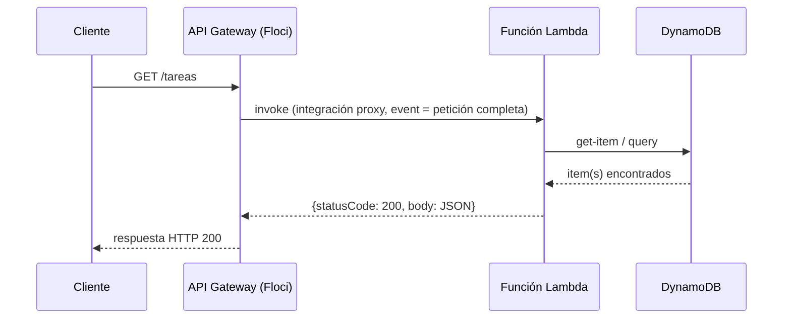

# Módulo 5: APIs con API Gateway


## Aprende construyendo


### Tema 1: Qué es API Gateway y tipos de API — REST, HTTP, WebSocket · Avanzado · 35 min

<details open>
<summary><strong>Capa 1 — Lectura</strong></summary>

#### ► DE QUÉ TRATA
Al finalizar vas a crear el contenedor de API REST que, en los siguientes Temas, va a exponer confirmar-entrega (Módulo 5) como endpoint HTTP. Prerrequisitos: Módulo 5 completo.

</details>

<details>
<summary><strong>Capa 2 — Construcción</strong></summary>

#### Código y verificación
```
┌─────────────┐        ┌───────────────────────┐        ┌──────────────┐
│  Cliente HTTP  │ ────▶ │      API Gateway         │ ────▶ │   Lambda        │
│ (navegador,     │◀──── │  (REST / HTTP / WebSocket)│◀──── │  (tu backend)   │
│  app móvil, etc)│        └───────────────────────┘        └──────────────┘
└─────────────┘
   REST/HTTP: petición → respuesta, conexión termina
   WebSocket: conexión persistente, datos en ambas direcciones en cualquier momento
```

```bash
API_ID=$(aws apigateway create-rest-api --name "API RutaFlow" --query id --output text)
ROOT_ID=$(aws apigateway get-resources --rest-api-id "$API_ID" --query 'items[0].id' --output text)
echo "API_ID=$API_ID ROOT_ID=$ROOT_ID"
```

</details>

### Tema 2: Recursos, métodos y stages · Avanzado · 35 min

<details open>
<summary><strong>Capa 1 — Lectura</strong></summary>

#### ► DE QUÉ TRATA
Al finalizar vas a crear el recurso /entregas con el único método que necesita: POST. Prerrequisitos: Tema 1 de este módulo.

</details>

<details>
<summary><strong>Capa 2 — Construcción</strong></summary>

#### Código y verificación
```error-output
User: arn:aws:apigateway:us-east-1:000000000000:invoke-api is not authorized to perform: lambda:InvokeFunction on resource: arn:aws:lambda:us-east-1:000000000000:function:confirmar-entrega
```

```bash
# ❌ INCORRECTO: Integración sin permiso
aws apigateway put-integration --rest-api-id "$API_ID" --resource-id "$ENTREGAS_ID" \
  --http-method POST --type AWS_PROXY --integration-http-method POST \
  --uri arn:aws:apigateway:us-east-1:lambda:path/2015-03-31/functions/.../confirmar-entrega/invocations

# Ahora invocas POST /entregas → 403 Forbidden (sin permiso)

# ✅ CORRECTO: Agregar permiso PRIMERO
aws lambda add-permission --function-name confirmar-entrega \
  --statement-id apigw-entregas \
  --action lambda:InvokeFunction \
  --principal apigateway.amazonaws.com \
  --source-arn "arn:aws:execute-api:us-east-1:000000000000:$API_ID/*/POST/entregas"

# LUEGO de add-permission, la integración funciona
```

```bash
aws lambda get-policy --function-name confirmar-entrega
```

```
API: "Sistema de Tareas"
├── /tareas
│    ├── GET    → listar todas las tareas
│    └── POST   → crear una tarea nueva
└── /tareas/{id}
     ├── GET    → obtener una tarea específica
     ├── PUT    → actualizar una tarea específica
     └── DELETE → eliminar una tarea específica

Desplegado en stages:
  /dev/tareas   → apunta a Lambda de desarrollo
  /prod/tareas  → apunta a Lambda de producción
```

```bash
ENTREGAS_ID=$(aws apigateway create-resource --rest-api-id "$API_ID" --parent-id "$ROOT_ID" --path-part entregas --query id --output text)
aws apigateway put-method --rest-api-id "$API_ID" --resource-id "$ENTREGAS_ID" --http-method POST --authorization-type NONE
```

</details>

### Tema 3: Integración con Lambda (proxy) · Avanzado · 35 min

<details open>
<summary><strong>Capa 1 — Lectura</strong></summary>


*Figura animada. La función solo existe, y se cobra, mientras atiende la petición.*

#### ► DE QUÉ TRATA
Al finalizar vas a conectar POST /entregas con la función confirmar-entrega del Módulo 5 mediante integración proxy, y a otorgar el permiso que esa conexión necesita de verdad. Prerrequisitos: Tema 2 de este módulo, Módulo 5 completo.

#### ► CÓMO FUNCIONA


</details>

<details>
<summary><strong>Capa 2 — Construcción</strong></summary>

#### Código y verificación
```
Integración PROXY (AWS_PROXY):                Integración NO PROXY (AWS):
Petición HTTP completa                         Petición HTTP
      │                                              │
      ▼ (sin transformar)                            ▼ (plantilla VTL transforma)
event = { httpMethod, path,                     event = { solo los campos
          headers, body, ... }                          que la plantilla decida exponer }
      │                                              │
      ▼                                              ▼
Lambda debe devolver                            Lambda devuelve lo que sea,
{statusCode, headers, body}                     otra plantilla VTL lo transforma
```


```bash
aws apigateway put-integration --rest-api-id "$API_ID" --resource-id "$ENTREGAS_ID" --http-method POST \
  --type AWS_PROXY --integration-http-method POST \
  --uri arn:aws:apigateway:us-east-1:lambda:path/2015-03-31/functions/arn:aws:lambda:us-east-1:000000000000:function:confirmar-entrega/invocations
aws lambda add-permission --function-name confirmar-entrega --statement-id apigw-entregas \
  --action lambda:InvokeFunction --principal apigateway.amazonaws.com \
  --source-arn "arn:aws:execute-api:us-east-1:000000000000:$API_ID/*/POST/entregas"
```

</details>

### Tema 4: Mapeo de entrada/salida y validación con modelos · Avanzado · 35 min

<details open>
<summary><strong>Capa 1 — Lectura</strong></summary>

#### ► DE QUÉ TRATA
Al finalizar vas a rechazar un comando de entrega malformado en API Gateway mismo, antes de que confirmar-entrega siquiera se invoque. Prerrequisitos: Tema 3 de este módulo.

</details>

<details>
<summary><strong>Capa 2 — Construcción</strong></summary>

#### Código y verificación
```
Petición POST /tareas con cuerpo malformado
      │
      ▼
┌───────────────────────┐
│ API Gateway valida       │
│ contra el modelo JSON     │  ──▶ Si NO cumple: rechaza con 400,
│ Schema asociado al método │       Lambda nunca se invoca
└───────────────────────┘
      │  Si SÍ cumple
      ▼
   Invoca Lambda con el cuerpo ya validado estructuralmente
```

```bash
aws apigateway create-model --rest-api-id "$API_ID" --name EntregaModel --content-type application/json --schema \
  '{"$schema":"http://json-schema.org/draft-04/schema#","title":"EntregaModel","type":"object","required":["shipmentId","recipientPin"],"properties":{"shipmentId":{"type":"string"},"recipientPin":{"type":"string"}}}'
aws apigateway update-method --rest-api-id "$API_ID" --resource-id "$ENTREGAS_ID" --http-method POST \
  --patch-operations op=replace,path=/requestValidatorId,value="$(aws apigateway create-request-validator --rest-api-id "$API_ID" --name validar-body --validate-request-body --query id --output text)"
```

</details>

### Tema 5: Despliegue y variables de stage · Avanzado · 35 min

<details open>
<summary><strong>Capa 1 — Lectura</strong></summary>

#### ► DE QUÉ TRATA
Al finalizar vas a publicar POST /entregas en un stage real y a probar el endpoint completo de punta a punta. Prerrequisitos: Temas 1-4 de este módulo.

</details>

<details>
<summary><strong>Capa 2 — Construcción</strong></summary>

#### Código y verificación
```
Configuración actual (recursos, métodos, integraciones)
        │
        │  create-deployment --stage-name dev
        ▼
   Stage "dev" ahora refleja esta configuración
        │
   (sigues editando la configuración: nuevos cambios)
        │
        │  create-deployment --stage-name dev   ← hay que repetirlo
        ▼
   Stage "dev" refleja los nuevos cambios
```

```bash
aws apigateway create-deployment --rest-api-id "$API_ID" --stage-name dev
aws apigateway update-stage --rest-api-id "$API_ID" --stage-name dev \
  --patch-operations op=replace,path=/variables/lambdaAlias,value=produccion
curl -X POST "http://localhost:4566/restapis/$API_ID/dev/_user_request_/entregas" \
  -d '{"shipmentId":"env-4471","recipientPin":"837201"}'
```

</details>

### Laboratorio 6.1 — Construir y desplegar el endpoint

<details open>
<summary><strong>Capa 1 — Lectura</strong></summary>

</details>

<details>
<summary><strong>Capa 2 — Construcción</strong></summary>

#### Nota de construcción
Este tema es principalmente conceptual en esta versión. La verificación se realiza con las preguntas de comprensión y el criterio de cuándo NO usar laboratorio 6.1 — construir y desplegar el endpoint.

</details>
