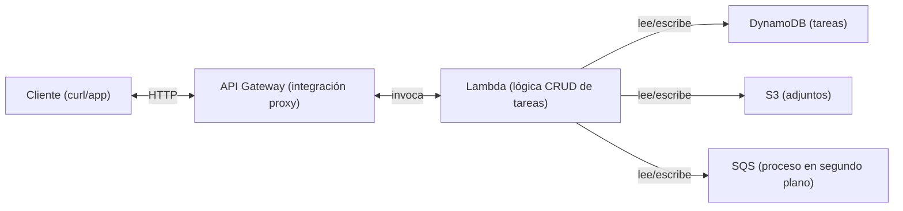
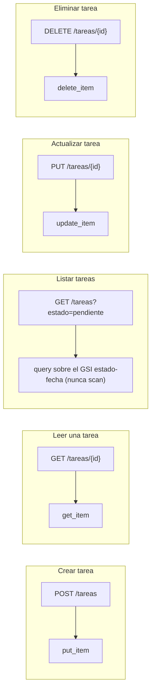
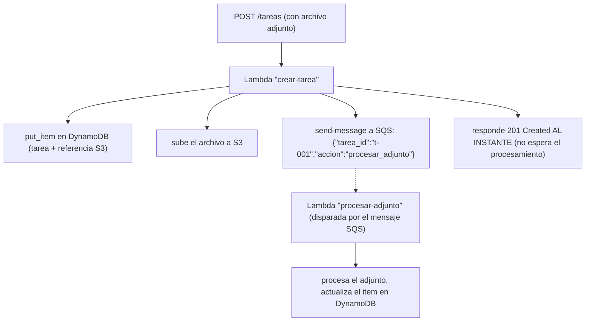
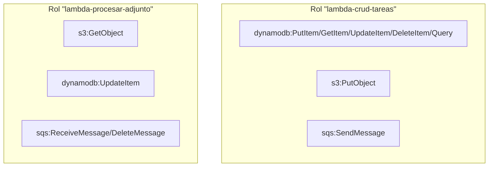
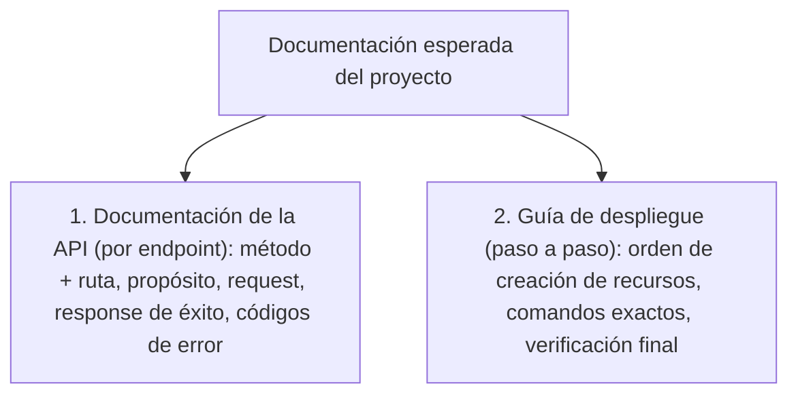

# Módulo 8: Proyecto final — Sistema de Gestión de Tareas


## Aprende construyendo


### Tema 1: Arquitectura de la aplicación — frontend, backend y base de datos · Avanzado · 45 min

<details open>
<summary><strong>Capa 1 — Lectura</strong></summary>

#### ► DE QUÉ TRATA
Al finalizar vas a crear los tres recursos base del proyecto (tabla, bucket, cola) y a comprobar en vivo por qué un archivo no pertenece dentro de un item de DynamoDB. Prerrequisitos: Módulos 2-7 completos.

#### ► CÓMO FUNCIONA


</details>

<details>
<summary><strong>Capa 2 — Construcción</strong></summary>

#### Código y verificación

```bash
aws dynamodb create-table --table-name Tareas \
  --attribute-definitions AttributeName=id,AttributeType=S AttributeName=estado,AttributeType=S AttributeName=fecha_creacion,AttributeType=S \
  --key-schema AttributeName=id,KeyType=HASH --billing-mode PAY_PER_REQUEST \
  --global-secondary-indexes '[{"IndexName":"estado-fecha","KeySchema":[{"AttributeName":"estado","KeyType":"HASH"},{"AttributeName":"fecha_creacion","KeyType":"RANGE"}],"Projection":{"ProjectionType":"ALL"}}]'
aws s3 mb s3://adjuntos-tareas
aws sqs create-queue --queue-name procesar-adjunto
```

</details>

### Tema 2: CRUD de tareas sobre DynamoDB expuesto por Lambda · Avanzado · 45 min

<details open>
<summary><strong>Capa 1 — Lectura</strong></summary>

#### ► DE QUÉ TRATA
Al finalizar vas a ejecutar el CRUD completo de Tareas con los cuatro comandos DynamoDB del Módulo 4, y a validar una regla de negocio antes de escribir nada. Prerrequisitos: Tema 1 de este módulo.

#### ► CÓMO FUNCIONA


</details>

<details>
<summary><strong>Capa 2 — Construcción</strong></summary>

#### Código y verificación


```bash
aws dynamodb put-item --table-name Tareas --item \
  '{"id":{"S":"t-001"},"titulo":{"S":"Revisar factura"},"estado":{"S":"pendiente"},"fecha_creacion":{"S":"2026-10-05"}}'
aws dynamodb update-item --table-name Tareas --key '{"id":{"S":"t-001"}}' \
  --update-expression "SET estado = :e" --expression-attribute-values '{":e":{"S":"en_progreso"}}'
aws dynamodb get-item --table-name Tareas --key '{"id":{"S":"t-001"}}'
```

</details>

### Tema 3: Archivos adjuntos en S3 y procesamiento en segundo plano con SQS · Avanzado · 45 min

<details open>
<summary><strong>Capa 1 — Lectura</strong></summary>

#### ► DE QUÉ TRATA
Al finalizar vas a adjuntar un archivo real a la tarea t-001 y a encolar su procesamiento en segundo plano, sin bloquear ninguna respuesta. Prerrequisitos: Temas 1-2 de este módulo.

#### ► CÓMO FUNCIONA


</details>

<details>
<summary><strong>Capa 2 — Construcción</strong></summary>

#### Código y verificación


```bash
aws s3 cp entrega-001.jpg s3://adjuntos-tareas/t-001/factura.jpg
aws dynamodb update-item --table-name Tareas --key '{"id":{"S":"t-001"}}' \
  --update-expression "SET adjunto_key = :k" --expression-attribute-values '{":k":{"S":"t-001/factura.jpg"}}'
QUEUE_URL=$(aws sqs get-queue-url --queue-name procesar-adjunto --query QueueUrl --output text)
aws sqs send-message --queue-url "$QUEUE_URL" --message-body '{"tarea_id":"t-001","accion":"procesar_adjunto"}'
```

</details>

### Tema 4: API Gateway e IAM de mínimo privilegio para el proyecto · Avanzado · 45 min

<details open>
<summary><strong>Capa 1 — Lectura</strong></summary>

#### ► DE QUÉ TRATA
Al finalizar vas a escribir las dos políticas de mínimo privilegio exactas que necesita este proyecto — una por función Lambda — y a comprobar con el simulador que ninguna se puede confundir con la otra. Prerrequisitos: Módulo 7, Temas 1-3 de este módulo.

#### ► CÓMO FUNCIONA


</details>

<details>
<summary><strong>Capa 2 — Construcción</strong></summary>

#### Código y verificación


```bash
mkdir ejemplo && cd ejemplo && floci start
```

Crea el archivo `policy-crud.json`:

```json
{"Version":"2012-10-17","Statement":[
  {"Effect":"Allow","Action":["dynamodb:PutItem","dynamodb:GetItem","dynamodb:UpdateItem","dynamodb:DeleteItem","dynamodb:Query"],"Resource":"arn:aws:dynamodb:us-east-1:000000000000:table/Tareas"},
  {"Effect":"Allow","Action":"s3:PutObject","Resource":"arn:aws:s3:::adjuntos-tareas/*"},
  {"Effect":"Allow","Action":"sqs:SendMessage","Resource":"arn:aws:sqs:us-east-1:000000000000:procesar-adjunto"}
]}
```

```bash
aws iam simulate-custom-policy --policy-input-list file://policy-crud.json \
  --action-names sqs:ReceiveMessage --resource-arns arn:aws:sqs:us-east-1:000000000000:procesar-adjunto
```

</details>

### Tema 5: Documentación de la API y guía de despliegue · Avanzado · 45 min

<details open>
<summary><strong>Capa 1 — Lectura</strong></summary>

#### ► DE QUÉ TRATA
Al finalizar podrás documentar y desplegar desde cero. Prerrequisitos: Node.js y Docker; verifica node --version.

#### ► CÓMO FUNCIONA


</details>

<details>
<summary><strong>Capa 2 — Construcción</strong></summary>

#### Código y verificación


```bash
mkdir -p ejemplo-documentado/scripts && cd ejemplo-documentado
```

Crea el archivo `scripts/desplegar.sh`:

```bash
#!/usr/bin/env bash
set -euo pipefail
: "${AWS_ENDPOINT_URL:?define el endpoint con eval \"\$(floci env)\" antes de desplegar}"
echo "1/3 preparación: endpoint $AWS_ENDPOINT_URL"
aws dynamodb create-table --table-name Tareas \
  --attribute-definitions AttributeName=id,AttributeType=S \
  --key-schema AttributeName=id,KeyType=HASH --billing-mode PAY_PER_REQUEST > /dev/null
aws dynamodb wait table-exists --table-name Tareas
echo "2/3 creación: tabla Tareas"
echo "3/3 comprobación: $(aws dynamodb describe-table --table-name Tareas --query 'Table.TableStatus' --output text)"
```

Crea el archivo `README.md`:

```markdown
# Tareas RutaFlow
## Despliegue local
1. Preparación: `floci start` y `eval "$(floci env)"`.
2. Creación y comprobación: `bash scripts/desplegar.sh`.
3. Limpieza: `aws dynamodb delete-table --table-name Tareas`.
```

```bash
bash scripts/desplegar.sh
```

</details>

### Requisitos funcionales

<details open>
<summary><strong>Capa 1 — Lectura</strong></summary>

</details>

<details>
<summary><strong>Capa 2 — Construcción</strong></summary>

#### Nota de construcción
Este tema es principalmente conceptual en esta versión. La verificación se realiza con las preguntas de comprensión y el criterio de cuándo NO usar requisitos funcionales.

</details>

### Requisitos técnicos

<details open>
<summary><strong>Capa 1 — Lectura</strong></summary>

</details>

<details>
<summary><strong>Capa 2 — Construcción</strong></summary>

#### Nota de construcción
Este tema es principalmente conceptual en esta versión. La verificación se realiza con las preguntas de comprensión y el criterio de cuándo NO usar requisitos técnicos.

</details>

### Entregables

<details open>
<summary><strong>Capa 1 — Lectura</strong></summary>

</details>

<details>
<summary><strong>Capa 2 — Construcción</strong></summary>

#### Nota de construcción
Este tema es principalmente conceptual en esta versión. La verificación se realiza con las preguntas de comprensión y el criterio de cuándo NO usar entregables.

</details>

### Docker

<details open>
<summary><strong>Capa 1 — Lectura</strong></summary>

</details>

<details>
<summary><strong>Capa 2 — Construcción</strong></summary>

#### Nota de construcción
Este tema es principalmente conceptual en esta versión. La verificación se realiza con las preguntas de comprensión y el criterio de cuándo NO usar docker.

</details>

### S3

<details open>
<summary><strong>Capa 1 — Lectura</strong></summary>

</details>

<details>
<summary><strong>Capa 2 — Construcción</strong></summary>

#### Nota de construcción
Este tema es principalmente conceptual en esta versión. La verificación se realiza con las preguntas de comprensión y el criterio de cuándo NO usar s3.

</details>

### SQS

<details open>
<summary><strong>Capa 1 — Lectura</strong></summary>

</details>

<details>
<summary><strong>Capa 2 — Construcción</strong></summary>

#### Nota de construcción
Este tema es principalmente conceptual en esta versión. La verificación se realiza con las preguntas de comprensión y el criterio de cuándo NO usar sqs.

</details>

### DynamoDB

<details open>
<summary><strong>Capa 1 — Lectura</strong></summary>

</details>

<details>
<summary><strong>Capa 2 — Construcción</strong></summary>

#### Nota de construcción
Este tema es principalmente conceptual en esta versión. La verificación se realiza con las preguntas de comprensión y el criterio de cuándo NO usar dynamodb.

</details>

### Lambda

<details open>
<summary><strong>Capa 1 — Lectura</strong></summary>

</details>

<details>
<summary><strong>Capa 2 — Construcción</strong></summary>

#### Nota de construcción
Este tema es principalmente conceptual en esta versión. La verificación se realiza con las preguntas de comprensión y el criterio de cuándo NO usar lambda.

</details>

### API Gateway

<details open>
<summary><strong>Capa 1 — Lectura</strong></summary>

</details>

<details>
<summary><strong>Capa 2 — Construcción</strong></summary>

#### Nota de construcción
Este tema es principalmente conceptual en esta versión. La verificación se realiza con las preguntas de comprensión y el criterio de cuándo NO usar api gateway.

</details>

### IAM

<details open>
<summary><strong>Capa 1 — Lectura</strong></summary>

</details>

<details>
<summary><strong>Capa 2 — Construcción</strong></summary>

#### Nota de construcción
Este tema es principalmente conceptual en esta versión. La verificación se realiza con las preguntas de comprensión y el criterio de cuándo NO usar iam.

</details>
