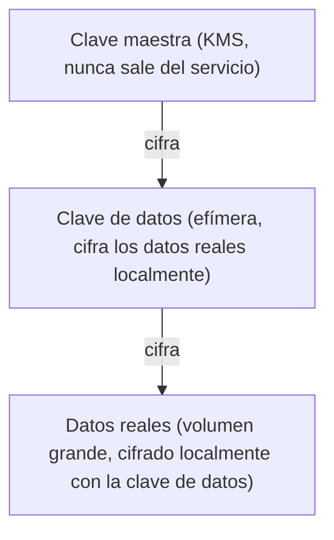
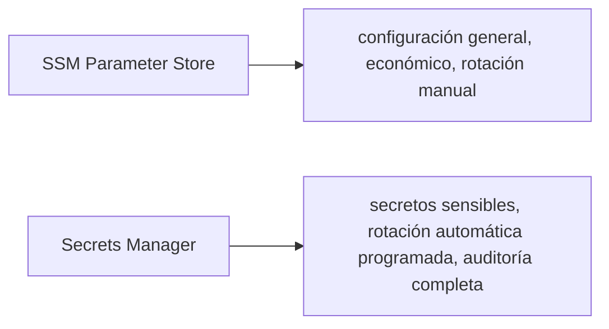

# Módulo 9: Secretos y configuración: Secrets Manager, Key Vault y Secret Manager


## Aprende construyendo


### Tema 1: Secrets Manager y por qué no usar variables de entorno hardcodeadas · Básico · 40 min

<details open>
<summary><strong>Capa 1 — Lectura</strong></summary>

#### ► DE QUÉ TRATA
Al finalizar vas a sacar una clave real de RutaFlow de un archivo versionado y meterla donde corresponde. Prerrequisitos: Módulo 9 completo.

</details>

<details>
<summary><strong>Capa 2 — Construcción</strong></summary>

#### Código y verificación
```bash
aws secretsmanager create-secret --name /app/db-password --secret-string "mi-password-segura"
aws secretsmanager get-secret-value --secret-id /app/db-password --query SecretString --output text
```

```bash
aws secretsmanager create-secret --name /app/db-password --secret-string "mi-password-segura"
aws secretsmanager get-secret-value --secret-id /app/db-password --query SecretString --output text
```

```bash
echo "SMS_GATEWAY_API_KEY=demo_rutaflow_12345" > .env
grep SMS_GATEWAY_API_KEY .env
aws secretsmanager create-secret --name /rutaflow/sms-gateway-api-key --secret-string "demo_rutaflow_12345"
```

```bash
git init -q && git add .env && git commit -qm "config: agrega .env por error"
git rm -q .env && git commit -qm "config: elimina .env"
git log --all --oneline -- .env
git show HEAD~1:.env
```

</details>

### Tema 2: KMS y envelope encryption · Básico · 40 min

<details open>
<summary><strong>Capa 1 — Lectura</strong></summary>

#### ► DE QUÉ TRATA
Al finalizar vas a cifrar un respaldo local de la clave del Tema 1 con KMS, y a comprobar qué pasa si alguien sin permiso intenta descifrarlo. Prerrequisitos: Tema 1 de este módulo.

#### ► CÓMO FUNCIONA


</details>

<details>
<summary><strong>Capa 2 — Construcción</strong></summary>

#### Código y verificación
```bash
aws kms create-key --description "Clave de la app"
aws kms encrypt --key-id alias/mi-clave --plaintext fileb://secreto.txt --query CiphertextBlob --output text | base64 -d > secreto.enc
aws kms decrypt --ciphertext-blob fileb://secreto.enc --query Plaintext --output text | base64 -d
```


```bash
aws kms create-key --description "Clave de respaldo RutaFlow" --query KeyMetadata.KeyId --output text
aws kms create-alias --alias-name alias/rutaflow-backup --target-key-id "$(aws kms list-keys --query 'Keys[-1].KeyId' --output text)"
echo "demo_rutaflow_12345" > respaldo-secreto.txt
aws kms encrypt --key-id alias/rutaflow-backup --plaintext fileb://respaldo-secreto.txt --query CiphertextBlob --output text | base64 -d > respaldo-secreto.enc
aws kms decrypt --ciphertext-blob fileb://respaldo-secreto.enc --query Plaintext --output text | base64 -d
```

</details>

### Tema 3: SSM Parameter Store vs Secrets Manager · Básico · 40 min

<details open>
<summary><strong>Capa 1 — Lectura</strong></summary>

#### ► DE QUÉ TRATA
Al finalizar vas a separar, para RutaFlow, qué va en SSM Parameter Store y qué va en Secrets Manager, y a comprobar por qué un rol sin permiso específico no puede leer ninguno de los dos. Prerrequisitos: Temas 1-2 de este módulo.

#### ► CÓMO FUNCIONA


#### ► REGLA PRÁCTICA
Si rotar manualmente es aceptable y el dato no es sensible, usa Parameter Store por costo; si el dato requiere rotación automática programada y auditoría, usa Secrets Manager aunque cueste más.

</details>

<details>
<summary><strong>Capa 2 — Construcción</strong></summary>

#### Código y verificación
```bash
aws ssm put-parameter --name /app/api-url --value "http://localhost:4566" --type String
```


```bash
aws ssm put-parameter --name /rutaflow/sms-gateway-url --value "https://sms-provider.example.com/v1" --type String
aws ssm get-parameter --name /rutaflow/sms-gateway-url --query Parameter.Value --output text
```

</details>
