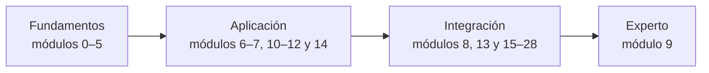

# Módulo 0: Cómo estudiar Control 1

Este curso va desde los números complejos hasta el diseño en frecuencia, en espacio de estados y por el método algebraico. Cada fórmula viene con su demostración paso a paso, y cada tema con ejemplos resueltos que empiezan muy simples y llegan a nivel parcial. Está pensado para Control 1 de Ingeniería en la Universidad Distrital.

**Al terminar este módulo sabrás:**

- Cómo está armado cada capítulo y cómo estudiarlo.
- Qué capítulo cubre cada punto de los parciales.
- En qué orden estudiar y en qué libros contrastar cada tema.

## Mapa de la ruta

«Control 1 — Sistemas de control desde cero» tiene 29 módulos en 4 etapas. La tabla sigue el orden de estudio: Bode (20) va antes de Nyquist (23) y de los compensadores (19 y 24), y los exámenes van al final. Usa la tabla para saltar a un módulo concreto.



| Módulo | Etapa | Qué aprendes |
|---|---|---|
| 0 | Fundamentos | [Cómo estudiar Control 1](/curso/control-1/0) |
| 1 | Fundamentos | [Números complejos](/curso/control-1/1) |
| 2 | Fundamentos | [Transformada de Laplace](/curso/control-1/2) |
| 3 | Fundamentos | [Transformada inversa](/curso/control-1/3) |
| 4 | Fundamentos | [Ecuaciones diferenciales y función de transferencia](/curso/control-1/4) |
| 5 | Fundamentos | [Sistemas de control y diagramas de bloques](/curso/control-1/5) |
| 6 | Aplicación | [Reducción de diagramas de bloques y regla de Mason](/curso/control-1/6) |
| 7 | Aplicación | [Circuitos y amplificadores operacionales](/curso/control-1/7) |
| 8 | Integración | [Modelado de sistemas físicos](/curso/control-1/8) |
| 9 | Experto | [Linealización](/curso/control-1/9) |
| 10 | Aplicación | [Introducción al espacio de estados](/curso/control-1/10) |
| 11 | Aplicación | [Sistemas de primer orden y retardo](/curso/control-1/11) |
| 12 | Aplicación | [Sistemas de segundo orden](/curso/control-1/12) |
| 13 | Integración | [Polos dominantes, polos adicionales y ceros](/curso/control-1/13) |
| 14 | Aplicación | [Error en estado estacionario](/curso/control-1/14) |
| 15 | Integración | [Estabilidad y criterio de Routh-Hurwitz](/curso/control-1/15) |
| 16 | Integración | [Plano s, estabilidad y zona de diseño](/curso/control-1/16) |
| 17 | Integración | [Lugar geométrico de las raíces](/curso/control-1/17) |
| 18 | Integración | [Acciones básicas de control: P, I, D](/curso/control-1/18) |
| 20 | Integración | [Respuesta en frecuencia y diagramas de Bode](/curso/control-1/20) |
| 23 | Integración | [Criterio de Nyquist](/curso/control-1/23) |
| 19 | Integración | [Compensadores de adelanto y atraso](/curso/control-1/19) |
| 24 | Integración | [Compensación en el dominio de la frecuencia](/curso/control-1/24) |
| 25 | Integración | [Controlabilidad, observabilidad y ubicación de polos](/curso/control-1/25) |
| 26 | Integración | [Observadores de estado](/curso/control-1/26) |
| 27 | Integración | [Método algebraico de diseño](/curso/control-1/27) |
| 21 | Integración | [Parciales resueltos](/curso/control-1/21) |
| 22 | Integración | [Simulacro y formulario](/curso/control-1/22) |
| 28 | Integración | [Simulacro de examen final](/curso/control-1/28) |

## Aprende construyendo

### Tema 1: Cómo está armado cada capítulo

**¿Por qué es importante?** Si sabes cómo está armado cada capítulo, puedes estudiar los ejemplos en el orden correcto y no solo leer resultados.

**Fuentes oficiales:** [Análisis de sistemas, Control Tutorials (U. de Michigan)](https://ctms.engin.umich.edu/CTMS/index.php?example=Introduction&section=SystemAnalysis).

Todos los capítulos siguen el mismo orden:

1. **Idea clave y teoría.** Primero la idea en palabras simples, después la fórmula.
2. **Procedimiento.** Los pasos exactos para resolver ese tipo de ejercicio.
3. **Demostración.** De dónde sale cada fórmula, paso a paso. Así no tienes que memorizar sin entender.
4. **Ejemplos resueltos.** Van de *Básico* a *Intermedio* y a *Nivel parcial*. Cada ejemplo dice qué cambia respecto al anterior, y cada paso dice qué se hace y **por qué**.
5. **Errores comunes y práctica.** Los errores típicos del tema y ejercicios con la respuesta plegada.

**Cómo estudiar un ejemplo:** lee el enunciado, tapa la solución e intenta el primer paso. Después abre la solución y compara solo ese paso, sobre todo el *¿Por qué?*. Repite paso por paso.

#### Verificación con código

Crea la carpeta `academia-labs/control-1` y guarda dentro este script como `verificacion.py`: lo reutilizarás en cada capítulo para comprobar los ejemplos con cálculo simbólico.

```python
# academia-labs/control-1/verificacion.py
import control
import sympy
import scipy

print("sympy:", sympy.__version__)
print("scipy:", scipy.__version__)
print("control:", control.__version__)
```

Desde la carpeta creada, prepara un entorno aislado y ejecuta (macOS/Linux):

```bash
cd academia-labs/control-1
python3 -m venv .venv
source .venv/bin/activate
python3 -m pip install sympy scipy matplotlib control
python3 verificacion.py
```

En PowerShell, desde la misma carpeta, crea el entorno con `py -m venv .venv`, instala con `.\.venv\Scripts\python.exe -m pip install sympy scipy matplotlib control` y ejecuta con `.\.venv\Scripts\python.exe verificacion.py`. Para los siguientes capítulos, guarda cada nuevo contenido en `verificacion.py`; en Windows sustituye `python3` por `.\.venv\Scripts\python.exe`.

**Resultado esperado:** tres líneas con los números de versión instalados (por ejemplo `sympy: 1.14.0` y `control: 0.10.2`). `control` es la biblioteca python-control: trae Bode, Nyquist, márgenes, lugar de las raíces, ubicación de polos y simulación de lazo cerrado, y la usan los módulos 23 a 28. Si ves `ModuleNotFoundError`, confirma que ejecutaste el Python de `.venv` y repite la instalación allí.

#### Practica

añade `import matplotlib; print("matplotlib:", matplotlib.__version__)` al script y confirma que también está disponible — lo necesitarás para graficar respuestas en el módulo 12. Confírmalo modificando `verificacion.py` y ejecutándolo de nuevo.

**Límite:** verificar que una cuenta numérica coincide con el cálculo manual no demuestra que entendiste el procedimiento; sigue resolviendo cada ejemplo a mano antes de comprobarlo con código.

Los módulos 10, 19, 20 y 23 a 27 (espacio de estados, compensadores, Bode, Nyquist, compensación en frecuencia, controlabilidad y observabilidad, observadores y método algebraico) corresponden a las unidades 5, 6 y 7 del programa de Control I (7303) y entran en el examen final. El módulo 28 es un simulacro de ese examen.

Para verificar tus cuentas puedes usar Python con SymPy, SciPy y python-control. El proyecto de práctica de la ruta explica cómo preparar la carpeta `academia-labs/control-1`.

#### El temario

| Bloque | Capítulo | Tema | Qué aprendes |
|---|---|---|---|
| Bases matemáticas | 2 | Números complejos | Operar, forma polar, Euler, raíces de \(s^2+bs+c\) |
| | 3 | Transformada de Laplace | Tabla y propiedades demostradas, valor final |
| | 4 | Transformada inversa | Fracciones parciales en sus tres casos |
| | 5 | Ecuaciones diferenciales | De la ecuación a \(G(s)\) |
| Modelado | 6 | Sistemas de control | Elementos, lazo cerrado, perturbaciones |
| | 7 | Bloques y Mason | Reducción de diagramas complejos |
| | 8 | Circuitos y op-amps | Impedancias, RLC, controladores con op-amps |
| | 9 | Sistemas físicos | Mecánicos, motor DC, térmicos, tanques |
| | 10 | Linealización | Sistemas no lineales alrededor de un punto |
| | 11 | Espacio de estados | Matrices y su relación con \(G(s)\) |
| Respuesta en el tiempo | 12 | Primer orden y retardo | \(K\), \(\tau\), identificación |
| | 13 | Segundo orden | \(\zeta\), \(\omega_n\), \(M_p\), \(t_p\), \(t_s\) demostrados |
| | 14 | Polos dominantes y ceros | Sistemas de orden alto |
| | 15 | Error estacionario | Tipo de sistema, \(K_p\), \(K_v\), \(K_a\) |
| Estabilidad y diseño | 16 | Routh-Hurwitz | Estabilidad y rango de \(K\) |
| | 17 | Plano s y zona de diseño | Especificaciones como regiones |
| | 18 | Lugar de las raíces | Reglas y simulador |
| | 19 | Acciones P, I, D | Efectos y sintonía de Ziegler-Nichols |
| Frecuencia | 21 | Bode | Respuesta en frecuencia y márgenes |
| | 24 | Nyquist | Criterio \(Z = N + P\), integradores, lazos abiertos inestables |
| | 20 | Compensadores | Adelanto y atraso con el lugar de las raíces |
| | 25 | Compensación en frecuencia | Adelanto, atraso y atraso-adelanto por margen de fase; sensibilidad |
| Estado y método algebraico | 26 | Controlabilidad y observabilidad | Rango, cancelaciones, ubicación de polos y Ackermann |
| | 27 | Observadores | Observador de Luenberger, separación, compensador equivalente |
| | 28 | Método algebraico | Igualación de modelos, ecuación diofántica, dos parámetros |
| Exámenes | 22 | Parciales resueltos | Parcial 1 y Parcial 2 paso a paso |
| | 23 | Simulacro y formulario | Un parcial nuevo con solución y todas las fórmulas |
| | 29 | Simulacro de examen final | Seis puntos de las unidades 5 a 7 con solución y script de corrección |

#### Qué faltó en el Parcial 1

| Punto | Qué pedían | Qué faltó | Dónde se estudia |
|---|---|---|---|
| 1 | Ejemplo de sistema de control y sus elementos | Nombrar y definir cada elemento | Módulo 5 |
| 2 | Función de transferencia del circuito con op-amps | Usar impedancias en Laplace en vez de derivadas en el tiempo | Módulo 7 |
| 3 | Respuesta al impulso de dos \(G(s)\) | Tabla, retardo y completar el cuadrado | Módulos 2, 3, 11 y 12 |
| 4 | Ventajas y desventajas de P, I, D | Explicar cada acción con su porqué | Módulo 18 |

#### Plan de estudio

| Día | Qué estudiar |
|---|---|
| 1 | Módulos 1 y 2 |
| 2 | Módulos 3 y 4 |
| 3 | Módulos 5 y 6 |
| 4 | Módulo 7, luego los puntos 1 y 2 del Parcial 1 |
| 5 | Módulo 8 |
| 6 | Módulo 11, luego el punto 3 del Parcial 1 |
| 7 | Módulo 12 (el más importante; con calma) |
| 8 | Módulos 13 y 14 |
| 9 | Módulos 15 y 16, luego el Parcial 2 completo |
| 10 | Módulo 17 |
| 11 | Módulo 18, luego el punto 4 del Parcial 1 |
| 12 | Simulacro en 90 minutos, solo con el formulario |
| 13 | Módulos 9 y 10 (linealización y estados) |
| 14 | Módulos 20 y 23 (Bode y Nyquist) |
| 15 | Módulos 19 y 24 (compensadores) |
| 16 | Módulos 25 y 26 (diseño en espacio de estados) |
| 17 | Módulo 27 (método algebraico) |
| 18 | Simulacro final en 90 minutos (módulo 28) |

#### Bibliografía de referencia

El curso no reemplaza a los libros del programa: úsalos para contrastar cada tema con otra explicación y para hacer más ejercicios. No hace falta tenerlos todos; con uno basta.

| Libro | Edición de referencia |
|---|---|
| Katsuhiko Ogata, *Ingeniería de control moderna* | 5.ª ed., Pearson, 2010 (original: *Modern Control Engineering*) |
| Norman S. Nise, *Control Systems Engineering* | 8.ª ed., Wiley |
| Richard C. Dorf y Robert H. Bishop, *Modern Control Systems* | 14.ª ed., Pearson, 2022 (en español: *Sistemas de control moderno*) |
| Farid Golnaraghi y Benjamin C. Kuo, *Automatic Control Systems* | 10.ª ed., McGraw-Hill, 2017 (ediciones anteriores en español como *Sistemas de control automático*, de Kuo) |
| Chi-Tsong Chen, *Analog and Digital Control System Design* | Oxford University Press, 1993 (para el método algebraico) |

Dónde está cada bloque del curso (capítulos de esas ediciones; en otras ediciones cambia la numeración, no el título):

| Bloque del curso | Módulos | Ogata | Nise | Dorf y Bishop | Golnaraghi y Kuo |
|---|---|---|---|---|---|
| Laplace, bloques y modelado | 1–9 | 2, 3 y 4 | 2 y 5 | 2 | 2, 3, 4 y 6 |
| Espacio de estados (modelo) | 10 | 9 | 3 | 3 | 8 |
| Respuesta temporal y error | 11–14 | 5 | 4 y 7 | 4 y 5 | 7 |
| Estabilidad | 15–16 | 5 | 6 | 6 | 5 |
| Lugar de las raíces, PID y compensadores | 17–19 | 6 y 8 | 8 y 9 | 7 y 10 | 9 y 11 |
| Bode y Nyquist | 20 y 23 | 7 | 10 | 8 y 9 | 10 |
| Compensación en frecuencia | 24 | 7 | 11 | 10 | 11 |
| Diseño en espacio de estados | 25–26 | 9 y 10 | 12 | 11 | 8 |
| Método algebraico | 27 | Chen, caps. 9 y 10 | | | |

**Cómo usarlos:** después de cada tema, lee la sección equivalente del libro y resuelve dos problemas del final del capítulo sin mirar la solución. Si el libro usa otra notación (por ejemplo \(G_c\) en vez de \(C\)), anótala en tu formulario.

**Fuentes de los índices:** [Ogata en Pearson](https://www.pearson.com/us/higher-education/program/Ogata-Modern-Control-Engineering-5th-Edition/PGM100186.html), [Dorf y Bishop en Pearson](https://www.pearson.com/en-us/subject-catalog/p/nonlinear-systems/P200000003484/9780137307098), [Nise (8.ª ed.)](https://www.schweitzer-online.de/en/buch/Nise/Control-Systems-Engineering/9781119721406/A57290836/), [Golnaraghi y Kuo (10.ª ed.)](https://www.mheducation.com/highered/mhp/product/automatic-control-systems-tenth-edition.html) y [Chen](https://www.schweitzer-online.de/en/buch/Chen/Analog-Digital-Control-System-Design/9780030940705/A406123/).
