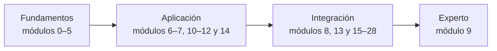

# Módulo 0: Cómo estudiar Control 1

Este curso va desde los números complejos hasta el diseño en frecuencia, en espacio de estados y por el método algebraico. Cada fórmula viene con su demostración paso a paso, y cada tema con ejemplos resueltos que empiezan muy simples y llegan a nivel parcial. Está pensado para Control 1 de Ingeniería en la Universidad Distrital.

**Al terminar este módulo sabrás:**

- Cómo está armado cada capítulo y cómo estudiarlo.
- Qué capítulo cubre cada punto de los parciales.
- En qué orden estudiar y en qué libros contrastar cada tema.

## Mapa de la ruta

«Control 1 — Sistemas de control desde cero» tiene 29 módulos en 4 etapas. La tabla sigue el orden de estudio: Bode (20) va antes de Nyquist (23) y de los compensadores (19 y 24), y los exámenes van al final. Usa la tabla para saltar a un módulo concreto.



| Módulo | Etapa | Qué aprendes |
|---|---|---|
| 0 | Fundamentos | [Cómo estudiar Control 1](/curso/control-1/0) |
| 1 | Fundamentos | [Números complejos](/curso/control-1/1) |
| 2 | Fundamentos | [Transformada de Laplace](/curso/control-1/2) |
| 3 | Fundamentos | [Transformada inversa](/curso/control-1/3) |
| 4 | Fundamentos | [Ecuaciones diferenciales y función de transferencia](/curso/control-1/4) |
| 5 | Fundamentos | [Sistemas de control y diagramas de bloques](/curso/control-1/5) |
| 6 | Aplicación | [Reducción de diagramas de bloques y regla de Mason](/curso/control-1/6) |
| 7 | Aplicación | [Circuitos y amplificadores operacionales](/curso/control-1/7) |
| 8 | Integración | [Modelado de sistemas físicos](/curso/control-1/8) |
| 9 | Experto | [Linealización](/curso/control-1/9) |
| 10 | Aplicación | [Introducción al espacio de estados](/curso/control-1/10) |
| 11 | Aplicación | [Sistemas de primer orden y retardo](/curso/control-1/11) |
| 12 | Aplicación | [Sistemas de segundo orden](/curso/control-1/12) |
| 13 | Integración | [Polos dominantes, polos adicionales y ceros](/curso/control-1/13) |
| 14 | Aplicación | [Error en estado estacionario](/curso/control-1/14) |
| 15 | Integración | [Estabilidad y criterio de Routh-Hurwitz](/curso/control-1/15) |
| 16 | Integración | [Plano s, estabilidad y zona de diseño](/curso/control-1/16) |
| 17 | Integración | [Lugar geométrico de las raíces](/curso/control-1/17) |
| 18 | Integración | [Acciones básicas de control: P, I, D](/curso/control-1/18) |
| 20 | Integración | [Respuesta en frecuencia y diagramas de Bode](/curso/control-1/20) |
| 23 | Integración | [Criterio de Nyquist](/curso/control-1/23) |
| 19 | Integración | [Compensadores de adelanto y atraso](/curso/control-1/19) |
| 24 | Integración | [Compensación en el dominio de la frecuencia](/curso/control-1/24) |
| 25 | Integración | [Controlabilidad, observabilidad y ubicación de polos](/curso/control-1/25) |
| 26 | Integración | [Observadores de estado](/curso/control-1/26) |
| 27 | Integración | [Método algebraico de diseño](/curso/control-1/27) |
| 21 | Integración | [Parciales resueltos](/curso/control-1/21) |
| 22 | Integración | [Simulacro y formulario](/curso/control-1/22) |
| 28 | Integración | [Simulacro de examen final](/curso/control-1/28) |

## Aprende construyendo


### Tema 1: Cómo está armado cada capítulo · Básico · 30 min

<details open>
<summary><strong>Capa 1 — Lectura</strong></summary>

#### ► DE QUÉ TRATA
Este tema te guía por cómo está armado cada capítulo con foco en comprensión antes de implementación.

#### ► LA IDEA EN UNA FRASE
**Entender cómo está armado cada capítulo te permite tomar mejores decisiones técnicas.**

#### ► POR QUÉ EXISTE ESTO
Resuelve un problema real de diseño o implementación y evita decisiones a ciegas.

#### ► LA ANALOGÍA
Piensa en cómo está armado cada capítulo como una herramienta de taller: útil cuando conoces su propósito y sus límites.
**Dónde se rompe la analogía:** en software, los efectos dependen del contexto, la escala y los trade-offs.

#### ► CÓMO FUNCIONA
1. Identifica el problema que cómo está armado cada capítulo resuelve.
2. Observa sus componentes y relaciones.
3. Aplica la opción más simple que funcione.
4. Verifica el resultado y los límites.

#### ► LO QUE PUEDE SALIR MAL
| Síntoma | Causa probable | Arreglo |
|---|---|---|
| Cómo está armado cada capítulo se aplica pero el resultado no mejora | Se usó sin medir el problema real | Mide antes y compara contra la alternativa simple |
| Aparece complejidad inesperada | Se adoptó la técnica sin comprender sus trade-offs | Vuelve a la sección de trade-offs y reduce el alcance |
| Falla en un caso límite | Se asumió un contexto que no se cumple | Prueba el caso límite y documenta cuándo NO usarlo |

#### ► TRADE-OFFS
| Opción | Cuándo usarla | Cuándo NO usarla |
|---|---|---|
| Usar Cómo está armado cada capítulo | Cuando el problema coincide con su propósito y el beneficio es observable | Cuando agrega complejidad sin resolver un problema real |
| Alternativa más simple | Cuando el contexto es pequeño, estable o fácil de razonar | Cuando ya demostró no escalar o no cumplir el requisito |
| Postergar la decisión | Cuando falta evidencia del problema | Cuando el costo de esperar es mayor que el costo de probar |

#### ► CUÁNDO NO USAR ESTO
No uses cómo está armado cada capítulo por defecto. Aplícalo cuando el problema lo justifique y puedas verificar el beneficio; si una alternativa más simple resuelve igual, prefiérela.

#### ► DE VUELTA A LA ANALOGÍA
Volviendo a la analogía: cómo está armado cada capítulo funciona como el modelo inicial, pero recuerda dónde se rompe: en producción importan la evidencia, la escala y el costo de equivocarte.

#### ► LO QUE DEBES RECORDAR
- Cómo está armado cada capítulo existe para resolver un problema específico.
- Mide antes de adoptar complejidad.
- Conoce el caso donde NO usarlo.
- Verifica con evidencia observable.

#### ► PREGUNTAS PARA PENSAR
1. ¿Qué problema concreto resuelve cómo está armado cada capítulo en tu contexto?
2. ¿Cómo sabrías que cómo está armado cada capítulo no está funcionando bien?
3. ¿Qué alternativa más simple considerarías antes de usar cómo está armado cada capítulo?

</details>

<details>
<summary><strong>Capa 2 — Construcción</strong></summary>

#### Código y verificación
```python
# academia-labs/control-1/verificacion.py
import control
import sympy
import scipy

print("sympy:", sympy.__version__)
print("scipy:", scipy.__version__)
print("control:", control.__version__)
```

```bash
cd academia-labs/control-1
python3 -m venv .venv
source .venv/bin/activate
python3 -m pip install sympy scipy matplotlib control
python3 verificacion.py
```

</details>
