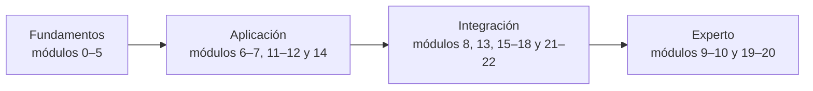

# Módulo 0: Cómo estudiar Control 1

Este curso va desde los números complejos hasta el diseño de compensadores. Cada fórmula viene con su demostración paso a paso, y cada tema con ejemplos resueltos que empiezan muy simples y llegan a nivel parcial. Está pensado para Control 1 de Ingeniería en la Universidad Distrital.

**Al terminar este módulo sabrás:**

- Cómo está armado cada capítulo y cómo estudiarlo.
- Qué capítulo cubre cada punto de los parciales.
- En qué orden estudiar en las próximas dos semanas.

## Mapa de la ruta

«Control 1 — Sistemas de control desde cero» tiene 23 módulos en 4 etapas. Cada etapa se apoya en la anterior; usa la tabla para saltar a un módulo concreto.



| Módulo | Etapa | Qué aprendes |
|---|---|---|
| 0 | Fundamentos | [Cómo estudiar Control 1](/curso/control-1/0) |
| 1 | Fundamentos | [Números complejos](/curso/control-1/1) |
| 2 | Fundamentos | [Transformada de Laplace](/curso/control-1/2) |
| 3 | Fundamentos | [Transformada inversa](/curso/control-1/3) |
| 4 | Fundamentos | [Ecuaciones diferenciales y función de transferencia](/curso/control-1/4) |
| 5 | Fundamentos | [Sistemas de control y diagramas de bloques](/curso/control-1/5) |
| 6 | Aplicación | [Reducción de diagramas de bloques y regla de Mason](/curso/control-1/6) |
| 7 | Aplicación | [Circuitos y amplificadores operacionales](/curso/control-1/7) |
| 8 | Integración | [Modelado de sistemas físicos](/curso/control-1/8) |
| 9 | Experto | [Linealización](/curso/control-1/9) |
| 10 | Experto | [Introducción al espacio de estados](/curso/control-1/10) |
| 11 | Aplicación | [Sistemas de primer orden y retardo](/curso/control-1/11) |
| 12 | Aplicación | [Sistemas de segundo orden](/curso/control-1/12) |
| 13 | Integración | [Polos dominantes, polos adicionales y ceros](/curso/control-1/13) |
| 14 | Aplicación | [Error en estado estacionario](/curso/control-1/14) |
| 15 | Integración | [Estabilidad y criterio de Routh-Hurwitz](/curso/control-1/15) |
| 16 | Integración | [Plano s, estabilidad y zona de diseño](/curso/control-1/16) |
| 17 | Integración | [Lugar geométrico de las raíces](/curso/control-1/17) |
| 18 | Integración | [Acciones básicas de control: P, I, D](/curso/control-1/18) |
| 19 | Experto | [Compensadores de adelanto y atraso](/curso/control-1/19) |
| 20 | Experto | [Respuesta en frecuencia y diagramas de Bode](/curso/control-1/20) |
| 21 | Integración | [Parciales resueltos](/curso/control-1/21) |
| 22 | Integración | [Simulacro y formulario](/curso/control-1/22) |

## Aprende construyendo

### Tema 1: Cómo está armado cada capítulo

**¿Por qué es importante?** Si sabes cómo está armado cada capítulo, puedes estudiar los ejemplos en el orden correcto y no solo leer resultados.

**Fuentes oficiales:** [Análisis de sistemas, Control Tutorials (U. de Michigan)](https://ctms.engin.umich.edu/CTMS/index.php?example=Introduction&section=SystemAnalysis).

Todos los capítulos siguen el mismo orden:

1. **Idea clave y teoría.** Primero la idea en palabras simples, después la fórmula.
2. **Procedimiento.** Los pasos exactos para resolver ese tipo de ejercicio.
3. **Demostración.** De dónde sale cada fórmula, paso a paso. Así no tienes que memorizar sin entender.
4. **Ejemplos resueltos.** Van de *Básico* a *Intermedio* y a *Nivel parcial*. Cada ejemplo dice qué cambia respecto al anterior, y cada paso dice qué se hace y **por qué**.
5. **Errores comunes y práctica.** Los errores típicos del tema y ejercicios con la respuesta plegada.

**Cómo estudiar un ejemplo:** lee el enunciado, tapa la solución e intenta el primer paso. Después abre la solución y compara solo ese paso, sobre todo el *¿Por qué?*. Repite paso por paso.

#### Verificación con código

Crea la carpeta `academia-labs/control-1` y guarda dentro este script como `verificacion.py`: lo reutilizarás en cada capítulo para comprobar los ejemplos con cálculo simbólico.

```python
# academia-labs/control-1/verificacion.py
import sympy
import scipy

print("sympy:", sympy.__version__)
print("scipy:", scipy.__version__)
```

Desde la carpeta creada, prepara un entorno aislado y ejecuta (macOS/Linux):

```bash
cd academia-labs/control-1
python3 -m venv .venv
source .venv/bin/activate
python3 -m pip install sympy scipy matplotlib
python3 verificacion.py
```

En PowerShell, desde la misma carpeta, crea el entorno con `py -m venv .venv`, instala con `.\.venv\Scripts\python.exe -m pip install sympy scipy matplotlib` y ejecuta con `.\.venv\Scripts\python.exe verificacion.py`. Para los siguientes capítulos, guarda cada nuevo contenido en `verificacion.py`; en Windows sustituye `python3` por `.\.venv\Scripts\python.exe`.

**Resultado esperado:** dos líneas con los números de versión instalados (por ejemplo `sympy: 1.14.0`). Si ves `ModuleNotFoundError`, confirma que ejecutaste el Python de `.venv` y repite la instalación allí.

#### Practica

añade `import matplotlib; print("matplotlib:", matplotlib.__version__)` al script y confirma que también está disponible — lo necesitarás para graficar respuestas en el módulo 12. Confírmalo modificando `verificacion.py` y ejecutándolo de nuevo.

**Límite:** verificar que una cuenta numérica coincide con el cálculo manual no demuestra que entendiste el procedimiento; sigue resolviendo cada ejemplo a mano antes de comprobarlo con código.

Los módulos 9, 10, 19 y 20 (linealización, espacio de estados, compensadores y Bode) son de nivel experto: van más allá de lo que suele preguntarse en los primeros parciales, pero te preparan para Control 2.

Para verificar tus cuentas puedes usar Python con SymPy y SciPy. El proyecto de práctica de la ruta explica cómo preparar la carpeta `academia-labs/control-1`.

#### El temario

| Bloque | Capítulo | Tema | Qué aprendes |
|---|---|---|---|
| Bases matemáticas | 2 | Números complejos | Operar, forma polar, Euler, raíces de \(s^2+bs+c\) |
| | 3 | Transformada de Laplace | Tabla y propiedades demostradas, valor final |
| | 4 | Transformada inversa | Fracciones parciales en sus tres casos |
| | 5 | Ecuaciones diferenciales | De la ecuación a \(G(s)\) |
| Modelado | 6 | Sistemas de control | Elementos, lazo cerrado, perturbaciones |
| | 7 | Bloques y Mason | Reducción de diagramas complejos |
| | 8 | Circuitos y op-amps | Impedancias, RLC, controladores con op-amps |
| | 9 | Sistemas físicos | Mecánicos, motor DC, térmicos, tanques |
| | 10 | Linealización | Sistemas no lineales alrededor de un punto |
| | 11 | Espacio de estados | Matrices y su relación con \(G(s)\) |
| Respuesta en el tiempo | 12 | Primer orden y retardo | \(K\), \(\tau\), identificación |
| | 13 | Segundo orden | \(\zeta\), \(\omega_n\), \(M_p\), \(t_p\), \(t_s\) demostrados |
| | 14 | Polos dominantes y ceros | Sistemas de orden alto |
| | 15 | Error estacionario | Tipo de sistema, \(K_p\), \(K_v\), \(K_a\) |
| Estabilidad y diseño | 16 | Routh-Hurwitz | Estabilidad y rango de \(K\) |
| | 17 | Plano s y zona de diseño | Especificaciones como regiones |
| | 18 | Lugar de las raíces | Reglas y simulador |
| | 19 | Acciones P, I, D | Efectos y sintonía de Ziegler-Nichols |
| | 20 | Compensadores | Adelanto y atraso |
| | 21 | Bode | Respuesta en frecuencia y márgenes |
| Exámenes | 22 | Parciales resueltos | Parcial 1 y Parcial 2 paso a paso |
| | 23 | Simulacro y formulario | Un parcial nuevo con solución y todas las fórmulas |

#### Qué faltó en el Parcial 1

| Punto | Qué pedían | Qué faltó | Dónde se estudia |
|---|---|---|---|
| 1 | Ejemplo de sistema de control y sus elementos | Nombrar y definir cada elemento | Módulo 5 |
| 2 | Función de transferencia del circuito con op-amps | Usar impedancias en Laplace en vez de derivadas en el tiempo | Módulo 7 |
| 3 | Respuesta al impulso de dos \(G(s)\) | Tabla, retardo y completar el cuadrado | Módulos 2, 3, 11 y 12 |
| 4 | Ventajas y desventajas de P, I, D | Explicar cada acción con su porqué | Módulo 18 |

#### Plan de dos semanas

| Día | Qué estudiar |
|---|---|
| 1 | Módulos 1 y 2 |
| 2 | Módulos 3 y 4 |
| 3 | Módulos 5 y 6 |
| 4 | Módulo 7, luego los puntos 1 y 2 del Parcial 1 |
| 5 | Módulo 8 |
| 6 | Módulo 11, luego el punto 3 del Parcial 1 |
| 7 | Módulo 12 (el más importante; con calma) |
| 8 | Módulos 13 y 14 |
| 9 | Módulos 15 y 16, luego el Parcial 2 completo |
| 10 | Módulo 17 |
| 11 | Módulo 18, luego el punto 4 del Parcial 1 |
| 12 | Simulacro en 90 minutos, solo con el formulario |
| 13–14 | Nivel experto: módulos 9, 10, 19 y 20 |
