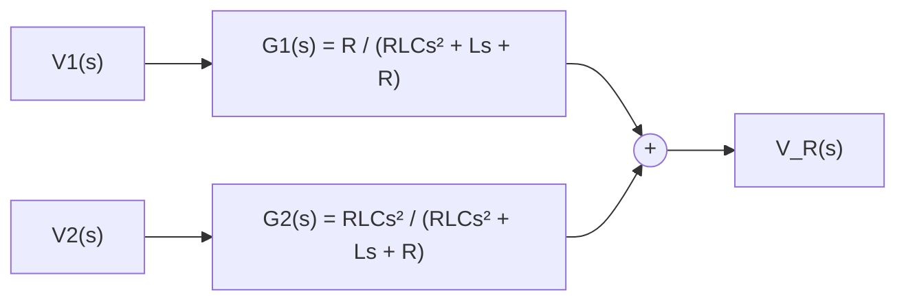

# Módulo 8: Modelado de sistemas físicos

Sistemas mecánicos, motores, hornos y tanques se describen con las mismas ecuaciones que un circuito. Aprende a obtener su función de transferencia a partir de las leyes físicas.

**Al terminar podrás:**

- Modelar masa-resorte-amortiguador y sistemas rotacionales.
- Obtener la función de transferencia de un motor DC.
- Modelar sistemas térmicos e hidráulicos de primer orden.
- Usar las analogías entre dominios.

## Aprende construyendo


### Tema 1: Mecánico de traslación · Avanzado · 40 min

<details open>
<summary><strong>Capa 1 — Lectura</strong></summary>

</details>

<details>
<summary><strong>Capa 2 — Construcción</strong></summary>

#### Código y verificación
```python
# verificacion.py
from sympy import sqrt, Rational, N

m, b, k = 1, 4, 20
wn = sqrt(Rational(k, m))
zeta = Rational(b, 1) / (2 * sqrt(k * m))
final = 10 * Rational(1, k)
print("wn:", N(wn, 3))
print("zeta:", N(zeta, 3))
print("final:", final)
```

```bash
python3 verificacion.py
```

</details>

### Tema 2: Mecánico de rotación · Avanzado · 40 min

<details open>
<summary><strong>Capa 1 — Lectura</strong></summary>

</details>

<details>
<summary><strong>Capa 2 — Construcción</strong></summary>

#### Código y verificación
```python
# verificacion.py
from sympy import sqrt, Rational, N

J, B, K = Rational(1, 2), 2, 10
wn = sqrt(K / J)
print("wn:", N(wn, 4))
```

```bash
python3 verificacion.py
```

</details>

### Tema 3: Motor DC (electromecánico) · Avanzado · 40 min

<details open>
<summary><strong>Capa 1 — Lectura</strong></summary>

</details>

<details>
<summary><strong>Capa 2 — Construcción</strong></summary>

#### Código y verificación
```python
# verificacion.py
from sympy import symbols, solve, N

s = symbols("s")
R, L, J, B, Kt, Kb = 1, 0.5, 0.01, 0.1, 0.01, 0.01
den = (L * s + R) * (J * s + B) + Kt * Kb
polos = solve(den, s)
print("polos:", sorted(N(p, 3) for p in polos))
```

```bash
python3 verificacion.py
```

</details>

### Tema 4: Sistemas térmicos e hidráulicos · Avanzado · 40 min

<details open>
<summary><strong>Capa 1 — Lectura</strong></summary>

</details>

<details>
<summary><strong>Capa 2 — Construcción</strong></summary>

#### Código y verificación
```python
# verificacion.py
from sympy import symbols

s = symbols("s")
A, R = 2, 5
G = R / (A * R * s + 1)
print("G(s):", G)
```

```bash
python3 verificacion.py
```

</details>

### Tema 5: Analogías entre sistemas eléctricos, mecánicos y térmicos · Avanzado · 40 min

<details open>
<summary><strong>Capa 1 — Lectura</strong></summary>

</details>

<details>
<summary><strong>Capa 2 — Construcción</strong></summary>

#### Código y verificación
```python
# verificacion.py
from sympy import sqrt, Rational, N

R, L, C = 4, 1, Rational(1, 20)
M, B, K = L, R, 1 / C
wn = sqrt(K / M)
zeta = B / (2 * sqrt(K * M))
print("wn:", N(wn, 3))
print("zeta:", N(zeta, 3))
```

```bash
python3 verificacion.py
```

</details>

### Tema 6: Ejercicio resuelto: circuito RLC con dos fuentes · Avanzado · 45 min

## Enunciado

En el circuito, una fuente \(v_1\) alimenta una bobina \(L\) que llega a un nodo central. Del nodo central sale una resistencia \(R\) a tierra y un condensador \(C\) hacia una segunda fuente \(v_2\). Halla el modelo matemático y el diagrama de bloques.

## Planteamiento

Llama \(v_R\) a la tensión del nodo central y aplica:
- la **ley de corrientes de Kirchhoff (LCK)** en ese nodo;
- la ecuación de cada elemento.

\[ i_L = \frac{v_R}{R} + i_C, \qquad L\frac{di_L}{dt} = v_1 - v_R, \qquad i_C = C\,\frac{d(v_R - v_2)}{dt} \]

En Laplace, con condiciones iniciales nulas, cada elemento es una impedancia (Módulo 7): \(sL\), \(R\) y \(1/(sC)\). La LCK queda:

\[ \frac{V_1 - V_R}{sL} = \frac{V_R}{R} + sC\,(V_R - V_2) \]

## Solución

Despejando \(V_R\):

\[ V_R(s) = \frac{R\,V_1(s) + RLCs^2\,V_2(s)}{RLCs^2 + Ls + R} \]

El sistema tiene dos entradas, así que hay una función de transferencia por cada una (superposición):

\[ G_1(s) = \frac{V_R}{V_1} = \frac{R}{RLCs^2 + Ls + R}, \qquad G_2(s) = \frac{V_R}{V_2} = \frac{RLCs^2}{RLCs^2 + Ls + R} \]

**Archivo:** `rlc_dos_fuentes.py`

```python
# rlc_dos_fuentes.py — nodo central de un circuito L-R-C con dos fuentes
from sympy import symbols, solve, simplify, factor

s, R, L, C = symbols("s R L C", positive=True)
V1, V2, VR = symbols("V1 V2 V_R")

# LCK en el nodo central: corriente de la bobina = corriente en R + corriente en C
ecuacion = (V1 - VR) / (s * L) - (VR / R + (VR - V2) * s * C)
VR_s = solve(ecuacion, VR)[0]

G1 = simplify(VR_s.diff(V1))   # V_R / V1
G2 = simplify(VR_s.diff(V2))   # V_R / V2
print("V_R/V1 =", factor(G1))
print("V_R/V2 =", factor(G2))
```

```text
$ python3 rlc_dos_fuentes.py
V_R/V1 = R/(C*L*R*s**2 + L*s + R)
V_R/V2 = C*L*R*s**2/(C*L*R*s**2 + L*s + R)
```

## Diagrama de bloques



## Interpretación

- **Polos:** las dos funciones tienen el mismo denominador, de segundo orden. Dividiéndolo por \(RLC\) queda \(s^2 + \frac{1}{RC}s + \frac{1}{LC}\), así que \(\omega_n = 1/\sqrt{LC}\) y \(2\zeta\omega_n = 1/(RC)\). Es la misma forma del Módulo 12.
- **Desde \(v_1\) el circuito es un pasa-bajos:** en continua (\(s=0\)) \(G_1 = 1\), y la bobina deja pasar \(v_1\) entera.
- **Desde \(v_2\) es un pasa-altos:** el condensador bloquea la continua (\(G_2(0)=0\)).

## Compruébalo

1. Con \(R = 1\) kΩ, \(L = 0{,}1\) H y \(C = 1\) µF, ¿el sistema es subamortiguado o sobreamortiguado?
2. Si \(v_2 = 0\) (cortocircuito), ¿qué circuito conocido del Módulo 7 queda?

