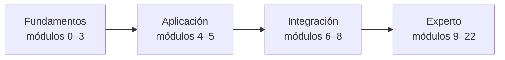
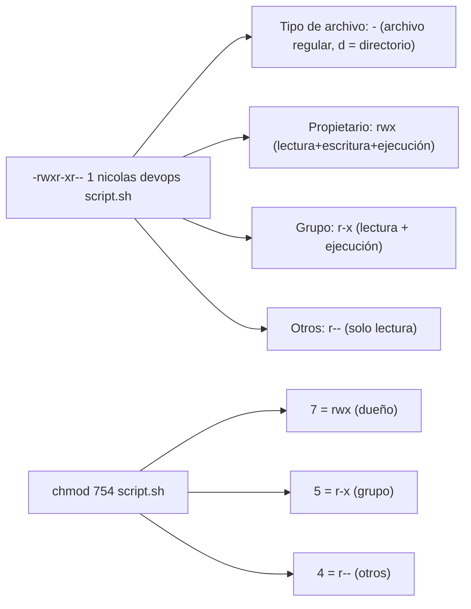
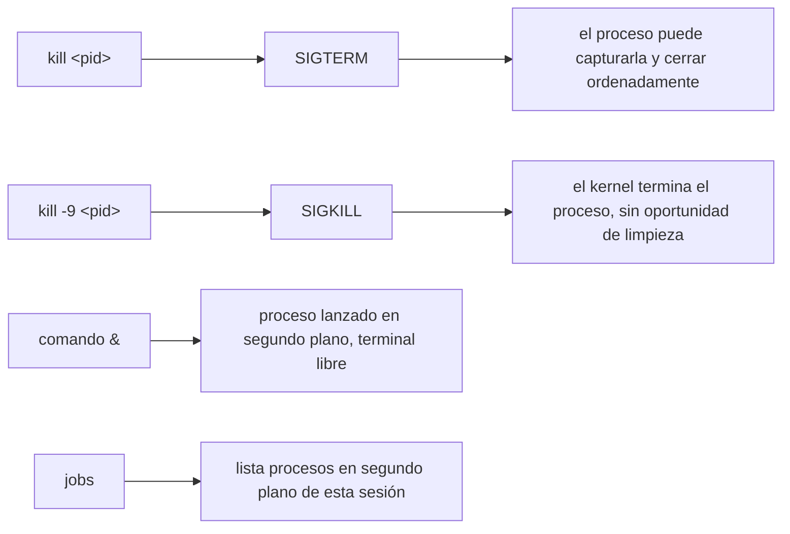
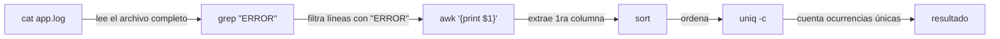
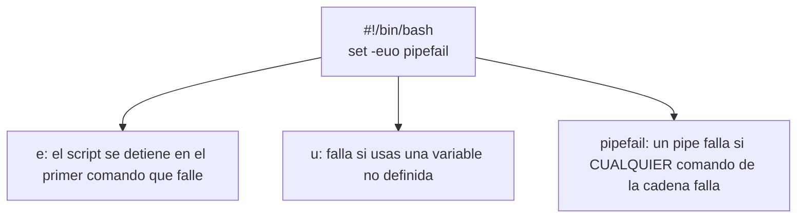
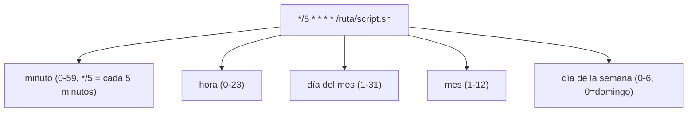
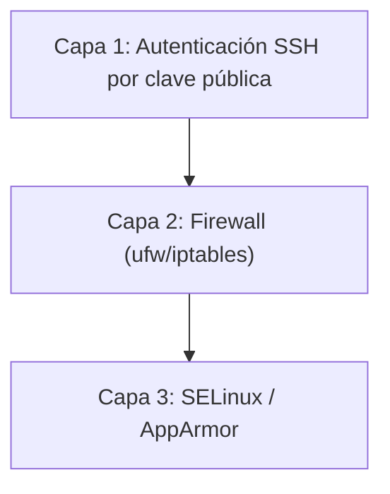
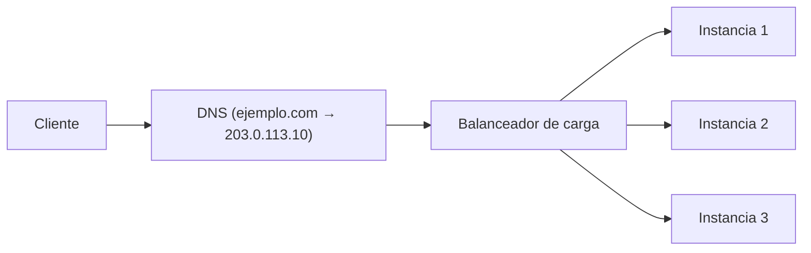
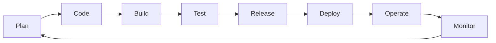
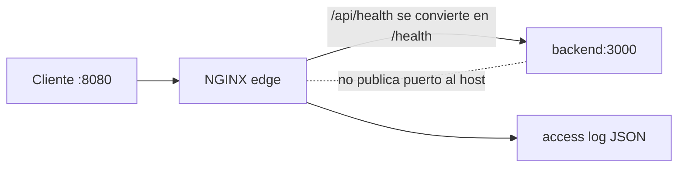

# Módulo 0: Linux y shell scripting para DevOps


## Antes de comenzar: construye un laboratorio seguro

DevOps trabaja intensamente con Linux, incluso si tu computador usa Windows o macOS. Necesitas Git, VS Code, Docker y una shell compatible. Practicaremos en local para no generar costos ni modificar servidores reales.


### Windows

<details open>
<summary><strong>Capa 1 — Lectura</strong></summary>

#### ► DE QUÉ TRATA
Este tema te guía por windows con foco en comprensión antes de implementación.

#### ► LA IDEA EN UNA FRASE
**Entender windows te permite tomar mejores decisiones técnicas.**

#### ► POR QUÉ EXISTE ESTO
Resuelve un problema real de diseño o implementación y evita decisiones a ciegas.

#### ► LA ANALOGÍA
Piensa en windows como una herramienta de taller: útil cuando conoces su propósito y sus límites.
**Dónde se rompe la analogía:** en software, los efectos dependen del contexto, la escala y los trade-offs.

#### ► CÓMO FUNCIONA
1. Identifica el problema que windows resuelve.
2. Observa sus componentes y relaciones.
3. Aplica la opción más simple que funcione.
4. Verifica el resultado y los límites.

#### ► LO QUE PUEDE SALIR MAL
| Síntoma | Causa probable | Arreglo |
|---|---|---|
| Windows se aplica pero el resultado no mejora | Se usó sin medir el problema real | Mide antes y compara contra la alternativa simple |
| Aparece complejidad inesperada | Se adoptó la técnica sin comprender sus trade-offs | Vuelve a la sección de trade-offs y reduce el alcance |
| Falla en un caso límite | Se asumió un contexto que no se cumple | Prueba el caso límite y documenta cuándo NO usarlo |

#### ► TRADE-OFFS
| Opción | Cuándo usarla | Cuándo NO usarla |
|---|---|---|
| Usar Windows | Cuando el problema coincide con su propósito y el beneficio es observable | Cuando agrega complejidad sin resolver un problema real |
| Alternativa más simple | Cuando el contexto es pequeño, estable o fácil de razonar | Cuando ya demostró no escalar o no cumplir el requisito |
| Postergar la decisión | Cuando falta evidencia del problema | Cuando el costo de esperar es mayor que el costo de probar |

#### ► CUÁNDO NO USAR ESTO
No uses windows por defecto. Aplícalo cuando el problema lo justifique y puedas verificar el beneficio; si una alternativa más simple resuelve igual, prefiérela.

#### ► DE VUELTA A LA ANALOGÍA
Volviendo a la analogía: windows funciona como el modelo inicial, pero recuerda dónde se rompe: en producción importan la evidencia, la escala y el costo de equivocarte.

#### ► LO QUE DEBES RECORDAR
- Windows existe para resolver un problema específico.
- Mide antes de adoptar complejidad.
- Conoce el caso donde NO usarlo.
- Verifica con evidencia observable.

#### ► PREGUNTAS PARA PENSAR
1. ¿Qué problema concreto resuelve windows en tu contexto?
2. ¿Cómo sabrías que windows no está funcionando bien?
3. ¿Qué alternativa más simple considerarías antes de usar windows?

</details>

<details>
<summary><strong>Capa 2 — Construcción</strong></summary>

#### Nota de construcción
Este tema es principalmente conceptual en esta versión. La verificación se realiza con las preguntas de comprensión y el criterio de cuándo NO usar windows.

</details>

### macOS

<details open>
<summary><strong>Capa 1 — Lectura</strong></summary>

#### ► DE QUÉ TRATA
Este tema te guía por macos con foco en comprensión antes de implementación.

#### ► LA IDEA EN UNA FRASE
**Entender macos te permite tomar mejores decisiones técnicas.**

#### ► POR QUÉ EXISTE ESTO
Resuelve un problema real de diseño o implementación y evita decisiones a ciegas.

#### ► LA ANALOGÍA
Piensa en macos como una herramienta de taller: útil cuando conoces su propósito y sus límites.
**Dónde se rompe la analogía:** en software, los efectos dependen del contexto, la escala y los trade-offs.

#### ► CÓMO FUNCIONA
1. Identifica el problema que macos resuelve.
2. Observa sus componentes y relaciones.
3. Aplica la opción más simple que funcione.
4. Verifica el resultado y los límites.

#### ► LO QUE PUEDE SALIR MAL
| Síntoma | Causa probable | Arreglo |
|---|---|---|
| macOS se aplica pero el resultado no mejora | Se usó sin medir el problema real | Mide antes y compara contra la alternativa simple |
| Aparece complejidad inesperada | Se adoptó la técnica sin comprender sus trade-offs | Vuelve a la sección de trade-offs y reduce el alcance |
| Falla en un caso límite | Se asumió un contexto que no se cumple | Prueba el caso límite y documenta cuándo NO usarlo |

#### ► TRADE-OFFS
| Opción | Cuándo usarla | Cuándo NO usarla |
|---|---|---|
| Usar macOS | Cuando el problema coincide con su propósito y el beneficio es observable | Cuando agrega complejidad sin resolver un problema real |
| Alternativa más simple | Cuando el contexto es pequeño, estable o fácil de razonar | Cuando ya demostró no escalar o no cumplir el requisito |
| Postergar la decisión | Cuando falta evidencia del problema | Cuando el costo de esperar es mayor que el costo de probar |

#### ► CUÁNDO NO USAR ESTO
No uses macos por defecto. Aplícalo cuando el problema lo justifique y puedas verificar el beneficio; si una alternativa más simple resuelve igual, prefiérela.

#### ► DE VUELTA A LA ANALOGÍA
Volviendo a la analogía: macos funciona como el modelo inicial, pero recuerda dónde se rompe: en producción importan la evidencia, la escala y el costo de equivocarte.

#### ► LO QUE DEBES RECORDAR
- macOS existe para resolver un problema específico.
- Mide antes de adoptar complejidad.
- Conoce el caso donde NO usarlo.
- Verifica con evidencia observable.

#### ► PREGUNTAS PARA PENSAR
1. ¿Qué problema concreto resuelve macos en tu contexto?
2. ¿Cómo sabrías que macos no está funcionando bien?
3. ¿Qué alternativa más simple considerarías antes de usar macos?

</details>

<details>
<summary><strong>Capa 2 — Construcción</strong></summary>

#### Nota de construcción
Este tema es principalmente conceptual en esta versión. La verificación se realiza con las preguntas de comprensión y el criterio de cuándo NO usar macos.

</details>

### Linux (Ubuntu/Debian)

<details open>
<summary><strong>Capa 1 — Lectura</strong></summary>

#### ► DE QUÉ TRATA
Este tema te guía por linux (ubuntu/debian) con foco en comprensión antes de implementación.

#### ► LA IDEA EN UNA FRASE
**Entender linux (ubuntu/debian) te permite tomar mejores decisiones técnicas.**

#### ► POR QUÉ EXISTE ESTO
Resuelve un problema real de diseño o implementación y evita decisiones a ciegas.

#### ► LA ANALOGÍA
Piensa en linux (ubuntu/debian) como una herramienta de taller: útil cuando conoces su propósito y sus límites.
**Dónde se rompe la analogía:** en software, los efectos dependen del contexto, la escala y los trade-offs.

#### ► CÓMO FUNCIONA


#### ► LO QUE PUEDE SALIR MAL
| Síntoma | Causa probable | Arreglo |
|---|---|---|
| Linux (Ubuntu/Debian) se aplica pero el resultado no mejora | Se usó sin medir el problema real | Mide antes y compara contra la alternativa simple |
| Aparece complejidad inesperada | Se adoptó la técnica sin comprender sus trade-offs | Vuelve a la sección de trade-offs y reduce el alcance |
| Falla en un caso límite | Se asumió un contexto que no se cumple | Prueba el caso límite y documenta cuándo NO usarlo |

#### ► TRADE-OFFS
| Opción | Cuándo usarla | Cuándo NO usarla |
|---|---|---|
| Usar Linux (Ubuntu/Debian) | Cuando el problema coincide con su propósito y el beneficio es observable | Cuando agrega complejidad sin resolver un problema real |
| Alternativa más simple | Cuando el contexto es pequeño, estable o fácil de razonar | Cuando ya demostró no escalar o no cumplir el requisito |
| Postergar la decisión | Cuando falta evidencia del problema | Cuando el costo de esperar es mayor que el costo de probar |

#### ► CUÁNDO NO USAR ESTO
No uses linux (ubuntu/debian) por defecto. Aplícalo cuando el problema lo justifique y puedas verificar el beneficio; si una alternativa más simple resuelve igual, prefiérela.

#### ► DE VUELTA A LA ANALOGÍA
Volviendo a la analogía: linux (ubuntu/debian) funciona como el modelo inicial, pero recuerda dónde se rompe: en producción importan la evidencia, la escala y el costo de equivocarte.

#### ► LO QUE DEBES RECORDAR
- Linux (Ubuntu/Debian) existe para resolver un problema específico.
- Mide antes de adoptar complejidad.
- Conoce el caso donde NO usarlo.
- Verifica con evidencia observable.

#### ► PREGUNTAS PARA PENSAR
1. ¿Qué problema concreto resuelve linux (ubuntu/debian) en tu contexto?
2. ¿Cómo sabrías que linux (ubuntu/debian) no está funcionando bien?
3. ¿Qué alternativa más simple considerarías antes de usar linux (ubuntu/debian)?

</details>

<details>
<summary><strong>Capa 2 — Construcción</strong></summary>

#### Código y verificación
```bash
git --version
docker --version
docker compose version
docker run --rm hello-world
```


</details>

### Tema 1: Sistema de archivos y permisos (chmod/chown) · Básico · 20 min

<details open>
<summary><strong>Capa 1 — Lectura</strong></summary>

#### ► DE QUÉ TRATA
Al finalizar podrás leer la notación de permisos de Linux (rwxr-xr--), cambiarla con chmod en notación simbólica y octal, y transferir propiedad con chown, aplicando el principio de mínimo privilegio a archivos reales.

#### ► LA IDEA EN UNA FRASE
**Al finalizar podrás leer la notación de permisos de Linux (rwxr-xr--), cambiarla con chmod en notación simbólica y octal, y transferir propiedad con chown, aplicando el principio de mínimo privilegio a archivos reales.**

#### ► POR QUÉ EXISTE ESTO
Resuelve un problema real de diseño o implementación y evita decisiones a ciegas.

#### ► LA ANALOGÍA
Piensa en sistema de archivos y permisos (chmod/chown) como una herramienta de taller: útil cuando conoces su propósito y sus límites.
**Dónde se rompe la analogía:** en software, los efectos dependen del contexto, la escala y los trade-offs.

#### ► CÓMO FUNCIONA


#### ► LO QUE PUEDE SALIR MAL
| Síntoma | Causa probable | Arreglo |
|---|---|---|
| Sistema de archivos y permisos (chmod/chown) se aplica pero el resultado no mejora | Se usó sin medir el problema real | Mide antes y compara contra la alternativa simple |
| Aparece complejidad inesperada | Se adoptó la técnica sin comprender sus trade-offs | Vuelve a la sección de trade-offs y reduce el alcance |
| Falla en un caso límite | Se asumió un contexto que no se cumple | Prueba el caso límite y documenta cuándo NO usarlo |

#### ► TRADE-OFFS
| Opción | Cuándo usarla | Cuándo NO usarla |
|---|---|---|
| Usar Sistema de archivos y permisos (chmod/chown) | Cuando el problema coincide con su propósito y el beneficio es observable | Cuando agrega complejidad sin resolver un problema real |
| Alternativa más simple | Cuando el contexto es pequeño, estable o fácil de razonar | Cuando ya demostró no escalar o no cumplir el requisito |
| Postergar la decisión | Cuando falta evidencia del problema | Cuando el costo de esperar es mayor que el costo de probar |

#### ► CUÁNDO NO USAR ESTO
No uses sistema de archivos y permisos (chmod/chown) por defecto. Aplícalo cuando el problema lo justifique y puedas verificar el beneficio; si una alternativa más simple resuelve igual, prefiérela.

#### ► DE VUELTA A LA ANALOGÍA
Volviendo a la analogía: sistema de archivos y permisos (chmod/chown) funciona como el modelo inicial, pero recuerda dónde se rompe: en producción importan la evidencia, la escala y el costo de equivocarte.

#### ► LO QUE DEBES RECORDAR
- Sistema de archivos y permisos (chmod/chown) existe para resolver un problema específico.
- Mide antes de adoptar complejidad.
- Conoce el caso donde NO usarlo.
- Verifica con evidencia observable.

#### ► PREGUNTAS PARA PENSAR
1. ¿Qué problema concreto resuelve sistema de archivos y permisos (chmod/chown) en tu contexto?
2. ¿Cómo sabrías que sistema de archivos y permisos (chmod/chown) no está funcionando bien?
3. ¿Qué alternativa más simple considerarías antes de usar sistema de archivos y permisos (chmod/chown)?

</details>

<details>
<summary><strong>Capa 2 — Construcción</strong></summary>

#### Código y verificación


```bash
mkdir -p academia-devops/src/modulo0/permisos && cd academia-devops/src/modulo0/permisos
```

Crea el archivo `script.sh`:

```bash
#!/bin/bash
echo "hola desde script.sh"
```

```bash
docker run --rm -v "$(pwd)":/work -w /work alpine sh -c \
  'ls -l script.sh; chmod 600 script.sh; ls -l script.sh; chmod 754 script.sh; ls -l script.sh'
```

```bash
docker run --rm -v "$(pwd)":/work -w /work alpine sh -c \
  'chmod 600 script.sh; ls -l script.sh; ./script.sh; echo "codigo de salida: $?"'
```

</details>

### Tema 2: Procesos, señales y jobs en segundo plano · Básico · 20 min

<details open>
<summary><strong>Capa 1 — Lectura</strong></summary>

#### ► DE QUÉ TRATA
Al finalizar podrás identificar el PID de un proceso, enviarle señales (SIGTERM vs SIGKILL) y lanzarlo en segundo plano, entendiendo por qué un servicio bien diseñado debe responder a SIGTERM con un apagado ordenado.

#### ► LA IDEA EN UNA FRASE
**Al finalizar podrás identificar el PID de un proceso, enviarle señales (SIGTERM vs SIGKILL) y lanzarlo en segundo plano, entendiendo por qué un servicio bien diseñado debe responder a SIGTERM con un apagado ordenado.**

#### ► POR QUÉ EXISTE ESTO
Resuelve un problema real de diseño o implementación y evita decisiones a ciegas.

#### ► LA ANALOGÍA
Piensa en procesos, señales y jobs en segundo plano como una herramienta de taller: útil cuando conoces su propósito y sus límites.
**Dónde se rompe la analogía:** en software, los efectos dependen del contexto, la escala y los trade-offs.

#### ► CÓMO FUNCIONA


#### ► LO QUE PUEDE SALIR MAL
| Síntoma | Causa probable | Arreglo |
|---|---|---|
| Procesos, señales y jobs en segundo plano se aplica pero el resultado no mejora | Se usó sin medir el problema real | Mide antes y compara contra la alternativa simple |
| Aparece complejidad inesperada | Se adoptó la técnica sin comprender sus trade-offs | Vuelve a la sección de trade-offs y reduce el alcance |
| Falla en un caso límite | Se asumió un contexto que no se cumple | Prueba el caso límite y documenta cuándo NO usarlo |

#### ► TRADE-OFFS
| Opción | Cuándo usarla | Cuándo NO usarla |
|---|---|---|
| Usar Procesos, señales y jobs en segundo plano | Cuando el problema coincide con su propósito y el beneficio es observable | Cuando agrega complejidad sin resolver un problema real |
| Alternativa más simple | Cuando el contexto es pequeño, estable o fácil de razonar | Cuando ya demostró no escalar o no cumplir el requisito |
| Postergar la decisión | Cuando falta evidencia del problema | Cuando el costo de esperar es mayor que el costo de probar |

#### ► CUÁNDO NO USAR ESTO
No uses procesos, señales y jobs en segundo plano por defecto. Aplícalo cuando el problema lo justifique y puedas verificar el beneficio; si una alternativa más simple resuelve igual, prefiérela.

#### ► DE VUELTA A LA ANALOGÍA
Volviendo a la analogía: procesos, señales y jobs en segundo plano funciona como el modelo inicial, pero recuerda dónde se rompe: en producción importan la evidencia, la escala y el costo de equivocarte.

#### ► LO QUE DEBES RECORDAR
- Procesos, señales y jobs en segundo plano existe para resolver un problema específico.
- Mide antes de adoptar complejidad.
- Conoce el caso donde NO usarlo.
- Verifica con evidencia observable.

#### ► PREGUNTAS PARA PENSAR
1. ¿Qué problema concreto resuelve procesos, señales y jobs en segundo plano en tu contexto?
2. ¿Cómo sabrías que procesos, señales y jobs en segundo plano no está funcionando bien?
3. ¿Qué alternativa más simple considerarías antes de usar procesos, señales y jobs en segundo plano?

</details>

<details>
<summary><strong>Capa 2 — Construcción</strong></summary>

#### Código y verificación


```bash
mkdir -p academia-devops/src/modulo0/procesos && cd academia-devops/src/modulo0/procesos
```

Crea el archivo `tarea-larga.sh`:

```bash
#!/bin/bash
trap 'echo "recibi SIGTERM, cerrando ordenadamente"; exit 0' TERM
echo "trabajando... PID: $$"
sleep 300
```

```bash
chmod +x tarea-larga.sh
```

```bash
docker run --rm -v "$(pwd)":/work -w /work alpine sh -c './tarea-larga.sh & sleep 1; kill -TERM $!; wait'
```

</details>

### Tema 3: Pipes, redirección y filtros (grep, awk, sed) · Básico · 20 min

<details open>
<summary><strong>Capa 1 — Lectura</strong></summary>

#### ► DE QUÉ TRATA
Al finalizar podrás encadenar grep, awk y sed con pipes para filtrar, extraer y transformar texto de logs, y redirigir su resultado a archivos sin sobrescribir accidentalmente datos existentes.

#### ► LA IDEA EN UNA FRASE
**Al finalizar podrás encadenar grep, awk y sed con pipes para filtrar, extraer y transformar texto de logs, y redirigir su resultado a archivos sin sobrescribir accidentalmente datos existentes.**

#### ► POR QUÉ EXISTE ESTO
Resuelve un problema real de diseño o implementación y evita decisiones a ciegas.

#### ► LA ANALOGÍA
Piensa en pipes, redirección y filtros (grep, awk, sed) como una herramienta de taller: útil cuando conoces su propósito y sus límites.
**Dónde se rompe la analogía:** en software, los efectos dependen del contexto, la escala y los trade-offs.

#### ► CÓMO FUNCIONA


#### ► LO QUE PUEDE SALIR MAL
| Síntoma | Causa probable | Arreglo |
|---|---|---|
| Pipes, redirección y filtros (grep, awk, sed) se aplica pero el resultado no mejora | Se usó sin medir el problema real | Mide antes y compara contra la alternativa simple |
| Aparece complejidad inesperada | Se adoptó la técnica sin comprender sus trade-offs | Vuelve a la sección de trade-offs y reduce el alcance |
| Falla en un caso límite | Se asumió un contexto que no se cumple | Prueba el caso límite y documenta cuándo NO usarlo |

#### ► TRADE-OFFS
| Opción | Cuándo usarla | Cuándo NO usarla |
|---|---|---|
| Usar Pipes, redirección y filtros (grep, awk, sed) | Cuando el problema coincide con su propósito y el beneficio es observable | Cuando agrega complejidad sin resolver un problema real |
| Alternativa más simple | Cuando el contexto es pequeño, estable o fácil de razonar | Cuando ya demostró no escalar o no cumplir el requisito |
| Postergar la decisión | Cuando falta evidencia del problema | Cuando el costo de esperar es mayor que el costo de probar |

#### ► CUÁNDO NO USAR ESTO
No uses pipes, redirección y filtros (grep, awk, sed) por defecto. Aplícalo cuando el problema lo justifique y puedas verificar el beneficio; si una alternativa más simple resuelve igual, prefiérela.

#### ► DE VUELTA A LA ANALOGÍA
Volviendo a la analogía: pipes, redirección y filtros (grep, awk, sed) funciona como el modelo inicial, pero recuerda dónde se rompe: en producción importan la evidencia, la escala y el costo de equivocarte.

#### ► LO QUE DEBES RECORDAR
- Pipes, redirección y filtros (grep, awk, sed) existe para resolver un problema específico.
- Mide antes de adoptar complejidad.
- Conoce el caso donde NO usarlo.
- Verifica con evidencia observable.

#### ► PREGUNTAS PARA PENSAR
1. ¿Qué problema concreto resuelve pipes, redirección y filtros (grep, awk, sed) en tu contexto?
2. ¿Cómo sabrías que pipes, redirección y filtros (grep, awk, sed) no está funcionando bien?
3. ¿Qué alternativa más simple considerarías antes de usar pipes, redirección y filtros (grep, awk, sed)?

</details>

<details>
<summary><strong>Capa 2 — Construcción</strong></summary>

#### Código y verificación


```bash
mkdir -p academia-devops/src/modulo0/filtros && cd academia-devops/src/modulo0/filtros
```

Crea el archivo `app.log`:

```text
2026-01-01T10:00:00 INFO inicio
2026-01-01T10:00:05 ERROR conexion
2026-01-01T10:00:06 ERROR timeout
2026-01-01T10:00:10 INFO reintento
2026-01-01T10:00:11 ERROR timeout
```

```bash
docker run --rm -v "$(pwd)":/work -w /work alpine sh -c \
  "grep ERROR app.log | awk '{print \$3}' | sort | uniq -c"
```

</details>

### Tema 4: Variables de entorno y scripts bash robustos (set -euo pipefail) · Básico · 20 min

<details open>
<summary><strong>Capa 1 — Lectura</strong></summary>

#### ► DE QUÉ TRATA
Al finalizar podrás escribir scripts bash que usan variables de entorno con valores por defecto seguros y que se detienen inmediatamente ante errores, variables no definidas o fallos ocultos dentro de un pipe.

#### ► LA IDEA EN UNA FRASE
**Al finalizar podrás escribir scripts bash que usan variables de entorno con valores por defecto seguros y que se detienen inmediatamente ante errores, variables no definidas o fallos ocultos dentro de un pipe.**

#### ► POR QUÉ EXISTE ESTO
Resuelve un problema real de diseño o implementación y evita decisiones a ciegas.

#### ► LA ANALOGÍA
Piensa en variables de entorno y scripts bash robustos (set -euo pipefail) como una herramienta de taller: útil cuando conoces su propósito y sus límites.
**Dónde se rompe la analogía:** en software, los efectos dependen del contexto, la escala y los trade-offs.

#### ► CÓMO FUNCIONA


#### ► LO QUE PUEDE SALIR MAL
| Síntoma | Causa probable | Arreglo |
|---|---|---|
| Variables de entorno y scripts bash robustos (set -euo pipefail) se aplica pero el resultado no mejora | Se usó sin medir el problema real | Mide antes y compara contra la alternativa simple |
| Aparece complejidad inesperada | Se adoptó la técnica sin comprender sus trade-offs | Vuelve a la sección de trade-offs y reduce el alcance |
| Falla en un caso límite | Se asumió un contexto que no se cumple | Prueba el caso límite y documenta cuándo NO usarlo |

#### ► TRADE-OFFS
| Opción | Cuándo usarla | Cuándo NO usarla |
|---|---|---|
| Usar Variables de entorno y scripts bash robustos (set -euo pipefail) | Cuando el problema coincide con su propósito y el beneficio es observable | Cuando agrega complejidad sin resolver un problema real |
| Alternativa más simple | Cuando el contexto es pequeño, estable o fácil de razonar | Cuando ya demostró no escalar o no cumplir el requisito |
| Postergar la decisión | Cuando falta evidencia del problema | Cuando el costo de esperar es mayor que el costo de probar |

#### ► CUÁNDO NO USAR ESTO
No uses variables de entorno y scripts bash robustos (set -euo pipefail) por defecto. Aplícalo cuando el problema lo justifique y puedas verificar el beneficio; si una alternativa más simple resuelve igual, prefiérela.

#### ► DE VUELTA A LA ANALOGÍA
Volviendo a la analogía: variables de entorno y scripts bash robustos (set -euo pipefail) funciona como el modelo inicial, pero recuerda dónde se rompe: en producción importan la evidencia, la escala y el costo de equivocarte.

#### ► LO QUE DEBES RECORDAR
- Variables de entorno y scripts bash robustos (set -euo pipefail) existe para resolver un problema específico.
- Mide antes de adoptar complejidad.
- Conoce el caso donde NO usarlo.
- Verifica con evidencia observable.

#### ► PREGUNTAS PARA PENSAR
1. ¿Qué problema concreto resuelve variables de entorno y scripts bash robustos (set -euo pipefail) en tu contexto?
2. ¿Cómo sabrías que variables de entorno y scripts bash robustos (set -euo pipefail) no está funcionando bien?
3. ¿Qué alternativa más simple considerarías antes de usar variables de entorno y scripts bash robustos (set -euo pipefail)?

</details>

<details>
<summary><strong>Capa 2 — Construcción</strong></summary>

#### Código y verificación


```bash
mkdir -p academia-devops/src/modulo0/robusto && cd academia-devops/src/modulo0/robusto
```

Crea el archivo `preparar.sh`:

```bash
#!/bin/bash
set -euo pipefail
ENTORNO="${ENTORNO:-desarrollo}"
echo "Entorno: $ENTORNO"
mkdir -p salida
echo "preparando..." | tee -a salida/log.txt >/dev/null
```

```bash
chmod +x preparar.sh
```

```bash
docker run --rm -v "$(pwd)":/work -w /work bash:5 sh -c './preparar.sh && ./preparar.sh && echo "AMBAS EJECUCIONES OK"'
```

</details>

### Tema 5: Cron y tareas programadas · Básico · 20 min

<details open>
<summary><strong>Capa 1 — Lectura</strong></summary>

#### ► DE QUÉ TRATA
Al finalizar podrás escribir expresiones cron para tareas periódicas y diagnosticar por qué un script que funciona manualmente falla bajo cron por su entorno mínimo.

#### ► LA IDEA EN UNA FRASE
**Al finalizar podrás escribir expresiones cron para tareas periódicas y diagnosticar por qué un script que funciona manualmente falla bajo cron por su entorno mínimo.**

#### ► POR QUÉ EXISTE ESTO
Resuelve un problema real de diseño o implementación y evita decisiones a ciegas.

#### ► LA ANALOGÍA
Piensa en cron y tareas programadas como una herramienta de taller: útil cuando conoces su propósito y sus límites.
**Dónde se rompe la analogía:** en software, los efectos dependen del contexto, la escala y los trade-offs.

#### ► CÓMO FUNCIONA


#### ► LO QUE PUEDE SALIR MAL
| Síntoma | Causa probable | Arreglo |
|---|---|---|
| Cron y tareas programadas se aplica pero el resultado no mejora | Se usó sin medir el problema real | Mide antes y compara contra la alternativa simple |
| Aparece complejidad inesperada | Se adoptó la técnica sin comprender sus trade-offs | Vuelve a la sección de trade-offs y reduce el alcance |
| Falla en un caso límite | Se asumió un contexto que no se cumple | Prueba el caso límite y documenta cuándo NO usarlo |

#### ► TRADE-OFFS
| Opción | Cuándo usarla | Cuándo NO usarla |
|---|---|---|
| Usar Cron y tareas programadas | Cuando el problema coincide con su propósito y el beneficio es observable | Cuando agrega complejidad sin resolver un problema real |
| Alternativa más simple | Cuando el contexto es pequeño, estable o fácil de razonar | Cuando ya demostró no escalar o no cumplir el requisito |
| Postergar la decisión | Cuando falta evidencia del problema | Cuando el costo de esperar es mayor que el costo de probar |

#### ► CUÁNDO NO USAR ESTO
No uses cron y tareas programadas por defecto. Aplícalo cuando el problema lo justifique y puedas verificar el beneficio; si una alternativa más simple resuelve igual, prefiérela.

#### ► DE VUELTA A LA ANALOGÍA
Volviendo a la analogía: cron y tareas programadas funciona como el modelo inicial, pero recuerda dónde se rompe: en producción importan la evidencia, la escala y el costo de equivocarte.

#### ► LO QUE DEBES RECORDAR
- Cron y tareas programadas existe para resolver un problema específico.
- Mide antes de adoptar complejidad.
- Conoce el caso donde NO usarlo.
- Verifica con evidencia observable.

#### ► PREGUNTAS PARA PENSAR
1. ¿Qué problema concreto resuelve cron y tareas programadas en tu contexto?
2. ¿Cómo sabrías que cron y tareas programadas no está funcionando bien?
3. ¿Qué alternativa más simple considerarías antes de usar cron y tareas programadas?

</details>

<details>
<summary><strong>Capa 2 — Construcción</strong></summary>

#### Código y verificación


```bash
mkdir -p academia-devops/src/modulo0/cron && cd academia-devops/src/modulo0/cron
```

Crea el archivo `tarea.sh`:

```bash
#!/bin/bash
set -euo pipefail
echo "$(date -u +%FT%TZ) tarea ejecutada" >> /work/tarea.log
```

```bash
chmod +x tarea.sh
echo "*/1 * * * * /work/tarea.sh" > mi-crontab
```

```bash
docker run --rm -v "$(pwd)":/work -w /work alpine sh -c \
  "crontab /work/mi-crontab && crond -f -l 2 & sleep 65; cat /work/tarea.log; kill %1"
```

</details>

### Tema 6: Hardening básico — SSH sin contraseña, firewalls, SELinux/AppArmor · Básico · 20 min

<details open>
<summary><strong>Capa 1 — Lectura</strong></summary>

#### ► DE QUÉ TRATA
Al finalizar podrás generar un par de claves SSH, deshabilitar autenticación por contraseña, configurar reglas básicas de ufw y explicar qué aporta el control de acceso obligatorio de AppArmor/SELinux más allá de los permisos tradicionales.

#### ► LA IDEA EN UNA FRASE
**Al finalizar podrás generar un par de claves SSH, deshabilitar autenticación por contraseña, configurar reglas básicas de ufw y explicar qué aporta el control de acceso obligatorio de AppArmor/SELinux más allá de los permisos tradicionales.**

#### ► POR QUÉ EXISTE ESTO
Resuelve un problema real de diseño o implementación y evita decisiones a ciegas.

#### ► LA ANALOGÍA
Piensa en hardening básico — ssh sin contraseña, firewalls, selinux/apparmor como una herramienta de taller: útil cuando conoces su propósito y sus límites.
**Dónde se rompe la analogía:** en software, los efectos dependen del contexto, la escala y los trade-offs.

#### ► CÓMO FUNCIONA


#### ► LO QUE PUEDE SALIR MAL
| Síntoma | Causa probable | Arreglo |
|---|---|---|
| Hardening básico — SSH sin contraseña, firewalls, SELinux/AppArmor se aplica pero el resultado no mejora | Se usó sin medir el problema real | Mide antes y compara contra la alternativa simple |
| Aparece complejidad inesperada | Se adoptó la técnica sin comprender sus trade-offs | Vuelve a la sección de trade-offs y reduce el alcance |
| Falla en un caso límite | Se asumió un contexto que no se cumple | Prueba el caso límite y documenta cuándo NO usarlo |

#### ► TRADE-OFFS
| Opción | Cuándo usarla | Cuándo NO usarla |
|---|---|---|
| Usar Hardening básico — SSH sin contraseña, firewalls, SELinux/AppArmor | Cuando el problema coincide con su propósito y el beneficio es observable | Cuando agrega complejidad sin resolver un problema real |
| Alternativa más simple | Cuando el contexto es pequeño, estable o fácil de razonar | Cuando ya demostró no escalar o no cumplir el requisito |
| Postergar la decisión | Cuando falta evidencia del problema | Cuando el costo de esperar es mayor que el costo de probar |

#### ► CUÁNDO NO USAR ESTO
No uses hardening básico — ssh sin contraseña, firewalls, selinux/apparmor por defecto. Aplícalo cuando el problema lo justifique y puedas verificar el beneficio; si una alternativa más simple resuelve igual, prefiérela.

#### ► DE VUELTA A LA ANALOGÍA
Volviendo a la analogía: hardening básico — ssh sin contraseña, firewalls, selinux/apparmor funciona como el modelo inicial, pero recuerda dónde se rompe: en producción importan la evidencia, la escala y el costo de equivocarte.

#### ► LO QUE DEBES RECORDAR
- Hardening básico — SSH sin contraseña, firewalls, SELinux/AppArmor existe para resolver un problema específico.
- Mide antes de adoptar complejidad.
- Conoce el caso donde NO usarlo.
- Verifica con evidencia observable.

#### ► PREGUNTAS PARA PENSAR
1. ¿Qué problema concreto resuelve hardening básico — ssh sin contraseña, firewalls, selinux/apparmor en tu contexto?
2. ¿Cómo sabrías que hardening básico — ssh sin contraseña, firewalls, selinux/apparmor no está funcionando bien?
3. ¿Qué alternativa más simple considerarías antes de usar hardening básico — ssh sin contraseña, firewalls, selinux/apparmor?

</details>

<details>
<summary><strong>Capa 2 — Construcción</strong></summary>

#### Código y verificación


```bash
mkdir -p academia-devops/src/modulo0/hardening && cd academia-devops/src/modulo0/hardening
ssh-keygen -t ed25519 -f clave_demo -N "" -C "demo-academia-devops"
```

```bash
docker run --rm -v "$(pwd)":/work -w /work alpine sh -c \
  "apk add --no-cache openssh >/dev/null 2>&1; mkdir -p /root/.ssh; cat /work/clave_demo.pub > /root/.ssh/authorized_keys; chmod 600 /root/.ssh/authorized_keys; wc -l < /root/.ssh/authorized_keys"
```

</details>

### Tema 7: Redes — modelo OSI, TCP/IP, DNS y balanceadores de carga · Básico · 20 min

<details open>
<summary><strong>Capa 1 — Lectura</strong></summary>

#### ► DE QUÉ TRATA
Al finalizar podrás explicar en qué capa opera una herramienta de red concreta, resolver un nombre DNS manualmente y distinguir un balanceador de capa 4 de uno de capa 7.

#### ► LA IDEA EN UNA FRASE
**Al finalizar podrás explicar en qué capa opera una herramienta de red concreta, resolver un nombre DNS manualmente y distinguir un balanceador de capa 4 de uno de capa 7.**

#### ► POR QUÉ EXISTE ESTO
Resuelve un problema real de diseño o implementación y evita decisiones a ciegas.

#### ► LA ANALOGÍA
Piensa en redes — modelo osi, tcp/ip, dns y balanceadores de carga como una herramienta de taller: útil cuando conoces su propósito y sus límites.
**Dónde se rompe la analogía:** en software, los efectos dependen del contexto, la escala y los trade-offs.

#### ► CÓMO FUNCIONA


#### ► LO QUE PUEDE SALIR MAL
| Síntoma | Causa probable | Arreglo |
|---|---|---|
| Redes — modelo OSI, TCP/IP, DNS y balanceadores de carga se aplica pero el resultado no mejora | Se usó sin medir el problema real | Mide antes y compara contra la alternativa simple |
| Aparece complejidad inesperada | Se adoptó la técnica sin comprender sus trade-offs | Vuelve a la sección de trade-offs y reduce el alcance |
| Falla en un caso límite | Se asumió un contexto que no se cumple | Prueba el caso límite y documenta cuándo NO usarlo |

#### ► TRADE-OFFS
| Opción | Cuándo usarla | Cuándo NO usarla |
|---|---|---|
| Usar Redes — modelo OSI, TCP/IP, DNS y balanceadores de carga | Cuando el problema coincide con su propósito y el beneficio es observable | Cuando agrega complejidad sin resolver un problema real |
| Alternativa más simple | Cuando el contexto es pequeño, estable o fácil de razonar | Cuando ya demostró no escalar o no cumplir el requisito |
| Postergar la decisión | Cuando falta evidencia del problema | Cuando el costo de esperar es mayor que el costo de probar |

#### ► CUÁNDO NO USAR ESTO
No uses redes — modelo osi, tcp/ip, dns y balanceadores de carga por defecto. Aplícalo cuando el problema lo justifique y puedas verificar el beneficio; si una alternativa más simple resuelve igual, prefiérela.

#### ► DE VUELTA A LA ANALOGÍA
Volviendo a la analogía: redes — modelo osi, tcp/ip, dns y balanceadores de carga funciona como el modelo inicial, pero recuerda dónde se rompe: en producción importan la evidencia, la escala y el costo de equivocarte.

#### ► LO QUE DEBES RECORDAR
- Redes — modelo OSI, TCP/IP, DNS y balanceadores de carga existe para resolver un problema específico.
- Mide antes de adoptar complejidad.
- Conoce el caso donde NO usarlo.
- Verifica con evidencia observable.

#### ► PREGUNTAS PARA PENSAR
1. ¿Qué problema concreto resuelve redes — modelo osi, tcp/ip, dns y balanceadores de carga en tu contexto?
2. ¿Cómo sabrías que redes — modelo osi, tcp/ip, dns y balanceadores de carga no está funcionando bien?
3. ¿Qué alternativa más simple considerarías antes de usar redes — modelo osi, tcp/ip, dns y balanceadores de carga?

</details>

<details>
<summary><strong>Capa 2 — Construcción</strong></summary>

#### Código y verificación


```bash
mkdir -p academia-devops/src/modulo0/redes && cd academia-devops/src/modulo0/redes
```

```bash
docker run --rm alpine sh -c \
  "apk add --no-cache bind-tools >/dev/null 2>&1; nslookup example.com; nc -vz example.com 443"
```

</details>

### Tema 8: Cultura DevOps y el ciclo Plan→Code→Build→Test→Release→Deploy→Operate→Monitor · Básico · 20 min

<details open>
<summary><strong>Capa 1 — Lectura</strong></summary>

#### ► DE QUÉ TRATA
Al finalizar podrás explicar el ciclo Plan→Code→Build→Test→Release→Deploy→Operate→Monitor como un flujo continuo, no lineal, y documentarlo para tu propio proyecto.

#### ► LA IDEA EN UNA FRASE
**Al finalizar podrás explicar el ciclo Plan→Code→Build→Test→Release→Deploy→Operate→Monitor como un flujo continuo, no lineal, y documentarlo para tu propio proyecto.**

#### ► POR QUÉ EXISTE ESTO
Resuelve un problema real de diseño o implementación y evita decisiones a ciegas.

#### ► LA ANALOGÍA
Piensa en cultura devops y el ciclo plan→code→build→test→release→deploy→operate→monitor como una herramienta de taller: útil cuando conoces su propósito y sus límites.
**Dónde se rompe la analogía:** en software, los efectos dependen del contexto, la escala y los trade-offs.

#### ► CÓMO FUNCIONA


#### ► LO QUE PUEDE SALIR MAL
| Síntoma | Causa probable | Arreglo |
|---|---|---|
| Cultura DevOps y el ciclo Plan→Code→Build→Test→Release→Deploy→Operate→Monitor se aplica pero el resultado no mejora | Se usó sin medir el problema real | Mide antes y compara contra la alternativa simple |
| Aparece complejidad inesperada | Se adoptó la técnica sin comprender sus trade-offs | Vuelve a la sección de trade-offs y reduce el alcance |
| Falla en un caso límite | Se asumió un contexto que no se cumple | Prueba el caso límite y documenta cuándo NO usarlo |

#### ► TRADE-OFFS
| Opción | Cuándo usarla | Cuándo NO usarla |
|---|---|---|
| Usar Cultura DevOps y el ciclo Plan→Code→Build→Test→Release→Deploy→Operate→Monitor | Cuando el problema coincide con su propósito y el beneficio es observable | Cuando agrega complejidad sin resolver un problema real |
| Alternativa más simple | Cuando el contexto es pequeño, estable o fácil de razonar | Cuando ya demostró no escalar o no cumplir el requisito |
| Postergar la decisión | Cuando falta evidencia del problema | Cuando el costo de esperar es mayor que el costo de probar |

#### ► CUÁNDO NO USAR ESTO
No uses cultura devops y el ciclo plan→code→build→test→release→deploy→operate→monitor por defecto. Aplícalo cuando el problema lo justifique y puedas verificar el beneficio; si una alternativa más simple resuelve igual, prefiérela.

#### ► DE VUELTA A LA ANALOGÍA
Volviendo a la analogía: cultura devops y el ciclo plan→code→build→test→release→deploy→operate→monitor funciona como el modelo inicial, pero recuerda dónde se rompe: en producción importan la evidencia, la escala y el costo de equivocarte.

#### ► LO QUE DEBES RECORDAR
- Cultura DevOps y el ciclo Plan→Code→Build→Test→Release→Deploy→Operate→Monitor existe para resolver un problema específico.
- Mide antes de adoptar complejidad.
- Conoce el caso donde NO usarlo.
- Verifica con evidencia observable.

#### ► PREGUNTAS PARA PENSAR
1. ¿Qué problema concreto resuelve cultura devops y el ciclo plan→code→build→test→release→deploy→operate→monitor en tu contexto?
2. ¿Cómo sabrías que cultura devops y el ciclo plan→code→build→test→release→deploy→operate→monitor no está funcionando bien?
3. ¿Qué alternativa más simple considerarías antes de usar cultura devops y el ciclo plan→code→build→test→release→deploy→operate→monitor?

</details>

<details>
<summary><strong>Capa 2 — Construcción</strong></summary>

#### Código y verificación


```bash
mkdir -p academia-devops/src/modulo0/cultura && cd academia-devops/src/modulo0/cultura
```

Crea el archivo `ciclo.md`:

```markdown
# Ciclo DevOps del proyecto
- Plan: priorizamos incidentes reportados en Monitor.
- Code -> Build -> Test -> Release -> Deploy -> Operate -> Monitor.
```

```bash
docker run --rm -v "$(pwd)":/work -w /work alpine sh -c "cat /work/ciclo.md; wc -l /work/ciclo.md"
```

</details>

### Tema 9: NGINX y proxies desde cero · Básico · 20 min

<details open>
<summary><strong>Capa 1 — Lectura</strong></summary>

#### ► DE QUÉ TRATA
Al finalizar podrás levantar NGINX como proxy inverso delante de un backend real, conservar cabeceras como X-Forwarded-For, y diagnosticar un 502 Bad Gateway cuando el backend cae.

#### ► LA IDEA EN UNA FRASE
**Al finalizar podrás levantar NGINX como proxy inverso delante de un backend real, conservar cabeceras como X-Forwarded-For, y diagnosticar un 502 Bad Gateway cuando el backend cae.**

#### ► POR QUÉ EXISTE ESTO
Resuelve un problema real de diseño o implementación y evita decisiones a ciegas.

#### ► LA ANALOGÍA
Piensa en nginx y proxies desde cero como una herramienta de taller: útil cuando conoces su propósito y sus límites.
**Dónde se rompe la analogía:** en software, los efectos dependen del contexto, la escala y los trade-offs.

#### ► CÓMO FUNCIONA


#### ► LO QUE PUEDE SALIR MAL
| Síntoma | Causa probable | Arreglo |
|---|---|---|
| NGINX y proxies desde cero se aplica pero el resultado no mejora | Se usó sin medir el problema real | Mide antes y compara contra la alternativa simple |
| Aparece complejidad inesperada | Se adoptó la técnica sin comprender sus trade-offs | Vuelve a la sección de trade-offs y reduce el alcance |
| Falla en un caso límite | Se asumió un contexto que no se cumple | Prueba el caso límite y documenta cuándo NO usarlo |

#### ► TRADE-OFFS
| Opción | Cuándo usarla | Cuándo NO usarla |
|---|---|---|
| Usar NGINX y proxies desde cero | Cuando el problema coincide con su propósito y el beneficio es observable | Cuando agrega complejidad sin resolver un problema real |
| Alternativa más simple | Cuando el contexto es pequeño, estable o fácil de razonar | Cuando ya demostró no escalar o no cumplir el requisito |
| Postergar la decisión | Cuando falta evidencia del problema | Cuando el costo de esperar es mayor que el costo de probar |

#### ► CUÁNDO NO USAR ESTO
No uses nginx y proxies desde cero por defecto. Aplícalo cuando el problema lo justifique y puedas verificar el beneficio; si una alternativa más simple resuelve igual, prefiérela.

#### ► DE VUELTA A LA ANALOGÍA
Volviendo a la analogía: nginx y proxies desde cero funciona como el modelo inicial, pero recuerda dónde se rompe: en producción importan la evidencia, la escala y el costo de equivocarte.

#### ► LO QUE DEBES RECORDAR
- NGINX y proxies desde cero existe para resolver un problema específico.
- Mide antes de adoptar complejidad.
- Conoce el caso donde NO usarlo.
- Verifica con evidencia observable.

#### ► PREGUNTAS PARA PENSAR
1. ¿Qué problema concreto resuelve nginx y proxies desde cero en tu contexto?
2. ¿Cómo sabrías que nginx y proxies desde cero no está funcionando bien?
3. ¿Qué alternativa más simple considerarías antes de usar nginx y proxies desde cero?

</details>

<details>
<summary><strong>Capa 2 — Construcción</strong></summary>

#### Código y verificación
```bash
mkdir -p academia-devops/src/modulo0/nginx-demo/{nginx,backend}
cd academia-devops/src/modulo0/nginx-demo
touch compose.yaml nginx/default.conf backend/server.js
```

```text
academia-devops/src/modulo0/nginx-demo/
├── compose.yaml
├── nginx/default.conf
└── backend/server.js
```

```js
const http = require('node:http'); // servidor HTTP nativo, sin dependencias externas
const instance = process.env.INSTANCE_NAME ?? 'unknown';

http.createServer((request, response) => {
  if (request.url !== '/health') {
    response.writeHead(404).end('not found');
    return;
  }
  response.writeHead(200, {'content-type': 'application/json'});
  response.end(JSON.stringify({
    status: 'ok',
    instance,
    requestId: request.headers['x-request-id'] ?? null
  }));
}).listen(3000, '0.0.0.0');
```

```nginx
upstream demo_api {
    server backend:3000 max_fails=3 fail_timeout=10s;
    keepalive 16;
}

log_format demo_json escape=json
  '{"time":"$time_iso8601","request_id":"$request_id",'
  '"status":$status,"method":"$request_method","uri":"$uri",'
  '"upstream":"$upstream_addr","upstream_time":"$upstream_response_time"}';

server {
    listen 80;
    access_log /var/log/nginx/access.log demo_json;

    location /api/ {
        proxy_pass http://demo_api/;
        proxy_http_version 1.1;
        proxy_set_header Connection "";
        proxy_set_header Host $host;
        proxy_set_header X-Request-ID $request_id;
        proxy_set_header X-Forwarded-For $proxy_add_x_forwarded_for;
        proxy_set_header X-Forwarded-Proto $scheme;
        proxy_connect_timeout 2s;
        proxy_read_timeout 5s;
    }
}
```

```yaml
services:
  backend:
    image: node:24-alpine
    working_dir: /app
    command: ["node", "server.js"]
    environment:
      INSTANCE_NAME: backend-a
    volumes:
      - ./backend:/app:ro
    expose: ["3000"]

  edge:
    image: nginx:1.30-alpine
    ports: ["8080:80"]
    volumes:
      - ./nginx/default.conf:/etc/nginx/conf.d/default.conf:ro
    depends_on: [backend]
```


</details>

### Tema 10: Usuarios, grupos, permisos compartidos y sudo con mínimo privilegio · Básico · 20 min

<details open>
<summary><strong>Capa 1 — Lectura</strong></summary>

#### ► DE QUÉ TRATA
Al finalizar podrás crear usuarios y grupos, compartir una carpeta entre un equipo con permisos de grupo y el bit setgid, comprobar quién puede leer qué y conceder sudo solo para un comando concreto. Prerrequisitos: Temas 1 y 6 de este módulo (permisos y hardening).

#### ► LA IDEA EN UNA FRASE
**Al finalizar podrás crear usuarios y grupos, compartir una carpeta entre un equipo con permisos de grupo y el bit setgid, comprobar quién puede leer qué y conceder sudo solo para un comando concreto.**

#### ► POR QUÉ EXISTE ESTO
Resuelve un problema real de diseño o implementación y evita decisiones a ciegas.

#### ► LA ANALOGÍA
Piensa en usuarios, grupos, permisos compartidos y sudo con mínimo privilegio como una herramienta de taller: útil cuando conoces su propósito y sus límites.
**Dónde se rompe la analogía:** en software, los efectos dependen del contexto, la escala y los trade-offs.

#### ► CÓMO FUNCIONA
```mermaid
flowchart LR
    A[ana] --> G[grupo despacho]
    G --> D["/srv/rutaflow/manifiestos 2770"]
    B[beto] -. sin grupo .-> D
    A --> S[sudo: solo systemctl restart despacho]
```

#### ► LO QUE PUEDE SALIR MAL
| Síntoma | Causa probable | Arreglo |
|---|---|---|
| Usuarios, grupos, permisos compartidos y sudo con mínimo privilegio se aplica pero el resultado no mejora | Se usó sin medir el problema real | Mide antes y compara contra la alternativa simple |
| Aparece complejidad inesperada | Se adoptó la técnica sin comprender sus trade-offs | Vuelve a la sección de trade-offs y reduce el alcance |
| Falla en un caso límite | Se asumió un contexto que no se cumple | Prueba el caso límite y documenta cuándo NO usarlo |

#### ► TRADE-OFFS
| Opción | Cuándo usarla | Cuándo NO usarla |
|---|---|---|
| Usar Usuarios, grupos, permisos compartidos y sudo con mínimo privilegio | Cuando el problema coincide con su propósito y el beneficio es observable | Cuando agrega complejidad sin resolver un problema real |
| Alternativa más simple | Cuando el contexto es pequeño, estable o fácil de razonar | Cuando ya demostró no escalar o no cumplir el requisito |
| Postergar la decisión | Cuando falta evidencia del problema | Cuando el costo de esperar es mayor que el costo de probar |

#### ► CUÁNDO NO USAR ESTO
No uses usuarios, grupos, permisos compartidos y sudo con mínimo privilegio por defecto. Aplícalo cuando el problema lo justifique y puedas verificar el beneficio; si una alternativa más simple resuelve igual, prefiérela.

#### ► DE VUELTA A LA ANALOGÍA
Volviendo a la analogía: usuarios, grupos, permisos compartidos y sudo con mínimo privilegio funciona como el modelo inicial, pero recuerda dónde se rompe: en producción importan la evidencia, la escala y el costo de equivocarte.

#### ► LO QUE DEBES RECORDAR
- Usuarios, grupos, permisos compartidos y sudo con mínimo privilegio existe para resolver un problema específico.
- Mide antes de adoptar complejidad.
- Conoce el caso donde NO usarlo.
- Verifica con evidencia observable.

#### ► PREGUNTAS PARA PENSAR
1. ¿Qué problema concreto resuelve usuarios, grupos, permisos compartidos y sudo con mínimo privilegio en tu contexto?
2. ¿Cómo sabrías que usuarios, grupos, permisos compartidos y sudo con mínimo privilegio no está funcionando bien?
3. ¿Qué alternativa más simple considerarías antes de usar usuarios, grupos, permisos compartidos y sudo con mínimo privilegio?

</details>

<details>
<summary><strong>Capa 2 — Construcción</strong></summary>

#### Código y verificación
```mermaid
flowchart LR
    A[ana] --> G[grupo despacho]
    G --> D["/srv/rutaflow/manifiestos 2770"]
    B[beto] -. sin grupo .-> D
    A --> S[sudo: solo systemctl restart despacho]
```

```bash
mkdir usuarios-linux && cd usuarios-linux
```

```bash
#!/usr/bin/env bash
# Ejecutar como root dentro de un contenedor Ubuntu desechable
set -euo pipefail

groupadd despacho                                  # grupo del equipo de despacho
useradd --create-home --shell /bin/bash --groups despacho ana
useradd --create-home --shell /bin/bash beto       # beto NO pertenece a despacho

mkdir -p /srv/rutaflow/manifiestos
echo "BO-004512;Chapinero" > /srv/rutaflow/manifiestos/hoy.csv
chown -R root:despacho /srv/rutaflow/manifiestos
chmod 2770 /srv/rutaflow/manifiestos              # setgid: lo nuevo hereda el grupo despacho
chmod 640 /srv/rutaflow/manifiestos/hoy.csv

echo "--- identidades"
id ana
id beto
echo "--- permisos"
ls -ld /srv/rutaflow/manifiestos
ls -l /srv/rutaflow/manifiestos

echo "--- ana lee y crea archivos"
sudo -u ana cat /srv/rutaflow/manifiestos/hoy.csv
sudo -u ana touch /srv/rutaflow/manifiestos/manana.csv
ls -l /srv/rutaflow/manifiestos/manana.csv | awk '{print $3, $4, $9}'

echo "--- beto intenta leer"
sudo -u beto cat /srv/rutaflow/manifiestos/hoy.csv || echo "beto fue rechazado (código $?)"

echo "--- sudo limitado: ana puede reiniciar solo el servicio de despacho"
echo 'ana ALL=(root) NOPASSWD: /usr/bin/systemctl restart despacho.service' > /etc/sudoers.d/despacho
chmod 440 /etc/sudoers.d/despacho
visudo -cf /etc/sudoers.d/despacho
sudo -l -U ana | tail -1
```

```bash
docker run --rm -v "$(pwd)":/work -w /work ubuntu:24.04 bash -c \
  "apt-get update -qq && apt-get install -y -qq sudo >/dev/null && bash usuarios.sh"
```

```text
--- identidades
uid=1001(ana) gid=1002(ana) groups=1002(ana),1001(despacho)
uid=1002(beto) gid=1003(beto) groups=1003(beto)
--- permisos
drwxrws--- 2 root despacho 4096 Oct 28 21:51 /srv/rutaflow/manifiestos
total 4
-rw-r----- 1 root despacho 20 Oct 28 21:51 hoy.csv
--- ana lee y crea archivos
BO-004512;Chapinero
ana despacho /srv/rutaflow/manifiestos/manana.csv
--- beto intenta leer
cat: /srv/rutaflow/manifiestos/hoy.csv: Permission denied
beto fue rechazado (código 1)
--- sudo limitado: ana puede reiniciar solo el servicio de despacho
/etc/sudoers.d/despacho: parsed OK
    (root) NOPASSWD: /usr/bin/systemctl restart despacho.service
```

</details>

### Tema 11: systemd: servicios, timers y logs con journalctl · Básico · 20 min

<details open>
<summary><strong>Capa 1 — Lectura</strong></summary>

#### ► DE QUÉ TRATA
Al finalizar podrás escribir una unidad de servicio y un timer de systemd, validarlos sin arrancarlos, calcular sus próximas ejecuciones y operar el servicio con systemctl y journalctl. Prerrequisitos: Temas 2, 5 y 10 de este módulo (procesos, cron y usuarios).

#### ► LA IDEA EN UNA FRASE
**Al finalizar podrás escribir una unidad de servicio y un timer de systemd, validarlos sin arrancarlos, calcular sus próximas ejecuciones y operar el servicio con systemctl y journalctl.**

#### ► POR QUÉ EXISTE ESTO
Resuelve un problema real de diseño o implementación y evita decisiones a ciegas.

#### ► LA ANALOGÍA
Piensa en systemd: servicios, timers y logs con journalctl como una herramienta de taller: útil cuando conoces su propósito y sus límites.
**Dónde se rompe la analogía:** en software, los efectos dependen del contexto, la escala y los trade-offs.

#### ► CÓMO FUNCIONA
```mermaid
flowchart LR
    T[reporte-despacho.timer] -- 06:30 --> S[reporte-despacho.service]
    S -- User=ana --> P[reporte-despacho.sh]
    P -- stdout --> J[(journal)]
    J --> Q[journalctl -u reporte-despacho]
```

#### ► LO QUE PUEDE SALIR MAL
| Síntoma | Causa probable | Arreglo |
|---|---|---|
| systemd: servicios, timers y logs con journalctl se aplica pero el resultado no mejora | Se usó sin medir el problema real | Mide antes y compara contra la alternativa simple |
| Aparece complejidad inesperada | Se adoptó la técnica sin comprender sus trade-offs | Vuelve a la sección de trade-offs y reduce el alcance |
| Falla en un caso límite | Se asumió un contexto que no se cumple | Prueba el caso límite y documenta cuándo NO usarlo |

#### ► TRADE-OFFS
| Opción | Cuándo usarla | Cuándo NO usarla |
|---|---|---|
| Usar systemd: servicios, timers y logs con journalctl | Cuando el problema coincide con su propósito y el beneficio es observable | Cuando agrega complejidad sin resolver un problema real |
| Alternativa más simple | Cuando el contexto es pequeño, estable o fácil de razonar | Cuando ya demostró no escalar o no cumplir el requisito |
| Postergar la decisión | Cuando falta evidencia del problema | Cuando el costo de esperar es mayor que el costo de probar |

#### ► CUÁNDO NO USAR ESTO
No uses systemd: servicios, timers y logs con journalctl por defecto. Aplícalo cuando el problema lo justifique y puedas verificar el beneficio; si una alternativa más simple resuelve igual, prefiérela.

#### ► DE VUELTA A LA ANALOGÍA
Volviendo a la analogía: systemd: servicios, timers y logs con journalctl funciona como el modelo inicial, pero recuerda dónde se rompe: en producción importan la evidencia, la escala y el costo de equivocarte.

#### ► LO QUE DEBES RECORDAR
- systemd: servicios, timers y logs con journalctl existe para resolver un problema específico.
- Mide antes de adoptar complejidad.
- Conoce el caso donde NO usarlo.
- Verifica con evidencia observable.

#### ► PREGUNTAS PARA PENSAR
1. ¿Qué problema concreto resuelve systemd: servicios, timers y logs con journalctl en tu contexto?
2. ¿Cómo sabrías que systemd: servicios, timers y logs con journalctl no está funcionando bien?
3. ¿Qué alternativa más simple considerarías antes de usar systemd: servicios, timers y logs con journalctl?

</details>

<details>
<summary><strong>Capa 2 — Construcción</strong></summary>

#### Código y verificación
```mermaid
flowchart LR
    T[reporte-despacho.timer] -- 06:30 --> S[reporte-despacho.service]
    S -- User=ana --> P[reporte-despacho.sh]
    P -- stdout --> J[(journal)]
    J --> Q[journalctl -u reporte-despacho]
```

```bash
mkdir systemd-despacho && cd systemd-despacho
```

```bash
#!/usr/bin/env bash
set -euo pipefail
# Escribe a stdout: systemd lo envía al journal, sin archivos de log propios
echo "Reporte de despacho generado: $(date --iso-8601=seconds)"
echo "Entregas pendientes: $(wc -l < /srv/rutaflow/pendientes.csv)"
```

```ini
[Unit]
Description=Genera el reporte diario de despacho de RutaFlow
After=network-online.target

[Service]
Type=oneshot
User=ana
ExecStart=/usr/local/bin/reporte-despacho.sh
# Endurecimiento: el servicio no puede escribir en /home ni ganar privilegios
ProtectHome=true
NoNewPrivileges=true
```

```ini
[Unit]
Description=Ejecuta el reporte de despacho de lunes a sábado a las 6:30

[Timer]
OnCalendar=Mon..Sat *-*-* 06:30:00
Persistent=true

[Install]
WantedBy=timers.target
```

```bash
#!/usr/bin/env bash
set -uo pipefail
install -m 755 reporte-despacho.sh /usr/local/bin/reporte-despacho.sh
cp reporte-despacho.service reporte-despacho.timer /etc/systemd/system/

echo "--- verificación de las unidades"
systemd-analyze verify /etc/systemd/system/reporte-despacho.service /etc/systemd/system/reporte-despacho.timer \
  && echo "unidades válidas"

echo "--- próximas ejecuciones del timer"
systemd-analyze calendar --iterations=3 --base-time='2026-10-30 12:00' 'Mon..Sat *-*-* 06:30:00' | grep -E 'Original|Normalized|Next|Iter'
```

</details>
