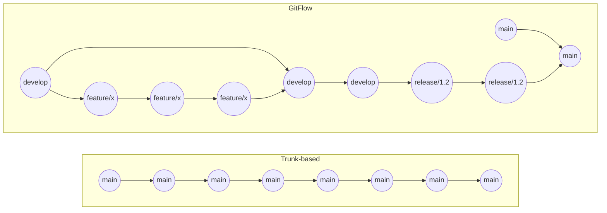
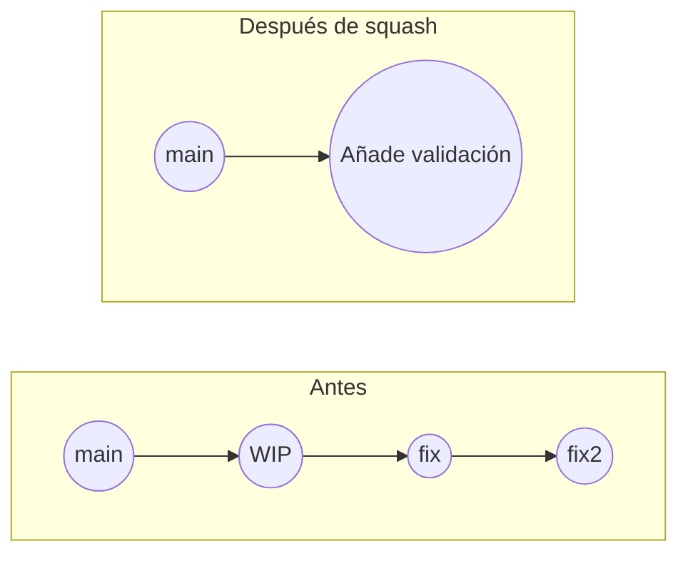
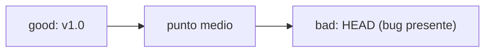
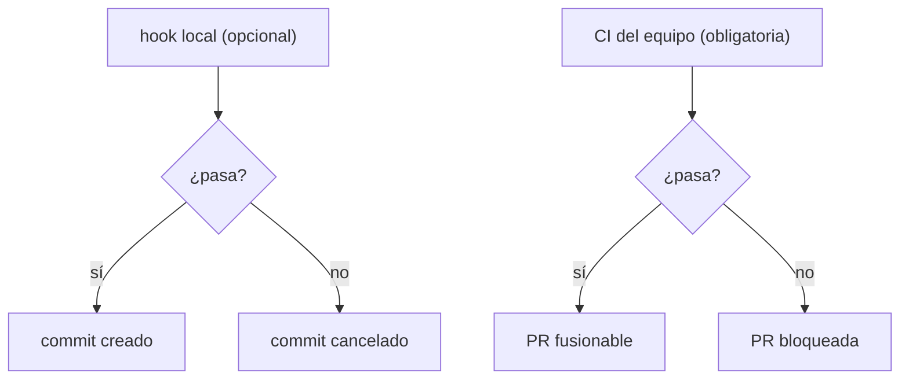
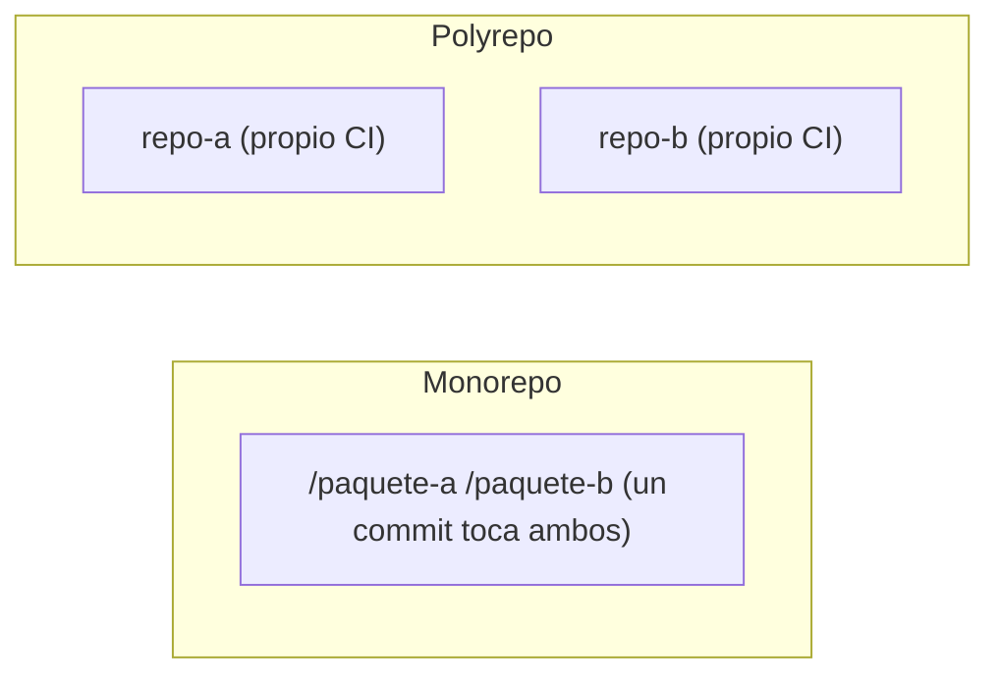
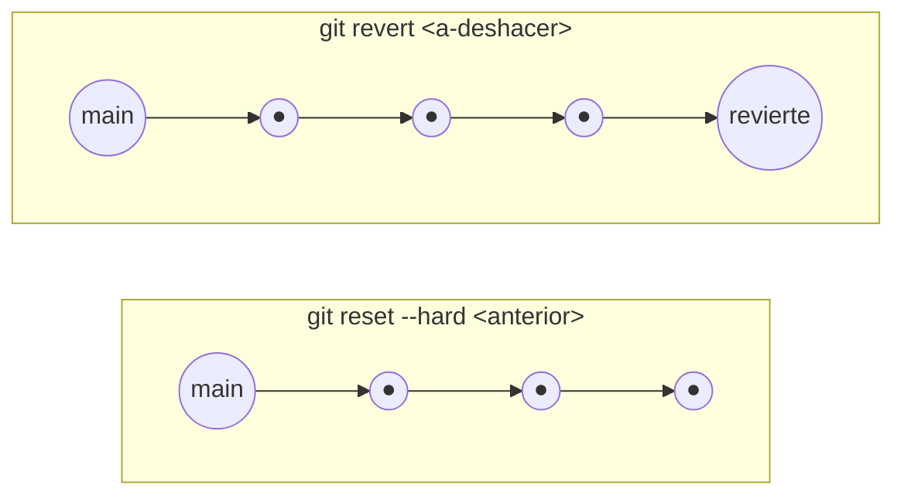
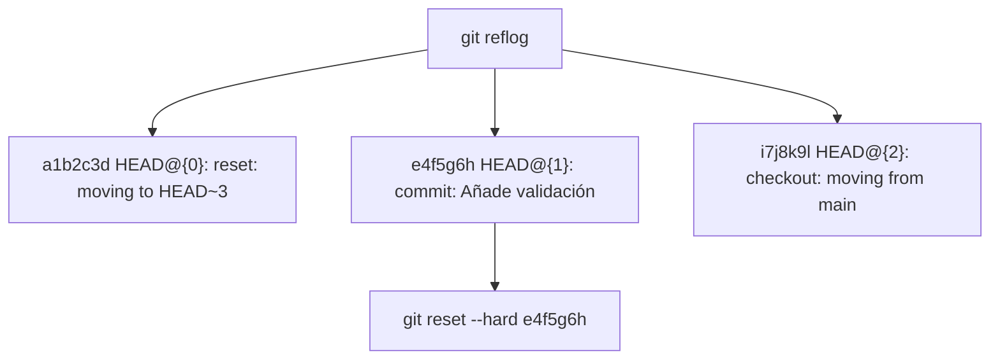

# Módulo 1: Git avanzado y estrategias de branching


## Aprende construyendo


### Tema 1: Trunk-based development vs GitFlow · Básico · 20 min

<details open>
<summary><strong>Capa 1 — Lectura</strong></summary>

#### ► DE QUÉ TRATA
Al finalizar podrás elegir entre trunk-based development y GitFlow según el tamaño y madurez operativa de un equipo, explicando qué rol cumplen los feature flags en cada modelo.

#### ► CÓMO FUNCIONA


#### ► REGLA PRÁCTICA
Si el equipo despliega varias veces al día con CI/CD y puede ocultar trabajo incompleto detrás de un feature flag, trunk-based es la opción natural; si el producto se libera en versiones programadas (apps móviles con revisión de tienda, software con soporte LTS), GitFlow da una rama `release/` estable donde congelar y parchear sin bloquear `develop`.

</details>

<details>
<summary><strong>Capa 2 — Construcción</strong></summary>

#### Código y verificación


```bash
mkdir -p academia-devops/src/modulo1/branching/trunk-demo
cd academia-devops/src/modulo1/branching/trunk-demo
docker run --rm -u "$(id -u):$(id -g)" -v "$(pwd)":/repo -w /repo --entrypoint sh alpine/git -c \
  "git init -q -b main && git config user.email demo@academia.dev && git config user.name demo && \
   echo v1 > app.txt && git add . && git commit -qm inicio && \
   git checkout -qb feature/x && echo 'v2 tras flag' >> app.txt && git commit -qam 'feature x' && \
   git checkout -q main && git merge --no-ff -q feature/x -m 'integra feature x' && \
   git log --oneline --graph --all"
```

</details>

### Tema 2: Rebase interactivo vs merge · Básico · 20 min

<details open>
<summary><strong>Capa 1 — Lectura</strong></summary>

#### ► DE QUÉ TRATA
Al finalizar podrás limpiar un historial de commits con git rebase -i y explicar por qué nunca debe reescribirse el historial de una rama ya compartida.

#### ► CÓMO FUNCIONA


#### ► REGLA PRÁCTICA
`git rebase -i` solo es seguro en commits que nadie más haya descargado todavía (tu rama local de feature antes del push, o justo después si nadie más la tocó); en cuanto la rama es compartida, usa merge o tendrás que forzar el push y reescribir el historial que otros ya tienen.

</details>

<details>
<summary><strong>Capa 2 — Construcción</strong></summary>

#### Código y verificación


```bash
mkdir -p academia-devops/src/modulo1/rebase
cd academia-devops/src/modulo1/rebase
docker run --rm -u "$(id -u):$(id -g)" -v "$(pwd)":/repo -w /repo --entrypoint sh alpine/git -c \
  "git init -q -b main && git config user.email demo@academia.dev && git config user.name demo && \
   echo v1 > archivo.txt && git add . && git commit -qm WIP && \
   echo v2 >> archivo.txt && git commit -qam fix && \
   echo v3 >> archivo.txt && git commit -qam 'fix de verdad' && git log --oneline"
```

```bash
docker run --rm -u "$(id -u):$(id -g)" -v "$(pwd)":/repo -w /repo --entrypoint sh alpine/git -c \
  "GIT_SEQUENCE_EDITOR='sed -i 2,3s/^pick/squash/' GIT_EDITOR=true git rebase -i --root && git log --oneline"
```

</details>

### Tema 3: Bisect para encontrar regresiones · Básico · 20 min

<details open>
<summary><strong>Capa 1 — Lectura</strong></summary>

#### ► DE QUÉ TRATA
Al finalizar podrás usar git bisect para encontrar por búsqueda binaria el commit exacto que introdujo una regresión, incluyendo su automatización con bisect run.

#### ► CÓMO FUNCIONA


</details>

<details>
<summary><strong>Capa 2 — Construcción</strong></summary>

#### Código y verificación


```bash
mkdir -p academia-devops/src/modulo1/bisect
cd academia-devops/src/modulo1/bisect
docker run --rm -u "$(id -u):$(id -g)" -v "$(pwd)":/repo -w /repo --entrypoint sh alpine/git -c '
  git init -q -b main && git config user.email demo@academia.dev && git config user.name demo
  echo "def suma(a,b): return a+b" > operacion.py && git add . && git commit -qm v1
  echo "def resta(a,b): return a-b" >> operacion.py && git commit -qam v2
  echo "def bug(a,b): return a-b  # BUG: debería sumar" >> operacion.py && git commit -qam v3-bug
  echo "def multiplica(a,b): return a*b" >> operacion.py && git commit -qam v4
  echo "def divide(a,b): return a/b" >> operacion.py && git commit -qam v5
  git log --oneline'
```

```bash
docker run --rm -u "$(id -u):$(id -g)" -v "$(pwd)":/repo -w /repo --entrypoint sh alpine/git -c '
  echo "#!/bin/sh
  grep -q BUG operacion.py && exit 1 || exit 0" > /repo/test-bug.sh && chmod +x /repo/test-bug.sh
  git bisect start HEAD HEAD~4
  git bisect run ./test-bug.sh'
```

</details>

### Tema 4: Hooks de Git y commits firmados · Básico · 20 min

<details open>
<summary><strong>Capa 1 — Lectura</strong></summary>

#### ► DE QUÉ TRATA
Al finalizar podrás configurar un hook pre-commit que bloquea commits inválidos localmente, y explicar por qué los commits firmados dan una garantía de autoría más fuerte que el user.name configurado.

#### ► CÓMO FUNCIONA


</details>

<details>
<summary><strong>Capa 2 — Construcción</strong></summary>

#### Código y verificación


```bash
mkdir -p academia-devops/src/modulo1/hooks
cd academia-devops/src/modulo1/hooks
docker run --rm -u "$(id -u):$(id -g)" -v "$(pwd)":/repo -w /repo --entrypoint sh alpine/git -c '
  git init -q -b main && git config user.email demo@academia.dev && git config user.name demo
  mkdir -p .git/hooks
  printf "#!/bin/sh\nif git diff --cached | grep -q SECRETO; then echo \"bloqueado: SECRETO detectado\"; exit 1; fi\n" > .git/hooks/pre-commit
  chmod +x .git/hooks/pre-commit
  echo "config normal" > config.txt && git add . && git commit -qm ok && git log --oneline'
```

```bash
docker run --rm -u "$(id -u):$(id -g)" -v "$(pwd)":/repo -w /repo --entrypoint sh alpine/git -c '
  echo "DB_PASSWORD=SECRETO123" >> config.txt
  git add . && git commit -qm "intento con secreto"; echo "codigo de salida: $?"'
```

</details>

### Tema 5: Monorepos vs polyrepos · Básico · 20 min

<details open>
<summary><strong>Capa 1 — Lectura</strong></summary>

#### ► DE QUÉ TRATA
Al finalizar podrás argumentar cuándo un monorepo facilita cambios atómicos entre paquetes relacionados y cuándo un polyrepo da límites de ownership más claros.

#### ► CÓMO FUNCIONA


#### ► REGLA PRÁCTICA
Si varios paquetes cambian juntos con frecuencia y necesitas que un mismo commit los actualice de forma atómica (como `paquete-a`/`paquete-b` compartiendo `tooling-compartido`), un monorepo evita el infierno de versiones cruzadas; si cada equipo necesita su propio pipeline de CI, su propio ritmo de release y fronteras de acceso claras, un polyrepo protege esos límites de ownership mejor que cualquier convención dentro de un único repo.

</details>

<details>
<summary><strong>Capa 2 — Construcción</strong></summary>

#### Código y verificación


```bash
mkdir -p academia-devops/src/modulo1/monorepo-demo
cd academia-devops/src/modulo1/monorepo-demo
docker run --rm -u "$(id -u):$(id -g)" -v "$(pwd)":/repo -w /repo --entrypoint sh alpine/git -c '
  git init -q -b main && git config user.email demo@academia.dev && git config user.name demo
  mkdir -p paquete-a paquete-b tooling-compartido
  echo "function formatear(x) { return x.toFixed(2); }" > tooling-compartido/formato.js
  echo "const { formatear } = require(\"../tooling-compartido/formato\"); console.log(formatear(3));" > paquete-a/index.js
  echo "const { formatear } = require(\"../tooling-compartido/formato\"); console.log(formatear(7));" > paquete-b/index.js
  git add . && git commit -qm "monorepo inicial con tooling compartido" && git log --oneline --stat'
```

</details>

### Tema 6: git cherry-pick, git stash, git reset vs git revert · Básico · 20 min

<details open>
<summary><strong>Capa 1 — Lectura</strong></summary>

#### ► DE QUÉ TRATA
Al finalizar podrás elegir entre cherry-pick, stash, reset y revert según si necesitas un cambio puntual, trabajo temporal, reescribir tu propio historial o deshacer algo de forma segura en una rama compartida.

#### ► CÓMO FUNCIONA


#### ► REGLA PRÁCTICA
La pregunta que decide es "¿la rama ya es compartida?": en tu propia rama local usa `reset` para reescribir libremente; en una rama que otros ya descargaron (como `main`), usa `revert`, que agrega un commit nuevo que deshace el anterior sin borrar historia que alguien más tiene. `cherry-pick` trae UN commit puntual de otra rama sin fusionar todo lo demás; `stash` guarda cambios sin terminar para volver a ellos después, sin crear un commit.

</details>

<details>
<summary><strong>Capa 2 — Construcción</strong></summary>

#### Código y verificación


```bash
mkdir -p academia-devops/src/modulo1/reset-revert
cd academia-devops/src/modulo1/reset-revert
docker run --rm -u "$(id -u):$(id -g)" -v "$(pwd)":/repo -w /repo --entrypoint sh alpine/git -c '
  git init -q -b main && git config user.email demo@academia.dev && git config user.name demo
  echo v1 > dato.txt && git add . && git commit -qm v1
  echo v2 >> dato.txt && git commit -qam v2
  echo v3-error >> dato.txt && git commit -qam "v3 con error"
  git revert --no-edit HEAD && cat dato.txt && git log --oneline'
```

</details>

### Tema 7: git reflog, git worktree y git submodule · Básico · 20 min

<details open>
<summary><strong>Capa 1 — Lectura</strong></summary>

#### ► DE QUÉ TRATA
Al finalizar podrás recuperar commits "perdidos" con git reflog, trabajar en paralelo sobre varias ramas con git worktree, e incluir un repositorio externo versionado con git submodule.

#### ► CÓMO FUNCIONA


</details>

<details>
<summary><strong>Capa 2 — Construcción</strong></summary>

#### Código y verificación


```bash
mkdir -p academia-devops/src/modulo1/reflog
cd academia-devops/src/modulo1/reflog
docker run --rm -u "$(id -u):$(id -g)" -v "$(pwd)":/repo -w /repo --entrypoint sh alpine/git -c '
  git init -q -b main && git config user.email demo@academia.dev && git config user.name demo
  echo v1 > dato.txt && git add . && git commit -qm v1
  echo v2 > dato.txt && git commit -qam "commit importante"
  git reset --hard HEAD~1
  echo "--- tras el reset, dato.txt: ---" && cat dato.txt
  echo "--- reflog: ---" && git reflog
  HASH=$(git reflog | grep "commit importante" | head -1 | cut -d" " -f1)
  git reset --hard "$HASH"
  echo "--- recuperado: ---" && cat dato.txt'
```

</details>
