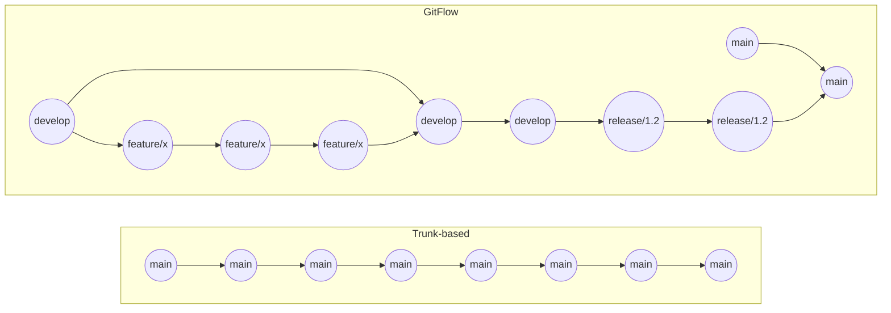
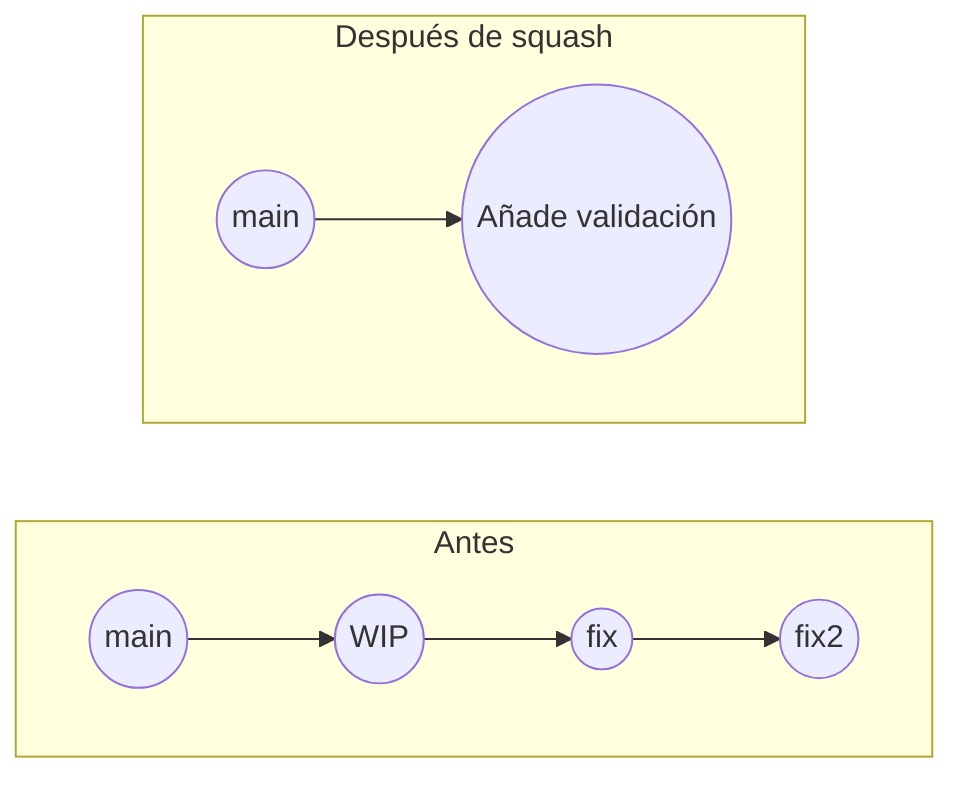
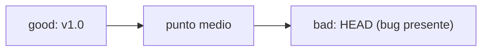
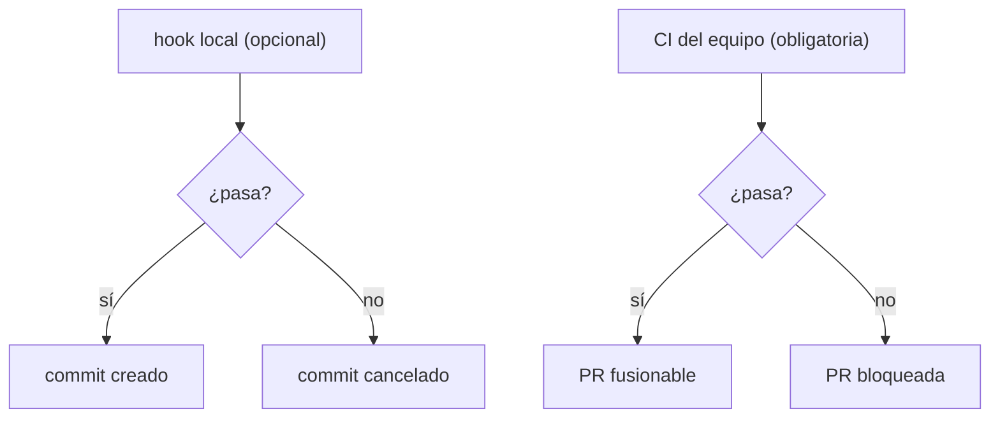
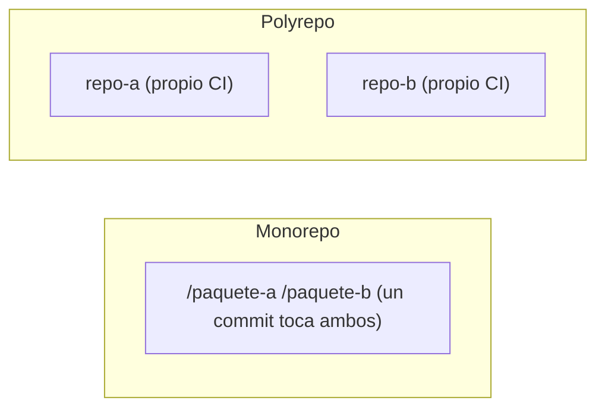
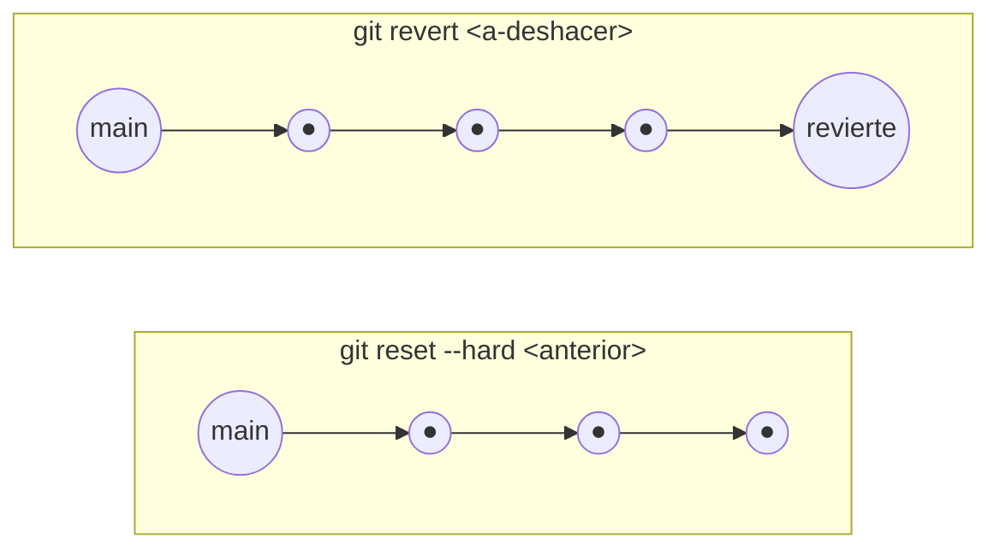
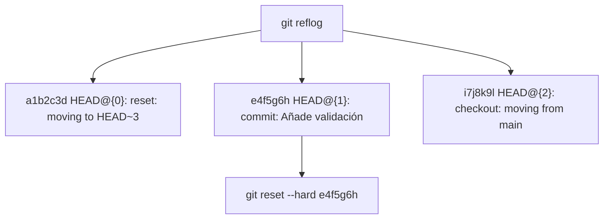

# Módulo 1: Git avanzado y estrategias de branching


## Aprende construyendo


### Tema 1: Trunk-based development vs GitFlow · Básico · 20 min

<details open>
<summary><strong>Capa 1 — Lectura</strong></summary>

#### ► DE QUÉ TRATA
Al finalizar podrás elegir entre trunk-based development y GitFlow según el tamaño y madurez operativa de un equipo, explicando qué rol cumplen los feature flags en cada modelo.

#### ► LA IDEA EN UNA FRASE
**Al finalizar podrás elegir entre trunk-based development y GitFlow según el tamaño y madurez operativa de un equipo, explicando qué rol cumplen los feature flags en cada modelo.**

#### ► POR QUÉ EXISTE ESTO
Resuelve un problema real de diseño o implementación y evita decisiones a ciegas.

#### ► LA ANALOGÍA
Piensa en trunk-based development vs gitflow como una herramienta de taller: útil cuando conoces su propósito y sus límites.
**Dónde se rompe la analogía:** en software, los efectos dependen del contexto, la escala y los trade-offs.

#### ► CÓMO FUNCIONA


#### ► LO QUE PUEDE SALIR MAL
| Síntoma | Causa probable | Arreglo |
|---|---|---|
| Trunk-based development vs GitFlow se aplica pero el resultado no mejora | Se usó sin medir el problema real | Mide antes y compara contra la alternativa simple |
| Aparece complejidad inesperada | Se adoptó la técnica sin comprender sus trade-offs | Vuelve a la sección de trade-offs y reduce el alcance |
| Falla en un caso límite | Se asumió un contexto que no se cumple | Prueba el caso límite y documenta cuándo NO usarlo |

#### ► TRADE-OFFS
| Opción | Cuándo usarla | Cuándo NO usarla |
|---|---|---|
| Usar Trunk-based development vs GitFlow | Cuando el problema coincide con su propósito y el beneficio es observable | Cuando agrega complejidad sin resolver un problema real |
| Alternativa más simple | Cuando el contexto es pequeño, estable o fácil de razonar | Cuando ya demostró no escalar o no cumplir el requisito |
| Postergar la decisión | Cuando falta evidencia del problema | Cuando el costo de esperar es mayor que el costo de probar |

#### ► REGLA PRÁCTICA
Si el equipo despliega varias veces al día con CI/CD y puede ocultar trabajo incompleto detrás de un feature flag, trunk-based es la opción natural; si el producto se libera en versiones programadas (apps móviles con revisión de tienda, software con soporte LTS), GitFlow da una rama `release/` estable donde congelar y parchear sin bloquear `develop`.

#### ► CUÁNDO NO USAR ESTO
No uses trunk-based development vs gitflow por defecto. Aplícalo cuando el problema lo justifique y puedas verificar el beneficio; si una alternativa más simple resuelve igual, prefiérela.

#### ► DE VUELTA A LA ANALOGÍA
Volviendo a la analogía: trunk-based development vs gitflow funciona como el modelo inicial, pero recuerda dónde se rompe: en producción importan la evidencia, la escala y el costo de equivocarte.

#### ► LO QUE DEBES RECORDAR
- Trunk-based development vs GitFlow existe para resolver un problema específico.
- Mide antes de adoptar complejidad.
- Conoce el caso donde NO usarlo.
- Verifica con evidencia observable.

#### ► PREGUNTAS PARA PENSAR
1. ¿Qué problema concreto resuelve trunk-based development vs gitflow en tu contexto?
2. ¿Cómo sabrías que trunk-based development vs gitflow no está funcionando bien?
3. ¿Qué alternativa más simple considerarías antes de usar trunk-based development vs gitflow?

</details>

<details>
<summary><strong>Capa 2 — Construcción</strong></summary>

#### Código y verificación


```bash
mkdir -p academia-devops/src/modulo1/branching/trunk-demo
cd academia-devops/src/modulo1/branching/trunk-demo
docker run --rm -u "$(id -u):$(id -g)" -v "$(pwd)":/repo -w /repo --entrypoint sh alpine/git -c \
  "git init -q -b main && git config user.email demo@academia.dev && git config user.name demo && \
   echo v1 > app.txt && git add . && git commit -qm inicio && \
   git checkout -qb feature/x && echo 'v2 tras flag' >> app.txt && git commit -qam 'feature x' && \
   git checkout -q main && git merge --no-ff -q feature/x -m 'integra feature x' && \
   git log --oneline --graph --all"
```

</details>

### Tema 2: Rebase interactivo vs merge · Básico · 20 min

<details open>
<summary><strong>Capa 1 — Lectura</strong></summary>

#### ► DE QUÉ TRATA
Al finalizar podrás limpiar un historial de commits con git rebase -i y explicar por qué nunca debe reescribirse el historial de una rama ya compartida.

#### ► LA IDEA EN UNA FRASE
**Al finalizar podrás limpiar un historial de commits con git rebase -i y explicar por qué nunca debe reescribirse el historial de una rama ya compartida.**

#### ► POR QUÉ EXISTE ESTO
Resuelve un problema real de diseño o implementación y evita decisiones a ciegas.

#### ► LA ANALOGÍA
Piensa en rebase interactivo vs merge como una herramienta de taller: útil cuando conoces su propósito y sus límites.
**Dónde se rompe la analogía:** en software, los efectos dependen del contexto, la escala y los trade-offs.

#### ► CÓMO FUNCIONA


#### ► LO QUE PUEDE SALIR MAL
| Síntoma | Causa probable | Arreglo |
|---|---|---|
| Rebase interactivo vs merge se aplica pero el resultado no mejora | Se usó sin medir el problema real | Mide antes y compara contra la alternativa simple |
| Aparece complejidad inesperada | Se adoptó la técnica sin comprender sus trade-offs | Vuelve a la sección de trade-offs y reduce el alcance |
| Falla en un caso límite | Se asumió un contexto que no se cumple | Prueba el caso límite y documenta cuándo NO usarlo |

#### ► TRADE-OFFS
| Opción | Cuándo usarla | Cuándo NO usarla |
|---|---|---|
| Usar Rebase interactivo vs merge | Cuando el problema coincide con su propósito y el beneficio es observable | Cuando agrega complejidad sin resolver un problema real |
| Alternativa más simple | Cuando el contexto es pequeño, estable o fácil de razonar | Cuando ya demostró no escalar o no cumplir el requisito |
| Postergar la decisión | Cuando falta evidencia del problema | Cuando el costo de esperar es mayor que el costo de probar |

#### ► REGLA PRÁCTICA
`git rebase -i` solo es seguro en commits que nadie más haya descargado todavía (tu rama local de feature antes del push, o justo después si nadie más la tocó); en cuanto la rama es compartida, usa merge o tendrás que forzar el push y reescribir el historial que otros ya tienen.

#### ► CUÁNDO NO USAR ESTO
No uses rebase interactivo vs merge por defecto. Aplícalo cuando el problema lo justifique y puedas verificar el beneficio; si una alternativa más simple resuelve igual, prefiérela.

#### ► DE VUELTA A LA ANALOGÍA
Volviendo a la analogía: rebase interactivo vs merge funciona como el modelo inicial, pero recuerda dónde se rompe: en producción importan la evidencia, la escala y el costo de equivocarte.

#### ► LO QUE DEBES RECORDAR
- Rebase interactivo vs merge existe para resolver un problema específico.
- Mide antes de adoptar complejidad.
- Conoce el caso donde NO usarlo.
- Verifica con evidencia observable.

#### ► PREGUNTAS PARA PENSAR
1. ¿Qué problema concreto resuelve rebase interactivo vs merge en tu contexto?
2. ¿Cómo sabrías que rebase interactivo vs merge no está funcionando bien?
3. ¿Qué alternativa más simple considerarías antes de usar rebase interactivo vs merge?

</details>

<details>
<summary><strong>Capa 2 — Construcción</strong></summary>

#### Código y verificación


```bash
mkdir -p academia-devops/src/modulo1/rebase
cd academia-devops/src/modulo1/rebase
docker run --rm -u "$(id -u):$(id -g)" -v "$(pwd)":/repo -w /repo --entrypoint sh alpine/git -c \
  "git init -q -b main && git config user.email demo@academia.dev && git config user.name demo && \
   echo v1 > archivo.txt && git add . && git commit -qm WIP && \
   echo v2 >> archivo.txt && git commit -qam fix && \
   echo v3 >> archivo.txt && git commit -qam 'fix de verdad' && git log --oneline"
```

```bash
docker run --rm -u "$(id -u):$(id -g)" -v "$(pwd)":/repo -w /repo --entrypoint sh alpine/git -c \
  "GIT_SEQUENCE_EDITOR='sed -i 2,3s/^pick/squash/' GIT_EDITOR=true git rebase -i --root && git log --oneline"
```

</details>

### Tema 3: Bisect para encontrar regresiones · Básico · 20 min

<details open>
<summary><strong>Capa 1 — Lectura</strong></summary>

#### ► DE QUÉ TRATA
Al finalizar podrás usar git bisect para encontrar por búsqueda binaria el commit exacto que introdujo una regresión, incluyendo su automatización con bisect run.

#### ► LA IDEA EN UNA FRASE
**Al finalizar podrás usar git bisect para encontrar por búsqueda binaria el commit exacto que introdujo una regresión, incluyendo su automatización con bisect run.**

#### ► POR QUÉ EXISTE ESTO
Resuelve un problema real de diseño o implementación y evita decisiones a ciegas.

#### ► LA ANALOGÍA
Piensa en bisect para encontrar regresiones como una herramienta de taller: útil cuando conoces su propósito y sus límites.
**Dónde se rompe la analogía:** en software, los efectos dependen del contexto, la escala y los trade-offs.

#### ► CÓMO FUNCIONA


#### ► LO QUE PUEDE SALIR MAL
| Síntoma | Causa probable | Arreglo |
|---|---|---|
| Bisect para encontrar regresiones se aplica pero el resultado no mejora | Se usó sin medir el problema real | Mide antes y compara contra la alternativa simple |
| Aparece complejidad inesperada | Se adoptó la técnica sin comprender sus trade-offs | Vuelve a la sección de trade-offs y reduce el alcance |
| Falla en un caso límite | Se asumió un contexto que no se cumple | Prueba el caso límite y documenta cuándo NO usarlo |

#### ► TRADE-OFFS
| Opción | Cuándo usarla | Cuándo NO usarla |
|---|---|---|
| Usar Bisect para encontrar regresiones | Cuando el problema coincide con su propósito y el beneficio es observable | Cuando agrega complejidad sin resolver un problema real |
| Alternativa más simple | Cuando el contexto es pequeño, estable o fácil de razonar | Cuando ya demostró no escalar o no cumplir el requisito |
| Postergar la decisión | Cuando falta evidencia del problema | Cuando el costo de esperar es mayor que el costo de probar |

#### ► CUÁNDO NO USAR ESTO
No uses bisect para encontrar regresiones por defecto. Aplícalo cuando el problema lo justifique y puedas verificar el beneficio; si una alternativa más simple resuelve igual, prefiérela.

#### ► DE VUELTA A LA ANALOGÍA
Volviendo a la analogía: bisect para encontrar regresiones funciona como el modelo inicial, pero recuerda dónde se rompe: en producción importan la evidencia, la escala y el costo de equivocarte.

#### ► LO QUE DEBES RECORDAR
- Bisect para encontrar regresiones existe para resolver un problema específico.
- Mide antes de adoptar complejidad.
- Conoce el caso donde NO usarlo.
- Verifica con evidencia observable.

#### ► PREGUNTAS PARA PENSAR
1. ¿Qué problema concreto resuelve bisect para encontrar regresiones en tu contexto?
2. ¿Cómo sabrías que bisect para encontrar regresiones no está funcionando bien?
3. ¿Qué alternativa más simple considerarías antes de usar bisect para encontrar regresiones?

</details>

<details>
<summary><strong>Capa 2 — Construcción</strong></summary>

#### Código y verificación


```bash
mkdir -p academia-devops/src/modulo1/bisect
cd academia-devops/src/modulo1/bisect
docker run --rm -u "$(id -u):$(id -g)" -v "$(pwd)":/repo -w /repo --entrypoint sh alpine/git -c '
  git init -q -b main && git config user.email demo@academia.dev && git config user.name demo
  echo "def suma(a,b): return a+b" > operacion.py && git add . && git commit -qm v1
  echo "def resta(a,b): return a-b" >> operacion.py && git commit -qam v2
  echo "def bug(a,b): return a-b  # BUG: debería sumar" >> operacion.py && git commit -qam v3-bug
  echo "def multiplica(a,b): return a*b" >> operacion.py && git commit -qam v4
  echo "def divide(a,b): return a/b" >> operacion.py && git commit -qam v5
  git log --oneline'
```

```bash
docker run --rm -u "$(id -u):$(id -g)" -v "$(pwd)":/repo -w /repo --entrypoint sh alpine/git -c '
  echo "#!/bin/sh
  grep -q BUG operacion.py && exit 1 || exit 0" > /repo/test-bug.sh && chmod +x /repo/test-bug.sh
  git bisect start HEAD HEAD~4
  git bisect run ./test-bug.sh'
```

</details>

### Tema 4: Hooks de Git y commits firmados · Básico · 20 min

<details open>
<summary><strong>Capa 1 — Lectura</strong></summary>

#### ► DE QUÉ TRATA
Al finalizar podrás configurar un hook pre-commit que bloquea commits inválidos localmente, y explicar por qué los commits firmados dan una garantía de autoría más fuerte que el user.name configurado.

#### ► LA IDEA EN UNA FRASE
**Al finalizar podrás configurar un hook pre-commit que bloquea commits inválidos localmente, y explicar por qué los commits firmados dan una garantía de autoría más fuerte que el user.name configurado.**

#### ► POR QUÉ EXISTE ESTO
Resuelve un problema real de diseño o implementación y evita decisiones a ciegas.

#### ► LA ANALOGÍA
Piensa en hooks de git y commits firmados como una herramienta de taller: útil cuando conoces su propósito y sus límites.
**Dónde se rompe la analogía:** en software, los efectos dependen del contexto, la escala y los trade-offs.

#### ► CÓMO FUNCIONA


#### ► LO QUE PUEDE SALIR MAL
| Síntoma | Causa probable | Arreglo |
|---|---|---|
| Hooks de Git y commits firmados se aplica pero el resultado no mejora | Se usó sin medir el problema real | Mide antes y compara contra la alternativa simple |
| Aparece complejidad inesperada | Se adoptó la técnica sin comprender sus trade-offs | Vuelve a la sección de trade-offs y reduce el alcance |
| Falla en un caso límite | Se asumió un contexto que no se cumple | Prueba el caso límite y documenta cuándo NO usarlo |

#### ► TRADE-OFFS
| Opción | Cuándo usarla | Cuándo NO usarla |
|---|---|---|
| Usar Hooks de Git y commits firmados | Cuando el problema coincide con su propósito y el beneficio es observable | Cuando agrega complejidad sin resolver un problema real |
| Alternativa más simple | Cuando el contexto es pequeño, estable o fácil de razonar | Cuando ya demostró no escalar o no cumplir el requisito |
| Postergar la decisión | Cuando falta evidencia del problema | Cuando el costo de esperar es mayor que el costo de probar |

#### ► CUÁNDO NO USAR ESTO
No uses hooks de git y commits firmados por defecto. Aplícalo cuando el problema lo justifique y puedas verificar el beneficio; si una alternativa más simple resuelve igual, prefiérela.

#### ► DE VUELTA A LA ANALOGÍA
Volviendo a la analogía: hooks de git y commits firmados funciona como el modelo inicial, pero recuerda dónde se rompe: en producción importan la evidencia, la escala y el costo de equivocarte.

#### ► LO QUE DEBES RECORDAR
- Hooks de Git y commits firmados existe para resolver un problema específico.
- Mide antes de adoptar complejidad.
- Conoce el caso donde NO usarlo.
- Verifica con evidencia observable.

#### ► PREGUNTAS PARA PENSAR
1. ¿Qué problema concreto resuelve hooks de git y commits firmados en tu contexto?
2. ¿Cómo sabrías que hooks de git y commits firmados no está funcionando bien?
3. ¿Qué alternativa más simple considerarías antes de usar hooks de git y commits firmados?

</details>

<details>
<summary><strong>Capa 2 — Construcción</strong></summary>

#### Código y verificación


```bash
mkdir -p academia-devops/src/modulo1/hooks
cd academia-devops/src/modulo1/hooks
docker run --rm -u "$(id -u):$(id -g)" -v "$(pwd)":/repo -w /repo --entrypoint sh alpine/git -c '
  git init -q -b main && git config user.email demo@academia.dev && git config user.name demo
  mkdir -p .git/hooks
  printf "#!/bin/sh\nif git diff --cached | grep -q SECRETO; then echo \"bloqueado: SECRETO detectado\"; exit 1; fi\n" > .git/hooks/pre-commit
  chmod +x .git/hooks/pre-commit
  echo "config normal" > config.txt && git add . && git commit -qm ok && git log --oneline'
```

```bash
docker run --rm -u "$(id -u):$(id -g)" -v "$(pwd)":/repo -w /repo --entrypoint sh alpine/git -c '
  echo "DB_PASSWORD=SECRETO123" >> config.txt
  git add . && git commit -qm "intento con secreto"; echo "codigo de salida: $?"'
```

</details>

### Tema 5: Monorepos vs polyrepos · Básico · 20 min

<details open>
<summary><strong>Capa 1 — Lectura</strong></summary>

#### ► DE QUÉ TRATA
Al finalizar podrás argumentar cuándo un monorepo facilita cambios atómicos entre paquetes relacionados y cuándo un polyrepo da límites de ownership más claros.

#### ► LA IDEA EN UNA FRASE
**Al finalizar podrás argumentar cuándo un monorepo facilita cambios atómicos entre paquetes relacionados y cuándo un polyrepo da límites de ownership más claros.**

#### ► POR QUÉ EXISTE ESTO
Resuelve un problema real de diseño o implementación y evita decisiones a ciegas.

#### ► LA ANALOGÍA
Piensa en monorepos vs polyrepos como una herramienta de taller: útil cuando conoces su propósito y sus límites.
**Dónde se rompe la analogía:** en software, los efectos dependen del contexto, la escala y los trade-offs.

#### ► CÓMO FUNCIONA


#### ► LO QUE PUEDE SALIR MAL
| Síntoma | Causa probable | Arreglo |
|---|---|---|
| Monorepos vs polyrepos se aplica pero el resultado no mejora | Se usó sin medir el problema real | Mide antes y compara contra la alternativa simple |
| Aparece complejidad inesperada | Se adoptó la técnica sin comprender sus trade-offs | Vuelve a la sección de trade-offs y reduce el alcance |
| Falla en un caso límite | Se asumió un contexto que no se cumple | Prueba el caso límite y documenta cuándo NO usarlo |

#### ► TRADE-OFFS
| Opción | Cuándo usarla | Cuándo NO usarla |
|---|---|---|
| Usar Monorepos vs polyrepos | Cuando el problema coincide con su propósito y el beneficio es observable | Cuando agrega complejidad sin resolver un problema real |
| Alternativa más simple | Cuando el contexto es pequeño, estable o fácil de razonar | Cuando ya demostró no escalar o no cumplir el requisito |
| Postergar la decisión | Cuando falta evidencia del problema | Cuando el costo de esperar es mayor que el costo de probar |

#### ► REGLA PRÁCTICA
Si varios paquetes cambian juntos con frecuencia y necesitas que un mismo commit los actualice de forma atómica (como `paquete-a`/`paquete-b` compartiendo `tooling-compartido`), un monorepo evita el infierno de versiones cruzadas; si cada equipo necesita su propio pipeline de CI, su propio ritmo de release y fronteras de acceso claras, un polyrepo protege esos límites de ownership mejor que cualquier convención dentro de un único repo.

#### ► CUÁNDO NO USAR ESTO
No uses monorepos vs polyrepos por defecto. Aplícalo cuando el problema lo justifique y puedas verificar el beneficio; si una alternativa más simple resuelve igual, prefiérela.

#### ► DE VUELTA A LA ANALOGÍA
Volviendo a la analogía: monorepos vs polyrepos funciona como el modelo inicial, pero recuerda dónde se rompe: en producción importan la evidencia, la escala y el costo de equivocarte.

#### ► LO QUE DEBES RECORDAR
- Monorepos vs polyrepos existe para resolver un problema específico.
- Mide antes de adoptar complejidad.
- Conoce el caso donde NO usarlo.
- Verifica con evidencia observable.

#### ► PREGUNTAS PARA PENSAR
1. ¿Qué problema concreto resuelve monorepos vs polyrepos en tu contexto?
2. ¿Cómo sabrías que monorepos vs polyrepos no está funcionando bien?
3. ¿Qué alternativa más simple considerarías antes de usar monorepos vs polyrepos?

</details>

<details>
<summary><strong>Capa 2 — Construcción</strong></summary>

#### Código y verificación


```bash
mkdir -p academia-devops/src/modulo1/monorepo-demo
cd academia-devops/src/modulo1/monorepo-demo
docker run --rm -u "$(id -u):$(id -g)" -v "$(pwd)":/repo -w /repo --entrypoint sh alpine/git -c '
  git init -q -b main && git config user.email demo@academia.dev && git config user.name demo
  mkdir -p paquete-a paquete-b tooling-compartido
  echo "function formatear(x) { return x.toFixed(2); }" > tooling-compartido/formato.js
  echo "const { formatear } = require(\"../tooling-compartido/formato\"); console.log(formatear(3));" > paquete-a/index.js
  echo "const { formatear } = require(\"../tooling-compartido/formato\"); console.log(formatear(7));" > paquete-b/index.js
  git add . && git commit -qm "monorepo inicial con tooling compartido" && git log --oneline --stat'
```

</details>

### Tema 6: git cherry-pick, git stash, git reset vs git revert · Básico · 20 min

<details open>
<summary><strong>Capa 1 — Lectura</strong></summary>

#### ► DE QUÉ TRATA
Al finalizar podrás elegir entre cherry-pick, stash, reset y revert según si necesitas un cambio puntual, trabajo temporal, reescribir tu propio historial o deshacer algo de forma segura en una rama compartida.

#### ► LA IDEA EN UNA FRASE
**Al finalizar podrás elegir entre cherry-pick, stash, reset y revert según si necesitas un cambio puntual, trabajo temporal, reescribir tu propio historial o deshacer algo de forma segura en una rama compartida.**

#### ► POR QUÉ EXISTE ESTO
Resuelve un problema real de diseño o implementación y evita decisiones a ciegas.

#### ► LA ANALOGÍA
Piensa en git cherry-pick, git stash, git reset vs git revert como una herramienta de taller: útil cuando conoces su propósito y sus límites.
**Dónde se rompe la analogía:** en software, los efectos dependen del contexto, la escala y los trade-offs.

#### ► CÓMO FUNCIONA


#### ► LO QUE PUEDE SALIR MAL
| Síntoma | Causa probable | Arreglo |
|---|---|---|
| git cherry-pick, git stash, git reset vs git revert se aplica pero el resultado no mejora | Se usó sin medir el problema real | Mide antes y compara contra la alternativa simple |
| Aparece complejidad inesperada | Se adoptó la técnica sin comprender sus trade-offs | Vuelve a la sección de trade-offs y reduce el alcance |
| Falla en un caso límite | Se asumió un contexto que no se cumple | Prueba el caso límite y documenta cuándo NO usarlo |

#### ► TRADE-OFFS
| Opción | Cuándo usarla | Cuándo NO usarla |
|---|---|---|
| Usar git cherry-pick, git stash, git reset vs git revert | Cuando el problema coincide con su propósito y el beneficio es observable | Cuando agrega complejidad sin resolver un problema real |
| Alternativa más simple | Cuando el contexto es pequeño, estable o fácil de razonar | Cuando ya demostró no escalar o no cumplir el requisito |
| Postergar la decisión | Cuando falta evidencia del problema | Cuando el costo de esperar es mayor que el costo de probar |

#### ► REGLA PRÁCTICA
La pregunta que decide es "¿la rama ya es compartida?": en tu propia rama local usa `reset` para reescribir libremente; en una rama que otros ya descargaron (como `main`), usa `revert`, que agrega un commit nuevo que deshace el anterior sin borrar historia que alguien más tiene. `cherry-pick` trae UN commit puntual de otra rama sin fusionar todo lo demás; `stash` guarda cambios sin terminar para volver a ellos después, sin crear un commit.

#### ► CUÁNDO NO USAR ESTO
No uses git cherry-pick, git stash, git reset vs git revert por defecto. Aplícalo cuando el problema lo justifique y puedas verificar el beneficio; si una alternativa más simple resuelve igual, prefiérela.

#### ► DE VUELTA A LA ANALOGÍA
Volviendo a la analogía: git cherry-pick, git stash, git reset vs git revert funciona como el modelo inicial, pero recuerda dónde se rompe: en producción importan la evidencia, la escala y el costo de equivocarte.

#### ► LO QUE DEBES RECORDAR
- git cherry-pick, git stash, git reset vs git revert existe para resolver un problema específico.
- Mide antes de adoptar complejidad.
- Conoce el caso donde NO usarlo.
- Verifica con evidencia observable.

#### ► PREGUNTAS PARA PENSAR
1. ¿Qué problema concreto resuelve git cherry-pick, git stash, git reset vs git revert en tu contexto?
2. ¿Cómo sabrías que git cherry-pick, git stash, git reset vs git revert no está funcionando bien?
3. ¿Qué alternativa más simple considerarías antes de usar git cherry-pick, git stash, git reset vs git revert?

</details>

<details>
<summary><strong>Capa 2 — Construcción</strong></summary>

#### Código y verificación


```bash
mkdir -p academia-devops/src/modulo1/reset-revert
cd academia-devops/src/modulo1/reset-revert
docker run --rm -u "$(id -u):$(id -g)" -v "$(pwd)":/repo -w /repo --entrypoint sh alpine/git -c '
  git init -q -b main && git config user.email demo@academia.dev && git config user.name demo
  echo v1 > dato.txt && git add . && git commit -qm v1
  echo v2 >> dato.txt && git commit -qam v2
  echo v3-error >> dato.txt && git commit -qam "v3 con error"
  git revert --no-edit HEAD && cat dato.txt && git log --oneline'
```

</details>

### Tema 7: git reflog, git worktree y git submodule · Básico · 20 min

<details open>
<summary><strong>Capa 1 — Lectura</strong></summary>

#### ► DE QUÉ TRATA
Al finalizar podrás recuperar commits "perdidos" con git reflog, trabajar en paralelo sobre varias ramas con git worktree, e incluir un repositorio externo versionado con git submodule.

#### ► LA IDEA EN UNA FRASE
**Al finalizar podrás recuperar commits "perdidos" con git reflog, trabajar en paralelo sobre varias ramas con git worktree, e incluir un repositorio externo versionado con git submodule.**

#### ► POR QUÉ EXISTE ESTO
Resuelve un problema real de diseño o implementación y evita decisiones a ciegas.

#### ► LA ANALOGÍA
Piensa en git reflog, git worktree y git submodule como una herramienta de taller: útil cuando conoces su propósito y sus límites.
**Dónde se rompe la analogía:** en software, los efectos dependen del contexto, la escala y los trade-offs.

#### ► CÓMO FUNCIONA


#### ► LO QUE PUEDE SALIR MAL
| Síntoma | Causa probable | Arreglo |
|---|---|---|
| git reflog, git worktree y git submodule se aplica pero el resultado no mejora | Se usó sin medir el problema real | Mide antes y compara contra la alternativa simple |
| Aparece complejidad inesperada | Se adoptó la técnica sin comprender sus trade-offs | Vuelve a la sección de trade-offs y reduce el alcance |
| Falla en un caso límite | Se asumió un contexto que no se cumple | Prueba el caso límite y documenta cuándo NO usarlo |

#### ► TRADE-OFFS
| Opción | Cuándo usarla | Cuándo NO usarla |
|---|---|---|
| Usar git reflog, git worktree y git submodule | Cuando el problema coincide con su propósito y el beneficio es observable | Cuando agrega complejidad sin resolver un problema real |
| Alternativa más simple | Cuando el contexto es pequeño, estable o fácil de razonar | Cuando ya demostró no escalar o no cumplir el requisito |
| Postergar la decisión | Cuando falta evidencia del problema | Cuando el costo de esperar es mayor que el costo de probar |

#### ► CUÁNDO NO USAR ESTO
No uses git reflog, git worktree y git submodule por defecto. Aplícalo cuando el problema lo justifique y puedas verificar el beneficio; si una alternativa más simple resuelve igual, prefiérela.

#### ► DE VUELTA A LA ANALOGÍA
Volviendo a la analogía: git reflog, git worktree y git submodule funciona como el modelo inicial, pero recuerda dónde se rompe: en producción importan la evidencia, la escala y el costo de equivocarte.

#### ► LO QUE DEBES RECORDAR
- git reflog, git worktree y git submodule existe para resolver un problema específico.
- Mide antes de adoptar complejidad.
- Conoce el caso donde NO usarlo.
- Verifica con evidencia observable.

#### ► PREGUNTAS PARA PENSAR
1. ¿Qué problema concreto resuelve git reflog, git worktree y git submodule en tu contexto?
2. ¿Cómo sabrías que git reflog, git worktree y git submodule no está funcionando bien?
3. ¿Qué alternativa más simple considerarías antes de usar git reflog, git worktree y git submodule?

</details>

<details>
<summary><strong>Capa 2 — Construcción</strong></summary>

#### Código y verificación


```bash
mkdir -p academia-devops/src/modulo1/reflog
cd academia-devops/src/modulo1/reflog
docker run --rm -u "$(id -u):$(id -g)" -v "$(pwd)":/repo -w /repo --entrypoint sh alpine/git -c '
  git init -q -b main && git config user.email demo@academia.dev && git config user.name demo
  echo v1 > dato.txt && git add . && git commit -qm v1
  echo v2 > dato.txt && git commit -qam "commit importante"
  git reset --hard HEAD~1
  echo "--- tras el reset, dato.txt: ---" && cat dato.txt
  echo "--- reflog: ---" && git reflog
  HASH=$(git reflog | grep "commit importante" | head -1 | cut -d" " -f1)
  git reset --hard "$HASH"
  echo "--- recuperado: ---" && cat dato.txt'
```

</details>
