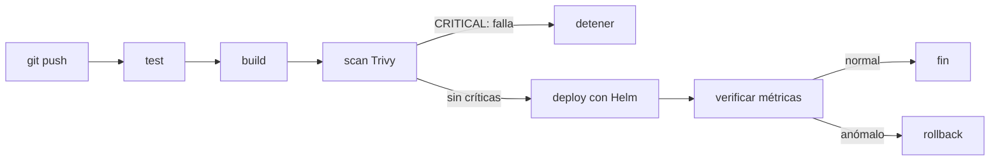
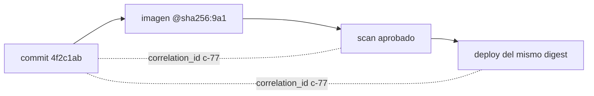
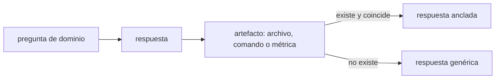

# Módulo 13: Proyecto integrador — pipeline CI/CD completo


## Aprende construyendo


### Tema 1: El pipeline completo — de commit a producción verificada · Avanzado · 45 min

<details open>
<summary><strong>Capa 1 — Lectura</strong></summary>

#### ► DE QUÉ TRATA
Al finalizar vas a validar, con un script, que el pipeline de RutaFlow encadena sus etapas con gates bloqueantes y etiqueta la imagen con el hash del commit. Prerrequisitos: módulos 1-12 completos y Python 3 con PyYAML (python3 -m pip install pyyaml); no necesitas un clúster real…

#### ► CÓMO FUNCIONA


</details>

<details>
<summary><strong>Capa 2 — Construcción</strong></summary>

#### Código y verificación


```bash
mkdir ejemplo && cd ejemplo
```

```yaml
name: pipeline
on: [push]
jobs:
  test:
    runs-on: ubuntu-latest
    steps:
      - uses: actions/checkout@3d3c42e5aac5ba805825da76410c181273ba90b1 # v7.0.1
      - run: npm ci && npm test
  build:
    needs: test
    runs-on: ubuntu-latest
    steps:
      - uses: actions/checkout@3d3c42e5aac5ba805825da76410c181273ba90b1 # v7.0.1
      - uses: docker/login-action@8aa5831fb8d48d8f76594c7ddde61ae58019f550 # v4.8.0
        with:
          registry: registry.rutaflow.app
          username: ${{ secrets.REGISTRY_USER }}
          password: ${{ secrets.REGISTRY_TOKEN }}
      - run: |
          docker build -t registry.rutaflow.app/api:${{ github.sha }} .
          docker push registry.rutaflow.app/api:${{ github.sha }}
  scan:
    needs: build
    runs-on: ubuntu-latest
    steps:
      - uses: aquasecurity/trivy-action@ed142fd0673e97e23eac54620cfb913e5ce36c25 # v0.36.0
        with:
          image-ref: registry.rutaflow.app/api:${{ github.sha }}
          severity: CRITICAL
          exit-code: "1"
        env:
          TRIVY_USERNAME: ${{ secrets.REGISTRY_USER }}
          TRIVY_PASSWORD: ${{ secrets.REGISTRY_TOKEN }}
  deploy:
    needs: scan
    runs-on: ubuntu-latest
    steps:
      - uses: actions/checkout@3d3c42e5aac5ba805825da76410c181273ba90b1 # v7.0.1
      - run: helm upgrade --install api ./chart --set image.tag=${{ github.sha }}
```

```python
import re
import sys
from pathlib import Path

import yaml

flujo = yaml.safe_load(Path(".github/workflows/pipeline.yml").read_text(encoding="utf-8"))
jobs = flujo["jobs"]
orden = ["test", "build", "scan", "deploy"]
TAG = "${{ github.sha }}"


def comandos(job):
    return "\n".join(paso.get("run", "") for paso in jobs[job]["steps"])


for anterior, siguiente in zip(orden, orden[1:]):
    if jobs[siguiente].get("needs") != anterior:
        sys.exit(f"fallo: {siguiente} no depende de {anterior}")

pasos_trivy = [p for p in jobs["scan"]["steps"] if p.get("uses", "").startswith("aquasecurity/trivy-action@")]
if not pasos_trivy:
    sys.exit("fallo: el job scan no ejecuta Trivy")
escaneo = pasos_trivy[0]["with"]
if str(escaneo.get("exit-code")) != "1" or escaneo.get("severity") != "CRITICAL":
    sys.exit("fallo: el escaneo no bloquea ante una vulnerabilidad CRITICAL")

imagen = f"registry.rutaflow.app/api:{TAG}"
if f"docker build -t {imagen}" not in comandos("build") or f"docker push {imagen}" not in comandos("build"):
    sys.exit("fallo: build no construye y publica la imagen etiquetada con github.sha")
if escaneo.get("image-ref") != imagen:
    sys.exit("fallo: scan no revisa la imagen etiquetada con github.sha")
if f"image.tag={TAG}" not in comandos("deploy"):
    sys.exit("fallo: deploy no despliega la imagen etiquetada con github.sha")

for nombre, job in jobs.items():
    for paso in job["steps"]:
        if "uses" in paso and not re.search(r"@[0-9a-f]{40}$", paso["uses"]):
            sys.exit(f"fallo: {nombre} usa {paso['uses']} sin fijarla por SHA")

print("jobs:", " -> ".join(orden))
print("gate de seguridad: bloqueante (exit-code 1, severity CRITICAL)")
print("imagen etiquetada con el hash del commit en build, scan y deploy")
print("acciones fijadas por SHA de commit")
```

```bash
python3 verificar_pipeline.py
```

```text
jobs: test -> build -> scan -> deploy
gate de seguridad: bloqueante (exit-code 1, severity CRITICAL)
imagen etiquetada con el hash del commit en build, scan y deploy
acciones fijadas por SHA de commit
```

</details>

### Tema 2: Uniendo cada módulo del track en un solo flujo · Avanzado · 45 min

<details open>
<summary><strong>Capa 1 — Lectura</strong></summary>

#### ► DE QUÉ TRATA
Al finalizar vas a reconstruir la cadena commit → imagen → escaneo → despliegue a partir de eventos trazables y a detectar cuándo un pipeline perdió esa trazabilidad. Prerrequisitos: Tema 1 de este módulo y Python 3.

#### ► CÓMO FUNCIONA


</details>

<details>
<summary><strong>Capa 2 — Construcción</strong></summary>

#### Código y verificación


```bash
mkdir ejemplo && cd ejemplo
```

```json
{"etapa":"commit","commit":"4f2c1ab","correlation_id":"c-77"}
{"etapa":"build","commit":"4f2c1ab","imagen":"registry.rutaflow.app/api@sha256:9a1","correlation_id":"c-77"}
{"etapa":"scan","commit":"4f2c1ab","resultado":"aprobado","correlation_id":"c-77"}
{"etapa":"deploy","commit":"4f2c1ab","imagen":"registry.rutaflow.app/api@sha256:9a1","correlation_id":"c-77"}
```

```python
import json
import sys
from pathlib import Path

eventos = [
    json.loads(linea)
    for linea in Path("eventos.jsonl").read_text(encoding="utf-8").splitlines()
    if linea.strip()
]
if len({e.get("correlation_id") for e in eventos}) != 1:
    sys.exit("fallo: la cadena no comparte correlation_id")

commit = eventos[0]["commit"]
if any(e.get("commit") != commit for e in eventos):
    sys.exit("fallo: hay etapas de otro commit")

imagenes = {e["imagen"] for e in eventos if "imagen" in e}
if len(imagenes) != 1 or any(":latest" in imagen for imagen in imagenes):
    sys.exit("fallo: la imagen no es trazable por digest")

escaneo = next(e for e in eventos if e["etapa"] == "scan")
if escaneo["resultado"] != "aprobado":
    sys.exit("fallo: se desplegó sin un escaneo aprobado")

print(f"commit: {commit}")
print(f"imagen: {imagenes.pop()}")
print("etapas:", " -> ".join(e["etapa"] for e in eventos))
print("cadena completa: True")
```

```bash
python3 trazabilidad.py
```

```text
commit: 4f2c1ab
imagen: registry.rutaflow.app/api@sha256:9a1
etapas: commit -> build -> scan -> deploy
cadena completa: True
```

</details>

### Tema 3: Cierre del track — checklist final y reflexión · Avanzado · 45 min

<details open>
<summary><strong>Capa 1 — Lectura</strong></summary>

#### ► DE QUÉ TRATA
Al finalizar vas a responder un checklist de decisiones reales del pipeline de RutaFlow y a comprobar, con un evaluador, si tus respuestas están ancladas en artefactos concretos. Prerrequisitos: Temas 1-2 de este módulo y Python 3.

#### ► CÓMO FUNCIONA


</details>

<details>
<summary><strong>Capa 2 — Construcción</strong></summary>

#### Código y verificación


```bash
mkdir ejemplo && cd ejemplo
```

```markdown
## 1. Deployment frente a StatefulSet
Usamos Deployment porque la API no necesita identidad estable ni almacenamiento propio; el estado vive en Postgres, no en el Pod.

## 2. GitOps y credenciales
El operador dentro del clúster lee del repositorio y no guarda credenciales de despliegue externas, a diferencia del runner de CD.

## 3. Canary y rollback
Desplegamos el 10 % con Helm y revertimos con rollback si la tasa de error supera el 1 % durante 5 minutos.
```

```python
import re
import sys
from pathlib import Path

texto = Path("checklist.md").read_text(encoding="utf-8")
bloques = re.split(r"^##\s+", texto, flags=re.MULTILINE)[1:]
genericas = ("es usar git como fuente de verdad", "es una buena práctica")
fallos = []

for bloque in bloques:
    titulo, _, respuesta = bloque.partition("\n")
    respuesta = respuesta.strip()
    if len(re.findall(r"\w+", respuesta)) < 12:
        fallos.append(f"{titulo}: respuesta demasiado corta")
    if any(generica in respuesta.lower() for generica in genericas):
        fallos.append(f"{titulo}: respuesta genérica sin artefacto")
    if not re.search(r"(Deployment|StatefulSet|Helm|Postgres|operador|runner|canary|rollback)", respuesta, re.IGNORECASE):
        fallos.append(f"{titulo}: sin decisión técnica nombrada")

if fallos:
    sys.exit("fallo: " + "; ".join(fallos))

print(f"preguntas respondidas: {len(bloques)}")
print("respuestas ancladas a una decisión: True")
```

```bash
python3 evaluar_checklist.py
```

```text
preguntas respondidas: 3
respuestas ancladas a una decisión: True
```

</details>
