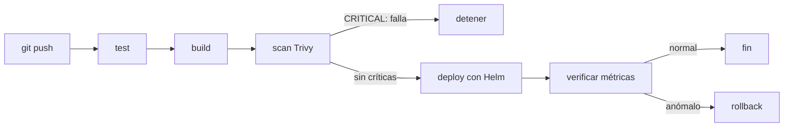
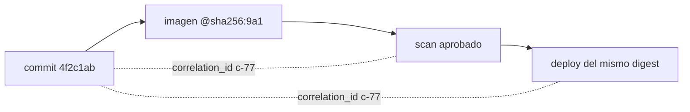
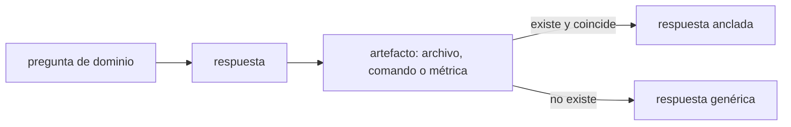

# Módulo 13: Proyecto integrador — pipeline CI/CD completo


## Aprende construyendo

### Tema 1: El pipeline completo — de commit a producción verificada

#### Paso 1 · Objetivo y preparación
Al finalizar vas a validar, con un script, que el pipeline de RutaFlow encadena sus etapas con gates bloqueantes y etiqueta la imagen con el hash del commit. Prerrequisitos: módulos 1-12 completos y Python 3 con PyYAML; no necesitás un clúster real para comprobar la configuración.

#### Paso 2 · Contexto y caso real
A lo largo del track construiste cada etapa por separado: tests, escaneo, build, despliegue y verificación. Nadie confirmó todavía que esas etapas estén realmente conectadas. En RutaFlow, un pipeline que ejecuta Trivy pero no falla ante una vulnerabilidad crítica produce una falsa sensación de seguridad: el escaneo aparece en verde y la imagen vulnerable se publica igual.

#### Paso 3 · Teoría, modelo mental y analogía
Un pipeline maduro es una cadena de gates: cada etapa recibe la salida de la anterior y solo continúa si su resultado es aceptable. `needs` expresa la dependencia; el código de salida de una acción decide si el job falla. Un gate que solo imprime un reporte no bloquea nada. La verificación post-despliegue también es un gate: compara métricas contra una línea base y dispara rollback si la tasa de error se degrada.

La trazabilidad empieza antes del despliegue. La imagen se etiqueta con el hash del commit, no solo con `latest`; el escaneo registra el resultado exacto; el despliegue usa ese mismo digest. Sin esa cadena, un incidente en producción obliga a adivinar qué versión está corriendo.

**Conceptos clave:** flujo end-to-end, gates bloqueantes, `needs`, código de salida, etiqueta por commit, verificación post-despliegue y rollback.



**Analogía:** es una línea de ensamblaje donde cada estación mide antes de dejar avanzar la pieza; una estación que solo anota el defecto sin detener la cinta no protege el producto final.

**¿Por qué es importante?** Porque el valor de un pipeline no está en ejecutar etapas, sino en impedir que un artefacto defectuoso llegue a producción.

**Límite de uso:** validar el YAML no demuestra que GitHub Actions, Docker ni el registry funcionen en tu cuenta; comprueba la estructura y las dependencias del flujo, no su ejecución real.

#### Paso 4 · Demostración guiada desde cero
**Ejemplo independiente (desde cero):** crea un directorio de trabajo nuevo con el workflow y el validador; no hace falta un repositorio remoto ni credenciales de nube.

```bash
mkdir ejemplo && cd ejemplo
```

Crea `.github/workflows/pipeline.yml` con cuatro jobs encadenados y un escaneo que falla ante vulnerabilidades críticas:

```yaml
name: pipeline
on: [push]
jobs:
  test:
    runs-on: ubuntu-latest
    steps:
      - run: npm test
  build:
    needs: test
    runs-on: ubuntu-latest
    steps:
      - run: docker build -t registry.rutaflow.app/api:${{ github.sha }} .
  scan:
    needs: build
    runs-on: ubuntu-latest
    steps:
      - uses: aquasecurity/trivy-action@0.28.0
        with:
          image-ref: registry.rutaflow.app/api:${{ github.sha }}
          severity: CRITICAL
          exit-code: "1"
  deploy:
    needs: scan
    runs-on: ubuntu-latest
    steps:
      - run: helm upgrade --install api ./chart --set image.tag=${{ github.sha }}
```

Crea `verificar_pipeline.py` para comprobar el orden, las dependencias y el gate de seguridad:

```python
import sys
from pathlib import Path

import yaml

flujo = yaml.safe_load(Path(".github/workflows/pipeline.yml").read_text(encoding="utf-8"))
jobs = flujo["jobs"]
orden = ["test", "build", "scan", "deploy"]

for anterior, siguiente in zip(orden, orden[1:]):
    if jobs[siguiente].get("needs") != anterior:
        sys.exit(f"fallo: {siguiente} no depende de {anterior}")

escaneo = jobs["scan"]["steps"][0]["with"]
if str(escaneo.get("exit-code")) != "1" or escaneo.get("severity") != "CRITICAL":
    sys.exit("fallo: el escaneo no bloquea ante una vulnerabilidad CRITICAL")

print("jobs:", " -> ".join(orden))
print("gate de seguridad: bloqueante (exit-code 1, severity CRITICAL)")
print("imagen etiquetada con el hash del commit: True")
```

**Ejecuta el ejemplo:**

```bash
python3 verificar_pipeline.py
```

Resultado esperado:

```text
jobs: test -> build -> scan -> deploy
gate de seguridad: bloqueante (exit-code 1, severity CRITICAL)
imagen etiquetada con el hash del commit: True
```

El script explica cada comprobación: `needs` define el orden, `exit-code` distingue un gate real de un reporte informativo y el tag con `github.sha` evita depender de `latest`.

#### Paso 5 · Práctica guiada
Pista: cambiá `exit-code: "1"` por `exit-code: "0"` y volvé a ejecutar `python3 verificar_pipeline.py`; ese es el fallo deliberado: el validador termina con `fallo: el escaneo no bloquea ante una vulnerabilidad CRITICAL`, porque el job de Trivy informaría el hallazgo pero no detendría el pipeline.

#### Paso 6 · Práctica independiente
Restaurá `exit-code: "1"` y agregá un job `verify` que dependa de `deploy` y falle si la tasa de error supera un umbral. Luego conectá el ejercicio con el proyecto integrador: el pipeline real de RutaFlow debe promover el mismo digest que pasó el escaneo, no reconstruir “la misma versión” para producción. Documentá qué parte del flujo pudiste validar con el script y cuál requiere un runner real.

#### Paso 7 · Cierre
Entregá la salida del Paso 4, el fallo del gate del Paso 5 y el flujo ampliado del Paso 6; explicá la diferencia entre informar un hallazgo y bloquear el despliegue. Siguiente paso: unir la trazabilidad de todas las etapas en el Tema 2. Errores comunes: escanear sin bloquear, desplegar sin verificación y documentar un rollback que nunca se ejecutó. **Fuentes oficiales:** https://docs.github.com/es/actions/using-jobs/using-jobs-in-a-workflow y https://trivy.dev/latest/docs/configuration/others/.

### Tema 2: Uniendo cada módulo del track en un solo flujo

#### Paso 1 · Objetivo y preparación
Al finalizar vas a reconstruir la cadena commit → imagen → escaneo → despliegue a partir de eventos trazables y a detectar cuándo un pipeline perdió esa trazabilidad. Prerrequisitos: Tema 1 de este módulo y Python 3.

#### Paso 2 · Contexto y caso real
En RutaFlow, un incidente en producción un viernes por la noche obliga al equipo a responder tres preguntas: qué imagen está corriendo, de qué commit salió y qué escaneo pasó. Si las etapas solo comparten un tag `latest`, la respuesta se pierde porque el tag se sobrescribió varias veces. La trazabilidad no es un log decorativo: es la diferencia entre diagnosticar en minutos y reconstruir a ciegas.

#### Paso 3 · Teoría, modelo mental y analogía
La integración horizontal significa que la salida de una etapa es la entrada de la siguiente. El commit produce una imagen con su hash; el escaneo registra el resultado de ese digest; el despliegue usa exactamente ese digest. Un `correlation_id` compartido permite agrupar los eventos de una misma ejecución aunque provengan de sistemas distintos.

La trazabilidad se diseña, no se improvisa. Etiquetar con `latest` elimina la identidad de la versión; construir de nuevo “la misma versión” rompe la cadena porque el nuevo binario puede diferir. El digest es inmutable: dos builds distintos no comparten digest. Los logs deben incluir commit, digest, etapa y correlation ID, sin secretos ni datos personales.

**Conceptos clave:** integración horizontal, dependencia entre etapas, digest inmutable, correlation ID, trazabilidad end-to-end y promoción de artefactos.



**Analogía:** es el número de guía de un envío: permite seguir el paquete por cada centro de distribución sin abrir la caja ni confiar en la memoria de cada operador.

**¿Por qué es importante?** Porque sin una cadena verificable no se puede atribuir un incidente a un cambio concreto ni demostrar que la versión desplegada pasó los controles.

**Límite de uso:** este ejercicio valida eventos simulados; no reemplaza los logs reales de GitHub Actions, del registry ni del clúster.

#### Paso 4 · Demostración guiada desde cero
**Ejemplo independiente (desde cero):** crea un directorio de trabajo nuevo con un archivo de eventos y el verificador; los eventos representan una ejecución, no requieren servicios externos.

```bash
mkdir ejemplo && cd ejemplo
```

Crea `eventos.jsonl` con las cuatro etapas de una misma ejecución:

```json
{"etapa":"commit","commit":"4f2c1ab","correlation_id":"c-77"}
{"etapa":"build","commit":"4f2c1ab","imagen":"registry.rutaflow.app/api@sha256:9a1","correlation_id":"c-77"}
{"etapa":"scan","commit":"4f2c1ab","resultado":"aprobado","correlation_id":"c-77"}
{"etapa":"deploy","commit":"4f2c1ab","imagen":"registry.rutaflow.app/api@sha256:9a1","correlation_id":"c-77"}
```

Crea `trazabilidad.py` para comprobar que todos los eventos comparten commit, digest y correlation ID:

```python
import json
import sys
from pathlib import Path

eventos = [
    json.loads(linea)
    for linea in Path("eventos.jsonl").read_text(encoding="utf-8").splitlines()
    if linea.strip()
]
if len({e.get("correlation_id") for e in eventos}) != 1:
    sys.exit("fallo: la cadena no comparte correlation_id")

commit = eventos[0]["commit"]
if any(e.get("commit") != commit for e in eventos):
    sys.exit("fallo: hay etapas de otro commit")

imagenes = {e["imagen"] for e in eventos if "imagen" in e}
if len(imagenes) != 1 or any(":latest" in imagen for imagen in imagenes):
    sys.exit("fallo: la imagen no es trazable por digest")

escaneo = next(e for e in eventos if e["etapa"] == "scan")
if escaneo["resultado"] != "aprobado":
    sys.exit("fallo: se desplegó sin un escaneo aprobado")

print(f"commit: {commit}")
print(f"imagen: {imagenes.pop()}")
print("etapas:", " -> ".join(e["etapa"] for e in eventos))
print("cadena completa: True")
```

**Ejecuta el ejemplo:**

```bash
python3 trazabilidad.py
```

Resultado esperado:

```text
commit: 4f2c1ab
imagen: registry.rutaflow.app/api@sha256:9a1
etapas: commit -> build -> scan -> deploy
cadena completa: True
```

El script explica cada condición: un solo correlation ID, un solo commit, un solo digest inmutable y un escaneo aprobado antes del despliegue.

#### Paso 5 · Práctica guiada
Pista: cambiá el digest del evento `deploy` por `registry.rutaflow.app/api:latest` y volvé a ejecutar; ese es el fallo deliberado: el verificador termina con `fallo: la imagen no es trazable por digest`, porque `latest` no identifica qué binario exacto se desplegó.

#### Paso 6 · Práctica independiente
Restaurá el digest y agregá un evento `rollback` que también comparta el correlation ID y el commit. Verificá que la cadena siga completa y documentá cómo localizarías el commit de origen si el incidente ocurriera después de tres despliegues. Aplicá la misma regla al proyecto integrador: cada etapa del pipeline de RutaFlow debe registrar el digest y un correlation ID, no solo un mensaje humano.

#### Paso 7 · Cierre
Entregá la salida del Paso 4, el fallo por tag mutable del Paso 5 y la cadena con rollback del Paso 6; explicá por qué un digest es más útil que un número de versión para atribuir un incidente. Siguiente paso: cerrar el track con el checklist del Tema 3. Errores comunes: etiquetar solo con `latest`, no propagar el correlation ID y asumir que el commit visible en el panel es el que está corriendo. **Fuentes oficiales:** https://docs.docker.com/engine/reference/commandline/pull/ y https://www.sre.google/sre-book/postmortem-culture/.

### Tema 3: Cierre del track — checklist final y reflexión

#### Paso 1 · Objetivo y preparación
Al finalizar vas a responder un checklist de decisiones reales del pipeline de RutaFlow y a comprobar, con un evaluador, si tus respuestas están ancladas en artefactos concretos. Prerrequisitos: Temas 1-2 de este módulo y Python 3.

#### Paso 2 · Contexto y caso real
Completar el proyecto no garantiza que puedas explicar por qué tomaste cada decisión. En una revisión de incidentes, una respuesta como “GitOps es usar Git como fuente de verdad” suena correcta pero no demuestra que entiendas por qué el operador del clúster necesita menos credenciales que un runner de CD. El equipo de RutaFlow necesita respuestas que puedan confrontarse con archivos y comandos reales.

#### Paso 3 · Teoría, modelo mental y analogía
Un checklist de dominio es útil si cada respuesta cita una decisión verificable: un manifiesto, un comando, una métrica o una prueba. La diferencia entre reconocer un término y dominarlo aparece cuando hay que justificar una elección frente a una alternativa. La reflexión final conecta los módulos en un modelo mental, no en una lista de definiciones.

El cierre también debe declarar límites: qué se ejecutó, qué se documentó y qué sigue pendiente. Un checklist honesto no se aprueba por escribir mucho, sino por anclar cada respuesta a un artefacto y reconocer lo que no se probó.

**Conceptos clave:** consolidación, checklist de dominio, respuesta anclada, decisión verificable, límite declarado y próximos pasos.



**Analogía:** es la diferencia entre decir “sé nadar” y mostrar el registro de una travesía cronometrada; la segunda respuesta se puede verificar.

**¿Por qué es importante?** Porque el objetivo del track no es haber visto catorce módulos, sino poder defender decisiones de operación con evidencia.

**Límite de uso:** el evaluador mide si una respuesta nombra una decisión técnica; no juzga si la decisión es correcta ni sustituye una revisión humana.

#### Paso 4 · Demostración guiada desde cero
**Ejemplo independiente (desde cero):** crea un directorio de trabajo nuevo con el checklist y el evaluador; no necesitás el clúster ni el repositorio de RutaFlow.

```bash
mkdir ejemplo && cd ejemplo
```

Crea `checklist.md` con tres respuestas ancladas a decisiones del pipeline:

```markdown
## 1. Deployment frente a StatefulSet
Usamos Deployment porque la API no necesita identidad estable ni almacenamiento propio; el estado vive en Postgres, no en el Pod.

## 2. GitOps y credenciales
El operador dentro del clúster lee del repositorio y no guarda credenciales de despliegue externas, a diferencia del runner de CD.

## 3. Canary y rollback
Desplegamos el 10 % con Helm y revertimos con rollback si la tasa de error supera el 1 % durante 5 minutos.
```

Crea `evaluar_checklist.py` para detectar respuestas cortas, genéricas o sin decisión técnica:

```python
import re
import sys
from pathlib import Path

texto = Path("checklist.md").read_text(encoding="utf-8")
bloques = re.split(r"^##\s+", texto, flags=re.MULTILINE)[1:]
genericas = ("es usar git como fuente de verdad", "es una buena práctica")
fallos = []

for bloque in bloques:
    titulo, _, respuesta = bloque.partition("\n")
    respuesta = respuesta.strip()
    if len(re.findall(r"\w+", respuesta)) < 12:
        fallos.append(f"{titulo}: respuesta demasiado corta")
    if any(generica in respuesta.lower() for generica in genericas):
        fallos.append(f"{titulo}: respuesta genérica sin artefacto")
    if not re.search(r"(Deployment|StatefulSet|Helm|Postgres|operador|runner|canary|rollback)", respuesta, re.IGNORECASE):
        fallos.append(f"{titulo}: sin decisión técnica nombrada")

if fallos:
    sys.exit("fallo: " + "; ".join(fallos))

print(f"preguntas respondidas: {len(bloques)}")
print("respuestas ancladas a una decisión: True")
```

**Ejecuta el ejemplo:**

```bash
python3 evaluar_checklist.py
```

Resultado esperado:

```text
preguntas respondidas: 3
respuestas ancladas a una decisión: True
```

El evaluador explica cada regla: longitud mínima para evitar respuestas vacías, lista de frases genéricas y exigencia de nombrar una decisión técnica concreta.

#### Paso 5 · Práctica guiada
Pista: reemplazá la respuesta de GitOps por “GitOps es usar Git como fuente de verdad” y volvé a ejecutar; ese es el fallo deliberado: el evaluador termina con `fallo: 2. GitOps y credenciales: respuesta demasiado corta; ... respuesta genérica sin artefacto`, porque la frase no cita el operador, el runner ni ninguna decisión del pipeline.

#### Paso 6 · Práctica independiente
Reescribí la respuesta de GitOps conectándola con una decisión real del proyecto integrador: el operador dentro del clúster no guarda credenciales de despliegue externas, mientras que un runner de CD tradicional sí las necesita. Agregá una cuarta pregunta sobre rollback y respondela con una métrica y un umbral concretos.

#### Paso 7 · Cierre
Entregá el checklist del Paso 4, el fallo del Paso 5 y las respuestas ampliadas del Paso 6; explicá por qué una respuesta de libro sin conexión a una decisión real no demuestra dominio. Siguiente paso: aplicar este pipeline a un proyecto personal y registrar qué partes se ejecutaron y cuáles quedaron documentadas. Errores comunes: confundir haber visto un tema con haberlo dominado, no declarar límites de ejecución y cerrar el track sin poder explicar las decisiones propias. **Fuentes oficiales:** https://www.sre.google/sre-book/postmortem-culture/ y https://12factor.net/.

## Laboratorio práctico

**Objetivo del laboratorio:** implementar (o documentar con diseño detallado y evidencia de cada etapa) un pipeline CI/CD completo end-to-end, aplicando en conjunto los Módulos 1 a 12 de este track.

**Requisitos previos:** una aplicación de ejemplo con Dockerfile (Módulo 2), un repositorio Git (Módulo 1), acceso a un runner de CI (GitHub Actions es suficiente, Módulo 4), y, idealmente, acceso a un clúster de Kubernetes (Minikube/Kind es suficiente, Módulos 6-7); si no dispones de clúster real, documenta el diseño completo del manifiesto/chart de Helm sin ejecutarlo.

| Paso | Acción | Comando/Configuración | Explicación |
|---|---|---|---|
| 1 | Definir el pipeline de CI con gate de seguridad | Workflow YAML con jobs: `test` → `build` → `scan` (Trivy, `exit-code: 1` en críticas) → `push` | Aplica los Módulos 4 y 11: el escaneo debe poder bloquear el pipeline realmente |
| 2 | Etiquetar la imagen con el hash del commit | `docker build -t registry/app:${{ github.sha }} .` | Aplica el Tema 2: trazabilidad, nunca solo `latest` |
| 3 | Desplegar con Helm a Kubernetes | `helm upgrade --install app ./chart --set image.tag=${{ github.sha }}` | Aplica el Módulo 7: chart parametrizado con el tag exacto de esta versión |
| 4 | Configurar verificación post-despliegue | Consulta PromQL de tasa de error tras el despliegue, comparada contra la línea base de los 10 minutos previos | Aplica el Módulo 9 |
| 5 | Simular un despliegue fallido y ejecutar rollback | Desplegar una versión con un bug deliberado (por ejemplo, que responda 500 en una ruta); ejecutar `helm rollback app` | Aplica el Módulo 5: prueba REAL de que el rollback funciona, no solo documentado |
| 6 | Escribir el runbook de incidentes | Documento breve: síntoma → diagnóstico → escalación → rollback manual si el automático falla | Cierra la checklist del Módulo 12 |

**Verificación:** el proyecto se considera completo si el gate de seguridad del paso 1 efectivamente detiene el pipeline ante una vulnerabilidad crítica simulada (puedes usar una imagen base antigua deliberadamente para provocarla), y si el rollback del paso 5 fue ejecutado y verificado realmente, no solo descrito en teoría.

**Errores comunes y soluciones**

- **El escaneo de seguridad se ejecuta pero no bloquea nada realmente ante una vulnerabilidad crítica.** Verifica que el `exit-code` de Trivy esté configurado para fallar el job (no solo imprimir un reporte informativo), y que el job de escaneo sea una dependencia explícita (`needs:`) del job de push.
- **El rollback nunca se prueba realmente, solo se documenta.** Ejecuta deliberadamente el escenario de fallo del paso 5; un procedimiento de rollback no probado tiene un riesgo real de no funcionar exactamente cuando más se necesita.
- **Las imágenes se etiquetan con `latest`, perdiendo trazabilidad.** Etiqueta siempre con el hash del commit (o un número de versión semántico), reservando `latest` únicamente como una etiqueta adicional de conveniencia, nunca como la única referencia usada para el despliegue.

---
