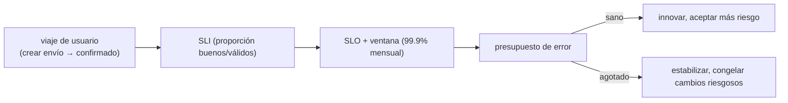
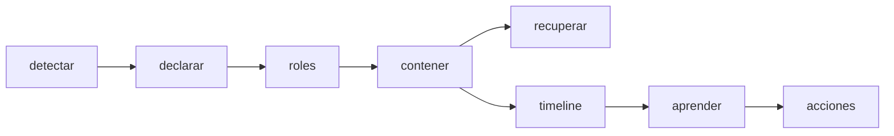
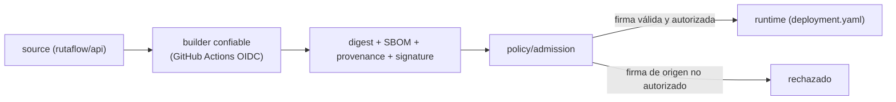
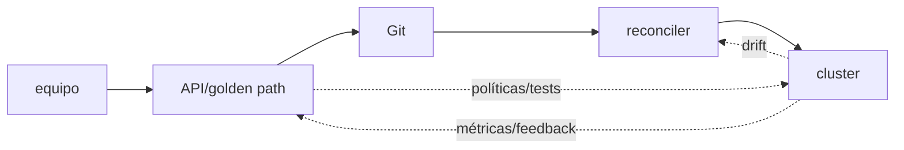

# Módulo 14: SRE y plataforma — confiabilidad, incidentes y supply chain

Automatizar despliegues es el comienzo, no el final. Un sistema profesional define qué significa estar sano, limita el riesgo de cambio, conserva procedencia de artefactos y aprende de incidentes. Este módulo conecta DevOps, SRE, seguridad de cadena de suministro y platform engineering mediante evidencia operativa.


## Aprende construyendo


### Tema 1: Confiabilidad es una expectativa cuantificada · Avanzado · 45 min

<details open>
<summary><strong>Capa 1 — Lectura</strong></summary>

#### ► DE QUÉ TRATA
Al finalizar vas a definir un SLI/SLO para el viaje "crear un envío y verlo confirmado" en la API de RutaFlow, y a calcular cuánto presupuesto de error queda disponible en la ventana actual. Prerrequisitos: Módulo 9 completo.

#### ► CÓMO FUNCIONA


</details>

<details>
<summary><strong>Capa 2 — Construcción</strong></summary>

#### Código y verificación
```promql
sum(rate(http_requests_total{route="/envios",code=~"2.."}[5m]))
/
sum(rate(http_requests_total{route="/envios"}[5m]))
```


```bash
mkdir -p ejemplo-slo && cd ejemplo-slo
```

```python
validos = 1_000_000
buenos = 999_450
slo = 0.999
sli = buenos / validos
presupuesto = validos * (1 - slo)
consumido = validos - buenos
print(f"SLI: {sli:.4%}")
print(f"Presupuesto: {presupuesto:.0f} eventos")
if consumido > presupuesto:
    raise SystemExit("presupuesto de error agotado: congelar cambios riesgosos")
print(f"Consumido: {consumido:.0f} ({consumido / presupuesto:.1%} del presupuesto)")
```

```bash
python3 sli.py
```

</details>

### Tema 2: Una alerta debe conducir a una acción · Avanzado · 45 min

<details open>
<summary><strong>Capa 1 — Lectura</strong></summary>

#### ► DE QUÉ TRATA
Al finalizar vas a configurar una alerta de "fast burn" sobre el presupuesto de error de /envios, con labels y annotations correctamente separados, y un runbook vinculado. Prerrequisitos: Tema 1 de este módulo.

#### ► CÓMO FUNCIONA


</details>

<details>
<summary><strong>Capa 2 — Construcción</strong></summary>

#### Código y verificación
```yaml
- alert: FastErrorBudgetBurn
  expr: job:slo_errors_per_request:ratio_rate5m > (14.4 * 0.001)
  for: 2m
  labels: { severity: page }
  annotations:
    summary: "La API consume rápidamente su presupuesto de error"
    runbook: "https://runbooks.example/tasks-api/high-burn"
```


```bash
mkdir ejemplo && cd ejemplo
```

```yaml
groups:
  - name: rutaflow-slo
    rules:
      - alert: FastErrorBudgetBurnEnvios
        expr: job:slo_errors_per_request:ratio_rate5m{route="/envios"} > (14.4 * 0.001)
        for: 2m
        labels:
          severity: page
          service: rutaflow-api
        annotations:
          summary: "La API de envíos consume rápidamente su presupuesto de error"
          runbook: "https://runbooks.rutaflow.app/envios-api/high-burn"
```

```python
import sys
from pathlib import Path

import yaml

PERMITIDOS = {"severity", "service", "team"}
documento = yaml.safe_load(Path("alerta.yaml").read_text(encoding="utf-8"))
reglas = [regla for grupo in documento["groups"] for regla in grupo["rules"]]
fallos = []
for regla in reglas:
    for campo in ("alert", "expr", "for"):
        if campo not in regla:
            fallos.append(f"{regla.get('alert', '?')}: falta {campo}")
    labels = regla.get("labels", {})
    extra = set(labels) - PERMITIDOS
    if extra:
        fallos.append(f"{regla['alert']}: labels de alta cardinalidad {sorted(extra)}")
    if "severity" not in labels:
        fallos.append(f"{regla['alert']}: falta labels.severity")
    annotations = regla.get("annotations", {})
    if not annotations.get("runbook"):
        fallos.append(f"{regla['alert']}: falta annotations.runbook")
    if "ratio_rate5m" not in regla.get("expr", ""):
        fallos.append(f"{regla['alert']}: la expresión no mide consumo de presupuesto")
print(f"alertas: {len(reglas)}")
print("labels:", ", ".join(sorted(set().union(*(r.get('labels', {}) for r in reglas)))))
print("annotations:", ", ".join(sorted(set().union(*(r.get('annotations', {}) for r in reglas)))))
for fallo in fallos:
    print("fallo:", fallo)
sys.exit(1 if fallos else 0)
```

```bash
python3 verificar_alerta.py
```

</details>

### Tema 3: Construir una imagen no demuestra de dónde proviene · Avanzado · 45 min

<details open>
<summary><strong>Capa 1 — Lectura</strong></summary>

#### ► DE QUÉ TRATA
Al finalizar vas a generar el SBOM de la imagen de RutaFlow y a firmarla con cosign, verificando que solo se acepte una imagen firmada por el pipeline de CI real. Prerrequisitos: Tema 2 de este módulo.

#### ► CÓMO FUNCIONA


</details>

<details>
<summary><strong>Capa 2 — Construcción</strong></summary>

#### Código y verificación
```bash
syft packages registry.example/tasks@sha256:ABC -o cyclonedx-json > sbom.json
cosign verify \
  --certificate-identity-regexp='github.com/example/tasks/' \
  --certificate-oidc-issuer='https://token.actions.githubusercontent.com' \
  registry.example/tasks@sha256:ABC
```


```bash
mkdir ejemplo && cd ejemplo
```

```yaml
apiVersion: policy.sigstore.dev/v1beta1
kind: ClusterImagePolicy
metadata:
  name: rutaflow-api
spec:
  images:
    - glob: "registry.rutaflow.app/api:*"
  authorities:
    - keyless:
        url: https://fulcio.sigstore.dev
        identities:
          - issuer: https://token.actions.githubusercontent.com
            subject: https://github.com/rutaflow/api/.github/workflows/release.yml@refs/heads/main
```

```python
import sys
from pathlib import Path

import yaml

documento = yaml.safe_load(Path("politica.yaml").read_text(encoding="utf-8"))
autoridades = documento.get("spec", {}).get("authorities", [])
identidades = [ident for autoridad in autoridades for ident in autoridad.get("keyless", {}).get("identities", [])]
fallos = []
if not documento.get("spec", {}).get("images"):
    fallos.append("la política no limita ninguna imagen")
for identidad in identidades:
    if identidad.get("issuer") != "https://token.actions.githubusercontent.com":
        fallos.append("emisor OIDC no es el builder autorizado")
    if "/rutaflow/api/" not in identidad.get("subject", ""):
        fallos.append("sin subject que limite el repositorio firmante")
if not identidades:
    fallos.append("no exige identidad keyless")
print(f"imágenes limitadas: {len(documento['spec']['images'])}")
print(f"identidades verificadas: {len(identidades)}")
for identidad in identidades:
    print("issuer:", identidad.get("issuer"))
    print("subject:", identidad.get("subject", "<sin restricción>"))
for fallo in fallos:
    print("fallo:", fallo)
sys.exit(1 if fallos else 0)
```

```bash
python3 verificar_politica.py
```

</details>

### Tema 4: Una plataforma interna es un producto con límites · Avanzado · 45 min

<details open>
<summary><strong>Capa 1 — Lectura</strong></summary>

#### ► DE QUÉ TRATA
Al finalizar vas a escribir una política Rego que rechace en el clúster de RutaFlow cualquier Pod que corra como root, y a medir el tiempo hasta el primer deploy exitoso de un desarrollador nuevo usando el golden path. Prerrequisitos: Tema 3 de este módulo.

#### ► CÓMO FUNCIONA


</details>

<details>
<summary><strong>Capa 2 — Construcción</strong></summary>

#### Código y verificación


```bash
mkdir -p ejemplo-politica && cd ejemplo-politica
```

```rego
package kubernetes.admission

deny[msg] {
  input.kind.kind == "Pod"
  c := input.spec.containers[_]
  not c.securityContext.runAsNonRoot
  msg := sprintf("%s debe ejecutar como non-root", [c.name])
}
```

```yaml
apiVersion: v1
kind: Pod
metadata:
  name: pod-root
spec:
  containers:
    - name: app
      image: nginx:1.30
```

```bash
opa eval -d policy.rego -i pod-root.yaml 'data.kubernetes.admission.deny'
kubectl apply --dry-run=client -f pod-root.yaml
```

```yaml
apiVersion: v1
kind: Pod
metadata:
  name: rutaflow-delivery-api
spec:
  containers:
    - name: app
      image: registry.rutaflow.app/api:1.0.0
      securityContext:
        runAsNonRoot: true
```

</details>

### Kubernetes 1.36, OpenTelemetry 1.59 y herramientas con ciclo propio

<details open>
<summary><strong>Capa 1 — Lectura</strong></summary>

</details>

<details>
<summary><strong>Capa 2 — Construcción</strong></summary>

#### Nota de construcción
Este tema es principalmente conceptual en esta versión. La verificación se realiza con las preguntas de comprensión y el criterio de cuándo NO usar kubernetes 1.36, opentelemetry 1.59 y herramientas con ciclo propio.

</details>

### Método de estudio y proyecto de ampliación

<details open>
<summary><strong>Capa 1 — Lectura</strong></summary>

</details>

<details>
<summary><strong>Capa 2 — Construcción</strong></summary>

#### Nota de construcción
Este tema es principalmente conceptual en esta versión. La verificación se realiza con las preguntas de comprensión y el criterio de cuándo NO usar método de estudio y proyecto de ampliación.

</details>
