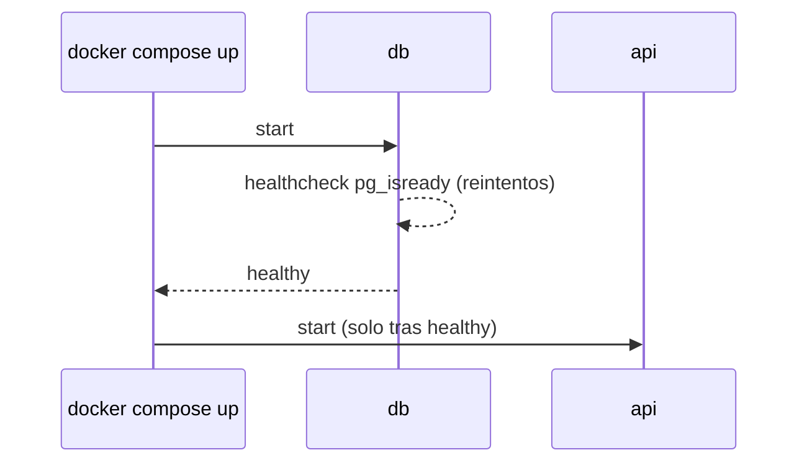
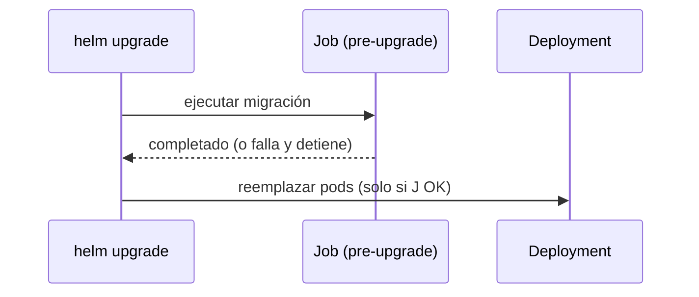
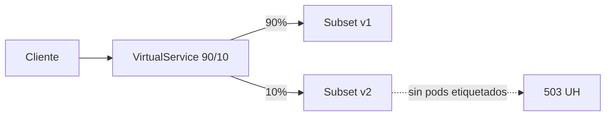
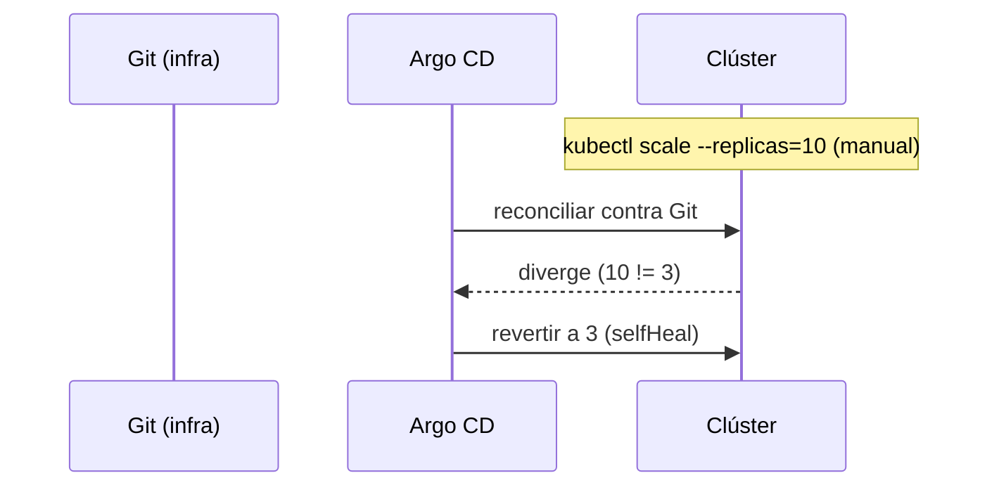
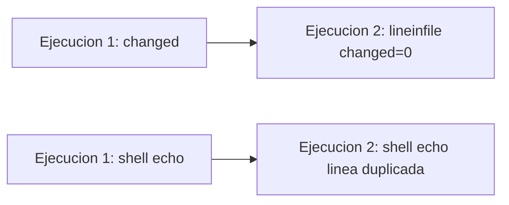
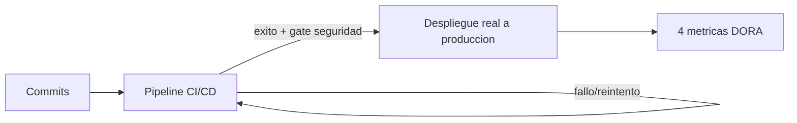

# Módulo 15: DevOps Master: GitOps, Service Mesh y DevSecOps


## Aprende construyendo


### Tema 1: Docker y Compose avanzados · Avanzado · 45 min

<details open>
<summary><strong>Capa 1 — Lectura</strong></summary>

#### ► DE QUÉ TRATA
Al finalizar vas a declarar un healthcheck y un depends_on: condition: service_healthy para que el servicio de RutaFlow no arranque contra una base de datos que aún no acepta conexiones. Prerrequisitos: Docker Compose v2 instalado (docker compose version).

#### ► LA IDEA EN UNA FRASE
**Al finalizar vas a declarar un healthcheck y un depends_on: condition: service_healthy para que el servicio de RutaFlow no arranque contra una base de datos que aún no acepta conexiones.**

#### ► POR QUÉ EXISTE ESTO
Resuelve un problema real de diseño o implementación y evita decisiones a ciegas.

#### ► LA ANALOGÍA
Piensa en docker y compose avanzados como una herramienta de taller: útil cuando conoces su propósito y sus límites.
**Dónde se rompe la analogía:** en software, los efectos dependen del contexto, la escala y los trade-offs.

#### ► CÓMO FUNCIONA


#### ► LO QUE PUEDE SALIR MAL
| Síntoma | Causa probable | Arreglo |
|---|---|---|
| Docker y Compose avanzados se aplica pero el resultado no mejora | Se usó sin medir el problema real | Mide antes y compara contra la alternativa simple |
| Aparece complejidad inesperada | Se adoptó la técnica sin comprender sus trade-offs | Vuelve a la sección de trade-offs y reduce el alcance |
| Falla en un caso límite | Se asumió un contexto que no se cumple | Prueba el caso límite y documenta cuándo NO usarlo |

#### ► TRADE-OFFS
| Opción | Cuándo usarla | Cuándo NO usarla |
|---|---|---|
| Usar Docker y Compose avanzados | Cuando el problema coincide con su propósito y el beneficio es observable | Cuando agrega complejidad sin resolver un problema real |
| Alternativa más simple | Cuando el contexto es pequeño, estable o fácil de razonar | Cuando ya demostró no escalar o no cumplir el requisito |
| Postergar la decisión | Cuando falta evidencia del problema | Cuando el costo de esperar es mayor que el costo de probar |

#### ► CUÁNDO NO USAR ESTO
No uses docker y compose avanzados por defecto. Aplícalo cuando el problema lo justifique y puedas verificar el beneficio; si una alternativa más simple resuelve igual, prefiérela.

#### ► DE VUELTA A LA ANALOGÍA
Volviendo a la analogía: docker y compose avanzados funciona como el modelo inicial, pero recuerda dónde se rompe: en producción importan la evidencia, la escala y el costo de equivocarte.

#### ► LO QUE DEBES RECORDAR
- Docker y Compose avanzados existe para resolver un problema específico.
- Mide antes de adoptar complejidad.
- Conoce el caso donde NO usarlo.
- Verifica con evidencia observable.

#### ► PREGUNTAS PARA PENSAR
1. ¿Qué problema concreto resuelve docker y compose avanzados en tu contexto?
2. ¿Cómo sabrías que docker y compose avanzados no está funcionando bien?
3. ¿Qué alternativa más simple considerarías antes de usar docker y compose avanzados?

</details>

<details>
<summary><strong>Capa 2 — Construcción</strong></summary>

#### Código y verificación


```bash
mkdir ejemplo-devops-health
cd ejemplo-devops-health
```

```json
{
  "name": "health-lab",
  "private": true,
  "type": "module",
  "dependencies": { "pg": "8.13.1" }
}
```

```js
import http from 'node:http';
import pg from 'pg';

const client = new pg.Client({ connectionTimeoutMillis: 2000 });
await client.connect();
await client.query('SELECT 1');

const server = http.createServer(async (request, response) => {
  try {
    const result = await client.query('SELECT 1 AS disponible');
    response.writeHead(200, { 'Content-Type': 'application/json' });
    response.end(JSON.stringify(result.rows[0]));
  } catch {
    response.writeHead(503, { 'Content-Type': 'application/json' });
    response.end('{"error":"base no disponible"}');
  }
});
server.listen(3000, '0.0.0.0');
```

```dockerfile
FROM node:22-alpine
WORKDIR /app
COPY package.json ./
RUN npm install --omit=dev
COPY server.mjs ./
CMD ["node", "server.mjs"]
```

```dotenv
LAB_DB_PASSWORD=lab-local-only
```

</details>

### Tema 2: Kubernetes extensible y Helm avanzado · Avanzado · 45 min

<details open>
<summary><strong>Capa 1 — Lectura</strong></summary>

#### ► DE QUÉ TRATA
Al finalizar vas a declarar un Helm hook pre-upgrade que corra las migraciones de RutaFlow antes de que el nuevo Deployment reciba tráfico. Prerrequisitos: Tema 1 de este módulo; Helm 3 instalado (helm version).

#### ► LA IDEA EN UNA FRASE
**Al finalizar vas a declarar un Helm hook pre-upgrade que corra las migraciones de RutaFlow antes de que el nuevo Deployment reciba tráfico.**

#### ► POR QUÉ EXISTE ESTO
Resuelve un problema real de diseño o implementación y evita decisiones a ciegas.

#### ► LA ANALOGÍA
Piensa en kubernetes extensible y helm avanzado como una herramienta de taller: útil cuando conoces su propósito y sus límites.
**Dónde se rompe la analogía:** en software, los efectos dependen del contexto, la escala y los trade-offs.

#### ► CÓMO FUNCIONA


#### ► LO QUE PUEDE SALIR MAL
| Síntoma | Causa probable | Arreglo |
|---|---|---|
| Kubernetes extensible y Helm avanzado se aplica pero el resultado no mejora | Se usó sin medir el problema real | Mide antes y compara contra la alternativa simple |
| Aparece complejidad inesperada | Se adoptó la técnica sin comprender sus trade-offs | Vuelve a la sección de trade-offs y reduce el alcance |
| Falla en un caso límite | Se asumió un contexto que no se cumple | Prueba el caso límite y documenta cuándo NO usarlo |

#### ► TRADE-OFFS
| Opción | Cuándo usarla | Cuándo NO usarla |
|---|---|---|
| Usar Kubernetes extensible y Helm avanzado | Cuando el problema coincide con su propósito y el beneficio es observable | Cuando agrega complejidad sin resolver un problema real |
| Alternativa más simple | Cuando el contexto es pequeño, estable o fácil de razonar | Cuando ya demostró no escalar o no cumplir el requisito |
| Postergar la decisión | Cuando falta evidencia del problema | Cuando el costo de esperar es mayor que el costo de probar |

#### ► CUÁNDO NO USAR ESTO
No uses kubernetes extensible y helm avanzado por defecto. Aplícalo cuando el problema lo justifique y puedas verificar el beneficio; si una alternativa más simple resuelve igual, prefiérela.

#### ► DE VUELTA A LA ANALOGÍA
Volviendo a la analogía: kubernetes extensible y helm avanzado funciona como el modelo inicial, pero recuerda dónde se rompe: en producción importan la evidencia, la escala y el costo de equivocarte.

#### ► LO QUE DEBES RECORDAR
- Kubernetes extensible y Helm avanzado existe para resolver un problema específico.
- Mide antes de adoptar complejidad.
- Conoce el caso donde NO usarlo.
- Verifica con evidencia observable.

#### ► PREGUNTAS PARA PENSAR
1. ¿Qué problema concreto resuelve kubernetes extensible y helm avanzado en tu contexto?
2. ¿Cómo sabrías que kubernetes extensible y helm avanzado no está funcionando bien?
3. ¿Qué alternativa más simple considerarías antes de usar kubernetes extensible y helm avanzado?

</details>

<details>
<summary><strong>Capa 2 — Construcción</strong></summary>

#### Código y verificación


```bash
mkdir ejemplo-helm && cd ejemplo-helm
mkdir -p chart/templates
```

```yaml
apiVersion: v2
name: rutaflow-api
version: 0.1.0
```

```yaml
image:
  tag: "1.0.0"
```

```yaml
apiVersion: batch/v1
kind: Job
metadata:
  name: rutaflow-migrate
  annotations:
    "helm.sh/hook": pre-upgrade
    "helm.sh/hook-weight": "0"
    "helm.sh/hook-delete-policy": before-hook-creation
spec:
  template:
    spec:
      containers:
        - name: migrate
          image: rutaflow/api:{{ .Values.image.tag }}
          command: ["npm", "run", "migrate"]
      restartPolicy: Never
```

```bash
helm template rutaflow ./chart
helm upgrade --install rutaflow ./chart --dry-run=client
```

</details>

### Tema 3: Service Mesh con Istio o Linkerd · Avanzado · 45 min

<details open>
<summary><strong>Capa 1 — Lectura</strong></summary>

#### ► DE QUÉ TRATA
Al finalizar vas a declarar un VirtualService y un DestinationRule de Istio para dividir el tráfico de la API de RutaFlow 90/10 entre la versión estable y un canary. Prerrequisitos: Tema 2 de este módulo; clúster con Istio instalado (istioctl version).

#### ► LA IDEA EN UNA FRASE
**Al finalizar vas a declarar un VirtualService y un DestinationRule de Istio para dividir el tráfico de la API de RutaFlow 90/10 entre la versión estable y un canary.**

#### ► POR QUÉ EXISTE ESTO
Resuelve un problema real de diseño o implementación y evita decisiones a ciegas.

#### ► LA ANALOGÍA
Piensa en service mesh con istio o linkerd como una herramienta de taller: útil cuando conoces su propósito y sus límites.
**Dónde se rompe la analogía:** en software, los efectos dependen del contexto, la escala y los trade-offs.

#### ► CÓMO FUNCIONA


#### ► LO QUE PUEDE SALIR MAL
| Síntoma | Causa probable | Arreglo |
|---|---|---|
| Service Mesh con Istio o Linkerd se aplica pero el resultado no mejora | Se usó sin medir el problema real | Mide antes y compara contra la alternativa simple |
| Aparece complejidad inesperada | Se adoptó la técnica sin comprender sus trade-offs | Vuelve a la sección de trade-offs y reduce el alcance |
| Falla en un caso límite | Se asumió un contexto que no se cumple | Prueba el caso límite y documenta cuándo NO usarlo |

#### ► TRADE-OFFS
| Opción | Cuándo usarla | Cuándo NO usarla |
|---|---|---|
| Usar Service Mesh con Istio o Linkerd | Cuando el problema coincide con su propósito y el beneficio es observable | Cuando agrega complejidad sin resolver un problema real |
| Alternativa más simple | Cuando el contexto es pequeño, estable o fácil de razonar | Cuando ya demostró no escalar o no cumplir el requisito |
| Postergar la decisión | Cuando falta evidencia del problema | Cuando el costo de esperar es mayor que el costo de probar |

#### ► CUÁNDO NO USAR ESTO
No uses service mesh con istio o linkerd por defecto. Aplícalo cuando el problema lo justifique y puedas verificar el beneficio; si una alternativa más simple resuelve igual, prefiérela.

#### ► DE VUELTA A LA ANALOGÍA
Volviendo a la analogía: service mesh con istio o linkerd funciona como el modelo inicial, pero recuerda dónde se rompe: en producción importan la evidencia, la escala y el costo de equivocarte.

#### ► LO QUE DEBES RECORDAR
- Service Mesh con Istio o Linkerd existe para resolver un problema específico.
- Mide antes de adoptar complejidad.
- Conoce el caso donde NO usarlo.
- Verifica con evidencia observable.

#### ► PREGUNTAS PARA PENSAR
1. ¿Qué problema concreto resuelve service mesh con istio o linkerd en tu contexto?
2. ¿Cómo sabrías que service mesh con istio o linkerd no está funcionando bien?
3. ¿Qué alternativa más simple considerarías antes de usar service mesh con istio o linkerd?

</details>

<details>
<summary><strong>Capa 2 — Construcción</strong></summary>

#### Código y verificación


```bash
kubectl get deployment rutaflow-delivery-api -o jsonpath='{.metadata.labels.version}'
```

```bash
mkdir ejemplo-istio && cd ejemplo-istio
```

```yaml
apiVersion: networking.istio.io/v1beta1
kind: DestinationRule
metadata: { name: rutaflow-api }
spec:
  host: rutaflow-api
  subsets:
    - name: v1
      labels: { version: v1 }
    - name: v2
      labels: { version: v2 }
---
apiVersion: networking.istio.io/v1beta1
kind: VirtualService
metadata: { name: rutaflow-api }
spec:
  hosts: [rutaflow-api]
  http:
    - route:
        - destination: { host: rutaflow-api, subset: v1 }
          weight: 90
        - destination: { host: rutaflow-api, subset: v2 }
          weight: 10
```

```bash
istioctl analyze -f virtualservice.yaml
kubectl apply -f virtualservice.yaml
kubectl get destinationrule,virtualservice rutaflow-api
```

</details>

### Tema 4: GitOps con Argo CD y Flux · Avanzado · 45 min

<details open>
<summary><strong>Capa 1 — Lectura</strong></summary>

#### ► DE QUÉ TRATA
Al finalizar vas a declarar una Application de Argo CD con syncPolicy.automated.selfHeal para que el estado de RutaFlow en el clúster nunca diverja silenciosamente del repositorio Git. Prerrequisitos: Tema 3 de este módulo; Argo CD instalado (argocd version).

#### ► LA IDEA EN UNA FRASE
**Al finalizar vas a declarar una Application de Argo CD con syncPolicy.automated.selfHeal para que el estado de RutaFlow en el clúster nunca diverja silenciosamente del repositorio Git.**

#### ► POR QUÉ EXISTE ESTO
Resuelve un problema real de diseño o implementación y evita decisiones a ciegas.

#### ► LA ANALOGÍA
Piensa en gitops con argo cd y flux como una herramienta de taller: útil cuando conoces su propósito y sus límites.
**Dónde se rompe la analogía:** en software, los efectos dependen del contexto, la escala y los trade-offs.

#### ► CÓMO FUNCIONA


#### ► LO QUE PUEDE SALIR MAL
| Síntoma | Causa probable | Arreglo |
|---|---|---|
| GitOps con Argo CD y Flux se aplica pero el resultado no mejora | Se usó sin medir el problema real | Mide antes y compara contra la alternativa simple |
| Aparece complejidad inesperada | Se adoptó la técnica sin comprender sus trade-offs | Vuelve a la sección de trade-offs y reduce el alcance |
| Falla en un caso límite | Se asumió un contexto que no se cumple | Prueba el caso límite y documenta cuándo NO usarlo |

#### ► TRADE-OFFS
| Opción | Cuándo usarla | Cuándo NO usarla |
|---|---|---|
| Usar GitOps con Argo CD y Flux | Cuando el problema coincide con su propósito y el beneficio es observable | Cuando agrega complejidad sin resolver un problema real |
| Alternativa más simple | Cuando el contexto es pequeño, estable o fácil de razonar | Cuando ya demostró no escalar o no cumplir el requisito |
| Postergar la decisión | Cuando falta evidencia del problema | Cuando el costo de esperar es mayor que el costo de probar |

#### ► CUÁNDO NO USAR ESTO
No uses gitops con argo cd y flux por defecto. Aplícalo cuando el problema lo justifique y puedas verificar el beneficio; si una alternativa más simple resuelve igual, prefiérela.

#### ► DE VUELTA A LA ANALOGÍA
Volviendo a la analogía: gitops con argo cd y flux funciona como el modelo inicial, pero recuerda dónde se rompe: en producción importan la evidencia, la escala y el costo de equivocarte.

#### ► LO QUE DEBES RECORDAR
- GitOps con Argo CD y Flux existe para resolver un problema específico.
- Mide antes de adoptar complejidad.
- Conoce el caso donde NO usarlo.
- Verifica con evidencia observable.

#### ► PREGUNTAS PARA PENSAR
1. ¿Qué problema concreto resuelve gitops con argo cd y flux en tu contexto?
2. ¿Cómo sabrías que gitops con argo cd y flux no está funcionando bien?
3. ¿Qué alternativa más simple considerarías antes de usar gitops con argo cd y flux?

</details>

<details>
<summary><strong>Capa 2 — Construcción</strong></summary>

#### Código y verificación


```bash
mkdir ejemplo-gitops && cd ejemplo-gitops
```

```yaml
apiVersion: argoproj.io/v1alpha1
kind: Application
metadata: { name: rutaflow-api }
spec:
  source: { repoURL: 'https://github.com/rutaflow/infra', path: api, targetRevision: main }
  destination: { server: 'https://kubernetes.default.svc', namespace: rutaflow }
  syncPolicy:
    automated: { prune: true, selfHeal: true }
```

```bash
kubectl apply --dry-run=client -f application.yaml
kubectl apply -f application.yaml
argocd app get rutaflow-api
```

</details>

### Tema 5: Ansible, inventarios, roles y Vault · Avanzado · 45 min

<details open>
<summary><strong>Capa 1 — Lectura</strong></summary>

#### ► DE QUÉ TRATA
Al finalizar vas a cifrar la API key de RutaFlow con ansible-vault y a escribirla en el servidor usando una tarea idempotente que no duplique su valor al ejecutarse varias veces. Prerrequisitos: Tema 4 de este módulo; Ansible instalado (ansible --version).

#### ► LA IDEA EN UNA FRASE
**Al finalizar vas a cifrar la API key de RutaFlow con ansible-vault y a escribirla en el servidor usando una tarea idempotente que no duplique su valor al ejecutarse varias veces.**

#### ► POR QUÉ EXISTE ESTO
Resuelve un problema real de diseño o implementación y evita decisiones a ciegas.

#### ► LA ANALOGÍA
Piensa en ansible, inventarios, roles y vault como una herramienta de taller: útil cuando conoces su propósito y sus límites.
**Dónde se rompe la analogía:** en software, los efectos dependen del contexto, la escala y los trade-offs.

#### ► CÓMO FUNCIONA


#### ► LO QUE PUEDE SALIR MAL
| Síntoma | Causa probable | Arreglo |
|---|---|---|
| Ansible, inventarios, roles y Vault se aplica pero el resultado no mejora | Se usó sin medir el problema real | Mide antes y compara contra la alternativa simple |
| Aparece complejidad inesperada | Se adoptó la técnica sin comprender sus trade-offs | Vuelve a la sección de trade-offs y reduce el alcance |
| Falla en un caso límite | Se asumió un contexto que no se cumple | Prueba el caso límite y documenta cuándo NO usarlo |

#### ► TRADE-OFFS
| Opción | Cuándo usarla | Cuándo NO usarla |
|---|---|---|
| Usar Ansible, inventarios, roles y Vault | Cuando el problema coincide con su propósito y el beneficio es observable | Cuando agrega complejidad sin resolver un problema real |
| Alternativa más simple | Cuando el contexto es pequeño, estable o fácil de razonar | Cuando ya demostró no escalar o no cumplir el requisito |
| Postergar la decisión | Cuando falta evidencia del problema | Cuando el costo de esperar es mayor que el costo de probar |

#### ► CUÁNDO NO USAR ESTO
No uses ansible, inventarios, roles y vault por defecto. Aplícalo cuando el problema lo justifique y puedas verificar el beneficio; si una alternativa más simple resuelve igual, prefiérela.

#### ► DE VUELTA A LA ANALOGÍA
Volviendo a la analogía: ansible, inventarios, roles y vault funciona como el modelo inicial, pero recuerda dónde se rompe: en producción importan la evidencia, la escala y el costo de equivocarte.

#### ► LO QUE DEBES RECORDAR
- Ansible, inventarios, roles y Vault existe para resolver un problema específico.
- Mide antes de adoptar complejidad.
- Conoce el caso donde NO usarlo.
- Verifica con evidencia observable.

#### ► PREGUNTAS PARA PENSAR
1. ¿Qué problema concreto resuelve ansible, inventarios, roles y vault en tu contexto?
2. ¿Cómo sabrías que ansible, inventarios, roles y vault no está funcionando bien?
3. ¿Qué alternativa más simple considerarías antes de usar ansible, inventarios, roles y vault?

</details>

<details>
<summary><strong>Capa 2 — Construcción</strong></summary>

#### Código y verificación


```bash
docker run --rm -it -v "$PWD":/playbooks ansible/ansible-runner ansible-playbook -i /playbooks/inventory.ini --ask-vault-pass /playbooks/site.yml
```

```bash
mkdir ejemplo-ansible && cd ejemplo-ansible
```

```bash
ansible-vault encrypt_string 'sk-rutaflow-lab-xxx' --name 'api_key'
```

```yaml
- hosts: all
  become: true
  vars_files:
    - vault.yml
  tasks:
    - name: Configurar API key de RutaFlow
      lineinfile:
        path: /etc/environment
        regexp: '^RUTAFLOW_API_KEY='
        line: "RUTAFLOW_API_KEY={{ api_key }}"
        state: present
```

```ini
[lab]
servidor ansible_host=192.0.2.10 ansible_user=ubuntu
```

</details>

### Tema 6: DevSecOps y métricas DORA · Avanzado · 45 min

<details open>
<summary><strong>Capa 1 — Lectura</strong></summary>

#### ► DE QUÉ TRATA
Al finalizar vas a calcular las cuatro métricas DORA (frecuencia de despliegue, lead time, tasa de fallo de cambios y MTTR) a partir de los datos reales del pipeline de RutaFlow. Prerrequisitos: Tema 5 de este módulo; acceso a los logs de CI/CD y al historial de incidentes de Rut…

#### ► LA IDEA EN UNA FRASE
**Al finalizar vas a calcular las cuatro métricas DORA (frecuencia de despliegue, lead time, tasa de fallo de cambios y MTTR) a partir de los datos reales del pipeline de RutaFlow.**

#### ► POR QUÉ EXISTE ESTO
Resuelve un problema real de diseño o implementación y evita decisiones a ciegas.

#### ► LA ANALOGÍA
Piensa en devsecops y métricas dora como una herramienta de taller: útil cuando conoces su propósito y sus límites.
**Dónde se rompe la analogía:** en software, los efectos dependen del contexto, la escala y los trade-offs.

#### ► CÓMO FUNCIONA


#### ► LO QUE PUEDE SALIR MAL
| Síntoma | Causa probable | Arreglo |
|---|---|---|
| DevSecOps y métricas DORA se aplica pero el resultado no mejora | Se usó sin medir el problema real | Mide antes y compara contra la alternativa simple |
| Aparece complejidad inesperada | Se adoptó la técnica sin comprender sus trade-offs | Vuelve a la sección de trade-offs y reduce el alcance |
| Falla en un caso límite | Se asumió un contexto que no se cumple | Prueba el caso límite y documenta cuándo NO usarlo |

#### ► TRADE-OFFS
| Opción | Cuándo usarla | Cuándo NO usarla |
|---|---|---|
| Usar DevSecOps y métricas DORA | Cuando el problema coincide con su propósito y el beneficio es observable | Cuando agrega complejidad sin resolver un problema real |
| Alternativa más simple | Cuando el contexto es pequeño, estable o fácil de razonar | Cuando ya demostró no escalar o no cumplir el requisito |
| Postergar la decisión | Cuando falta evidencia del problema | Cuando el costo de esperar es mayor que el costo de probar |

#### ► CUÁNDO NO USAR ESTO
No uses devsecops y métricas dora por defecto. Aplícalo cuando el problema lo justifique y puedas verificar el beneficio; si una alternativa más simple resuelve igual, prefiérela.

#### ► DE VUELTA A LA ANALOGÍA
Volviendo a la analogía: devsecops y métricas dora funciona como el modelo inicial, pero recuerda dónde se rompe: en producción importan la evidencia, la escala y el costo de equivocarte.

#### ► LO QUE DEBES RECORDAR
- DevSecOps y métricas DORA existe para resolver un problema específico.
- Mide antes de adoptar complejidad.
- Conoce el caso donde NO usarlo.
- Verifica con evidencia observable.

#### ► PREGUNTAS PARA PENSAR
1. ¿Qué problema concreto resuelve devsecops y métricas dora en tu contexto?
2. ¿Cómo sabrías que devsecops y métricas dora no está funcionando bien?
3. ¿Qué alternativa más simple considerarías antes de usar devsecops y métricas dora?

</details>

<details>
<summary><strong>Capa 2 — Construcción</strong></summary>

#### Código y verificación


```bash
kubectl get events --field-selector reason=Started -n rutaflow --sort-by='.lastTimestamp'
```

```bash
mkdir ejemplo-dora && cd ejemplo-dora
```

```bash
#!/usr/bin/env bash
set -euo pipefail
PROJECT_DIR=${1:?Indica la carpeta Git de tu propio proyecto}
: "${DEPLOY_TIME:?Define DEPLOY_TIME}"
: "${COMMIT_TIME:?Define COMMIT_TIME}"

# Frecuencia de despliegue: despliegues EXITOSOS a producción por día
git -C "$PROJECT_DIR" log --since="30 days ago" --grep="deploy: production" --oneline | wc -l

# Lead time: desde el commit hasta el despliegue exitoso
echo "$(( $(date -d "$DEPLOY_TIME" +%s) - $(date -d "$COMMIT_TIME" +%s) )) segundos"
```

```bash
export COMMIT_TIME="2026-07-15T10:00:00Z"
export DEPLOY_TIME="2026-07-15T12:30:00Z"
bash medir_dora.sh /ruta/a/tu/proyecto
```

</details>
