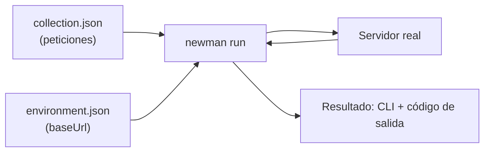
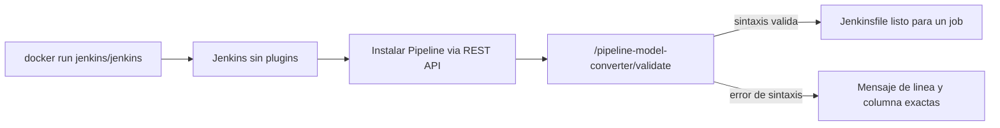

# Módulo 16: QA Automation — Postman, Newman y Jenkins

## Aprende construyendo

Cada Tema parte de una carpeta vacía y se verifica con comandos reales, no solo describiendo la interfaz gráfica de las herramientas.


### Tema 1: Postman y Newman — tu primera colección contra una API real · Avanzado · 40 min

<details open>
<summary><strong>Capa 1 — Lectura</strong></summary>

#### ► DE QUÉ TRATA
Al finalizar vas a escribir una colección Postman (formato Collection v2.1, el mismo JSON que exporta la app de Postman) con una petición real, y a ejecutarla desde la terminal con Newman — el ejecutor oficial de línea de comandos de Postman — contra un servidor local.

#### ► CÓMO FUNCIONA


</details>

<details>
<summary><strong>Capa 2 — Construcción</strong></summary>

#### Código y verificación


```bash
mkdir -p academia-devops/src/modulo16/postman-newman
cd academia-devops/src/modulo16/postman-newman
```

Crea el archivo `server.js`:

```js
const http = require('node:http');
http.createServer((req, res) => {
  if (req.method === 'GET' && req.url === '/health') {
    res.writeHead(200, { 'content-type': 'application/json' });
    res.end(JSON.stringify({ status: 'ok' }));
    return;
  }
  res.writeHead(404); res.end();
}).listen(4000, () => console.log('servidor de pruebas en :4000'));
```

```bash
node server.js &
sleep 1
```

Crea el archivo `environment.json`:

```json
{
  "name": "local",
  "values": [
    { "key": "baseUrl", "value": "http://127.0.0.1:4000", "enabled": true }
  ]
}
```

Crea el archivo `collection.json`:

```json
{
  "info": { "name": "RutaFlow API", "schema": "https://schema.getpostman.com/json/collection/v2.1.0/collection.json" },
  "item": [
    {
      "name": "Salud del servicio",
      "request": { "method": "GET", "url": "{{baseUrl}}/health" },
      "event": [{
        "listen": "test",
        "script": { "exec": [
          "pm.test('responde 200', () => pm.response.to.have.status(200));",
          "pm.test('status es ok', () => pm.expect(pm.response.json().status).to.eql('ok'));"
        ] }
      }]
    }
  ]
}
```

```bash
npx newman run collection.json -e environment.json
```

</details>

### Tema 2: Scripts y assertions — pruebas automatizadas sobre datos reales · Avanzado · 40 min

<details open>
<summary><strong>Capa 1 — Lectura</strong></summary>

#### ► DE QUÉ TRATA
Al finalizar vas a escribir aserciones que validan el cuerpo real de una respuesta JSON (no solo el código de estado), y vas a reconocer un error de script que haría pasar un test que en realidad no comprobó nada.

</details>

<details>
<summary><strong>Capa 2 — Construcción</strong></summary>

#### Código y verificación
Crea el archivo `server.js`:

```js
const http = require('node:http');
http.createServer((req, res) => {
  if (req.method === 'GET' && req.url === '/health') {
    res.writeHead(200, { 'content-type': 'application/json' });
    res.end(JSON.stringify({ status: 'ok' })); return;
  }
  if (req.method === 'POST' && req.url === '/envios') {
    let body = '';
    req.on('data', c => body += c);
    req.on('end', () => {
      const entrada = JSON.parse(body);
      res.writeHead(201, { 'content-type': 'application/json' });
      res.end(JSON.stringify({ id: 'env-1', guia: entrada.guia, estado: 'creado' }));
    });
    return;
  }
  res.writeHead(404); res.end();
}).listen(4000, () => console.log('servidor de pruebas en :4000'));
```

```bash
node server.js &
sleep 1
```

```bash
python3 -c "
import json
d = json.load(open('collection.json'))
d['item'].append({
  'name': 'Crear envio',
  'request': {
    'method': 'POST',
    'header': [{'key': 'content-type', 'value': 'application/json'}],
    'url': '{{baseUrl}}/envios',
    'body': {'mode': 'raw', 'raw': '{\"guia\": \"RF-4471\"}'}
  },
  'event': [{
    'listen': 'test',
    'script': {'exec': [
      \"pm.test('responde 201', () => pm.response.to.have.status(201));\",
      \"const cuerpo = pm.response.json();\",
      \"pm.test('la guia coincide con la enviada', () => pm.expect(cuerpo.guia).to.eql('RF-4471'));\",
      \"pm.test('el estado inicial es creado', () => pm.expect(cuerpo.estado).to.eql('creado'));\"
    ]}
  }]
})
json.dump(d, open('collection.json', 'w'), indent=2)
"
npx newman run collection.json -e environment.json
```

</details>

### Tema 3: Newman en profundidad — reportes y el contrato del código de salida · Avanzado · 40 min

<details open>
<summary><strong>Capa 1 — Lectura</strong></summary>

#### ► DE QUÉ TRATA
Al finalizar vas a generar un reporte HTML navegable de una corrida de Newman, y vas a reproducir un error real y común al integrar Newman en un script de CI: perder el código de salida verdadero al canalizar su salida a través de otro comando.

</details>

<details>
<summary><strong>Capa 2 — Construcción</strong></summary>

#### Código y verificación
```bash
cd academia-devops/src/modulo16/postman-newman
npm install --no-save newman-reporter-html
npx newman run collection.json -e environment.json --reporters cli,html --reporter-html-export reporte.html
ls -la reporte.html
```

```bash
python3 -c "
import json
d = json.load(open('collection.json'))
for script in d['item'][1]['event'][0]['script']['exec']:
    pass
d['item'][1]['event'][0]['script']['exec'][-1] = d['item'][1]['event'][0]['script']['exec'][-1].replace(\"eql('creado')\", \"eql('entregado')\")
json.dump(d, open('collection-fallo.json', 'w'), indent=2)
"
npx newman run collection-fallo.json -e environment.json | tail -5
echo "codigo de salida visto por el script: $?"
```

```bash
npx newman run collection-fallo.json -e environment.json > /tmp/newman-salida.txt 2>&1
echo "codigo de salida real de newman: $?"
```

</details>

### Tema 4: Jenkins — instalación, jobs y el linter real de pipelines declarativos · Avanzado · 40 min

<details open>
<summary><strong>Capa 1 — Lectura</strong></summary>

#### ► DE QUÉ TRATA
Al finalizar vas a levantar Jenkins en Docker, confirmar que no trae ningún plugin preinstalado, instalar el soporte de Pipeline, y validar un Jenkinsfile declarativo con el linter real de Jenkins antes de crear ningún job.

#### ► CÓMO FUNCIONA


</details>

<details>
<summary><strong>Capa 2 — Construcción</strong></summary>

#### Código y verificación


```bash
mkdir -p academia-devops/src/modulo16/jenkins
cd academia-devops/src/modulo16/jenkins
docker run -d --name academia-jenkins -p 8080:8080 \
  -e JAVA_OPTS="-Djenkins.install.runSetupWizard=false" \
  jenkins/jenkins:lts-jdk21
sleep 20
curl -s http://localhost:8080/api/json | python3 -c "import json,sys; d=json.load(sys.stdin); print('useSecurity:', d['useSecurity'])"
```

```bash
curl -s "http://localhost:8080/pluginManager/api/json?depth=1" | python3 -c "import json,sys; print('plugins instalados:', len(json.load(sys.stdin).get('plugins', [])))"

curl -s -c cookies.txt "http://localhost:8080/crumbIssuer/api/json" -o crumb.json
CRUMB=$(python3 -c "import json; print(json.load(open('crumb.json'))['crumb'])")
curl -s -b cookies.txt -H "Jenkins-Crumb: $CRUMB" \
  -d '<jenkins><install plugin="workflow-aggregator@latest" /></jenkins>' \
  -H "Content-Type: text/xml" \
  http://localhost:8080/pluginManager/installNecessaryPlugins
```

```bash
sleep 30
docker restart academia-jenkins
sleep 25
```

Crea el archivo `Jenkinsfile`:

```text
pipeline {
    agent any
    stages {
        stage('Build') {
            steps { echo 'construyendo' }
        }
        stage('Test') {
            steps { sh 'echo probando' }
        }
    }
}
```

```bash
curl -s -c cookies2.txt "http://localhost:8080/crumbIssuer/api/json" -o crumb2.json
CRUMB2=$(python3 -c "import json; print(json.load(open('crumb2.json'))['crumb'])")
curl -s -b cookies2.txt -H "Jenkins-Crumb: $CRUMB2" -F "jenkinsfile=<Jenkinsfile" http://localhost:8080/pipeline-model-converter/validate
```

</details>

### Tema 5: Integración completa — Newman dentro de un pipeline Jenkins · Avanzado · 40 min

<details open>
<summary><strong>Capa 1 — Lectura</strong></summary>

#### ► DE QUÉ TRATA
Al finalizar vas a crear un job de Jenkins real a partir de un Jenkinsfile, dispararlo, y confirmar — leyendo el resultado real desde la API de Jenkins — que un step que falla marca automáticamente todo el build como FAILURE, el mismo mecanismo que usará una etapa que ejecute New…

#### ► LA IDEA EN UNA FRASE
**Al finalizar vas a crear un job de Jenkins real a partir de un Jenkinsfile, dispararlo, y confirmar — leyendo el resultado real desde la API de Jenkins — que un step que falla marca automáticamente todo el build como FAILURE, el mismo mecanismo que usará una etapa que ejecute Newman.**

</details>

<details>
<summary><strong>Capa 2 — Construcción</strong></summary>

#### Código y verificación
```bash
cd academia-devops/src/modulo16/jenkins
```

Crea el archivo `job-config.xml`:

```xml
<?xml version='1.1' encoding='UTF-8'?>
<flow-definition>
  <description>Pipeline QA del proyecto</description>
  <keepDependencies>false</keepDependencies>
  <definition class="org.jenkinsci.plugins.workflow.cps.CpsFlowDefinition">
    <script>pipeline {
    agent any
    stages {
        stage('QA') {
            steps { sh 'echo "simulando: npx newman run collection.json -e environment.json" &amp;&amp; exit 0' }
        }
    }
}</script>
    <sandbox>true</sandbox>
  </definition>
  <triggers/>
  <disabled>false</disabled>
</flow-definition>
```

```bash
curl -s -c cookies3.txt "http://localhost:8080/crumbIssuer/api/json" -o crumb3.json
CRUMB3=$(python3 -c "import json; print(json.load(open('crumb3.json'))['crumb'])")
curl -s -b cookies3.txt -H "Jenkins-Crumb: $CRUMB3" -H "Content-Type: application/xml" \
  --data-binary @job-config.xml "http://localhost:8080/createItem?name=qa-pipeline"
curl -s -b cookies3.txt -H "Jenkins-Crumb: $CRUMB3" -X POST "http://localhost:8080/job/qa-pipeline/build"
sleep 8
curl -s -b cookies3.txt "http://localhost:8080/job/qa-pipeline/1/api/json" | python3 -c "import json,sys; print('resultado:', json.load(sys.stdin)['result'])"
```

</details>

### Tema 6: Bruno y Postman, evaluar con el mismo contrato · Avanzado · 40 min

<details open>
<summary><strong>Capa 1 — Lectura</strong></summary>

#### ► DE QUÉ TRATA
Al finalizar podrás comparar dos clientes de API por resultados verificables. Prerrequisitos: colección Postman, aserciones y servidor local del Tema 1; Bruno instalado desde su sitio oficial. No se asume que todas las funciones o licencias de una captura sigan vigentes.

</details>

<details>
<summary><strong>Capa 2 — Construcción</strong></summary>

#### Código y verificación
```bash
mkdir -p practica-clientes
python3 -m http.server 8091 --bind 127.0.0.1 --directory practica-clientes
```

```json
{"id":"sensor-1","temperatura":21.5,"unidad":"C"}
```

```bash
curl --fail http://127.0.0.1:8091/sensor.json
```

</details>
