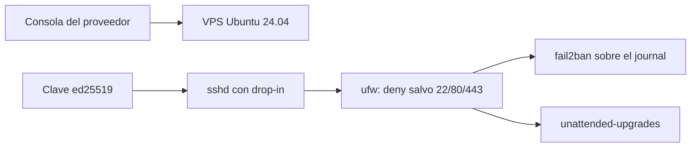
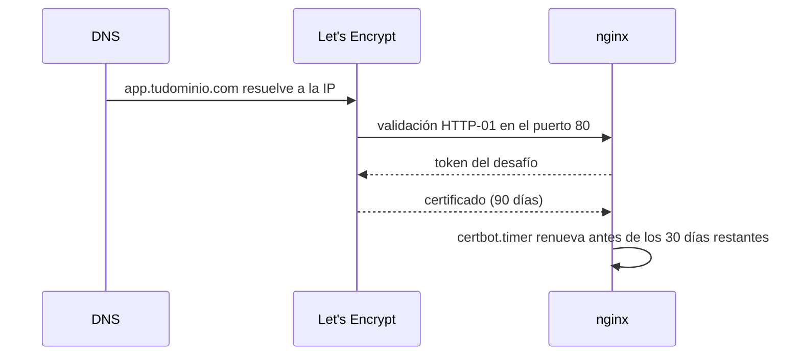
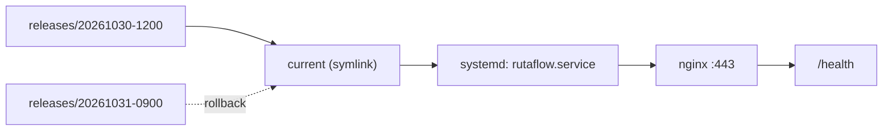
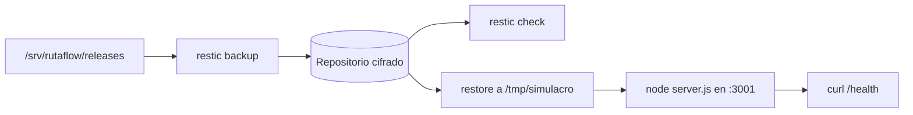

# Módulo 18: Servidor propio: VPS endurecido, TLS y recuperación

## Aprende construyendo

Cada Tema parte de una carpeta vacía y se verifica con comandos reales. El servidor de práctica es un VPS desechable con Ubuntu 24.04 LTS (o una VM local con red puente) en `203.0.113.10`, y el dominio de los Temas 2 a 4 es `app.tudominio.com`; sustituye ambos valores por los tuyos.


### Tema 1: Aprovisionar y endurecer: usuario, SSH, firewall y parches · Avanzado · 45 min

<details open>
<summary><strong>Capa 1 — Lectura</strong></summary>

#### ► DE QUÉ TRATA
Al finalizar vas a dejar un Ubuntu 24.04 LTS donde solo se entra con clave ed25519, sin login de root, con firewall que niega todo salvo 22/80/443, fail2ban y parches automáticos, demostrado con sshd -T y ufw status verbose.

#### ► CÓMO FUNCIONA


</details>

<details>
<summary><strong>Capa 2 — Construcción</strong></summary>

#### Código y verificación
```bash
mkdir -p academia-devops/src/modulo18/tema-1-endurecer
cd academia-devops/src/modulo18/tema-1-endurecer
```


Crea el archivo `tema-1.sh`:

```bash
#!/usr/bin/env bash
set -euo pipefail
USUARIO=deploy

# 1. Usuario sin privilegios, con la misma clave que ya usas
id -u "$USUARIO" >/dev/null 2>&1 || adduser --disabled-password --gecos "" "$USUARIO"
usermod -aG sudo "$USUARIO"
[ -f /root/.ssh/authorized_keys ] || {
  echo "no existe /root/.ssh/authorized_keys: añade tu clave pública al usuario $USUARIO a mano"; exit 1; }
install -d -m 700 -o "$USUARIO" -g "$USUARIO" "/home/$USUARIO/.ssh"
install -m 600 -o "$USUARIO" -g "$USUARIO" /root/.ssh/authorized_keys "/home/$USUARIO/.ssh/authorized_keys"
echo "$USUARIO ALL=(ALL) NOPASSWD:ALL" > "/etc/sudoers.d/90-$USUARIO"
chmod 440 "/etc/sudoers.d/90-$USUARIO"
visudo -c

# 2. sshd: drop-in que gana sobre el archivo principal
# Crea /etc/ssh/sshd_config.d/99-endurecer.conf con este contenido:
# PermitRootLogin no
# PasswordAuthentication no
# KbdInteractiveAuthentication no
# PubkeyAuthentication yes
# MaxAuthTries 3
install -d -m 755 /etc/ssh/sshd_config.d
python3 -c "import pathlib; pathlib.Path("/tmp/99-endurecer.conf").write_text("PermitRootLogin no\nPasswordAuthentication no\nKbdInteractiveAuthentication no\nPubkeyAuthentication yes\nMaxAuthTries 3\n")"
install -m 644 /tmp/99-endurecer.conf /etc/ssh/sshd_config.d/99-endurecer.conf
sshd -t

# 3. Firewall: permitir primero, habilitar después
ufw default deny incoming
ufw default allow outgoing
ufw allow 22/tcp
ufw allow 80/tcp
ufw allow 443/tcp
ufw --dry-run enable
ufw --force enable

# 4. fail2ban y parches de seguridad
export DEBIAN_FRONTEND=noninteractive
apt-get update -qq
apt-get install -y -qq fail2ban unattended-upgrades
python3 -c "import pathlib; pathlib.Path("/etc/fail2ban/jail.local").write_text("[sshd]\nenabled = true\nbackend = systemd\nmaxretry = 4\nfindtime = 10m\nbantime = 1h\n")"
systemctl enable --now fail2ban
python3 -c "import pathlib; pathlib.Path("/etc/apt/apt.conf.d/20auto-upgrades").write_text("APT::Periodic::Update-Package-Lists \"1\";\nAPT::Periodic::Unattended-Upgrade \"1\";\n")"
systemctl restart unattended-upgrades
```

```bash
scp tema-1.sh root@203.0.113.10:/root/tema-1.sh
ssh root@203.0.113.10 'bash /root/tema-1.sh'
```

```bash
ssh deploy@203.0.113.10 'sudo sshd -T | grep -E "^(permitrootlogin|passwordauthentication|maxauthtries) " | sort'
ssh deploy@203.0.113.10 'sudo ufw status verbose'
```

```
maxauthtries 3
passwordauthentication no
permitrootlogin no
Status: active
Logging: on (low)
Default: deny (incoming), allow (outgoing), disabled (routed)
New profiles: skip

To                         Action      From
--                         ------      ----
22/tcp                     ALLOW IN    Anywhere
80/tcp                     ALLOW IN    Anywhere
443/tcp                    ALLOW IN    Anywhere
```

</details>

### Tema 2: Dominio, TLS y borde: DNS, Let's Encrypt y Cloudflare · Avanzado · 45 min

<details open>
<summary><strong>Capa 1 — Lectura</strong></summary>

#### ► DE QUÉ TRATA
Al finalizar vas a servir app.tudominio.com por HTTPS con certificado de Let's Encrypt, redirección permanente desde HTTP, HSTS y renovación automática comprobada con openssl y certbot renew --dry-run.

#### ► CÓMO FUNCIONA


</details>

<details>
<summary><strong>Capa 2 — Construcción</strong></summary>

#### Código y verificación
```bash
mkdir -p academia-devops/src/modulo18/tema-2-tls
cd academia-devops/src/modulo18/tema-2-tls
```


Crea el archivo `tema-2.sh`:

```bash
#!/usr/bin/env bash
set -euo pipefail
DOMINIO=app.tudominio.com
IP=203.0.113.10
CORREO=ops@tudominio.com

dig +short A "$DOMINIO"
[ "$(dig +short A "$DOMINIO" | tail -1)" = "$IP" ] || { echo "el registro A no apunta a $IP"; exit 1; }

export DEBIAN_FRONTEND=noninteractive
apt-get update -qq
apt-get install -y -qq nginx dnsutils certbot python3-certbot-nginx

install -d -m 755 /var/www/rutaflow
python3 -c "import pathlib; pathlib.Path("/var/www/rutaflow/index.html").write_text("<!doctype html><html lang=\"es\"><title>RutaFlow</title><h1>RutaFlow en produccion</h1></html>\n")"
python3 -c "import pathlib; pathlib.Path("/etc/nginx/sites-available/rutaflow").write_text("server {\n    listen 80;\n    listen [::]:80;\n    server_name app.tudominio.com;\n    root /var/www/rutaflow;\n    index index.html;\n}\n")"
ln -sfn /etc/nginx/sites-available/rutaflow /etc/nginx/sites-enabled/rutaflow
rm -f /etc/nginx/sites-enabled/default
nginx -t
systemctl reload nginx

certbot --nginx -d "$DOMINIO" --redirect --agree-tos -m "$CORREO" --non-interactive
```

```bash
scp tema-2.sh root@203.0.113.10:/root/tema-2.sh
ssh root@203.0.113.10 'bash /root/tema-2.sh'
```

```bash
curl -sI http://app.tudominio.com | head -1
curl -sI https://app.tudominio.com | grep -iE '^(HTTP|strict-transport-security)'
echo | openssl s_client -connect app.tudominio.com:443 -servername app.tudominio.com 2>/dev/null | openssl x509 -noout -dates
systemctl list-timers | grep certbot
certbot renew --dry-run
```

```
HTTP/1.1 301 Moved Permanently
HTTP/1.1 200 OK
Strict-Transport-Security: max-age=31536000; includeSubDomains
notBefore=Oct 30 12:04:11 2026 GMT
notAfter=Jan 28 12:04:10 2027 GMT
```

```bash
curl -sI https://app.tudominio.com | grep -i cf-ray
curl -sI --resolve app.tudominio.com:443:203.0.113.10 https://app.tudominio.com | head -1
```

</details>

### Tema 3: Despliegue y rollback: systemd, nginx y artefactos versionados · Avanzado · 45 min

<details open>
<summary><strong>Capa 1 — Lectura</strong></summary>

#### ► DE QUÉ TRATA
Al finalizar vas a publicar releases versionados en /srv/rutaflow/releases, apuntar current al que está en servicio con un cambio atómico de symlink, ejecutar la app como servicio systemd que se reinicia si falla, servirla con nginx en 127.0.0.1:3000 y volver a la release anterio…

#### ► LA IDEA EN UNA FRASE
**Al finalizar vas a publicar releases versionados en /srv/rutaflow/releases, apuntar current al que está en servicio con un cambio atómico de symlink, ejecutar la app como servicio systemd que se reinicia si falla, servirla con nginx en 127.0.0.1:3000 y volver a la release anterior en segundos.**

#### ► CÓMO FUNCIONA


</details>

<details>
<summary><strong>Capa 2 — Construcción</strong></summary>

#### Código y verificación
```bash
mkdir -p academia-devops/src/modulo18/tema-3-despliegue/app
cd academia-devops/src/modulo18/tema-3-despliegue
```


Crea el archivo `app/server.js`:

```js
const http = require('node:http');
const fs = require('node:fs');
const path = require('node:path');
const version = fs.readFileSync(path.join(__dirname, 'VERSION'), 'utf8').trim();

http.createServer((req, res) => {
  if (req.url === '/health') {
    res.writeHead(200, { 'content-type': 'application/json' });
    res.end(JSON.stringify({ status: 'ok', version }));
    return;
  }
  res.writeHead(404);
  res.end();
}).listen(Number(process.env.PORT || 3000), '127.0.0.1',
  () => console.log(`rutaflow ${version} escuchando en 127.0.0.1:${process.env.PORT || 3000}`));
```

```bash
echo v1 > app/VERSION
scp -r app root@203.0.113.10:/root/
```

Crea el archivo `tema-3-servidor.sh`:

```bash
#!/usr/bin/env bash
set -euo pipefail
id -u rutaflow >/dev/null 2>&1 || useradd --system --home-dir /srv/rutaflow --shell /usr/sbin/nologin rutaflow
install -d -o rutaflow -g rutaflow -m 755 /srv/rutaflow /srv/rutaflow/releases
RELEASE="/srv/rutaflow/releases/$(date +%Y%m%d-%H%M%S)"
install -d -o rutaflow -g rutaflow -m 755 "$RELEASE"
install -o rutaflow -g rutaflow -m 644 /root/app/server.js /root/app/VERSION "$RELEASE"/
ln -sfn "$RELEASE" /srv/rutaflow/current
python3 -c "import pathlib; pathlib.Path("/etc/systemd/system/rutaflow.service").write_text("[Unit]\nDescription=RutaFlow (servidor propio)\nAfter=network.target\n\n[Service]\nType=simple\nUser=rutaflow\nGroup=rutaflow\nWorkingDirectory=/srv/rutaflow/current\nEnvironment=PORT=3000\nExecStart=/usr/bin/node server.js\nRestart=on-failure\nRestartSec=2\nNoNewPrivileges=true\nPrivateTmp=true\n\n[Install]\nWantedBy=multi-user.target\n")"
python3 -c "import pathlib; pathlib.Path("/etc/nginx/sites-available/rutaflow").write_text("server {\n    listen 80;\n    listen [::]:80;\n    server_name app.tudominio.com;\n\n    location / {\n        proxy_pass http://127.0.0.1:3000;\n        proxy_set_header Host $host;\n        proxy_set_header X-Forwarded-For $proxy_add_x_forwarded_for;\n        proxy_set_header X-Forwarded-Proto $scheme;\n    }\n}\n")"
nginx -t
systemctl daemon-reload
systemd-analyze verify /etc/systemd/system/rutaflow.service
systemctl enable --now rutaflow
systemctl reload nginx
certbot --nginx -d app.tudominio.com --redirect --reinstall --non-interactive
```

```bash
scp tema-3-servidor.sh root@203.0.113.10:/root/tema-3-servidor.sh
ssh root@203.0.113.10 'bash /root/tema-3-servidor.sh'
```

Crea el archivo `/usr/local/bin/desplegar-rutaflow`:

```text
#!/usr/bin/env bash
set -euo pipefail
ORIGEN=${1:?uso: desplegar-rutaflow <carpeta-del-release>}
RELEASE="/srv/rutaflow/releases/$(date +%Y%m%d-%H%M%S)"
ANTERIOR=$(readlink -f /srv/rutaflow/current)

install -d -o rutaflow -g rutaflow -m 755 "$RELEASE"
install -o rutaflow -g rutaflow -m 644 "$ORIGEN/server.js" "$ORIGEN/VERSION" "$RELEASE"/
ln -sfn "$RELEASE" /srv/rutaflow/current.nuevo
mv -Tf /srv/rutaflow/current.nuevo /srv/rutaflow/current
systemctl restart rutaflow

for intento in 1 2 3 4 5; do
  if curl --fail --silent --max-time 2 http://127.0.0.1:3000/health >/dev/null; then
    echo "desplegado $RELEASE"
    exit 0
  fi
  sleep 1
done

echo "healthcheck fallo; revirtiendo a $ANTERIOR"
ln -sfn "$ANTERIOR" /srv/rutaflow/current.nuevo
mv -Tf /srv/rutaflow/current.nuevo /srv/rutaflow/current
systemctl restart rutaflow
exit 1
```

```bash
chmod 755 /usr/local/bin/desplegar-rutaflow
```

```bash
sed -i 's/^v1$/v2/' app/VERSION
scp -r app root@203.0.113.10:/root/
ssh root@203.0.113.10 'desplegar-rutaflow /root/app && curl -s http://127.0.0.1:3000/health'
```

</details>

#### Alternativa: Coolify, un PaaS sobre tu propio VPS

Lo que montaste a mano en este tema (servicio, proxy inverso, TLS, versiones y rollback) es lo que automatiza [Coolify](https://github.com/coollabsio/coolify): una plataforma open source (Apache-2.0) para desplegar apps, bases de datos y servicios en tus servidores, al estilo de Heroku o Vercel.

**Qué hace por ti.** Despliega desde GitHub, GitLab o imágenes Docker; pone un proxy inverso con HTTPS automático; guarda variables y secretos; programa backups; y permite volver a una versión anterior.

**Requisitos.** Linux (Debian, Ubuntu, RHEL y derivados, entre otros) con mínimo 2 núcleos, 2 GB de RAM y 10 GB libres, en amd64 o arm64, y acceso SSH como root o con sudo. La instalación oficial:

```bash
curl -fsSL https://cdn.coollabs.io/coolify/install.sh | bash
```

Luego abres `http://<ip-del-servidor>:8000` y creas la cuenta de administrador en los primeros 10 minutos.

**Cuidado.** Ese comando ejecuta un script remoto como root: córrelo solo en un servidor dedicado y recién endurecido (Tema 1), nunca en tu equipo personal. Respalda `/data/coolify/source/.env`, que guarda secretos como `APP_KEY`.

**Cuándo elegirlo.** Coolify ahorra trabajo cuando tienes varias apps en uno o pocos servidores. Hacerlo a mano, como en este tema, te enseña qué pasa debajo y te deja depurar cuando la plataforma falla.

**Ejercicio.** Haz una tabla con cada paso de este tema (systemd, nginx, certificados, releases, rollback) y escribe qué componente de Coolify lo reemplaza.

Fuente: [instalación de Coolify](https://coolify.io/docs/get-started/installation).

### Tema 4: Respaldos que se restauran: restic, RPO/RTO y simulacro · Avanzado · 45 min

<details open>
<summary><strong>Capa 1 — Lectura</strong></summary>

#### ► DE QUÉ TRATA
Al finalizar vas a crear un repositorio restic cifrado, respaldar releases y configuración, verificar la integridad, restaurar en una carpeta limpia y medir la recuperación. El criterio no es que el respaldo diga saved, sino que el servicio arranque desde lo restaurado.

#### ► CÓMO FUNCIONA


</details>

<details>
<summary><strong>Capa 2 — Construcción</strong></summary>

#### Código y verificación
```bash
mkdir -p academia-devops/src/modulo18/tema-4-restic
cd academia-devops/src/modulo18/tema-4-restic
```


Crea el archivo `tema-4.sh`:

```bash
#!/usr/bin/env bash
set -euo pipefail
export RESTIC_REPOSITORY=/srv/backups/restic-repo
export RESTIC_PASSWORD_FILE=/etc/restic/password

install -d -m 700 /etc/restic
[ -f "$RESTIC_PASSWORD_FILE" ] || openssl rand -base64 32 > "$RESTIC_PASSWORD_FILE"
chmod 600 "$RESTIC_PASSWORD_FILE"
[ -d "$RESTIC_REPOSITORY" ] || restic init

restic backup --tag nightly \
  /srv/rutaflow/releases \
  /etc/nginx/sites-available/rutaflow \
  /etc/systemd/system/rutaflow.service
restic check
restic snapshots
```

```bash
scp tema-4.sh root@203.0.113.10:/root/tema-4.sh
ssh root@203.0.113.10 'bash /root/tema-4.sh'
```

```bash
rm -rf /tmp/simulacro && install -d -m 755 /tmp/simulacro
time restic restore latest --target /tmp/simulacro
RELEASE=$(ls -d /tmp/simulacro/srv/rutaflow/releases/* | tail -1)
sudo -u rutaflow env PORT=3001 node "$RELEASE/server.js" &
sleep 1
curl --fail --silent http://127.0.0.1:3001/health
kill %1
sudo grep -ra 'RutaFlow (servidor propio)' /srv/backups/restic-repo || echo "sin coincidencias en claro: repositorio cifrado"
```

```
repository 5b1e9a3c opened (version 2, compression level auto)
snapshot 9a1c4e7d saved
check all packs
check snapshots, trees and blobs
no errors were found
{"status":"ok","version":"v2"}
```

```bash
RESTIC_REPOSITORY=/srv/backups/restic-repo RESTIC_PASSWORD_FILE=/etc/restic/password \
  restic backup --tag release /srv/rutaflow/current
sudo mv /srv/rutaflow /srv/rutaflow.perdido
rm -rf /tmp/simulacro && install -d -m 755 /tmp/simulacro
RESTIC_REPOSITORY=/srv/backups/restic-repo RESTIC_PASSWORD_FILE=/etc/restic/password \
  restic restore latest --target /tmp/simulacro
ls -l /tmp/simulacro/srv/rutaflow/
ls /tmp/simulacro/srv/rutaflow/current/
```

</details>
