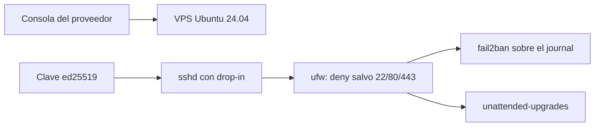
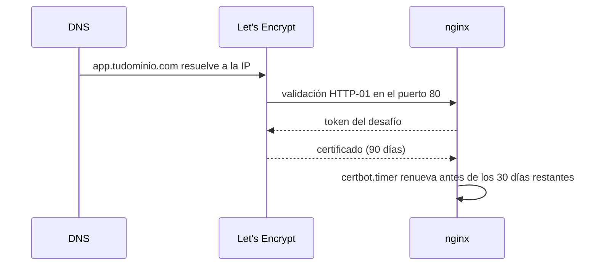
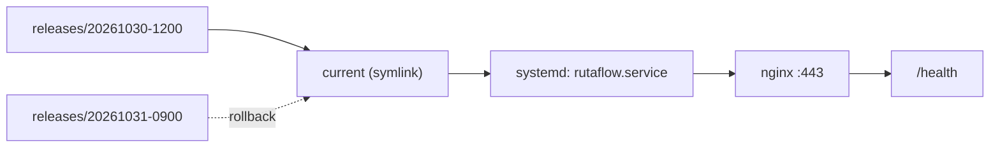
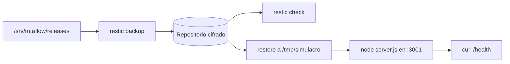

# Módulo 18: Servidor propio: VPS endurecido, TLS y recuperación

## Aprende construyendo

Cada Tema parte de una carpeta vacía y se verifica con comandos reales. El servidor de práctica es un VPS desechable con Ubuntu 24.04 LTS (o una VM local con red puente) en `203.0.113.10`, y el dominio de los Temas 2 a 4 es `app.tudominio.com`; sustituye ambos valores por los tuyos.


### Tema 1: Aprovisionar y endurecer: usuario, SSH, firewall y parches · Avanzado · 45 min

<details open>
<summary><strong>Capa 1 — Lectura</strong></summary>

#### ► DE QUÉ TRATA
Al finalizar vas a dejar un Ubuntu 24.04 LTS donde solo se entra con clave ed25519, sin login de root, con firewall que niega todo salvo 22/80/443, fail2ban y parches automáticos, demostrado con sshd -T y ufw status verbose.

#### ► LA IDEA EN UNA FRASE
**Al finalizar vas a dejar un Ubuntu 24.04 LTS donde solo se entra con clave ed25519, sin login de root, con firewall que niega todo salvo 22/80/443, fail2ban y parches automáticos, demostrado con sshd -T y ufw status verbose.**

#### ► POR QUÉ EXISTE ESTO
Resuelve un problema real de diseño o implementación y evita decisiones a ciegas.

#### ► LA ANALOGÍA
Piensa en aprovisionar y endurecer: usuario, ssh, firewall y parches como una herramienta de taller: útil cuando conoces su propósito y sus límites.
**Dónde se rompe la analogía:** en software, los efectos dependen del contexto, la escala y los trade-offs.

#### ► CÓMO FUNCIONA


#### ► LO QUE PUEDE SALIR MAL
| Síntoma | Causa probable | Arreglo |
|---|---|---|
| Aprovisionar y endurecer: usuario, SSH, firewall y parches se aplica pero el resultado no mejora | Se usó sin medir el problema real | Mide antes y compara contra la alternativa simple |
| Aparece complejidad inesperada | Se adoptó la técnica sin comprender sus trade-offs | Vuelve a la sección de trade-offs y reduce el alcance |
| Falla en un caso límite | Se asumió un contexto que no se cumple | Prueba el caso límite y documenta cuándo NO usarlo |

#### ► TRADE-OFFS
| Opción | Cuándo usarla | Cuándo NO usarla |
|---|---|---|
| Usar Aprovisionar y endurecer: usuario, SSH, firewall y parches | Cuando el problema coincide con su propósito y el beneficio es observable | Cuando agrega complejidad sin resolver un problema real |
| Alternativa más simple | Cuando el contexto es pequeño, estable o fácil de razonar | Cuando ya demostró no escalar o no cumplir el requisito |
| Postergar la decisión | Cuando falta evidencia del problema | Cuando el costo de esperar es mayor que el costo de probar |

#### ► CUÁNDO NO USAR ESTO
No uses aprovisionar y endurecer: usuario, ssh, firewall y parches por defecto. Aplícalo cuando el problema lo justifique y puedas verificar el beneficio; si una alternativa más simple resuelve igual, prefiérela.

#### ► DE VUELTA A LA ANALOGÍA
Volviendo a la analogía: aprovisionar y endurecer: usuario, ssh, firewall y parches funciona como el modelo inicial, pero recuerda dónde se rompe: en producción importan la evidencia, la escala y el costo de equivocarte.

#### ► LO QUE DEBES RECORDAR
- Aprovisionar y endurecer: usuario, SSH, firewall y parches existe para resolver un problema específico.
- Mide antes de adoptar complejidad.
- Conoce el caso donde NO usarlo.
- Verifica con evidencia observable.

#### ► PREGUNTAS PARA PENSAR
1. ¿Qué problema concreto resuelve aprovisionar y endurecer: usuario, ssh, firewall y parches en tu contexto?
2. ¿Cómo sabrías que aprovisionar y endurecer: usuario, ssh, firewall y parches no está funcionando bien?
3. ¿Qué alternativa más simple considerarías antes de usar aprovisionar y endurecer: usuario, ssh, firewall y parches?

</details>

<details>
<summary><strong>Capa 2 — Construcción</strong></summary>

#### Código y verificación
```bash
mkdir -p academia-devops/src/modulo18/tema-1-endurecer
cd academia-devops/src/modulo18/tema-1-endurecer
```


```bash
cat > tema-1.sh <<'SCRIPT'
#!/usr/bin/env bash
set -euo pipefail
USUARIO=deploy

# 1. Usuario sin privilegios, con la misma clave que ya usas
id -u "$USUARIO" >/dev/null 2>&1 || adduser --disabled-password --gecos "" "$USUARIO"
usermod -aG sudo "$USUARIO"
[ -f /root/.ssh/authorized_keys ] || {
  echo "no existe /root/.ssh/authorized_keys: añade tu clave pública al usuario $USUARIO a mano"; exit 1; }
install -d -m 700 -o "$USUARIO" -g "$USUARIO" "/home/$USUARIO/.ssh"
install -m 600 -o "$USUARIO" -g "$USUARIO" /root/.ssh/authorized_keys "/home/$USUARIO/.ssh/authorized_keys"
echo "$USUARIO ALL=(ALL) NOPASSWD:ALL" > "/etc/sudoers.d/90-$USUARIO"
chmod 440 "/etc/sudoers.d/90-$USUARIO"
visudo -c

# 2. sshd: drop-in que gana sobre el archivo principal
cat > /etc/ssh/sshd_config.d/99-endurecer.conf <<'EOF'
PermitRootLogin no
PasswordAuthentication no
KbdInteractiveAuthentication no
PubkeyAuthentication yes
MaxAuthTries 3
EOF
sshd -t

# 3. Firewall: permitir primero, habilitar después
ufw default deny incoming
ufw default allow outgoing
ufw allow 22/tcp
ufw allow 80/tcp
ufw allow 443/tcp
ufw --dry-run enable
ufw --force enable

# 4. fail2ban y parches de seguridad
export DEBIAN_FRONTEND=noninteractive
apt-get update -qq
apt-get install -y -qq fail2ban unattended-upgrades
cat > /etc/fail2ban/jail.local <<'EOF'
[sshd]
enabled = true
backend = systemd
maxretry = 4
findtime = 10m
bantime = 1h
EOF
systemctl enable --now fail2ban
cat > /etc/apt/apt.conf.d/20auto-upgrades <<'EOF'
APT::Periodic::Update-Package-Lists "1";
APT::Periodic::Unattended-Upgrade "1";
EOF
systemctl restart unattended-upgrades
SCRIPT
scp tema-1.sh root@203.0.113.10:/root/tema-1.sh
ssh root@203.0.113.10 'bash /root/tema-1.sh'
```

```bash
ssh deploy@203.0.113.10 'sudo sshd -T | grep -E "^(permitrootlogin|passwordauthentication|maxauthtries) " | sort'
ssh deploy@203.0.113.10 'sudo ufw status verbose'
```

```
maxauthtries 3
passwordauthentication no
permitrootlogin no
Status: active
Logging: on (low)
Default: deny (incoming), allow (outgoing), disabled (routed)
New profiles: skip

To                         Action      From
--                         ------      ----
22/tcp                     ALLOW IN    Anywhere
80/tcp                     ALLOW IN    Anywhere
443/tcp                    ALLOW IN    Anywhere
```

</details>

### Tema 2: Dominio, TLS y borde: DNS, Let's Encrypt y Cloudflare · Avanzado · 45 min

<details open>
<summary><strong>Capa 1 — Lectura</strong></summary>

#### ► DE QUÉ TRATA
Al finalizar vas a servir app.tudominio.com por HTTPS con certificado de Let's Encrypt, redirección permanente desde HTTP, HSTS y renovación automática comprobada con openssl y certbot renew --dry-run.

#### ► LA IDEA EN UNA FRASE
**Al finalizar vas a servir app.tudominio.com por HTTPS con certificado de Let's Encrypt, redirección permanente desde HTTP, HSTS y renovación automática comprobada con openssl y certbot renew --dry-run.**

#### ► POR QUÉ EXISTE ESTO
Resuelve un problema real de diseño o implementación y evita decisiones a ciegas.

#### ► LA ANALOGÍA
Piensa en dominio, tls y borde: dns, let's encrypt y cloudflare como una herramienta de taller: útil cuando conoces su propósito y sus límites.
**Dónde se rompe la analogía:** en software, los efectos dependen del contexto, la escala y los trade-offs.

#### ► CÓMO FUNCIONA


#### ► LO QUE PUEDE SALIR MAL
| Síntoma | Causa probable | Arreglo |
|---|---|---|
| Dominio, TLS y borde: DNS, Let's Encrypt y Cloudflare se aplica pero el resultado no mejora | Se usó sin medir el problema real | Mide antes y compara contra la alternativa simple |
| Aparece complejidad inesperada | Se adoptó la técnica sin comprender sus trade-offs | Vuelve a la sección de trade-offs y reduce el alcance |
| Falla en un caso límite | Se asumió un contexto que no se cumple | Prueba el caso límite y documenta cuándo NO usarlo |

#### ► TRADE-OFFS
| Opción | Cuándo usarla | Cuándo NO usarla |
|---|---|---|
| Usar Dominio, TLS y borde: DNS, Let's Encrypt y Cloudflare | Cuando el problema coincide con su propósito y el beneficio es observable | Cuando agrega complejidad sin resolver un problema real |
| Alternativa más simple | Cuando el contexto es pequeño, estable o fácil de razonar | Cuando ya demostró no escalar o no cumplir el requisito |
| Postergar la decisión | Cuando falta evidencia del problema | Cuando el costo de esperar es mayor que el costo de probar |

#### ► CUÁNDO NO USAR ESTO
No uses dominio, tls y borde: dns, let's encrypt y cloudflare por defecto. Aplícalo cuando el problema lo justifique y puedas verificar el beneficio; si una alternativa más simple resuelve igual, prefiérela.

#### ► DE VUELTA A LA ANALOGÍA
Volviendo a la analogía: dominio, tls y borde: dns, let's encrypt y cloudflare funciona como el modelo inicial, pero recuerda dónde se rompe: en producción importan la evidencia, la escala y el costo de equivocarte.

#### ► LO QUE DEBES RECORDAR
- Dominio, TLS y borde: DNS, Let's Encrypt y Cloudflare existe para resolver un problema específico.
- Mide antes de adoptar complejidad.
- Conoce el caso donde NO usarlo.
- Verifica con evidencia observable.

#### ► PREGUNTAS PARA PENSAR
1. ¿Qué problema concreto resuelve dominio, tls y borde: dns, let's encrypt y cloudflare en tu contexto?
2. ¿Cómo sabrías que dominio, tls y borde: dns, let's encrypt y cloudflare no está funcionando bien?
3. ¿Qué alternativa más simple considerarías antes de usar dominio, tls y borde: dns, let's encrypt y cloudflare?

</details>

<details>
<summary><strong>Capa 2 — Construcción</strong></summary>

#### Código y verificación
```bash
mkdir -p academia-devops/src/modulo18/tema-2-tls
cd academia-devops/src/modulo18/tema-2-tls
```


```bash
cat > tema-2.sh <<'SCRIPT'
#!/usr/bin/env bash
set -euo pipefail
DOMINIO=app.tudominio.com
IP=203.0.113.10
CORREO=ops@tudominio.com

dig +short A "$DOMINIO"
[ "$(dig +short A "$DOMINIO" | tail -1)" = "$IP" ] || { echo "el registro A no apunta a $IP"; exit 1; }

export DEBIAN_FRONTEND=noninteractive
apt-get update -qq
apt-get install -y -qq nginx dnsutils certbot python3-certbot-nginx

install -d -m 755 /var/www/rutaflow
cat > /var/www/rutaflow/index.html <<'EOF'
<!doctype html><html lang="es"><title>RutaFlow</title><h1>RutaFlow en produccion</h1></html>
EOF
cat > /etc/nginx/sites-available/rutaflow <<'EOF'
server {
    listen 80;
    listen [::]:80;
    server_name app.tudominio.com;
    root /var/www/rutaflow;
    index index.html;
}
EOF
ln -sfn /etc/nginx/sites-available/rutaflow /etc/nginx/sites-enabled/rutaflow
rm -f /etc/nginx/sites-enabled/default
nginx -t
systemctl reload nginx

certbot --nginx -d "$DOMINIO" --redirect --agree-tos -m "$CORREO" --non-interactive
SCRIPT
scp tema-2.sh root@203.0.113.10:/root/tema-2.sh
ssh root@203.0.113.10 'bash /root/tema-2.sh'
```

```bash
curl -sI http://app.tudominio.com | head -1
curl -sI https://app.tudominio.com | grep -iE '^(HTTP|strict-transport-security)'
echo | openssl s_client -connect app.tudominio.com:443 -servername app.tudominio.com 2>/dev/null | openssl x509 -noout -dates
systemctl list-timers | grep certbot
certbot renew --dry-run
```

```
HTTP/1.1 301 Moved Permanently
HTTP/1.1 200 OK
Strict-Transport-Security: max-age=31536000; includeSubDomains
notBefore=Oct 30 12:04:11 2026 GMT
notAfter=Jan 28 12:04:10 2027 GMT
```

```bash
curl -sI https://app.tudominio.com | grep -i cf-ray
curl -sI --resolve app.tudominio.com:443:203.0.113.10 https://app.tudominio.com | head -1
```

</details>

### Tema 3: Despliegue y rollback: systemd, nginx y artefactos versionados · Avanzado · 45 min

<details open>
<summary><strong>Capa 1 — Lectura</strong></summary>

#### ► DE QUÉ TRATA
Al finalizar vas a publicar releases versionados en /srv/rutaflow/releases, apuntar current al que está en servicio con un cambio atómico de symlink, ejecutar la app como servicio systemd que se reinicia si falla, servirla con nginx en 127.0.0.1:3000 y volver a la release anterio…

#### ► LA IDEA EN UNA FRASE
**Al finalizar vas a publicar releases versionados en /srv/rutaflow/releases, apuntar current al que está en servicio con un cambio atómico de symlink, ejecutar la app como servicio systemd que se reinicia si falla, servirla con nginx en 127.0.0.1:3000 y volver a la release anterior en segundos.**

#### ► POR QUÉ EXISTE ESTO
Resuelve un problema real de diseño o implementación y evita decisiones a ciegas.

#### ► LA ANALOGÍA
Piensa en despliegue y rollback: systemd, nginx y artefactos versionados como una herramienta de taller: útil cuando conoces su propósito y sus límites.
**Dónde se rompe la analogía:** en software, los efectos dependen del contexto, la escala y los trade-offs.

#### ► CÓMO FUNCIONA


#### ► LO QUE PUEDE SALIR MAL
| Síntoma | Causa probable | Arreglo |
|---|---|---|
| Despliegue y rollback: systemd, nginx y artefactos versionados se aplica pero el resultado no mejora | Se usó sin medir el problema real | Mide antes y compara contra la alternativa simple |
| Aparece complejidad inesperada | Se adoptó la técnica sin comprender sus trade-offs | Vuelve a la sección de trade-offs y reduce el alcance |
| Falla en un caso límite | Se asumió un contexto que no se cumple | Prueba el caso límite y documenta cuándo NO usarlo |

#### ► TRADE-OFFS
| Opción | Cuándo usarla | Cuándo NO usarla |
|---|---|---|
| Usar Despliegue y rollback: systemd, nginx y artefactos versionados | Cuando el problema coincide con su propósito y el beneficio es observable | Cuando agrega complejidad sin resolver un problema real |
| Alternativa más simple | Cuando el contexto es pequeño, estable o fácil de razonar | Cuando ya demostró no escalar o no cumplir el requisito |
| Postergar la decisión | Cuando falta evidencia del problema | Cuando el costo de esperar es mayor que el costo de probar |

#### ► CUÁNDO NO USAR ESTO
No uses despliegue y rollback: systemd, nginx y artefactos versionados por defecto. Aplícalo cuando el problema lo justifique y puedas verificar el beneficio; si una alternativa más simple resuelve igual, prefiérela.

#### ► DE VUELTA A LA ANALOGÍA
Volviendo a la analogía: despliegue y rollback: systemd, nginx y artefactos versionados funciona como el modelo inicial, pero recuerda dónde se rompe: en producción importan la evidencia, la escala y el costo de equivocarte.

#### ► LO QUE DEBES RECORDAR
- Despliegue y rollback: systemd, nginx y artefactos versionados existe para resolver un problema específico.
- Mide antes de adoptar complejidad.
- Conoce el caso donde NO usarlo.
- Verifica con evidencia observable.

#### ► PREGUNTAS PARA PENSAR
1. ¿Qué problema concreto resuelve despliegue y rollback: systemd, nginx y artefactos versionados en tu contexto?
2. ¿Cómo sabrías que despliegue y rollback: systemd, nginx y artefactos versionados no está funcionando bien?
3. ¿Qué alternativa más simple considerarías antes de usar despliegue y rollback: systemd, nginx y artefactos versionados?

</details>

<details>
<summary><strong>Capa 2 — Construcción</strong></summary>

#### Código y verificación
```bash
mkdir -p academia-devops/src/modulo18/tema-3-despliegue/app
cd academia-devops/src/modulo18/tema-3-despliegue
```


```bash
cat > app/server.js <<'EOF'
const http = require('node:http');
const fs = require('node:fs');
const path = require('node:path');
const version = fs.readFileSync(path.join(__dirname, 'VERSION'), 'utf8').trim();

http.createServer((req, res) => {
  if (req.url === '/health') {
    res.writeHead(200, { 'content-type': 'application/json' });
    res.end(JSON.stringify({ status: 'ok', version }));
    return;
  }
  res.writeHead(404);
  res.end();
}).listen(Number(process.env.PORT || 3000), '127.0.0.1',
  () => console.log(`rutaflow ${version} escuchando en 127.0.0.1:${process.env.PORT || 3000}`));
EOF
echo v1 > app/VERSION
scp -r app root@203.0.113.10:/root/
```

```bash
cat > tema-3-servidor.sh <<'SCRIPT'
#!/usr/bin/env bash
set -euo pipefail
id -u rutaflow >/dev/null 2>&1 || useradd --system --home-dir /srv/rutaflow --shell /usr/sbin/nologin rutaflow
install -d -o rutaflow -g rutaflow -m 755 /srv/rutaflow /srv/rutaflow/releases
RELEASE="/srv/rutaflow/releases/$(date +%Y%m%d-%H%M%S)"
install -d -o rutaflow -g rutaflow -m 755 "$RELEASE"
install -o rutaflow -g rutaflow -m 644 /root/app/server.js /root/app/VERSION "$RELEASE"/
ln -sfn "$RELEASE" /srv/rutaflow/current

cat > /etc/systemd/system/rutaflow.service <<'EOF'
[Unit]
Description=RutaFlow (servidor propio)
After=network.target

[Service]
Type=simple
User=rutaflow
Group=rutaflow
WorkingDirectory=/srv/rutaflow/current
Environment=PORT=3000
ExecStart=/usr/bin/node server.js
Restart=on-failure
RestartSec=2
NoNewPrivileges=true
PrivateTmp=true

[Install]
WantedBy=multi-user.target
EOF

cat > /etc/nginx/sites-available/rutaflow <<'EOF'
server {
    listen 80;
    listen [::]:80;
    server_name app.tudominio.com;

    location / {
        proxy_pass http://127.0.0.1:3000;
        proxy_set_header Host $host;
        proxy_set_header X-Forwarded-For $proxy_add_x_forwarded_for;
        proxy_set_header X-Forwarded-Proto $scheme;
    }
}
EOF

nginx -t
systemctl daemon-reload
systemd-analyze verify /etc/systemd/system/rutaflow.service
systemctl enable --now rutaflow
systemctl reload nginx
certbot --nginx -d app.tudominio.com --redirect --reinstall --non-interactive
SCRIPT
scp tema-3-servidor.sh root@203.0.113.10:/root/tema-3-servidor.sh
ssh root@203.0.113.10 'bash /root/tema-3-servidor.sh'
```

```bash
cat > /usr/local/bin/desplegar-rutaflow <<'SCRIPT'
#!/usr/bin/env bash
set -euo pipefail
ORIGEN=${1:?uso: desplegar-rutaflow <carpeta-del-release>}
RELEASE="/srv/rutaflow/releases/$(date +%Y%m%d-%H%M%S)"
ANTERIOR=$(readlink -f /srv/rutaflow/current)

install -d -o rutaflow -g rutaflow -m 755 "$RELEASE"
install -o rutaflow -g rutaflow -m 644 "$ORIGEN/server.js" "$ORIGEN/VERSION" "$RELEASE"/
ln -sfn "$RELEASE" /srv/rutaflow/current.nuevo
mv -Tf /srv/rutaflow/current.nuevo /srv/rutaflow/current
systemctl restart rutaflow

for intento in 1 2 3 4 5; do
  if curl --fail --silent --max-time 2 http://127.0.0.1:3000/health >/dev/null; then
    echo "desplegado $RELEASE"
    exit 0
  fi
  sleep 1
done

echo "healthcheck fallo; revirtiendo a $ANTERIOR"
ln -sfn "$ANTERIOR" /srv/rutaflow/current.nuevo
mv -Tf /srv/rutaflow/current.nuevo /srv/rutaflow/current
systemctl restart rutaflow
exit 1
SCRIPT
chmod 755 /usr/local/bin/desplegar-rutaflow
```

```bash
sed -i 's/^v1$/v2/' app/VERSION
scp -r app root@203.0.113.10:/root/
ssh root@203.0.113.10 'desplegar-rutaflow /root/app && curl -s http://127.0.0.1:3000/health'
```

</details>

### Tema 4: Respaldos que se restauran: restic, RPO/RTO y simulacro · Avanzado · 45 min

<details open>
<summary><strong>Capa 1 — Lectura</strong></summary>

#### ► DE QUÉ TRATA
Al finalizar vas a crear un repositorio restic cifrado, respaldar releases y configuración, verificar la integridad, restaurar en una carpeta limpia y medir la recuperación. El criterio no es que el respaldo diga saved, sino que el servicio arranque desde lo restaurado.

#### ► LA IDEA EN UNA FRASE
**Al finalizar vas a crear un repositorio restic cifrado, respaldar releases y configuración, verificar la integridad, restaurar en una carpeta limpia y medir la recuperación.**

#### ► POR QUÉ EXISTE ESTO
Resuelve un problema real de diseño o implementación y evita decisiones a ciegas.

#### ► LA ANALOGÍA
Piensa en respaldos que se restauran: restic, rpo/rto y simulacro como una herramienta de taller: útil cuando conoces su propósito y sus límites.
**Dónde se rompe la analogía:** en software, los efectos dependen del contexto, la escala y los trade-offs.

#### ► CÓMO FUNCIONA


#### ► LO QUE PUEDE SALIR MAL
| Síntoma | Causa probable | Arreglo |
|---|---|---|
| Respaldos que se restauran: restic, RPO/RTO y simulacro se aplica pero el resultado no mejora | Se usó sin medir el problema real | Mide antes y compara contra la alternativa simple |
| Aparece complejidad inesperada | Se adoptó la técnica sin comprender sus trade-offs | Vuelve a la sección de trade-offs y reduce el alcance |
| Falla en un caso límite | Se asumió un contexto que no se cumple | Prueba el caso límite y documenta cuándo NO usarlo |

#### ► TRADE-OFFS
| Opción | Cuándo usarla | Cuándo NO usarla |
|---|---|---|
| Usar Respaldos que se restauran: restic, RPO/RTO y simulacro | Cuando el problema coincide con su propósito y el beneficio es observable | Cuando agrega complejidad sin resolver un problema real |
| Alternativa más simple | Cuando el contexto es pequeño, estable o fácil de razonar | Cuando ya demostró no escalar o no cumplir el requisito |
| Postergar la decisión | Cuando falta evidencia del problema | Cuando el costo de esperar es mayor que el costo de probar |

#### ► CUÁNDO NO USAR ESTO
No uses respaldos que se restauran: restic, rpo/rto y simulacro por defecto. Aplícalo cuando el problema lo justifique y puedas verificar el beneficio; si una alternativa más simple resuelve igual, prefiérela.

#### ► DE VUELTA A LA ANALOGÍA
Volviendo a la analogía: respaldos que se restauran: restic, rpo/rto y simulacro funciona como el modelo inicial, pero recuerda dónde se rompe: en producción importan la evidencia, la escala y el costo de equivocarte.

#### ► LO QUE DEBES RECORDAR
- Respaldos que se restauran: restic, RPO/RTO y simulacro existe para resolver un problema específico.
- Mide antes de adoptar complejidad.
- Conoce el caso donde NO usarlo.
- Verifica con evidencia observable.

#### ► PREGUNTAS PARA PENSAR
1. ¿Qué problema concreto resuelve respaldos que se restauran: restic, rpo/rto y simulacro en tu contexto?
2. ¿Cómo sabrías que respaldos que se restauran: restic, rpo/rto y simulacro no está funcionando bien?
3. ¿Qué alternativa más simple considerarías antes de usar respaldos que se restauran: restic, rpo/rto y simulacro?

</details>

<details>
<summary><strong>Capa 2 — Construcción</strong></summary>

#### Código y verificación
```bash
mkdir -p academia-devops/src/modulo18/tema-4-restic
cd academia-devops/src/modulo18/tema-4-restic
```


```bash
cat > tema-4.sh <<'SCRIPT'
#!/usr/bin/env bash
set -euo pipefail
export RESTIC_REPOSITORY=/srv/backups/restic-repo
export RESTIC_PASSWORD_FILE=/etc/restic/password

install -d -m 700 /etc/restic
[ -f "$RESTIC_PASSWORD_FILE" ] || openssl rand -base64 32 > "$RESTIC_PASSWORD_FILE"
chmod 600 "$RESTIC_PASSWORD_FILE"
[ -d "$RESTIC_REPOSITORY" ] || restic init

restic backup --tag nightly \
  /srv/rutaflow/releases \
  /etc/nginx/sites-available/rutaflow \
  /etc/systemd/system/rutaflow.service
restic check
restic snapshots
SCRIPT
scp tema-4.sh root@203.0.113.10:/root/tema-4.sh
ssh root@203.0.113.10 'bash /root/tema-4.sh'
```

```bash
rm -rf /tmp/simulacro && install -d -m 755 /tmp/simulacro
time restic restore latest --target /tmp/simulacro
RELEASE=$(ls -d /tmp/simulacro/srv/rutaflow/releases/* | tail -1)
sudo -u rutaflow env PORT=3001 node "$RELEASE/server.js" &
sleep 1
curl --fail --silent http://127.0.0.1:3001/health
kill %1
sudo grep -ra 'RutaFlow (servidor propio)' /srv/backups/restic-repo || echo "sin coincidencias en claro: repositorio cifrado"
```

```
repository 5b1e9a3c opened (version 2, compression level auto)
snapshot 9a1c4e7d saved
check all packs
check snapshots, trees and blobs
no errors were found
{"status":"ok","version":"v2"}
```

```bash
RESTIC_REPOSITORY=/srv/backups/restic-repo RESTIC_PASSWORD_FILE=/etc/restic/password \
  restic backup --tag release /srv/rutaflow/current
sudo mv /srv/rutaflow /srv/rutaflow.perdido
rm -rf /tmp/simulacro && install -d -m 755 /tmp/simulacro
RESTIC_REPOSITORY=/srv/backups/restic-repo RESTIC_PASSWORD_FILE=/etc/restic/password \
  restic restore latest --target /tmp/simulacro
ls -l /tmp/simulacro/srv/rutaflow/
ls /tmp/simulacro/srv/rutaflow/current/
```

</details>
