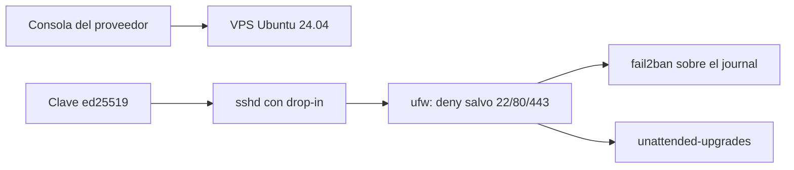
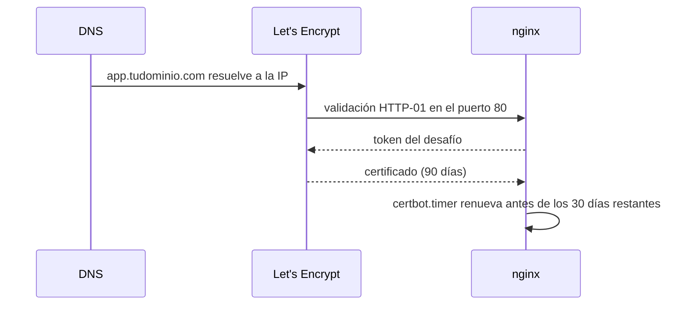
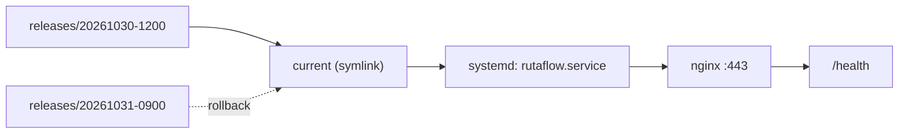
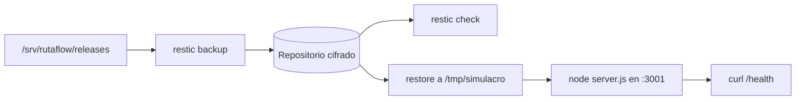

# Módulo 18: Servidor propio: VPS endurecido, TLS y recuperación

## Aprende construyendo

Cada Tema parte de una carpeta vacía y se verifica con comandos reales. El servidor de práctica es un VPS desechable con Ubuntu 24.04 LTS (o una VM local con red puente) en `203.0.113.10`, y el dominio de los Temas 2 a 4 es `app.tudominio.com`; sustituye ambos valores por los tuyos.

### Tema 1: Aprovisionar y endurecer: usuario, SSH, firewall y parches

#### Paso 1 · Objetivo y preparación

Al finalizar vas a dejar un Ubuntu 24.04 LTS donde solo se entra con clave ed25519, sin login de root, con firewall que niega todo salvo 22/80/443, `fail2ban` y parches automáticos, demostrado con `sshd -T` y `ufw status verbose`.

**Conocimiento previo:** Módulo 1 (usuarios, permisos, systemd) y Módulo 2 (Docker). Un VPS desechable con tu clave pública cargada y acceso a la consola web del proveedor, que usarás en el fallo deliberado.

```bash
mkdir -p academia-devops/src/modulo18/tema-1-endurecer
cd academia-devops/src/modulo18/tema-1-endurecer
```

Un contenedor no sirve: `ufw` necesita privilegios sobre netfilter y `sshd` bajo activación por socket se comporta distinto dentro de Docker. Usa una VM o un VPS.

#### Paso 2 · Contexto y caso real

**¿Por qué es importante?** Un VPS recién creado responde en el 22 con `root` y una contraseña o una clave que nunca rotaste, y los escaneos llegan en minutos. El caso concreto: el staging de una demo de RutaFlow quedó con `PermitRootLogin yes` y contraseña corta; tras miles de intentos en un día, alguien entró, dejó un minero y borró `/srv`, y el equipo lo supo cuando el proveedor suspendió la instancia por abuso de red.

El proyecto integrador se despliega en un servidor que debe sobrevivir a un escaneo automatizado sin intervención manual.

#### Paso 3 · Teoría, modelo mental y analogía

**Conceptos clave:** par de claves, drop-in de `sshd`, política por defecto de `ufw`, jail de `fail2ban`, ventana de `unattended-upgrades`.

SSH autentica demostrando posesión de una clave privada que nunca viaja; el servidor solo guarda la pública en `authorized_keys`. En Ubuntu 24.04, `sshd_config` empieza con `Include /etc/ssh/sshd_config.d/*.conf` y sshd aplica **el primer valor que lee**: un drop-in gana sobre el archivo principal aunque la línea esté más abajo. `sshd -t` valida sintaxis y `sshd -T` imprime la configuración efectiva, que es la que manda.

`ufw` es un frontend de netfilter: `default deny incoming` descarta paquetes (DROP, no REJECT), así que un puerto cerrado se manifiesta como **timeout**, no como "connection refused". `fail2ban` banea la IP tras N fallos leídos del journal. `unattended-upgrades` aplica parches de seguridad en una ventana diaria; un kernel nuevo exige reinicio, y sin reinicio el parche no está activo.

**Analogía:** el drop-in de sshd es la instrucción que el portero recibe al empezar el turno; si el manual general dice una cosa y la instrucción del turno dice otra, obedece la primera que leyó, no la que alguien añadió al final del manual.

**Diagrama:**



#### Paso 4 · Demostración guiada desde cero

Crea `tema-1.sh` en la carpeta vacía. Es un script completo que se ejecuta una sola vez como root:

```bash
cat > tema-1.sh <<'SCRIPT'
#!/usr/bin/env bash
set -euo pipefail
USUARIO=deploy

# 1. Usuario sin privilegios, con la misma clave que ya usas
id -u "$USUARIO" >/dev/null 2>&1 || adduser --disabled-password --gecos "" "$USUARIO"
usermod -aG sudo "$USUARIO"
[ -f /root/.ssh/authorized_keys ] || {
  echo "no existe /root/.ssh/authorized_keys: añade tu clave pública al usuario $USUARIO a mano"; exit 1; }
install -d -m 700 -o "$USUARIO" -g "$USUARIO" "/home/$USUARIO/.ssh"
install -m 600 -o "$USUARIO" -g "$USUARIO" /root/.ssh/authorized_keys "/home/$USUARIO/.ssh/authorized_keys"
echo "$USUARIO ALL=(ALL) NOPASSWD:ALL" > "/etc/sudoers.d/90-$USUARIO"
chmod 440 "/etc/sudoers.d/90-$USUARIO"
visudo -c

# 2. sshd: drop-in que gana sobre el archivo principal
cat > /etc/ssh/sshd_config.d/99-endurecer.conf <<'EOF'
PermitRootLogin no
PasswordAuthentication no
KbdInteractiveAuthentication no
PubkeyAuthentication yes
MaxAuthTries 3
EOF
sshd -t

# 3. Firewall: permitir primero, habilitar después
ufw default deny incoming
ufw default allow outgoing
ufw allow 22/tcp
ufw allow 80/tcp
ufw allow 443/tcp
ufw --dry-run enable
ufw --force enable

# 4. fail2ban y parches de seguridad
export DEBIAN_FRONTEND=noninteractive
apt-get update -qq
apt-get install -y -qq fail2ban unattended-upgrades
cat > /etc/fail2ban/jail.local <<'EOF'
[sshd]
enabled = true
backend = systemd
maxretry = 4
findtime = 10m
bantime = 1h
EOF
systemctl enable --now fail2ban
cat > /etc/apt/apt.conf.d/20auto-upgrades <<'EOF'
APT::Periodic::Update-Package-Lists "1";
APT::Periodic::Unattended-Upgrade "1";
EOF
systemctl restart unattended-upgrades
SCRIPT
scp tema-1.sh root@203.0.113.10:/root/tema-1.sh
ssh root@203.0.113.10 'bash /root/tema-1.sh'
```

**Explicación línea por línea:** `install -d -m 700` crea `.ssh` con los permisos que sshd exige (si otro puede escribir ahí, sshd ignora la clave sin avisar); `install -m 600 -o deploy` deja la clave del usuario, no de root; `visudo -c` comprueba el sudoers antes de que te quedes sin `sudo`; `ufw --dry-run enable` muestra las reglas sin tocar netfilter, y por eso va antes de habilitar; `backend = systemd` apunta fail2ban al journal.

Cierra la sesión de root, deja una terminal abierta y entra como `deploy` en una **segunda**:

```bash
ssh deploy@203.0.113.10 'sudo sshd -T | grep -E "^(permitrootlogin|passwordauthentication|maxauthtries) " | sort'
ssh deploy@203.0.113.10 'sudo ufw status verbose'
```

**Resultado esperado:** la política efectiva, no la declarada:

```
maxauthtries 3
passwordauthentication no
permitrootlogin no
Status: active
Logging: on (low)
Default: deny (incoming), allow (outgoing), disabled (routed)
New profiles: skip

To                         Action      From
--                         ------      ----
22/tcp                     ALLOW IN    Anywhere
80/tcp                     ALLOW IN    Anywhere
443/tcp                    ALLOW IN    Anywhere
```

`apt-config dump APT::Periodic::Unattended-Upgrade` imprime `APT::Periodic::Unattended-Upgrade "1";`, y `ss -H -tulpn` solo debe listar 22, 80 y 443.

**Fallo deliberado:** ejecuta `sudo ufw delete allow 22/tcp` y, desde otra terminal, `ssh deploy@203.0.113.10`. Obtienes `ssh: connect to host 203.0.113.10 port 22: Connection timed out`, no `Connection refused`: ufw descarta en silencio. La sesión ya abierta **sigue viva**, porque la regla `ESTABLISHED,RELATED` la acepta; por eso el bloqueo aparece al abrir otra conexión. Recuperación: entra por la consola web del proveedor (VNC o serie), ejecuta `sudo ufw allow 22/tcp` y confirma con `sudo ufw status numbered`. Prevención: `ufw --dry-run enable` antes de habilitar, una segunda sesión abierta y nunca `ufw reset` en remoto.

#### Paso 5 · Práctica guiada

Añade `PasswordAuthentication yes` al final de `/etc/ssh/sshd_config` y comprueba el valor con `sudo sshd -T | grep passwordauthentication`. **Pista:** sigue diciendo `passwordauthentication no`, porque el `Include` ya fijó el valor; para cambiarlo hay que editar el drop-in.

#### Paso 6 · Práctica independiente

Mueve SSH al 2222 sin quedarte fuera: crea `/etc/systemd/system/ssh.socket.d/10-puerto.conf` con `[Socket]`, `ListenStream=` (vacío, borra el 22) y `ListenStream=2222`; ejecuta `systemctl daemon-reload`, `systemctl restart ssh.socket`, `sudo ufw allow 2222/tcp`, verifica con `ss -H -tulpn 'sport = :2222'` y una sesión nueva, y solo entonces retira la regla del 22. Documenta por qué `Port 2222` en `sshd_config` no mueve el puerto: el que escucha es `ssh.socket`.

#### Paso 7 · Cierre

Ya tienes un servidor donde el acceso depende de una clave, el firewall niega por defecto y los parches se aplican solos, demostrado con la configuración efectiva. **Siguiente paso:** publicarlo con dominio y TLS, en el Tema 2.

**Errores comunes:** editar `sshd_config` sin comprobar el valor efectivo; habilitar ufw antes de permitir el 22; suponer que `systemctl restart ssh` aplica un cambio de puerto bajo socket activation; dejar `KbdInteractiveAuthentication yes`; instalar fail2ban sin `backend = systemd` y no ver ningún intento.

**Límites y decisión de uso:** sin servidor real no puedes verificar netfilter, los baneos ni la ventana de parches. Con el VPS, comprueba desde fuera con `nmap -Pn -p 22,80,443 203.0.113.10`, provoca cuatro fallos desde otra IP y mira `fail2ban-client status sshd`, y revisa `systemctl list-timers 'apt-daily*'`. Si nadie mantiene parches ni tiene consola del proveedor, un VPS propio es peor decisión que un servicio gestionado.

**Fuente oficial:** [Ubuntu Server — OpenSSH](https://documentation.ubuntu.com/server/how-to/security/openssh-server/) y [OpenSSH — sshd_config(5)](https://man.openbsd.org/sshd_config).

### Tema 2: Dominio, TLS y borde: DNS, Let's Encrypt y Cloudflare

#### Paso 1 · Objetivo y preparación

Al finalizar vas a servir `app.tudominio.com` por HTTPS con certificado de Let's Encrypt, redirección permanente desde HTTP, HSTS y renovación automática comprobada con `openssl` y `certbot renew --dry-run`.

**Conocimiento previo:** Tema 1, un dominio que controles y acceso a su zona DNS. Cloudflare es opcional, pero este Tema lo usa para explicar el borde. Let's Encrypt no emite certificados para IPs ni para dominios de ejemplo: sin dominio, este Tema no se puede completar.

```bash
mkdir -p academia-devops/src/modulo18/tema-2-tls
cd academia-devops/src/modulo18/tema-2-tls
```

#### Paso 2 · Contexto y caso real

**¿Por qué es importante?** Sin certificado, el navegador advierte que el sitio no es de fiar y los formularios viajan en claro. El fallo frecuente no es emitirlo, es **mantenerlo vivo**: se emitió bien y venció noventa días después porque la validación de renovación dejó de funcionar y nadie miraba el registro. En RutaFlow, el panel de seguimiento quedó inaccesible un lunes porque el puerto 80 se cerró "porque ya todo era HTTPS" y la renovación llevaba semanas fallando.

El proyecto integrador se sirve por HTTPS; un certificado vencido deja el panel inaccesible aunque el código esté correcto.

#### Paso 3 · Teoría, modelo mental y analogía

**Conceptos clave:** registro A, validación HTTP-01, cadena de confianza, renovación por temporizador, modo proxy de Cloudflare.

Un registro **A** asocia el nombre con la IP, y sin él la validación HTTP-01 no llega a tu nginx. Let's Encrypt emite certificados de 90 días y certbot instala un `certbot.timer` que renueva cuando queda menos de un tercio de vida; la renovación repite la misma validación, así que **si el 80 deja de ser alcanzable, falla en silencio** hasta que el certificado vence. En Cloudflare, el icono gris es "solo DNS" (el tráfico va a tu IP) y el naranja es "proxied" (pasa por el borde de Cloudflare). El modo `Flexible` hace que Cloudflare hable HTTP con tu origen y HTTPS con el usuario: si además nginx redirige a HTTPS, la petición vuelve a entrar por HTTP y se produce un bucle.

**Analogía:** el certificado es una credencial con caducidad; renovar es volver a pasar el control de identidad, y si cierras la puerta por la que entra el inspector, no hay credencial nueva por bien guardada que esté la vieja.

**Diagrama:**



#### Paso 4 · Demostración guiada desde cero

Crea `tema-2.sh` en la carpeta vacía y ajusta dominio y correo antes de ejecutarlo:

```bash
cat > tema-2.sh <<'SCRIPT'
#!/usr/bin/env bash
set -euo pipefail
DOMINIO=app.tudominio.com
IP=203.0.113.10
CORREO=ops@tudominio.com

dig +short A "$DOMINIO"
[ "$(dig +short A "$DOMINIO" | tail -1)" = "$IP" ] || { echo "el registro A no apunta a $IP"; exit 1; }

export DEBIAN_FRONTEND=noninteractive
apt-get update -qq
apt-get install -y -qq nginx dnsutils certbot python3-certbot-nginx

install -d -m 755 /var/www/rutaflow
cat > /var/www/rutaflow/index.html <<'EOF'
<!doctype html><html lang="es"><title>RutaFlow</title><h1>RutaFlow en produccion</h1></html>
EOF
cat > /etc/nginx/sites-available/rutaflow <<'EOF'
server {
    listen 80;
    listen [::]:80;
    server_name app.tudominio.com;
    root /var/www/rutaflow;
    index index.html;
}
EOF
ln -sfn /etc/nginx/sites-available/rutaflow /etc/nginx/sites-enabled/rutaflow
rm -f /etc/nginx/sites-enabled/default
nginx -t
systemctl reload nginx

certbot --nginx -d "$DOMINIO" --redirect --agree-tos -m "$CORREO" --non-interactive
SCRIPT
scp tema-2.sh root@203.0.113.10:/root/tema-2.sh
ssh root@203.0.113.10 'bash /root/tema-2.sh'
```

**Explicación línea por línea:** la comprobación con `dig` evita pedir un certificado para un nombre que aún no resuelve, el error de validación más común; `nginx -t` valida sintaxis antes de recargar; `--nginx` usa el plugin como autenticador e instalador y `--redirect` añade el 301 permanente. Después, añade dentro del bloque con `listen 443 ssl` que generó certbot: `add_header Strict-Transport-Security "max-age=31536000; includeSubDomains" always;`, y recarga con `nginx -t && systemctl reload nginx`.

Verifica desde tu máquina, no desde el servidor:

```bash
curl -sI http://app.tudominio.com | head -1
curl -sI https://app.tudominio.com | grep -iE '^(HTTP|strict-transport-security)'
echo | openssl s_client -connect app.tudominio.com:443 -servername app.tudominio.com 2>/dev/null | openssl x509 -noout -dates
systemctl list-timers | grep certbot
certbot renew --dry-run
```

**Resultado esperado:** redirección, HSTS y fechas reales del certificado en vigor:

```
HTTP/1.1 301 Moved Permanently
HTTP/1.1 200 OK
Strict-Transport-Security: max-age=31536000; includeSubDomains
notBefore=Oct 30 12:04:11 2026 GMT
notAfter=Jan 28 12:04:10 2027 GMT
```

`systemctl list-timers` muestra `certbot.timer` con su próximo disparo y la prueba termina con `Congratulations, all simulated renewals succeeded:`.

**Fallo deliberado:** cierra el 80 con `sudo ufw delete allow 80/tcp` y ejecuta `sudo certbot renew --dry-run`. certbot informa `Certbot failed to authenticate some domains (authenticator: nginx). The Certificate Authority reported these problems:` con `Detail: 203.0.113.10: Fetching http://app.tudominio.com/.well-known/acme-challenge/...: Timeout during connect (likely firewall problem)`. Ese es el aviso que nadie lee: el temporizador sigue `active`, la renovación real lleva fallando desde ese día y, noventa días después, `curl -sI https://app.tudominio.com` devuelve `curl: (60) SSL certificate problem: certificate has expired` y el navegador `NET::ERR_CERT_DATE_INVALID`. Recuperación: `sudo ufw allow 80/tcp`, `sudo certbot renew --force-renewal`, `sudo systemctl reload nginx` y repetir la comprobación de fechas. Prevención: el 80 queda abierto siempre porque HTTP-01 lo necesita, una comprobación diaria que falle con menos de 21 días y `certbot renew --dry-run` mensual; `--force-renewal` consume el límite de duplicados, úsalo una vez.

#### Paso 5 · Práctica guiada

Con el dominio detrás de Cloudflare en proxied, compara el certificado del borde con el del origen:

```bash
curl -sI https://app.tudominio.com | grep -i cf-ray
curl -sI --resolve app.tudominio.com:443:203.0.113.10 https://app.tudominio.com | head -1
```

**Pista:** `cf-ray` aparece solo si el tráfico pasa por Cloudflare; `--resolve` fuerza la conexión directa a tu IP sin tocar el DNS y es la única forma de ver qué certificado sirve realmente tu nginx.

#### Paso 6 · Práctica independiente

Pasa el registro a naranja, pon el modo en `Full (strict)` y confirma que el sitio sigue en 200 y que el origen conserva su certificado. Luego cambia a `Flexible` a propósito: el navegador muestra `ERR_TOO_MANY_REDIRECTS` y `curl -sIL https://app.tudominio.com` termina en `curl: (47) Maximum (50) redirects followed`. Explica el bucle (Cloudflare habla HTTP con el origen, nginx responde 301 a HTTPS, Cloudflare vuelve a pedir por HTTP) y vuelve a `Full (strict)`.

#### Paso 7 · Cierre

Ya emites, sirves y renuevas TLS con un dominio real, y distingues "el temporizador existe" de "la renovación funciona". **Siguiente paso:** desplegar la aplicación detrás de ese nginx, en el Tema 3.

**Errores comunes:** cerrar el 80 tras emitir el certificado; confundir el certificado del borde con el del origen; dejar `Flexible` y culpar a nginx del bucle; usar `--force-renewal` en cada prueba y agotar el límite semanal; añadir `includeSubDomains` sin controlar todos los subdominios.

**Límites y decisión de uso:** sin dominio ni DNS no hay emisión ni renovación que verificar; en local solo puedes validar la sintaxis de nginx. Con el dominio, revisa `dig`, `curl --resolve`, `openssl s_client` y `/var/log/letsencrypt/letsencrypt.log`. Si el sitio es interno, un certificado privado o TLS terminado en un balanceador gestionado evita depender de la validación pública.

**Fuente oficial:** [Certbot — instrucciones por sistema](https://certbot.eff.org/instructions) y [Let's Encrypt — tipos de desafío](https://letsencrypt.org/docs/challenge-types/).

### Tema 3: Despliegue y rollback: systemd, nginx y artefactos versionados

#### Paso 1 · Objetivo y preparación

Al finalizar vas a publicar releases versionados en `/srv/rutaflow/releases`, apuntar `current` al que está en servicio con un cambio atómico de symlink, ejecutar la app como servicio systemd que se reinicia si falla, servirla con nginx en `127.0.0.1:3000` y volver a la release anterior en segundos.

**Conocimiento previo:** Temas 1 y 2, con `app.tudominio.com` resolviendo y con certificado. Node.js 18 o superior en el servidor.

```bash
mkdir -p academia-devops/src/modulo18/tema-3-despliegue/app
cd academia-devops/src/modulo18/tema-3-despliegue
```

#### Paso 2 · Contexto y caso real

**¿Por qué es importante?** Copiar por SSH sobre la carpeta en uso hace que el proceso lea una mezcla de versiones, y si el cambio rompe algo no hay a qué volver. RutaFlow pasó de arrastrar archivos con `scp` a releases inmutables con symlink: el rollback dejó de ser una hora de reconstrucción y pasó a ser un comando.

El proyecto integrador necesita volver a la versión anterior en minutos, no en una tarde de reconstrucción.

#### Paso 3 · Teoría, modelo mental y analogía

**Conceptos clave:** release inmutable, symlink `current`, unidad systemd, proxy inverso, rollback por symlink.

Cada despliegue crea una carpeta con fecha y hora que nunca se modifica; `current` es un symlink a la activa, y cambiarlo con `ln -sfn` y `mv -Tf` es atómico. systemd arranca con `WorkingDirectory=/srv/rutaflow/current`, así que el rollback es cambiar el symlink y reiniciar. nginx escucha en 443 y reenvía a `127.0.0.1:3000`, accesible solo desde la máquina. `Restart=on-failure` reinicia si el proceso falla, pero no arregla una configuración inválida: systemd se rinde con `start request repeated too quickly`.

**Analogía:** las releases son películas en estanterías separadas y `current` es la etiqueta del atril; cambiar la etiqueta no copia la película, y si la nueva no se proyecta, vuelves a poner la anterior sin tocar ninguna cinta.

**Diagrama:**



#### Paso 4 · Demostración guiada desde cero

Crea la aplicación mínima con versión legible:

```bash
cat > app/server.js <<'EOF'
const http = require('node:http');
const fs = require('node:fs');
const path = require('node:path');
const version = fs.readFileSync(path.join(__dirname, 'VERSION'), 'utf8').trim();

http.createServer((req, res) => {
  if (req.url === '/health') {
    res.writeHead(200, { 'content-type': 'application/json' });
    res.end(JSON.stringify({ status: 'ok', version }));
    return;
  }
  res.writeHead(404);
  res.end();
}).listen(Number(process.env.PORT || 3000), '127.0.0.1',
  () => console.log(`rutaflow ${version} escuchando en 127.0.0.1:${process.env.PORT || 3000}`));
EOF
echo v1 > app/VERSION
scp -r app root@203.0.113.10:/root/
```

En el servidor, crea usuario, unidad y proxy:

```bash
cat > tema-3-servidor.sh <<'SCRIPT'
#!/usr/bin/env bash
set -euo pipefail
id -u rutaflow >/dev/null 2>&1 || useradd --system --home-dir /srv/rutaflow --shell /usr/sbin/nologin rutaflow
install -d -o rutaflow -g rutaflow -m 755 /srv/rutaflow /srv/rutaflow/releases
RELEASE="/srv/rutaflow/releases/$(date +%Y%m%d-%H%M%S)"
install -d -o rutaflow -g rutaflow -m 755 "$RELEASE"
install -o rutaflow -g rutaflow -m 644 /root/app/server.js /root/app/VERSION "$RELEASE"/
ln -sfn "$RELEASE" /srv/rutaflow/current

cat > /etc/systemd/system/rutaflow.service <<'EOF'
[Unit]
Description=RutaFlow (servidor propio)
After=network.target

[Service]
Type=simple
User=rutaflow
Group=rutaflow
WorkingDirectory=/srv/rutaflow/current
Environment=PORT=3000
ExecStart=/usr/bin/node server.js
Restart=on-failure
RestartSec=2
NoNewPrivileges=true
PrivateTmp=true

[Install]
WantedBy=multi-user.target
EOF

cat > /etc/nginx/sites-available/rutaflow <<'EOF'
server {
    listen 80;
    listen [::]:80;
    server_name app.tudominio.com;

    location / {
        proxy_pass http://127.0.0.1:3000;
        proxy_set_header Host $host;
        proxy_set_header X-Forwarded-For $proxy_add_x_forwarded_for;
        proxy_set_header X-Forwarded-Proto $scheme;
    }
}
EOF

nginx -t
systemctl daemon-reload
systemd-analyze verify /etc/systemd/system/rutaflow.service
systemctl enable --now rutaflow
systemctl reload nginx
certbot --nginx -d app.tudominio.com --redirect --reinstall --non-interactive
SCRIPT
scp tema-3-servidor.sh root@203.0.113.10:/root/tema-3-servidor.sh
ssh root@203.0.113.10 'bash /root/tema-3-servidor.sh'
```

**Explicación línea por línea:** `install -d -o rutaflow` crea las carpetas con el dueño correcto, que es la causa del fallo de este Tema; `ln -sfn` solo borra y recrea el enlace, dejando una ventana en la que no existe, y por eso se combina con `mv -Tf`; `WorkingDirectory` apunta al symlink, así que el rollback no toca la unidad; `certbot --reinstall` reaplica TLS sobre el bloque recién reemplazado.

Guarda el despliegue con healthcheck y rollback automático:

```bash
cat > /usr/local/bin/desplegar-rutaflow <<'SCRIPT'
#!/usr/bin/env bash
set -euo pipefail
ORIGEN=${1:?uso: desplegar-rutaflow <carpeta-del-release>}
RELEASE="/srv/rutaflow/releases/$(date +%Y%m%d-%H%M%S)"
ANTERIOR=$(readlink -f /srv/rutaflow/current)

install -d -o rutaflow -g rutaflow -m 755 "$RELEASE"
install -o rutaflow -g rutaflow -m 644 "$ORIGEN/server.js" "$ORIGEN/VERSION" "$RELEASE"/
ln -sfn "$RELEASE" /srv/rutaflow/current.nuevo
mv -Tf /srv/rutaflow/current.nuevo /srv/rutaflow/current
systemctl restart rutaflow

for intento in 1 2 3 4 5; do
  if curl --fail --silent --max-time 2 http://127.0.0.1:3000/health >/dev/null; then
    echo "desplegado $RELEASE"
    exit 0
  fi
  sleep 1
done

echo "healthcheck fallo; revirtiendo a $ANTERIOR"
ln -sfn "$ANTERIOR" /srv/rutaflow/current.nuevo
mv -Tf /srv/rutaflow/current.nuevo /srv/rutaflow/current
systemctl restart rutaflow
exit 1
SCRIPT
chmod 755 /usr/local/bin/desplegar-rutaflow
```

Despliega una segunda versión y comprueba qué sirve:

```bash
sed -i 's/^v1$/v2/' app/VERSION
scp -r app root@203.0.113.10:/root/
ssh root@203.0.113.10 'desplegar-rutaflow /root/app && curl -s http://127.0.0.1:3000/health'
```

**Resultado esperado:** el servicio activo y la versión nueva respondiendo con el proxy delante:

```
desplegado /srv/rutaflow/releases/20261030-130512
active
{"status":"ok","version":"v2"}
```

`journalctl -u rutaflow -n 5 --no-pager` muestra `rutaflow v2 escuchando en 127.0.0.1:3000`, y `curl -sI https://app.tudominio.com | head -1` responde `HTTP/1.1 200 OK`.

**Fallo deliberado:** publica una release con el dueño equivocado, como haría un script que copia como root:

```bash
echo v3 > app/VERSION
scp app/VERSION root@203.0.113.10:/root/app/VERSION
R=/srv/rutaflow/releases/20261030-140030
install -d -o root -g root -m 750 "$R"
install -o root -g root -m 640 /root/app/server.js /root/app/VERSION "$R"/
ln -sfn "$R" /srv/rutaflow/current.nuevo && mv -Tf /srv/rutaflow/current.nuevo /srv/rutaflow/current
systemctl restart rutaflow
journalctl -u rutaflow -n 8 --no-pager
```

El journal lo dice sin ambigüedad: `rutaflow.service: Changing to the requested working directory failed: Permission denied`, `Failed at step CHDIR spawning /usr/bin/node: Permission denied`, `Main process exited, code=exited, status=200/CHDIR` y `Failed with result 'exit-code'.` El 200 es `EXIT_CHDIR`, no un fallo de Node. Diagnóstico: `sudo -u rutaflow ls /srv/rutaflow/current` devuelve `Permission denied` y `namei -l /srv/rutaflow/current` muestra `drwxr-x--- root root`. Recuperación: apunta el symlink a la release anterior o, si la release es correcta, `sudo chown -R rutaflow:rutaflow "$R" && sudo systemctl restart rutaflow`. Prevención: que el único camino de despliegue sea el script, que hace `chown`; `systemd-analyze verify` valida sintaxis, no permisos.

#### Paso 5 · Práctica guiada

Vuelve a la última release que funcionaba:

```bash
sudo ln -sfn "$(readlink -f /srv/rutaflow/releases/20261030-130512)" /srv/rutaflow/current.nuevo
sudo mv -Tf /srv/rutaflow/current.nuevo /srv/rutaflow/current
sudo systemctl restart rutaflow
curl -s http://127.0.0.1:3000/health
```

**Pista:** el health vuelve a `{"status":"ok","version":"v2"}` y el journal muestra `rutaflow v2 escuchando...`, aunque la release apuntada antes del rollback era `v3`; si tarda, mira `journalctl -u rutaflow --since "2 min ago"` antes de tocar el symlink otra vez.

#### Paso 6 · Práctica independiente

Añade al script un paso que rechace el despliegue si `/root/app/VERSION` está vacío, y un `ExecStartPre=/usr/bin/test -r /srv/rutaflow/current/VERSION` en la unidad. Verifica con `systemd-analyze verify` provocando el caso vacío. Documenta por qué `Restart=on-failure` no evita este fallo: reinicia, el permiso sigue mal y termina en `start request repeated too quickly`.

#### Paso 7 · Cierre

Ya despliegas artefactos versionados, sirves por proxy y vuelves atrás cambiando un symlink, con el journal como fuente de verdad. **Siguiente paso:** que ese servidor sobreviva a la pérdida de datos, en el Tema 4.

**Errores comunes:** copiar sobre la carpeta en uso; desplegar como root y arrancar como `rutaflow`; usar `ln -sfn` sin `mv -Tf`; exponer Node en `0.0.0.0:3000`; confiar en `Restart=on-failure` como sustituto de un healthcheck.

**Límites y decisión de uso:** sin servidor no puedes verificar el arranque bajo systemd ni el proxy; `systemd-analyze verify` y `nginx -t` solo validan forma. Con la máquina, revisa `systemctl is-active`, `journalctl -u`, `ss -H -tulpn 'sport = :3000'` y el health por el proxy. Para un equipo pequeño basta; con despliegues simultáneos o varios servidores, mantenerlo a mano cuesta más que una plataforma orquestada.

**Fuente oficial:** [systemd.service](https://www.freedesktop.org/software/systemd/man/latest/systemd.service.html) y [nginx — ngx_http_proxy_module](https://nginx.org/en/docs/http/ngx_http_proxy_module.html).

### Tema 4: Respaldos que se restauran: restic, RPO/RTO y simulacro

#### Paso 1 · Objetivo y preparación

Al finalizar vas a crear un repositorio restic cifrado, respaldar releases y configuración, verificar la integridad, restaurar en una carpeta limpia y medir la recuperación. El criterio no es que el respaldo diga `saved`, sino que el servicio arranque desde lo restaurado.

**Conocimiento previo:** Temas 1 a 3, con `/srv/rutaflow/releases` desplegado. Define antes un RPO de 24 horas (puedes perder un día de cambios) y un RTO de 30 minutos (debes volver a servir en media hora).

```bash
mkdir -p academia-devops/src/modulo18/tema-4-restic
cd academia-devops/src/modulo18/tema-4-restic
```

#### Paso 2 · Contexto y caso real

**¿Por qué es importante?** Un respaldo que nunca se restauró es una hipótesis, no una copia. En RutaFlow, `restic snapshots` mostró un snapshot diario durante meses; el día de la recuperación contenía solo el enlace `current`, sin los archivos, porque se había respaldado el symlink. El RPO y el RTO reales se descubrieron ese día, y eran "lo que tardes en reconstruirlo a mano".

El proyecto integrador declara RPO y RTO; este tema es la única forma de saber si son reales.

#### Paso 3 · Teoría, modelo mental y analogía

**Conceptos clave:** repositorio cifrado, snapshot, `check`, `restore`, retención, RPO/RTO.

restic cifra en el cliente antes de escribir: sin la contraseña no hay datos, y perderla equivale a perder el respaldo. Cada ejecución crea un snapshot deduplicado; `restic check` verifica índices, árboles y packs, y `--read-data` verifica además el contenido. **RPO** es cuántos datos puedes perder y lo fija la frecuencia del respaldo; **RTO** es cuánto tardas en volver a servir y solo se conoce midiendo una restauración real. La retención (`forget --keep-daily/--keep-weekly/--keep-monthly`) decide hasta dónde puedes volver atrás, y una copia en otro backend (`restic copy`) es la única que sobrevive a perder la máquina entera.

**Analogía:** un respaldo sin restauración ensayada es un extintor que nunca se descargó: parece cubrir el riesgo, pero nadie sabe si funciona hasta el incendio, y ese día no hay tiempo para averiguarlo.

**Diagrama:**



#### Paso 4 · Demostración guiada desde cero

Crea `tema-4.sh` en la carpeta vacía con este contenido completo:

```bash
cat > tema-4.sh <<'SCRIPT'
#!/usr/bin/env bash
set -euo pipefail
export RESTIC_REPOSITORY=/srv/backups/restic-repo
export RESTIC_PASSWORD_FILE=/etc/restic/password

install -d -m 700 /etc/restic
[ -f "$RESTIC_PASSWORD_FILE" ] || openssl rand -base64 32 > "$RESTIC_PASSWORD_FILE"
chmod 600 "$RESTIC_PASSWORD_FILE"
[ -d "$RESTIC_REPOSITORY" ] || restic init

restic backup --tag nightly \
  /srv/rutaflow/releases \
  /etc/nginx/sites-available/rutaflow \
  /etc/systemd/system/rutaflow.service
restic check
restic snapshots
SCRIPT
scp tema-4.sh root@203.0.113.10:/root/tema-4.sh
ssh root@203.0.113.10 'bash /root/tema-4.sh'
```

**Explicación línea por línea:** `RESTIC_PASSWORD_FILE` evita la contraseña en el historial; `restic init` solo corre si el repositorio no existe; se respaldan rutas absolutas reales, nunca el symlink; `check` no lee los packs salvo con `--read-data`, así que conviene alternarlo.

El RPO de 24 horas lo sostiene el temporizador `restic-rutaflow.timer` (`OnCalendar=*-*-* 03:00:00`, `Persistent=true`); sus dos unidades completas están en el laboratorio. Ahora el simulacro: restaura en una carpeta limpia, arranca lo restaurado y mide.

```bash
rm -rf /tmp/simulacro && install -d -m 755 /tmp/simulacro
time restic restore latest --target /tmp/simulacro
RELEASE=$(ls -d /tmp/simulacro/srv/rutaflow/releases/* | tail -1)
sudo -u rutaflow env PORT=3001 node "$RELEASE/server.js" &
sleep 1
curl --fail --silent http://127.0.0.1:3001/health
kill %1
sudo grep -ra 'RutaFlow (servidor propio)' /srv/backups/restic-repo || echo "sin coincidencias en claro: repositorio cifrado"
```

**Resultado esperado:** el repositorio abre, guarda el snapshot y la verificación pasa:

```
repository 5b1e9a3c opened (version 2, compression level auto)
snapshot 9a1c4e7d saved
check all packs
check snapshots, trees and blobs
no errors were found
{"status":"ok","version":"v2"}
```

El `node` restaurado arranca en el 3001 para no chocar con el servicio vivo, y ese `curl` prueba que el artefacto es ejecutable, no solo que los bytes existen; `grep -ra` no encuentra el texto de la unidad porque el repositorio está cifrado. El `time` es tu RTO medido: si supera los 30 minutos declarados, el documento es ficción y hay que corregir RPO o RTO.

**Fallo deliberado:** respalda el symlink y simula la pérdida del disco:

```bash
RESTIC_REPOSITORY=/srv/backups/restic-repo RESTIC_PASSWORD_FILE=/etc/restic/password \
  restic backup --tag release /srv/rutaflow/current
sudo mv /srv/rutaflow /srv/rutaflow.perdido
rm -rf /tmp/simulacro && install -d -m 755 /tmp/simulacro
RESTIC_REPOSITORY=/srv/backups/restic-repo RESTIC_PASSWORD_FILE=/etc/restic/password \
  restic restore latest --target /tmp/simulacro
ls -l /tmp/simulacro/srv/rutaflow/
ls /tmp/simulacro/srv/rutaflow/current/
```

El respaldo terminó con `snapshot ... saved` y `restic check` dijo `no errors were found`, pero la última orden responde `ls: cannot access '/tmp/simulacro/srv/rutaflow/current/': No such file or directory`, y `ls -l` muestra `current -> /srv/rutaflow/releases/20261030-130512`: un enlace roto. restic archiva los symlinks **como symlinks** y no sigue su destino, así que la copia era correcta y aun así no recuperaba nada. Recuperación: remonta el árbol (`sudo mv /srv/rutaflow.perdido /srv/rutaflow`), respalda el contenido real (`/srv/rutaflow/releases`) y comprueba con `restic ls latest` que el snapshot contiene archivos, no un enlace. Prevención: el criterio no es que el respaldo termine bien, sino que el simulacro arranque el servicio; un `check` verde no detecta un alcance equivocado.

#### Paso 5 · Práctica guiada

Comprueba que una corrupción se detecta: guarda aparte un archivo de `/srv/backups/restic-repo/index/` y escribe basura encima (`echo boom | sudo tee <archivo>`), luego ejecuta `sudo restic check`. **Pista:** verás `error loading index ...: LoadRaw(<index/...>): invalid data returned` y la línea `Fatal: repository contains errors`; se repara con `sudo restic repair index` y se repite `check`. Guarda la salida: es la prueba de que el monitoreo de integridad sirve.

#### Paso 6 · Práctica independiente

Copia el repositorio a otro medio con `restic copy --from-repo /srv/backups/restic-repo --repo /mnt/offsite/restic-repo` y ejecuta allí `restic check --read-data`. Escribe el runbook con los pasos exactos, el RTO medido y quién tiene la contraseña; ensaya el simulacro sin mirar este Tema.

#### Paso 7 · Cierre

Ya tienes respaldos cifrados, verificados, con retención y un simulacro que arranca el servicio y mide el tiempo. **Siguiente paso:** el laboratorio integra los cuatro Temas sobre un único servidor.

**Errores comunes:** respaldar el symlink y no el contenido; guardar la contraseña solo en el servidor que puede perderse; no probar nunca la restauración; confundir deduplicación con copias independientes; retener un único snapshot y quedarse sin histórico.

**Límites y decisión de uso:** sin servidor real no puedes medir RTO ni verificar la restauración del servicio; `check` y el simulacro se ejecutan contra el repositorio real. Si el respaldo vive en el mismo disco que la aplicación, no protege del fallo más probable. Para datos de negocio necesitas consistencia transaccional, que restic no aporta por sí solo.

**Fuente oficial:** [restic — Restoring from backup](https://restic.readthedocs.io/en/stable/050_restore.html) y [restic — Checking integrity and consistency](https://restic.readthedocs.io/en/stable/045_working_with_repos.html).

---

## Laboratorio práctico

**Objetivo del laboratorio:** llevar un VPS desechable desde el acceso por contraseña hasta un servicio con TLS, despliegue versionado, rollback probado y un simulacro de restauración con RPO/RTO medidos.

**Requisitos previos:** VPS Ubuntu 24.04 LTS (o VM con red puente), un dominio con zona DNS editable y los Temas 1 a 4 completados.

| Paso | Acción | Comando | Explicación | Resultado esperado |
|---|---|---|---|---|
| 1 | Endurecer acceso | Ver Tema 1 | Usuario sin root, clave ed25519, ufw y fail2ban | `passwordauthentication no` y `Status: active` |
| 2 | Publicar con TLS | Ver Tema 2 | Registro A, certbot y HSTS | `notAfter` futuro y `certbot.timer` activo |
| 3 | Desplegar y revertir | Ver Tema 3 | Release nueva, healthcheck y symlink anterior | `v3` intentada y `v2` tras el rollback |
| 4 | Respaldar y verificar | Ver Tema 4 y la programación de abajo | `restic backup` + `check` + temporizador | `no errors were found` y temporizador activo |
| 5 | Simulacro cronometrado | Ver Tema 4 | Restaurar en carpeta limpia y arrancar ahí | Servicio respondiendo y RTO medido |

**Programación del respaldo (el RPO de 24 horas):** el servicio ejecuta el respaldo y la retención, y el temporizador lo dispara cada noche a las 03:00:

```bash
cat > /etc/systemd/system/restic-rutaflow.service <<'EOF'
[Unit]
Description=Respaldo cifrado de RutaFlow
[Service]
Type=oneshot
Environment=RESTIC_REPOSITORY=/srv/backups/restic-repo
Environment=RESTIC_PASSWORD_FILE=/etc/restic/password
ExecStart=/usr/bin/restic backup --tag nightly /srv/rutaflow/releases /etc/nginx/sites-available/rutaflow /etc/systemd/system/rutaflow.service
ExecStartPost=/usr/bin/restic forget --keep-daily 7 --keep-weekly 4 --keep-monthly 6 --prune
EOF
cat > /etc/systemd/system/restic-rutaflow.timer <<'EOF'
[Unit]
Description=Respaldo diario de RutaFlow
[Timer]
OnCalendar=*-*-* 03:00:00
Persistent=true
[Install]
WantedBy=timers.target
EOF
systemctl daemon-reload
systemctl enable --now restic-rutaflow.timer
systemctl list-timers restic-rutaflow.timer
```

**Verificación:** el laboratorio se considera exitoso si el servicio responde por HTTPS, si el rollback devuelve la versión anterior en menos de un minuto, y si la restauración en una carpeta limpia arranca la aplicación y responde `{"status":"ok","version":"..."}` con un tiempo medido inferior al RTO que declaraste.

**Qué no se puede verificar sin el servidor:** los comandos de este módulo se validaron por sintaxis con `bash -n`, pero el comportamiento depende de la máquina. La activación por socket de `ssh.socket`, el descarte real de paquetes de netfilter, la emisión y renovación de certificados, el arranque bajo systemd y el tiempo de restauración solo existen en un servidor. Con el servidor delante, la secuencia de comprobación es siempre la misma: `sshd -T`, `ufw status verbose`, `openssl x509 -noout -dates`, `systemctl is-active rutaflow`, `journalctl -u rutaflow` y un simulacro de restauración cronometrado.

**Errores comunes y soluciones**

- **El firewall deja fuera la sesión SSH.** Usa `ufw --dry-run enable` y mantén una segunda sesión y la consola del proveedor abiertas.
- **La renovación falla porque el 80 está cerrado.** Deja el 80 abierto y alerta cuando queden menos de 21 días de certificado.
- **El servicio no arranca tras desplegar.** Revisa dueño y permisos con `namei -l`; el journal muestra `status=200/CHDIR`.
- **El respaldo no restaura.** Respalda rutas reales, no symlinks, y valida con un simulacro, no con la salida del respaldo.
