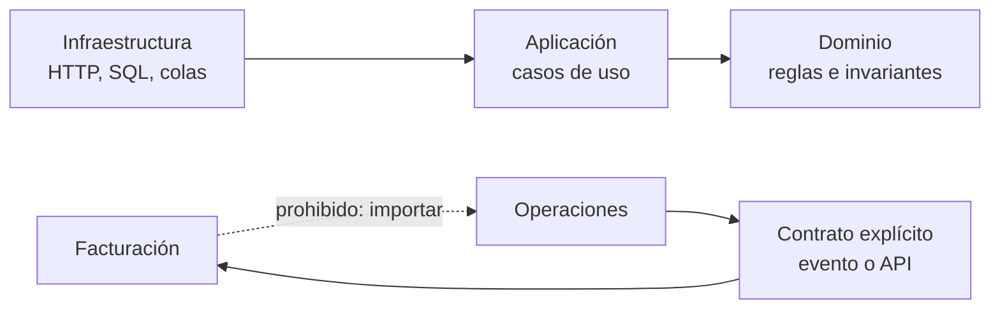
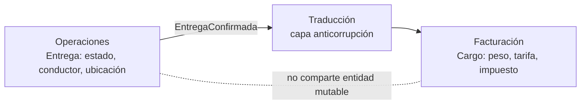
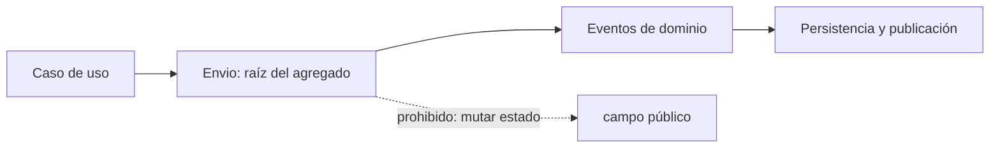
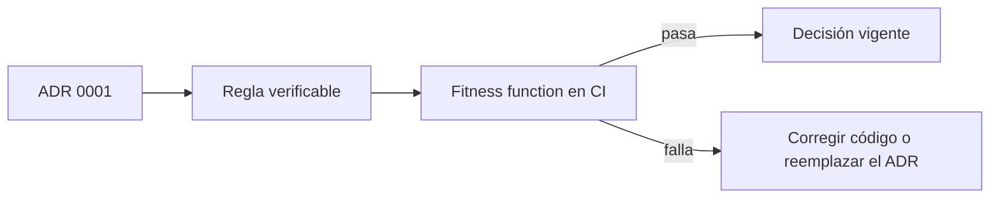

# Módulo 19: Arquitectura moderna y DDD: límites que sobreviven al cambio

## Aprende construyendo

Este módulo no empieza con la pregunta «¿microservicios o monolito?», sino con una anterior: **¿dónde termina una parte del sistema y empieza otra?** Esa frontera se decide con lenguaje, reglas de negocio y coste de cambio, no con el número de repositorios. Vas a modelar RutaFlow como un monolito modular, separar dos contextos que usan la misma palabra para cosas distintas, proteger una invariante dentro de un agregado y registrar la decisión en un ADR que una prueba automática puede defender.

Cada tema parte de una carpeta vacía, crea archivos ejecutables y se comprueba con `node --test` o un script de verificación. No necesitas Docker para este módulo; el laboratorio con Floci llega en el Módulo 22. **Conocimiento previo:** Módulos 0 a 3 (Linux, Git, Docker y Compose), programación con funciones y objetos, y haber leído el modelo de envíos del proyecto RutaFlow. Si vienes de Java, el Módulo 22 de Spring Boot amplía estos mismos conceptos con puertos y C4; aquí el foco está en la decisión y en la evidencia, no en el framework.

### Tema 1: Límites, acoplamiento y monolito modular: cuándo un microservicio no es la respuesta

**¿Por qué es importante?** Porque la mayoría de los equipos que fracasa con microservicios no falla por Kubernetes: falla porque convirtió un sistema con fronteras borrosas en una red de servicios con las mismas fronteras borrosas, y ahora cada cambio exige coordinar despliegues, versiones y caídas ajenas. Un monolito modular bien delimitado conserva transacciones locales, depuración sencilla y un solo despliegue, y permite extraer un servicio más adelante si una frontera demuestra que lo necesita.

**Analogía:** un edificio con tabiques de carga y uno con oficinas diáfanas. El primero puede remodelar una habitación sin tocar la estructura; el segundo obliga a mover cables y paredes cada vez que cambia un equipo. La pregunta no es cuántas oficinas hay, sino qué tabiques soportan el peso.

**Conceptos clave:** acoplamiento, cohesión, límite de contexto, monolito modular, monolito distribuido, dependencia permitida y prueba de arquitectura.

Un **límite** es una regla sobre quién puede depender de quién. En una aplicación Node típica, el dominio contiene las reglas del negocio; la aplicación coordina casos de uso; la infraestructura habla con HTTP, bases de datos o colas. La dirección permitida es `infraestructura → aplicación → dominio`, nunca al revés. Cuando el dominio importa un cliente de base de datos, deja de poder probarse sin esa base y las reglas del negocio se mezclan con detalles de despliegue.

Un **monolito modular** mantiene un solo proceso y una sola base de datos, pero organiza el código en módulos con interfaces explícitas y prohíbe las dependencias cruzadas. No es «carpetas bonitas»: es una restricción verificable. Un **monolito distribuido** es lo peor de ambos mundos: varios servicios desplegados por separado que comparten base de datos o se llaman en cadena para completar una operación, de modo que una caída o un cambio de esquema rompe a todos.

El caso de RutaFlow es concreto. El equipo quiere extraer «Facturación» porque tiene su propio ciclo de cambios. Antes de crear un servicio, mide cuántas veces el código de facturación importa entidades de operaciones, cuántas tablas comparte y cuántas transacciones abarcan ambos. Si la respuesta es «casi todo», extraer un servicio solo traslada el acoplamiento a la red.

**Diagrama:**



#### Paso 1 · Objetivo y preparación

Al finalizar podrás construir un monolito modular mínimo, ejecutar una prueba que demuestre que el dominio no muta sus entradas ni depende de infraestructura, y explicar con evidencia por qué extraer un servicio todavía no está justificado. **Conocimiento previo:** funciones, objetos, `require` y `node --test`.

Crea una carpeta vacía y un proyecto sin dependencias externas:

```bash
mkdir -p arquitectura-moderna/modulo-19/tema-1-monolito-modular/src/domain
cd arquitectura-moderna/modulo-19/tema-1-monolito-modular
npm init -y
mkdir -p src/application src/infra test
```

#### Paso 2 · Contexto y caso real

**Caso real:** el equipo de RutaFlow quiere dividir el sistema en «envíos» y «facturación» porque los despliegues se estorban. En la auditoría descubren que la tabla `envios` se consulta desde facturación en tres reportes, que la confirmación de entrega y la emisión de factura ocurren en la misma transacción y que ambos equipos comparten el mismo modelo `Entrega`. Extraer un servicio sin resolver esas dependencias produce un monolito distribuido: dos despliegues que siguen necesitando la misma base y la misma transacción, pero ahora con latencia y fallos de red.

El objetivo del tema no es «elegir monolito para siempre». Es aprender a medir el acoplamiento antes de pagar el precio de distribuirlo, y a dejar una frontera que permita extraer después sin reescribir el dominio.

#### Paso 3 · Teoría, modelo mental y analogía

**Cohesión** mide si lo que está junto cambia junto. **Acoplamiento** mide cuánto depende una parte de los detalles de otra. Un buen límite agrupa reglas que cambian por la misma razón y expone una interfaz pequeña. Un mal límite agrupa por capa técnica («todos los controladores») o por entidad de base de datos («todo lo que toca la tabla envios»), y obliga a saltar entre carpetas para completar un caso de uso.

En un monolito modular, el dominio debe ser **puro**: recibe datos, valida invariantes y devuelve un resultado; no escribe en disco, no lee variables de entorno y no llama a una cola. La aplicación compone el caso de uso y la infraestructura implementa los detalles. Esta pureza no es estética: permite ejecutar cientos de pruebas en milisegundos y detectar una regla rota sin levantar una base de datos.

**Modelo mental:** el dominio es el reglamento del juego; la infraestructura es el estadio. El reglamento no debería cambiar porque el estadio tenga césped artificial. Si el árbitro necesita consultar el tipo de césped para decidir un offside, el reglamento está acoplado al estadio.

**Criterio de decisión:** un monolito modular es la opción por defecto cuando el equipo es pequeño, las transacciones abarcan varias entidades y el despliegue único no es el cuello de botella. Un microservicio se justifica cuando una parte tiene un ciclo de cambio, una carga o un requisito de disponibilidad genuinamente distintos, y cuando la frontera ya es estable. La decisión se revisa con datos: frecuencia de despliegue, incidentes, latencia y coste de coordinación.

#### Paso 4 · Demostración guiada desde cero

Crea `src/domain/envio.js` con una función pura. No importa infraestructura, no muta la entrada y devuelve un resultado nuevo:

```javascript
// Reglas del dominio: no conocen HTTP, SQL ni variables de entorno.
const TRANSICIONES = {
  admitido: ['clasificado'],
  clasificado: ['asignado'],
  asignado: ['en_transito'],
  en_transito: ['intentado', 'entregado'],
  intentado: ['en_transito', 'entregado'],
  entregado: [],
};

function confirmarEntrega(envio, ocurridoEn) {
  if (envio.estado === 'entregado') {
    throw new Error('Una entrega confirmada es terminal');
  }
  if (!TRANSICIONES[envio.estado]?.includes('entregado')) {
    throw new Error(`No se puede entregar desde ${envio.estado}`);
  }
  // Se devuelve un objeto nuevo: la entrada no se muta.
  return {
    ...envio,
    estado: 'entregado',
    eventos: [...envio.eventos, { tipo: 'EntregaConfirmada', ocurridoEn }],
  };
}

module.exports = { confirmarEntrega };
```

Crea `src/application/confirmar-entrega.js` para el caso de uso. La aplicación sí conoce el repositorio, pero lo recibe como dependencia:

```javascript
// La aplicación orquesta; el dominio decide.
function crearConfirmarEntrega({ repositorio, reloj = () => new Date().toISOString() }) {
  return function ejecutar(id) {
    const envio = repositorio.buscar(id);
    if (!envio) throw new Error(`Envío ${id} no encontrado`);
    const actualizado = require('../domain/envio').confirmarEntrega(envio, reloj());
    repositorio.guardar(actualizado);
    return actualizado;
  };
}

module.exports = { crearConfirmarEntrega };
```

Crea `src/infra/repositorio-memoria.js` como detalle reemplazable y `test/dominio.test.js`:

```javascript
const test = require('node:test');
const assert = require('node:assert/strict');
const { confirmarEntrega } = require('../src/domain/envio');

test('confirmar entrega no muta la entrada y registra el hecho', () => {
  const original = { id: 'RF-1', estado: 'en_transito', eventos: [] };
  const resultado = confirmarEntrega(original, '2026-10-31T10:00:00Z');

  assert.equal(resultado.estado, 'entregado');
  assert.equal(original.estado, 'en_transito');
  assert.equal(resultado.eventos.at(-1).tipo, 'EntregaConfirmada');
});

test('una entrega confirmada no vuelve atrás', () => {
  const entregado = { id: 'RF-1', estado: 'entregado', eventos: [] };
  assert.throws(() => confirmarEntrega(entregado, '2026-10-31T10:00:00Z'), /terminal/);
});
```

Ejecuta la suite desde la carpeta del tema:

```bash
node --test
```

**Resultado esperado:** dos pruebas en verde. La primera demuestra que el dominio es puro; la segunda, que la invariante «entregado es terminal» se aplica sin base de datos ni servidor.

**Fallo deliberado:** cambia `return { ...envio, ... }` por `envio.estado = 'entregado'; return envio;` y vuelve a ejecutar `node --test`. La primera prueba falla en `assert.equal(original.estado, 'en_transito')`: el objeto original ya es `entregado`. El diagnóstico es directo: el dominio mutó su entrada y cualquier otro caso de uso que conservara la referencia observaría un cambio que no solicitó. Restaura la versión inmutable antes de continuar.

#### Paso 5 · Práctica guiada

Agrega una función `cancelar(envio, motivo)` al dominio que solo permita cancelar desde `admitido`, `clasificado` o `asignado`, y registre un evento `EntregaCancelada` con el motivo. Escribe dos pruebas: una para una cancelación válida y otra para un intento desde `en_transito`. **Pista:** no agregues un `if` dentro de `confirmarEntrega`; la tabla `TRANSICIONES` ya expresa qué estados son terminales. Si tu tabla no distingue «cancelado» de «entregado», el problema está en el modelo, no en la prueba.

#### Paso 6 · Práctica independiente

Aplica el mismo patrón a dos operaciones de RutaFlow que hoy estén mezcladas con HTTP o SQL: por ejemplo, «asignar conductor» y «registrar intento fallido». Extrae la regla a `src/domain`, deja la persistencia en `src/infra` y escribe una prueba que falle si el dominio importa un módulo de infraestructura. Después redacta un párrafo para el proyecto integrador: ¿qué parte de RutaFlow extraerías primero y qué evidencia necesitas para justificarlo?

#### Paso 7 · Cierre

Siguiente paso: el Tema 2 muestra qué ocurre cuando dos contextos usan la misma palabra para modelos distintos, y por qué compartir una entidad «para no duplicar» suele crear el acoplamiento que este tema intenta evitar.

**Errores comunes:** llamar «modular» a una carpeta sin reglas de dependencia; inyectar el repositorio dentro del dominio «para simplificar»; probar el dominio solo a través de HTTP; extraer un servicio antes de medir cuántas transacciones cruzan la frontera.

**Límites y decisión de uso:** el monolito modular no elimina la necesidad de límites; los hace más baratos de verificar. No conviene imponerlo como dogma si una parte del sistema ya tiene un ciclo de despliegue y una carga independientes. Tampoco conviene extraer un microservicio para resolver un problema de organización del equipo: Conway describe la influencia, no justifica la distribución.

**Fuentes oficiales:** [Martin Fowler — MonolithFirst](https://martinfowler.com/bliki/MonolithFirst.html) y [Martin Fowler — BoundedContext](https://martinfowler.com/bliki/BoundedContext.html).

### Tema 2: Lenguaje ubicuo y contextos delimitados: el mismo envío no significa lo mismo

**¿Por qué es importante?** Porque dos áreas pueden usar la misma palabra y referirse a modelos incompatibles. Para Operaciones, una entrega es un recorrido con estado y conductor; para Facturación, es un hecho económico con precio, impuesto y fecha de corte. Si ambas comparten una sola clase `Entrega`, cada cambio de una rompe la otra, y las reglas de facturación terminan escondidas en campos opcionales que Operaciones nunca usa.

**Analogía:** la palabra «cuenta» en un restaurante y en un banco. Ambas existen, pero una se paga al final y la otra se abre con un contrato. Forzar un único modelo de «cuenta» para ambas produce un objeto con propina y número de cuenta bancaria, y nadie sabe qué campos son obligatorios.

**Conceptos clave:** lenguaje ubicuo, contexto delimitado, mapa de contextos, capa anticorrupción, contrato de traducción y modelo compartido.

Un **lenguaje ubicuo** es el vocabulario que el equipo y el código usan con el mismo significado dentro de un contexto. No es un glosario global: es local. «Entrega confirmada» en Operaciones significa que el conductor y el receptor completaron el acto; en Facturación significa que existe una base para emitir un cargo. El mismo nombre puede aparecer en ambos contextos, pero el modelo, las invariantes y el ciclo de vida son distintos.

Un **contexto delimitado** es la frontera dentro de la cual un modelo y su lenguaje son consistentes. Fuera de esa frontera, otra área puede tener otro modelo con el mismo nombre. El **mapa de contextos** describe las relaciones: quién consume a quién, con qué contrato y qué traducción existe. Una **capa anticorrupción** impide que el modelo externo contamine el interno: traduce en la frontera y no expone las clases ajenas.

El caso de RutaFlow: Operaciones necesita `estado`, `conductorId`, `ultimaUbicacion` y `eventos`; Facturación necesita `envioId`, `clienteId`, `pesoFacturable`, `tarifa`, `impuestos` y `fechaDeCorte`. Si se comparte una entidad mutable, Facturación podría cambiar `estado` «para marcar que ya facturó» y Operaciones vería una entrega modificada por un área que no participa del recorrido. La traducción explícita evita esa contaminación y hace visible qué datos cruzan realmente.

**Diagrama:**



#### Paso 1 · Objetivo y preparación

Al finalizar podrás separar dos contextos que usan el mismo sustantivo, traducir solo los campos necesarios y demostrar con una prueba que un cambio en Facturación no altera el estado de Operaciones. **Conocimiento previo:** Tema 1 del módulo, objetos y pruebas con `node --test`.

```bash
mkdir -p arquitectura-moderna/modulo-19/tema-2-contextos/src/{operaciones,facturacion,anticorrupcion}
cd arquitectura-moderna/modulo-19/tema-2-contextos
npm init -y
```

#### Paso 2 · Contexto y caso real

**Caso real:** RutaFlow tenía una clase `Entrega` con veinte campos. Operaciones agregó `estado = 'facturada'` para que Facturación supiera que no debía volver a cobrar. El problema: ese estado no es una transición logística y rompió la tabla de transiciones del Tema 1; además, un reintento de facturación podía dejar una entrega «facturada» antes de que el cobro existiera. El equipo decidió separar los modelos y comunicar un hecho explícito: `EntregaConfirmada`.

La lección no es «duplicar por duplicar». Es que cada contexto paga el coste de su propio modelo y recibe solo los datos que necesita, con un contrato que puede evolucionar por separado.

#### Paso 3 · Teoría, modelo mental y analogía

Un contexto delimitado no es un microservicio. Puede vivir en el mismo proceso, en el mismo repositorio y hasta en la misma base de datos, siempre que las fronteras de código y de lenguaje se respeten. La diferencia entre «módulo» y «contexto» es semántica: un módulo agrupa código; un contexto define dónde un término tiene un significado único y verificable.

La traducción en la frontera tiene tres responsabilidades. Primero, **seleccionar**: no pasar el objeto completo. Segundo, **transformar**: convertir unidades, nombres y formatos. Tercero, **validar**: rechazar un mensaje que no cumple el contrato. Si la traducción copia todos los campos, el contexto receptor queda acoplado a cambios del emisor aunque no los use.

**Modelo mental:** una aduana. El país de origen no entrega su camión completo al país de destino; entrega una declaración con los datos requeridos, revisa el contenido y lo traduce a las reglas locales. Una aduana que dejara pasar el camión sin revisar no sería una frontera, solo un cambio de cartel.

**Criterio de decisión:** compartir un modelo es razonable para un **kernel compartido** pequeño y muy estable, como un identificador o una moneda. No lo es para entidades con ciclo de vida propio. Si dos contextos necesitan exactamente el mismo modelo y cambian juntos siempre, quizá no son dos contextos: revisa la frontera antes de duplicar. Si la traducción se vuelve enorme, el problema puede ser que la frontera está mal elegida.

**Diagrama interactivo:** [El mapa de contextos de RutaFlow: qué cruza la frontera y qué no](/visuals/temas/devops/modulo-19-tema-2-contextos.html) — mapa explorable con los cuatro contextos, la traducción de `EntregaConfirmada`, `CargoEmitido` hacia Notificaciones y la entidad mutable marcada como prohibida.

#### Paso 4 · Demostración guiada desde cero

Crea los dos modelos y la traducción. Observa que Facturación no importa nada de Operaciones:

```javascript
// src/operaciones/entrega.js
// Modelo local de Operaciones: su estado y su historia logística.
function crearEntrega({ id, clienteId, conductorId }) {
  return { id, clienteId, conductorId, estado: 'en_transito', eventos: [] };
}

function confirmar(entrega) {
  if (entrega.estado !== 'en_transito') throw new Error('Solo se confirma en tránsito');
  return { ...entrega, estado: 'entregado', eventos: [...entrega.eventos, 'EntregaConfirmada'] };
}

module.exports = { crearEntrega, confirmar };
```

```javascript
// src/facturacion/cargo.js
// Modelo local de Facturación: no conoce conductores ni ubicaciones.
function crearCargo({ envioId, clienteId, pesoKg, tarifaPorKg }) {
  return {
    envioId,
    clienteId,
    pesoFacturable: pesoKg,
    total: Number((pesoKg * tarifaPorKg).toFixed(2)),
    estado: 'pendiente',
  };
}

module.exports = { crearCargo };
```

```javascript
// src/anticorrupcion/traductor.js
// La frontera decide qué cruza y qué no.
function traducirEntregaConfirmada(evento, tarifaPorKg) {
  if (!evento.envioId || !evento.clienteId || evento.pesoKg <= 0) {
    throw new Error('Evento incompleto para facturación');
  }
  return {
    envioId: evento.envioId,
    clienteId: evento.clienteId,
    pesoKg: evento.pesoKg,
    tarifaPorKg,
  };
}

module.exports = { traducirEntregaConfirmada };
```

Crea `test/contextos.test.js` y verifica que la traducción no transporta campos internos ni permite mutar Operaciones:

```javascript
const test = require('node:test');
const assert = require('node:assert/strict');
const { crearEntrega, confirmar } = require('../src/operaciones/entrega');
const { traducirEntregaConfirmada } = require('../src/anticorrupcion/traductor');
const { crearCargo } = require('../src/facturacion/cargo');

test('la traducción solo expone los datos que facturación necesita', () => {
  const entrega = confirmar(crearEntrega({ id: 'RF-9', clienteId: 'C-3', conductorId: 'K-7' }));
  const datos = traducirEntregaConfirmada(
    { envioId: entrega.id, clienteId: entrega.clienteId, pesoKg: 12 },
    1500,
  );

  assert.deepEqual(Object.keys(datos).sort(), ['clienteId', 'envioId', 'pesoKg', 'tarifaPorKg']);
  assert.equal(datos.conductorId, undefined);
});

test('un cargo no puede cambiar el estado logístico', () => {
  const entrega = crearEntrega({ id: 'RF-9', clienteId: 'C-3', conductorId: 'K-7' });
  const cargo = crearCargo({ envioId: entrega.id, clienteId: entrega.clienteId, pesoKg: 12, tarifaPorKg: 1500 });
  cargo.estado = 'facturado';

  assert.equal(entrega.estado, 'en_transito');
  assert.equal(cargo.estado, 'facturado');
});
```

Ejecuta:

```bash
node --test
```

**Resultado esperado:** dos pruebas en verde. La traducción produce cuatro campos y el cambio de estado del cargo no toca la entrega.

**Fallo deliberado:** en `traducirEntregaConfirmada`, reemplaza el objeto de retorno por `return evento;` y ejecuta de nuevo. La primera prueba falla al comparar las claves: ahora viajan `conductorId`, `estado` y `eventos`. El diagnóstico es que la frontera dejó de seleccionar y se convirtió en un pasamanos; cualquier campo interno nuevo se filtraría a Facturación sin revisión. Restaura la selección explícita.

#### Paso 5 · Práctica guiada

Agrega un campo `pesoKg` al evento de Operaciones y una validación que rechace pesos menores o iguales a cero. Escribe una prueba para el peso inválido y otra para un evento sin `clienteId`. **Pista:** la validación pertenece a la traducción, no al modelo de Facturación; si la pones en `crearCargo`, el mensaje inválido ya cruzó la frontera y el error aparece demasiado tarde.

#### Paso 6 · Práctica independiente

Dibuja el mapa de contextos de RutaFlow con al menos cuatro contextos: Operaciones, Facturación, Clientes y Notificaciones. Para cada relación escribe qué evento o contrato cruza y qué campos no deben cruzar. Implementa una segunda traducción para `CargoEmitido` hacia Notificaciones y prueba que no incluye datos fiscales internos. Documenta la decisión en el README del proyecto integrador.

#### Paso 7 · Cierre

Siguiente paso: el Tema 3 baja del mapa al código y muestra cómo un agregado protege una invariante incluso cuando varios casos de uso intentan cambiarla.

**Errores comunes:** compartir una entidad mutable «para no duplicar»; traducir copiando el objeto completo; poner reglas del contexto receptor en la capa anticorrupción; usar el mismo nombre para conceptos con ciclos de vida distintos.

**Límites y decisión de uso:** duplicar un modelo tiene un coste de mantenimiento; solo se justifica cuando los significados difieren y cambian por razones distintas. Un kernel compartido debe ser mínimo y estable. Si la traducción requiere consultar cinco servicios para completar un campo, quizá el evento no lleva la información necesaria o la frontera está mal trazada.

**Fuentes oficiales:** [Martin Fowler — UbiquitousLanguage](https://martinfowler.com/bliki/UbiquitousLanguage.html) y [Martin Fowler — BoundedContext](https://martinfowler.com/bliki/BoundedContext.html).

### Tema 3: Agregados, invariantes y eventos de dominio: dónde vive la regla que no se puede romper

**¿Por qué es importante?** Porque una regla de negocio repartida entre controladores, servicios y scripts se rompe en cuanto aparece un caso de uso nuevo. Un agregado concentra las reglas que deben cumplirse juntas y emite hechos cuando algo cambia; así, la invariante «una entrega confirmada no vuelve a tránsito» se cumple en un solo lugar y no depende de que cada pantalla recuerde validarla.

**Analogía:** un cajero automático. No puedes retirar más saldo del disponible aunque llames por teléfono, uses la app o pidas un giro en ventanilla: todas las operaciones pasan por el mismo mecanismo que valida el saldo. El agregado es ese mecanismo, no una de las ventanillas.

**Conceptos clave:** agregado, raíz de agregado, entidad, objeto de valor, invariante, evento de dominio y consistencia transaccional.

Un **agregado** es un grupo de objetos que se tratan como una unidad para cambiar datos. La **raíz** es el único punto de entrada: el exterior no modifica partes internas directamente. Una **invariante** es una condición que debe ser verdadera antes y después de cada operación, como «el total de líneas coincide con el total del pedido» o «una entrega entregada no cambia de estado».

Un **objeto de valor** no tiene identidad propia; se compara por su contenido. `Peso(12, 'kg')` es igual a otro `Peso(12, 'kg')` aunque sean instancias distintas. Un **evento de dominio** registra un hecho ya ocurrido dentro del agregado, en pasado: `EntregaConfirmada`, no `ConfirmarEntrega`. El agregado acumula eventos y la aplicación decide cuándo publicarlos; esa separación evita que el dominio dependa de una cola o de una base de datos.

**Criterio de decisión:** un agregado no es «todas las tablas relacionadas». Si dos partes pueden cambiar de forma independiente y no comparten una invariante inmediata, probablemente son agregados distintos que se coordinan por identificadores y eventos. Un agregado demasiado grande bloquea escrituras concurrentes y obliga a cargar media base de datos para cambiar un campo.

**Diagrama:**



#### Paso 1 · Objetivo y preparación

Al finalizar podrás construir un agregado `Envio` que valide una invariante, devuelva un resultado nuevo y emita eventos de dominio, y demostrar con pruebas que una mutación externa no puede saltarse la regla. **Conocimiento previo:** Temas 1 y 2, clases y `node --test`.

```bash
mkdir -p arquitectura-moderna/modulo-19/tema-3-agregado/{src/domain,test}
cd arquitectura-moderna/modulo-19/tema-3-agregado
npm init -y
```

#### Paso 2 · Contexto y caso real

**Caso real:** un operador marcó una entrega como entregada y, minutos después, un reintento automático la devolvió a «en tránsito» porque el sistema aceptaba cualquier actualización de estado. El cliente recibió dos notificaciones contradictorias y el equipo de soporte no pudo reconstruir qué había pasado. La causa no era la cola ni la base: el estado era un campo público que cada módulo escribía a su manera.

La solución fue convertir `Envio` en un agregado con métodos explícitos (`confirmar`, `reintentar`, `cancelar`) y una tabla de transiciones. El estado dejó de ser un campo asignable y los cambios empezaron a producir eventos con la información necesaria para auditar.

#### Paso 3 · Teoría, modelo mental y analogía

La raíz del agregado debe proteger la consistencia **inmediata**: lo que no puede quedar a medias dentro de una misma transacción. Lo que puede resolverse unos segundos después pertenece a otro agregado y se coordina con eventos o sagas. Esta distinción evita dos extremos: un agregado gigante que bloquea todo y un conjunto de objetos anémicos que no garantiza nada.

Los objetos de valor ayudan a que las invariantes sean explícitas. Si el peso es un número suelto, cualquier código puede pasar gramos donde se esperan kilogramos. Si es `Peso` con unidad y validación, la conversión ocurre en un lugar y el resto del sistema no puede inventar una unidad. Lo mismo ocurre con `Dinero`: moneda y cantidad viajan juntas.

**Modelo mental:** una caja fuerte con procedimientos. No importa cuántas personas tengan la llave; el procedimiento define que primero se registra la apertura y luego se extrae el contenido. Si cualquiera pudiera abrir la caja por una ranura lateral, el procedimiento no serviría.

**Criterio de decisión:** los eventos de dominio no sustituyen una transacción cuando la invariante cruza agregados. Si dos agregados deben cambiar juntos sí o sí, quizá la frontera está mal y deberían ser uno; si pueden quedar consistentes después, usa eventos y acepta la ventana de inconsistencia. No emitas un evento antes de persistir el cambio: primero se guarda el estado y el evento en la misma transacción, y luego se publica.

#### Paso 4 · Demostración guiada desde cero

Crea `src/domain/envio.js` con una clase que no expone setters y valida cada transición:

```javascript
// Agregado: el estado solo cambia mediante métodos que validan invariantes.
class Envio {
  #estado;
  #eventos = [];

  constructor({ id, estado = 'admitido' }) {
    this.id = id;
    this.#estado = estado;
  }

  get estado() {
    return this.#estado;
  }

  get eventos() {
    return [...this.#eventos];
  }

  confirmar(ocurridoEn) {
    if (this.#estado === 'entregado') {
      throw new Error('Una entrega confirmada es terminal');
    }
    if (!['en_transito', 'intentado'].includes(this.#estado)) {
      throw new Error(`No se puede confirmar desde ${this.#estado}`);
    }
    this.#estado = 'entregado';
    this.#eventos.push({ tipo: 'EntregaConfirmada', envioId: this.id, ocurridoEn });
    return this;
  }

  reintentar(ocurridoEn) {
    if (this.#estado !== 'intentado') {
      throw new Error('Solo se reintenta un intento fallido');
    }
    this.#estado = 'en_transito';
    this.#eventos.push({ tipo: 'EntregaReintentada', envioId: this.id, ocurridoEn });
    return this;
  }
}

module.exports = { Envio };
```

Escribe pruebas que intenten romper la invariante desde fuera:

```javascript
const test = require('node:test');
const assert = require('node:assert/strict');
const { Envio } = require('../src/domain/envio');

test('confirmar produce un evento y deja la entrega terminal', () => {
  const envio = new Envio({ id: 'RF-20', estado: 'en_transito' });
  envio.confirmar('2026-10-31T12:00:00Z');

  assert.equal(envio.estado, 'entregado');
  assert.deepEqual(envio.eventos.map((evento) => evento.tipo), ['EntregaConfirmada']);
});

test('no se puede reabrir una entrega confirmada', () => {
  const envio = new Envio({ id: 'RF-20', estado: 'en_transito' });
  envio.confirmar('2026-10-31T12:00:00Z');

  assert.throws(() => envio.confirmar('2026-10-31T12:01:00Z'), /terminal/);
  assert.throws(() => envio.reintentar('2026-10-31T12:01:00Z'), /intento fallido/);
});
```

Ejecuta:

```bash
node --test
```

**Resultado esperado:** dos pruebas en verde y un evento `EntregaConfirmada` por cada confirmación válida.

**Fallo deliberado:** agrega `envio.estado = 'en_transito'` después de confirmar en la segunda prueba y ejecuta `node --test`. El estado no cambia porque la propiedad es privada y el getter no tiene setter; el intento de asignación falla en modo estricto o se ignora. El diagnóstico es que el agregado ya no expone una puerta trasera. Si en tu versión el campo fuera público, la prueba podría pasar sin detectar la reapertura: por eso la encapsulación importa.

#### Paso 5 · Práctica guiada

Agrega el método `cancelar(motivo, ocurridoEn)` que solo permita cancelar desde `admitido`, `clasificado` o `asignado`, y emita `EntregaCancelada` con el motivo. Escribe una prueba para una cancelación válida y otra para un intento desde `en_transito`. **Pista:** no dupliques la tabla de transiciones dentro de cada método; extrae una función `puedeTransicionar(estadoActual, destino)` y prueba esa función por separado.

#### Paso 6 · Práctica independiente

Modela `Factura` como agregado con líneas y una invariante: el total debe coincidir con la suma de las líneas y no puede ser negativo. Implementa `agregarLinea`, `quitarLinea` y `emitir`, con eventos `LineaAgregada`, `LineaQuitada` y `FacturaEmitida`. Escribe una prueba que intente agregar una línea después de emitir y otra que verifique el total. Conecta el resultado con el proyecto integrador: ¿qué eventos necesita Facturación para no volver a consultar Operaciones?

#### Paso 7 · Cierre

Siguiente paso: el Tema 4 convierte estas decisiones en un registro durable y en una prueba automática que impide que la arquitectura se degrade sin que nadie lo note.

**Errores comunes:** exponer setters para cada campo; crear un agregado que abarca toda la base de datos; emitir eventos antes de guardar; usar eventos para comunicar comandos («ConfirmarEntrega») en lugar de hechos ocurridos.

**Límites y decisión de uso:** un agregado debe ser lo bastante pequeño para cargarse y guardarse en una transacción, y lo bastante grande para proteger sus invariantes. Si dos operaciones necesitan bloquearse mutuamente pero pertenecen a agregados distintos, evalúa si la frontera es correcta antes de añadir bloqueos distribuidos. Los eventos de dominio son locales al contexto; su publicación externa se trata en el Módulo 20.

**Fuentes oficiales:** [Martin Fowler — DDD_Aggregate](https://martinfowler.com/bliki/DDD_Aggregate.html) y [Martin Fowler — DomainEvent](https://martinfowler.com/eaaDev/DomainEvent.html).

### Tema 4: ADR y fitness functions: decisiones que el código puede defender

**¿Por qué es importante?** Porque una decisión de arquitectura sin registro se olvida y se contradice seis meses después. Un ADR conserva el contexto, las alternativas y las consecuencias; una **fitness function** convierte una parte de esa decisión en una prueba que falla cuando el código se desvía. Sin ambas, «arquitectura» queda en una presentación que nadie ejecuta.

**Analogía:** el acta de una cirugía y el protocolo de verificación. El acta explica por qué se eligió una técnica; el protocolo comprueba antes de cerrar que no quedó un instrumento dentro. Ninguno de los dos garantiza el resultado por sí solo, pero juntos evitan repetir errores y detectan desviaciones.

**Conceptos clave:** ADR, contexto, alternativas, consecuencias, fitness function, dependencia permitida y deuda arquitectónica.

Un **ADR** (Architecture Decision Record) es un documento corto con fecha, estado, contexto, decisión, alternativas consideradas y consecuencias. No es una especificación completa ni un diagrama: es la memoria de por qué se eligió un camino. Un ADR puede ser reemplazado por otro; lo importante es que el cambio quede trazado.

Una **fitness function** es una prueba objetiva de una propiedad arquitectónica. Puede ser estática (analizar imports), dinámica (medir latencia o acoplamiento en ejecución) o de proceso (verificar que un despliegue cumple un contrato). En este tema construirás una prueba estática que impide que el dominio importe infraestructura o que un contexto importe otro sin pasar por el contrato.

**Criterio de decisión:** no toda decisión merece un ADR. Reserva el registro para decisiones costosas de revertir, con alternativas reales y consecuencias que afecten a varios equipos. Una fitness function mal diseñada puede volverse un obstáculo burocrático: si bloquea cambios legítimos sin explicar el motivo, el equipo la desactiva. Debe ser rápida, determinista y tener un mensaje de error que indique cómo corregir.

**Diagrama:**



#### Paso 1 · Objetivo y preparación

Al finalizar podrás escribir un ADR que justifique un monolito modular, implementar una fitness function que verifique las dependencias permitidas y demostrar que la prueba falla ante una violación real. **Conocimiento previo:** Temas 1 a 3 y manejo de archivos con Node.

```bash
mkdir -p arquitectura-moderna/modulo-19/tema-4-adr/{docs/adr,src/domain,src/infra,scripts}
cd arquitectura-moderna/modulo-19/tema-4-adr
npm init -y
```

#### Paso 2 · Contexto y caso real

**Caso real:** RutaFlow decidió mantener un monolito modular durante la temporada alta y extraer Facturación después. Tres meses más tarde, un atajo importó el cliente de base de datos dentro de una regla de dominio para «evitar una capa». Nadie lo notó hasta que las pruebas del dominio empezaron a necesitar una base real y se volvieron lentas. El ADR existía, pero no había ninguna prueba que lo defendiera.

La decisión de este tema es doble: documentar el porqué y convertir la parte verificable en una comprobación automática que se ejecute en cada cambio.

#### Paso 3 · Teoría, modelo mental y analogía

Un ADR útil responde cuatro preguntas: **¿qué contexto obligó a decidir?**, **¿qué alternativas eran viables?**, **¿qué se eligió y por qué?** y **¿qué consecuencias se aceptan?** La sección de consecuencias debe incluir las negativas; un ADR que solo enumera beneficios es propaganda, no memoria técnica.

La fitness function traduce una consecuencia en una regla. Si el ADR dice «el dominio no dependerá de infraestructura», la prueba debe recorrer los archivos del dominio y fallar si encuentran un `require` hacia `infra`, `express`, `pg` o cualquier detalle externo. La prueba no demuestra que el diseño sea bueno; demuestra que la decisión sigue vigente o que alguien la cambió sin actualizar el registro.

**Modelo mental:** el ADR es la ley y la fitness function es el guardia que comprueba el documento en la puerta. La ley sin guardia se incumple por conveniencia; el guardia sin ley bloquea sin explicar. Juntos mantienen el acuerdo.

**Criterio de decisión:** una fitness function estática no detecta acoplamiento semántico (dos módulos que se llaman por HTTP aunque no compartan imports) ni dependencias en tiempo de ejecución. Complementa con pruebas de contrato y observabilidad. No conviertas cada preferencia de estilo en una regla arquitectónica: la burocracia también tiene coste.

#### Paso 4 · Demostración guiada desde cero

Crea `src/domain/envio.js` y `src/infra/repositorio.js` como en los temas anteriores. Luego escribe `scripts/limites.mjs`, que analiza los imports del dominio:

```javascript
// Fitness function: el dominio no puede importar infraestructura ni frameworks.
import { readFileSync, readdirSync, statSync } from 'node:fs';
import { join, relative } from 'node:path';

const raiz = process.cwd();
const dominio = join(raiz, 'src', 'domain');
const prohibidos = [/from ['"]\.\.\/infra/, /require\(['"]\.\.\/infra/, /from ['"]express['"]/, /from ['"]pg['"]/];

function archivos(directorio) {
  return readdirSync(directorio).flatMap((nombre) => {
    const ruta = join(directorio, nombre);
    return statSync(ruta).isDirectory() ? archivos(ruta) : [ruta];
  });
}

const violaciones = archivos(dominio).filter((archivo) => {
  const contenido = readFileSync(archivo, 'utf8');
  return prohibidos.some((patron) => patron.test(contenido));
});

if (violaciones.length) {
  console.error('El dominio importa infraestructura:');
  for (const archivo of violaciones) console.error(`- ${relative(raiz, archivo)}`);
  process.exitCode = 1;
} else {
  console.log(`Límites OK: ${archivos(dominio).length} archivos de dominio sin imports prohibidos`);
}
```

Crea el ADR `docs/adr/0001-monolito-modular.md` con contexto, alternativas y consecuencias. Incluye una consecuencia verificable: «el dominio no importa infraestructura; se comprueba con `node scripts/limites.mjs`».

Ejecuta la comprobación:

```bash
node scripts/limites.mjs
```

**Resultado esperado:** `Límites OK: 1 archivos de dominio sin imports prohibidos` (el número puede variar si agregas más archivos).

**Fallo deliberado:** agrega al inicio de `src/domain/envio.js` la línea `const db = require('../infra/repositorio');` y ejecuta de nuevo. La salida muestra `El dominio importa infraestructura:` y el archivo; el código de salida es 1. Diagnostica: la prueba detectó la violación antes de que el dominio se volviera difícil de probar. Elimina el import y confirma que la comprobación vuelve a verde.

#### Paso 5 · Práctica guiada

Agrega una segunda regla: ningún archivo de `src/domain` puede importar otro contexto (`src/facturacion`). Extiende `prohibidos` con el patrón correspondiente y escribe un archivo de prueba que viole la regla en una carpeta temporal para confirmar que la detección funciona. **Pista:** prueba la fitness function contra un fixture, no contra el código real; así sabes que falla por la razón correcta y no porque el proyecto esté mal en ese momento.

#### Paso 6 · Práctica independiente

Escribe un ADR para una decisión real de RutaFlow: mantener una sola base de datos o separar la de Facturación. Incluye al menos tres alternativas y una consecuencia negativa de la opción elegida. Después implementa una fitness function que verifique una parte de esa decisión, por ejemplo, que Facturación no consulte tablas de Operaciones directamente. Documenta en el proyecto integrador cómo se ejecutará esa prueba en CI.

#### Paso 7 · Cierre

Siguiente paso: el Módulo 20 convierte los eventos de dominio de este módulo en mensajes que cruzan procesos, con outbox, idempotencia y sagas.

**Errores comunes:** escribir un ADR después de implementar y sin alternativas; crear una fitness function que depende de la red o del reloj; ignorar el mensaje de error y desactivar la prueba; documentar una decisión que el código ya contradice.

**Límites y decisión de uso:** una fitness function no reemplaza la revisión de diseño ni mide calidad. Un ADR no es inmutable: si el contexto cambia, se escribe uno nuevo que reemplaza al anterior y se conserva el historial. La deuda arquitectónica debe registrarse con fecha y responsable, no ocultarse en un comentario.

**Fuentes oficiales:** [Architecture Decision Records](https://adr.github.io/) y [C4 model](https://c4model.com/).
