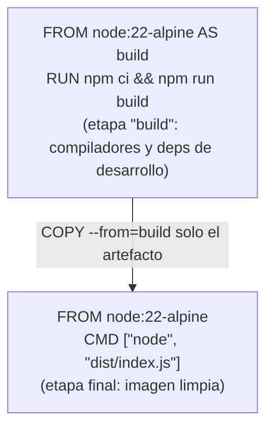
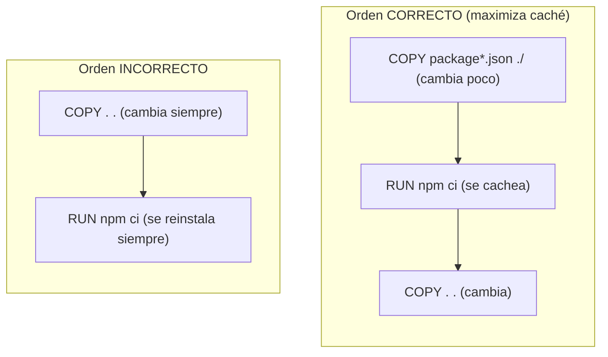
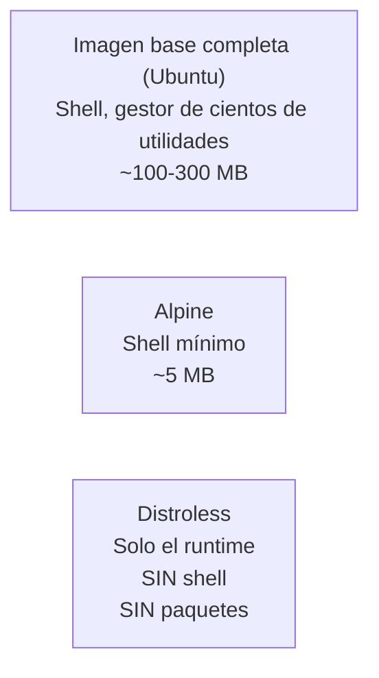
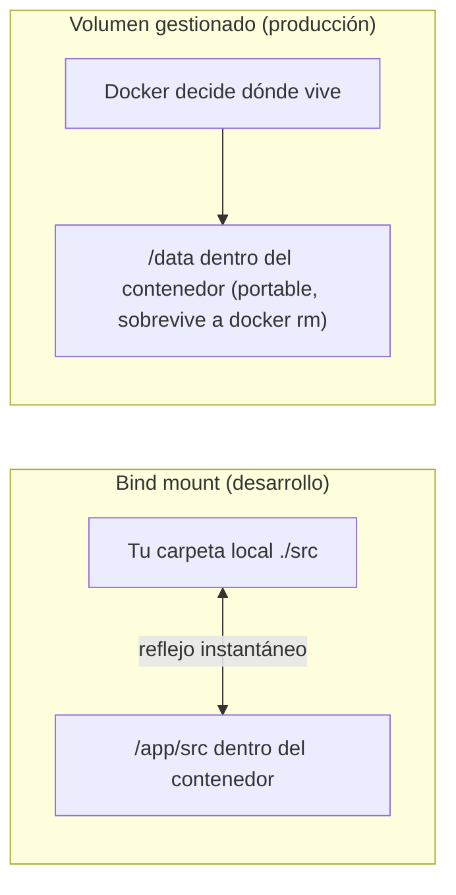
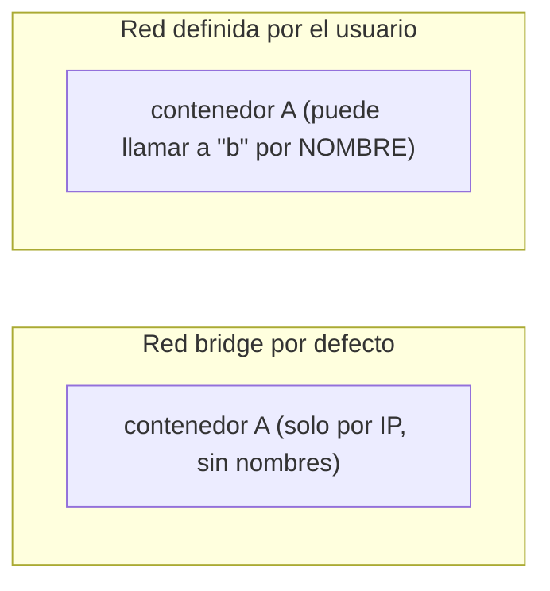
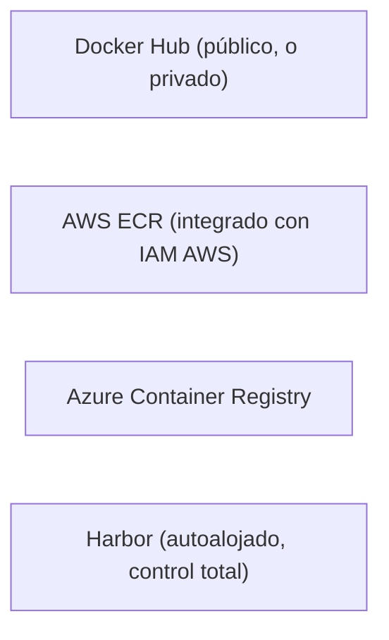
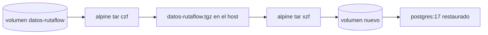
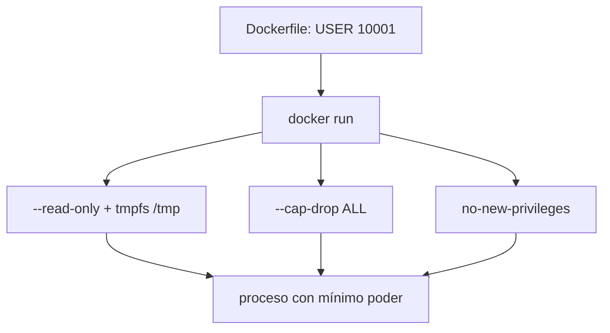
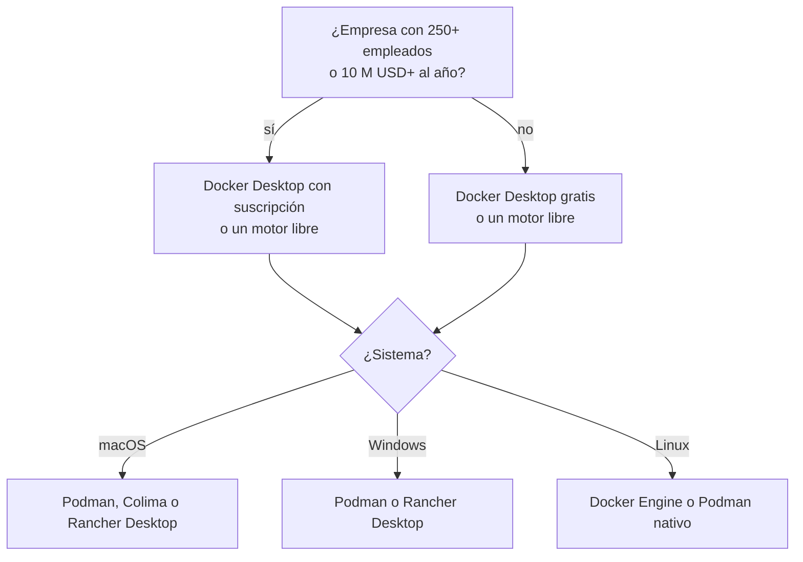

# Módulo 2: Docker — imágenes y buenas prácticas


## Aprende construyendo


### Tema 1: Dockerfile multi-stage · Básico · 20 min

<details open>
<summary><strong>Capa 1 — Lectura</strong></summary>

#### ► DE QUÉ TRATA
Al finalizar podrás escribir un Dockerfile multi-stage que separa la compilación de la ejecución, reduciendo drásticamente el tamaño y la superficie de ataque de la imagen final.

#### ► LA IDEA EN UNA FRASE
**Al finalizar podrás escribir un Dockerfile multi-stage que separa la compilación de la ejecución, reduciendo drásticamente el tamaño y la superficie de ataque de la imagen final.**

#### ► POR QUÉ EXISTE ESTO
Resuelve un problema real de diseño o implementación y evita decisiones a ciegas.

#### ► LA ANALOGÍA
Piensa en dockerfile multi-stage como una herramienta de taller: útil cuando conoces su propósito y sus límites.
**Dónde se rompe la analogía:** en software, los efectos dependen del contexto, la escala y los trade-offs.

#### ► CÓMO FUNCIONA


#### ► LO QUE PUEDE SALIR MAL
| Síntoma | Causa probable | Arreglo |
|---|---|---|
| Dockerfile multi-stage se aplica pero el resultado no mejora | Se usó sin medir el problema real | Mide antes y compara contra la alternativa simple |
| Aparece complejidad inesperada | Se adoptó la técnica sin comprender sus trade-offs | Vuelve a la sección de trade-offs y reduce el alcance |
| Falla en un caso límite | Se asumió un contexto que no se cumple | Prueba el caso límite y documenta cuándo NO usarlo |

#### ► TRADE-OFFS
| Opción | Cuándo usarla | Cuándo NO usarla |
|---|---|---|
| Usar Dockerfile multi-stage | Cuando el problema coincide con su propósito y el beneficio es observable | Cuando agrega complejidad sin resolver un problema real |
| Alternativa más simple | Cuando el contexto es pequeño, estable o fácil de razonar | Cuando ya demostró no escalar o no cumplir el requisito |
| Postergar la decisión | Cuando falta evidencia del problema | Cuando el costo de esperar es mayor que el costo de probar |

#### ► CUÁNDO NO USAR ESTO
No uses dockerfile multi-stage por defecto. Aplícalo cuando el problema lo justifique y puedas verificar el beneficio; si una alternativa más simple resuelve igual, prefiérela.

#### ► DE VUELTA A LA ANALOGÍA
Volviendo a la analogía: dockerfile multi-stage funciona como el modelo inicial, pero recuerda dónde se rompe: en producción importan la evidencia, la escala y el costo de equivocarte.

#### ► LO QUE DEBES RECORDAR
- Dockerfile multi-stage existe para resolver un problema específico.
- Mide antes de adoptar complejidad.
- Conoce el caso donde NO usarlo.
- Verifica con evidencia observable.

#### ► PREGUNTAS PARA PENSAR
1. ¿Qué problema concreto resuelve dockerfile multi-stage en tu contexto?
2. ¿Cómo sabrías que dockerfile multi-stage no está funcionando bien?
3. ¿Qué alternativa más simple considerarías antes de usar dockerfile multi-stage?

</details>

<details>
<summary><strong>Capa 2 — Construcción</strong></summary>

#### Código y verificación


```bash
mkdir -p academia-devops/src/modulo2/multistage
cd academia-devops/src/modulo2/multistage
```

Crea el archivo `package.json`:

```json
{"name":"api-demo","version":"1.0.0","scripts":{"build":"echo 'compilado' > dist-marker.txt"},"main":"index.js"}
```

```bash
docker run --rm -v "$(pwd)":/app -w /app node:22-alpine npm install --package-lock-only
mkdir dist && echo "console.log('API corriendo')" > index.js
```

Crea el archivo `Dockerfile.sinoptimizar`:

```dockerfile
FROM node:22
WORKDIR /app
COPY . .
RUN npm ci --omit=dev
CMD ["node", "index.js"]
```

```bash
docker build -f Dockerfile.sinoptimizar -t api-demo:sin-optimizar .
```

Crea el archivo `Dockerfile`:

```dockerfile
FROM node:22-alpine AS build
WORKDIR /app
COPY package*.json ./
RUN npm ci
COPY . .
RUN npm run build

FROM node:22-alpine
WORKDIR /app
COPY --from=build /app/dist-marker.txt ./
COPY --from=build /app/index.js ./
CMD ["node", "index.js"]
```

```bash
docker build -t api-demo:multistage .
docker images | grep api-demo
```

</details>

### Tema 2: Capas e invalidación de caché · Básico · 20 min

<details open>
<summary><strong>Capa 1 — Lectura</strong></summary>

#### ► DE QUÉ TRATA
Al finalizar podrás ordenar las instrucciones de un Dockerfile para maximizar la reutilización de caché entre builds sucesivos.

#### ► LA IDEA EN UNA FRASE
**Al finalizar podrás ordenar las instrucciones de un Dockerfile para maximizar la reutilización de caché entre builds sucesivos.**

#### ► POR QUÉ EXISTE ESTO
Resuelve un problema real de diseño o implementación y evita decisiones a ciegas.

#### ► LA ANALOGÍA
Piensa en capas e invalidación de caché como una herramienta de taller: útil cuando conoces su propósito y sus límites.
**Dónde se rompe la analogía:** en software, los efectos dependen del contexto, la escala y los trade-offs.

#### ► CÓMO FUNCIONA


#### ► LO QUE PUEDE SALIR MAL
| Síntoma | Causa probable | Arreglo |
|---|---|---|
| Capas e invalidación de caché se aplica pero el resultado no mejora | Se usó sin medir el problema real | Mide antes y compara contra la alternativa simple |
| Aparece complejidad inesperada | Se adoptó la técnica sin comprender sus trade-offs | Vuelve a la sección de trade-offs y reduce el alcance |
| Falla en un caso límite | Se asumió un contexto que no se cumple | Prueba el caso límite y documenta cuándo NO usarlo |

#### ► TRADE-OFFS
| Opción | Cuándo usarla | Cuándo NO usarla |
|---|---|---|
| Usar Capas e invalidación de caché | Cuando el problema coincide con su propósito y el beneficio es observable | Cuando agrega complejidad sin resolver un problema real |
| Alternativa más simple | Cuando el contexto es pequeño, estable o fácil de razonar | Cuando ya demostró no escalar o no cumplir el requisito |
| Postergar la decisión | Cuando falta evidencia del problema | Cuando el costo de esperar es mayor que el costo de probar |

#### ► CUÁNDO NO USAR ESTO
No uses capas e invalidación de caché por defecto. Aplícalo cuando el problema lo justifique y puedas verificar el beneficio; si una alternativa más simple resuelve igual, prefiérela.

#### ► DE VUELTA A LA ANALOGÍA
Volviendo a la analogía: capas e invalidación de caché funciona como el modelo inicial, pero recuerda dónde se rompe: en producción importan la evidencia, la escala y el costo de equivocarte.

#### ► LO QUE DEBES RECORDAR
- Capas e invalidación de caché existe para resolver un problema específico.
- Mide antes de adoptar complejidad.
- Conoce el caso donde NO usarlo.
- Verifica con evidencia observable.

#### ► PREGUNTAS PARA PENSAR
1. ¿Qué problema concreto resuelve capas e invalidación de caché en tu contexto?
2. ¿Cómo sabrías que capas e invalidación de caché no está funcionando bien?
3. ¿Qué alternativa más simple considerarías antes de usar capas e invalidación de caché?

</details>

<details>
<summary><strong>Capa 2 — Construcción</strong></summary>

#### Código y verificación


```bash
mkdir -p academia-devops/src/modulo2/cache-test && cd academia-devops/src/modulo2/cache-test
```

Crea el archivo `package.json`:

```json
{"name":"api-demo","version":"1.0.0","scripts":{"build":"echo compilado > dist-marker.txt"}}
```

```bash
docker run --rm -v "$(pwd)":/app -w /app node:22-alpine npm install --package-lock-only
echo "console.log('v1')" > index.js
```

Crea el archivo `Dockerfile`:

```dockerfile
FROM node:22-alpine AS build
WORKDIR /app
COPY package*.json ./
RUN npm ci
COPY . .
RUN npm run build
FROM node:22-alpine
WORKDIR /app
COPY --from=build /app/dist-marker.txt ./
CMD ["cat", "dist-marker.txt"]
```

```bash
docker build -t api-demo:cache-test .
echo "console.log('cambio de código, sin tocar package.json')" >> index.js
docker build -t api-demo:cache-test . 2>&1 | grep -E "CACHED|npm ci"
```

</details>

### Tema 3: Imágenes base distroless/alpine · Básico · 20 min

<details open>
<summary><strong>Capa 1 — Lectura</strong></summary>

#### ► DE QUÉ TRATA
Al finalizar podrás elegir entre una imagen base completa, Alpine o distroless según si priorizas comodidad de depuración o mínima superficie de ataque.

#### ► LA IDEA EN UNA FRASE
**Al finalizar podrás elegir entre una imagen base completa, Alpine o distroless según si priorizas comodidad de depuración o mínima superficie de ataque.**

#### ► POR QUÉ EXISTE ESTO
Resuelve un problema real de diseño o implementación y evita decisiones a ciegas.

#### ► LA ANALOGÍA
Piensa en imágenes base distroless/alpine como una herramienta de taller: útil cuando conoces su propósito y sus límites.
**Dónde se rompe la analogía:** en software, los efectos dependen del contexto, la escala y los trade-offs.

#### ► CÓMO FUNCIONA


#### ► LO QUE PUEDE SALIR MAL
| Síntoma | Causa probable | Arreglo |
|---|---|---|
| Imágenes base distroless/alpine se aplica pero el resultado no mejora | Se usó sin medir el problema real | Mide antes y compara contra la alternativa simple |
| Aparece complejidad inesperada | Se adoptó la técnica sin comprender sus trade-offs | Vuelve a la sección de trade-offs y reduce el alcance |
| Falla en un caso límite | Se asumió un contexto que no se cumple | Prueba el caso límite y documenta cuándo NO usarlo |

#### ► TRADE-OFFS
| Opción | Cuándo usarla | Cuándo NO usarla |
|---|---|---|
| Usar Imágenes base distroless/alpine | Cuando el problema coincide con su propósito y el beneficio es observable | Cuando agrega complejidad sin resolver un problema real |
| Alternativa más simple | Cuando el contexto es pequeño, estable o fácil de razonar | Cuando ya demostró no escalar o no cumplir el requisito |
| Postergar la decisión | Cuando falta evidencia del problema | Cuando el costo de esperar es mayor que el costo de probar |

#### ► CUÁNDO NO USAR ESTO
No uses imágenes base distroless/alpine por defecto. Aplícalo cuando el problema lo justifique y puedas verificar el beneficio; si una alternativa más simple resuelve igual, prefiérela.

#### ► DE VUELTA A LA ANALOGÍA
Volviendo a la analogía: imágenes base distroless/alpine funciona como el modelo inicial, pero recuerda dónde se rompe: en producción importan la evidencia, la escala y el costo de equivocarte.

#### ► LO QUE DEBES RECORDAR
- Imágenes base distroless/alpine existe para resolver un problema específico.
- Mide antes de adoptar complejidad.
- Conoce el caso donde NO usarlo.
- Verifica con evidencia observable.

#### ► PREGUNTAS PARA PENSAR
1. ¿Qué problema concreto resuelve imágenes base distroless/alpine en tu contexto?
2. ¿Cómo sabrías que imágenes base distroless/alpine no está funcionando bien?
3. ¿Qué alternativa más simple considerarías antes de usar imágenes base distroless/alpine?

</details>

<details>
<summary><strong>Capa 2 — Construcción</strong></summary>

#### Código y verificación


```bash
mkdir -p academia-devops/src/modulo2/imagenes-base
cd academia-devops/src/modulo2/imagenes-base
echo 'console.log("hola")' > app.js
for base in "node:22" "node:22-alpine" "gcr.io/distroless/nodejs22-debian12"; do
  echo "--- $base ---"
  docker run --rm -v "$(pwd)":/app -w /app "$base" node app.js 2>&1 || echo "(sin shell disponible para depurar interactivamente)"
done
docker images node:22 node:22-alpine --format "{{.Repository}}:{{.Tag}} {{.Size}}"
```

</details>

### Tema 4: Volúmenes vs bind mounts · Básico · 20 min

<details open>
<summary><strong>Capa 1 — Lectura</strong></summary>

#### ► DE QUÉ TRATA
Al finalizar podrás elegir entre un volumen gestionado por Docker y un bind mount según si necesitas persistencia portable o reflejo instantáneo de código local.

#### ► LA IDEA EN UNA FRASE
**Al finalizar podrás elegir entre un volumen gestionado por Docker y un bind mount según si necesitas persistencia portable o reflejo instantáneo de código local.**

#### ► POR QUÉ EXISTE ESTO
Resuelve un problema real de diseño o implementación y evita decisiones a ciegas.

#### ► LA ANALOGÍA
Piensa en volúmenes vs bind mounts como una herramienta de taller: útil cuando conoces su propósito y sus límites.
**Dónde se rompe la analogía:** en software, los efectos dependen del contexto, la escala y los trade-offs.

#### ► CÓMO FUNCIONA


#### ► LO QUE PUEDE SALIR MAL
| Síntoma | Causa probable | Arreglo |
|---|---|---|
| Volúmenes vs bind mounts se aplica pero el resultado no mejora | Se usó sin medir el problema real | Mide antes y compara contra la alternativa simple |
| Aparece complejidad inesperada | Se adoptó la técnica sin comprender sus trade-offs | Vuelve a la sección de trade-offs y reduce el alcance |
| Falla en un caso límite | Se asumió un contexto que no se cumple | Prueba el caso límite y documenta cuándo NO usarlo |

#### ► TRADE-OFFS
| Opción | Cuándo usarla | Cuándo NO usarla |
|---|---|---|
| Usar Volúmenes vs bind mounts | Cuando el problema coincide con su propósito y el beneficio es observable | Cuando agrega complejidad sin resolver un problema real |
| Alternativa más simple | Cuando el contexto es pequeño, estable o fácil de razonar | Cuando ya demostró no escalar o no cumplir el requisito |
| Postergar la decisión | Cuando falta evidencia del problema | Cuando el costo de esperar es mayor que el costo de probar |

#### ► CUÁNDO NO USAR ESTO
No uses volúmenes vs bind mounts por defecto. Aplícalo cuando el problema lo justifique y puedas verificar el beneficio; si una alternativa más simple resuelve igual, prefiérela.

#### ► DE VUELTA A LA ANALOGÍA
Volviendo a la analogía: volúmenes vs bind mounts funciona como el modelo inicial, pero recuerda dónde se rompe: en producción importan la evidencia, la escala y el costo de equivocarte.

#### ► LO QUE DEBES RECORDAR
- Volúmenes vs bind mounts existe para resolver un problema específico.
- Mide antes de adoptar complejidad.
- Conoce el caso donde NO usarlo.
- Verifica con evidencia observable.

#### ► PREGUNTAS PARA PENSAR
1. ¿Qué problema concreto resuelve volúmenes vs bind mounts en tu contexto?
2. ¿Cómo sabrías que volúmenes vs bind mounts no está funcionando bien?
3. ¿Qué alternativa más simple considerarías antes de usar volúmenes vs bind mounts?

</details>

<details>
<summary><strong>Capa 2 — Construcción</strong></summary>

#### Código y verificación


```bash
mkdir -p academia-devops/src/modulo2/volumenes
cd academia-devops/src/modulo2/volumenes
echo "console.log('version 1')" > app.js
docker run --rm -v "$(pwd)":/app -w /app node:22-alpine node app.js
echo "console.log('version 2, editado localmente')" > app.js
docker run --rm -v "$(pwd)":/app -w /app node:22-alpine node app.js
```

```bash
docker volume create datos-prueba
docker run --rm -v datos-prueba:/data alpine sh -c "echo 'dato persistente' > /data/registro.txt"
docker run --rm -v datos-prueba:/data alpine cat /data/registro.txt
```

</details>

### Tema 5: Redes en Docker · Básico · 20 min

<details open>
<summary><strong>Capa 1 — Lectura</strong></summary>

#### ► DE QUÉ TRATA
Al finalizar podrás crear una red Docker definida por el usuario y conectar contenedores entre sí usando resolución de nombres, en vez de direcciones IP frágiles.

#### ► LA IDEA EN UNA FRASE
**Al finalizar podrás crear una red Docker definida por el usuario y conectar contenedores entre sí usando resolución de nombres, en vez de direcciones IP frágiles.**

#### ► POR QUÉ EXISTE ESTO
Resuelve un problema real de diseño o implementación y evita decisiones a ciegas.

#### ► LA ANALOGÍA
Piensa en redes en docker como una herramienta de taller: útil cuando conoces su propósito y sus límites.
**Dónde se rompe la analogía:** en software, los efectos dependen del contexto, la escala y los trade-offs.

#### ► CÓMO FUNCIONA


#### ► LO QUE PUEDE SALIR MAL
| Síntoma | Causa probable | Arreglo |
|---|---|---|
| Redes en Docker se aplica pero el resultado no mejora | Se usó sin medir el problema real | Mide antes y compara contra la alternativa simple |
| Aparece complejidad inesperada | Se adoptó la técnica sin comprender sus trade-offs | Vuelve a la sección de trade-offs y reduce el alcance |
| Falla en un caso límite | Se asumió un contexto que no se cumple | Prueba el caso límite y documenta cuándo NO usarlo |

#### ► TRADE-OFFS
| Opción | Cuándo usarla | Cuándo NO usarla |
|---|---|---|
| Usar Redes en Docker | Cuando el problema coincide con su propósito y el beneficio es observable | Cuando agrega complejidad sin resolver un problema real |
| Alternativa más simple | Cuando el contexto es pequeño, estable o fácil de razonar | Cuando ya demostró no escalar o no cumplir el requisito |
| Postergar la decisión | Cuando falta evidencia del problema | Cuando el costo de esperar es mayor que el costo de probar |

#### ► CUÁNDO NO USAR ESTO
No uses redes en docker por defecto. Aplícalo cuando el problema lo justifique y puedas verificar el beneficio; si una alternativa más simple resuelve igual, prefiérela.

#### ► DE VUELTA A LA ANALOGÍA
Volviendo a la analogía: redes en docker funciona como el modelo inicial, pero recuerda dónde se rompe: en producción importan la evidencia, la escala y el costo de equivocarte.

#### ► LO QUE DEBES RECORDAR
- Redes en Docker existe para resolver un problema específico.
- Mide antes de adoptar complejidad.
- Conoce el caso donde NO usarlo.
- Verifica con evidencia observable.

#### ► PREGUNTAS PARA PENSAR
1. ¿Qué problema concreto resuelve redes en docker en tu contexto?
2. ¿Cómo sabrías que redes en docker no está funcionando bien?
3. ¿Qué alternativa más simple considerarías antes de usar redes en docker?

</details>

<details>
<summary><strong>Capa 2 — Construcción</strong></summary>

#### Código y verificación


```bash
mkdir -p academia-devops/src/modulo2/redes && cd academia-devops/src/modulo2/redes
docker network create demo-red
docker run -d --name servicio-a --network demo-red alpine sleep 300
docker run --rm --network demo-red alpine ping -c 2 servicio-a
```

</details>

### Tema 6: Registries — Docker Hub, AWS ECR, Azure Container Registry, Harbor · Básico · 20 min

<details open>
<summary><strong>Capa 1 — Lectura</strong></summary>

#### ► DE QUÉ TRATA
Al finalizar podrás elegir entre Docker Hub, un registry gestionado por proveedor cloud y un registry autoalojado (Harbor) según tus requisitos de integración e independencia.

#### ► LA IDEA EN UNA FRASE
**Al finalizar podrás elegir entre Docker Hub, un registry gestionado por proveedor cloud y un registry autoalojado (Harbor) según tus requisitos de integración e independencia.**

#### ► POR QUÉ EXISTE ESTO
Resuelve un problema real de diseño o implementación y evita decisiones a ciegas.

#### ► LA ANALOGÍA
Piensa en registries — docker hub, aws ecr, azure container registry, harbor como una herramienta de taller: útil cuando conoces su propósito y sus límites.
**Dónde se rompe la analogía:** en software, los efectos dependen del contexto, la escala y los trade-offs.

#### ► CÓMO FUNCIONA


#### ► LO QUE PUEDE SALIR MAL
| Síntoma | Causa probable | Arreglo |
|---|---|---|
| Registries — Docker Hub, AWS ECR, Azure Container Registry, Harbor se aplica pero el resultado no mejora | Se usó sin medir el problema real | Mide antes y compara contra la alternativa simple |
| Aparece complejidad inesperada | Se adoptó la técnica sin comprender sus trade-offs | Vuelve a la sección de trade-offs y reduce el alcance |
| Falla en un caso límite | Se asumió un contexto que no se cumple | Prueba el caso límite y documenta cuándo NO usarlo |

#### ► TRADE-OFFS
| Opción | Cuándo usarla | Cuándo NO usarla |
|---|---|---|
| Usar Registries — Docker Hub, AWS ECR, Azure Container Registry, Harbor | Cuando el problema coincide con su propósito y el beneficio es observable | Cuando agrega complejidad sin resolver un problema real |
| Alternativa más simple | Cuando el contexto es pequeño, estable o fácil de razonar | Cuando ya demostró no escalar o no cumplir el requisito |
| Postergar la decisión | Cuando falta evidencia del problema | Cuando el costo de esperar es mayor que el costo de probar |

#### ► CUÁNDO NO USAR ESTO
No uses registries — docker hub, aws ecr, azure container registry, harbor por defecto. Aplícalo cuando el problema lo justifique y puedas verificar el beneficio; si una alternativa más simple resuelve igual, prefiérela.

#### ► DE VUELTA A LA ANALOGÍA
Volviendo a la analogía: registries — docker hub, aws ecr, azure container registry, harbor funciona como el modelo inicial, pero recuerda dónde se rompe: en producción importan la evidencia, la escala y el costo de equivocarte.

#### ► LO QUE DEBES RECORDAR
- Registries — Docker Hub, AWS ECR, Azure Container Registry, Harbor existe para resolver un problema específico.
- Mide antes de adoptar complejidad.
- Conoce el caso donde NO usarlo.
- Verifica con evidencia observable.

#### ► PREGUNTAS PARA PENSAR
1. ¿Qué problema concreto resuelve registries — docker hub, aws ecr, azure container registry, harbor en tu contexto?
2. ¿Cómo sabrías que registries — docker hub, aws ecr, azure container registry, harbor no está funcionando bien?
3. ¿Qué alternativa más simple considerarías antes de usar registries — docker hub, aws ecr, azure container registry, harbor?

</details>

<details>
<summary><strong>Capa 2 — Construcción</strong></summary>

#### Código y verificación


```bash
mkdir -p academia-devops/src/modulo2/registry && cd academia-devops/src/modulo2/registry
docker run -d -p 5000:5000 --name registro-local registry:2
echo "console.log('imagen de prueba')" > app.js
printf 'FROM node:22-alpine\nCOPY app.js .\nCMD ["node","app.js"]\n' > Dockerfile
docker build -t localhost:5000/app-demo:v1 .
docker push localhost:5000/app-demo:v1
```

```bash
curl -s http://localhost:5000/v2/app-demo/tags/list
docker rmi localhost:5000/app-demo:v1
docker pull localhost:5000/app-demo:v1
```

</details>

### Tema 7: Operación diaria: inspect, stats, events y respaldo de volúmenes · Básico · 20 min

<details open>
<summary><strong>Capa 1 — Lectura</strong></summary>

#### ► DE QUÉ TRATA
Al finalizar podrás inspeccionar un contenedor y sus montajes, medir su consumo, revisar los eventos del motor de Docker y respaldar y restaurar un volumen con un contenedor auxiliar. Prerrequisito: Tema 4 de este módulo (volúmenes).

#### ► LA IDEA EN UNA FRASE
**Al finalizar podrás inspeccionar un contenedor y sus montajes, medir su consumo, revisar los eventos del motor de Docker y respaldar y restaurar un volumen con un contenedor auxiliar.**

#### ► POR QUÉ EXISTE ESTO
Resuelve un problema real de diseño o implementación y evita decisiones a ciegas.

#### ► LA ANALOGÍA
Piensa en operación diaria: inspect, stats, events y respaldo de volúmenes como una herramienta de taller: útil cuando conoces su propósito y sus límites.
**Dónde se rompe la analogía:** en software, los efectos dependen del contexto, la escala y los trade-offs.

#### ► CÓMO FUNCIONA


#### ► LO QUE PUEDE SALIR MAL
| Síntoma | Causa probable | Arreglo |
|---|---|---|
| Operación diaria: inspect, stats, events y respaldo de volúmenes se aplica pero el resultado no mejora | Se usó sin medir el problema real | Mide antes y compara contra la alternativa simple |
| Aparece complejidad inesperada | Se adoptó la técnica sin comprender sus trade-offs | Vuelve a la sección de trade-offs y reduce el alcance |
| Falla en un caso límite | Se asumió un contexto que no se cumple | Prueba el caso límite y documenta cuándo NO usarlo |

#### ► TRADE-OFFS
| Opción | Cuándo usarla | Cuándo NO usarla |
|---|---|---|
| Usar Operación diaria: inspect, stats, events y respaldo de volúmenes | Cuando el problema coincide con su propósito y el beneficio es observable | Cuando agrega complejidad sin resolver un problema real |
| Alternativa más simple | Cuando el contexto es pequeño, estable o fácil de razonar | Cuando ya demostró no escalar o no cumplir el requisito |
| Postergar la decisión | Cuando falta evidencia del problema | Cuando el costo de esperar es mayor que el costo de probar |

#### ► CUÁNDO NO USAR ESTO
No uses operación diaria: inspect, stats, events y respaldo de volúmenes por defecto. Aplícalo cuando el problema lo justifique y puedas verificar el beneficio; si una alternativa más simple resuelve igual, prefiérela.

#### ► DE VUELTA A LA ANALOGÍA
Volviendo a la analogía: operación diaria: inspect, stats, events y respaldo de volúmenes funciona como el modelo inicial, pero recuerda dónde se rompe: en producción importan la evidencia, la escala y el costo de equivocarte.

#### ► LO QUE DEBES RECORDAR
- Operación diaria: inspect, stats, events y respaldo de volúmenes existe para resolver un problema específico.
- Mide antes de adoptar complejidad.
- Conoce el caso donde NO usarlo.
- Verifica con evidencia observable.

#### ► PREGUNTAS PARA PENSAR
1. ¿Qué problema concreto resuelve operación diaria: inspect, stats, events y respaldo de volúmenes en tu contexto?
2. ¿Cómo sabrías que operación diaria: inspect, stats, events y respaldo de volúmenes no está funcionando bien?
3. ¿Qué alternativa más simple considerarías antes de usar operación diaria: inspect, stats, events y respaldo de volúmenes?

</details>

<details>
<summary><strong>Capa 2 — Construcción</strong></summary>

#### Código y verificación


```bash
mkdir respaldo-volumenes && cd respaldo-volumenes
```

```bash
#!/usr/bin/env bash
# Operación diaria de un contenedor con volumen: inspeccionar, medir, respaldar y restaurar
set -euo pipefail

docker volume create datos-rutaflow >/dev/null
docker run -d --name bd-rutaflow -e POSTGRES_PASSWORD=dev -v datos-rutaflow:/var/lib/postgresql/data postgres:17 >/dev/null
until docker exec bd-rutaflow pg_isready -U postgres >/dev/null 2>&1; do sleep 1; done
docker exec bd-rutaflow psql -U postgres -qc "CREATE TABLE entrega(guia text); INSERT INTO entrega VALUES ('BO-1'),('BO-2');"

echo "--- inspección: dónde vive el volumen y con qué imagen corre"
docker inspect bd-rutaflow --format '{{.Config.Image}} {{range .Mounts}}{{.Name}} -> {{.Destination}}{{end}}'
echo "--- consumo instantáneo"
docker stats --no-stream --format '{{.Name}} CPU={{.CPUPerc}} MEM={{.MemUsage}}' bd-rutaflow

echo "--- respaldo del volumen con un contenedor auxiliar (la BD se detiene para un respaldo consistente)"
docker stop bd-rutaflow >/dev/null
docker run --rm -v datos-rutaflow:/origen:ro -v "$(pwd)":/respaldo alpine tar czf /respaldo/datos-rutaflow.tgz -C /origen .
ls -lh datos-rutaflow.tgz | awk '{print $5, $9}'

echo "--- desastre: se borran el contenedor y el volumen"
docker rm bd-rutaflow >/dev/null && docker volume rm datos-rutaflow >/dev/null

echo "--- restauración en un volumen nuevo"
docker volume create datos-rutaflow >/dev/null
docker run --rm -v datos-rutaflow:/destino -v "$(pwd)":/respaldo alpine tar xzf /respaldo/datos-rutaflow.tgz -C /destino
docker run -d --name bd-rutaflow -e POSTGRES_PASSWORD=dev -v datos-rutaflow:/var/lib/postgresql/data postgres:17 >/dev/null
until docker exec bd-rutaflow pg_isready -U postgres >/dev/null 2>&1; do sleep 1; done
docker exec bd-rutaflow psql -U postgres -Atc "SELECT count(*) || ' entregas restauradas' FROM entrega;"

docker rm -f bd-rutaflow >/dev/null && docker volume rm datos-rutaflow >/dev/null
```

```bash
bash respaldo.sh
docker events --since 10m --filter type=container --format '{{.Action}} {{.Actor.Attributes.name}}' --until "$(date +%s)"
```

```text
--- inspección: dónde vive el volumen y con qué imagen corre
postgres:17 datos-rutaflow -> /var/lib/postgresql/data
--- consumo instantáneo
bd-rutaflow CPU=0.05% MEM=38.2MiB / 7.6GiB
--- respaldo del volumen con un contenedor auxiliar (la BD se detiene para un respaldo consistente)
6.5M datos-rutaflow.tgz
--- desastre: se borran el contenedor y el volumen
--- restauración en un volumen nuevo
2 entregas restauradas
```

</details>

### Tema 8: Contenedores sin privilegios: usuario no root, sistema de archivos de solo lectura y capacidades mínimas · Avanzado · 45 min

<details open>
<summary><strong>Capa 1 — Lectura</strong></summary>

#### ► DE QUÉ TRATA
Necesitas Docker 24 o superior. Crea la carpeta academia-labs/devops/sin-privilegios con un servidor Node mínimo (server.js) y su Dockerfile.

#### ► LA IDEA EN UNA FRASE
**Necesitas Docker 24 o superior.**

#### ► POR QUÉ EXISTE ESTO
Resuelve un problema real de diseño o implementación y evita decisiones a ciegas.

#### ► LA ANALOGÍA
Piensa en contenedores sin privilegios: usuario no root, sistema de archivos de solo lectura y capacidades mínimas como una herramienta de taller: útil cuando conoces su propósito y sus límites.
**Dónde se rompe la analogía:** en software, los efectos dependen del contexto, la escala y los trade-offs.

#### ► CÓMO FUNCIONA


#### ► LO QUE PUEDE SALIR MAL
| Síntoma | Causa probable | Arreglo |
|---|---|---|
| Contenedores sin privilegios: usuario no root, sistema de archivos de solo lectura y capacidades mínimas se aplica pero el resultado no mejora | Se usó sin medir el problema real | Mide antes y compara contra la alternativa simple |
| Aparece complejidad inesperada | Se adoptó la técnica sin comprender sus trade-offs | Vuelve a la sección de trade-offs y reduce el alcance |
| Falla en un caso límite | Se asumió un contexto que no se cumple | Prueba el caso límite y documenta cuándo NO usarlo |

#### ► TRADE-OFFS
| Opción | Cuándo usarla | Cuándo NO usarla |
|---|---|---|
| Usar Contenedores sin privilegios: usuario no root, sistema de archivos de solo lectura y capacidades mínimas | Cuando el problema coincide con su propósito y el beneficio es observable | Cuando agrega complejidad sin resolver un problema real |
| Alternativa más simple | Cuando el contexto es pequeño, estable o fácil de razonar | Cuando ya demostró no escalar o no cumplir el requisito |
| Postergar la decisión | Cuando falta evidencia del problema | Cuando el costo de esperar es mayor que el costo de probar |

#### ► CUÁNDO NO USAR ESTO
No uses contenedores sin privilegios: usuario no root, sistema de archivos de solo lectura y capacidades mínimas por defecto. Aplícalo cuando el problema lo justifique y puedas verificar el beneficio; si una alternativa más simple resuelve igual, prefiérela.

#### ► DE VUELTA A LA ANALOGÍA
Volviendo a la analogía: contenedores sin privilegios: usuario no root, sistema de archivos de solo lectura y capacidades mínimas funciona como el modelo inicial, pero recuerda dónde se rompe: en producción importan la evidencia, la escala y el costo de equivocarte.

#### ► LO QUE DEBES RECORDAR
- Contenedores sin privilegios: usuario no root, sistema de archivos de solo lectura y capacidades mínimas existe para resolver un problema específico.
- Mide antes de adoptar complejidad.
- Conoce el caso donde NO usarlo.
- Verifica con evidencia observable.

#### ► PREGUNTAS PARA PENSAR
1. ¿Qué problema concreto resuelve contenedores sin privilegios: usuario no root, sistema de archivos de solo lectura y capacidades mínimas en tu contexto?
2. ¿Cómo sabrías que contenedores sin privilegios: usuario no root, sistema de archivos de solo lectura y capacidades mínimas no está funcionando bien?
3. ¿Qué alternativa más simple considerarías antes de usar contenedores sin privilegios: usuario no root, sistema de archivos de solo lectura y capacidades mínimas?

</details>

<details>
<summary><strong>Capa 2 — Construcción</strong></summary>

#### Código y verificación


```js
const http = require('node:http');
const fs = require('node:fs');

http.createServer((req, res) => {
  let escritura;
  try { fs.writeFileSync('/app/prueba.txt', 'x'); escritura = 'pude escribir en /app'; }
  catch (e) { escritura = `no puedo escribir en /app (${e.code})`; }
  fs.writeFileSync('/tmp/cache.txt', 'ok'); // /tmp es un tmpfs permitido
  res.end(`uid=${process.getuid()} · ${escritura} · /tmp ok\n`);
}).listen(8080);
```

```dockerfile
FROM node:22-alpine
WORKDIR /app
COPY server.js .
# Usuario sin privilegios con UID fijo (las políticas de Kubernetes revisan el número).
RUN addgroup -S -g 10001 app && adduser -S -u 10001 -G app app
USER 10001:10001
EXPOSE 8080
CMD ["node", "server.js"]
```

```bash
cd academia-labs/devops/sin-privilegios
docker build -t rutaflow/api-segura .
docker run -d --name api --read-only --tmpfs /tmp \
  --cap-drop ALL --security-opt no-new-privileges -p 8080:8080 rutaflow/api-segura
curl -s localhost:8080
docker exec api id
docker exec api sh -c 'touch /etc/hackeado' ; echo "código de salida: $?"
```

```text
uid=10001 · no puedo escribir en /app (EROFS) · /tmp ok
uid=10001(app) gid=10001(app) groups=10001(app)
touch: /etc/hackeado: Read-only file system
código de salida: 1
```

</details>

### Tema 9: Elegir el motor de contenedores local: Docker Desktop, Podman, Colima y Rancher Desktop · Avanzado · 35 min

<details open>
<summary><strong>Capa 1 — Lectura</strong></summary>

#### ► DE QUÉ TRATA
Usa Python 3.10 o superior para el script. Para probar un motor alternativo instala uno: brew install podman o brew install colima docker en macOS, o Rancher Desktop desde su página. Crea la carpeta academia-labs/devops/motor-local.

#### ► LA IDEA EN UNA FRASE
**Usa Python 3.10 o superior para el script.**

#### ► POR QUÉ EXISTE ESTO
Resuelve un problema real de diseño o implementación y evita decisiones a ciegas.

#### ► LA ANALOGÍA
Piensa en elegir el motor de contenedores local: docker desktop, podman, colima y rancher desktop como una herramienta de taller: útil cuando conoces su propósito y sus límites.
**Dónde se rompe la analogía:** en software, los efectos dependen del contexto, la escala y los trade-offs.

#### ► CÓMO FUNCIONA


#### ► LO QUE PUEDE SALIR MAL
| Síntoma | Causa probable | Arreglo |
|---|---|---|
| Elegir el motor de contenedores local: Docker Desktop, Podman, Colima y Rancher Desktop se aplica pero el resultado no mejora | Se usó sin medir el problema real | Mide antes y compara contra la alternativa simple |
| Aparece complejidad inesperada | Se adoptó la técnica sin comprender sus trade-offs | Vuelve a la sección de trade-offs y reduce el alcance |
| Falla en un caso límite | Se asumió un contexto que no se cumple | Prueba el caso límite y documenta cuándo NO usarlo |

#### ► TRADE-OFFS
| Opción | Cuándo usarla | Cuándo NO usarla |
|---|---|---|
| Usar Elegir el motor de contenedores local: Docker Desktop, Podman, Colima y Rancher Desktop | Cuando el problema coincide con su propósito y el beneficio es observable | Cuando agrega complejidad sin resolver un problema real |
| Alternativa más simple | Cuando el contexto es pequeño, estable o fácil de razonar | Cuando ya demostró no escalar o no cumplir el requisito |
| Postergar la decisión | Cuando falta evidencia del problema | Cuando el costo de esperar es mayor que el costo de probar |

#### ► CUÁNDO NO USAR ESTO
No uses elegir el motor de contenedores local: docker desktop, podman, colima y rancher desktop por defecto. Aplícalo cuando el problema lo justifique y puedas verificar el beneficio; si una alternativa más simple resuelve igual, prefiérela.

#### ► DE VUELTA A LA ANALOGÍA
Volviendo a la analogía: elegir el motor de contenedores local: docker desktop, podman, colima y rancher desktop funciona como el modelo inicial, pero recuerda dónde se rompe: en producción importan la evidencia, la escala y el costo de equivocarte.

#### ► LO QUE DEBES RECORDAR
- Elegir el motor de contenedores local: Docker Desktop, Podman, Colima y Rancher Desktop existe para resolver un problema específico.
- Mide antes de adoptar complejidad.
- Conoce el caso donde NO usarlo.
- Verifica con evidencia observable.

#### ► PREGUNTAS PARA PENSAR
1. ¿Qué problema concreto resuelve elegir el motor de contenedores local: docker desktop, podman, colima y rancher desktop en tu contexto?
2. ¿Cómo sabrías que elegir el motor de contenedores local: docker desktop, podman, colima y rancher desktop no está funcionando bien?
3. ¿Qué alternativa más simple considerarías antes de usar elegir el motor de contenedores local: docker desktop, podman, colima y rancher desktop?

</details>

<details>
<summary><strong>Capa 2 — Construcción</strong></summary>

#### Código y verificación


```python
"""Recomienda un motor de contenedores local según el equipo y la empresa.

Los datos de licencia vienen de las páginas oficiales (revisadas el 2026-11-18).
"""
from dataclasses import dataclass

# Docker Desktop es gratis para empresas con menos de 250 empleados Y menos de 10 M USD al año.
LIMITE_EMPLEADOS = 250
LIMITE_INGRESOS_MUSD = 10

# Sistemas donde corre cada motor.
MOTORES = {
    "Docker Desktop": {"macos", "windows", "linux"},
    "Podman": {"macos", "windows", "linux"},
    "Colima": {"macos", "linux"},
    "Rancher Desktop": {"macos", "windows", "linux"},
}


@dataclass
class Equipo:
    nombre: str
    so: str
    empleados: int
    ingresos_musd: float


def docker_desktop_gratis(equipo: Equipo) -> bool:
    return equipo.empleados < LIMITE_EMPLEADOS and equipo.ingresos_musd < LIMITE_INGRESOS_MUSD


def opciones(equipo: Equipo) -> list[str]:
    elegibles = []
    for nombre, sistemas in MOTORES.items():
        if equipo.so not in sistemas:
            continue
        if nombre == "Docker Desktop" and not docker_desktop_gratis(equipo):
            continue  # se puede usar, pero exige pagar una suscripción
        elegibles.append(nombre)
    return elegibles


EQUIPOS = [
    Equipo("estudiante", "macos", 1, 0),
    Equipo("RutaFlow (40 personas)", "windows", 40, 3),
    Equipo("empresa de 900 personas", "macos", 900, 120),
]

for equipo in EQUIPOS:
    lista = ", ".join(opciones(equipo))
    pago = "" if docker_desktop_gratis(equipo) else "  (Docker Desktop exige suscripción)"
    print(f"{equipo.nombre:<26} {equipo.so:<8} -> {lista}{pago}")
```

```bash
cd academia-labs/devops/motor-local
python3 elegir_runtime.py
# con el motor elegido instalado, comprueba que tu Compose funciona igual:
docker compose up -d && docker compose ps
```

```text
estudiante                 macos    -> Docker Desktop, Podman, Colima, Rancher Desktop
RutaFlow (40 personas)     windows  -> Docker Desktop, Podman, Rancher Desktop
empresa de 900 personas    macos    -> Podman, Colima, Rancher Desktop  (Docker Desktop exige suscripción)
```

</details>
