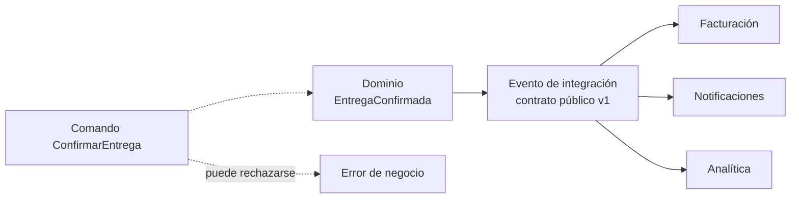
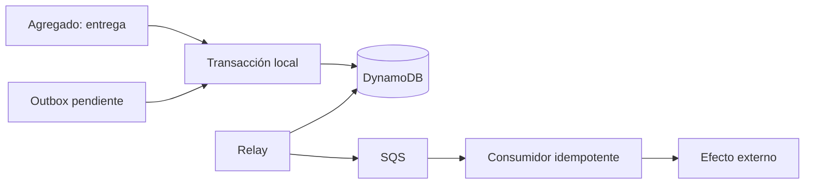
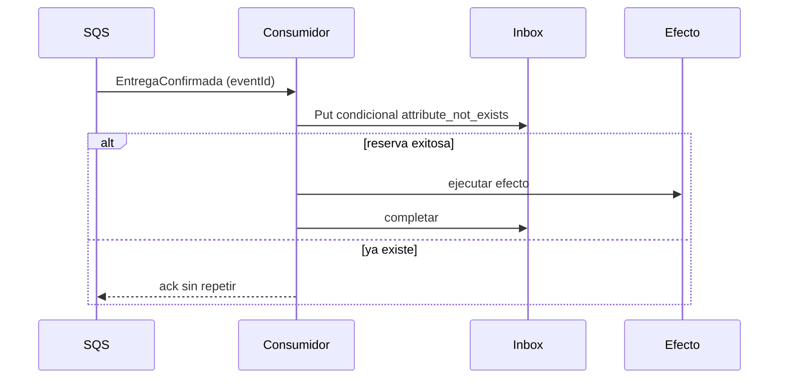
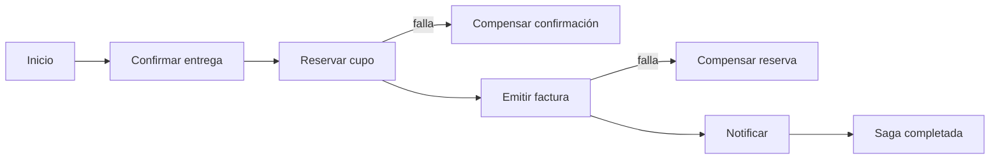

# Módulo 20: Eventos de dominio y consistencia eventual

## Aprende construyendo

Un evento no es una notificación decorativa ni un log con nombre bonito: es un **hecho ocurrido** que otro componente puede usar para decidir sin volver a preguntar. En este módulo vas a separar eventos de dominio de eventos de integración, persistir un hecho y su mensaje en la misma transacción con el patrón **outbox**, consumir mensajes duplicados sin repetir efectos y coordinar un proceso largo con **compensaciones** en lugar de una transacción distribuida.

El laboratorio usa Floci para SQS y DynamoDB local. Puedes completar los temas 1 y 4 sin Docker; los temas 2 y 3 incluyen una parte pura que se prueba con `node --test` y una integración opcional contra `http://localhost:4566`. **Conocimiento previo:** Módulo 19 (agregados y eventos de dominio), Node.js, JSON y Docker. Si trabajas en Java, el Módulo 15 de Spring Boot muestra la misma saga con transacciones y compensación; aquí el foco está en el contrato y en la evidencia reproducible.

### Tema 1: Eventos de dominio e integración: hechos, no comandos

**¿Por qué es importante?** Porque un equipo que confunde un comando con un evento termina acoplando consumidores a la intención del emisor y descubre demasiado tarde que no puede reaccionar a un hecho ya ocurrido. Un evento bien nombrado y versionado permite que Facturación, Notificaciones o Analítica reaccionen sin que Operaciones sepa quiénes son, y permite reconstruir qué pasó cuando algo falla.

**Analogía:** un comando es una orden al cocinero («prepara la mesa 4»); un evento es el ticket que confirma que la mesa 4 ya recibió su pedido. Si confundes ambos, el cliente que llama para preguntar por su pedido recibe una nueva orden de cocina en lugar de una respuesta sobre lo que ya ocurrió.

**Conceptos clave:** evento de dominio, evento de integración, comando, hecho en pasado, `eventId`, `occurredAt`, `correlationId`, esquema y compatibilidad.

Un **evento de dominio** describe algo que ocurrió dentro de un contexto y que al negocio le importa: `EntregaConfirmada`, `FacturaEmitida`, `ConductorAsignado`. Vive en el lenguaje del dominio y puede contener datos internos que no deben salir del contexto. Un **evento de integración** es la versión pública que cruza una frontera: tiene un contrato estable, campos mínimos y una política de compatibilidad. No son lo mismo; publicar la entidad interna completa convierte cualquier cambio de esquema en una ruptura para todos los consumidores.

Un **comando** expresa una intención y puede rechazarse: `ConfirmarEntrega`. Un evento expresa un hecho y no se rechaza: ya ocurrió. El nombre en pasado no es una convención estética; obliga a pensar en quién produce el hecho y qué información debe llevar para que otro pueda actuar sin consultar el sistema de origen.

El caso de RutaFlow: Operaciones confirma una entrega. Facturación necesita `envioId`, `clienteId`, `pesoFacturable`, `moneda` y `ocurridoEn`; Notificaciones necesita `envioId`, `clienteId` y un canal; Analítica necesita `conductorId` y tiempos. Un solo evento gigante con todos los campos obliga a todos a conocer el modelo completo. Tres eventos de integración con contratos pequeños permiten evolucionar cada consumidor por separado, siempre que el hecho base y su identificador sean estables.

**Diagrama:**



#### Paso 1 · Objetivo y preparación

Al finalizar podrás definir un evento de integración con identidad, versión y campos mínimos, validarlo antes de publicarlo y distinguirlo de un comando con pruebas que fallen ante un nombre o un contrato incorrecto. **Conocimiento previo:** Módulo 19 y `node --test`.

```bash
mkdir -p arquitectura-moderna/modulo-20/tema-1-eventos/{src,test}
cd arquitectura-moderna/modulo-20/tema-1-eventos
npm init -y
```

#### Paso 2 · Contexto y caso real

**Caso real:** un equipo publicó `ConfirmarEntrega` como «evento» y tres consumidores empezaron a reaccionar a la intención. Cuando Operaciones añadió una validación que rechazaba entregas sin firma del receptor, el evento ya se había publicado y Facturación cobró una entrega que el dominio había rechazado. Nadie sabía si el mensaje era una orden fallida o un hecho consumado porque el nombre no lo decía y el contrato no incluía el resultado.

La corrección fue separar el comando interno del hecho publicado. El comando puede fallar; el evento `EntregaConfirmada` solo se emite después de que la invariante se cumple, y lleva `eventId`, `occurredAt` y la versión del contrato.

#### Paso 3 · Teoría, modelo mental y analogía

Un contrato de evento debe responder: **¿qué ocurrió?**, **¿a quién le importa?**, **¿qué datos mínimos necesita para actuar?**, **¿cómo se identifica de forma única?** y **¿qué pasa si el consumidor lo recibe dos veces o fuera de orden?** Si no puedes responder esas preguntas, el evento todavía no está listo para cruzar una frontera.

La **compatibilidad** se decide antes de publicar. Añadir un campo opcional suele ser compatible; renombrar o eliminar un campo obligatorio no lo es. La versión puede vivir en el nombre (`EntregaConfirmada.v1`) o en un campo (`schemaVersion`); lo importante es que el consumidor pueda rechazar una versión que no entiende en lugar de interpretarla mal.

**Modelo mental:** un pasaporte, no una carta abierta. El pasaporte tiene número único, fecha, emisor y datos estandarizados; una carta abierta puede contener cualquier cosa y cada lector la interpreta a su manera. El evento de integración es el pasaporte del hecho.

**Criterio de decisión:** publica un evento de integración solo cuando el hecho sea estable y al menos un consumidor externo lo necesite. Para comunicación interna dentro del mismo proceso, un evento de dominio o una llamada directa puede ser suficiente. No publiques eventos «por si acaso»: cada contrato público es una obligación de compatibilidad y una superficie de fuga de datos.

#### Paso 4 · Demostración guiada desde cero

Crea `src/evento-entrega.js` con una fábrica y un validador que no dependa de ninguna librería:

```javascript
// Contrato público v1: solo hechos y campos que otros contextos necesitan.
const VERSION = 1;

function crearEntregaConfirmada({ envioId, clienteId, pesoKg, ocurridoEn, correlationId }) {
  if (!envioId || !clienteId) throw new Error('Faltan identificadores del hecho');
  if (typeof pesoKg !== 'number' || pesoKg <= 0) throw new Error('pesoKg debe ser positivo');

  return {
    eventId: `${envioId}:EntregaConfirmada:${ocurridoEn}`,
    eventType: 'EntregaConfirmada',
    schemaVersion: VERSION,
    occurredAt: ocurridoEn,
    correlationId: correlationId ?? null,
    payload: { envioId, clienteId, pesoKg },
  };
}

function validarEvento(evento) {
  // El consumidor rechaza lo que no entiende; no adivina.
  if (evento.eventType !== 'EntregaConfirmada') throw new Error('Tipo de evento inesperado');
  if (evento.schemaVersion !== VERSION) throw new Error(`Versión no soportada: ${evento.schemaVersion}`);
  if (!evento.eventId || !evento.occurredAt) throw new Error('Evento sin identidad o fecha');
  if (evento.payload?.pesoKg <= 0) throw new Error('Payload inválido');
  return true;
}

module.exports = { crearEntregaConfirmada, validarEvento, VERSION };
```

Escribe `test/evento.test.js` con un caso válido y un intento de publicar un comando como evento:

```javascript
const test = require('node:test');
const assert = require('node:assert/strict');
const { crearEntregaConfirmada, validarEvento } = require('../src/evento-entrega');

test('el hecho publicado se puede validar y tiene identidad estable', () => {
  const evento = crearEntregaConfirmada({
    envioId: 'RF-10',
    clienteId: 'C-4',
    pesoKg: 8.5,
    ocurridoEn: '2026-10-31T09:00:00Z',
    correlationId: 'req-77',
  });

  assert.equal(validarEvento(evento), true);
  assert.equal(evento.eventType, 'EntregaConfirmada');
  assert.equal(evento.eventId, 'RF-10:EntregaConfirmada:2026-10-31T09:00:00Z');
});

test('un comando no pasa la validación de evento', () => {
  const comando = { eventType: 'ConfirmarEntrega', schemaVersion: 1, eventId: 'x', occurredAt: 'x' };
  assert.throws(() => validarEvento(comando), /Tipo de evento inesperado/);
});
```

Ejecuta:

```bash
node --test
```

**Resultado esperado:** dos pruebas en verde; el evento válido lleva `eventType`, `schemaVersion`, `eventId`, `occurredAt` y un `payload` mínimo.

**Fallo deliberado:** elimina `eventId` del objeto que devuelve `crearEntregaConfirmada` y ejecuta de nuevo. La primera prueba falla en `validarEvento` con `Evento sin identidad o fecha`. Diagnostica: sin identidad no puedes deduplicar ni auditar; el consumidor no debería completar el efecto. Restaura el campo y conserva el validador como puerta de entrada.

#### Paso 5 · Práctica guiada

Agrega un segundo evento `FacturaEmitida` con `facturaId`, `envioId`, `total`, `moneda` y `occurredAt`. Escribe una prueba que verifique que un consumidor que solo entiende la versión 1 rechaza una versión 2. **Pista:** no valides la versión con una comparación `<=`; una versión futura puede cambiar el significado de un campo aunque el número sea mayor. Rechaza explícitamente lo que no conoces.

#### Paso 6 · Práctica independiente

Diseña los tres eventos de integración de RutaFlow para Facturación, Notificaciones y Analítica a partir de `EntregaConfirmada`. Para cada uno escribe el contrato en JSON, la lista de campos obligatorios, qué campos nunca deben cruzar y una prueba de validación. Añade al proyecto integrador una tabla de compatibilidad: qué cambio considerarías seguro y cuál requeriría una versión nueva.

#### Paso 7 · Cierre

Siguiente paso: el Tema 2 resuelve el problema de publicar un evento después de guardar el estado, cuando la base y la cola no comparten una transacción.

**Errores comunes:** nombrar eventos en imperativo; publicar la entidad interna completa; validar solo en el emisor; cambiar el significado de un campo sin subir la versión; usar `timestamp` como única identidad.

**Límites y decisión de uso:** un evento de integración no sustituye una consulta cuando el consumidor necesita el estado actual y no un hecho histórico. No publiques datos personales que el consumidor no necesita; el contrato también es una frontera de privacidad. Si el consumidor necesita más de cinco campos para decidir, revisa si el hecho está bien definido o si la responsabilidad pertenece al emisor.

**Fuentes oficiales:** [Martin Fowler — DomainEvent](https://martinfowler.com/eaaDev/DomainEvent.html) y [microservices.io — Messaging](https://microservices.io/patterns/communication-style/messaging.html).

### Tema 2: Outbox transaccional: guardar el hecho y el mensaje juntos

**¿Por qué es importante?** Porque escribir en una base de datos y publicar en una cola son dos operaciones distintas. Si guardas el pedido y luego falla la publicación, el consumidor nunca se entera; si publicas y luego falla la escritura, el consumidor actúa sobre un hecho que no existe. El patrón **outbox** elimina la escritura doble: el estado y el mensaje se guardan en la misma transacción, y un relevo publica después con reintentos.

**Analogía:** el libro de salidas de una oficina de correos. El empleado anota el envío en el libro y deposita el sobre en la misma operación; si el camión no pasa, el sobre sigue en la bandeja y se reintenta. Si anotara el envío en un cuaderno y luego llevara el sobre a otra oficina, una interrupción entre ambos pasos perdería el rastro.

**Conceptos clave:** escritura doble, outbox, transacción local, relevo, entrega al menos una vez, estado del mensaje y reintento con backoff.

El **outbox** es una tabla o colección dentro de la misma base del agregado. En la misma transacción se guardan el estado del agregado y una fila con el evento serializado, su estado (`pendiente`, `publicado`) y un identificador único. Un proceso **relay** lee filas pendientes, las publica en la cola y las marca como publicadas. Si el relay falla entre publicar y marcar, el mensaje se publica otra vez: por eso el consumidor debe ser idempotente (Tema 3).

**Modelo mental:** una bandeja de salida con copias. Cada mensaje tiene un número de control; si el cartero no confirma la entrega, la bandeja lo vuelve a sacar. El receptor puede recibir la misma carta dos veces, pero el número de control le permite no ejecutar dos veces el efecto.

**Criterio de decisión:** usa outbox cuando el hecho y el mensaje deban corresponder y no exista una transacción distribuida. No lo uses para mensajes efímeros sin valor de negocio ni para reemplazar una cola de trabajo interna. El coste es una tabla adicional, un relay y una limpieza de filas publicadas; el beneficio es no perder ni inventar hechos.

**Diagrama:**



#### Paso 1 · Objetivo y preparación

Al finalizar podrás guardar un agregado y su evento en una transacción de DynamoDB, publicar el evento con un relay y demostrar que un fallo entre la escritura y la publicación no pierde el mensaje. **Conocimiento previo:** Tema 1, AWS SDK v3, Docker y `node --test`.

```bash
mkdir -p arquitectura-moderna/modulo-20/tema-2-outbox/{src,scripts,test}
cd arquitectura-moderna/modulo-20/tema-2-outbox
npm init -y
npm pkg set type=module
npm install @aws-sdk/client-dynamodb @aws-sdk/lib-dynamodb @aws-sdk/client-sqs
```

#### Paso 2 · Contexto y caso real

**Caso real:** RutaFlow guardaba la confirmación en PostgreSQL y luego llamaba a SQS. En un despliegue, la aplicación recibió la petición, guardó la entrega y se reinició antes de publicar. El pedido aparecía entregado, pero Facturación nunca recibió el evento y el cliente no recibió la notificación. El equipo lo descubrió con una conciliación manual tres días después.

La causa es la **escritura doble**: dos sistemas distintos, sin una transacción común. La solución no es «reintentar la publicación» en memoria, porque el proceso que reintenta puede morir; el evento debe estar persistido antes de intentar publicarlo.

#### Paso 3 · Teoría, modelo mental y analogía

DynamoDB ofrece `TransactWriteItems` para escribir hasta 100 elementos de forma atómica en una o varias tablas. Puedes escribir el ítem del agregado y el ítem del outbox en la misma transacción; si una condición falla, ninguna escritura se aplica. El relay lee el outbox con consistencia fuerte, publica en SQS y actualiza el estado del ítem. La ventana entre publicar y marcar puede producir un duplicado, nunca una pérdida si el mensaje llegó a la cola y el proceso no marcó.

Un error frecuente es poner la llamada a SQS dentro de la transacción de DynamoDB. No existe tal transacción: la llamada HTTP a SQS ocurre fuera y puede fallar después del commit. El outbox no elimina la ventana; la hace explícita y recuperable. El relay debe tener un límite de reintentos y una alerta cuando una fila lleva demasiado tiempo pendiente.

**Modelo mental:** el registro de una biblioteca. El bibliotecario anota el préstamo en el libro y coloca la ficha en la bandeja de avisos en el mismo acto. Si el teléfono no contesta, la ficha queda en la bandeja; no se pierde porque el libro ya la registró.

**Criterio de decisión:** outbox es obligatorio cuando el evento dispara un efecto económico o legal y no puedes permitir pérdidas silenciosas. Para telemetría o métricas de baja criticidad, una publicación directa con reintentos puede ser suficiente. No uses outbox si el consumidor puede reconstruir el estado consultando la fuente; sería complejidad sin beneficio.

**Figura interactiva — la mesa de outbox:** pulsa espacio o `Enter` para estampar un hecho y observar cómo la ficha nace en la misma pasada que el registro, cómo el relevo la publica y qué queda pendiente. La tecla `F` muestra el fallo: el relevo se detiene y las fichas se acumulan sin perderse.

```anatomy
outbox-transaccional
```

#### Paso 4 · Demostración guiada desde cero

Crea `src/outbox.js` con la transacción. El código asume dos tablas: `rutaflow_envios` y `rutaflow_outbox`.

```javascript
// Una sola transacción escribe el agregado y el mensaje pendiente.
import { DynamoDBClient } from '@aws-sdk/client-dynamodb';
import { DynamoDBDocumentClient, TransactWriteCommand } from '@aws-sdk/lib-dynamodb';

const cliente = DynamoDBDocumentClient.from(new DynamoDBClient({
  region: 'us-east-1',
  endpoint: 'http://localhost:4566',
  credentials: { accessKeyId: 'test', secretAccessKey: 'test' },
}));

export async function confirmarConOutbox({ envioId, ocurridoEn, evento }) {
  await cliente.send(new TransactWriteCommand({
    TransactItems: [
      {
        Put: {
          TableName: 'rutaflow_envios',
          Item: { pk: `ENVIO#${envioId}`, estado: 'entregado', ocurridoEn },
          ConditionExpression: 'attribute_exists(pk)',
        },
      },
      {
        Put: {
          TableName: 'rutaflow_outbox',
          Item: {
            pk: `OUTBOX#${evento.eventId}`,
            eventId: evento.eventId,
            payload: evento,
            estado: 'pendiente',
            intentos: 0,
          },
          ConditionExpression: 'attribute_not_exists(pk)',
        },
      },
    ],
  }));
}
```

Crea `scripts/crear-tablas.mjs` para preparar las tablas locales y `scripts/registrar.mjs` para invocar la transacción. Para el relay, `src/relay.mjs` lee pendientes, publica y marca:

```javascript
// El relay publica después del commit; si falla, el mensaje sigue pendiente.
import { ScanCommand, UpdateCommand } from '@aws-sdk/lib-dynamodb';
import { SendMessageCommand } from '@aws-sdk/client-sqs';

export async function relay({ documentos, sqs, queueUrl, limite = 10 }) {
  const pendientes = await documentos.send(new ScanCommand({
    TableName: 'rutaflow_outbox',
    FilterExpression: 'estado = :pendiente',
    ExpressionAttributeValues: { ':pendiente': 'pendiente' },
    Limit: limite,
  }));

  for (const item of pendientes.Items ?? []) {
    await sqs.send(new SendMessageCommand({
      QueueUrl: queueUrl,
      MessageBody: JSON.stringify(item.payload),
    }));

    await documentos.send(new UpdateCommand({
      TableName: 'rutaflow_outbox',
      Key: { pk: item.pk },
      UpdateExpression: 'SET estado = :publicado, intentos = intentos + :uno',
      ExpressionAttributeValues: { ':publicado': 'publicado', ':uno': 1 },
    }));
  }
  return pendientes.Items?.length ?? 0;
}
```

Ejecuta el flujo con Floci y la CLI de AWS o con los scripts del proyecto:

```bash
floci start
eval $(floci env)
aws --endpoint-url http://localhost:4566 sqs create-queue --queue-name rutaflow-eventos
export SQS_QUEUE_URL="$(aws --endpoint-url http://localhost:4566 sqs get-queue-url \
  --queue-name rutaflow-eventos --query QueueUrl --output text)"
aws --endpoint-url http://localhost:4566 dynamodb create-table \
  --table-name rutaflow_envios \
  --attribute-definitions AttributeName=pk,AttributeType=S \
  --key-schema AttributeName=pk,KeyType=HASH \
  --billing-mode PAY_PER_REQUEST
aws --endpoint-url http://localhost:4566 dynamodb create-table \
  --table-name rutaflow_outbox \
  --attribute-definitions AttributeName=pk,AttributeType=S \
  --key-schema AttributeName=pk,KeyType=HASH \
  --billing-mode PAY_PER_REQUEST
aws --endpoint-url http://localhost:4566 dynamodb put-item \
  --table-name rutaflow_envios \
  --item '{"pk":{"S":"ENVIO#RF-1"},"estado":{"S":"en_reparto"}}'
node scripts/registrar.mjs
node src/relay.mjs
aws --endpoint-url http://localhost:4566 sqs receive-message \
  --queue-url "$SQS_QUEUE_URL" --max-number-of-messages 1 \
  --query 'Messages[0].Body'
```

`relay.mjs` debe leer `SQS_QUEUE_URL` del entorno. La semilla crea el envío `RF-1` porque la transacción exige `attribute_exists(pk)`; si tu `registrar.mjs` usa otro identificador, ajusta la semilla.

**Resultado esperado:** después de `registrar`, existe un ítem `OUTBOX#...` con `estado=pendiente`; después de `relay`, el ítem cambia a `publicado` y `receive-message` imprime el cuerpo JSON del evento con su `eventId`. Si el relay se ejecuta dos veces antes de marcar, el consumidor recibirá un duplicado; el Tema 3 lo resuelve.

**Fallo deliberado:** comenta la segunda operación `Put` del outbox y ejecuta `registrar` y luego `relay`. El agregado queda `entregado`, pero no hay fila pendiente y la cola no recibe nada; el efecto económico se pierde. Diagnostica comparando el ítem del envío con la tabla outbox: el estado avanzó sin hecho publicado. Restaura la transacción y vuelve a ejecutar.

#### Paso 5 · Práctica guiada

Agrega un campo `proximoIntento` y un relay que no reintente una fila antes de una fecha concreta. Simula un fallo de SQS con una función `publicar` que lanza un error en la primera llamada y comprueba que la fila sigue `pendiente` con `intentos=1`. **Pista:** no marques como publicado dentro del `catch`; el estado debe cambiar solo después de una publicación confirmada por la cola.

#### Paso 6 · Práctica independiente

Implementa una limpieza de filas publicadas con más de siete días y una métrica `outbox_pendientes`. Escribe un runbook de tres pasos para cuando la métrica supera un umbral: identificar la cola, revisar el error del relay y decidir si se reintenta o se escala. Aplícalo al proyecto integrador y documenta qué evento de RutaFlow no puede perderse bajo ninguna circunstancia.

#### Paso 7 · Cierre

Siguiente paso: el Tema 3 asume que el relay puede publicar dos veces y convierte al consumidor en idempotente, porque la entrega exactamente una vez no existe en una cola estándar.

**Errores comunes:** llamar a SQS dentro de la transacción de DynamoDB; marcar como publicado antes de confirmar el envío; usar una tabla outbox sin índice para pendientes; no limpiar filas publicadas; ignorar los reintentos agotados.

**Límites y decisión de uso:** outbox añade una tabla, un relay y latencia de publicación; no es gratis. Si el volumen es enorme, la tabla necesita particionado y limpieza. Si el consumidor puede reconstruir el hecho consultando el agregado, quizá no necesites outbox. Nunca prometas entrega exactamente una vez: diseña para al menos una vez y deduplica.

**Fuentes oficiales:** [microservices.io — Transactional outbox](https://microservices.io/patterns/data/transactional-outbox.html) y [AWS — DynamoDB transactions](https://docs.aws.amazon.com/amazondynamodb/latest/developerguide/transaction-apis.html).

### Tema 3: Idempotencia y orden: consumidores que sobreviven a reintentos

**¿Por qué es importante?** Porque SQS estándar garantiza entrega al menos una vez, no exactamente una vez. Un consumidor que cobra, envía un correo o descuenta inventario puede ejecutar el mismo efecto dos veces si el mensaje se reentrega por un timeout, un reinicio o una respuesta perdida. La idempotencia convierte un reintento inevitable en un resultado único.

**Analogía:** el comprobante de una transferencia. Si el banco reintenta la operación, el número de comprobante permite saber que ya se aplicó; sin él, el reintento parece una segunda transferencia. El mensaje necesita ese número y el consumidor necesita consultarlo antes de actuar.

**Conceptos clave:** entrega al menos una vez, idempotencia, clave de idempotencia, bandeja de entrada, condición, duplicado y orden.

Una operación es **idempotente** cuando ejecutarla dos veces produce el mismo estado final que ejecutarla una vez. No basta con «comprobar si existe» y luego escribir: entre la comprobación y la escritura puede entrar otro consumidor. La forma segura es una escritura condicional atómica: `PutItem` con `attribute_not_exists(pk)` o `TransactWriteItems` con una condición. Si la condición falla, el mensaje ya fue procesado y el consumidor lo registra como duplicado sin repetir el efecto.

SQS estándar no garantiza orden. Si el orden importa, usa una cola FIFO con `MessageGroupId` y un `MessageDeduplicationId`, o diseña el consumidor para tolerar eventos fuera de orden (por ejemplo, comparando versiones o fechas). Cambiar a FIFO no elimina la necesidad de idempotencia: un mensaje puede reentregarse dentro de la ventana de deduplicación o después de ella.

**Modelo mental:** una bandeja de entrada con sellos. Cada carta trae un número; el empleado sella el número al recibirla y archiva el sello. Si llega otra copia con el mismo número, la archiva sin volver a ejecutar la orden. El sello debe escribirse en la misma operación que el efecto, no en un papel aparte.

**Criterio de decisión:** aplica idempotencia a todo consumidor que produzca un efecto externo no reversible: cobros, correos, inventario, reservas. Para proyecciones de solo lectura, un duplicado puede ser inocuo si la escritura es un upsert determinista. No uses una tabla de idempotencia infinita sin política de retención; crece con cada mensaje.

**Diagrama:**



#### Paso 1 · Objetivo y preparación

Al finalizar podrás procesar un mensaje dos veces y demostrar que el efecto se aplica una sola vez, con una escritura condicional y una prueba que distinga duplicado de error real. **Conocimiento previo:** Tema 2, DynamoDB y `node --test`.

```bash
mkdir -p arquitectura-moderna/modulo-20/tema-3-idempotencia/{src,test}
cd arquitectura-moderna/modulo-20/tema-3-idempotencia
npm init -y
npm pkg set type=module
```

#### Paso 2 · Contexto y caso real

**Caso real:** el consumidor de Facturación recibió dos veces `EntregaConfirmada` porque el relay murió después de publicar y antes de marcar el outbox. El consumidor emitió dos facturas con números distintos para el mismo envío. El cliente recibió dos cargos y el equipo tuvo que revertir uno manualmente.

La causa no era el relay: era el consumidor. Un mensaje duplicado es normal en un sistema de colas; el consumidor debía reconocer el `eventId` y no volver a emitir la factura. La corrección fue una tabla de idempotencia con escritura condicional y una prueba que envía el mismo mensaje dos veces.

#### Paso 3 · Teoría, modelo mental y analogía

La tabla de idempotencia se llama a veces **inbox**. Guarda la clave del mensaje, el resultado y una marca temporal. El consumidor intenta reservar la clave antes de ejecutar el efecto; si la reserva falla porque ya existe, no ejecuta. Si el efecto falla después de reservar, hay que decidir: reintentar con la misma clave o marcar un estado `fallido` que permita una compensación. Reservar no es lo mismo que completar; el estado debe distinguir ambos.

El orden es un problema separado. Un evento `EntregaConfirmada` puede llegar después de `EntregaCancelada` por una reentrega o por una cola estándar. Si el estado final depende del orden, el consumidor debe comparar una versión o una secuencia y descartar lo obsoleto. No confíes en la hora del reloj de dos máquinas distintas; usa una secuencia emitida por el productor o una versión del agregado.

**Modelo mental:** un guardarropa con tickets. El número de ticket se entrega una vez y se registra; si alguien presenta una copia, el empleado comprueba el registro antes de entregar el abrigo. El registro debe actualizarse en el mismo movimiento que la entrega, no en un cuaderno que puede perderse.

**Criterio de decisión:** usa idempotencia obligatoria para efectos económicos y para cualquier operación que no pueda repetirse sin consecuencias. Para mensajes de solo lectura, un duplicado puede ser aceptable. Si el consumidor no puede escribir una tabla de idempotencia (por ejemplo, una función sin estado), usa una clave de idempotencia en el servicio de destino o un almacén externo; no confíes en la memoria del proceso.

#### Paso 4 · Demostración guiada desde cero

Crea `src/consumidor.js` con una función pura que recibe un almacén con `reservar(clave)` y `liberar(clave)`. La prueba simula un almacén en memoria y verifica que el segundo mensaje no ejecuta el efecto:

```javascript
// El consumidor reserva la clave antes de ejecutar el efecto.
export async function procesar(mensaje, { almacen, efecto }) {
  const clave = mensaje.eventId;
  if (!clave) throw new Error('Mensaje sin eventId');

  const reservado = await almacen.reservar(clave);
  if (!reservado) {
    return { estado: 'duplicado', eventId: clave };
  }

  try {
    await efecto(mensaje);
    await almacen.completar(clave);
    return { estado: 'procesado', eventId: clave };
  } catch (error) {
    await almacen.liberar(clave);
    throw error;
  }
}
```

```javascript
// Almacén de prueba: la reserva es atómica para el caso de un solo proceso.
export function crearAlmacen() {
  const claves = new Map();
  return {
    async reservar(clave) {
      if (claves.has(clave)) return false;
      claves.set(clave, 'reservado');
      return true;
    },
    async completar(clave) {
      claves.set(clave, 'completado');
    },
    async liberar(clave) {
      claves.delete(clave);
    },
    estado(clave) {
      return claves.get(clave);
    },
  };
}
```

```javascript
import test from 'node:test';
import assert from 'node:assert/strict';
import { procesar } from '../src/consumidor.js';
import { crearAlmacen } from '../src/almacen.js';

test('el mismo eventId no ejecuta el efecto dos veces', async () => {
  const almacen = crearAlmacen();
  let cobros = 0;
  const efecto = async () => { cobros += 1; };
  const mensaje = { eventId: 'RF-10:EntregaConfirmada:2026-10-31T09:00:00Z' };

  const primero = await procesar(mensaje, { almacen, efecto });
  const segundo = await procesar(mensaje, { almacen, efecto });

  assert.equal(primero.estado, 'procesado');
  assert.equal(segundo.estado, 'duplicado');
  assert.equal(cobros, 1);
});

test('si el efecto falla, la clave se libera para reintentar', async () => {
  const almacen = crearAlmacen();
  const mensaje = { eventId: 'RF-11' };

  await assert.rejects(() => procesar(mensaje, {
    almacen,
    efecto: async () => { throw new Error('proveedor caído'); },
  }), /proveedor caído/);

  assert.equal(almacen.estado('RF-11'), undefined);
});
```

Ejecuta:

```bash
node --test
```

**Resultado esperado:** dos pruebas en verde; `cobros` vale 1 y la clave queda libre cuando el efecto falla.

**Fallo deliberado:** elimina la comprobación `if (!reservado)` y ejecuta de nuevo. `cobros` vale 2 y la segunda prueba sigue pasando; el diagnóstico es que el consumidor ejecuta el efecto incluso cuando la reserva falla. Restaura la condición y vuelve a ejecutar para confirmar que el duplicado se detiene.

#### Paso 5 · Práctica guiada

Sustituye el almacén en memoria por una tabla DynamoDB llamada `rutaflow_inbox`: usa `PutItem` con `ConditionExpression: 'attribute_not_exists(pk)'` y captura `ConditionalCheckFailedException` como duplicado. Ejecuta el mismo `eventId` dos veces contra Floci y verifica que solo hay un ítem. **Pista:** no uses `GetItem` seguido de `PutItem`; entre ambas operaciones puede entrar otro consumidor. La condición debe estar en la escritura.

#### Paso 6 · Práctica independiente

Agrega un campo `version` al evento y descarta un mensaje si su versión es menor que la última aplicada para ese `envioId`. Escribe una prueba con `version=2` y luego `version=1`. Documenta en el proyecto integrador qué efecto de RutaFlow es idempotente y cuál requiere compensación si se ejecuta dos veces.

#### Paso 7 · Cierre

Siguiente paso: el Tema 4 coordina varios pasos que no pueden vivir en una sola transacción y muestra cómo compensar cuando uno falla.

**Errores comunes:** comprobar con `GetItem` antes de escribir; usar el timestamp como clave de idempotencia; olvidar liberar la clave cuando el efecto falla; asumir orden en una cola estándar; guardar la tabla de idempotencia para siempre.

**Límites y decisión de uso:** la idempotencia no arregla un efecto no determinista (por ejemplo, un cobro con un importe calculado con la hora actual) ni reemplaza una compensación. La tabla de idempotencia necesita retención y limpieza; si se borra antes de que pueda llegar un duplicado, el efecto se repite. La ventana de retención debe ser mayor que la ventana máxima de reentrega.

**Fuentes oficiales:** [microservices.io — Idempotent consumer](https://microservices.io/patterns/communication-style/idempotent-consumer.html) y [AWS — SQS at-least-once delivery](https://docs.aws.amazon.com/AWSSimpleQueueService/latest/SQSDeveloperGuide/standard-queues-at-least-once-delivery.html).

### Tema 4: Sagas y compensaciones: procesos largos sin transacción distribuida

**¿Por qué es importante?** Porque un proceso de negocio como «confirmar entrega, emitir factura y notificar» abarca varios servicios y no puede resolverse con una transacción ACID única. Si el segundo paso falla, el primero no se deshace solo. Una **saga** coordina pasos locales y ejecuta **compensaciones** para dejar el sistema en un estado coherente, sin fingir que existe una transacción global.

**Analogía:** organizar un viaje con hotel, vuelo y traslado. Si el vuelo se cancela después de reservar el hotel, no puedes «deshacer el tiempo»; llamas al hotel y cancelas la reserva. La compensación no borra la historia, la corrige con otro hecho.

**Conceptos clave:** saga, orquestación, coreografía, compensación, paso idempotente, estado de la saga, timeout y punto de no retorno.

En una **saga orquestada**, un coordinador conoce la secuencia y decide qué paso ejecutar o compensar. En una **coreografía**, cada servicio reacciona a eventos y no hay coordinador central; es más descentralizada pero más difícil de observar cuando algo falla. En ambos casos, cada paso debe ser idempotente y cada compensación debe poder ejecutarse más de una vez sin efectos adicionales.

Una compensación no siempre es «lo contrario» del paso original. Reservar un cupo se compensa liberándolo; enviar un correo no se puede «desenviar», así que se envía una corrección o se registra la comunicación fallida. El diseño debe nombrar la compensación real, no inventar una operación que el proveedor no ofrece.

**Modelo mental:** una cadena de montaje con estaciones. Si la estación 3 rechaza la pieza, la estación 2 desmonta lo que agregó y la 1 libera el material reservado. Ninguna estación puede «rebobinar» el tiempo; cada una registra su corrección.

**Criterio de decisión:** usa una saga cuando el proceso tenga varios pasos con efectos externos y no puedas mantener una transacción única. Si todos los pasos viven en la misma base y pueden ser atómicos, una transacción local es más simple y segura. No uses una saga para ocultar un límite mal trazado: si dos pasos siempre deben ocurrir juntos, quizá pertenecen al mismo agregado.

**Diagrama:**



#### Paso 1 · Objetivo y preparación

Al finalizar podrás implementar una saga orquestada con tres pasos, ejecutar una compensación cuando el segundo falla y demostrar que la compensación es idempotente. **Conocimiento previo:** Temas 1 a 3, funciones asíncronas y `node --test`.

```bash
mkdir -p arquitectura-moderna/modulo-20/tema-4-sagas/{src,test}
cd arquitectura-moderna/modulo-20/tema-4-sagas
npm init -y
npm pkg set type=module
```

#### Paso 2 · Contexto y caso real

**Caso real:** RutaFlow confirmaba una entrega, reservaba un cupo de facturación y notificaba al cliente. Si la reserva fallaba, la entrega quedaba confirmada y el cliente no recibía aviso; si la notificación fallaba después de la reserva, el cupo quedaba bloqueado. El equipo intentó envolver todo en una transacción de base de datos, pero los tres sistemas eran externos.

La solución fue una saga: confirmar entrega, reservar cupo y notificar. Si la reserva falla, se libera la confirmación lógica; si la notificación falla, se libera el cupo y se registra una tarea de reintento. Cada paso tiene una clave de idempotencia y la saga guarda su estado para poder reanudarse.

#### Paso 3 · Teoría, modelo mental y analogía

Una saga debe definir **qué paso es compensable** y **cuál es el punto de no retorno**. Si un paso ya produjo un efecto irreversible (por ejemplo, un pago liquidado), la compensación puede ser un reembolso, no una anulación. El estado de la saga (`iniciada`, `paso_2_completado`, `compensando`, `completada`) debe persistirse para que un reinicio no vuelva a empezar desde cero.

Los timeouts son parte del diseño. Un paso que no responde no es necesariamente un fallo; puede estar lento. La saga debe decidir si reintenta, compensa o deja el paso en `pendiente` con una alerta. No bloquees un hilo esperando indefinidamente: usa un límite y registra el resultado.

**Modelo mental:** un contrato con cláusulas de reversión. Cada cláusula dice qué ocurre si la siguiente no se cumple; no se puede simplemente arrancar la página firmada. La compensación es la cláusula, no el olvido.

**Criterio de decisión:** prefiere orquestación cuando el proceso tenga pocos pasos, un dueño claro y necesidad de visibilidad; prefiere coreografía cuando los servicios sean autónomos y el flujo emerja de eventos. No mezcles ambas sin documentar quién decide. Si la saga tiene más de siete pasos, probablemente el proceso necesita dividirse o el límite está mal.

#### Paso 4 · Demostración guiada desde cero

Crea `src/saga.js` con pasos y compensaciones explícitas:

```javascript
// Cada paso declara su compensación; la saga guarda el progreso.
export async function ejecutarSaga({ envioId, pasos, registro }) {
  const completados = [];

  for (const paso of pasos) {
    try {
      await paso.ejecutar(envioId);
      completados.push(paso);
      await registro.guardar(envioId, paso.nombre, 'completado');
    } catch (error) {
      await registro.guardar(envioId, paso.nombre, 'fallido');
      for (const completado of completados.reverse()) {
        await completado.compensar(envioId);
        await registro.guardar(envioId, `${completado.nombre}:compensado`, 'ok');
      }
      throw error;
    }
  }

  return { estado: 'completada', pasos: completados.map((paso) => paso.nombre) };
}
```

Escribe una prueba con tres pasos y un fallo en el segundo:

```javascript
import test from 'node:test';
import assert from 'node:assert/strict';
import { ejecutarSaga } from '../src/saga.js';

test('si la reserva falla, se compensa la confirmación', async () => {
  const historial = [];
  const registro = { guardar: async (id, paso, estado) => historial.push(`${paso}:${estado}`) };
  const pasos = [
    { nombre: 'confirmar', ejecutar: async () => historial.push('confirmar:hecho'), compensar: async () => historial.push('confirmar:compensado') },
    { nombre: 'reservar', ejecutar: async () => { throw new Error('sin cupo'); }, compensar: async () => historial.push('reservar:compensado') },
  ];

  await assert.rejects(() => ejecutarSaga({ envioId: 'RF-30', pasos, registro }), /sin cupo/);

  assert.ok(historial.includes('confirmar:hecho'));
  assert.ok(historial.includes('confirmar:compensado'));
  assert.equal(historial.includes('reservar:compensado'), false);
});
```

Ejecuta:

```bash
node --test
```

**Resultado esperado:** la prueba pasa; la confirmación se ejecutó y se compensó, y la reserva fallida no se compensó porque nunca se completó.

**Fallo deliberado:** cambia `for (const completado of completados.reverse())` por `for (const completado of completados)` y añade un tercer paso que registre el orden. La compensación se ejecuta en orden inverso al necesario y el historial lo evidencia. Diagnostica: una compensación debe deshacer primero lo último que se hizo; si liberas la reserva antes de anular la confirmación, dejas una ventana con datos incoherentes. Restaura el orden inverso.

#### Paso 5 · Práctica guiada

Agrega un paso `notificar` que falle de forma intermitente y una compensación que envíe un aviso de corrección. Escribe una prueba con dos ejecuciones para demostrar que la compensación no duplica el aviso. **Pista:** la compensación también necesita una clave de idempotencia; si solo la protegiste en el paso original, el reintento de la saga puede duplicar el efecto compensatorio.

#### Paso 6 · Práctica independiente

Diseña la saga completa de RutaFlow con cuatro pasos: confirmar entrega, reservar cupo, emitir factura y notificar. Define para cada uno: contrato, timeout, compensación, clave de idempotencia y estado persistido. Implementa el punto de no retorno y documenta en el proyecto integrador qué ocurre si el proceso se reinicia después de la factura.

#### Paso 7 · Cierre

Siguiente paso: el Módulo 21 cambia de escala y muestra cómo estos contratos y eventos se convierten en servicios desplegables, con datos propios y operación distribuida.

**Errores comunes:** compensar pasos que nunca se completaron; ejecutar compensaciones no idempotentes; no persistir el estado de la saga; usar una transacción distribuida inexistente; ignorar que un paso lento puede no estar fallido.

**Límites y decisión de uso:** una saga no garantiza aislamiento; otros usuarios pueden ver estados intermedios. Si el negocio no tolera esa visibilidad, necesitas reservas, bloqueos o un diseño distinto. La compensación puede fallar; debes dejar un estado pendiente, alertar y permitir intervención manual. No hay una solución mágica para los sistemas distribuidos, solo decisiones explícitas y verificables.

**Fuentes oficiales:** [microservices.io — Saga](https://microservices.io/patterns/data/saga.html) y [microservices.io — Event sourcing](https://microservices.io/patterns/data/event-sourcing.html).
