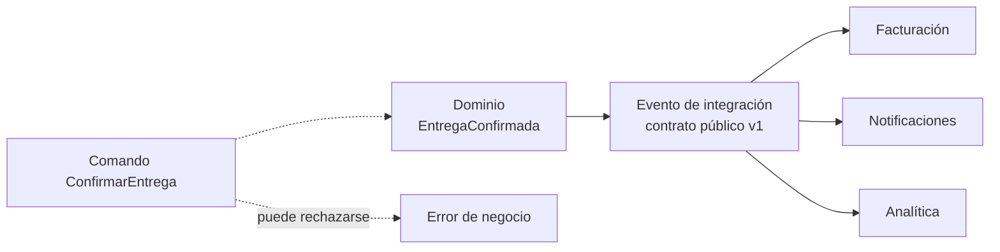
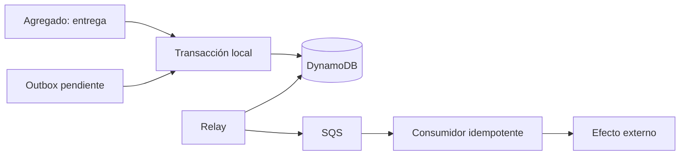
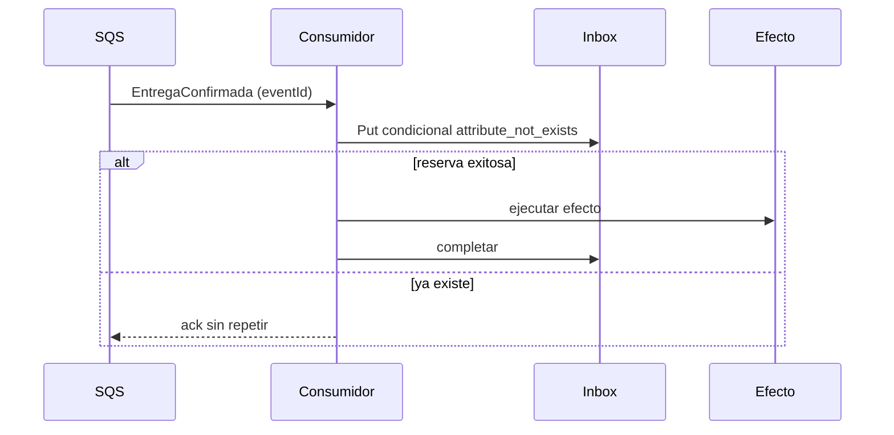
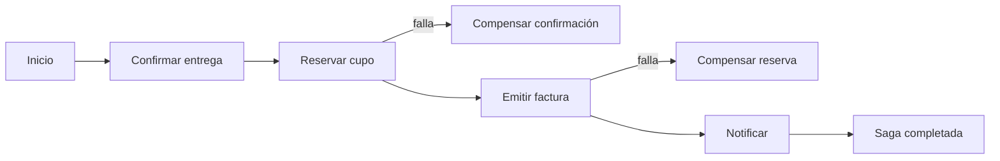

# Módulo 20: Eventos de dominio y consistencia eventual

## Aprende construyendo

Un evento no es una notificación decorativa ni un log con nombre bonito: es un **hecho ocurrido** que otro componente puede usar para decidir sin volver a preguntar. En este módulo vas a separar eventos de dominio de eventos de integración, persistir un hecho y su mensaje en la misma transacción con el patrón **outbox**, consumir mensajes duplicados sin repetir efectos y coordinar un proceso largo con **compensaciones** en lugar de una transacción distribuida.

El laboratorio usa Floci para SQS y DynamoDB local. Puedes completar los temas 1 y 4 sin Docker; los temas 2 y 3 incluyen una parte pura que se prueba con `node --test` y una integración opcional contra `http://localhost:4566`. **Conocimiento previo:** Módulo 19 (agregados y eventos de dominio), Node.js, JSON y Docker. Si trabajas en Java, el Módulo 15 de Spring Boot muestra la misma saga con transacciones y compensación; aquí el foco está en el contrato y en la evidencia reproducible.


### Tema 1: Eventos de dominio e integración: hechos, no comandos · Avanzado · 45 min

<details open>
<summary><strong>Capa 1 — Lectura</strong></summary>

#### ► DE QUÉ TRATA
Al finalizar podrás definir un evento de integración con identidad, versión y campos mínimos, validarlo antes de publicarlo y distinguirlo de un comando con pruebas que fallen ante un nombre o un contrato incorrecto. Conocimiento previo: Módulo 19 y node --test.

#### ► CÓMO FUNCIONA


</details>

<details>
<summary><strong>Capa 2 — Construcción</strong></summary>

#### Código y verificación


```bash
mkdir -p arquitectura-moderna/modulo-20/tema-1-eventos/{src,test}
cd arquitectura-moderna/modulo-20/tema-1-eventos
npm init -y
```

```javascript
// Contrato público v1: solo hechos y campos que otros contextos necesitan.
const VERSION = 1;

function crearEntregaConfirmada({ envioId, clienteId, pesoKg, ocurridoEn, correlationId }) {
  if (!envioId || !clienteId) throw new Error('Faltan identificadores del hecho');
  if (typeof pesoKg !== 'number' || pesoKg <= 0) throw new Error('pesoKg debe ser positivo');

  return {
    eventId: `${envioId}:EntregaConfirmada:${ocurridoEn}`,
    eventType: 'EntregaConfirmada',
    schemaVersion: VERSION,
    occurredAt: ocurridoEn,
    correlationId: correlationId ?? null,
    payload: { envioId, clienteId, pesoKg },
  };
}

function validarEvento(evento) {
  // El consumidor rechaza lo que no entiende; no adivina.
  if (evento.eventType !== 'EntregaConfirmada') throw new Error('Tipo de evento inesperado');
  if (evento.schemaVersion !== VERSION) throw new Error(`Versión no soportada: ${evento.schemaVersion}`);
  if (!evento.eventId || !evento.occurredAt) throw new Error('Evento sin identidad o fecha');
  if (evento.payload?.pesoKg <= 0) throw new Error('Payload inválido');
  return true;
}

module.exports = { crearEntregaConfirmada, validarEvento, VERSION };
```

```javascript
const test = require('node:test');
const assert = require('node:assert/strict');
const { crearEntregaConfirmada, validarEvento } = require('../src/evento-entrega');

test('el hecho publicado se puede validar y tiene identidad estable', () => {
  const evento = crearEntregaConfirmada({
    envioId: 'RF-10',
    clienteId: 'C-4',
    pesoKg: 8.5,
    ocurridoEn: '2026-10-31T09:00:00Z',
    correlationId: 'req-77',
  });

  assert.equal(validarEvento(evento), true);
  assert.equal(evento.eventType, 'EntregaConfirmada');
  assert.equal(evento.eventId, 'RF-10:EntregaConfirmada:2026-10-31T09:00:00Z');
});

test('un comando no pasa la validación de evento', () => {
  const comando = { eventType: 'ConfirmarEntrega', schemaVersion: 1, eventId: 'x', occurredAt: 'x' };
  assert.throws(() => validarEvento(comando), /Tipo de evento inesperado/);
});
```

```bash
node --test
```

</details>

### Tema 2: Outbox transaccional: guardar el hecho y el mensaje juntos · Avanzado · 45 min

<details open>
<summary><strong>Capa 1 — Lectura</strong></summary>

#### ► DE QUÉ TRATA
Al finalizar podrás guardar un agregado y su evento en una transacción de DynamoDB, publicar el evento con un relay y demostrar que un fallo entre la escritura y la publicación no pierde el mensaje. Conocimiento previo: Tema 1, AWS SDK v3, Docker y node --test.

#### ► CÓMO FUNCIONA


</details>

<details>
<summary><strong>Capa 2 — Construcción</strong></summary>

#### Código y verificación


```bash
mkdir -p arquitectura-moderna/modulo-20/tema-2-outbox/{src,scripts,test}
cd arquitectura-moderna/modulo-20/tema-2-outbox
npm init -y
npm pkg set type=module
npm install @aws-sdk/client-dynamodb @aws-sdk/lib-dynamodb @aws-sdk/client-sqs
```

```anatomy
outbox-transaccional
```

```javascript
// Una sola transacción escribe el agregado y el mensaje pendiente.
import { DynamoDBClient } from '@aws-sdk/client-dynamodb';
import { DynamoDBDocumentClient, TransactWriteCommand } from '@aws-sdk/lib-dynamodb';

const cliente = DynamoDBDocumentClient.from(new DynamoDBClient({
  region: 'us-east-1',
  endpoint: 'http://localhost:4566',
  credentials: { accessKeyId: 'test', secretAccessKey: 'test' },
}));

export async function confirmarConOutbox({ envioId, ocurridoEn, evento }) {
  await cliente.send(new TransactWriteCommand({
    TransactItems: [
      {
        Put: {
          TableName: 'rutaflow_envios',
          Item: { pk: `ENVIO#${envioId}`, estado: 'entregado', ocurridoEn },
          ConditionExpression: 'attribute_exists(pk)',
        },
      },
      {
        Put: {
          TableName: 'rutaflow_outbox',
          Item: {
            pk: `OUTBOX#${evento.eventId}`,
            eventId: evento.eventId,
            payload: evento,
            estado: 'pendiente',
            intentos: 0,
          },
          ConditionExpression: 'attribute_not_exists(pk)',
        },
      },
    ],
  }));
}
```

```javascript
// Registra la confirmación de RF-1 y su evento en una sola transacción.
import { randomUUID } from 'node:crypto';
import { confirmarConOutbox } from '../src/outbox.js';

const ocurridoEn = new Date().toISOString();
const evento = { eventId: randomUUID(), tipo: 'EntregaConfirmada', envioId: 'RF-1', ocurridoEn };

await confirmarConOutbox({ envioId: 'RF-1', ocurridoEn, evento });
console.log(`registrado ${evento.eventId} como pendiente`);
```

```javascript
// El relay publica después del commit; si falla, el mensaje sigue pendiente.
import { pathToFileURL } from 'node:url';
import { DynamoDBClient } from '@aws-sdk/client-dynamodb';
import { DynamoDBDocumentClient, ScanCommand, UpdateCommand } from '@aws-sdk/lib-dynamodb';
import { SQSClient, SendMessageCommand } from '@aws-sdk/client-sqs';

export async function relay({ documentos, sqs, queueUrl }) {
  let publicados = 0;
  let desde; // clave donde continúa el Scan en la página siguiente
  do {
    const pagina = await documentos.send(new ScanCommand({
      TableName: 'rutaflow_outbox',
      FilterExpression: 'estado = :pendiente',
      ExpressionAttributeValues: { ':pendiente': 'pendiente' },
      ConsistentRead: true,
      ExclusiveStartKey: desde,
    }));

    for (const item of pagina.Items ?? []) {
      await sqs.send(new SendMessageCommand({
        QueueUrl: queueUrl,
        MessageBody: JSON.stringify(item.payload),
      }));

      await documentos.send(new UpdateCommand({
        TableName: 'rutaflow_outbox',
        Key: { pk: item.pk },
        UpdateExpression: 'SET estado = :publicado, intentos = intentos + :uno',
        ExpressionAttributeValues: { ':publicado': 'publicado', ':uno': 1 },
      }));
      publicados += 1;
    }
    desde = pagina.LastEvaluatedKey;
  } while (desde);
  return publicados;
}

if (import.meta.url === pathToFileURL(process.argv[1]).href) {
  const queueUrl = process.env.SQS_QUEUE_URL;
  if (!queueUrl) throw new Error('Define SQS_QUEUE_URL antes de ejecutar el relay');
  const conexion = {
    region: 'us-east-1',
    endpoint: 'http://localhost:4566',
    credentials: { accessKeyId: 'test', secretAccessKey: 'test' },
  };
  const documentos = DynamoDBDocumentClient.from(new DynamoDBClient(conexion));
  const sqs = new SQSClient(conexion);
  console.log(`publicados: ${await relay({ documentos, sqs, queueUrl })}`);
}
```

</details>

### Tema 3: Idempotencia y orden: consumidores que sobreviven a reintentos · Avanzado · 45 min

<details open>
<summary><strong>Capa 1 — Lectura</strong></summary>

#### ► DE QUÉ TRATA
Al finalizar podrás procesar un mensaje dos veces y demostrar que el efecto se aplica una sola vez, con una escritura condicional y una prueba que distinga duplicado de error real. Conocimiento previo: Tema 2, DynamoDB y node --test.

#### ► CÓMO FUNCIONA


</details>

<details>
<summary><strong>Capa 2 — Construcción</strong></summary>

#### Código y verificación


```bash
mkdir -p arquitectura-moderna/modulo-20/tema-3-idempotencia/{src,test}
cd arquitectura-moderna/modulo-20/tema-3-idempotencia
npm init -y
npm pkg set type=module
```

```javascript
// El consumidor reserva la clave antes de ejecutar el efecto.
export async function procesar(mensaje, { almacen, efecto }) {
  const clave = mensaje.eventId;
  if (!clave) throw new Error('Mensaje sin eventId');

  const reservado = await almacen.reservar(clave);
  if (!reservado) {
    return { estado: 'duplicado', eventId: clave };
  }

  try {
    await efecto(mensaje);
    await almacen.completar(clave);
    return { estado: 'procesado', eventId: clave };
  } catch (error) {
    await almacen.liberar(clave);
    throw error;
  }
}
```

```javascript
// Almacén de prueba: la reserva es atómica para el caso de un solo proceso.
export function crearAlmacen() {
  const claves = new Map();
  return {
    async reservar(clave) {
      if (claves.has(clave)) return false;
      claves.set(clave, 'reservado');
      return true;
    },
    async completar(clave) {
      claves.set(clave, 'completado');
    },
    async liberar(clave) {
      claves.delete(clave);
    },
    estado(clave) {
      return claves.get(clave);
    },
  };
}
```

```javascript
import test from 'node:test';
import assert from 'node:assert/strict';
import { procesar } from '../src/consumidor.js';
import { crearAlmacen } from '../src/almacen.js';

test('el mismo eventId no ejecuta el efecto dos veces', async () => {
  const almacen = crearAlmacen();
  let cobros = 0;
  const efecto = async () => { cobros += 1; };
  const mensaje = { eventId: 'RF-10:EntregaConfirmada:2026-10-31T09:00:00Z' };

  const primero = await procesar(mensaje, { almacen, efecto });
  const segundo = await procesar(mensaje, { almacen, efecto });

  assert.equal(primero.estado, 'procesado');
  assert.equal(segundo.estado, 'duplicado');
  assert.equal(cobros, 1);
});

test('si el efecto falla, la clave se libera para reintentar', async () => {
  const almacen = crearAlmacen();
  const mensaje = { eventId: 'RF-11' };

  await assert.rejects(() => procesar(mensaje, {
    almacen,
    efecto: async () => { throw new Error('proveedor caído'); },
  }), /proveedor caído/);

  assert.equal(almacen.estado('RF-11'), undefined);
});
```

```bash
node --test
```

</details>

### Tema 4: Sagas y compensaciones: procesos largos sin transacción distribuida · Avanzado · 45 min

<details open>
<summary><strong>Capa 1 — Lectura</strong></summary>

#### ► DE QUÉ TRATA
Al finalizar podrás implementar una saga orquestada con tres pasos, ejecutar una compensación cuando el segundo falla y demostrar que la compensación es idempotente. Conocimiento previo: Temas 1 a 3, funciones asíncronas y node --test.

#### ► CÓMO FUNCIONA


</details>

<details>
<summary><strong>Capa 2 — Construcción</strong></summary>

#### Código y verificación


```bash
mkdir -p arquitectura-moderna/modulo-20/tema-4-sagas/{src,test}
cd arquitectura-moderna/modulo-20/tema-4-sagas
npm init -y
npm pkg set type=module
```

```javascript
// Cada paso declara su compensación; la saga guarda el progreso.
export async function ejecutarSaga({ envioId, pasos, registro }) {
  const completados = [];

  for (const paso of pasos) {
    try {
      await paso.ejecutar(envioId);
      completados.push(paso);
      await registro.guardar(envioId, paso.nombre, 'completado');
    } catch (error) {
      await registro.guardar(envioId, paso.nombre, 'fallido');
      for (const completado of completados.reverse()) {
        await completado.compensar(envioId);
        await registro.guardar(envioId, `${completado.nombre}:compensado`, 'ok');
      }
      throw error;
    }
  }

  return { estado: 'completada', pasos: completados.map((paso) => paso.nombre) };
}
```

```javascript
import test from 'node:test';
import assert from 'node:assert/strict';
import { ejecutarSaga } from '../src/saga.js';

test('si la reserva falla, se compensa la confirmación', async () => {
  const historial = [];
  const registro = { guardar: async (id, paso, estado) => historial.push(`${paso}:${estado}`) };
  const pasos = [
    { nombre: 'confirmar', ejecutar: async () => historial.push('confirmar:hecho'), compensar: async () => historial.push('confirmar:compensado') },
    { nombre: 'reservar', ejecutar: async () => { throw new Error('sin cupo'); }, compensar: async () => historial.push('reservar:compensado') },
  ];

  await assert.rejects(() => ejecutarSaga({ envioId: 'RF-30', pasos, registro }), /sin cupo/);

  assert.ok(historial.includes('confirmar:hecho'));
  assert.ok(historial.includes('confirmar:compensado'));
  assert.equal(historial.includes('reservar:compensado'), false);
});
```

```bash
node --test
```

</details>
