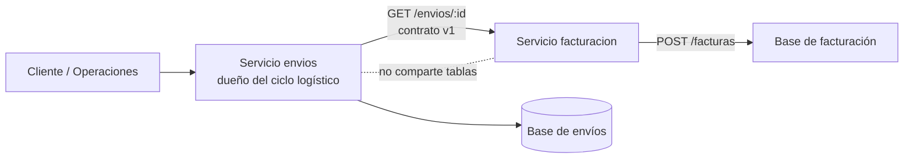
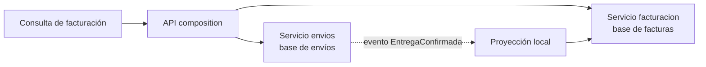
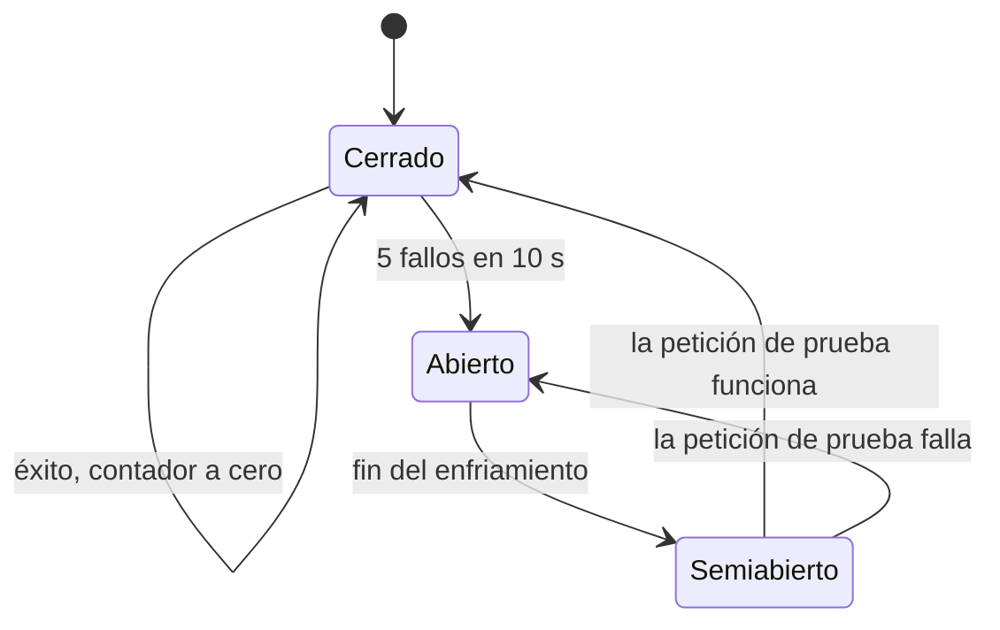
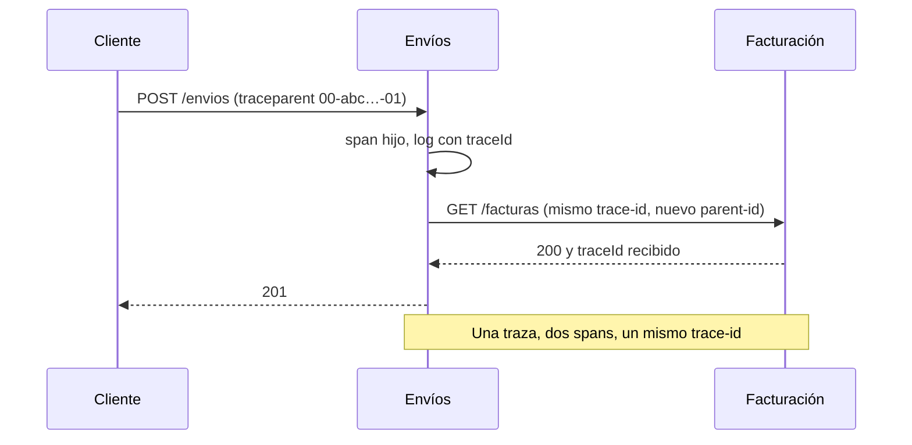

# Módulo 21: Microservicios: contratos, datos y operación

## Aprende construyendo

Un microservicio no es «un proyecto pequeño»: es una unidad desplegable con un contrato, datos propios y una responsabilidad de negocio. Este módulo convierte los límites y eventos de los módulos 19 y 20 en servicios que pueden fallar por separado. Vas a descomponer RutaFlow por capacidad de negocio, definir un contrato HTTP verificable, impedir que dos servicios compartan la misma tabla, añadir timeouts y un cortacircuitos, y propagar un identificador de traza para diagnosticar una petición que cruza procesos.

Cada tema se ejecuta con `node --test` y no requiere Docker; el Módulo 22 lleva estos conceptos a un laboratorio con Floci, contenedores y Terraform. **Conocimiento previo:** Módulos 19 y 20, Node.js, HTTP y JSON. Si trabajas con Spring Boot, el Módulo 15 muestra bulkhead, rate limiter y saga en Java; aquí el foco está en los contratos y en las decisiones que puedes verificar sin framework.

### Tema 1: Descomponer por capacidad de negocio: dos servicios, un contrato

**¿Por qué es importante?** Porque dividir por capas técnicas («servicio de controladores», «servicio de base de datos») produce servicios que cambian juntos y se despliegan juntos, sin ganar autonomía. Dividir por **capacidad de negocio** —envíos, facturación, notificaciones— alinea cada despliegue con un equipo y un ciclo de cambio, y permite definir un contrato que sobreviva a la implementación interna.

**Analogía:** una ciudad con distritos especializados. El distrito de bomberos no necesita saber cómo funciona el de sanidad para atender una emergencia; ambos comparten calles y protocolos, no empleados. Si todos los distritos compartieran el mismo edificio y el mismo horario, no serían distritos autónomos.

**Conceptos clave:** capacidad de negocio, servicio desplegable, contrato, límite de contexto, propiedad de datos y contrato de consumidor.

Una **capacidad de negocio** es algo que la organización hace para entregar valor: gestionar envíos, facturar, notificar. Un servicio que la representa debe poder cambiar su implementación sin que los consumidores reescriban su código, siempre que el contrato se respete. El contrato incluye la ruta, el método, los campos obligatorios, los códigos de error y la semántica de cada campo.

El caso de RutaFlow: `envios` expone `GET /envios/:id` con `id`, `estado`, `clienteId`, `pesoKg` y `actualizadoEn`. `facturacion` consume ese contrato para emitir una factura. Si `envios` renombra `pesoKg` a `peso`, el consumidor se rompe aunque el servicio siga «funcionando». Una prueba de contrato detecta el cambio antes del despliegue.

**Diagrama:**



#### Paso 1 · Objetivo y preparación

Al finalizar podrás implementar dos servicios HTTP mínimos, verificar su contrato con una prueba que arranca ambos en puertos efímeros y demostrar que un cambio incompatible rompe la prueba antes de llegar a producción. **Conocimiento previo:** `node:http`, `fetch` y `node --test`.

```bash
mkdir -p arquitectura-moderna/modulo-21/tema-1-contratos/{src/envios,src/facturacion,test}
cd arquitectura-moderna/modulo-21/tema-1-contratos
npm init -y
npm pkg set type=module
```

#### Paso 2 · Contexto y caso real

**Caso real:** el equipo extrajo Facturación como servicio y acordó consumir `GET /envios/:id`. Dos sprints después, Envíos cambió `pesoKg` por `pesoGramos` para «unificar unidades». El contrato no estaba documentado ni probado; Facturación empezó a calcular facturas con `undefined` y el error apareció como totales en cero. El despliegue de Envíos era correcto según sus pruebas unitarias; el sistema falló en la frontera.

La lección: un servicio es autónomo solo si su contrato está explícito y verificado. La prueba de contrato no necesita levantar toda la infraestructura; puede ejecutar ambos servicios en memoria y comprobar la forma de la respuesta.

#### Paso 3 · Teoría, modelo mental y analogía

Descomponer por capacidad de negocio no significa crear un servicio por entidad. `Envio` y `Factura` pueden ser entidades de la misma capacidad si siempre cambian juntas; separarlas añade una frontera sin autonomía. La pregunta correcta es: **¿qué cambios queremos poder desplegar sin coordinar con otro equipo?** Si la respuesta es «el cálculo de tarifas», ese es el límite; si es «el estado del envío y la factura siempre cambian juntos», quizá no hay dos servicios.

Un contrato HTTP debe incluir los errores. Un `404` con cuerpo vacío y un `404` con `{ error: 'envio_no_encontrado' }` no son equivalentes para el consumidor. Documenta también los códigos `409` (conflicto), `422` (validación) y `503` (dependencia no disponible), y decide qué campos son obligatorios. Un contrato que solo describe el caso feliz no es un contrato.

**Modelo mental:** un tratado comercial. Cada país puede cambiar sus leyes internas, pero el tratado define qué productos cruzan la frontera, con qué aranceles y qué documentación. Si un país cambia el nombre del producto sin actualizar el tratado, la aduana del otro lado no sabe qué recibió.

**Criterio de decisión:** crea un servicio nuevo cuando haya un ciclo de despliegue, una carga o una responsabilidad de datos que justifique la independencia. No lo crees solo para «usar microservicios» ni para separar capas técnicas. Si dos servicios comparten una transacción, una tabla o un despliegue obligatorio, la frontera todavía no está lista.

#### Paso 4 · Demostración guiada desde cero

Crea `src/envios/server.mjs` con una función que devuelve un servidor sin escuchar, para poder probarlo:

```javascript
// Servicio de envíos: dueño de su dato y de su contrato público.
import { createServer } from 'node:http';

export function crearServidorEnvios(envios) {
  return createServer((req, res) => {
    const url = new URL(req.url, 'http://localhost');
    const match = url.pathname.match(/^\/envios\/([^/]+)$/);
    if (req.method !== 'GET' || !match) {
      res.writeHead(404, { 'content-type': 'application/json' });
      res.end(JSON.stringify({ error: 'ruta_no_encontrada' }));
      return;
    }
    const envio = envios[match[1]];
    if (!envio) {
      res.writeHead(404, { 'content-type': 'application/json' });
      res.end(JSON.stringify({ error: 'envio_no_encontrado' }));
      return;
    }
    res.writeHead(200, { 'content-type': 'application/json' });
    res.end(JSON.stringify({
      id: envio.id,
      estado: envio.estado,
      clienteId: envio.clienteId,
      pesoKg: envio.pesoKg,
      actualizadoEn: envio.actualizadoEn,
    }));
  });
}
```

La prueba de contrato arranca el servidor en el puerto 0 y verifica la forma exacta de la respuesta:

```javascript
import test from 'node:test';
import assert from 'node:assert/strict';
import { crearServidorEnvios } from '../src/envios/server.mjs';

test('el contrato de envios conserva los campos que facturacion consume', async () => {
  const servidor = crearServidorEnvios({
    'RF-1': { id: 'RF-1', estado: 'entregado', clienteId: 'C-1', pesoKg: 8, actualizadoEn: '2026-10-31' },
  });
  await new Promise((resolve) => servidor.listen(0, resolve));
  const puerto = servidor.address().port;

  const respuesta = await fetch(`http://127.0.0.1:${puerto}/envios/RF-1`);
  const cuerpo = await respuesta.json();

  assert.equal(respuesta.status, 200);
  assert.deepEqual(Object.keys(cuerpo).sort(), ['actualizadoEn', 'clienteId', 'estado', 'id', 'pesoKg']);

  servidor.close();
});
```

Ejecuta:

```bash
node --test
```

**Resultado esperado:** una prueba en verde; el contrato contiene exactamente cinco campos y conserva `pesoKg`.

**Fallo deliberado:** en `crearServidorEnvios`, cambia `pesoKg: envio.pesoKg` por `peso: envio.pesoKg` y ejecuta de nuevo. La prueba falla en `assert.deepEqual` porque las claves son `peso` en lugar de `pesoKg`. Diagnostica: el servicio sigue respondiendo 200, pero rompió a su consumidor. El contrato detectó la incompatibilidad antes de desplegar. Restaura el nombre.

#### Paso 5 · Práctica guiada

Agrega un endpoint `POST /envios/:id/confirmar` que devuelva `409` si la entrega ya está confirmada y `200` con el estado actualizado si es válida. Extiende la prueba de contrato para cubrir ambos códigos y el cuerpo de error. **Pista:** prueba el `409` antes del `200` con una entrega ya confirmada; si tu servidor devuelve `500`, el contrato de errores no está implementado y el consumidor no puede distinguir un conflicto de una caída.

#### Paso 6 · Práctica independiente

Define el contrato de Facturación en OpenAPI con `POST /facturas`, sus campos obligatorios y sus errores. Implementa un consumidor que llame a Envíos, valide la respuesta y falle con un mensaje claro si el contrato cambia. Añade al proyecto integrador una tabla de compatibilidad: qué cambio de campo requiere una versión nueva y cuál puede ser aditivo.

#### Paso 7 · Cierre

Siguiente paso: el Tema 2 aborda el problema que aparece cuando cada servicio tiene su propia base y una consulta necesita datos de ambos.

**Errores comunes:** dividir por capas técnicas; compartir la base «para simplificar»; documentar solo el caso feliz; cambiar un campo sin prueba de contrato; llamar directamente a la base de otro servicio.

**Límites y decisión de uso:** un contrato HTTP no garantiza que el consumidor entienda la semántica; documenta qué significa cada estado. No conviertas cada cambio interno en una versión nueva si el contrato no cambia. Si dos servicios se despliegan siempre juntos, la frontera no aporta autonomía y probablemente debas unirlos.

**Fuentes oficiales:** [microservices.io — Decompose by business capability](https://microservices.io/patterns/decomposition/decompose-by-business-capability.html) y [OpenAPI Specification](https://spec.openapis.org/oas/latest.html).

### Tema 2: Datos por servicio: propiedad, composición y réplicas

**¿Por qué es importante?** Porque compartir una base de datos entre servicios crea un acoplamiento invisible: un cambio de esquema en uno rompe al otro aunque los contratos HTTP no cambien. La propiedad de datos permite que cada servicio evolucione su modelo interno, pero obliga a resolver las consultas que cruzan contextos con composición, eventos o réplicas explícitas.

**Analogía:** dos archivos de una empresa. Si ambos comparten la misma carpeta y alguien reorganiza los documentos, el otro pierde el acceso. Si cada archivo mantiene su carpeta y comparte copias certificadas, puede trabajar sin depender del desorden ajeno, aunque deba actualizar la copia cuando cambie el original.

**Conceptos clave:** propiedad de datos, base por servicio, composición de API, replicación dirigida por eventos, dato autoritativo y consistencia eventual.

Cada servicio es **dueño** de los datos que necesita para cumplir su responsabilidad. Solo él escribe en su base; los demás leen a través de su contrato. Una consulta que necesita datos de dos servicios puede resolverse con **composición de API**: el servicio que consulta llama a ambos y combina la respuesta. También puede mantener una **réplica** actualizada por eventos, aceptando que durante unos segundos el dato esté desactualizado.

El caso de RutaFlow: Facturación necesita el peso facturable y el estado de la entrega. No debe consultar la tabla `envios`; puede pedir `GET /envios/:id` o mantener una proyección local actualizada con `EntregaConfirmada`. La composición es simple pero añade latencia y un punto de fallo; la réplica es rápida pero introduce retraso y necesita reconciliación.

**Diagrama:**



#### Paso 1 · Objetivo y preparación

Al finalizar podrás implementar una composición que combine datos de dos servicios, devolver un resultado parcial cuando una dependencia falla y explicar por qué una réplica actualizada por eventos cambia el problema de latencia por el de consistencia. **Conocimiento previo:** Tema 1 y funciones asíncronas.

```bash
mkdir -p arquitectura-moderna/modulo-21/tema-2-datos/{src,test}
cd arquitectura-moderna/modulo-21/tema-2-datos
npm init -y
npm pkg set type=module
```

#### Paso 2 · Contexto y caso real

**Caso real:** Facturación consultaba directamente la tabla `envios` porque «era más rápido». Un día Envíos agregó una columna obligatoria y renombró `peso_kg`; las facturas empezaron a salir con peso cero. El equipo de Envíos no sabía que Facturación dependía de su esquema porque no había contrato ni prueba. La base compartida ocultó la dependencia hasta que el cambio llegó a producción.

La solución fue separar los datos y definir dos caminos: composición para consultas puntuales y una proyección local para reportes frecuentes. La proyección se actualiza con eventos y tiene un retraso medible; el equipo prefiere un dato segundos atrás a una consulta que tumba ambos servicios.

#### Paso 3 · Teoría, modelo mental y analogía

La **composición de API** es fácil de entender pero tiene costes: una consulta depende de la disponibilidad y la latencia de varios servicios. Si un servicio falla, ¿devuelves error completo o un resultado parcial? La respuesta depende del negocio. Para una ficha de envío, quizá puedas mostrar el estado logístico aunque falte la factura; para un cobro, no puedes inventar el importe.

La **réplica dirigida por eventos** mantiene una copia local de los campos que el consumidor necesita. No es una copia de la base completa: es una proyección con los campos y el formato del consumidor. Debe tener una clave estable, una versión o fecha del último evento aplicado y una forma de reconstruirse si se corrompe. La consistencia es eventual; el consumidor debe tolerar un retraso y no usarla para decisiones que exijan el dato exacto del instante.

**Modelo mental:** el tablero de una estación. El tren real es la fuente autoritativa; el tablero muestra una copia actualizada con unos segundos de retraso. Si el tablero falla, no detienes los trenes; si el retraso supera un umbral, avisas. No usas el tablero para decidir si el tren ya pasó, solo para orientarte.

**Criterio de decisión:** usa composición cuando la consulta sea poco frecuente y necesites el dato actual; usa una proyección cuando la consulta sea frecuente, toleres retraso y quieras desacoplar la disponibilidad. No compartas la base ni siquiera «solo para leer»: la lectura crea una dependencia de esquema que el contrato no protege.

#### Paso 4 · Demostración guiada desde cero

Crea `src/composicion.js` con dependencias inyectadas para poder probar el fallo parcial:

```javascript
// Compone datos de dos servicios sin compartir sus bases.
export async function consultarEnvioConFactura(envioId, { envios, facturas }) {
  const envio = await envios.obtener(envioId);
  if (!envio) return { estado: 'no_encontrado' };

  try {
    const factura = await facturas.obtenerPorEnvio(envioId);
    return { estado: 'completo', envio, factura };
  } catch (error) {
    // El envío existe; la factura es información complementaria.
    return { estado: 'parcial', envio, aviso: 'facturacion_no_disponible' };
  }
}
```

```javascript
import test from 'node:test';
import assert from 'node:assert/strict';
import { consultarEnvioConFactura } from '../src/composicion.js';

test('si facturación falla, devuelve el envío con un aviso explícito', async () => {
  const resultado = await consultarEnvioConFactura('RF-1', {
    envios: { obtener: async () => ({ id: 'RF-1', estado: 'entregado' }) },
    facturas: { obtenerPorEnvio: async () => { throw new Error('timeout'); } },
  });

  assert.equal(resultado.estado, 'parcial');
  assert.equal(resultado.envio.estado, 'entregado');
  assert.equal(resultado.aviso, 'facturacion_no_disponible');
});

test('no consulta la base de envíos desde facturación', async () => {
  let consultasDirectas = 0;
  const resultado = await consultarEnvioConFactura('RF-2', {
    envios: { obtener: async () => ({ id: 'RF-2', estado: 'en_transito' }) },
    facturas: {
      obtenerPorEnvio: async () => { consultasDirectas += 1; return { total: 100 }; },
    },
  });

  assert.equal(resultado.estado, 'completo');
  assert.equal(consultasDirectas, 1);
});
```

Ejecuta:

```bash
node --test
```

**Resultado esperado:** dos pruebas en verde; el fallo de Facturación no oculta el envío y la composición usa el contrato, no una tabla compartida.

**Fallo deliberado:** haz que `facturas.obtenerPorEnvio` lea un campo renombrado (`peso_kg` en lugar de `pesoKg`) y devuelva `undefined`. La primera prueba sigue pasando, pero la segunda puede devolver un total `NaN` si no validas. Diagnostica: la composición debe validar el contrato de la respuesta, no confiar en que el otro servicio siempre devuelve lo esperado. Agrega una validación y una prueba para el dato inválido.

#### Paso 5 · Práctica guiada

Implementa una proyección local `facturas_por_envio` que se actualice con `EntregaConfirmada` y exponga `actualizadoEn`. Escribe una prueba que aplique el mismo evento dos veces y verifique que la proyección no duplica la factura. **Pista:** la proyección necesita una clave de idempotencia, igual que el consumidor del Módulo 20; si solo usas `upsert` por `envioId`, un evento viejo puede sobrescribir uno nuevo.

#### Paso 6 · Práctica independiente

Diseña las consultas de RutaFlow que cruzan contextos: ficha de envío con factura, historial de entregas por cliente y reporte de ingresos. Para cada una elige composición o proyección, documenta la latencia aceptable y el comportamiento ante fallo. Implementa una de ellas y añade al proyecto integrador una prueba de dato obsoleto.

#### Paso 7 · Cierre

Siguiente paso: el Tema 3 añade límites de tiempo y cortacircuitos para que una dependencia lenta no consuma todos los recursos del servicio que la llama.

**Errores comunes:** leer la base de otro servicio; componer en cadena sin límite de profundidad; ocultar un fallo devolviendo datos vacíos; replicar la base completa en lugar de una proyección; no versionar la proyección.

**Límites y decisión de uso:** la composición añade latencia y puntos de fallo; la proyección añade retraso y complejidad de reconciliación. No hay una opción gratuita. Si la consulta necesita consistencia fuerte entre dos servicios, probablemente la frontera está mal o el dato debería vivir en uno solo. La duplicación de datos debe tener un dueño y una política de reconstrucción.

**Fuentes oficiales:** [microservices.io — Database per service](https://microservices.io/patterns/data/database-per-service.html) y [microservices.io — API composition](https://microservices.io/patterns/data/api-composition.html).

### Tema 3: Resiliencia: timeouts, reintentos y cortacircuitos

**¿Por qué es importante?** Porque en un sistema distribuido la falla no es una excepción rara: es el estado normal de una dependencia remota. Sin timeout, una petición lenta consume un hilo o una conexión indefinidamente; sin reintentos bien diseñados, un fallo transitorio se convierte en un error visible; sin cortacircuitos, todos los clientes siguen golpeando un servicio caído y agravan la caída.

**Analogía:** una llamada telefónica con límite de espera. Si nadie contesta en treinta segundos, cuelgas y decides si vuelves a llamar; no dejas el teléfono ocupado todo el día. Si la línea está caída, dejas de marcar por un rato en lugar de insistir cada segundo.

**Conceptos clave:** timeout, deadline, reintento, backoff exponencial, jitter, cortacircuitos, bulkhead y degradación.

Un **timeout** es un límite superior para una operación. Debe ser menor que el deadline del llamador; si el cliente espera 5 segundos y el servidor tarda 10, el cliente ya abandonó cuando el servidor termina. Un **reintento** solo tiene sentido para fallos transitorios y operaciones idempotentes; reintentar un `400` o un cobro no idempotente empeora el problema.

El **backoff exponencial** separa los reintentos (1 s, 2 s, 4 s) y el **jitter** añade aleatoriedad para que miles de clientes no reintenten al mismo tiempo. Un **cortacircuitos** pasa por estados `cerrado`, `abierto` y `semiabierto`: cuando se supera un umbral de fallos, deja de llamar durante un tiempo y luego prueba una petición; si funciona, vuelve a cerrar. Un **bulkhead** limita cuántas operaciones concurrentes puede consumir una dependencia para que no agote todos los recursos del servicio.

**Diagrama:**



Cada intento dentro del estado cerrado tiene su propio timeout y su espera con backoff; el diagrama muestra la decisión que sobrevive entre peticiones, no el bucle interno de un solo intento.

**Modelo mental:** la válvula de una instalación. Si la presión sube, la válvula se cierra antes de romper la tubería; luego se abre un poco para comprobar si la presión volvió a la normalidad. No dejas la válvula abierta «para ver si aguanta».

**Criterio de decisión:** aplica timeout siempre que cruces una frontera de red. Reintenta solo errores transitorios, con un número máximo y backoff; no reintentes errores de validación ni operaciones sin clave de idempotencia. Usa cortacircuitos cuando una dependencia tenga un historial de fallos que pueda propagarse; no lo uses para ocultar un bug permanente.

#### Paso 1 · Objetivo y preparación

Al finalizar podrás implementar un cliente con timeout, reintentos con backoff y jitter, y un cortacircuitos que abra tras varios fallos, con pruebas deterministas que no dependan de esperas reales. **Conocimiento previo:** Temas 1 y 2, promesas y `AbortSignal`.

```bash
mkdir -p arquitectura-moderna/modulo-21/tema-3-resiliencia/{src,test}
cd arquitectura-moderna/modulo-21/tema-3-resiliencia
npm init -y
npm pkg set type=module
```

#### Paso 2 · Contexto y caso real

**Caso real:** el servicio de Envíos llamaba a Facturación sin timeout. Un día Facturación quedó lenta por una consulta sin índice; las peticiones de Envíos se acumularon, el pool de conexiones se agotó y Envíos dejó de responder a todo, incluso a las rutas que no usaban Facturación. El problema no era la lentitud de Facturación, sino la falta de un límite que impidiera que una dependencia lenta consumiera todos los recursos.

La solución fue un cliente con timeout de 800 ms, dos reintentos con backoff y jitter para errores `503`, y un cortacircuitos que abría después de cinco fallos en diez segundos. Envíos empezó a degradar la respuesta (mostrar el estado logístico sin factura) en lugar de caerse completo.

#### Paso 3 · Teoría, modelo mental y analogía

Los reintentos pueden amplificar una caída. Si un servicio recibe 1.000 peticiones por segundo y cada cliente reintenta tres veces, el servicio caído recibe 3.000. El backoff y el jitter reducen la sincronización, pero el límite de reintentos y el cortacircuitos son los que evitan la tormenta. Un reintento sin idempotencia puede duplicar un cobro; la resiliencia no es solo «volver a intentar».

El cortacircuitos debe tener una política de recuperación observable: cuántos fallos abren, cuánto tiempo permanece abierto, cuántas peticiones de prueba pasan en semiabierto. Si no puedes explicar esos números, no puedes operar el circuito. Además, el estado del circuito es local al proceso; con varias réplicas, cada una tiene su propia ventana y el servicio caído puede recibir tráfico de las que aún no abrieron.

**Modelo mental:** un semáforo con memoria. En verde deja pasar; tras varios accidentes pasa a rojo; después de un tiempo prueba un coche en amarillo. No cambia a verde porque «ya pasó un rato», sino porque la prueba funcionó.

**Criterio de decisión:** usa timeout y reintentos en clientes de red; usa cortacircuitos en dependencias compartidas con riesgo de fallo en cascada. No añadas reintentos a operaciones no idempotentes sin una clave de idempotencia. Si la dependencia es local y rápida, un cortacircuitos puede añadir complejidad sin beneficio; mide antes de introducirlo.

#### Paso 4 · Demostración guiada desde cero

Crea `src/cliente.js` con dependencias inyectadas para probar sin red ni esperas reales:

```javascript
// Cliente resiliente: timeout, reintentos con jitter y cortacircuitos.
export function crearCliente({ fetchImpl, ahora = () => Date.now(), dormir = (ms) => new Promise((r) => setTimeout(r, ms)), maxIntentos = 3, timeoutMs = 200, umbral = 3, enfriamientoMs = 1000 }) {
  const estado = { fallos: 0, abiertoHasta: 0 };

  return async function pedir(url) {
    if (ahora() < estado.abiertoHasta) {
      throw new Error('circuito_abierto');
    }

    for (let intento = 1; intento <= maxIntentos; intento += 1) {
      const controlador = new AbortController();
      const temporizador = setTimeout(() => controlador.abort(), timeoutMs);
      try {
        const respuesta = await fetchImpl(url, { signal: controlador.signal });
        clearTimeout(temporizador);
        if (!respuesta.ok) throw new Error(`http_${respuesta.status}`);
        estado.fallos = 0;
        return respuesta;
      } catch (error) {
        clearTimeout(temporizador);
        estado.fallos += 1;
        if (estado.fallos >= umbral) {
          estado.abiertoHasta = ahora() + enfriamientoMs;
          throw new Error('circuito_abierto');
        }
        if (intento === maxIntentos) throw error;
        const espera = 50 * 2 ** (intento - 1) + Math.floor(Math.random() * 25);
        await dormir(espera);
      }
    }
  };
}
```

La prueba usa un `fetchImpl` que falla dos veces y luego responde, y un reloj controlado:

```javascript
import test from 'node:test';
import assert from 'node:assert/strict';
import { crearCliente } from '../src/cliente.js';

test('reintenta errores transitorios y termina en éxito', async () => {
  let llamadas = 0;
  const cliente = crearCliente({
    fetchImpl: async () => {
      llamadas += 1;
      if (llamadas < 3) return { ok: false, status: 503 };
      return { ok: true, status: 200 };
    },
    dormir: async () => {},
    maxIntentos: 3,
    umbral: 10,
  });

  const respuesta = await cliente('http://facturacion/facturas/RF-1');
  assert.equal(respuesta.status, 200);
  assert.equal(llamadas, 3);
});

test('abre el circuito tras superar el umbral de fallos', async () => {
  let tiempo = 0;
  const cliente = crearCliente({
    fetchImpl: async () => { throw new Error('conexion_rechazada'); },
    ahora: () => tiempo,
    dormir: async () => {},
    maxIntentos: 1,
    umbral: 3,
    enfriamientoMs: 1000,
  });

  for (let i = 0; i < 3; i += 1) await assert.rejects(() => cliente('http://x'));
  tiempo = 500;
  await assert.rejects(() => cliente('http://x'), /circuito_abierto/);
});
```

Ejecuta:

```bash
node --test
```

**Resultado esperado:** dos pruebas en verde; el cliente reintenta hasta tres veces y el circuito abierto rechaza sin llamar a la dependencia.

**Fallo deliberado:** elimina la comprobación `if (ahora() < estado.abiertoHasta)` y ejecuta de nuevo. La segunda prueba falla porque el cliente vuelve a llamar a la dependencia después de abrir el circuito. Diagnostica: sin la comprobación, el cortacircuitos es solo un contador de fallos que no protege nada. Restaura la condición.

#### Paso 5 · Práctica guiada

Agrega un estado `semiabierto` que permita una única petición de prueba después del enfriamiento. Si la prueba falla, vuelve a abrir; si funciona, cierra y reinicia el contador. Escribe pruebas para ambos caminos. **Pista:** el estado debe comprobarse y actualizarse antes de la llamada, no después; si dos peticiones entran a la vez en semiabierto, ambas pueden pasar y el circuito deja de proteger.

#### Paso 6 · Práctica independiente

Aplica el cliente a la composición del Tema 2: timeout de 300 ms para Facturación, dos reintentos solo para `503` y una respuesta parcial si el circuito está abierto. Documenta en el proyecto integrador qué rutas degradan y cuáles deben fallar completas. Añade una métrica de circuitos abiertos y una alerta cuando una dependencia supere un umbral.

#### Paso 7 · Cierre

Siguiente paso: el Tema 4 añade la pieza que permite diagnosticar una petición que atravesó varios servicios y medir si el sistema cumple su objetivo de confiabilidad.

**Errores comunes:** reintentar errores `4xx`; usar un timeout mayor que el del llamador; abrir el circuito sin una política de recuperación; olvidar el jitter y sincronizar los reintentos; asumir que el estado del circuito se comparte entre réplicas.

**Límites y decisión de uso:** un cortacircuitos no arregla un servicio caído; solo evita propagar la caída. Un reintento no convierte una operación no idempotente en segura. Los timeouts demasiado agresivos generan falsos positivos en picos legítimos; ajústalos con percentiles reales (p95, p99), no con una corazonada. La resiliencia tiene coste de complejidad: mide el fallo antes de añadir capas.

**Fuentes oficiales:** [AWS Builders' Library — Timeouts, retries and backoff with jitter](https://aws.amazon.com/builders-library/timeouts-retries-and-backoff-with-jitter/) y [Martin Fowler — CircuitBreaker](https://martinfowler.com/bliki/CircuitBreaker.html).

### Tema 4: Observabilidad distribuida: trazas, correlación y SLO

**¿Por qué es importante?** Porque cuando una petición cruza tres servicios, un log aislado no explica dónde se perdió el tiempo ni por qué falló. Un identificador de traza propagado permite reconstruir el recorrido; un SLO convierte la confiabilidad en una medida acordada con el negocio, en lugar de una sensación. Sin ambos, la operación depende de adivinar.

**Analogía:** el número de seguimiento de un paquete. Cada centro de distribución registra el mismo número al recibir y al enviar; con él puedes ver dónde está el paquete y cuánto tardó en cada tramo. Sin el número, cada centro tiene una lista distinta y nadie puede reconstruir el viaje.

**Conceptos clave:** traza, span, `traceparent`, correlación, log estructurado, SLI, SLO y presupuesto de error.

Una **traza** representa una operación completa; un **span** representa un tramo con inicio, fin, servicio y resultado. El estándar W3C `traceparent` propaga `trace-id`, `parent-id` y flags en una cabecera HTTP. El servicio que recibe la petición crea un span hijo y conserva el `trace-id`; así todos los logs y spans comparten la misma identidad.

Un **SLI** es una medida (por ejemplo, porcentaje de peticiones exitosas en menos de 300 ms). Un **SLO** es el objetivo acordado para ese SLI (99,9% en 30 días). El **presupuesto de error** es lo que puedes gastar antes de incumplir; sirve para decidir si priorizas confiabilidad o nuevas funciones.

**Diagrama:**



El cliente inicia la traza; cada salto crea un span hijo con un `parent-id` nuevo, pero conserva el `trace-id`. El SLO se calcula sobre los eventos del flujo completo, no sobre los spans aislados.

**Modelo mental:** el parte de un viaje con escalas. Cada tramo tiene hora de salida, llegada y estado; el número de billete une todos los tramos. El SLO es la promesa de que el viaje completo llegará en un tiempo aceptable, no la suma de promesas incompatibles de cada tramo.

**Criterio de decisión:** instrumenta trazas cuando una petición cruce más de un servicio o cuando el tiempo de espera no se explique con una sola métrica. Define SLOs para los flujos que el negocio nota; no para cada endpoint interno. Si el volumen es bajo, un SLO de disponibilidad mensual puede ser estadísticamente ruidoso: usa ventanas más largas o indicadores de latencia.

#### Paso 1 · Objetivo y preparación

Al finalizar podrás propagar un `traceparent` entre dos servicios, registrar logs estructurados con el mismo `trace-id` y calcular un SLI básico a partir de eventos de éxito y latencia. **Conocimiento previo:** Temas 1 a 3, HTTP y JSON.

```bash
mkdir -p arquitectura-moderna/modulo-21/tema-4-observabilidad/{src,test}
cd arquitectura-moderna/modulo-21/tema-4-observabilidad
npm init -y
npm pkg set type=module
```

#### Paso 2 · Contexto y caso real

**Caso real:** una petición de confirmación tardaba cuatro segundos y el equipo revisó los logs de Envíos: la operación local duraba 40 ms. No había forma de saber que el tiempo se iba en una llamada a Facturación que reintentaba sin backoff. Los logs de cada servicio usaban identificadores distintos y no se podían correlacionar. La solución fue propagar `traceparent` y registrar `traceId`, `spanId`, `servicio`, `duracionMs` y `resultado` en cada log.

Después, el equipo definió un SLO: 99% de las confirmaciones por debajo de 800 ms durante 30 días. El presupuesto de error permitió decidir cuándo priorizar la optimización de Facturación y cuándo seguir agregando funciones.

#### Paso 3 · Teoría, modelo mental y analogía

La observabilidad no es «tener muchos logs»; es poder responder preguntas que no anticipaste. Las tres señales clásicas son métricas, logs y trazas. Las métricas son baratas y agregadas; los logs explican un caso concreto; las trazas muestran la relación entre servicios. Un log sin estructura es difícil de consultar; un log estructurado en JSON con `traceId` se puede unir a la traza.

El `traceparent` no autentica ni autoriza; solo correlaciona. Un atacante podría enviar un `traceparent` falso y contaminar la trazabilidad, así que no lo uses para decisiones de seguridad. El muestreo de trazas reduce coste: no necesitas guardar el 100% de las peticiones, pero debes muestrear también los errores para no perder justo los casos interesantes.

**Modelo mental:** una cadena de recibos con el mismo número de operación. Cada servicio añade su recibo; el número no dice si la operación fue buena o mala, pero permite reunir todos los recibos y reconstruir la historia. El SLO es la auditoría que dice si la cadena cumple el acuerdo.

**Criterio de decisión:** usa trazas para diagnóstico y SLOs para decisiones de prioridad. No midas todo: cada señal tiene coste de almacenamiento y cardinalidad. Si una métrica tiene un identificador de usuario como etiqueta, puede explotar en cardinalidad; usa logs o trazas para ese detalle. Define el SLO antes de instrumentar, para no recolectar datos que nunca usarás.

#### Paso 4 · Demostración guiada desde cero

Crea `src/traza.js` para generar y propagar el contexto:

```javascript
// Utilidades mínimas de correlación; OpenTelemetry usa el mismo estándar.
import { randomBytes } from 'node:crypto';

export function nuevoTraceparent() {
  const traceId = randomBytes(16).toString('hex');
  const spanId = randomBytes(8).toString('hex');
  return `00-${traceId}-${spanId}-01`;
}

export function leerTraceparent(header) {
  const [version, traceId, spanId, flags] = String(header ?? '').split('-');
  if (version !== '00' || traceId?.length !== 32 || spanId?.length !== 16) {
    throw new Error('traceparent inválido');
  }
  return { traceId, spanId, flags };
}

export function log(servicio, traceId, mensaje, extra = {}) {
  // Log estructurado: una línea JSON, fácil de filtrar y unir con la traza.
  console.log(JSON.stringify({ ts: new Date().toISOString(), servicio, traceId, mensaje, ...extra }));
}
```

La prueba simula dos servicios y comprueba que el segundo conserva el `trace-id`:

```javascript
import test from 'node:test';
import assert from 'node:assert/strict';
import { nuevoTraceparent, leerTraceparent } from '../src/traza.js';

test('el servicio de facturación conserva el trace-id recibido', async () => {
  const original = nuevoTraceparent();

  // Servicio simulado: lee la cabecera y devuelve el trace-id que recibió.
  const facturacion = async (url, { headers }) => {
    const contexto = leerTraceparent(headers.traceparent);
    return { ok: true, status: 200, cuerpo: { traceId: contexto.traceId } };
  };

  const respuesta = await facturacion('http://facturacion/facturas', {
    headers: { traceparent: original },
  });

  assert.equal(respuesta.cuerpo.traceId, original.split('-')[1]);
  assert.equal(respuesta.cuerpo.traceId.length, 32);
});
```

Ejecuta la prueba de la utilidad (sin red) y luego un script que calcula el SLI:

```bash
node --test
node -e "
const eventos = [
  { ok: true, ms: 120 }, { ok: true, ms: 300 }, { ok: false, ms: 900 }, { ok: true, ms: 250 },
];
const exitosos = eventos.filter((e) => e.ok && e.ms < 800).length;
console.log('SLI', (exitosos / eventos.length * 100).toFixed(1) + '%');
"
```

**Resultado esperado:** la prueba valida un `trace-id` de 32 caracteres y el cálculo imprime `SLI 75.0%` para los cuatro eventos del ejemplo.

**Fallo deliberado:** en el servicio de Facturación, genera un `nuevoTraceparent()` en lugar de leer el recibido y compara los `trace-id`. La prueba de propagación falla porque los identificadores no coinciden. Diagnostica: cada salto creó una traza nueva y ya no puedes reconstruir el recorrido completo. Corrige leyendo la cabecera y propagándola.

#### Paso 5 · Práctica guiada

Implementa dos servidores HTTP reales: Envíos recibe `traceparent` o genera uno, llama a Facturación con la misma cabecera y registra un log JSON con `traceId` y `duracionMs`. Facturación devuelve el `traceId` recibido. Escribe una prueba que verifique que ambos logs contienen el mismo identificador. **Pista:** no generes un `spanId` nuevo para el hijo sin conservar el `traceId`; el estándar permite crear un span hijo con el mismo `trace-id` y un `parent-id` distinto.

#### Paso 6 · Práctica independiente

Define dos SLOs para RutaFlow: confirmación de entrega por debajo de 800 ms y disponibilidad del endpoint de facturas. Calcula el presupuesto de error de 30 días y escribe qué harías si se consume el 80%. Añade al proyecto integrador un panel con p95, p99, tasa de error y trazas de ejemplo, y documenta qué señal usarías para diagnosticar una caída de Facturación.

#### Paso 7 · Cierre

Siguiente paso: el Módulo 22 lleva estos contratos, eventos y servicios a un laboratorio con Floci, contenedores, Terraform y ejercicios verificables.

**Errores comunes:** generar un `trace-id` nuevo en cada servicio; usar el `traceparent` como autenticación; etiquetar métricas con identificadores de alta cardinalidad; definir un SLO sin ventana ni presupuesto; guardar logs sin estructura y sin retención.

**Límites y decisión de uso:** la observabilidad tiene coste y puede exponer datos personales; define qué campos se registran y durante cuánto tiempo. Un SLO no es una promesa contractual si no hay consecuencias acordadas; es una herramienta de decisión. Las trazas muestreadas no prueban que todas las peticiones funcionen; complementa con métricas agregadas.

**Fuentes oficiales:** [W3C — Trace Context](https://www.w3.org/TR/trace-context/), [OpenTelemetry — Traces](https://opentelemetry.io/docs/concepts/signals/traces/) y [Google SRE Workbook — Implementing SLOs](https://sre.google/workbook/implementing-slos/).
