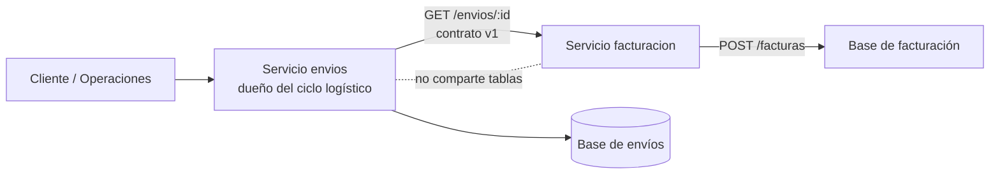
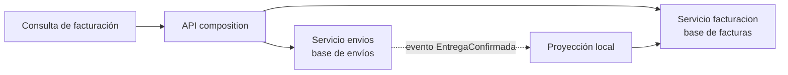
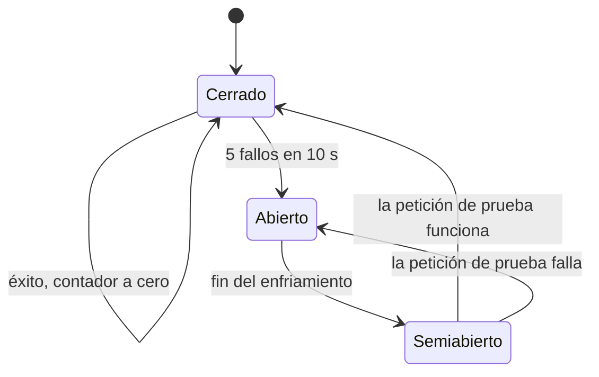
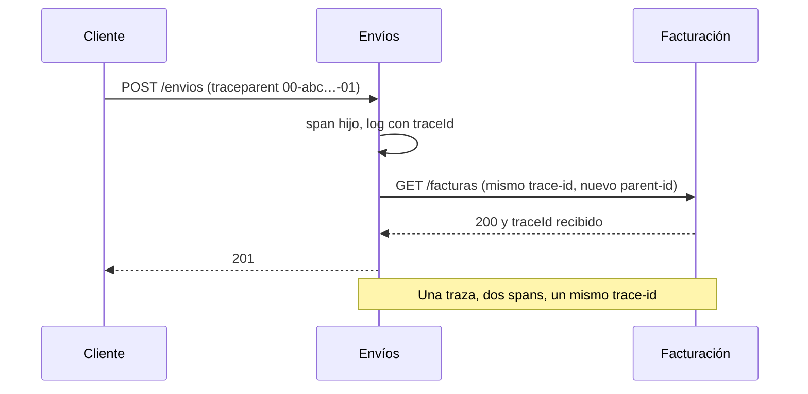

# Módulo 21: Microservicios: contratos, datos y operación

## Aprende construyendo

Un microservicio no es «un proyecto pequeño»: es una unidad desplegable con un contrato, datos propios y una responsabilidad de negocio. Este módulo convierte los límites y eventos de los módulos 19 y 20 en servicios que pueden fallar por separado. Vas a descomponer RutaFlow por capacidad de negocio, definir un contrato HTTP verificable, impedir que dos servicios compartan la misma tabla, añadir timeouts y un cortacircuitos, y propagar un identificador de traza para diagnosticar una petición que cruza procesos.

Cada tema se ejecuta con `node --test` y no requiere Docker; el Módulo 22 lleva estos conceptos a un laboratorio con Floci, contenedores y Terraform. **Conocimiento previo:** Módulos 19 y 20, Node.js, HTTP y JSON. Si trabajas con Spring Boot, los Módulos 16 (bulkhead y rate limiter) y 17 (saga) lo muestran en Java; aquí el foco está en los contratos y en las decisiones que puedes verificar sin framework.


### Tema 1: Descomponer por capacidad de negocio: dos servicios, un contrato · Avanzado · 45 min

<details open>
<summary><strong>Capa 1 — Lectura</strong></summary>

#### ► DE QUÉ TRATA
Al finalizar podrás implementar dos servicios HTTP mínimos, verificar su contrato con una prueba que arranca ambos en puertos efímeros y demostrar que un cambio incompatible rompe la prueba antes de llegar a producción. Conocimiento previo: node:http, fetch y node --test.

#### ► LA IDEA EN UNA FRASE
**Al finalizar podrás implementar dos servicios HTTP mínimos, verificar su contrato con una prueba que arranca ambos en puertos efímeros y demostrar que un cambio incompatible rompe la prueba antes de llegar a producción.**

#### ► POR QUÉ EXISTE ESTO
Resuelve un problema real de diseño o implementación y evita decisiones a ciegas.

#### ► LA ANALOGÍA
Piensa en descomponer por capacidad de negocio: dos servicios, un contrato como una herramienta de taller: útil cuando conoces su propósito y sus límites.
**Dónde se rompe la analogía:** en software, los efectos dependen del contexto, la escala y los trade-offs.

#### ► CÓMO FUNCIONA


#### ► LO QUE PUEDE SALIR MAL
| Síntoma | Causa probable | Arreglo |
|---|---|---|
| Descomponer por capacidad de negocio: dos servicios, un contrato se aplica pero el resultado no mejora | Se usó sin medir el problema real | Mide antes y compara contra la alternativa simple |
| Aparece complejidad inesperada | Se adoptó la técnica sin comprender sus trade-offs | Vuelve a la sección de trade-offs y reduce el alcance |
| Falla en un caso límite | Se asumió un contexto que no se cumple | Prueba el caso límite y documenta cuándo NO usarlo |

#### ► TRADE-OFFS
| Opción | Cuándo usarla | Cuándo NO usarla |
|---|---|---|
| Usar Descomponer por capacidad de negocio: dos servicios, un contrato | Cuando el problema coincide con su propósito y el beneficio es observable | Cuando agrega complejidad sin resolver un problema real |
| Alternativa más simple | Cuando el contexto es pequeño, estable o fácil de razonar | Cuando ya demostró no escalar o no cumplir el requisito |
| Postergar la decisión | Cuando falta evidencia del problema | Cuando el costo de esperar es mayor que el costo de probar |

#### ► CUÁNDO NO USAR ESTO
No uses descomponer por capacidad de negocio: dos servicios, un contrato por defecto. Aplícalo cuando el problema lo justifique y puedas verificar el beneficio; si una alternativa más simple resuelve igual, prefiérela.

#### ► DE VUELTA A LA ANALOGÍA
Volviendo a la analogía: descomponer por capacidad de negocio: dos servicios, un contrato funciona como el modelo inicial, pero recuerda dónde se rompe: en producción importan la evidencia, la escala y el costo de equivocarte.

#### ► LO QUE DEBES RECORDAR
- Descomponer por capacidad de negocio: dos servicios, un contrato existe para resolver un problema específico.
- Mide antes de adoptar complejidad.
- Conoce el caso donde NO usarlo.
- Verifica con evidencia observable.

#### ► PREGUNTAS PARA PENSAR
1. ¿Qué problema concreto resuelve descomponer por capacidad de negocio: dos servicios, un contrato en tu contexto?
2. ¿Cómo sabrías que descomponer por capacidad de negocio: dos servicios, un contrato no está funcionando bien?
3. ¿Qué alternativa más simple considerarías antes de usar descomponer por capacidad de negocio: dos servicios, un contrato?

</details>

<details>
<summary><strong>Capa 2 — Construcción</strong></summary>

#### Código y verificación


```bash
mkdir -p arquitectura-moderna/modulo-21/tema-1-contratos/{src/envios,src/facturacion,test}
cd arquitectura-moderna/modulo-21/tema-1-contratos
npm init -y
npm pkg set type=module
```

```javascript
// Servicio de envíos: dueño de su dato y de su contrato público.
import { createServer } from 'node:http';

export function crearServidorEnvios(envios) {
  return createServer((req, res) => {
    const url = new URL(req.url, 'http://localhost');
    const match = url.pathname.match(/^\/envios\/([^/]+)$/);
    if (req.method !== 'GET' || !match) {
      res.writeHead(404, { 'content-type': 'application/json' });
      res.end(JSON.stringify({ error: 'ruta_no_encontrada' }));
      return;
    }
    const envio = envios[match[1]];
    if (!envio) {
      res.writeHead(404, { 'content-type': 'application/json' });
      res.end(JSON.stringify({ error: 'envio_no_encontrado' }));
      return;
    }
    res.writeHead(200, { 'content-type': 'application/json' });
    res.end(JSON.stringify({
      id: envio.id,
      estado: envio.estado,
      clienteId: envio.clienteId,
      pesoKg: envio.pesoKg,
      actualizadoEn: envio.actualizadoEn,
    }));
  });
}
```

```javascript
import test from 'node:test';
import assert from 'node:assert/strict';
import { crearServidorEnvios } from '../src/envios/server.mjs';

test('el contrato de envios conserva los campos que facturacion consume', async () => {
  const servidor = crearServidorEnvios({
    'RF-1': { id: 'RF-1', estado: 'entregado', clienteId: 'C-1', pesoKg: 8, actualizadoEn: '2026-10-31' },
  });
  await new Promise((resolve) => servidor.listen(0, resolve));
  const puerto = servidor.address().port;

  const respuesta = await fetch(`http://127.0.0.1:${puerto}/envios/RF-1`);
  const cuerpo = await respuesta.json();

  assert.equal(respuesta.status, 200);
  assert.deepEqual(Object.keys(cuerpo).sort(), ['actualizadoEn', 'clienteId', 'estado', 'id', 'pesoKg']);

  servidor.close();
});
```

```bash
node --test
```

</details>

### Tema 2: Datos por servicio: propiedad, composición y réplicas · Avanzado · 45 min

<details open>
<summary><strong>Capa 1 — Lectura</strong></summary>

#### ► DE QUÉ TRATA
Al finalizar podrás implementar una composición que combine datos de dos servicios, devolver un resultado parcial cuando una dependencia falla y explicar por qué una réplica actualizada por eventos cambia el problema de latencia por el de consistencia. Conocimiento previo: Tema 1…

#### ► LA IDEA EN UNA FRASE
**Al finalizar podrás implementar una composición que combine datos de dos servicios, devolver un resultado parcial cuando una dependencia falla y explicar por qué una réplica actualizada por eventos cambia el problema de latencia por el de consistencia.**

#### ► POR QUÉ EXISTE ESTO
Resuelve un problema real de diseño o implementación y evita decisiones a ciegas.

#### ► LA ANALOGÍA
Piensa en datos por servicio: propiedad, composición y réplicas como una herramienta de taller: útil cuando conoces su propósito y sus límites.
**Dónde se rompe la analogía:** en software, los efectos dependen del contexto, la escala y los trade-offs.

#### ► CÓMO FUNCIONA


#### ► LO QUE PUEDE SALIR MAL
| Síntoma | Causa probable | Arreglo |
|---|---|---|
| Datos por servicio: propiedad, composición y réplicas se aplica pero el resultado no mejora | Se usó sin medir el problema real | Mide antes y compara contra la alternativa simple |
| Aparece complejidad inesperada | Se adoptó la técnica sin comprender sus trade-offs | Vuelve a la sección de trade-offs y reduce el alcance |
| Falla en un caso límite | Se asumió un contexto que no se cumple | Prueba el caso límite y documenta cuándo NO usarlo |

#### ► TRADE-OFFS
| Opción | Cuándo usarla | Cuándo NO usarla |
|---|---|---|
| Usar Datos por servicio: propiedad, composición y réplicas | Cuando el problema coincide con su propósito y el beneficio es observable | Cuando agrega complejidad sin resolver un problema real |
| Alternativa más simple | Cuando el contexto es pequeño, estable o fácil de razonar | Cuando ya demostró no escalar o no cumplir el requisito |
| Postergar la decisión | Cuando falta evidencia del problema | Cuando el costo de esperar es mayor que el costo de probar |

#### ► CUÁNDO NO USAR ESTO
No uses datos por servicio: propiedad, composición y réplicas por defecto. Aplícalo cuando el problema lo justifique y puedas verificar el beneficio; si una alternativa más simple resuelve igual, prefiérela.

#### ► DE VUELTA A LA ANALOGÍA
Volviendo a la analogía: datos por servicio: propiedad, composición y réplicas funciona como el modelo inicial, pero recuerda dónde se rompe: en producción importan la evidencia, la escala y el costo de equivocarte.

#### ► LO QUE DEBES RECORDAR
- Datos por servicio: propiedad, composición y réplicas existe para resolver un problema específico.
- Mide antes de adoptar complejidad.
- Conoce el caso donde NO usarlo.
- Verifica con evidencia observable.

#### ► PREGUNTAS PARA PENSAR
1. ¿Qué problema concreto resuelve datos por servicio: propiedad, composición y réplicas en tu contexto?
2. ¿Cómo sabrías que datos por servicio: propiedad, composición y réplicas no está funcionando bien?
3. ¿Qué alternativa más simple considerarías antes de usar datos por servicio: propiedad, composición y réplicas?

</details>

<details>
<summary><strong>Capa 2 — Construcción</strong></summary>

#### Código y verificación


```bash
mkdir -p arquitectura-moderna/modulo-21/tema-2-datos/{src,test}
cd arquitectura-moderna/modulo-21/tema-2-datos
npm init -y
npm pkg set type=module
```

```javascript
// Compone datos de dos servicios sin compartir sus bases.
export async function consultarEnvioConFactura(envioId, { envios, facturas }) {
  const envio = await envios.obtener(envioId);
  if (!envio) return { estado: 'no_encontrado' };

  try {
    const factura = await facturas.obtenerPorEnvio(envioId);
    return { estado: 'completo', envio, factura };
  } catch (error) {
    // El envío existe; la factura es información complementaria.
    return { estado: 'parcial', envio, aviso: 'facturacion_no_disponible' };
  }
}
```

```javascript
import test from 'node:test';
import assert from 'node:assert/strict';
import { consultarEnvioConFactura } from '../src/composicion.js';

test('si facturación falla, devuelve el envío con un aviso explícito', async () => {
  const resultado = await consultarEnvioConFactura('RF-1', {
    envios: { obtener: async () => ({ id: 'RF-1', estado: 'entregado' }) },
    facturas: { obtenerPorEnvio: async () => { throw new Error('timeout'); } },
  });

  assert.equal(resultado.estado, 'parcial');
  assert.equal(resultado.envio.estado, 'entregado');
  assert.equal(resultado.aviso, 'facturacion_no_disponible');
});

test('no consulta la base de envíos desde facturación', async () => {
  let consultasDirectas = 0;
  const resultado = await consultarEnvioConFactura('RF-2', {
    envios: { obtener: async () => ({ id: 'RF-2', estado: 'en_transito' }) },
    facturas: {
      obtenerPorEnvio: async () => { consultasDirectas += 1; return { total: 100 }; },
    },
  });

  assert.equal(resultado.estado, 'completo');
  assert.equal(consultasDirectas, 1);
});
```

```bash
node --test
```

</details>

### Tema 3: Resiliencia: timeouts, reintentos y cortacircuitos · Avanzado · 45 min

<details open>
<summary><strong>Capa 1 — Lectura</strong></summary>

#### ► DE QUÉ TRATA
Al finalizar podrás implementar un cliente con timeout, reintentos con backoff y jitter, y un cortacircuitos que abra tras varios fallos, con pruebas deterministas que no dependan de esperas reales. Conocimiento previo: Temas 1 y 2, promesas y AbortSignal.

#### ► LA IDEA EN UNA FRASE
**Al finalizar podrás implementar un cliente con timeout, reintentos con backoff y jitter, y un cortacircuitos que abra tras varios fallos, con pruebas deterministas que no dependan de esperas reales.**

#### ► POR QUÉ EXISTE ESTO
Resuelve un problema real de diseño o implementación y evita decisiones a ciegas.

#### ► LA ANALOGÍA
Piensa en resiliencia: timeouts, reintentos y cortacircuitos como una herramienta de taller: útil cuando conoces su propósito y sus límites.
**Dónde se rompe la analogía:** en software, los efectos dependen del contexto, la escala y los trade-offs.

#### ► CÓMO FUNCIONA


#### ► LO QUE PUEDE SALIR MAL
| Síntoma | Causa probable | Arreglo |
|---|---|---|
| Resiliencia: timeouts, reintentos y cortacircuitos se aplica pero el resultado no mejora | Se usó sin medir el problema real | Mide antes y compara contra la alternativa simple |
| Aparece complejidad inesperada | Se adoptó la técnica sin comprender sus trade-offs | Vuelve a la sección de trade-offs y reduce el alcance |
| Falla en un caso límite | Se asumió un contexto que no se cumple | Prueba el caso límite y documenta cuándo NO usarlo |

#### ► TRADE-OFFS
| Opción | Cuándo usarla | Cuándo NO usarla |
|---|---|---|
| Usar Resiliencia: timeouts, reintentos y cortacircuitos | Cuando el problema coincide con su propósito y el beneficio es observable | Cuando agrega complejidad sin resolver un problema real |
| Alternativa más simple | Cuando el contexto es pequeño, estable o fácil de razonar | Cuando ya demostró no escalar o no cumplir el requisito |
| Postergar la decisión | Cuando falta evidencia del problema | Cuando el costo de esperar es mayor que el costo de probar |

#### ► CUÁNDO NO USAR ESTO
No uses resiliencia: timeouts, reintentos y cortacircuitos por defecto. Aplícalo cuando el problema lo justifique y puedas verificar el beneficio; si una alternativa más simple resuelve igual, prefiérela.

#### ► DE VUELTA A LA ANALOGÍA
Volviendo a la analogía: resiliencia: timeouts, reintentos y cortacircuitos funciona como el modelo inicial, pero recuerda dónde se rompe: en producción importan la evidencia, la escala y el costo de equivocarte.

#### ► LO QUE DEBES RECORDAR
- Resiliencia: timeouts, reintentos y cortacircuitos existe para resolver un problema específico.
- Mide antes de adoptar complejidad.
- Conoce el caso donde NO usarlo.
- Verifica con evidencia observable.

#### ► PREGUNTAS PARA PENSAR
1. ¿Qué problema concreto resuelve resiliencia: timeouts, reintentos y cortacircuitos en tu contexto?
2. ¿Cómo sabrías que resiliencia: timeouts, reintentos y cortacircuitos no está funcionando bien?
3. ¿Qué alternativa más simple considerarías antes de usar resiliencia: timeouts, reintentos y cortacircuitos?

</details>

<details>
<summary><strong>Capa 2 — Construcción</strong></summary>

#### Código y verificación


```bash
mkdir -p arquitectura-moderna/modulo-21/tema-3-resiliencia/{src,test}
cd arquitectura-moderna/modulo-21/tema-3-resiliencia
npm init -y
npm pkg set type=module
```

```javascript
// Cliente resiliente: timeout, reintentos con jitter y cortacircuitos.
export function crearCliente({ fetchImpl, ahora = () => Date.now(), dormir = (ms) => new Promise((r) => setTimeout(r, ms)), maxIntentos = 3, timeoutMs = 200, umbral = 3, enfriamientoMs = 1000 }) {
  const estado = { fallos: 0, abiertoHasta: 0 };

  return async function pedir(url) {
    if (ahora() < estado.abiertoHasta) {
      throw new Error('circuito_abierto');
    }

    for (let intento = 1; intento <= maxIntentos; intento += 1) {
      const controlador = new AbortController();
      const temporizador = setTimeout(() => controlador.abort(), timeoutMs);
      try {
        const respuesta = await fetchImpl(url, { signal: controlador.signal });
        clearTimeout(temporizador);
        if (!respuesta.ok) throw new Error(`http_${respuesta.status}`);
        estado.fallos = 0;
        return respuesta;
      } catch (error) {
        clearTimeout(temporizador);
        estado.fallos += 1;
        if (estado.fallos >= umbral) {
          estado.abiertoHasta = ahora() + enfriamientoMs;
          throw new Error('circuito_abierto');
        }
        if (intento === maxIntentos) throw error;
        const espera = 50 * 2 ** (intento - 1) + Math.floor(Math.random() * 25);
        await dormir(espera);
      }
    }
  };
}
```

```javascript
import test from 'node:test';
import assert from 'node:assert/strict';
import { crearCliente } from '../src/cliente.js';

test('reintenta errores transitorios y termina en éxito', async () => {
  let llamadas = 0;
  const cliente = crearCliente({
    fetchImpl: async () => {
      llamadas += 1;
      if (llamadas < 3) return { ok: false, status: 503 };
      return { ok: true, status: 200 };
    },
    dormir: async () => {},
    maxIntentos: 3,
    umbral: 10,
  });

  const respuesta = await cliente('http://facturacion/facturas/RF-1');
  assert.equal(respuesta.status, 200);
  assert.equal(llamadas, 3);
});

test('abre el circuito tras superar el umbral de fallos', async () => {
  let tiempo = 0;
  const cliente = crearCliente({
    fetchImpl: async () => { throw new Error('conexion_rechazada'); },
    ahora: () => tiempo,
    dormir: async () => {},
    maxIntentos: 1,
    umbral: 3,
    enfriamientoMs: 1000,
  });

  for (let i = 0; i < 3; i += 1) await assert.rejects(() => cliente('http://x'));
  tiempo = 500;
  await assert.rejects(() => cliente('http://x'), /circuito_abierto/);
});
```

```bash
node --test
```

</details>

### Tema 4: Observabilidad distribuida: trazas, correlación y SLO · Avanzado · 45 min

<details open>
<summary><strong>Capa 1 — Lectura</strong></summary>

#### ► DE QUÉ TRATA
Al finalizar podrás propagar un traceparent entre dos servicios, registrar logs estructurados con el mismo trace-id y calcular un SLI básico a partir de eventos de éxito y latencia. Conocimiento previo: Temas 1 a 3, HTTP y JSON.

#### ► LA IDEA EN UNA FRASE
**Al finalizar podrás propagar un traceparent entre dos servicios, registrar logs estructurados con el mismo trace-id y calcular un SLI básico a partir de eventos de éxito y latencia.**

#### ► POR QUÉ EXISTE ESTO
Resuelve un problema real de diseño o implementación y evita decisiones a ciegas.

#### ► LA ANALOGÍA
Piensa en observabilidad distribuida: trazas, correlación y slo como una herramienta de taller: útil cuando conoces su propósito y sus límites.
**Dónde se rompe la analogía:** en software, los efectos dependen del contexto, la escala y los trade-offs.

#### ► CÓMO FUNCIONA


#### ► LO QUE PUEDE SALIR MAL
| Síntoma | Causa probable | Arreglo |
|---|---|---|
| Observabilidad distribuida: trazas, correlación y SLO se aplica pero el resultado no mejora | Se usó sin medir el problema real | Mide antes y compara contra la alternativa simple |
| Aparece complejidad inesperada | Se adoptó la técnica sin comprender sus trade-offs | Vuelve a la sección de trade-offs y reduce el alcance |
| Falla en un caso límite | Se asumió un contexto que no se cumple | Prueba el caso límite y documenta cuándo NO usarlo |

#### ► TRADE-OFFS
| Opción | Cuándo usarla | Cuándo NO usarla |
|---|---|---|
| Usar Observabilidad distribuida: trazas, correlación y SLO | Cuando el problema coincide con su propósito y el beneficio es observable | Cuando agrega complejidad sin resolver un problema real |
| Alternativa más simple | Cuando el contexto es pequeño, estable o fácil de razonar | Cuando ya demostró no escalar o no cumplir el requisito |
| Postergar la decisión | Cuando falta evidencia del problema | Cuando el costo de esperar es mayor que el costo de probar |

#### ► CUÁNDO NO USAR ESTO
No uses observabilidad distribuida: trazas, correlación y slo por defecto. Aplícalo cuando el problema lo justifique y puedas verificar el beneficio; si una alternativa más simple resuelve igual, prefiérela.

#### ► DE VUELTA A LA ANALOGÍA
Volviendo a la analogía: observabilidad distribuida: trazas, correlación y slo funciona como el modelo inicial, pero recuerda dónde se rompe: en producción importan la evidencia, la escala y el costo de equivocarte.

#### ► LO QUE DEBES RECORDAR
- Observabilidad distribuida: trazas, correlación y SLO existe para resolver un problema específico.
- Mide antes de adoptar complejidad.
- Conoce el caso donde NO usarlo.
- Verifica con evidencia observable.

#### ► PREGUNTAS PARA PENSAR
1. ¿Qué problema concreto resuelve observabilidad distribuida: trazas, correlación y slo en tu contexto?
2. ¿Cómo sabrías que observabilidad distribuida: trazas, correlación y slo no está funcionando bien?
3. ¿Qué alternativa más simple considerarías antes de usar observabilidad distribuida: trazas, correlación y slo?

</details>

<details>
<summary><strong>Capa 2 — Construcción</strong></summary>

#### Código y verificación


```bash
mkdir -p arquitectura-moderna/modulo-21/tema-4-observabilidad/{src,test}
cd arquitectura-moderna/modulo-21/tema-4-observabilidad
npm init -y
npm pkg set type=module
```

```javascript
// Utilidades mínimas de correlación; OpenTelemetry usa el mismo estándar.
import { randomBytes } from 'node:crypto';

export function nuevoTraceparent() {
  const traceId = randomBytes(16).toString('hex');
  const spanId = randomBytes(8).toString('hex');
  return `00-${traceId}-${spanId}-01`;
}

export function leerTraceparent(header) {
  const [version, traceId, spanId, flags] = String(header ?? '').split('-');
  if (version !== '00' || traceId?.length !== 32 || spanId?.length !== 16) {
    throw new Error('traceparent inválido');
  }
  return { traceId, spanId, flags };
}

export function log(servicio, traceId, mensaje, extra = {}) {
  // Log estructurado: una línea JSON, fácil de filtrar y unir con la traza.
  console.log(JSON.stringify({ ts: new Date().toISOString(), servicio, traceId, mensaje, ...extra }));
}
```

```javascript
import test from 'node:test';
import assert from 'node:assert/strict';
import { nuevoTraceparent, leerTraceparent } from '../src/traza.js';

test('el servicio de facturación conserva el trace-id recibido', async () => {
  const original = nuevoTraceparent();

  // Servicio simulado: lee la cabecera y devuelve el trace-id que recibió.
  const facturacion = async (url, { headers }) => {
    const contexto = leerTraceparent(headers.traceparent);
    return { ok: true, status: 200, cuerpo: { traceId: contexto.traceId } };
  };

  const respuesta = await facturacion('http://facturacion/facturas', {
    headers: { traceparent: original },
  });

  assert.equal(respuesta.cuerpo.traceId, original.split('-')[1]);
  assert.equal(respuesta.cuerpo.traceId.length, 32);
});
```

```bash
node --test
node -e "
const eventos = [
  { ok: true, ms: 120 }, { ok: true, ms: 300 }, { ok: false, ms: 900 }, { ok: true, ms: 250 },
];
const exitosos = eventos.filter((e) => e.ok && e.ms < 800).length;
console.log('SLI', (exitosos / eventos.length * 100).toFixed(1) + '%');
"
```

</details>
