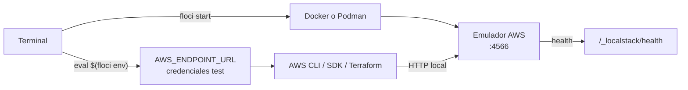
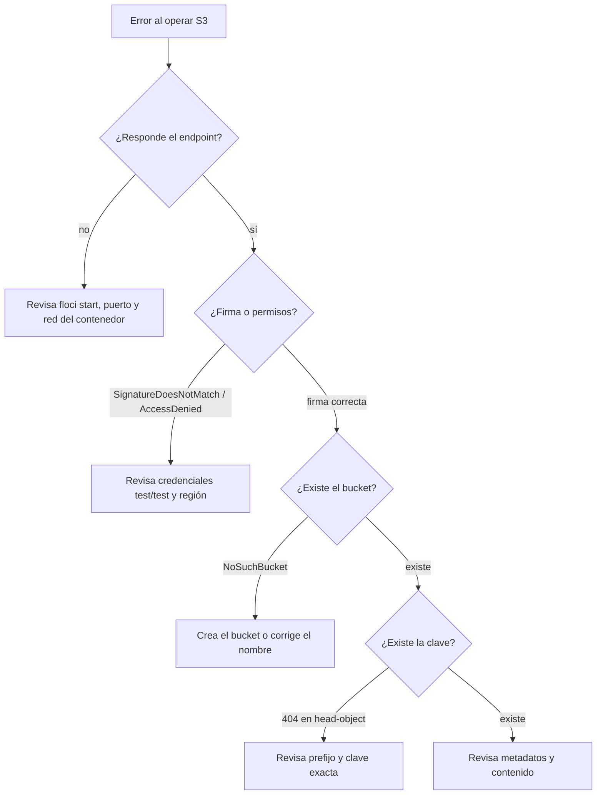
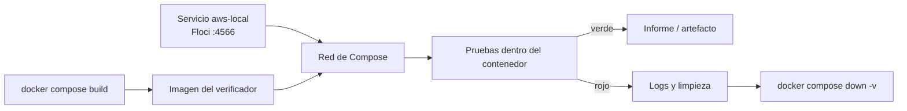
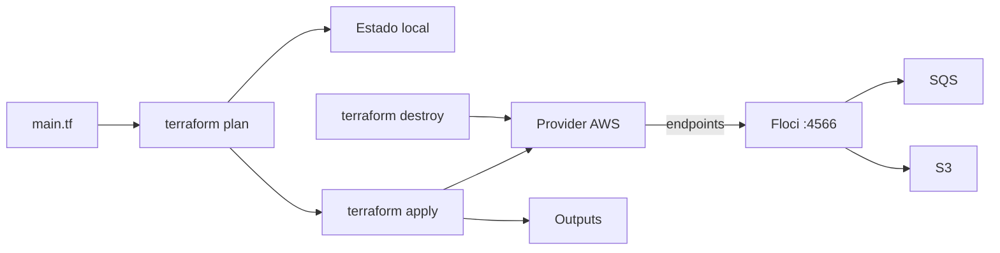

# Módulo 22: Laboratorio DevOps con Floci: ejercicios verificables

## Aprende construyendo

Los módulos 19 a 21 explicaron cómo dividir un sistema, publicar hechos y operar servicios. Este módulo los lleva a un laboratorio local: una nube emulada donde puedes crear un bucket, enviar un mensaje a una cola, construir una imagen y reproducir infraestructura con Terraform sin una cuenta real y sin generar una factura. Floci emula AWS, Azure, GCP y OCI; aquí usaremos su emulador AWS porque es el que aparece en el Compose del repositorio y el que permite practicar los mismos comandos de la CLI de AWS.

El objetivo no es memorizar comandos, sino aprender a **verificar el entorno antes de culpar al código**. La mayoría de los fallos de un laboratorio local no están en S3 ni en SQS: están en un endpoint que apunta a otro sitio, en credenciales reales que se colaron en la terminal o en un contenedor que intenta llegar a `localhost` cuando `localhost` es él mismo. Cada tema termina con una prueba que distingue esas causas.

**Alcance de verificación:** los comandos y rutas se contrastaron con la documentación oficial de Floci, con la documentación de AWS, Docker y Terraform, y con `docs/floci.md` del repositorio. Este entorno de redacción no tiene la CLI de Floci ni la CLI de AWS instaladas, así que la ejecución completa queda como **revisión manual pendiente**. No presentes estas lecciones como un laboratorio ya ejecutado.

La progresión de ejercicios se inspira en el índice público [bregman-arie/devops-exercises](https://github.com/bregman-arie/devops-exercises), distribuido bajo CC BY-NC-SA. Este módulo no reproduce ni traduce su texto: las explicaciones, el código y las prácticas son redacción original adaptada a RutaFlow y a Floci.


### Tema 1: Floci desde cero: instalar, aislar y verificar · Avanzado · 45 min

<details open>
<summary><strong>Capa 1 — Lectura</strong></summary>

#### ► DE QUÉ TRATA
Al finalizar podrás instalar la CLI, iniciar el emulador, comprobar su salud y ejecutar un script que rechaza cualquier endpoint que no sea local. Conocimiento previo: terminal, Docker o Podman en ejecución, Node.js 22 o superior y nociones de variables de entorno.

#### ► CÓMO FUNCIONA


</details>

<details>
<summary><strong>Capa 2 — Construcción</strong></summary>

#### Código y verificación


```bash
mkdir -p laboratorio-floci/modulo-22/tema-1-entorno/{src,test,scripts}
cd laboratorio-floci/modulo-22/tema-1-entorno
npm init -y
npm pkg set type=module
curl --fail --location --show-error --output floci-install.sh https://floci.io/install.sh
less floci-install.sh
sh floci-install.sh
floci --version
```

```bash
floci doctor
floci start
eval $(floci env)
printf 'AWS_ENDPOINT_URL=%s\n' "$AWS_ENDPOINT_URL"
curl --fail --show-error http://localhost:4566/_localstack/health
```

```javascript
// Valida que el laboratorio apunte a un endpoint local y consulta su salud.
const HOSTS_PERMITIDOS = new Set(['localhost', '127.0.0.1', 'aws-local', 'host.docker.internal']);

export function validarEndpoint(endpoint) {
  if (!endpoint) throw new Error('AWS_ENDPOINT_URL no está definido');
  if (/amazonaws\.com/i.test(endpoint)) {
    throw new Error(`endpoint real detectado: ${endpoint}`);
  }
  const url = new URL(endpoint);
  if (!HOSTS_PERMITIDOS.has(url.hostname)) {
    throw new Error(`host no permitido para el laboratorio: ${url.hostname}`);
  }
  return url;
}

export async function verificarSalud({ endpoint, fetchImpl = fetch }) {
  const url = validarEndpoint(endpoint);
  const respuesta = await fetchImpl(new URL('/_localstack/health', url));
  if (!respuesta.ok) {
    throw new Error(`salud falló (${respuesta.status}) en ${url.origin}`);
  }
  const cuerpo = await respuesta.json();
  return { origen: url.origin, servicios: cuerpo.services ?? {} };
}
```

```javascript
import { verificarSalud } from '../src/verificar.mjs';

const resultado = await verificarSalud({ endpoint: process.env.AWS_ENDPOINT_URL });
console.log(JSON.stringify(resultado, null, 2));
```

```javascript
import test from 'node:test';
import assert from 'node:assert/strict';
import { validarEndpoint, verificarSalud } from '../src/verificar.mjs';

test('rechaza un endpoint de AWS real', () => {
  assert.throws(() => validarEndpoint('https://s3.us-east-1.amazonaws.com'), /endpoint real/);
});

test('acepta un endpoint local y conserva el puerto', () => {
  const url = validarEndpoint('http://localhost:4566');
  assert.equal(url.hostname, 'localhost');
  assert.equal(url.port, '4566');
});

test('incluye el origen cuando la salud falla', async () => {
  const fetchImpl = async () => ({ ok: false, status: 404 });
  await assert.rejects(
    () => verificarSalud({ endpoint: 'http://localhost:4567', fetchImpl }),
    /salud falló \(404\) en http:\/\/localhost:4567/,
  );
});
```

</details>

### Tema 2: S3 y diagnóstico de red: objetos, metadatos y errores · Avanzado · 45 min

<details open>
<summary><strong>Capa 1 — Lectura</strong></summary>

#### ► DE QUÉ TRATA
Al finalizar podrás crear un bucket, subir un objeto con metadatos, consultarlo y clasificar los errores más frecuentes con una función que devuelve una causa probable y una acción. Conocimiento previo: Tema 1, CLI de AWS instalada y el emulador en ejecución.

#### ► CÓMO FUNCIONA


</details>

<details>
<summary><strong>Capa 2 — Construcción</strong></summary>

#### Código y verificación


```bash
mkdir -p laboratorio-floci/modulo-22/tema-2-s3/{src,test,datos}
cd laboratorio-floci/modulo-22/tema-2-s3
npm init -y
npm pkg set type=module
floci start
eval $(floci env)
aws s3 mb s3://rutaflow-labs
printf '{"envio":"RF-1","estado":"confirmado"}\n' > datos/RF-1.json
aws s3 cp datos/RF-1.json s3://rutaflow-labs/envios/RF-1.json
aws s3 ls s3://rutaflow-labs/envios/
```

```javascript
// Traduce errores frecuentes de S3 a una causa probable y una acción.
const GUIA = {
  NoSuchBucket: ({ bucket }) => `El bucket "${bucket}" no existe en este endpoint.`,
  AccessDenied: ({ bucket }) => `Acceso denegado a "${bucket}": revisa credenciales y política.`,
  SignatureDoesNotMatch: () => 'La firma no coincide: revisa clave secreta, región y cuerpo enviado.',
  PermanentRedirect: ({ region }) => `La petición llegó a otra región; configura ${region}.`,
  ECONNREFUSED: ({ endpoint }) => `No hay nada escuchando en ${endpoint}; inicia Floci o corrige el puerto.`,
};

export function explicarErrorS3(error, contexto) {
  const nombre = error?.name ?? error?.code ?? 'ErrorDesconocido';
  const guia = GUIA[nombre];
  return {
    nombre,
    endpoint: contexto.endpoint,
    bucket: contexto.bucket,
    key: contexto.key,
    detalle: guia ? guia(contexto) : `Error no clasificado: ${error?.message ?? nombre}`,
  };
}
```

```javascript
import test from 'node:test';
import assert from 'node:assert/strict';
import { explicarErrorS3 } from '../src/diagnostico.mjs';

const contexto = { endpoint: 'http://localhost:4566', bucket: 'rutaflow-labs', key: 'envios/RF-1.json' };

test('un bucket inexistente se explica con su nombre', () => {
  const salida = explicarErrorS3({ name: 'NoSuchBucket' }, contexto);
  assert.match(salida.detalle, /rutaflow-labs/);
});

test('una firma incorrecta no se confunde con permisos', () => {
  const salida = explicarErrorS3({ name: 'SignatureDoesNotMatch' }, contexto);
  assert.match(salida.detalle, /firma/i);
  assert.doesNotMatch(salida.detalle, /política/i);
});

test('una conexión rechazada muestra el endpoint', () => {
  const salida = explicarErrorS3({ code: 'ECONNREFUSED' }, contexto);
  assert.match(salida.detalle, /localhost:4566/);
});

test('un error desconocido conserva el mensaje original', () => {
  const salida = explicarErrorS3({ name: 'AlgoRaro', message: 'respuesta inesperada' }, contexto);
  assert.match(salida.detalle, /respuesta inesperada/);
});
```

```bash
aws s3api put-object \
  --bucket rutaflow-labs \
  --key envios/RF-1.json \
  --body datos/RF-1.json \
  --metadata origen=laboratorio,tema=s3
aws s3api head-object \
  --bucket rutaflow-labs \
  --key envios/RF-1.json \
  --query 'Metadata'
node --test
```

</details>

### Tema 3: Contenedores y CI: una imagen que se prueba contra Floci · Avanzado · 45 min

<details open>
<summary><strong>Capa 1 — Lectura</strong></summary>

#### ► DE QUÉ TRATA
Al finalizar podrás construir una imagen sin dependencias externas, esperar a que Floci responda desde otro contenedor y ejecutar una prueba de humo que falle con un mensaje útil si la red está mal configurada. Conocimiento previo: Temas 1 y 2, Docker y Docker Compose instalados.

#### ► CÓMO FUNCIONA


</details>

<details>
<summary><strong>Capa 2 — Construcción</strong></summary>

#### Código y verificación


```bash
mkdir -p laboratorio-floci/modulo-22/tema-3-contenedor/{src,test}
cd laboratorio-floci/modulo-22/tema-3-contenedor
npm init -y
npm pkg set type=module
docker --version
docker compose version
```

```javascript
// Espera a que la salud responda; no confunde "contenedor iniciado" con "API lista".
export async function esperarSalud({
  endpoint,
  intentos = 30,
  esperaMs = 500,
  fetchImpl = fetch,
  dormir = (ms) => new Promise((resolve) => setTimeout(resolve, ms)),
}) {
  let ultimoError;
  for (let intento = 1; intento <= intentos; intento += 1) {
    try {
      const respuesta = await fetchImpl(new URL('/_localstack/health', endpoint));
      if (respuesta.ok) return { intento, endpoint };
      ultimoError = new Error(`HTTP ${respuesta.status}`);
    } catch (error) {
      ultimoError = error;
    }
    if (intento < intentos) await dormir(esperaMs);
  }
  throw new Error(`salud no disponible en ${endpoint}: ${ultimoError?.message}`);
}
```

```javascript
import test from 'node:test';
import assert from 'node:assert/strict';
import { esperarSalud } from '../src/esperar.mjs';

test('reintenta hasta que la salud responde', async () => {
  let llamadas = 0;
  const fetchImpl = async () => {
    llamadas += 1;
    if (llamadas < 3) throw new Error('ECONNREFUSED');
    return { ok: true, status: 200 };
  };
  const resultado = await esperarSalud({
    endpoint: 'http://aws-local:4566',
    fetchImpl,
    dormir: async () => {},
  });
  assert.equal(resultado.intento, 3);
  assert.equal(llamadas, 3);
});

test('falla con el endpoint cuando se agotan los intentos', async () => {
  await assert.rejects(
    () => esperarSalud({
      endpoint: 'http://aws-local:4566',
      intentos: 2,
      fetchImpl: async () => { throw new Error('ECONNREFUSED'); },
      dormir: async () => {},
    }),
    /salud no disponible en http:\/\/aws-local:4566/,
  );
});
```

```javascript
import test from 'node:test';
import { esperarSalud } from '../src/esperar.mjs';

test('el contenedor alcanza Floci por el nombre del servicio', async () => {
  const endpoint = process.env.AWS_ENDPOINT_URL;
  const resultado = await esperarSalud({ endpoint, intentos: 10, esperaMs: 200 });
  assert.equal(resultado.endpoint, 'http://aws-local:4566');
});
```

```dockerfile
FROM node:22-alpine
WORKDIR /app
COPY package.json ./
COPY src ./src
COPY test ./test
CMD ["node", "--test"]
```

</details>

### Tema 4: Terraform, SQS y operación: infraestructura reproducible y ejercicios · Avanzado · 45 min

<details open>
<summary><strong>Capa 1 — Lectura</strong></summary>

#### ► DE QUÉ TRATA
Al finalizar podrás declarar una cola SQS y un bucket S3 contra Floci, leer un plan, aplicar cambios, enviar y recibir un mensaje y destruir todo sin dejar recursos. Conocimiento previo: Temas 1 a 3, Terraform instalado y el emulador en ejecución.

#### ► CÓMO FUNCIONA


</details>

<details>
<summary><strong>Capa 2 — Construcción</strong></summary>

#### Código y verificación


```bash
mkdir -p laboratorio-floci/modulo-22/tema-4-terraform
cd laboratorio-floci/modulo-22/tema-4-terraform
terraform version
floci start
eval $(floci env)
curl --fail --show-error http://localhost:4566/_localstack/health
```

```hcl
terraform {
  required_version = ">= 1.6"
  required_providers {
    aws = {
      source  = "hashicorp/aws"
      version = "~> 5.0"
    }
  }
}

provider "aws" {
  region                      = "us-east-1"
  access_key                  = "test"
  secret_key                  = "test"
  skip_credentials_validation = true
  skip_metadata_api_check     = true
  skip_requesting_account_id  = true
  s3_use_path_style           = true

  endpoints {
    s3  = "http://localhost:4566"
    sqs = "http://localhost:4566"
  }
}

resource "aws_s3_bucket" "evidencias" {
  bucket = "rutaflow-evidencias-tf"
}

resource "aws_sqs_queue" "eventos" {
  name = "rutaflow-eventos"
}

output "cola_url" {
  value = aws_sqs_queue.eventos.url
}
```

```bash
terraform init
terraform fmt
terraform validate
terraform plan -out=laboratorio.tfplan
terraform apply laboratorio.tfplan
terraform output -raw cola_url
```

```bash
COLA="$(terraform output -raw cola_url)"
aws sqs send-message \
  --queue-url "$COLA" \
  --message-body '{"tipo":"EntregaConfirmada","envio":"RF-1"}'
aws sqs receive-message \
  --queue-url "$COLA" \
  --max-number-of-messages 1 \
  --query 'Messages[0].Body'
terraform destroy -auto-approve
```

</details>
