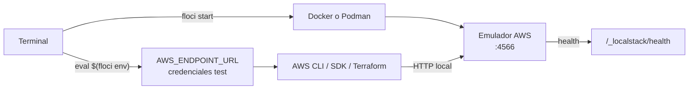
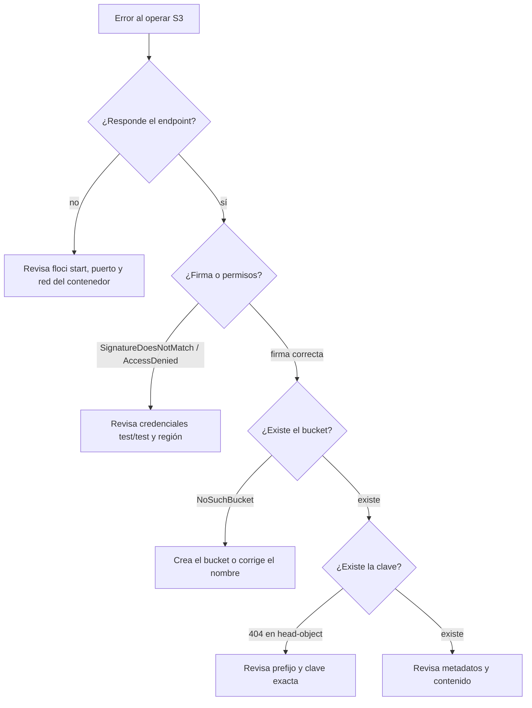
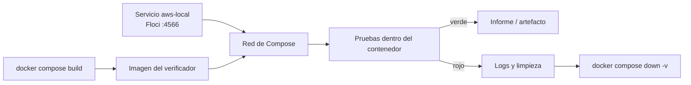
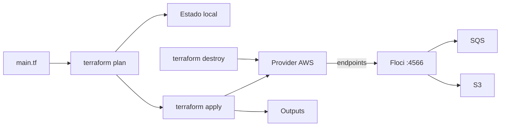

# Módulo 22: Laboratorio DevOps con Floci: ejercicios verificables

## Aprende construyendo

Los módulos 19 a 21 explicaron cómo dividir un sistema, publicar hechos y operar servicios. Este módulo los lleva a un laboratorio local: una nube emulada donde puedes crear un bucket, enviar un mensaje a una cola, construir una imagen y reproducir infraestructura con Terraform sin una cuenta real y sin generar una factura. Floci emula AWS, Azure, GCP y OCI; aquí usaremos su emulador AWS porque es el que aparece en el Compose del repositorio y el que permite practicar los mismos comandos de la CLI de AWS.

El objetivo no es memorizar comandos, sino aprender a **verificar el entorno antes de culpar al código**. La mayoría de los fallos de un laboratorio local no están en S3 ni en SQS: están en un endpoint que apunta a otro sitio, en credenciales reales que se colaron en la terminal o en un contenedor que intenta llegar a `localhost` cuando `localhost` es él mismo. Cada tema termina con una prueba que distingue esas causas.

**Alcance de verificación:** los comandos y rutas se contrastaron con la documentación oficial de Floci, con la documentación de AWS, Docker y Terraform, y con `docs/floci.md` del repositorio. Este entorno de redacción no tiene la CLI de Floci ni la CLI de AWS instaladas, así que la ejecución completa queda como **revisión manual pendiente**. No presentes estas lecciones como un laboratorio ya ejecutado.

La progresión de ejercicios se inspira en el índice público [bregman-arie/devops-exercises](https://github.com/bregman-arie/devops-exercises), distribuido bajo CC BY-NC-SA. Este módulo no reproduce ni traduce su texto: las explicaciones, el código y las prácticas son redacción original adaptada a RutaFlow y a Floci.

### Tema 1: Floci desde cero: instalar, aislar y verificar

**¿Por qué es importante?** Porque un laboratorio de nube sin aislamiento es un riesgo, no una práctica. Si tus pruebas usan credenciales reales o un endpoint mal configurado, puedes crear recursos en una cuenta de verdad mientras crees que estás en local. Aprender a instalar el emulador, comprobar que responde y demostrar que el cliente apunta al puerto correcto es la base de todos los ejercicios posteriores.

**Analogía:** ensayar una obra en un teatro de maqueta. La maqueta tiene las mismas marcas del escenario y los mismos nombres de bambalinas, pero no hay fuego real ni público. Antes de empezar, compruebas que estás en la sala de ensayo y no en el teatro principal; si confundes la puerta, el ensayo se convierte en una función sin aviso.

**Conceptos clave:** emulador local, endpoint, credenciales ficticias, aislamiento, health check, paridad parcial y modo de persistencia.

Un **emulador local** implementa una parte de la API de un proveedor cloud en tu máquina. Floci es un proyecto MIT que ofrece emuladores para AWS, Azure, GCP y OCI; el emulador AWS escucha en el puerto `4566` y expone servicios como S3, SQS, DynamoDB, Lambda y RDS. No necesitas cuenta ni token, pero sí un motor de contenedores: Docker o Podman debe estar en ejecución.

Un **endpoint** es la URL a la que el cliente envía las peticiones. La CLI de AWS y los SDK respetan la variable `AWS_ENDPOINT_URL`; al ejecutar `eval $(floci env)` en la terminal, la CLI de Floci carga las variables de entorno de la sesión actual. Ese `eval` afecta solo a esa terminal: si abres otra pestaña, debes repetirlo. Las **credenciales ficticias** (`test`/`test`) permiten que la firma de las peticiones funcione sin usar secretos reales.

La **paridad** con el proveedor real es parcial. Floci implementa la forma de la API, no todas las reglas de IAM, cuotas, regiones o facturación. Un ejercicio que pasa en local demuestra que tu cliente y tu contrato funcionan; no demuestra que la política de producción sea correcta. El **modo de persistencia** decide si los datos sobreviven al reinicio del contenedor: en memoria se pierden, y el Compose del repositorio usa un volumen persistente para conservarlos.

**Diagrama:**



#### Paso 1 · Objetivo y preparación

Al finalizar podrás instalar la CLI, iniciar el emulador, comprobar su salud y ejecutar un script que rechaza cualquier endpoint que no sea local. **Conocimiento previo:** terminal, Docker o Podman en ejecución, Node.js 20 o superior y nociones de variables de entorno.

Crea una carpeta vacía para el laboratorio y descarga el instalador antes de ejecutarlo:

```bash
mkdir -p laboratorio-floci/modulo-22/tema-1-entorno/{src,test,scripts}
cd laboratorio-floci/modulo-22/tema-1-entorno
npm init -y
npm pkg set type=module
curl --fail --location --show-error --output floci-install.sh https://floci.io/install.sh
less floci-install.sh
sh floci-install.sh
floci --version
```

Inspecciona el script antes de ejecutarlo y guarda el SHA-256 de la copia descargada si tu equipo exige trazabilidad. Después inicia el emulador y carga su entorno:

```bash
floci doctor
floci start
eval $(floci env)
printf 'AWS_ENDPOINT_URL=%s\n' "$AWS_ENDPOINT_URL"
curl --fail --show-error http://localhost:4566/_localstack/health
```

**Resultado esperado:** `floci doctor` informa si el motor de contenedores está disponible; `floci start` deja el emulador escuchando en `4566`; la variable muestra una URL local y la comprobación de salud devuelve un JSON con servicios. Si el puerto está ocupado, detén el proceso que lo usa antes de iniciar otro emulador.

#### Paso 2 · Contexto y caso real

**Caso real:** en RutaFlow, un desarrollador ejecutó las pruebas en una terminal nueva sin repetir `eval $(floci env)`. La CLI de AWS conservó un perfil real configurado meses atrás y la prueba de carga apuntó a la cuenta de la empresa. No se creó ningún recurso destructivo porque el bucket tenía un nombre distinto, pero el susto reveló dos fallos: el laboratorio no comprobaba el endpoint y las credenciales reales seguían visibles en el entorno.

La corrección fue doble: un script que falla si el endpoint no es local y una convención de credenciales `test`/`test` para todo el laboratorio. La lección no es «tener cuidado»; es hacer que el cuidado sea una comprobación automática que se ejecute antes de cada práctica.

#### Paso 3 · Teoría, modelo mental y analogía

Floci separa la **CLI** del **emulador**. La CLI descarga y administra contenedores; el emulador es el proceso que responde a las APIs. `floci start` inicia el emulador AWS y `floci env` imprime las variables que los clientes necesitan. `floci doctor` diagnostica problemas de instalación o de motor de contenedores. `floci stop` detiene el emulador. Estos comandos se documentan en floci.io y en el repositorio de la CLI; las opciones exactas pueden cambiar entre versiones, así que consulta `floci --help` en la versión instalada.

La salud del emulador se puede comprobar con una petición HTTP a `/_localstack/health`, la ruta de compatibilidad que Floci expone para herramientas acostumbradas a LocalStack. Que responda `200` significa que el proceso está vivo; no significa que todos los servicios estén listos ni que tu cliente esté configurado. Por eso el script del Paso 4 valida dos cosas distintas: el endpoint que vas a usar y la respuesta del servicio.

**Modelo mental:** el portero de un edificio. No basta con que el edificio exista; necesitas comprobar que estás llamando al portero correcto y que te reconoce. Un endpoint local con credenciales de producción es llamar al portero de otro edificio con tu documento real.

**Criterio de decisión:** usa Floci cuando necesites practicar APIs cloud sin coste ni riesgo y cuando la prueba pueda tolerar paridad parcial. No lo uses para validar políticas de IAM, límites de servicio o comportamientos exclusivos de una región real. Si el ejercicio depende de una función que el emulador no implementa, márcalo como no cubierto en lugar de simularlo con una respuesta falsa.

#### Paso 4 · Demostración guiada desde cero

Crea `src/verificar.mjs` con funciones puras que puedas probar sin red:

```javascript
// Valida que el laboratorio apunte a un endpoint local y consulta su salud.
const HOSTS_PERMITIDOS = new Set(['localhost', '127.0.0.1', 'aws-local', 'host.docker.internal']);

export function validarEndpoint(endpoint) {
  if (!endpoint) throw new Error('AWS_ENDPOINT_URL no está definido');
  if (/amazonaws\.com/i.test(endpoint)) {
    throw new Error(`endpoint real detectado: ${endpoint}`);
  }
  const url = new URL(endpoint);
  if (!HOSTS_PERMITIDOS.has(url.hostname)) {
    throw new Error(`host no permitido para el laboratorio: ${url.hostname}`);
  }
  return url;
}

export async function verificarSalud({ endpoint, fetchImpl = fetch }) {
  const url = validarEndpoint(endpoint);
  const respuesta = await fetchImpl(new URL('/_localstack/health', url));
  if (!respuesta.ok) {
    throw new Error(`salud falló (${respuesta.status}) en ${url.origin}`);
  }
  const cuerpo = await respuesta.json();
  return { origen: url.origin, servicios: cuerpo.services ?? {} };
}
```

El script ejecutable `scripts/verificar.mjs` usa la variable de entorno y muestra el resultado:

```javascript
import { verificarSalud } from '../src/verificar.mjs';

const resultado = await verificarSalud({ endpoint: process.env.AWS_ENDPOINT_URL });
console.log(JSON.stringify(resultado, null, 2));
```

La prueba no toca la red: inyecta un `fetchImpl` falso y comprueba los dos caminos.

```javascript
import test from 'node:test';
import assert from 'node:assert/strict';
import { validarEndpoint, verificarSalud } from '../src/verificar.mjs';

test('rechaza un endpoint de AWS real', () => {
  assert.throws(() => validarEndpoint('https://s3.us-east-1.amazonaws.com'), /endpoint real/);
});

test('acepta un endpoint local y conserva el puerto', () => {
  const url = validarEndpoint('http://localhost:4566');
  assert.equal(url.hostname, 'localhost');
  assert.equal(url.port, '4566');
});

test('incluye el origen cuando la salud falla', async () => {
  const fetchImpl = async () => ({ ok: false, status: 404 });
  await assert.rejects(
    () => verificarSalud({ endpoint: 'http://localhost:4567', fetchImpl }),
    /salud falló \(404\) en http:\/\/localhost:4567/,
  );
});
```

Ejecuta las pruebas y después la comprobación real:

```bash
node --test
AWS_ENDPOINT_URL=http://localhost:4566 node scripts/verificar.mjs
```

**Resultado esperado:** tres pruebas en verde; el script imprime un JSON con `origen` igual a `http://localhost:4566` y un objeto `servicios` con los servicios disponibles en esa versión del emulador.

**Fallo deliberado:** cambia el endpoint a `http://localhost:4567` y ejecuta el script. La petición falla con un error de conexión o con `salud falló`; el mensaje incluye el origen consultado. Diagnostica: el script está bien, pero el puerto no corresponde al emulador. Ejecuta `floci doctor`, comprueba el puerto real con `curl` y restaura `4566`. Si el endpoint fuera el de AWS real, el script se negaría antes de enviar ninguna petición.

#### Paso 5 · Práctica guiada

Amplía `validarEndpoint` para rechazar también credenciales que parezcan reales. Una clave de acceso de AWS suele empezar por `AKIA` o `ASIA`; si `AWS_ACCESS_KEY_ID` cumple ese patrón, el laboratorio debe detenerse con un mensaje que explique cómo usar `test`. Añade una prueba con `AKIA...` y otra con `test`. **Pista:** no registres el valor completo de la clave en el mensaje de error; basta con indicar que parece una credencial real.

#### Paso 6 · Práctica independiente

Crea `scripts/aislamiento.mjs` que revise `AWS_ENDPOINT_URL`, `AWS_ACCESS_KEY_ID` y `AWS_SECRET_ACCESS_KEY`, y salga con código `1` si alguna comprobación falla. Añade un script de npm llamado `verificar` y documenta en el proyecto integrador qué debe ejecutar una persona antes de empezar el laboratorio. Prueba el caso correcto y el caso con un endpoint de AWS real; conserva la salida de ambos como evidencia.

#### Paso 7 · Cierre

Siguiente paso: con el entorno verificado, el Tema 2 usa S3 para crear objetos, leer metadatos y diagnosticar errores en lugar de adivinarlos.

**Errores comunes:** ejecutar el instalador sin inspeccionarlo; abrir una terminal nueva y olvidar `eval $(floci env)`; usar credenciales reales en el laboratorio; asumir que un emulador implementa todas las reglas de AWS; iniciar dos emuladores en el puerto `4566`; confundir «el proceso responde» con «mi cliente está bien configurado».

**Límites y decisión de uso:** Floci es una herramienta de desarrollo y prueba, no un entorno de producción ni una certificación de paridad. La disponibilidad de servicios y detalles de implementación cambian entre versiones; contrasta con la documentación oficial antes de afirmar que una función está soportada. La instalación y la ejecución en tu equipo quedan como revisión manual hasta que las completes y registres la salida.

**Fuentes oficiales:** [Floci — sitio oficial](https://floci.io/) y [Floci CLI — repositorio y releases](https://github.com/floci-io/floci-cli).

### Tema 2: S3 y diagnóstico de red: objetos, metadatos y errores

**¿Por qué es importante?** Porque S3 es el primer servicio con el que se topa casi cualquier laboratorio cloud y, al mismo tiempo, el que produce los errores más confusos: un `403` puede significar credenciales, un `404` puede significar bucket o clave, y una conexión rechazada puede significar endpoint o red. Aprender a leer el objeto, sus metadatos y la causa del error convierte una tarde de prueba y error en una lista corta de comprobaciones.

**Analogía:** un almacén con estantes numerados. El nombre completo del objeto es la dirección del estante; los metadatos son la etiqueta pegada a la caja, no el contenido. Si buscas en el pasillo equivocado, el número correcto no te salva; si la etiqueta dice «frágil», eso no cambia lo que hay dentro.

**Conceptos clave:** bucket, clave, objeto, metadato, prefijo, estilo de ruta, error de firma y consistencia.

Un **bucket** es el contenedor de nivel superior; una **clave** identifica el objeto dentro del bucket y puede contener barras, pero S3 no tiene directorios reales: los prefijos son una convención de nombres. Un **objeto** tiene cuerpo, tipo de contenido, ETag y **metadatos**. Los metadatos definidos por el usuario se envían con el prefijo `x-amz-meta-` y se consultan con `head-object`.

El **estilo de ruta** (`path-style`) pone el bucket en la ruta (`http://localhost:4566/bucket/clave`) en lugar de usar un subdominio (`http://bucket.localhost:4566`). Los emuladores suelen preferir el estilo de ruta porque no requieren DNS comodín. La **firma** demuestra que la petición fue construida con una clave secreta; si cambias el cuerpo o la cabecera después de firmar, el servidor devuelve `SignatureDoesNotMatch`.

Los errores de S3 se diagnostican en un orden fijo: endpoint, credenciales, bucket, clave. Un `AccessDenied` en AWS real puede ocultar que el bucket no existe, porque el proveedor no revela la existencia de recursos ajenos. Un `PermanentRedirect` indica que la petición llegó a la región equivocada. Una conexión rechazada indica que no hay nada escuchando en esa URL. La **consistencia** de listados y lecturas puede variar; en un emulador local suele ser inmediata, pero no generalices ese comportamiento a producción.

**Diagrama:**



#### Paso 1 · Objetivo y preparación

Al finalizar podrás crear un bucket, subir un objeto con metadatos, consultarlo y clasificar los errores más frecuentes con una función que devuelve una causa probable y una acción. **Conocimiento previo:** Tema 1, CLI de AWS instalada y el emulador en ejecución.

Crea la carpeta del tema y prepara un objeto pequeño:

```bash
mkdir -p laboratorio-floci/modulo-22/tema-2-s3/{src,test,datos}
cd laboratorio-floci/modulo-22/tema-2-s3
npm init -y
npm pkg set type=module
floci start
eval $(floci env)
aws s3 mb s3://rutaflow-labs
printf '{"envio":"RF-1","estado":"confirmado"}\n' > datos/RF-1.json
aws s3 cp datos/RF-1.json s3://rutaflow-labs/envios/RF-1.json
aws s3 ls s3://rutaflow-labs/envios/
```

**Resultado esperado:** `aws s3 mb` confirma la creación; `aws s3 cp` muestra una línea de subida y el listado incluye `RF-1.json` con su tamaño.

#### Paso 2 · Contexto y caso real

**Caso real:** el equipo de RutaFlow subió un archivo con `aws s3 cp` y recibió `AccessDenied`. La primera hipótesis fue una política de IAM; dedicaron una hora a revisar roles. El problema era más simple: la CLI estaba usando el perfil real y el bucket `rutaflow-labs` solo existía en el emulador. La operación había llegado a otra cuenta, donde el nombre no existía o no pertenecía al usuario.

La corrección fue una lista de diagnóstico y un script que imprime el endpoint y el bucket antes de operar. Desde entonces, el equipo no discute políticas hasta confirmar que la petición se quedó en local. Ese orden evita perseguir la causa equivocada.

#### Paso 3 · Teoría, modelo mental y analogía

S3 organiza objetos por bucket y clave; no hay jerarquía real. Cuando la consola muestra carpetas, está agrupando prefijos. Esto importa porque una copia a `envios/RF-1.json` y otra a `envios/RF-1.json/` producen claves distintas, y un listado con `--prefix envios/` solo encuentra las que empiezan exactamente por ese texto.

Los metadatos se dividen en del sistema (tipo de contenido, longitud, ETag) y definidos por el usuario. Los del sistema los gestiona el servicio; los del usuario los envías tú y los recuperas con `head-object`. No uses metadatos para datos que deban consultarse o actualizarse con frecuencia: no son un índice y no se pueden filtrar como una base de datos.

La CLI de AWS permite apuntar a un endpoint con `AWS_ENDPOINT_URL` o con `--endpoint-url`. Si ambos existen, la precedencia puede sorprenderte; elige una convención y úsala en todos los comandos. Las credenciales deben ser `test`/`test` en el laboratorio; una clave real convierte un error de configuración en un riesgo.

**Modelo mental:** una biblioteca con estanterías modulares. La etiqueta de la caja (metadatos) te dice quién la envió y cuándo, pero para encontrar la caja necesitas el pasillo y el número (bucket y clave). Cambiar la etiqueta no mueve la caja.

**Criterio de decisión:** usa `cp` para operaciones simples y `s3api` cuando necesites controlar metadatos, condiciones o respuestas detalladas. Usa un prefijo por entorno o por tipo de dato para que un listado accidental no mezcle objetos de prácticas distintas. Si el ejercicio requiere políticas de bucket o cifrado gestionado, comprueba primero si el emulador lo soporta; si no, márcalo como no cubierto.

#### Paso 4 · Demostración guiada desde cero

Crea `src/diagnostico.mjs` con una tabla de causas probables. La función no adivina: clasifica el nombre del error y devuelve una acción concreta.

```javascript
// Traduce errores frecuentes de S3 a una causa probable y una acción.
const GUIA = {
  NoSuchBucket: ({ bucket }) => `El bucket "${bucket}" no existe en este endpoint.`,
  AccessDenied: ({ bucket }) => `Acceso denegado a "${bucket}": revisa credenciales y política.`,
  SignatureDoesNotMatch: () => 'La firma no coincide: revisa clave secreta, región y cuerpo enviado.',
  PermanentRedirect: ({ region }) => `La petición llegó a otra región; configura ${region}.`,
  ECONNREFUSED: ({ endpoint }) => `No hay nada escuchando en ${endpoint}; inicia Floci o corrige el puerto.`,
};

export function explicarErrorS3(error, contexto) {
  const nombre = error?.name ?? error?.code ?? 'ErrorDesconocido';
  const guia = GUIA[nombre];
  return {
    nombre,
    endpoint: contexto.endpoint,
    bucket: contexto.bucket,
    key: contexto.key,
    detalle: guia ? guia(contexto) : `Error no clasificado: ${error?.message ?? nombre}`,
  };
}
```

La prueba recorre cuatro errores y comprueba que el detalle menciona el dato útil:

```javascript
import test from 'node:test';
import assert from 'node:assert/strict';
import { explicarErrorS3 } from '../src/diagnostico.mjs';

const contexto = { endpoint: 'http://localhost:4566', bucket: 'rutaflow-labs', key: 'envios/RF-1.json' };

test('un bucket inexistente se explica con su nombre', () => {
  const salida = explicarErrorS3({ name: 'NoSuchBucket' }, contexto);
  assert.match(salida.detalle, /rutaflow-labs/);
});

test('una firma incorrecta no se confunde con permisos', () => {
  const salida = explicarErrorS3({ name: 'SignatureDoesNotMatch' }, contexto);
  assert.match(salida.detalle, /firma/i);
  assert.doesNotMatch(salida.detalle, /política/i);
});

test('una conexión rechazada muestra el endpoint', () => {
  const salida = explicarErrorS3({ code: 'ECONNREFUSED' }, contexto);
  assert.match(salida.detalle, /localhost:4566/);
});

test('un error desconocido conserva el mensaje original', () => {
  const salida = explicarErrorS3({ name: 'AlgoRaro', message: 'respuesta inesperada' }, contexto);
  assert.match(salida.detalle, /respuesta inesperada/);
});
```

Ahora sube el objeto con metadatos y consúltalos:

```bash
aws s3api put-object \
  --bucket rutaflow-labs \
  --key envios/RF-1.json \
  --body datos/RF-1.json \
  --metadata origen=laboratorio,tema=s3
aws s3api head-object \
  --bucket rutaflow-labs \
  --key envios/RF-1.json \
  --query 'Metadata'
node --test
```

**Resultado esperado:** `put-object` devuelve un `ETag`; `head-object` muestra un objeto `Metadata` con `origen` igual a `laboratorio` y `tema` igual a `s3`; las cuatro pruebas pasan.

**Fallo deliberado:** repite la subida con el bucket `rutaflow-lab` (sin la `s`). La CLI responde con un error de bucket inexistente. Clasifícalo con la tabla de `explicarErrorS3` (o con la función, si capturas el error desde el SDK) y comprueba que el detalle nombra el bucket equivocado. Diagnostica: no es un problema de permisos ni de red; la ruta lógica está mal. Corrige el nombre y repite. Si en lugar de eso obtienes una conexión rechazada, el fallo está antes: el emulador no está iniciado o el endpoint no es el correcto.

#### Paso 5 · Práctica guiada

Borra el objeto con `aws s3 rm`, confirma con `head-object` que ya no existe y clasifica el error resultante. Después sube tres objetos bajo `envios/` y `facturas/`, lista solo el prefijo `envios/` y explica por qué `facturas/` no aparece. **Pista:** el listado por prefijo es textual; `envios/` no coincide con `envios-2026/` si la barra forma parte de la clave.

#### Paso 6 · Práctica independiente

Crea un segundo bucket, sube un objeto con metadatos distintos y escribe un informe que compare `ContentLength`, `ContentType`, `ETag` y metadatos de usuario de ambos. Añade un caso de error provocado por una clave inexistente y otro por un endpoint apagado. Guarda la salida de `explicarErrorS3` para cada caso y documenta cuál fue la causa real. Integra la lista de comprobaciones en el proyecto integrador para que otra persona pueda repetir el diagnóstico sin tu ayuda. No borres el bucket hasta comprobar que el informe está completo.

#### Paso 7 · Cierre

Siguiente paso: el Tema 3 empaqueta estas comprobaciones en una imagen y las ejecuta dentro de un contenedor, donde `localhost` deja de significar lo mismo.

**Errores comunes:** tratar las barras como directorios reales; confundir metadatos con etiquetas o con el contenido; asumir que un `403` siempre es IAM; olvidar `--endpoint-url` o la variable de entorno; usar una clave con `AKIA` en el laboratorio; creer que el listado demuestra que el objeto es correcto sin leer el cuerpo.

**Límites y decisión de uso:** la emulación de S3 cubre las operaciones habituales, pero no garantiza todas las políticas, eventos, cifrados o clases de almacenamiento de AWS. Los tiempos de consistencia y las URLs prefirmadas pueden diferir. No uses el laboratorio para certificar una configuración de producción; úsalo para aprender el flujo, automatizar pruebas y detectar errores de cliente.

**Fuentes oficiales:** [Amazon S3 — PutObject](https://docs.aws.amazon.com/AmazonS3/latest/API/API_PutObject.html), [AWS CLI — s3api put-object](https://docs.aws.amazon.com/cli/latest/reference/s3api/put-object.html) y [Floci — sitio oficial](https://floci.io/).

### Tema 3: Contenedores y CI: una imagen que se prueba contra Floci

**¿Por qué es importante?** Porque «funciona en mi máquina» suele significar «funciona con mi endpoint, mis credenciales y mi red». Una imagen que se construye una vez y se prueba contra el emulador dentro de la misma red de contenedores elimina esas diferencias. El mismo artefacto puede ejecutarse en tu equipo y en integración continua, y el fallo se reproduce antes de llegar a otra persona.

**Analogía:** un contenedor de carga estandarizado. La grúa no necesita saber qué lleva dentro, pero el contenedor debe tener la dirección correcta del almacén. Si la etiqueta dice «aquí mismo» y el almacén está en otra dársena, la carga nunca llega.

**Conceptos clave:** imagen, contenedor, red de Compose, nombre de servicio, `host.docker.internal`, health check, artefacto y pipeline.

Una **imagen** es un sistema de archivos inmutable con una orden de arranque; un **contenedor** es una instancia en ejecución. Cada contenedor tiene su propia interfaz de red y su propio `localhost`: si dentro del contenedor escribes `http://localhost:4566`, buscas un emulador dentro de ese contenedor, no el de tu máquina. En una red de Compose, los servicios se resuelven por su **nombre de servicio**; el Compose del repositorio llama `aws-local` al emulador y le asigna el hostname `aws-local`.

`host.docker.internal` es un nombre especial que Docker Desktop resuelve hacia la máquina anfitriona. Funciona en macOS y Windows con Docker Desktop; en Linux puede requerir una entrada adicional. Para un laboratorio portable, prefiere la red de Compose y el nombre del servicio.

Un **health check** comprueba que el servicio está listo, no solo que el contenedor existe. `depends_on` con `condition: service_started` espera a que el contenedor arranque, no a que la API responda. Por eso el cliente debe reintentar la salud con un límite de tiempo; si el límite se agota, el trabajo falla con un mensaje claro en lugar de quedarse colgado.

Un **pipeline** de integración continua construye la imagen, inicia el emulador, espera la salud, ejecuta las pruebas y limpia los recursos incluso si algo falla. El **artefacto** es la imagen etiquetada con un identificador reproducible; no uses `latest` si necesitas repetir el mismo resultado.

**Diagrama:**



#### Paso 1 · Objetivo y preparación

Al finalizar podrás construir una imagen sin dependencias externas, esperar a que Floci responda desde otro contenedor y ejecutar una prueba de humo que falle con un mensaje útil si la red está mal configurada. **Conocimiento previo:** Temas 1 y 2, Docker y Docker Compose instalados.

Crea la carpeta y los archivos base:

```bash
mkdir -p laboratorio-floci/modulo-22/tema-3-contenedor/{src,test}
cd laboratorio-floci/modulo-22/tema-3-contenedor
npm init -y
npm pkg set type=module
docker --version
docker compose version
```

**Resultado esperado:** ambas versiones se imprimen sin error. Si `docker compose` no existe, instala el plugin de Compose antes de continuar; el comando `docker-compose` con guion es una variante antigua y no se usa en este tema.

#### Paso 2 · Contexto y caso real

**Caso real:** las pruebas de RutaFlow pasaban en el portátil y fallaban en integración continua con `ECONNREFUSED`. El código usaba `http://localhost:4566`; en la máquina anfitriona ese puerto era el emulador, pero dentro del contenedor de pruebas era el propio contenedor, donde no había nada escuchando. El equipo pasó de revisar el código a revisar la topología.

La solución fue declarar el emulador como servicio `aws-local` en la misma red y usar `http://aws-local:4566`. Además, el trabajo de CI espera la salud con reintentos y ejecuta `docker compose down -v` en un paso que corre siempre. El fallo dejó de ser intermitente porque la red y la limpieza quedaron versionadas con el código.

#### Paso 3 · Teoría, modelo mental y analogía

Construir dentro del contenedor y probar dentro del contenedor reduce la diferencia entre entornos. Si la imagen instala dependencias con una versión fija y el código se copia después, el resultado es reproducible. Si pruebas en el host pero construyes en la imagen, sigues teniendo dos entornos.

La red de Compose crea un DNS interno: cada servicio es accesible por su nombre. El puerto publicado en el host (`4566:4566`) sirve para que tú uses la CLI desde fuera; los contenedores no lo necesitan, hablan directamente al puerto interno. Publicar el puerto no sustituye al nombre de servicio.

Las credenciales del laboratorio se pasan como variables de entorno, nunca dentro de la imagen. Una imagen con secretos se copia, se cachea y se comparte; rotarla es casi imposible. Usa `test`/`test` y documenta que son ficticias.

**Modelo mental:** una sala de reuniones con extensiones internas. Desde fuera marcas el número general; dentro, cada persona tiene una extensión que solo funciona en la red interna. `localhost` es «yo mismo», no «la recepción».

**Criterio de decisión:** usa un contenedor para pruebas cuando el entorno importe o cuando quieras reproducir el pipeline en CI. No lo uses para ocultar una dependencia mal declarada: si el servicio necesita una base, declárala como servicio y espera su salud. Si la prueba es puramente de lógica, ejecútala en el host; añadir contenedores solo por moda aumenta el tiempo de realimentación.

#### Paso 4 · Demostración guiada desde cero

Crea `src/esperar.mjs` con una espera acotada y observable:

```javascript
// Espera a que la salud responda; no confunde "contenedor iniciado" con "API lista".
export async function esperarSalud({
  endpoint,
  intentos = 30,
  esperaMs = 500,
  fetchImpl = fetch,
  dormir = (ms) => new Promise((resolve) => setTimeout(resolve, ms)),
}) {
  let ultimoError;
  for (let intento = 1; intento <= intentos; intento += 1) {
    try {
      const respuesta = await fetchImpl(new URL('/_localstack/health', endpoint));
      if (respuesta.ok) return { intento, endpoint };
      ultimoError = new Error(`HTTP ${respuesta.status}`);
    } catch (error) {
      ultimoError = error;
    }
    if (intento < intentos) await dormir(esperaMs);
  }
  throw new Error(`salud no disponible en ${endpoint}: ${ultimoError?.message}`);
}
```

Crea `test/unidad.test.mjs` con un `fetchImpl` que falla dos veces y luego responde, sin esperas reales:

```javascript
import test from 'node:test';
import assert from 'node:assert/strict';
import { esperarSalud } from '../src/esperar.mjs';

test('reintenta hasta que la salud responde', async () => {
  let llamadas = 0;
  const fetchImpl = async () => {
    llamadas += 1;
    if (llamadas < 3) throw new Error('ECONNREFUSED');
    return { ok: true, status: 200 };
  };
  const resultado = await esperarSalud({
    endpoint: 'http://aws-local:4566',
    fetchImpl,
    dormir: async () => {},
  });
  assert.equal(resultado.intento, 3);
  assert.equal(llamadas, 3);
});

test('falla con el endpoint cuando se agotan los intentos', async () => {
  await assert.rejects(
    () => esperarSalud({
      endpoint: 'http://aws-local:4566',
      intentos: 2,
      fetchImpl: async () => { throw new Error('ECONNREFUSED'); },
      dormir: async () => {},
    }),
    /salud no disponible en http:\/\/aws-local:4566/,
  );
});
```

Crea la prueba de humo `test/humo.test.mjs`, que solo se ejecuta dentro del contenedor:

```javascript
import test from 'node:test';
import { esperarSalud } from '../src/esperar.mjs';

test('el contenedor alcanza Floci por el nombre del servicio', async () => {
  const endpoint = process.env.AWS_ENDPOINT_URL;
  const resultado = await esperarSalud({ endpoint, intentos: 10, esperaMs: 200 });
  assert.equal(resultado.endpoint, 'http://aws-local:4566');
});
```

El `Dockerfile` no instala dependencias porque el ejemplo solo usa módulos de Node:

```dockerfile
FROM node:22-alpine
WORKDIR /app
COPY package.json ./
COPY src ./src
COPY test ./test
CMD ["node", "--test"]
```

El `compose.yaml` declara la red y las variables:

```yaml
services:
  aws-local:
    image: floci/floci:2.2.0@sha256:e97cd0c1dc2aa14e7697fb5ef5018404c4d6345169dbd276315f0bed2c7b0520
    ports:
      - "4566:4566"
    environment:
      - FLOCI_HOSTNAME=aws-local

  verificador:
    build: .
    depends_on:
      aws-local:
        condition: service_started
    environment:
      - AWS_ENDPOINT_URL=http://aws-local:4566
      - AWS_ACCESS_KEY_ID=test
      - AWS_SECRET_ACCESS_KEY=test
      - AWS_DEFAULT_REGION=us-east-1
```

Ejecuta la unidad en el host y el conjunto completo dentro de la red:

```bash
node --test test/unidad.test.mjs
docker compose build verificador
docker compose up -d aws-local
docker compose run --rm verificador
docker compose down -v
```

**Resultado esperado:** la prueba unitaria pasa en el host; la imagen se construye sin instalar dependencias externas; dentro del contenedor pasan la unidad y la prueba de humo; la prueba de humo confirma que el nombre `aws-local` resuelve y que la salud respondió. `down -v` elimina los contenedores y el volumen del laboratorio.

**Fallo deliberado:** cambia `AWS_ENDPOINT_URL` a `http://localhost:4566` dentro del servicio `verificador` y repite. La prueba de humo agota los intentos y falla con `salud no disponible en http://localhost:4566`. Diagnostica: el contenedor está llamándose a sí mismo; no es que Floci esté caído. Restaura el nombre del servicio y vuelve a ejecutar. Para confirmar la diferencia, ejecuta `docker compose exec verificador sh` y prueba `curl` contra ambos nombres si la imagen incluye `curl`.

#### Paso 5 · Práctica guiada

Añade un `.dockerignore` con `node_modules`, `data` y `*.log`, y un flujo de GitHub Actions que haga `docker compose up -d aws-local`, ejecute el verificador y llame a `docker compose down -v` en un paso con `if: always()`. Comprueba que el flujo no publica secretos y que el nombre del servicio coincide con el del Compose. **Pista:** `if: always()` debe ir en el paso de limpieza, no en el de pruebas; si lo pones en las pruebas, ocultarás el fallo.

#### Paso 6 · Práctica independiente

Amplía la imagen para que, después de la salud, suba un objeto a S3 y compruebe sus metadatos. Construye con una etiqueta basada en el commit o en un número de versión, no en `latest`. Ejecuta el flujo dos veces y compara los tiempos de construcción en frío y en caliente. Documenta qué parte del tiempo corresponde a descargar la imagen de Floci y qué parte a tu aplicación, y conserva esa medición en el proyecto integrador como línea base para futuras ejecuciones de CI.

#### Paso 7 · Cierre

Siguiente paso: el Tema 4 reemplaza los comandos manuales por Terraform para que la infraestructura del laboratorio se pueda crear, inspeccionar y destruir de forma reproducible.

**Errores comunes:** usar `localhost` dentro del contenedor; creer que `depends_on` espera a que la API esté lista; copiar secretos dentro de la imagen; usar `latest` y perder la reproducibilidad; dejar contenedores y volúmenes después de la práctica; publicar el puerto del emulador y asumir que los contenedores lo necesitan.

**Límites y decisión de uso:** una imagen de laboratorio no demuestra paridad con producción ni sustituye una prueba de integración contra servicios reales. El tiempo de CI y el consumo de recursos pueden crecer; mide antes de añadir más servicios. En Linux, `host.docker.internal` puede no existir; usa la red de Compose como camino portable. La ejecución del flujo en tu proveedor de CI queda como revisión manual hasta que la completes.

**Fuentes oficiales:** [Docker — Dockerfile reference](https://docs.docker.com/reference/dockerfile/), [Docker — Networking](https://docs.docker.com/engine/network/) y [Floci — sitio oficial](https://floci.io/).

### Tema 4: Terraform, SQS y operación: infraestructura reproducible y ejercicios

**¿Por qué es importante?** Porque crear recursos a mano en una consola no deja un registro reproducible: la siguiente persona obtiene otro nombre, otra configuración y otros errores. Terraform describe la infraestructura en archivos, calcula un plan antes de cambiar nada y permite destruir el laboratorio completo. En un emulador local puedes practicar ese ciclo sin coste y aprender a leer un plan antes de aplicarlo.

**Analogía:** un plano de construcción frente a mover muebles a mano. El plano permite reconstruir la misma habitación y detectar cuándo alguien movió una pared; si el plano apunta a una dirección equivocada, los operarios construyen en el lote de al lado aunque el dibujo sea perfecto.

**Conceptos clave:** provider, recurso, estado, plan, apply, destroy, endpoint, backend local y deriva.

Un **provider** es el plugin que traduce la configuración de Terraform a llamadas de una API. El provider de AWS habla con AWS por defecto; para el laboratorio se le indican **endpoints** por servicio. Las credenciales `test`/`test` y las opciones que evitan consultas de metadatos permiten usarlo contra Floci sin una cuenta.

Un **recurso** declara un objeto que Terraform debe gestionar, por ejemplo un bucket o una cola. El **estado** guarda la relación entre la configuración y los identificadores reales; es la memoria de Terraform. `terraform plan` compara el estado con la configuración y con la realidad (en la medida en que puede consultarla) y muestra los cambios antes de aplicarlos. `terraform apply` los ejecuta; `terraform destroy` elimina lo declarado.

La **deriva** ocurre cuando alguien cambia un recurso fuera de Terraform. El plan puede detectarla si el provider puede leer el recurso, pero no siempre puede reconstruir la causa. El **backend local** guarda el estado en un archivo del proyecto; sirve para el laboratorio, pero no para un equipo: el archivo puede contener identificadores y no debe compartirse sin control. Para producción se usa un backend remoto con bloqueo, fuera del alcance de este tema.

**Diagrama:**



#### Paso 1 · Objetivo y preparación

Al finalizar podrás declarar una cola SQS y un bucket S3 contra Floci, leer un plan, aplicar cambios, enviar y recibir un mensaje y destruir todo sin dejar recursos. **Conocimiento previo:** Temas 1 a 3, Terraform instalado y el emulador en ejecución.

Crea la carpeta y comprueba las versiones:

```bash
mkdir -p laboratorio-floci/modulo-22/tema-4-terraform
cd laboratorio-floci/modulo-22/tema-4-terraform
terraform version
floci start
eval $(floci env)
curl --fail --show-error http://localhost:4566/_localstack/health
```

**Resultado esperado:** Terraform imprime su versión y la salud del emulador responde antes de inicializar el provider. Si el emulador no responde, detente aquí: un plan contra un endpoint caído produce errores que no enseñan nada sobre Terraform.

#### Paso 2 · Contexto y caso real

**Caso real:** RutaFlow creó a mano una cola para practicar eventos y la llamó `rutaflow-eventos`. Semanas después, otra persona creó `rutaflow-eventos-dev` y las pruebas apuntaban a la primera; los mensajes se perdían en una cola que nadie consumía. Nadie sabía qué cola era la correcta porque no había un archivo que lo declarara.

El equipo pasó el laboratorio a Terraform: una cola con nombre versionado, un bucket para evidencias y un `output` con la URL de la cola. El plan se revisa antes de aplicar y el entorno se destruye al terminar. La conversación dejó de ser «¿cuál cola era?» y pasó a ser «¿qué dice el plan?».

#### Paso 3 · Teoría, modelo mental y analogía

Terraform no es un script de creación: mantiene un estado y calcula diferencias. Si cambias el nombre de una cola, el plan puede proponer destruir la anterior y crear otra, o reemplazarla, según el atributo. Leer esa diferencia evita pérdidas de datos. Un cambio de nombre no es un cambio cosmético.

Los endpoints del provider permiten dirigir cada servicio a una URL distinta. En el laboratorio, S3 y SQS apuntan a `http://localhost:4566`. Si el endpoint de SQS apunta a un puerto cerrado, el plan puede pasar porque no necesita contactar con el servicio, pero el apply falla. Esa asimetría es importante: `plan` no es una prueba de conectividad.

El estado local contiene identificadores de recursos. No lo publiques sin revisar su contenido y no lo borres a mano mientras existan recursos: perderás la capacidad de que Terraform los gestione. Para el laboratorio, destruye antes de borrar la carpeta.

**Modelo mental:** un libro de inventario con fotografías. Terraform anota qué compró y dónde lo puso; si alguien mueve un mueble, el inventario puede detectar la diferencia, pero si rompes el libro, sigues teniendo los muebles y ya no sabes cuáles son tuyos.

**Criterio de decisión:** usa Terraform cuando necesites reproducir, revisar y destruir infraestructura, aunque sea local. No lo uses para un recurso que no piensas gestionar de forma continua o cuando el provider no soporte el endpoint del emulador. Si el ejercicio exige una función que Floci no implementa, decláralo como no cubierto y no la simules con un recurso vacío.

#### Paso 4 · Demostración guiada desde cero

Crea `main.tf` con el provider configurado para el emulador:

```hcl
terraform {
  required_version = ">= 1.6"
  required_providers {
    aws = {
      source  = "hashicorp/aws"
      version = "~> 5.0"
    }
  }
}

provider "aws" {
  region                      = "us-east-1"
  access_key                  = "test"
  secret_key                  = "test"
  skip_credentials_validation = true
  skip_metadata_api_check     = true
  skip_requesting_account_id  = true
  s3_use_path_style           = true

  endpoints {
    s3  = "http://localhost:4566"
    sqs = "http://localhost:4566"
  }
}

resource "aws_s3_bucket" "evidencias" {
  bucket = "rutaflow-evidencias-tf"
}

resource "aws_sqs_queue" "eventos" {
  name = "rutaflow-eventos"
}

output "cola_url" {
  value = aws_sqs_queue.eventos.url
}
```

Inicializa, valida y revisa el plan antes de aplicar:

```bash
terraform init
terraform fmt
terraform validate
terraform plan -out=laboratorio.tfplan
terraform apply laboratorio.tfplan
terraform output -raw cola_url
```

**Resultado esperado:** `init` descarga el provider; `validate` responde `Success! The configuration is valid.`; el plan muestra dos recursos por crear; `apply` informa `Apply complete! Resources: 2 added`; el output imprime una URL de cola local.

Ahora usa la cola con la CLI de AWS y comprueba el ciclo completo:

```bash
COLA="$(terraform output -raw cola_url)"
aws sqs send-message \
  --queue-url "$COLA" \
  --message-body '{"tipo":"EntregaConfirmada","envio":"RF-1"}'
aws sqs receive-message \
  --queue-url "$COLA" \
  --max-number-of-messages 1 \
  --query 'Messages[0].Body'
terraform destroy -auto-approve
```

**Resultado esperado:** el envío devuelve un `MessageId`; la recepción imprime el cuerpo JSON con `EntregaConfirmada`; `destroy` informa que destruyó dos recursos. Después del destroy, un `aws sqs get-queue-url --queue-name rutaflow-eventos` debe fallar porque la cola ya no existe.

**Fallo deliberado:** cambia el endpoint de SQS a `http://localhost:4567` y ejecuta `terraform apply`. El plan puede generarse, pero el apply falla al no poder conectar con el servicio. Diagnostica: el archivo describe recursos correctos, pero el endpoint no corresponde al emulador; `floci start` y el puerto `4566` son la referencia. Restaura el endpoint, vuelve a aplicar y destruye. Observa que `terraform validate` no habría detectado este fallo: valida la sintaxis, no la red.

#### Paso 5 · Práctica guiada

Realiza estos ejercicios y anota el resultado de cada plan antes de aplicarlo:

1. Cambia el nombre de la cola a `rutaflow-eventos-dev`. ¿El plan propone reemplazo o actualización? Explica por qué.
2. Añade `visibility_timeout_seconds = 10` a la cola. Comprueba que el plan muestra un cambio en el lugar.
3. Añade un `output` con el ARN de la cola y comprueba que aparece tras el apply.
4. Sube un objeto al bucket con `aws s3 cp` y verifica que Terraform no lo destruye en el siguiente plan.
5. Borra el bucket manualmente con `aws s3 rb` y ejecuta `terraform plan`. ¿Detecta la deriva? ¿Qué propone?
6. Ejecuta `terraform destroy` y confirma que la cola y el bucket ya no existen.

**Pista:** el ejercicio 5 muestra la diferencia entre estado y realidad; si el plan no detecta el borrado, no asumas que el recurso sigue existiendo. Verifica con la CLI y documenta la discrepancia.

#### Paso 6 · Práctica independiente

Convierte `main.tf` en un módulo con variables para el nombre de la cola, el nombre del bucket y el endpoint. Añade un archivo `terraform.tfvars.example` con valores de laboratorio y documenta el comando para aplicar con un archivo distinto. Crea un segundo entorno lógico con nombres diferentes y comprueba que ambos pueden planificarse sin colisiones. No apliques los dos a la vez contra el mismo estado; explica qué ocurriría y cómo lo evitarías con estados separados.

#### Paso 7 · Cierre

Cierre del módulo: ya tienes un entorno local verificado, objetos con metadatos, una imagen probada dentro de la red y una infraestructura reproducible. El siguiente paso es convertir estos ejercicios en pruebas de tu proyecto integrador y registrar qué partes quedaron como revisión manual.

**Errores comunes:** usar credenciales reales en el provider; aplicar sin leer el plan; borrar el estado a mano; asumir que `plan` prueba la conectividad; apuntar un endpoint a un puerto cerrado; destruir el estado sin destruir los recursos; compartir el archivo de estado con identificadores.

**Límites y decisión de uso:** el backend local no es apto para equipos ni para producción; el estado remoto y el bloqueo quedan fuera de este tema. La emulación de SQS y S3 no garantiza todas las políticas, cifrados o cuotas de AWS. Terraform puede aceptar una configuración que el emulador no implementa; verifica el apply y no confundas «plan válido» con «servicio compatible». La ejecución completa del laboratorio queda como revisión manual hasta que se registre en un entorno con Floci, AWS CLI y Terraform instalados.

**Fuentes oficiales:** [Terraform — Provider configuration](https://developer.hashicorp.com/terraform/language/providers/configuration), [Terraform AWS Provider — documentación](https://registry.terraform.io/providers/hashicorp/aws/latest/docs), [Amazon SQS — guía del desarrollador](https://docs.aws.amazon.com/AWSSimpleQueueService/latest/SQSDeveloperGuide/welcome.html) y [Floci — sitio oficial](https://floci.io/).
