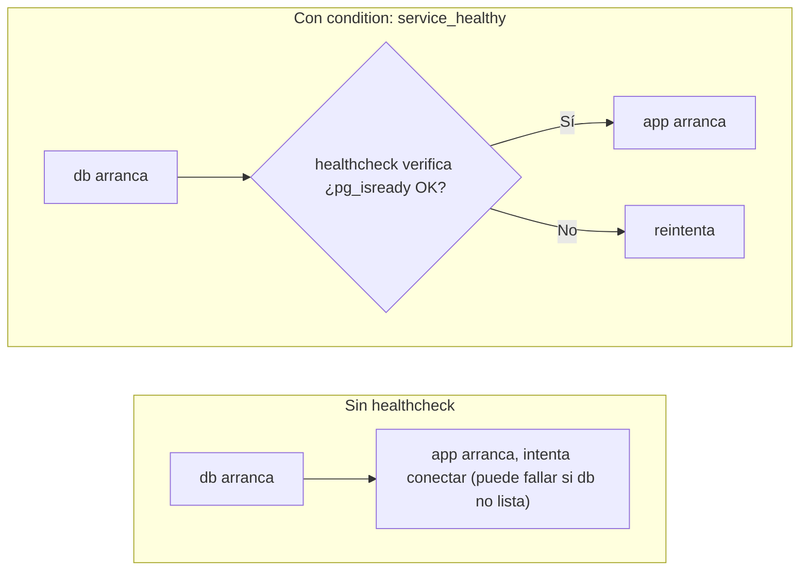
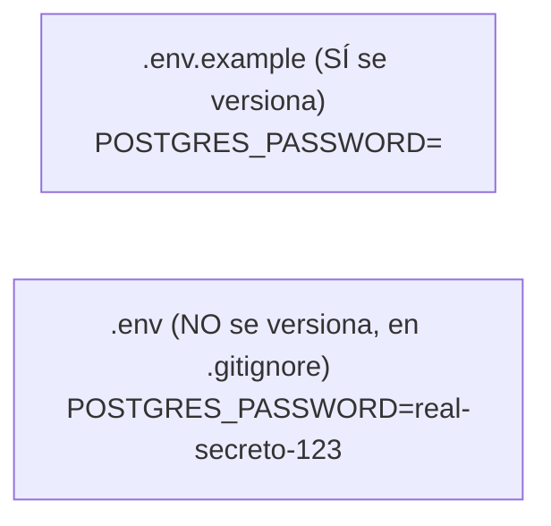
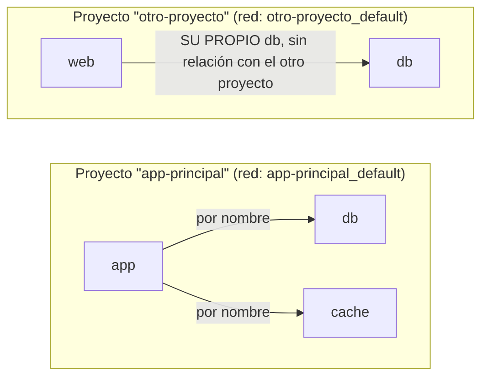
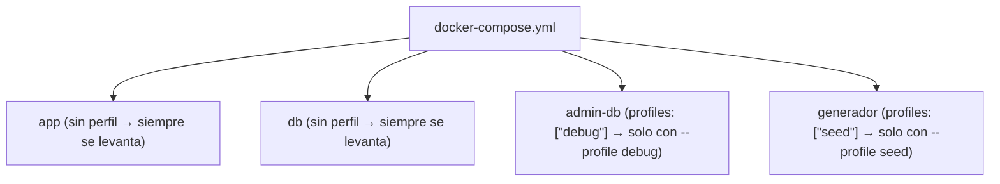

# Módulo 3: Docker Compose y orquestación local


## Aprende construyendo


### Tema 1: Servicios, dependencias y healthchecks · Básico · 30 min

<details open>
<summary><strong>Capa 1 — Lectura</strong></summary>

#### ► DE QUÉ TRATA
Al finalizar podrás configurar un healthcheck y depends_on: condition: service_healthy para que un servicio espere disponibilidad real, no solo el arranque del proceso de otro.

#### ► LA IDEA EN UNA FRASE
**Al finalizar podrás configurar un healthcheck y depends_on: condition: service_healthy para que un servicio espere disponibilidad real, no solo el arranque del proceso de otro.**

#### ► POR QUÉ EXISTE ESTO
Resuelve un problema real de diseño o implementación y evita decisiones a ciegas.

#### ► LA ANALOGÍA
Piensa en servicios, dependencias y healthchecks como una herramienta de taller: útil cuando conoces su propósito y sus límites.
**Dónde se rompe la analogía:** en software, los efectos dependen del contexto, la escala y los trade-offs.

#### ► CÓMO FUNCIONA


#### ► LO QUE PUEDE SALIR MAL
| Síntoma | Causa probable | Arreglo |
|---|---|---|
| Servicios, dependencias y healthchecks se aplica pero el resultado no mejora | Se usó sin medir el problema real | Mide antes y compara contra la alternativa simple |
| Aparece complejidad inesperada | Se adoptó la técnica sin comprender sus trade-offs | Vuelve a la sección de trade-offs y reduce el alcance |
| Falla en un caso límite | Se asumió un contexto que no se cumple | Prueba el caso límite y documenta cuándo NO usarlo |

#### ► TRADE-OFFS
| Opción | Cuándo usarla | Cuándo NO usarla |
|---|---|---|
| Usar Servicios, dependencias y healthchecks | Cuando el problema coincide con su propósito y el beneficio es observable | Cuando agrega complejidad sin resolver un problema real |
| Alternativa más simple | Cuando el contexto es pequeño, estable o fácil de razonar | Cuando ya demostró no escalar o no cumplir el requisito |
| Postergar la decisión | Cuando falta evidencia del problema | Cuando el costo de esperar es mayor que el costo de probar |

#### ► CUÁNDO NO USAR ESTO
No uses servicios, dependencias y healthchecks por defecto. Aplícalo cuando el problema lo justifique y puedas verificar el beneficio; si una alternativa más simple resuelve igual, prefiérela.

#### ► DE VUELTA A LA ANALOGÍA
Volviendo a la analogía: servicios, dependencias y healthchecks funciona como el modelo inicial, pero recuerda dónde se rompe: en producción importan la evidencia, la escala y el costo de equivocarte.

#### ► LO QUE DEBES RECORDAR
- Servicios, dependencias y healthchecks existe para resolver un problema específico.
- Mide antes de adoptar complejidad.
- Conoce el caso donde NO usarlo.
- Verifica con evidencia observable.

#### ► PREGUNTAS PARA PENSAR
1. ¿Qué problema concreto resuelve servicios, dependencias y healthchecks en tu contexto?
2. ¿Cómo sabrías que servicios, dependencias y healthchecks no está funcionando bien?
3. ¿Qué alternativa más simple considerarías antes de usar servicios, dependencias y healthchecks?

</details>

<details>
<summary><strong>Capa 2 — Construcción</strong></summary>

#### Código y verificación


```bash
mkdir -p academia-devops/src/modulo3/healthcheck && cd academia-devops/src/modulo3/healthcheck
cat > compose.yaml <<'EOF'
services:
  db:
    image: postgres:16-alpine
    environment:
      POSTGRES_PASSWORD: demo
    healthcheck:
      test: ["CMD-SHELL", "pg_isready -U postgres"]
      interval: 2s
      retries: 10
  app:
    image: postgres:16-alpine
    depends_on:
      db:
        condition: service_healthy
    command: ["sh", "-c", "pg_isready -h db -U postgres && echo 'app arrancó DESPUES de que db reportara healthy'"]
EOF
```

```bash
docker compose up -d
docker compose logs app
docker compose ps
```

</details>

### Tema 2: Variables de entorno y .env · Básico · 30 min

<details open>
<summary><strong>Capa 1 — Lectura</strong></summary>

#### ► DE QUÉ TRATA
Al finalizar podrás externalizar configuración sensible en .env, versionando solo una plantilla .env.example, sin exponer secretos reales en el repositorio.

#### ► LA IDEA EN UNA FRASE
**Al finalizar podrás externalizar configuración sensible en .env, versionando solo una plantilla .env.example, sin exponer secretos reales en el repositorio.**

#### ► POR QUÉ EXISTE ESTO
Resuelve un problema real de diseño o implementación y evita decisiones a ciegas.

#### ► LA ANALOGÍA
Piensa en variables de entorno y .env como una herramienta de taller: útil cuando conoces su propósito y sus límites.
**Dónde se rompe la analogía:** en software, los efectos dependen del contexto, la escala y los trade-offs.

#### ► CÓMO FUNCIONA


#### ► LO QUE PUEDE SALIR MAL
| Síntoma | Causa probable | Arreglo |
|---|---|---|
| Variables de entorno y .env se aplica pero el resultado no mejora | Se usó sin medir el problema real | Mide antes y compara contra la alternativa simple |
| Aparece complejidad inesperada | Se adoptó la técnica sin comprender sus trade-offs | Vuelve a la sección de trade-offs y reduce el alcance |
| Falla en un caso límite | Se asumió un contexto que no se cumple | Prueba el caso límite y documenta cuándo NO usarlo |

#### ► TRADE-OFFS
| Opción | Cuándo usarla | Cuándo NO usarla |
|---|---|---|
| Usar Variables de entorno y .env | Cuando el problema coincide con su propósito y el beneficio es observable | Cuando agrega complejidad sin resolver un problema real |
| Alternativa más simple | Cuando el contexto es pequeño, estable o fácil de razonar | Cuando ya demostró no escalar o no cumplir el requisito |
| Postergar la decisión | Cuando falta evidencia del problema | Cuando el costo de esperar es mayor que el costo de probar |

#### ► CUÁNDO NO USAR ESTO
No uses variables de entorno y .env por defecto. Aplícalo cuando el problema lo justifique y puedas verificar el beneficio; si una alternativa más simple resuelve igual, prefiérela.

#### ► DE VUELTA A LA ANALOGÍA
Volviendo a la analogía: variables de entorno y .env funciona como el modelo inicial, pero recuerda dónde se rompe: en producción importan la evidencia, la escala y el costo de equivocarte.

#### ► LO QUE DEBES RECORDAR
- Variables de entorno y .env existe para resolver un problema específico.
- Mide antes de adoptar complejidad.
- Conoce el caso donde NO usarlo.
- Verifica con evidencia observable.

#### ► PREGUNTAS PARA PENSAR
1. ¿Qué problema concreto resuelve variables de entorno y .env en tu contexto?
2. ¿Cómo sabrías que variables de entorno y .env no está funcionando bien?
3. ¿Qué alternativa más simple considerarías antes de usar variables de entorno y .env?

</details>

<details>
<summary><strong>Capa 2 — Construcción</strong></summary>

#### Código y verificación


```bash
mkdir -p academia-devops/src/modulo3/env-demo && cd academia-devops/src/modulo3/env-demo
echo "POSTGRES_PASSWORD=" > .env.example
echo "POSTGRES_PASSWORD=desarrollo123" > .env
echo ".env" > .gitignore
cat > compose.yaml <<'EOF'
services:
  db:
    image: postgres:16-alpine
    environment:
      POSTGRES_PASSWORD: ${POSTGRES_PASSWORD:-sin-configurar}
EOF
```

```bash
docker compose config | grep POSTGRES_PASSWORD
mv .env .env.bak
docker compose config | grep POSTGRES_PASSWORD
mv .env.bak .env
```

</details>

### Tema 3: Redes y descubrimiento por nombre de servicio · Básico · 30 min

<details open>
<summary><strong>Capa 1 — Lectura</strong></summary>

#### ► DE QUÉ TRATA
Al finalizar podrás explicar por qué un servicio de Compose alcanza a otro por su nombre, y por qué dos proyectos Compose distintos están aislados entre sí por defecto.

#### ► LA IDEA EN UNA FRASE
**Al finalizar podrás explicar por qué un servicio de Compose alcanza a otro por su nombre, y por qué dos proyectos Compose distintos están aislados entre sí por defecto.**

#### ► POR QUÉ EXISTE ESTO
Resuelve un problema real de diseño o implementación y evita decisiones a ciegas.

#### ► LA ANALOGÍA
Piensa en redes y descubrimiento por nombre de servicio como una herramienta de taller: útil cuando conoces su propósito y sus límites.
**Dónde se rompe la analogía:** en software, los efectos dependen del contexto, la escala y los trade-offs.

#### ► CÓMO FUNCIONA


#### ► LO QUE PUEDE SALIR MAL
| Síntoma | Causa probable | Arreglo |
|---|---|---|
| Redes y descubrimiento por nombre de servicio se aplica pero el resultado no mejora | Se usó sin medir el problema real | Mide antes y compara contra la alternativa simple |
| Aparece complejidad inesperada | Se adoptó la técnica sin comprender sus trade-offs | Vuelve a la sección de trade-offs y reduce el alcance |
| Falla en un caso límite | Se asumió un contexto que no se cumple | Prueba el caso límite y documenta cuándo NO usarlo |

#### ► TRADE-OFFS
| Opción | Cuándo usarla | Cuándo NO usarla |
|---|---|---|
| Usar Redes y descubrimiento por nombre de servicio | Cuando el problema coincide con su propósito y el beneficio es observable | Cuando agrega complejidad sin resolver un problema real |
| Alternativa más simple | Cuando el contexto es pequeño, estable o fácil de razonar | Cuando ya demostró no escalar o no cumplir el requisito |
| Postergar la decisión | Cuando falta evidencia del problema | Cuando el costo de esperar es mayor que el costo de probar |

#### ► CUÁNDO NO USAR ESTO
No uses redes y descubrimiento por nombre de servicio por defecto. Aplícalo cuando el problema lo justifique y puedas verificar el beneficio; si una alternativa más simple resuelve igual, prefiérela.

#### ► DE VUELTA A LA ANALOGÍA
Volviendo a la analogía: redes y descubrimiento por nombre de servicio funciona como el modelo inicial, pero recuerda dónde se rompe: en producción importan la evidencia, la escala y el costo de equivocarte.

#### ► LO QUE DEBES RECORDAR
- Redes y descubrimiento por nombre de servicio existe para resolver un problema específico.
- Mide antes de adoptar complejidad.
- Conoce el caso donde NO usarlo.
- Verifica con evidencia observable.

#### ► PREGUNTAS PARA PENSAR
1. ¿Qué problema concreto resuelve redes y descubrimiento por nombre de servicio en tu contexto?
2. ¿Cómo sabrías que redes y descubrimiento por nombre de servicio no está funcionando bien?
3. ¿Qué alternativa más simple considerarías antes de usar redes y descubrimiento por nombre de servicio?

</details>

<details>
<summary><strong>Capa 2 — Construcción</strong></summary>

#### Código y verificación


```bash
mkdir -p academia-devops/src/modulo3/proyecto-a academia-devops/src/modulo3/proyecto-b
cat > academia-devops/src/modulo3/proyecto-a/compose.yaml <<'EOF'
services:
  db:
    image: alpine
    command: sleep 300
  cliente:
    image: alpine
    depends_on: [db]
    command: sh -c "ping -c 2 db"
EOF
cp academia-devops/src/modulo3/proyecto-a/compose.yaml academia-devops/src/modulo3/proyecto-b/compose.yaml
cd academia-devops/src/modulo3/proyecto-a && docker compose up -d db
cd ../proyecto-b && docker compose up -d db
cd ../proyecto-a && docker compose run --rm cliente
```

</details>

### Tema 4: Perfiles para distintos entornos · Básico · 30 min

<details open>
<summary><strong>Capa 1 — Lectura</strong></summary>

#### ► DE QUÉ TRATA
Al finalizar podrás usar profiles para que servicios opcionales (herramientas de administración, generadores de datos) solo se levanten cuando se activan explícitamente.

#### ► LA IDEA EN UNA FRASE
**Al finalizar podrás usar profiles para que servicios opcionales (herramientas de administración, generadores de datos) solo se levanten cuando se activan explícitamente.**

#### ► POR QUÉ EXISTE ESTO
Resuelve un problema real de diseño o implementación y evita decisiones a ciegas.

#### ► LA ANALOGÍA
Piensa en perfiles para distintos entornos como una herramienta de taller: útil cuando conoces su propósito y sus límites.
**Dónde se rompe la analogía:** en software, los efectos dependen del contexto, la escala y los trade-offs.

#### ► CÓMO FUNCIONA


#### ► LO QUE PUEDE SALIR MAL
| Síntoma | Causa probable | Arreglo |
|---|---|---|
| Perfiles para distintos entornos se aplica pero el resultado no mejora | Se usó sin medir el problema real | Mide antes y compara contra la alternativa simple |
| Aparece complejidad inesperada | Se adoptó la técnica sin comprender sus trade-offs | Vuelve a la sección de trade-offs y reduce el alcance |
| Falla en un caso límite | Se asumió un contexto que no se cumple | Prueba el caso límite y documenta cuándo NO usarlo |

#### ► TRADE-OFFS
| Opción | Cuándo usarla | Cuándo NO usarla |
|---|---|---|
| Usar Perfiles para distintos entornos | Cuando el problema coincide con su propósito y el beneficio es observable | Cuando agrega complejidad sin resolver un problema real |
| Alternativa más simple | Cuando el contexto es pequeño, estable o fácil de razonar | Cuando ya demostró no escalar o no cumplir el requisito |
| Postergar la decisión | Cuando falta evidencia del problema | Cuando el costo de esperar es mayor que el costo de probar |

#### ► CUÁNDO NO USAR ESTO
No uses perfiles para distintos entornos por defecto. Aplícalo cuando el problema lo justifique y puedas verificar el beneficio; si una alternativa más simple resuelve igual, prefiérela.

#### ► DE VUELTA A LA ANALOGÍA
Volviendo a la analogía: perfiles para distintos entornos funciona como el modelo inicial, pero recuerda dónde se rompe: en producción importan la evidencia, la escala y el costo de equivocarte.

#### ► LO QUE DEBES RECORDAR
- Perfiles para distintos entornos existe para resolver un problema específico.
- Mide antes de adoptar complejidad.
- Conoce el caso donde NO usarlo.
- Verifica con evidencia observable.

#### ► PREGUNTAS PARA PENSAR
1. ¿Qué problema concreto resuelve perfiles para distintos entornos en tu contexto?
2. ¿Cómo sabrías que perfiles para distintos entornos no está funcionando bien?
3. ¿Qué alternativa más simple considerarías antes de usar perfiles para distintos entornos?

</details>

<details>
<summary><strong>Capa 2 — Construcción</strong></summary>

#### Código y verificación


```bash
mkdir -p academia-devops/src/modulo3/perfiles && cd academia-devops/src/modulo3/perfiles
cat > compose.yaml <<'EOF'
services:
  app:
    image: alpine
    command: sleep 300
  admin-db:
    image: alpine
    command: sleep 300
    profiles: ["debug"]
EOF
docker compose up -d
docker compose ps --services
```

```bash
docker compose --profile debug up -d
docker compose ps --services
```

</details>
