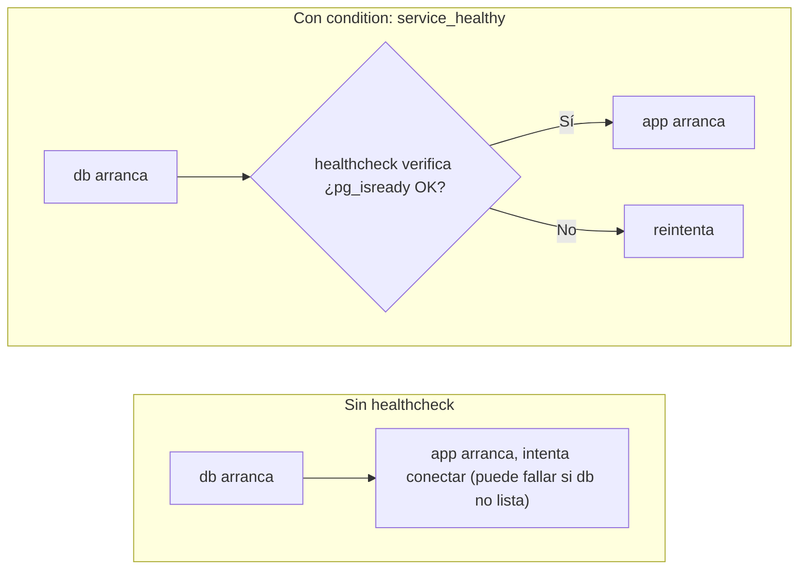
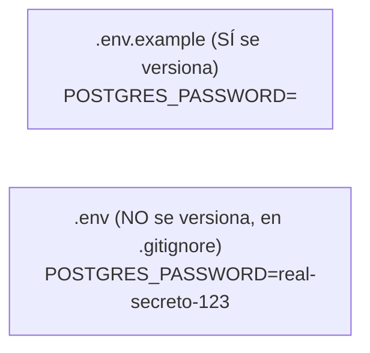
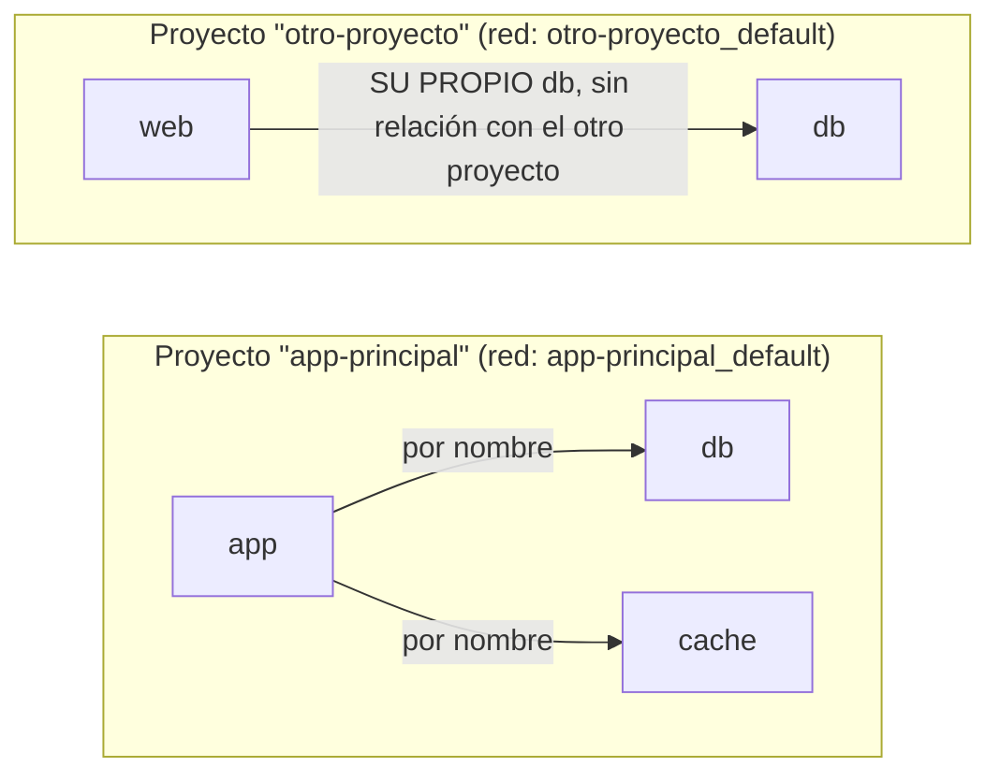
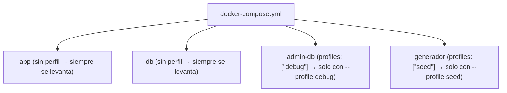

# Módulo 3: Docker Compose y orquestación local


## Aprende construyendo


### Tema 1: Servicios, dependencias y healthchecks · Básico · 30 min

<details open>
<summary><strong>Capa 1 — Lectura</strong></summary>

#### ► DE QUÉ TRATA
Al finalizar podrás configurar un healthcheck y depends_on: condition: service_healthy para que un servicio espere disponibilidad real, no solo el arranque del proceso de otro.

#### ► CÓMO FUNCIONA


</details>

<details>
<summary><strong>Capa 2 — Construcción</strong></summary>

#### Código y verificación


```bash
mkdir -p academia-devops/src/modulo3/healthcheck && cd academia-devops/src/modulo3/healthcheck
```

Crea el archivo `compose.yaml`:

```yaml
services:
  db:
    image: postgres:16-alpine
    environment:
      POSTGRES_PASSWORD: demo
    healthcheck:
      test: ["CMD-SHELL", "pg_isready -U postgres"]
      interval: 2s
      retries: 10
  app:
    image: postgres:16-alpine
    depends_on:
      db:
        condition: service_healthy
    command: ["sh", "-c", "pg_isready -h db -U postgres && echo 'app arrancó DESPUES de que db reportara healthy'"]
```

```bash
docker compose up -d
docker compose logs app
docker compose ps
```

</details>

### Tema 2: Variables de entorno y .env · Básico · 30 min

<details open>
<summary><strong>Capa 1 — Lectura</strong></summary>

#### ► DE QUÉ TRATA
Al finalizar podrás externalizar configuración sensible en .env, versionando solo una plantilla .env.example, sin exponer secretos reales en el repositorio.

#### ► CÓMO FUNCIONA


</details>

<details>
<summary><strong>Capa 2 — Construcción</strong></summary>

#### Código y verificación


```bash
mkdir -p academia-devops/src/modulo3/env-demo && cd academia-devops/src/modulo3/env-demo
echo "POSTGRES_PASSWORD=" > .env.example
echo "POSTGRES_PASSWORD=desarrollo123" > .env
echo ".env" > .gitignore
```

Crea el archivo `compose.yaml`:

```yaml
services:
  db:
    image: postgres:16-alpine
    environment:
      POSTGRES_PASSWORD: ${POSTGRES_PASSWORD:-sin-configurar}
```

```bash
docker compose config | grep POSTGRES_PASSWORD
mv .env .env.bak
docker compose config | grep POSTGRES_PASSWORD
mv .env.bak .env
```

</details>

### Tema 3: Redes y descubrimiento por nombre de servicio · Básico · 30 min

<details open>
<summary><strong>Capa 1 — Lectura</strong></summary>

#### ► DE QUÉ TRATA
Al finalizar podrás explicar por qué un servicio de Compose alcanza a otro por su nombre, y por qué dos proyectos Compose distintos están aislados entre sí por defecto.

#### ► CÓMO FUNCIONA


</details>

<details>
<summary><strong>Capa 2 — Construcción</strong></summary>

#### Código y verificación


```bash
mkdir -p academia-devops/src/modulo3/proyecto-a academia-devops/src/modulo3/proyecto-b
```

Crea el archivo `academia-devops/src/modulo3/proyecto-a/compose.yaml`:

```yaml
services:
  db:
    image: alpine
    command: sleep 300
  cliente:
    image: alpine
    depends_on: [db]
    command: sh -c "ping -c 2 db"
```

```bash
cp academia-devops/src/modulo3/proyecto-a/compose.yaml academia-devops/src/modulo3/proyecto-b/compose.yaml
cd academia-devops/src/modulo3/proyecto-a && docker compose up -d db
cd ../proyecto-b && docker compose up -d db
cd ../proyecto-a && docker compose run --rm cliente
```

</details>

### Tema 4: Perfiles para distintos entornos · Básico · 30 min

<details open>
<summary><strong>Capa 1 — Lectura</strong></summary>

#### ► DE QUÉ TRATA
Al finalizar podrás usar profiles para que servicios opcionales (herramientas de administración, generadores de datos) solo se levanten cuando se activan explícitamente.

#### ► CÓMO FUNCIONA


</details>

<details>
<summary><strong>Capa 2 — Construcción</strong></summary>

#### Código y verificación


```bash
mkdir -p academia-devops/src/modulo3/perfiles && cd academia-devops/src/modulo3/perfiles
```

Crea el archivo `compose.yaml`:

```yaml
services:
  app:
    image: alpine
    command: sleep 300
  admin-db:
    image: alpine
    command: sleep 300
    profiles: ["debug"]
```

```bash
docker compose up -d
docker compose ps --services
```

```bash
docker compose --profile debug up -d
docker compose ps --services
```

</details>
