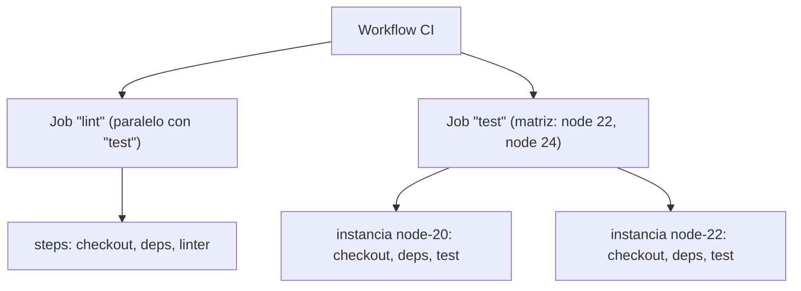
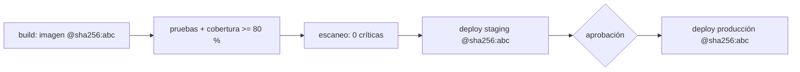

# Módulo 4: CI — pipelines automatizados


## Aprende construyendo


### Tema 1: Jobs, steps y matrices de build · Intermedio · 35 min

<details open>
<summary><strong>Capa 1 — Lectura</strong></summary>

#### ► DE QUÉ TRATA
Al finalizar podrás escribir un workflow de GitHub Actions con un job matricial que ejecuta las mismas pruebas contra varias versiones de runtime en paralelo.

#### ► CÓMO FUNCIONA


</details>

<details>
<summary><strong>Capa 2 — Construcción</strong></summary>

#### Código y verificación


```bash
mkdir -p academia-devops/src/modulo4/ci-matriz/.github/workflows
cd academia-devops/src/modulo4/ci-matriz
```

Crea el archivo `.github/workflows/ci.yml`:

```yaml
name: CI
on: [pull_request]
jobs:
  test:
    runs-on: ubuntu-latest
    strategy:
      matrix:
        node-version: [22, 24]
    steps:
      - uses: actions/checkout@3d3c42e5aac5ba805825da76410c181273ba90b1 # v7.0.1
      - uses: actions/setup-node@949feb2413d6458794dcd2491c4babbbce0c15c1 # v7.1.0
        with:
          node-version: ${{ matrix.node-version }}
      - run: npm test
```

```bash
echo '{"scripts":{"test":"node -e \"console.log(process.version)\""}}' > package.json
```

```bash
docker run --rm -v "$(pwd)":/w -w /w python:3.12-alpine sh -c "pip install --no-cache-dir pyyaml -q && python3 -c \"import yaml; yaml.safe_load(open('.github/workflows/ci.yml')); print('YAML valido')\""
for version in 22 24; do
  echo "--- instancia matriz node-version=$version ---"
  docker run --rm -v "$(pwd)":/app -w /app "node:$version-alpine" npm test
done
```

</details>

### Tema 2: Caché de dependencias en CI · Intermedio · 35 min

<details open>
<summary><strong>Capa 1 — Lectura</strong></summary>

#### ► DE QUÉ TRATA
Al finalizar podrás configurar caché de dependencias basada en el lockfile para evitar reinstalaciones innecesarias en cada ejecución del pipeline.

</details>

<details>
<summary><strong>Capa 2 — Construcción</strong></summary>

#### Código y verificación
```
┌── Ejecución 1 (lockfile hash-A) ──┐   ┌── Ejecución 2 (mismo hash-A) ──┐
│ npm ci (instalación completa)        │   │ restaura caché con clave "hash-A"  │
│ guarda caché con clave "hash-A"       │   │ salta la instalación (rápido)        │
└─────────────────────┘   └───────────────────────┘
Ejecución 3 (lockfile hash-B, cambió) ──▶ clave no existe ──▶ npm ci de nuevo
```

```bash
mkdir -p academia-devops/src/modulo4/cache-ci && cd academia-devops/src/modulo4/cache-ci
echo '{"name":"demo","dependencies":{"left-pad":"1.3.0"}}' > package.json
docker volume create npm-cache-demo
HASH1=$(sha256sum package.json | cut -d" " -f1)
echo "clave de cache derivada del lockfile: $HASH1"
time docker run --rm -v "$(pwd)":/app -v npm-cache-demo:/root/.npm -w /app node:22-alpine npm install --prefer-offline
```

```bash
time docker run --rm -v "$(pwd)":/app -v npm-cache-demo:/root/.npm -w /app node:22-alpine npm install --prefer-offline
```

</details>

### Tema 3: Artifacts y reportes de cobertura · Intermedio · 35 min

<details open>
<summary><strong>Capa 1 — Lectura</strong></summary>

#### ► DE QUÉ TRATA
Al finalizar podrás publicar un reporte de cobertura como artifact descargable de una ejecución de CI, y pasar resultados entre jobs que no comparten sistema de archivos.

</details>

<details>
<summary><strong>Capa 2 — Construcción</strong></summary>

#### Código y verificación
```
┌── Job "test" ────────────────┐       ┌── Job "deploy" (posterior) ──┐
│ ejecuta tests con --coverage      │  ───▶ │ descarga el artifact              │
│ sube "coverage/" como artifact      │       │ "binario-compilado" del job "build" │
└────────────────────────┘       └─────────────────────────┘
```

```bash
mkdir -p academia-devops/src/modulo4/artifacts && cd academia-devops/src/modulo4/artifacts
docker volume create artifacts-demo
docker run --rm -v artifacts-demo:/artifacts alpine sh -c \
  "mkdir -p /artifacts/coverage && echo 'lineas cubiertas: 87%' > /artifacts/coverage/resumen.txt && echo 'job build: artifact generado'"
docker run --rm -v artifacts-demo:/artifacts alpine sh -c \
  "echo 'job deploy: leyendo artifact del job anterior'; cat /artifacts/coverage/resumen.txt"
```

</details>

### Tema 4: Pipelines como código (GitHub Actions/GitLab CI) · Intermedio · 35 min

<details open>
<summary><strong>Capa 1 — Lectura</strong></summary>

#### ► DE QUÉ TRATA
Al finalizar podrás explicar por qué versionar el pipeline de CI/CD como código junto al proyecto da trazabilidad y reversibilidad que una configuración manual externa no da.

</details>

<details>
<summary><strong>Capa 2 — Construcción</strong></summary>

#### Código y verificación
```
┌── .github/workflows/ci.yml (versionado junto al código) ──┐
│ cambios pasan por pull request, revisión, historial de Git   │
│ on: [pull_request]  ──▶ dispara el workflow en cada PR         │
│ on: schedule (cron) ──▶ dispara en horario programado           │
└─────────────────────────────────────────────┘
```

```bash
mkdir -p academia-devops/src/modulo4/pipeline-como-codigo/.github/workflows
cd academia-devops/src/modulo4/pipeline-como-codigo
docker run --rm -u "$(id -u):$(id -g)" -v "$(pwd)":/repo -w /repo --entrypoint sh alpine/git -c '
  git init -q && git config user.email demo@academia.dev && git config user.name demo
  echo "name: CI
on: [push]
jobs:
  test:
    runs-on: ubuntu-latest
    steps:
      - run: echo solo un paso" > .github/workflows/ci.yml
  git add . && git commit -qm "pipeline v1: solo un paso"
  echo "name: CI
on: [push, pull_request]
jobs:
  test:
    runs-on: ubuntu-latest
    steps:
      - run: echo paso 1
      - run: echo paso 2 nuevo" > .github/workflows/ci.yml
  git add . && git commit -qm "pipeline v2: agrega pull_request y un paso nuevo"
  git log --oneline
  git show HEAD~1:.github/workflows/ci.yml'
```

</details>

### Tema 5: Promoción entre entornos con quality gates: el mismo artefacto de pruebas a producción · Avanzado · 45 min

<details open>
<summary><strong>Capa 1 — Lectura</strong></summary>

#### ► DE QUÉ TRATA
Usa GitHub Actions en un repositorio con un Dockerfile. Crea en Settings > Environments los entornos staging y produccion; en produccion agrega revisores obligatorios.

#### ► CÓMO FUNCIONA


</details>

<details>
<summary><strong>Capa 2 — Construcción</strong></summary>

#### Código y verificación


```yaml
name: entrega
on: { push: { branches: [main] } }

jobs:
  build:
    runs-on: ubuntu-latest
    permissions:
      contents: read
      packages: write
    outputs:
      digest: ${{ steps.imagen.outputs.digest }}
    steps:
      - uses: actions/checkout@3d3c42e5aac5ba805825da76410c181273ba90b1 # v7.0.1
      - run: npm ci && npm test -- --coverage --coverage.thresholds.branches=80 # puerta: pruebas y cobertura
      - uses: docker/login-action@8aa5831fb8d48d8f76594c7ddde61ae58019f550 # v4.8.0
        with:
          registry: ghcr.io
          username: ${{ github.actor }}
          password: ${{ secrets.GITHUB_TOKEN }}
      - id: imagen
        uses: docker/build-push-action@c3c9e263c25d99ce0380d002d59b67737d91b0dc # v7.4.0
        with:
          push: true
          tags: ghcr.io/rutaflow/api:${{ github.sha }}

  escaneo:
    needs: build
    runs-on: ubuntu-latest
    permissions:
      packages: read
    steps:
      - uses: aquasecurity/trivy-action@ed142fd0673e97e23eac54620cfb913e5ce36c25 # v0.36.0
        with:
          image-ref: ghcr.io/rutaflow/api@${{ needs.build.outputs.digest }}
          severity: CRITICAL
          exit-code: '1' # puerta: falla si hay críticas
        env:
          TRIVY_USERNAME: ${{ github.actor }} # la imagen de GHCR es privada por defecto
          TRIVY_PASSWORD: ${{ secrets.GITHUB_TOKEN }}

  staging:
    needs: [build, escaneo]
    environment: staging
    runs-on: ubuntu-latest
    steps:
      - run: echo "desplegando ghcr.io/rutaflow/api@${{ needs.build.outputs.digest }} en staging"

  produccion:
    needs: [build, staging]
    environment: produccion # espera la aprobación de un revisor
    runs-on: ubuntu-latest
    steps:
      - run: echo "promoviendo el MISMO digest ${{ needs.build.outputs.digest }} a producción"
```

```bash
git commit -am "cambio" && git push
# en la pestaña Actions: build -> escaneo -> staging -> (aprobación) -> produccion
```

```text
En Actions: build ✓, escaneo ✓, staging ✓ y produccion «Waiting for review».
Tras aprobar, el log de produccion imprime el mismo digest sha256 que el de staging.
```

</details>
