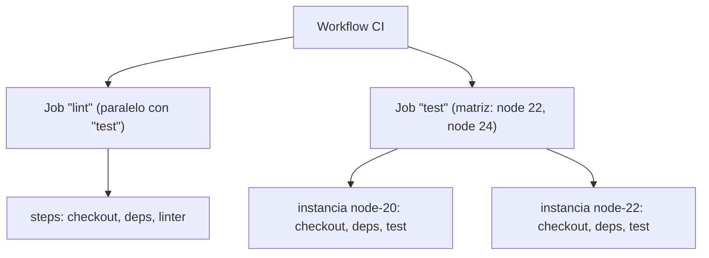
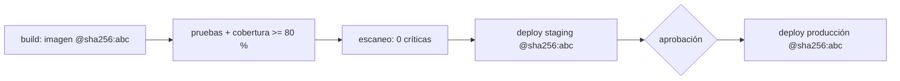

# Módulo 4: CI — pipelines automatizados


## Aprende construyendo


### Tema 1: Jobs, steps y matrices de build · Intermedio · 35 min

<details open>
<summary><strong>Capa 1 — Lectura</strong></summary>

#### ► DE QUÉ TRATA
Al finalizar podrás escribir un workflow de GitHub Actions con un job matricial que ejecuta las mismas pruebas contra varias versiones de runtime en paralelo.

#### ► LA IDEA EN UNA FRASE
**Al finalizar podrás escribir un workflow de GitHub Actions con un job matricial que ejecuta las mismas pruebas contra varias versiones de runtime en paralelo.**

#### ► POR QUÉ EXISTE ESTO
Resuelve un problema real de diseño o implementación y evita decisiones a ciegas.

#### ► LA ANALOGÍA
Piensa en jobs, steps y matrices de build como una herramienta de taller: útil cuando conoces su propósito y sus límites.
**Dónde se rompe la analogía:** en software, los efectos dependen del contexto, la escala y los trade-offs.

#### ► CÓMO FUNCIONA


#### ► LO QUE PUEDE SALIR MAL
| Síntoma | Causa probable | Arreglo |
|---|---|---|
| Jobs, steps y matrices de build se aplica pero el resultado no mejora | Se usó sin medir el problema real | Mide antes y compara contra la alternativa simple |
| Aparece complejidad inesperada | Se adoptó la técnica sin comprender sus trade-offs | Vuelve a la sección de trade-offs y reduce el alcance |
| Falla en un caso límite | Se asumió un contexto que no se cumple | Prueba el caso límite y documenta cuándo NO usarlo |

#### ► TRADE-OFFS
| Opción | Cuándo usarla | Cuándo NO usarla |
|---|---|---|
| Usar Jobs, steps y matrices de build | Cuando el problema coincide con su propósito y el beneficio es observable | Cuando agrega complejidad sin resolver un problema real |
| Alternativa más simple | Cuando el contexto es pequeño, estable o fácil de razonar | Cuando ya demostró no escalar o no cumplir el requisito |
| Postergar la decisión | Cuando falta evidencia del problema | Cuando el costo de esperar es mayor que el costo de probar |

#### ► CUÁNDO NO USAR ESTO
No uses jobs, steps y matrices de build por defecto. Aplícalo cuando el problema lo justifique y puedas verificar el beneficio; si una alternativa más simple resuelve igual, prefiérela.

#### ► DE VUELTA A LA ANALOGÍA
Volviendo a la analogía: jobs, steps y matrices de build funciona como el modelo inicial, pero recuerda dónde se rompe: en producción importan la evidencia, la escala y el costo de equivocarte.

#### ► LO QUE DEBES RECORDAR
- Jobs, steps y matrices de build existe para resolver un problema específico.
- Mide antes de adoptar complejidad.
- Conoce el caso donde NO usarlo.
- Verifica con evidencia observable.

#### ► PREGUNTAS PARA PENSAR
1. ¿Qué problema concreto resuelve jobs, steps y matrices de build en tu contexto?
2. ¿Cómo sabrías que jobs, steps y matrices de build no está funcionando bien?
3. ¿Qué alternativa más simple considerarías antes de usar jobs, steps y matrices de build?

</details>

<details>
<summary><strong>Capa 2 — Construcción</strong></summary>

#### Código y verificación


```bash
mkdir -p academia-devops/src/modulo4/ci-matriz/.github/workflows
cd academia-devops/src/modulo4/ci-matriz
```

Crea el archivo `.github/workflows/ci.yml`:

```yaml
name: CI
on: [pull_request]
jobs:
  test:
    runs-on: ubuntu-latest
    strategy:
      matrix:
        node-version: [22, 24]
    steps:
      - uses: actions/checkout@3d3c42e5aac5ba805825da76410c181273ba90b1 # v7.0.1
      - uses: actions/setup-node@949feb2413d6458794dcd2491c4babbbce0c15c1 # v7.1.0
        with:
          node-version: ${{ matrix.node-version }}
      - run: npm test
```

```bash
echo '{"scripts":{"test":"node -e \"console.log(process.version)\""}}' > package.json
```

```bash
docker run --rm -v "$(pwd)":/w -w /w python:3.12-alpine sh -c "pip install --no-cache-dir pyyaml -q && python3 -c \"import yaml; yaml.safe_load(open('.github/workflows/ci.yml')); print('YAML valido')\""
for version in 22 24; do
  echo "--- instancia matriz node-version=$version ---"
  docker run --rm -v "$(pwd)":/app -w /app "node:$version-alpine" npm test
done
```

</details>

### Tema 2: Caché de dependencias en CI · Intermedio · 35 min

<details open>
<summary><strong>Capa 1 — Lectura</strong></summary>

#### ► DE QUÉ TRATA
Al finalizar podrás configurar caché de dependencias basada en el lockfile para evitar reinstalaciones innecesarias en cada ejecución del pipeline.

#### ► LA IDEA EN UNA FRASE
**Al finalizar podrás configurar caché de dependencias basada en el lockfile para evitar reinstalaciones innecesarias en cada ejecución del pipeline.**

#### ► POR QUÉ EXISTE ESTO
Resuelve un problema real de diseño o implementación y evita decisiones a ciegas.

#### ► LA ANALOGÍA
Piensa en caché de dependencias en ci como una herramienta de taller: útil cuando conoces su propósito y sus límites.
**Dónde se rompe la analogía:** en software, los efectos dependen del contexto, la escala y los trade-offs.

#### ► CÓMO FUNCIONA
1. Identifica el problema que caché de dependencias en ci resuelve.
2. Observa sus componentes y relaciones.
3. Aplica la opción más simple que funcione.
4. Verifica el resultado y los límites.

#### ► LO QUE PUEDE SALIR MAL
| Síntoma | Causa probable | Arreglo |
|---|---|---|
| Caché de dependencias en CI se aplica pero el resultado no mejora | Se usó sin medir el problema real | Mide antes y compara contra la alternativa simple |
| Aparece complejidad inesperada | Se adoptó la técnica sin comprender sus trade-offs | Vuelve a la sección de trade-offs y reduce el alcance |
| Falla en un caso límite | Se asumió un contexto que no se cumple | Prueba el caso límite y documenta cuándo NO usarlo |

#### ► TRADE-OFFS
| Opción | Cuándo usarla | Cuándo NO usarla |
|---|---|---|
| Usar Caché de dependencias en CI | Cuando el problema coincide con su propósito y el beneficio es observable | Cuando agrega complejidad sin resolver un problema real |
| Alternativa más simple | Cuando el contexto es pequeño, estable o fácil de razonar | Cuando ya demostró no escalar o no cumplir el requisito |
| Postergar la decisión | Cuando falta evidencia del problema | Cuando el costo de esperar es mayor que el costo de probar |

#### ► CUÁNDO NO USAR ESTO
No uses caché de dependencias en ci por defecto. Aplícalo cuando el problema lo justifique y puedas verificar el beneficio; si una alternativa más simple resuelve igual, prefiérela.

#### ► DE VUELTA A LA ANALOGÍA
Volviendo a la analogía: caché de dependencias en ci funciona como el modelo inicial, pero recuerda dónde se rompe: en producción importan la evidencia, la escala y el costo de equivocarte.

#### ► LO QUE DEBES RECORDAR
- Caché de dependencias en CI existe para resolver un problema específico.
- Mide antes de adoptar complejidad.
- Conoce el caso donde NO usarlo.
- Verifica con evidencia observable.

#### ► PREGUNTAS PARA PENSAR
1. ¿Qué problema concreto resuelve caché de dependencias en ci en tu contexto?
2. ¿Cómo sabrías que caché de dependencias en ci no está funcionando bien?
3. ¿Qué alternativa más simple considerarías antes de usar caché de dependencias en ci?

</details>

<details>
<summary><strong>Capa 2 — Construcción</strong></summary>

#### Código y verificación
```
┌── Ejecución 1 (lockfile hash-A) ──┐   ┌── Ejecución 2 (mismo hash-A) ──┐
│ npm ci (instalación completa)        │   │ restaura caché con clave "hash-A"  │
│ guarda caché con clave "hash-A"       │   │ salta la instalación (rápido)        │
└─────────────────────┘   └───────────────────────┘
Ejecución 3 (lockfile hash-B, cambió) ──▶ clave no existe ──▶ npm ci de nuevo
```

```bash
mkdir -p academia-devops/src/modulo4/cache-ci && cd academia-devops/src/modulo4/cache-ci
echo '{"name":"demo","dependencies":{"left-pad":"1.3.0"}}' > package.json
docker volume create npm-cache-demo
HASH1=$(sha256sum package.json | cut -d" " -f1)
echo "clave de cache derivada del lockfile: $HASH1"
time docker run --rm -v "$(pwd)":/app -v npm-cache-demo:/root/.npm -w /app node:22-alpine npm install --prefer-offline
```

```bash
time docker run --rm -v "$(pwd)":/app -v npm-cache-demo:/root/.npm -w /app node:22-alpine npm install --prefer-offline
```

</details>

### Tema 3: Artifacts y reportes de cobertura · Intermedio · 35 min

<details open>
<summary><strong>Capa 1 — Lectura</strong></summary>

#### ► DE QUÉ TRATA
Al finalizar podrás publicar un reporte de cobertura como artifact descargable de una ejecución de CI, y pasar resultados entre jobs que no comparten sistema de archivos.

#### ► LA IDEA EN UNA FRASE
**Al finalizar podrás publicar un reporte de cobertura como artifact descargable de una ejecución de CI, y pasar resultados entre jobs que no comparten sistema de archivos.**

#### ► POR QUÉ EXISTE ESTO
Resuelve un problema real de diseño o implementación y evita decisiones a ciegas.

#### ► LA ANALOGÍA
Piensa en artifacts y reportes de cobertura como una herramienta de taller: útil cuando conoces su propósito y sus límites.
**Dónde se rompe la analogía:** en software, los efectos dependen del contexto, la escala y los trade-offs.

#### ► CÓMO FUNCIONA
1. Identifica el problema que artifacts y reportes de cobertura resuelve.
2. Observa sus componentes y relaciones.
3. Aplica la opción más simple que funcione.
4. Verifica el resultado y los límites.

#### ► LO QUE PUEDE SALIR MAL
| Síntoma | Causa probable | Arreglo |
|---|---|---|
| Artifacts y reportes de cobertura se aplica pero el resultado no mejora | Se usó sin medir el problema real | Mide antes y compara contra la alternativa simple |
| Aparece complejidad inesperada | Se adoptó la técnica sin comprender sus trade-offs | Vuelve a la sección de trade-offs y reduce el alcance |
| Falla en un caso límite | Se asumió un contexto que no se cumple | Prueba el caso límite y documenta cuándo NO usarlo |

#### ► TRADE-OFFS
| Opción | Cuándo usarla | Cuándo NO usarla |
|---|---|---|
| Usar Artifacts y reportes de cobertura | Cuando el problema coincide con su propósito y el beneficio es observable | Cuando agrega complejidad sin resolver un problema real |
| Alternativa más simple | Cuando el contexto es pequeño, estable o fácil de razonar | Cuando ya demostró no escalar o no cumplir el requisito |
| Postergar la decisión | Cuando falta evidencia del problema | Cuando el costo de esperar es mayor que el costo de probar |

#### ► CUÁNDO NO USAR ESTO
No uses artifacts y reportes de cobertura por defecto. Aplícalo cuando el problema lo justifique y puedas verificar el beneficio; si una alternativa más simple resuelve igual, prefiérela.

#### ► DE VUELTA A LA ANALOGÍA
Volviendo a la analogía: artifacts y reportes de cobertura funciona como el modelo inicial, pero recuerda dónde se rompe: en producción importan la evidencia, la escala y el costo de equivocarte.

#### ► LO QUE DEBES RECORDAR
- Artifacts y reportes de cobertura existe para resolver un problema específico.
- Mide antes de adoptar complejidad.
- Conoce el caso donde NO usarlo.
- Verifica con evidencia observable.

#### ► PREGUNTAS PARA PENSAR
1. ¿Qué problema concreto resuelve artifacts y reportes de cobertura en tu contexto?
2. ¿Cómo sabrías que artifacts y reportes de cobertura no está funcionando bien?
3. ¿Qué alternativa más simple considerarías antes de usar artifacts y reportes de cobertura?

</details>

<details>
<summary><strong>Capa 2 — Construcción</strong></summary>

#### Código y verificación
```
┌── Job "test" ────────────────┐       ┌── Job "deploy" (posterior) ──┐
│ ejecuta tests con --coverage      │  ───▶ │ descarga el artifact              │
│ sube "coverage/" como artifact      │       │ "binario-compilado" del job "build" │
└────────────────────────┘       └─────────────────────────┘
```

```bash
mkdir -p academia-devops/src/modulo4/artifacts && cd academia-devops/src/modulo4/artifacts
docker volume create artifacts-demo
docker run --rm -v artifacts-demo:/artifacts alpine sh -c \
  "mkdir -p /artifacts/coverage && echo 'lineas cubiertas: 87%' > /artifacts/coverage/resumen.txt && echo 'job build: artifact generado'"
docker run --rm -v artifacts-demo:/artifacts alpine sh -c \
  "echo 'job deploy: leyendo artifact del job anterior'; cat /artifacts/coverage/resumen.txt"
```

</details>

### Tema 4: Pipelines como código (GitHub Actions/GitLab CI) · Intermedio · 35 min

<details open>
<summary><strong>Capa 1 — Lectura</strong></summary>

#### ► DE QUÉ TRATA
Al finalizar podrás explicar por qué versionar el pipeline de CI/CD como código junto al proyecto da trazabilidad y reversibilidad que una configuración manual externa no da.

#### ► LA IDEA EN UNA FRASE
**Al finalizar podrás explicar por qué versionar el pipeline de CI/CD como código junto al proyecto da trazabilidad y reversibilidad que una configuración manual externa no da.**

#### ► POR QUÉ EXISTE ESTO
Resuelve un problema real de diseño o implementación y evita decisiones a ciegas.

#### ► LA ANALOGÍA
Piensa en pipelines como código (github actions/gitlab ci) como una herramienta de taller: útil cuando conoces su propósito y sus límites.
**Dónde se rompe la analogía:** en software, los efectos dependen del contexto, la escala y los trade-offs.

#### ► CÓMO FUNCIONA
1. Identifica el problema que pipelines como código (github actions/gitlab ci) resuelve.
2. Observa sus componentes y relaciones.
3. Aplica la opción más simple que funcione.
4. Verifica el resultado y los límites.

#### ► LO QUE PUEDE SALIR MAL
| Síntoma | Causa probable | Arreglo |
|---|---|---|
| Pipelines como código (GitHub Actions/GitLab CI) se aplica pero el resultado no mejora | Se usó sin medir el problema real | Mide antes y compara contra la alternativa simple |
| Aparece complejidad inesperada | Se adoptó la técnica sin comprender sus trade-offs | Vuelve a la sección de trade-offs y reduce el alcance |
| Falla en un caso límite | Se asumió un contexto que no se cumple | Prueba el caso límite y documenta cuándo NO usarlo |

#### ► TRADE-OFFS
| Opción | Cuándo usarla | Cuándo NO usarla |
|---|---|---|
| Usar Pipelines como código (GitHub Actions/GitLab CI) | Cuando el problema coincide con su propósito y el beneficio es observable | Cuando agrega complejidad sin resolver un problema real |
| Alternativa más simple | Cuando el contexto es pequeño, estable o fácil de razonar | Cuando ya demostró no escalar o no cumplir el requisito |
| Postergar la decisión | Cuando falta evidencia del problema | Cuando el costo de esperar es mayor que el costo de probar |

#### ► CUÁNDO NO USAR ESTO
No uses pipelines como código (github actions/gitlab ci) por defecto. Aplícalo cuando el problema lo justifique y puedas verificar el beneficio; si una alternativa más simple resuelve igual, prefiérela.

#### ► DE VUELTA A LA ANALOGÍA
Volviendo a la analogía: pipelines como código (github actions/gitlab ci) funciona como el modelo inicial, pero recuerda dónde se rompe: en producción importan la evidencia, la escala y el costo de equivocarte.

#### ► LO QUE DEBES RECORDAR
- Pipelines como código (GitHub Actions/GitLab CI) existe para resolver un problema específico.
- Mide antes de adoptar complejidad.
- Conoce el caso donde NO usarlo.
- Verifica con evidencia observable.

#### ► PREGUNTAS PARA PENSAR
1. ¿Qué problema concreto resuelve pipelines como código (github actions/gitlab ci) en tu contexto?
2. ¿Cómo sabrías que pipelines como código (github actions/gitlab ci) no está funcionando bien?
3. ¿Qué alternativa más simple considerarías antes de usar pipelines como código (github actions/gitlab ci)?

</details>

<details>
<summary><strong>Capa 2 — Construcción</strong></summary>

#### Código y verificación
```
┌── .github/workflows/ci.yml (versionado junto al código) ──┐
│ cambios pasan por pull request, revisión, historial de Git   │
│ on: [pull_request]  ──▶ dispara el workflow en cada PR         │
│ on: schedule (cron) ──▶ dispara en horario programado           │
└─────────────────────────────────────────────┘
```

```bash
mkdir -p academia-devops/src/modulo4/pipeline-como-codigo/.github/workflows
cd academia-devops/src/modulo4/pipeline-como-codigo
docker run --rm -u "$(id -u):$(id -g)" -v "$(pwd)":/repo -w /repo --entrypoint sh alpine/git -c '
  git init -q && git config user.email demo@academia.dev && git config user.name demo
  echo "name: CI
on: [push]
jobs:
  test:
    runs-on: ubuntu-latest
    steps:
      - run: echo solo un paso" > .github/workflows/ci.yml
  git add . && git commit -qm "pipeline v1: solo un paso"
  echo "name: CI
on: [push, pull_request]
jobs:
  test:
    runs-on: ubuntu-latest
    steps:
      - run: echo paso 1
      - run: echo paso 2 nuevo" > .github/workflows/ci.yml
  git add . && git commit -qm "pipeline v2: agrega pull_request y un paso nuevo"
  git log --oneline
  git show HEAD~1:.github/workflows/ci.yml'
```

</details>

### Tema 5: Promoción entre entornos con quality gates: el mismo artefacto de pruebas a producción · Avanzado · 45 min

<details open>
<summary><strong>Capa 1 — Lectura</strong></summary>

#### ► DE QUÉ TRATA
Usa GitHub Actions en un repositorio con un Dockerfile. Crea en Settings > Environments los entornos staging y produccion; en produccion agrega revisores obligatorios.

#### ► LA IDEA EN UNA FRASE
**Usa GitHub Actions en un repositorio con un Dockerfile.**

#### ► POR QUÉ EXISTE ESTO
Resuelve un problema real de diseño o implementación y evita decisiones a ciegas.

#### ► LA ANALOGÍA
Piensa en promoción entre entornos con quality gates: el mismo artefacto de pruebas a producción como una herramienta de taller: útil cuando conoces su propósito y sus límites.
**Dónde se rompe la analogía:** en software, los efectos dependen del contexto, la escala y los trade-offs.

#### ► CÓMO FUNCIONA


#### ► LO QUE PUEDE SALIR MAL
| Síntoma | Causa probable | Arreglo |
|---|---|---|
| Promoción entre entornos con quality gates: el mismo artefacto de pruebas a producción se aplica pero el resultado no mejora | Se usó sin medir el problema real | Mide antes y compara contra la alternativa simple |
| Aparece complejidad inesperada | Se adoptó la técnica sin comprender sus trade-offs | Vuelve a la sección de trade-offs y reduce el alcance |
| Falla en un caso límite | Se asumió un contexto que no se cumple | Prueba el caso límite y documenta cuándo NO usarlo |

#### ► TRADE-OFFS
| Opción | Cuándo usarla | Cuándo NO usarla |
|---|---|---|
| Usar Promoción entre entornos con quality gates: el mismo artefacto de pruebas a producción | Cuando el problema coincide con su propósito y el beneficio es observable | Cuando agrega complejidad sin resolver un problema real |
| Alternativa más simple | Cuando el contexto es pequeño, estable o fácil de razonar | Cuando ya demostró no escalar o no cumplir el requisito |
| Postergar la decisión | Cuando falta evidencia del problema | Cuando el costo de esperar es mayor que el costo de probar |

#### ► CUÁNDO NO USAR ESTO
No uses promoción entre entornos con quality gates: el mismo artefacto de pruebas a producción por defecto. Aplícalo cuando el problema lo justifique y puedas verificar el beneficio; si una alternativa más simple resuelve igual, prefiérela.

#### ► DE VUELTA A LA ANALOGÍA
Volviendo a la analogía: promoción entre entornos con quality gates: el mismo artefacto de pruebas a producción funciona como el modelo inicial, pero recuerda dónde se rompe: en producción importan la evidencia, la escala y el costo de equivocarte.

#### ► LO QUE DEBES RECORDAR
- Promoción entre entornos con quality gates: el mismo artefacto de pruebas a producción existe para resolver un problema específico.
- Mide antes de adoptar complejidad.
- Conoce el caso donde NO usarlo.
- Verifica con evidencia observable.

#### ► PREGUNTAS PARA PENSAR
1. ¿Qué problema concreto resuelve promoción entre entornos con quality gates: el mismo artefacto de pruebas a producción en tu contexto?
2. ¿Cómo sabrías que promoción entre entornos con quality gates: el mismo artefacto de pruebas a producción no está funcionando bien?
3. ¿Qué alternativa más simple considerarías antes de usar promoción entre entornos con quality gates: el mismo artefacto de pruebas a producción?

</details>

<details>
<summary><strong>Capa 2 — Construcción</strong></summary>

#### Código y verificación


```yaml
name: entrega
on: { push: { branches: [main] } }

jobs:
  build:
    runs-on: ubuntu-latest
    permissions:
      contents: read
      packages: write
    outputs:
      digest: ${{ steps.imagen.outputs.digest }}
    steps:
      - uses: actions/checkout@3d3c42e5aac5ba805825da76410c181273ba90b1 # v7.0.1
      - run: npm ci && npm test -- --coverage --coverage.thresholds.branches=80 # puerta: pruebas y cobertura
      - uses: docker/login-action@8aa5831fb8d48d8f76594c7ddde61ae58019f550 # v4.8.0
        with:
          registry: ghcr.io
          username: ${{ github.actor }}
          password: ${{ secrets.GITHUB_TOKEN }}
      - id: imagen
        uses: docker/build-push-action@c3c9e263c25d99ce0380d002d59b67737d91b0dc # v7.4.0
        with:
          push: true
          tags: ghcr.io/rutaflow/api:${{ github.sha }}

  escaneo:
    needs: build
    runs-on: ubuntu-latest
    permissions:
      packages: read
    steps:
      - uses: aquasecurity/trivy-action@ed142fd0673e97e23eac54620cfb913e5ce36c25 # v0.36.0
        with:
          image-ref: ghcr.io/rutaflow/api@${{ needs.build.outputs.digest }}
          severity: CRITICAL
          exit-code: '1' # puerta: falla si hay críticas
        env:
          TRIVY_USERNAME: ${{ github.actor }} # la imagen de GHCR es privada por defecto
          TRIVY_PASSWORD: ${{ secrets.GITHUB_TOKEN }}

  staging:
    needs: [build, escaneo]
    environment: staging
    runs-on: ubuntu-latest
    steps:
      - run: echo "desplegando ghcr.io/rutaflow/api@${{ needs.build.outputs.digest }} en staging"

  produccion:
    needs: [build, staging]
    environment: produccion # espera la aprobación de un revisor
    runs-on: ubuntu-latest
    steps:
      - run: echo "promoviendo el MISMO digest ${{ needs.build.outputs.digest }} a producción"
```

```bash
git commit -am "cambio" && git push
# en la pestaña Actions: build -> escaneo -> staging -> (aprobación) -> produccion
```

```text
En Actions: build ✓, escaneo ✓, staging ✓ y produccion «Waiting for review».
Tras aprobar, el log de produccion imprime el mismo digest sha256 que el de staging.
```

</details>
