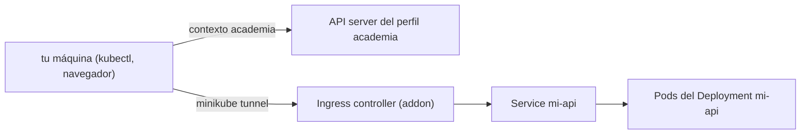
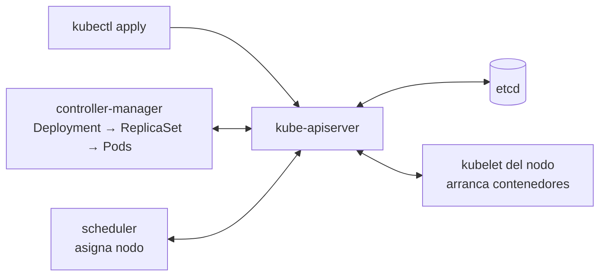
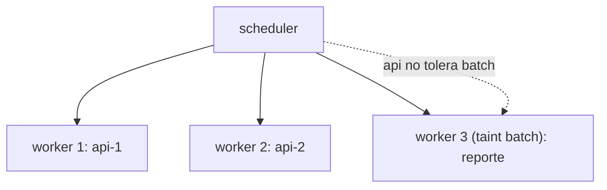

# Módulo 6: Kubernetes — fundamentos


## Aprende construyendo


### Tema 1: Pod, ReplicaSet, Deployment · Avanzado · 25 min

<details open>
<summary><strong>Capa 1 — Lectura</strong></summary>

#### ► DE QUÉ TRATA
Al finalizar podrás explicar la jerarquía Deployment → ReplicaSet → Pod y observar cómo un Deployment gestiona un rollout y un rollback entre dos versiones.

#### ► LA IDEA EN UNA FRASE
**Al finalizar podrás explicar la jerarquía Deployment → ReplicaSet → Pod y observar cómo un Deployment gestiona un rollout y un rollback entre dos versiones.**

#### ► POR QUÉ EXISTE ESTO
Resuelve un problema real de diseño o implementación y evita decisiones a ciegas.

#### ► LA ANALOGÍA
Piensa en pod, replicaset, deployment como una herramienta de taller: útil cuando conoces su propósito y sus límites.
**Dónde se rompe la analogía:** en software, los efectos dependen del contexto, la escala y los trade-offs.

#### ► CÓMO FUNCIONA
1. Identifica el problema que pod, replicaset, deployment resuelve.
2. Observa sus componentes y relaciones.
3. Aplica la opción más simple que funcione.
4. Verifica el resultado y los límites.

#### ► LO QUE PUEDE SALIR MAL
| Síntoma | Causa probable | Arreglo |
|---|---|---|
| Pod, ReplicaSet, Deployment se aplica pero el resultado no mejora | Se usó sin medir el problema real | Mide antes y compara contra la alternativa simple |
| Aparece complejidad inesperada | Se adoptó la técnica sin comprender sus trade-offs | Vuelve a la sección de trade-offs y reduce el alcance |
| Falla en un caso límite | Se asumió un contexto que no se cumple | Prueba el caso límite y documenta cuándo NO usarlo |

#### ► TRADE-OFFS
| Opción | Cuándo usarla | Cuándo NO usarla |
|---|---|---|
| Usar Pod, ReplicaSet, Deployment | Cuando el problema coincide con su propósito y el beneficio es observable | Cuando agrega complejidad sin resolver un problema real |
| Alternativa más simple | Cuando el contexto es pequeño, estable o fácil de razonar | Cuando ya demostró no escalar o no cumplir el requisito |
| Postergar la decisión | Cuando falta evidencia del problema | Cuando el costo de esperar es mayor que el costo de probar |

#### ► CUÁNDO NO USAR ESTO
No uses pod, replicaset, deployment por defecto. Aplícalo cuando el problema lo justifique y puedas verificar el beneficio; si una alternativa más simple resuelve igual, prefiérela.

#### ► DE VUELTA A LA ANALOGÍA
Volviendo a la analogía: pod, replicaset, deployment funciona como el modelo inicial, pero recuerda dónde se rompe: en producción importan la evidencia, la escala y el costo de equivocarte.

#### ► LO QUE DEBES RECORDAR
- Pod, ReplicaSet, Deployment existe para resolver un problema específico.
- Mide antes de adoptar complejidad.
- Conoce el caso donde NO usarlo.
- Verifica con evidencia observable.

#### ► PREGUNTAS PARA PENSAR
1. ¿Qué problema concreto resuelve pod, replicaset, deployment en tu contexto?
2. ¿Cómo sabrías que pod, replicaset, deployment no está funcionando bien?
3. ¿Qué alternativa más simple considerarías antes de usar pod, replicaset, deployment?

</details>

<details>
<summary><strong>Capa 2 — Construcción</strong></summary>

#### Código y verificación
```
┌── Deployment "mi-api" (gestiona actualizaciones y rollback) ──┐
│  ├── ReplicaSet "mi-api-v1" (0 réplicas, conservado para rollback) │
│  └── ReplicaSet "mi-api-v2" (3 réplicas activas)                     │
│       ├── Pod (mi-api:1.1)  ├── Pod (mi-api:1.1)  └── Pod (mi-api:1.1) │
└─────────────────────────────────────────┘
```

```bash
mkdir -p academia-devops/src/modulo6/deployment && cd academia-devops/src/modulo6/deployment
kind create cluster --name academia-devops
kubectl get nodes
```

Crea el archivo `deployment.yaml`:

```yaml
apiVersion: apps/v1
kind: Deployment
metadata:
  name: mi-api
spec:
  replicas: 3
  selector:
    matchLabels: { app: mi-api }
  template:
    metadata:
      labels: { app: mi-api }
    spec:
      containers:
        - name: mi-api
          image: node:22-alpine
          command: ["node", "-e", "require('http').createServer((q,r)=>r.end('v1')).listen(3000)"]
```

```bash
kubectl apply -f deployment.yaml
```

```bash
kubectl get replicasets
kubectl set image deployment/mi-api mi-api=node:24-alpine
kubectl annotate deployment/mi-api kubernetes.io/change-cause="imagen node:24-alpine"
kubectl rollout status deployment/mi-api
kubectl get replicasets
```

</details>

### Tema 2: Service (ClusterIP, NodePort, LoadBalancer) · Avanzado · 25 min

<details open>
<summary><strong>Capa 1 — Lectura</strong></summary>

#### ► DE QUÉ TRATA
Al finalizar podrás exponer un Deployment con un Service que enruta tráfico de forma estable hacia Pods efímeros, sin depender de sus direcciones IP internas.

#### ► LA IDEA EN UNA FRASE
**Al finalizar podrás exponer un Deployment con un Service que enruta tráfico de forma estable hacia Pods efímeros, sin depender de sus direcciones IP internas.**

#### ► POR QUÉ EXISTE ESTO
Resuelve un problema real de diseño o implementación y evita decisiones a ciegas.

#### ► LA ANALOGÍA
Piensa en service (clusterip, nodeport, loadbalancer) como una herramienta de taller: útil cuando conoces su propósito y sus límites.
**Dónde se rompe la analogía:** en software, los efectos dependen del contexto, la escala y los trade-offs.

#### ► CÓMO FUNCIONA
1. Identifica el problema que service (clusterip, nodeport, loadbalancer) resuelve.
2. Observa sus componentes y relaciones.
3. Aplica la opción más simple que funcione.
4. Verifica el resultado y los límites.

#### ► LO QUE PUEDE SALIR MAL
| Síntoma | Causa probable | Arreglo |
|---|---|---|
| Service (ClusterIP, NodePort, LoadBalancer) se aplica pero el resultado no mejora | Se usó sin medir el problema real | Mide antes y compara contra la alternativa simple |
| Aparece complejidad inesperada | Se adoptó la técnica sin comprender sus trade-offs | Vuelve a la sección de trade-offs y reduce el alcance |
| Falla en un caso límite | Se asumió un contexto que no se cumple | Prueba el caso límite y documenta cuándo NO usarlo |

#### ► TRADE-OFFS
| Opción | Cuándo usarla | Cuándo NO usarla |
|---|---|---|
| Usar Service (ClusterIP, NodePort, LoadBalancer) | Cuando el problema coincide con su propósito y el beneficio es observable | Cuando agrega complejidad sin resolver un problema real |
| Alternativa más simple | Cuando el contexto es pequeño, estable o fácil de razonar | Cuando ya demostró no escalar o no cumplir el requisito |
| Postergar la decisión | Cuando falta evidencia del problema | Cuando el costo de esperar es mayor que el costo de probar |

#### ► CUÁNDO NO USAR ESTO
No uses service (clusterip, nodeport, loadbalancer) por defecto. Aplícalo cuando el problema lo justifique y puedas verificar el beneficio; si una alternativa más simple resuelve igual, prefiérela.

#### ► DE VUELTA A LA ANALOGÍA
Volviendo a la analogía: service (clusterip, nodeport, loadbalancer) funciona como el modelo inicial, pero recuerda dónde se rompe: en producción importan la evidencia, la escala y el costo de equivocarte.

#### ► LO QUE DEBES RECORDAR
- Service (ClusterIP, NodePort, LoadBalancer) existe para resolver un problema específico.
- Mide antes de adoptar complejidad.
- Conoce el caso donde NO usarlo.
- Verifica con evidencia observable.

#### ► PREGUNTAS PARA PENSAR
1. ¿Qué problema concreto resuelve service (clusterip, nodeport, loadbalancer) en tu contexto?
2. ¿Cómo sabrías que service (clusterip, nodeport, loadbalancer) no está funcionando bien?
3. ¿Qué alternativa más simple considerarías antes de usar service (clusterip, nodeport, loadbalancer)?

</details>

<details>
<summary><strong>Capa 2 — Construcción</strong></summary>

#### Código y verificación
```
┌── Service "mi-api" (selector: app=mi-api) ──────┐
│  enruta automáticamente, sin importar qué Pod exista ahora  │
│    Pod A (v1.1)   Pod B (v1.1)   Pod C (v1.2, nuevo)          │
└─────────────────────────────────────────┘
```

```bash
mkdir -p academia-devops/src/modulo6/service && cd academia-devops/src/modulo6/service
```

Crea el archivo `service.yaml`:

```yaml
apiVersion: v1
kind: Service
metadata:
  name: mi-api-svc
spec:
  type: ClusterIP
  selector: { app: mi-api }
  ports:
    - port: 80
      targetPort: 3000
```

```bash
kubectl apply -f service.yaml
kubectl get service mi-api-svc
kubectl describe service mi-api-svc | grep Endpoints
```

```bash
kubectl port-forward service/mi-api-svc 8080:80 &
sleep 2
curl -s http://localhost:8080/
kubectl delete pod $(kubectl get pods -l app=mi-api -o jsonpath='{.items[0].metadata.name}')
sleep 3
curl -s http://localhost:8080/
kill %1
```

</details>

### Tema 3: ConfigMaps y Secrets · Avanzado · 25 min

<details open>
<summary><strong>Capa 1 — Lectura</strong></summary>

#### ► DE QUÉ TRATA
Al finalizar podrás externalizar configuración con ConfigMaps y datos sensibles con Secrets, entendiendo que un Secret nativo de Kubernetes solo está codificado en base64, no cifrado.

#### ► LA IDEA EN UNA FRASE
**Al finalizar podrás externalizar configuración con ConfigMaps y datos sensibles con Secrets, entendiendo que un Secret nativo de Kubernetes solo está codificado en base64, no cifrado.**

#### ► POR QUÉ EXISTE ESTO
Resuelve un problema real de diseño o implementación y evita decisiones a ciegas.

#### ► LA ANALOGÍA
Piensa en configmaps y secrets como una herramienta de taller: útil cuando conoces su propósito y sus límites.
**Dónde se rompe la analogía:** en software, los efectos dependen del contexto, la escala y los trade-offs.

#### ► CÓMO FUNCIONA
1. Identifica el problema que configmaps y secrets resuelve.
2. Observa sus componentes y relaciones.
3. Aplica la opción más simple que funcione.
4. Verifica el resultado y los límites.

#### ► LO QUE PUEDE SALIR MAL
| Síntoma | Causa probable | Arreglo |
|---|---|---|
| ConfigMaps y Secrets se aplica pero el resultado no mejora | Se usó sin medir el problema real | Mide antes y compara contra la alternativa simple |
| Aparece complejidad inesperada | Se adoptó la técnica sin comprender sus trade-offs | Vuelve a la sección de trade-offs y reduce el alcance |
| Falla en un caso límite | Se asumió un contexto que no se cumple | Prueba el caso límite y documenta cuándo NO usarlo |

#### ► TRADE-OFFS
| Opción | Cuándo usarla | Cuándo NO usarla |
|---|---|---|
| Usar ConfigMaps y Secrets | Cuando el problema coincide con su propósito y el beneficio es observable | Cuando agrega complejidad sin resolver un problema real |
| Alternativa más simple | Cuando el contexto es pequeño, estable o fácil de razonar | Cuando ya demostró no escalar o no cumplir el requisito |
| Postergar la decisión | Cuando falta evidencia del problema | Cuando el costo de esperar es mayor que el costo de probar |

#### ► CUÁNDO NO USAR ESTO
No uses configmaps y secrets por defecto. Aplícalo cuando el problema lo justifique y puedas verificar el beneficio; si una alternativa más simple resuelve igual, prefiérela.

#### ► DE VUELTA A LA ANALOGÍA
Volviendo a la analogía: configmaps y secrets funciona como el modelo inicial, pero recuerda dónde se rompe: en producción importan la evidencia, la escala y el costo de equivocarte.

#### ► LO QUE DEBES RECORDAR
- ConfigMaps y Secrets existe para resolver un problema específico.
- Mide antes de adoptar complejidad.
- Conoce el caso donde NO usarlo.
- Verifica con evidencia observable.

#### ► PREGUNTAS PARA PENSAR
1. ¿Qué problema concreto resuelve configmaps y secrets en tu contexto?
2. ¿Cómo sabrías que configmaps y secrets no está funcionando bien?
3. ¿Qué alternativa más simple considerarías antes de usar configmaps y secrets?

</details>

<details>
<summary><strong>Capa 2 — Construcción</strong></summary>

#### Código y verificación
```
┌── ConfigMap "config-app" ──────┐   ┌── Secret "db-creds" ───────────┐
│ LOG_LEVEL: info                   │   │ password: c2VjcmV0bw==  ← solo base64 │
└─────────────────────────┘   └──────────────────────────┘
                Pod (variables de entorno LOG_LEVEL, password)
```

```bash
mkdir -p academia-devops/src/modulo6/config-secrets && cd academia-devops/src/modulo6/config-secrets
kubectl create configmap config-app --from-literal=LOG_LEVEL=info
kubectl create secret generic db-creds --from-literal=password=secreto123
kubectl get secret db-creds -o jsonpath='{.data.password}'
echo
kubectl get secret db-creds -o jsonpath='{.data.password}' | base64 -d
echo
```

```bash
kubectl run demo-config --image=alpine --restart=Never --command -- sh -c \
  "env | grep -E 'LOG_LEVEL|DB_PASSWORD'; sleep 3" \
  --env="LOG_LEVEL=$(kubectl get configmap config-app -o jsonpath='{.data.LOG_LEVEL}')" \
  --env="DB_PASSWORD=$(kubectl get secret db-creds -o jsonpath='{.data.password}' | base64 -d)"
sleep 4
kubectl logs demo-config
```

</details>

### Tema 4: kubectl esencial · Avanzado · 25 min

<details open>
<summary><strong>Capa 1 — Lectura</strong></summary>

#### ► DE QUÉ TRATA
Al finalizar podrás diagnosticar el estado de cualquier objeto de un clúster con kubectl get, describe, logs y exec, verificando siempre contra qué contexto operas.

#### ► LA IDEA EN UNA FRASE
**Al finalizar podrás diagnosticar el estado de cualquier objeto de un clúster con kubectl get, describe, logs y exec, verificando siempre contra qué contexto operas.**

#### ► POR QUÉ EXISTE ESTO
Resuelve un problema real de diseño o implementación y evita decisiones a ciegas.

#### ► LA ANALOGÍA
Piensa en kubectl esencial como una herramienta de taller: útil cuando conoces su propósito y sus límites.
**Dónde se rompe la analogía:** en software, los efectos dependen del contexto, la escala y los trade-offs.

#### ► CÓMO FUNCIONA
1. Identifica el problema que kubectl esencial resuelve.
2. Observa sus componentes y relaciones.
3. Aplica la opción más simple que funcione.
4. Verifica el resultado y los límites.

#### ► LO QUE PUEDE SALIR MAL
| Síntoma | Causa probable | Arreglo |
|---|---|---|
| kubectl esencial se aplica pero el resultado no mejora | Se usó sin medir el problema real | Mide antes y compara contra la alternativa simple |
| Aparece complejidad inesperada | Se adoptó la técnica sin comprender sus trade-offs | Vuelve a la sección de trade-offs y reduce el alcance |
| Falla en un caso límite | Se asumió un contexto que no se cumple | Prueba el caso límite y documenta cuándo NO usarlo |

#### ► TRADE-OFFS
| Opción | Cuándo usarla | Cuándo NO usarla |
|---|---|---|
| Usar kubectl esencial | Cuando el problema coincide con su propósito y el beneficio es observable | Cuando agrega complejidad sin resolver un problema real |
| Alternativa más simple | Cuando el contexto es pequeño, estable o fácil de razonar | Cuando ya demostró no escalar o no cumplir el requisito |
| Postergar la decisión | Cuando falta evidencia del problema | Cuando el costo de esperar es mayor que el costo de probar |

#### ► CUÁNDO NO USAR ESTO
No uses kubectl esencial por defecto. Aplícalo cuando el problema lo justifique y puedas verificar el beneficio; si una alternativa más simple resuelve igual, prefiérela.

#### ► DE VUELTA A LA ANALOGÍA
Volviendo a la analogía: kubectl esencial funciona como el modelo inicial, pero recuerda dónde se rompe: en producción importan la evidencia, la escala y el costo de equivocarte.

#### ► LO QUE DEBES RECORDAR
- kubectl esencial existe para resolver un problema específico.
- Mide antes de adoptar complejidad.
- Conoce el caso donde NO usarlo.
- Verifica con evidencia observable.

#### ► PREGUNTAS PARA PENSAR
1. ¿Qué problema concreto resuelve kubectl esencial en tu contexto?
2. ¿Cómo sabrías que kubectl esencial no está funcionando bien?
3. ¿Qué alternativa más simple considerarías antes de usar kubectl esencial?

</details>

<details>
<summary><strong>Capa 2 — Construcción</strong></summary>

#### Código y verificación
```
kubectl get pods                ──▶ vista resumida de todos los Pods
kubectl describe pod <x>        ──▶ detalle completo + eventos recientes
kubectl logs <x>                ──▶ salida estándar/error de ese Pod
kubectl exec -it <x> -- sh      ──▶ shell interactiva dentro de ese Pod
kubectl config current-context  ──▶ confirma contra qué clúster operas
```

```bash
mkdir -p academia-devops/src/modulo6/kubectl-esencial && cd academia-devops/src/modulo6/kubectl-esencial
kubectl config current-context
kubectl run diagnostico --image=alpine --restart=Never -- sh -c "echo arrancando; sleep 60"
kubectl get pods
kubectl logs diagnostico
kubectl exec -it diagnostico -- sh -c "echo 'estoy dentro del contenedor'; hostname"
```

```bash
kubectl run imposible --image=alpine --restart=Never --requests=cpu=1000,memory=1000Gi -- sleep 60
kubectl get pods imposible
kubectl describe pod imposible | grep -A5 Events
kubectl delete pod diagnostico imposible
```

</details>

### Tema 5: Namespaces · Avanzado · 25 min

<details open>
<summary><strong>Capa 1 — Lectura</strong></summary>

#### ► DE QUÉ TRATA
Al finalizar podrás aislar lógicamente objetos de un mismo clúster en namespaces distintos, evitando colisiones de nombres entre entornos o equipos.

#### ► LA IDEA EN UNA FRASE
**Al finalizar podrás aislar lógicamente objetos de un mismo clúster en namespaces distintos, evitando colisiones de nombres entre entornos o equipos.**

#### ► POR QUÉ EXISTE ESTO
Resuelve un problema real de diseño o implementación y evita decisiones a ciegas.

#### ► LA ANALOGÍA
Piensa en namespaces como una herramienta de taller: útil cuando conoces su propósito y sus límites.
**Dónde se rompe la analogía:** en software, los efectos dependen del contexto, la escala y los trade-offs.

#### ► CÓMO FUNCIONA
1. Identifica el problema que namespaces resuelve.
2. Observa sus componentes y relaciones.
3. Aplica la opción más simple que funcione.
4. Verifica el resultado y los límites.

#### ► LO QUE PUEDE SALIR MAL
| Síntoma | Causa probable | Arreglo |
|---|---|---|
| Namespaces se aplica pero el resultado no mejora | Se usó sin medir el problema real | Mide antes y compara contra la alternativa simple |
| Aparece complejidad inesperada | Se adoptó la técnica sin comprender sus trade-offs | Vuelve a la sección de trade-offs y reduce el alcance |
| Falla en un caso límite | Se asumió un contexto que no se cumple | Prueba el caso límite y documenta cuándo NO usarlo |

#### ► TRADE-OFFS
| Opción | Cuándo usarla | Cuándo NO usarla |
|---|---|---|
| Usar Namespaces | Cuando el problema coincide con su propósito y el beneficio es observable | Cuando agrega complejidad sin resolver un problema real |
| Alternativa más simple | Cuando el contexto es pequeño, estable o fácil de razonar | Cuando ya demostró no escalar o no cumplir el requisito |
| Postergar la decisión | Cuando falta evidencia del problema | Cuando el costo de esperar es mayor que el costo de probar |

#### ► CUÁNDO NO USAR ESTO
No uses namespaces por defecto. Aplícalo cuando el problema lo justifique y puedas verificar el beneficio; si una alternativa más simple resuelve igual, prefiérela.

#### ► DE VUELTA A LA ANALOGÍA
Volviendo a la analogía: namespaces funciona como el modelo inicial, pero recuerda dónde se rompe: en producción importan la evidencia, la escala y el costo de equivocarte.

#### ► LO QUE DEBES RECORDAR
- Namespaces existe para resolver un problema específico.
- Mide antes de adoptar complejidad.
- Conoce el caso donde NO usarlo.
- Verifica con evidencia observable.

#### ► PREGUNTAS PARA PENSAR
1. ¿Qué problema concreto resuelve namespaces en tu contexto?
2. ¿Cómo sabrías que namespaces no está funcionando bien?
3. ¿Qué alternativa más simple considerarías antes de usar namespaces?

</details>

<details>
<summary><strong>Capa 2 — Construcción</strong></summary>

#### Código y verificación
```
┌── Clúster físico único ──────────────────┐
│ namespace "desarrollo"  → Deployment "mi-api" (dev)  │
│ namespace "staging"     → Deployment "mi-api" (staging, sin conflicto) │
│ namespace "default"     → lo que crees sin especificar namespace │
└─────────────────────────────────────┘
```

```bash
mkdir -p academia-devops/src/modulo6/namespaces && cd academia-devops/src/modulo6/namespaces
kubectl create namespace desarrollo
kubectl create namespace staging
kubectl run mi-api --image=alpine --restart=Never -n desarrollo -- sh -c "echo soy-desarrollo; sleep 60"
kubectl run mi-api --image=alpine --restart=Never -n staging -- sh -c "echo soy-staging; sleep 60"
kubectl get pods -n desarrollo
kubectl get pods -n staging
```

```bash
kubectl get pods
kubectl config set-context --current --namespace=desarrollo
kubectl get pods
```

</details>

### Tema 6: StatefulSets, DaemonSets, Jobs y CronJobs · Avanzado · 25 min

<details open>
<summary><strong>Capa 1 — Lectura</strong></summary>

#### ► DE QUÉ TRATA
Al finalizar podrás elegir entre Deployment, StatefulSet, DaemonSet, Job o CronJob según si tu carga de trabajo necesita identidad estable, presencia por nodo, o una tarea con principio y fin.

#### ► LA IDEA EN UNA FRASE
**Al finalizar podrás elegir entre Deployment, StatefulSet, DaemonSet, Job o CronJob según si tu carga de trabajo necesita identidad estable, presencia por nodo, o una tarea con principio y fin.**

#### ► POR QUÉ EXISTE ESTO
Resuelve un problema real de diseño o implementación y evita decisiones a ciegas.

#### ► LA ANALOGÍA
Piensa en statefulsets, daemonsets, jobs y cronjobs como una herramienta de taller: útil cuando conoces su propósito y sus límites.
**Dónde se rompe la analogía:** en software, los efectos dependen del contexto, la escala y los trade-offs.

#### ► CÓMO FUNCIONA
1. Identifica el problema que statefulsets, daemonsets, jobs y cronjobs resuelve.
2. Observa sus componentes y relaciones.
3. Aplica la opción más simple que funcione.
4. Verifica el resultado y los límites.

#### ► LO QUE PUEDE SALIR MAL
| Síntoma | Causa probable | Arreglo |
|---|---|---|
| StatefulSets, DaemonSets, Jobs y CronJobs se aplica pero el resultado no mejora | Se usó sin medir el problema real | Mide antes y compara contra la alternativa simple |
| Aparece complejidad inesperada | Se adoptó la técnica sin comprender sus trade-offs | Vuelve a la sección de trade-offs y reduce el alcance |
| Falla en un caso límite | Se asumió un contexto que no se cumple | Prueba el caso límite y documenta cuándo NO usarlo |

#### ► TRADE-OFFS
| Opción | Cuándo usarla | Cuándo NO usarla |
|---|---|---|
| Usar StatefulSets, DaemonSets, Jobs y CronJobs | Cuando el problema coincide con su propósito y el beneficio es observable | Cuando agrega complejidad sin resolver un problema real |
| Alternativa más simple | Cuando el contexto es pequeño, estable o fácil de razonar | Cuando ya demostró no escalar o no cumplir el requisito |
| Postergar la decisión | Cuando falta evidencia del problema | Cuando el costo de esperar es mayor que el costo de probar |

#### ► CUÁNDO NO USAR ESTO
No uses statefulsets, daemonsets, jobs y cronjobs por defecto. Aplícalo cuando el problema lo justifique y puedas verificar el beneficio; si una alternativa más simple resuelve igual, prefiérela.

#### ► DE VUELTA A LA ANALOGÍA
Volviendo a la analogía: statefulsets, daemonsets, jobs y cronjobs funciona como el modelo inicial, pero recuerda dónde se rompe: en producción importan la evidencia, la escala y el costo de equivocarte.

#### ► LO QUE DEBES RECORDAR
- StatefulSets, DaemonSets, Jobs y CronJobs existe para resolver un problema específico.
- Mide antes de adoptar complejidad.
- Conoce el caso donde NO usarlo.
- Verifica con evidencia observable.

#### ► PREGUNTAS PARA PENSAR
1. ¿Qué problema concreto resuelve statefulsets, daemonsets, jobs y cronjobs en tu contexto?
2. ¿Cómo sabrías que statefulsets, daemonsets, jobs y cronjobs no está funcionando bien?
3. ¿Qué alternativa más simple considerarías antes de usar statefulsets, daemonsets, jobs y cronjobs?

</details>

<details>
<summary><strong>Capa 2 — Construcción</strong></summary>

#### Código y verificación
```
┌ Deployment ┐ ┌ StatefulSet ┐ ┌ DaemonSet ┐ ┌ Job / CronJob ┐
│ sin estado,  │ │ con estado,   │ │ uno por     │ │ tarea que        │
│ intercambiable│ │ identidad     │ │ nodo          │ │ termina (o se     │
│              │ │ estable       │ │               │ │ programa)          │
└──────────┘ └───────────┘ └─────────┘ └──────────────┘
```

```bash
mkdir -p academia-devops/src/modulo6/workloads && cd academia-devops/src/modulo6/workloads
```

Crea el archivo `job.yaml`:

```yaml
apiVersion: batch/v1
kind: Job
metadata:
  name: migracion-datos
spec:
  template:
    spec:
      containers:
        - name: migracion
          image: alpine
          command: ["sh", "-c", "echo 'migrando datos...'; sleep 2; echo 'migracion completa'"]
      restartPolicy: Never
```

Crea el archivo `cronjob.yaml`:

```yaml
apiVersion: batch/v1
kind: CronJob
metadata:
  name: respaldo-nocturno
spec:
  schedule: "0 3 * * *"
  jobTemplate:
    spec:
      template:
        spec:
          containers:
            - name: respaldo
              image: alpine
              command: ["sh", "-c", "echo 'respaldo ejecutado'"]
          restartPolicy: Never
```

```bash
kubectl apply -f job.yaml -f cronjob.yaml
kubectl wait --for=condition=complete job/migracion-datos --timeout=30s
kubectl get jobs cronjobs
```

```bash
kubectl get pods -l job-name=migracion-datos
kubectl logs -l job-name=migracion-datos
```

</details>

### Tema 7: Persistent Volumes, PVCs y StorageClasses · Avanzado · 25 min

<details open>
<summary><strong>Capa 1 — Lectura</strong></summary>

#### ► DE QUÉ TRATA
Al finalizar podrás solicitar almacenamiento persistente para un Pod con un PVC, aprovisionado dinámicamente por una StorageClass, sin acoplar la aplicación a los detalles físicos del almacenamiento.

#### ► LA IDEA EN UNA FRASE
**Al finalizar podrás solicitar almacenamiento persistente para un Pod con un PVC, aprovisionado dinámicamente por una StorageClass, sin acoplar la aplicación a los detalles físicos del almacenamiento.**

#### ► POR QUÉ EXISTE ESTO
Resuelve un problema real de diseño o implementación y evita decisiones a ciegas.

#### ► LA ANALOGÍA
Piensa en persistent volumes, pvcs y storageclasses como una herramienta de taller: útil cuando conoces su propósito y sus límites.
**Dónde se rompe la analogía:** en software, los efectos dependen del contexto, la escala y los trade-offs.

#### ► CÓMO FUNCIONA
1. Identifica el problema que persistent volumes, pvcs y storageclasses resuelve.
2. Observa sus componentes y relaciones.
3. Aplica la opción más simple que funcione.
4. Verifica el resultado y los límites.

#### ► LO QUE PUEDE SALIR MAL
| Síntoma | Causa probable | Arreglo |
|---|---|---|
| Persistent Volumes, PVCs y StorageClasses se aplica pero el resultado no mejora | Se usó sin medir el problema real | Mide antes y compara contra la alternativa simple |
| Aparece complejidad inesperada | Se adoptó la técnica sin comprender sus trade-offs | Vuelve a la sección de trade-offs y reduce el alcance |
| Falla en un caso límite | Se asumió un contexto que no se cumple | Prueba el caso límite y documenta cuándo NO usarlo |

#### ► TRADE-OFFS
| Opción | Cuándo usarla | Cuándo NO usarla |
|---|---|---|
| Usar Persistent Volumes, PVCs y StorageClasses | Cuando el problema coincide con su propósito y el beneficio es observable | Cuando agrega complejidad sin resolver un problema real |
| Alternativa más simple | Cuando el contexto es pequeño, estable o fácil de razonar | Cuando ya demostró no escalar o no cumplir el requisito |
| Postergar la decisión | Cuando falta evidencia del problema | Cuando el costo de esperar es mayor que el costo de probar |

#### ► CUÁNDO NO USAR ESTO
No uses persistent volumes, pvcs y storageclasses por defecto. Aplícalo cuando el problema lo justifique y puedas verificar el beneficio; si una alternativa más simple resuelve igual, prefiérela.

#### ► DE VUELTA A LA ANALOGÍA
Volviendo a la analogía: persistent volumes, pvcs y storageclasses funciona como el modelo inicial, pero recuerda dónde se rompe: en producción importan la evidencia, la escala y el costo de equivocarte.

#### ► LO QUE DEBES RECORDAR
- Persistent Volumes, PVCs y StorageClasses existe para resolver un problema específico.
- Mide antes de adoptar complejidad.
- Conoce el caso donde NO usarlo.
- Verifica con evidencia observable.

#### ► PREGUNTAS PARA PENSAR
1. ¿Qué problema concreto resuelve persistent volumes, pvcs y storageclasses en tu contexto?
2. ¿Cómo sabrías que persistent volumes, pvcs y storageclasses no está funcionando bien?
3. ¿Qué alternativa más simple considerarías antes de usar persistent volumes, pvcs y storageclasses?

</details>

<details>
<summary><strong>Capa 2 — Construcción</strong></summary>

#### Código y verificación
```
┌── StatefulSet "mi-base" (3 réplicas) ────────────────┐
│ mi-base-0 ──▶ PVC "datos-0" ──▶ (StorageClass) ──▶ PV físico 0 │
│ mi-base-1 ──▶ PVC "datos-1" ──▶ (StorageClass) ──▶ PV físico 1 │
│ mi-base-2 ──▶ PVC "datos-2" ──▶ (StorageClass) ──▶ PV físico 2 │
└─────────────────────────────────────────┘
```

```bash
mkdir -p academia-devops/src/modulo6/almacenamiento && cd academia-devops/src/modulo6/almacenamiento
```

Crea el archivo `pvc.yaml`:

```yaml
apiVersion: v1
kind: PersistentVolumeClaim
metadata:
  name: datos-app
spec:
  accessModes: ["ReadWriteOnce"]
  resources:
    requests:
      storage: 1Gi
```

```bash
kubectl apply -f pvc.yaml
kubectl get pvc datos-app
```

Crea el archivo `pod-con-volumen.yaml`:

```yaml
apiVersion: v1
kind: Pod
metadata:
  name: escritor
spec:
  containers:
    - name: escritor
      image: alpine
      command: ["sh", "-c", "echo 'dato persistente' > /datos/registro.txt; sleep 3600"]
      volumeMounts:
        - name: almacenamiento
          mountPath: /datos
  volumes:
    - name: almacenamiento
      persistentVolumeClaim:
        claimName: datos-app
```

```bash
kubectl apply -f pod-con-volumen.yaml
kubectl wait --for=condition=Ready pod/escritor --timeout=30s
kubectl exec escritor -- cat /datos/registro.txt
```

```bash
kubectl delete pod escritor
kubectl apply -f pod-con-volumen.yaml
kubectl wait --for=condition=Ready pod/escritor --timeout=30s
kubectl exec escritor -- cat /datos/registro.txt
```

</details>

### Tema 8: Clúster local con Minikube: perfiles, addons e Ingress · Avanzado · 25 min

<details open>
<summary><strong>Capa 1 — Lectura</strong></summary>

#### ► DE QUÉ TRATA
Al finalizar vas a levantar un clúster con Minikube, activar el addon de Ingress, publicar el Deployment mi-api del Tema 1 por un nombre de host y explicar cuándo conviene Minikube frente a kind. Conocimiento previo: Temas 1, 2 y 4 de este módulo; Docker en ejecución, kubectl y m…

#### ► LA IDEA EN UNA FRASE
**Al finalizar vas a levantar un clúster con Minikube, activar el addon de Ingress, publicar el Deployment mi-api del Tema 1 por un nombre de host y explicar cuándo conviene Minikube frente a kind.**

#### ► POR QUÉ EXISTE ESTO
Resuelve un problema real de diseño o implementación y evita decisiones a ciegas.

#### ► LA ANALOGÍA
Piensa en clúster local con minikube: perfiles, addons e ingress como una herramienta de taller: útil cuando conoces su propósito y sus límites.
**Dónde se rompe la analogía:** en software, los efectos dependen del contexto, la escala y los trade-offs.

#### ► CÓMO FUNCIONA


#### ► LO QUE PUEDE SALIR MAL
| Síntoma | Causa probable | Arreglo |
|---|---|---|
| Clúster local con Minikube: perfiles, addons e Ingress se aplica pero el resultado no mejora | Se usó sin medir el problema real | Mide antes y compara contra la alternativa simple |
| Aparece complejidad inesperada | Se adoptó la técnica sin comprender sus trade-offs | Vuelve a la sección de trade-offs y reduce el alcance |
| Falla en un caso límite | Se asumió un contexto que no se cumple | Prueba el caso límite y documenta cuándo NO usarlo |

#### ► TRADE-OFFS
| Opción | Cuándo usarla | Cuándo NO usarla |
|---|---|---|
| Usar Clúster local con Minikube: perfiles, addons e Ingress | Cuando el problema coincide con su propósito y el beneficio es observable | Cuando agrega complejidad sin resolver un problema real |
| Alternativa más simple | Cuando el contexto es pequeño, estable o fácil de razonar | Cuando ya demostró no escalar o no cumplir el requisito |
| Postergar la decisión | Cuando falta evidencia del problema | Cuando el costo de esperar es mayor que el costo de probar |

#### ► CUÁNDO NO USAR ESTO
No uses clúster local con minikube: perfiles, addons e ingress por defecto. Aplícalo cuando el problema lo justifique y puedas verificar el beneficio; si una alternativa más simple resuelve igual, prefiérela.

#### ► DE VUELTA A LA ANALOGÍA
Volviendo a la analogía: clúster local con minikube: perfiles, addons e ingress funciona como el modelo inicial, pero recuerda dónde se rompe: en producción importan la evidencia, la escala y el costo de equivocarte.

#### ► LO QUE DEBES RECORDAR
- Clúster local con Minikube: perfiles, addons e Ingress existe para resolver un problema específico.
- Mide antes de adoptar complejidad.
- Conoce el caso donde NO usarlo.
- Verifica con evidencia observable.

#### ► PREGUNTAS PARA PENSAR
1. ¿Qué problema concreto resuelve clúster local con minikube: perfiles, addons e ingress en tu contexto?
2. ¿Cómo sabrías que clúster local con minikube: perfiles, addons e ingress no está funcionando bien?
3. ¿Qué alternativa más simple considerarías antes de usar clúster local con minikube: perfiles, addons e ingress?

</details>

<details>
<summary><strong>Capa 2 — Construcción</strong></summary>

#### Código y verificación


```bash
mkdir -p academia-devops/src/modulo6/minikube && cd academia-devops/src/modulo6/minikube
minikube start -p academia --driver=docker --cpus=2 --memory=4096
kubectl config current-context
minikube addons enable ingress -p academia
kubectl get pods -n ingress-nginx
```

```bash
kubectl create deployment mi-api --image=nginx:1.30-alpine --replicas=2
kubectl expose deployment mi-api --port=80
```

Crea el archivo `ingress.yaml`:

```yaml
apiVersion: networking.k8s.io/v1
kind: Ingress
metadata:
  name: mi-api
spec:
  ingressClassName: nginx
  rules:
    - host: mi-api.local
      http:
        paths:
          - path: /
            pathType: Prefix
            backend:
              service: { name: mi-api, port: { number: 80 } }
```

```bash
kubectl apply -f ingress.yaml
kubectl get ingress mi-api
```

```bash
curl -s -H "Host: mi-api.local" http://127.0.0.1/ | head -4
```

</details>

### Tema 9: Arquitectura de Kubernetes: plano de control, nodos y el ciclo de reconciliación · Avanzado · 40 min

<details open>
<summary><strong>Capa 1 — Lectura</strong></summary>

#### ► DE QUÉ TRATA
Usa Minikube o kind con kubectl. Crea un clúster con minikube start (o kind create cluster).

#### ► LA IDEA EN UNA FRASE
**Usa Minikube o kind con kubectl.**

#### ► POR QUÉ EXISTE ESTO
Resuelve un problema real de diseño o implementación y evita decisiones a ciegas.

#### ► LA ANALOGÍA
Piensa en arquitectura de kubernetes: plano de control, nodos y el ciclo de reconciliación como una herramienta de taller: útil cuando conoces su propósito y sus límites.
**Dónde se rompe la analogía:** en software, los efectos dependen del contexto, la escala y los trade-offs.

#### ► CÓMO FUNCIONA


#### ► LO QUE PUEDE SALIR MAL
| Síntoma | Causa probable | Arreglo |
|---|---|---|
| Arquitectura de Kubernetes: plano de control, nodos y el ciclo de reconciliación se aplica pero el resultado no mejora | Se usó sin medir el problema real | Mide antes y compara contra la alternativa simple |
| Aparece complejidad inesperada | Se adoptó la técnica sin comprender sus trade-offs | Vuelve a la sección de trade-offs y reduce el alcance |
| Falla en un caso límite | Se asumió un contexto que no se cumple | Prueba el caso límite y documenta cuándo NO usarlo |

#### ► TRADE-OFFS
| Opción | Cuándo usarla | Cuándo NO usarla |
|---|---|---|
| Usar Arquitectura de Kubernetes: plano de control, nodos y el ciclo de reconciliación | Cuando el problema coincide con su propósito y el beneficio es observable | Cuando agrega complejidad sin resolver un problema real |
| Alternativa más simple | Cuando el contexto es pequeño, estable o fácil de razonar | Cuando ya demostró no escalar o no cumplir el requisito |
| Postergar la decisión | Cuando falta evidencia del problema | Cuando el costo de esperar es mayor que el costo de probar |

#### ► CUÁNDO NO USAR ESTO
No uses arquitectura de kubernetes: plano de control, nodos y el ciclo de reconciliación por defecto. Aplícalo cuando el problema lo justifique y puedas verificar el beneficio; si una alternativa más simple resuelve igual, prefiérela.

#### ► DE VUELTA A LA ANALOGÍA
Volviendo a la analogía: arquitectura de kubernetes: plano de control, nodos y el ciclo de reconciliación funciona como el modelo inicial, pero recuerda dónde se rompe: en producción importan la evidencia, la escala y el costo de equivocarte.

#### ► LO QUE DEBES RECORDAR
- Arquitectura de Kubernetes: plano de control, nodos y el ciclo de reconciliación existe para resolver un problema específico.
- Mide antes de adoptar complejidad.
- Conoce el caso donde NO usarlo.
- Verifica con evidencia observable.

#### ► PREGUNTAS PARA PENSAR
1. ¿Qué problema concreto resuelve arquitectura de kubernetes: plano de control, nodos y el ciclo de reconciliación en tu contexto?
2. ¿Cómo sabrías que arquitectura de kubernetes: plano de control, nodos y el ciclo de reconciliación no está funcionando bien?
3. ¿Qué alternativa más simple considerarías antes de usar arquitectura de kubernetes: plano de control, nodos y el ciclo de reconciliación?

</details>

<details>
<summary><strong>Capa 2 — Construcción</strong></summary>

#### Código y verificación


```yaml
apiVersion: apps/v1
kind: Deployment
metadata:
  name: api-rutaflow
spec:
  replicas: 3
  selector: { matchLabels: { app: api-rutaflow } }
  template:
    metadata: { labels: { app: api-rutaflow } }
    spec:
      containers:
        - name: api
          image: nginx:1.30
          resources:
            requests: { cpu: 100m, memory: 64Mi }
```

```bash
kubectl get pods -n kube-system           # componentes del plano de control (en Minikube/kind)
kubectl apply -f academia-labs/devops/arquitectura/api.yaml
kubectl get events --sort-by=.lastTimestamp | tail -12
```

```text
kube-system muestra etcd-minikube, kube-apiserver-minikube, kube-controller-manager-minikube, kube-scheduler-minikube y kube-proxy-xxxxx.
Eventos (en orden): ScalingReplicaSet (deployment-controller), SuccessfulCreate (replicaset-controller), Scheduled (default-scheduler), Pulling / Pulled / Created / Started (kubelet).
```

</details>

### Tema 10: Scheduling en Kubernetes: requests, limits, afinidad, taints y tolerations · Avanzado · 45 min

<details open>
<summary><strong>Capa 1 — Lectura</strong></summary>

#### ► DE QUÉ TRATA
Usa kind con varios nodos: crea kind-3nodos.yaml con un plano de control y tres workers, y ejecuta kind create cluster --config kind-3nodos.yaml.

#### ► LA IDEA EN UNA FRASE
**Usa kind con varios nodos: crea kind-3nodos.yaml con un plano de control y tres workers, y ejecuta kind create cluster --config kind-3nodos.yaml.**

#### ► POR QUÉ EXISTE ESTO
Resuelve un problema real de diseño o implementación y evita decisiones a ciegas.

#### ► LA ANALOGÍA
**Conceptos clave:** request, limit, clase de QoS, `podAntiAffinity`, `topologyKey`, `topologySpreadConstraints`, taint, toleration, `nodeSelector`.

- **requests:** lo que el pod reserva; el scheduler solo lo pone en nodos con ese espacio libre.
- **limits:** el máximo. Si supera el límite de memoria, el contenedor se mata (`OOMKilled`); si supera el de CPU, se frena.
- **Anti-afinidad** (`podAntiAffinity`) evita poner pods iguales juntos según una `topologyKey` (por ejemplo, el nombre del nodo o la zona).
- **Taint** en un nodo: «aquí no entra nadie, salvo quien tolere esto». **Toleration** en un pod: «yo sí puedo entrar». Se usa para nodos especiales (GPU, procesos batch).

Las reglas pueden ser **obligatorias** (`required...`) o **preferidas** (`preferred...`). Las obligatorias pueden dejar pods en `Pending` si no hay dónde cumplirlas.

**Analogía:** requests son reservas de mesa en un restaurante; limits, el máximo que alguien puede pedir; anti-afinidad es «no sienten a toda la familia en la misma mesa»; un taint es un cartel «mesa reservada para grupos» que solo respetan quienes traen la reserva (toleration). La analogía falla en que el restaurante no echa al cliente que se pasa del límite; Kubernetes sí.

**Límite de uso:** la anti-afinidad obligatoria con más réplicas que nodos deja pods sin programar: usa `topologySpreadConstraints` o la versión preferida. Requests muy altas desperdician capacidad; mídelas con el uso real.



**Dónde se rompe la analogía:** el modelo simplifica la realidad; en producción influyen escala, fallos, costo y contexto.

#### ► CÓMO FUNCIONA


#### ► LO QUE PUEDE SALIR MAL
| Síntoma | Causa probable | Arreglo |
|---|---|---|
| Scheduling en Kubernetes: requests, limits, afinidad, taints y tolerations se aplica pero el resultado no mejora | Se usó sin medir el problema real | Mide antes y compara contra la alternativa simple |
| Aparece complejidad inesperada | Se adoptó la técnica sin comprender sus trade-offs | Vuelve a la sección de trade-offs y reduce el alcance |
| Falla en un caso límite | Se asumió un contexto que no se cumple | Prueba el caso límite y documenta cuándo NO usarlo |

#### ► TRADE-OFFS
| Opción | Cuándo usarla | Cuándo NO usarla |
|---|---|---|
| Usar Scheduling en Kubernetes: requests, limits, afinidad, taints y tolerations | Cuando el problema coincide con su propósito y el beneficio es observable | Cuando agrega complejidad sin resolver un problema real |
| Alternativa más simple | Cuando el contexto es pequeño, estable o fácil de razonar | Cuando ya demostró no escalar o no cumplir el requisito |
| Postergar la decisión | Cuando falta evidencia del problema | Cuando el costo de esperar es mayor que el costo de probar |

#### ► CUÁNDO NO USAR ESTO
No uses scheduling en kubernetes: requests, limits, afinidad, taints y tolerations por defecto. Aplícalo cuando el problema lo justifique y puedas verificar el beneficio; si una alternativa más simple resuelve igual, prefiérela.

#### ► DE VUELTA A LA ANALOGÍA
Volviendo a la analogía: scheduling en kubernetes: requests, limits, afinidad, taints y tolerations funciona como el modelo inicial, pero recuerda dónde se rompe: en producción importan la evidencia, la escala y el costo de equivocarte.

#### ► LO QUE DEBES RECORDAR
- Scheduling en Kubernetes: requests, limits, afinidad, taints y tolerations existe para resolver un problema específico.
- Mide antes de adoptar complejidad.
- Conoce el caso donde NO usarlo.
- Verifica con evidencia observable.

#### ► PREGUNTAS PARA PENSAR
1. ¿Qué problema concreto resuelve scheduling en kubernetes: requests, limits, afinidad, taints y tolerations en tu contexto?
2. ¿Cómo sabrías que scheduling en kubernetes: requests, limits, afinidad, taints y tolerations no está funcionando bien?
3. ¿Qué alternativa más simple considerarías antes de usar scheduling en kubernetes: requests, limits, afinidad, taints y tolerations?

</details>

<details>
<summary><strong>Capa 2 — Construcción</strong></summary>

#### Código y verificación


```yaml
kind: Cluster
apiVersion: kind.x-k8s.io/v1alpha4
nodes:
  - role: control-plane
  - role: worker
  - role: worker
  - role: worker
```

```yaml
apiVersion: apps/v1
kind: Deployment
metadata: { name: api }
spec:
  replicas: 2
  selector: { matchLabels: { app: api } }
  template:
    metadata: { labels: { app: api } }
    spec:
      affinity:
        podAntiAffinity:
          requiredDuringSchedulingIgnoredDuringExecution:
            - labelSelector: { matchLabels: { app: api } }
              topologyKey: kubernetes.io/hostname   # una réplica por nodo
      containers:
        - name: api
          image: nginx:1.30
          resources:
            requests: { cpu: 100m, memory: 64Mi }
            limits: { memory: 128Mi }
```

```yaml
apiVersion: batch/v1
kind: Job
metadata: { name: reporte-nocturno }
spec:
  template:
    spec:
      restartPolicy: Never
      nodeSelector: { carga: batch }
      tolerations:
        - { key: carga, operator: Equal, value: batch, effect: NoSchedule }
      containers:
        - name: reporte
          image: busybox:1.36
          command: ["sh", "-c", "echo reporte listo"]
```

```bash
cd academia-labs/devops/scheduling
kind create cluster --config kind-3nodos.yaml
kubectl taint nodes kind-worker3 carga=batch:NoSchedule
kubectl label nodes kind-worker3 carga=batch
kubectl apply -f api.yaml -f reporte.yaml
kubectl get pods -o wide
```

```text
NAME                     READY   STATUS      NODE
api-xxxx-aaaaa           1/1     Running     kind-worker
api-xxxx-bbbbb           1/1     Running     kind-worker2
reporte-nocturno-ccccc   0/1     Completed   kind-worker3
```

</details>
