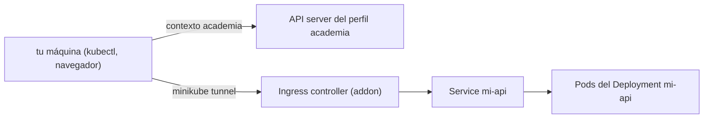
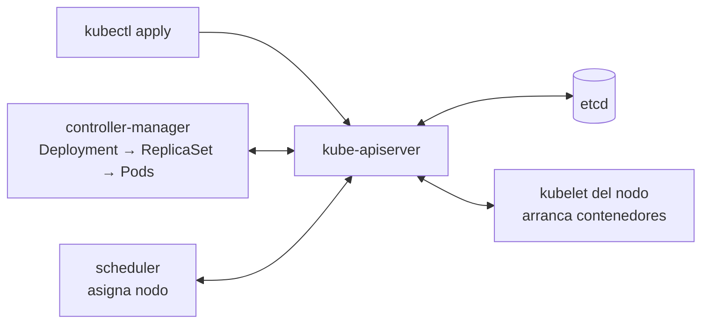
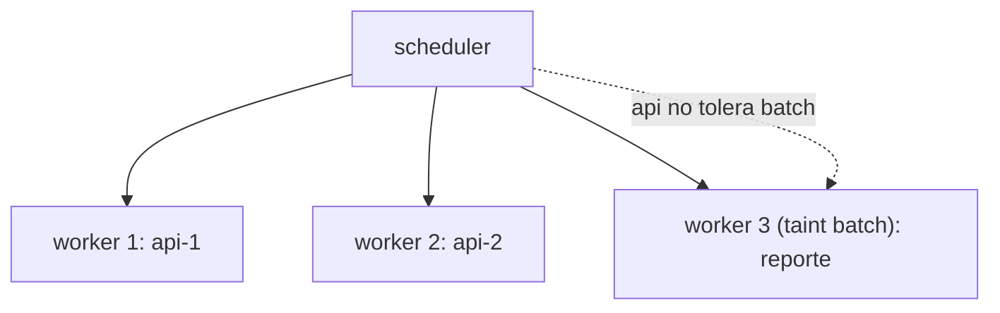

# Módulo 6: Kubernetes — fundamentos


## Aprende construyendo

### Tema 1: Pod, ReplicaSet, Deployment

#### Paso 1 · Objetivo y preparación

Al finalizar podrás explicar la jerarquía Deployment → ReplicaSet → Pod y observar cómo un Deployment gestiona un rollout y un rollback entre dos versiones.

**Conocimiento previo:** Docker (Módulos 0-2) y el patrón de rolling update (Módulo 5) de este track; `kind` y `kubectl` instalados.

#### Paso 2 · Contexto y caso real

**¿Por qué es importante?** Este es un caso real de diagnóstico: sin entender esta jerarquía de tres niveles, comandos como `kubectl get pods/replicasets/deployments` parecen mostrar información redundante, cuando cada uno responde una pregunta distinta.

#### Paso 3 · Teoría con analogía

**Conceptos clave:** Pod (unidad mínima desplegable), ReplicaSet (garantía de réplicas), Deployment (gestión de actualizaciones), reconciliación continua.

Un Pod es la unidad más pequeña que Kubernetes despliega: agrupa uno o más contenedores que comparten red y almacenamiento. Un ReplicaSet garantiza que siempre haya un número exacto de Pods idénticos corriendo, recreándolos automáticamente si fallan. Un Deployment gestiona ReplicaSets: al cambiar la imagen, crea un ReplicaSet nuevo y transiciona gradualmente los Pods del antiguo al nuevo (rolling update por defecto), conservando el ReplicaSet anterior con cero réplicas para rollback casi instantáneo.

**Analogía:** un Pod es una caja individual de un producto. Un ReplicaSet es un supervisor de almacén que asegura siempre 3 cajas en el estante, reponiendo cualquiera que se retire. Un Deployment es el gerente que coordina una transición gradual a un producto nuevo, conservando el registro del anterior por si necesita revertir.

**Diagrama:**

```
┌── Deployment "mi-api" (gestiona actualizaciones y rollback) ──┐
│  ├── ReplicaSet "mi-api-v1" (0 réplicas, conservado para rollback) │
│  └── ReplicaSet "mi-api-v2" (3 réplicas activas)                     │
│       ├── Pod (mi-api:1.1)  ├── Pod (mi-api:1.1)  └── Pod (mi-api:1.1) │
└─────────────────────────────────────────┘
```

#### Paso 4 · Demostración guiada desde cero

Desde una carpeta vacía crea `academia-devops/src/modulo6/deployment` y levanta un clúster local:

```bash
mkdir -p academia-devops/src/modulo6/deployment && cd academia-devops/src/modulo6/deployment
kind create cluster --name academia-devops
kubectl get nodes
cat > deployment.yaml <<'EOF'
apiVersion: apps/v1
kind: Deployment
metadata:
  name: mi-api
spec:
  replicas: 3
  selector:
    matchLabels: { app: mi-api }
  template:
    metadata:
      labels: { app: mi-api }
    spec:
      containers:
        - name: mi-api
          image: node:22-alpine
          command: ["node", "-e", "require('http').createServer((q,r)=>r.end('v1')).listen(3000)"]
EOF
kubectl apply -f deployment.yaml
```

**Explicación línea por línea:** `kind` es el comando que crea un clúster de Kubernetes real dentro de contenedores Docker locales (el nombre es un acrónimo de "Kubernetes IN Docker"); `replicas: 3` declara el estado deseado que el ReplicaSet subyacente mantiene; `selector.matchLabels` conecta el Deployment con los Pods que gestiona a través de la etiqueta `app: mi-api`.

Actualiza la imagen y observa el rollout gestionado automáticamente:

```bash
kubectl get replicasets
kubectl set image deployment/mi-api mi-api=node:20-alpine --record 2>/dev/null || true
kubectl rollout status deployment/mi-api
kubectl get replicasets
```

`--record` es la bandera que guarda el comando ejecutado como anotación del rollout, útil para ver después qué comando causó cada cambio con `kubectl rollout history`. El tag cambia de `node:22-alpine` a `node:20-alpine`: Kubernetes solo crea un ReplicaSet nuevo cuando el pod template efectivamente cambia — fijar la MISMA imagen que ya está desplegada no dispara ningún rollout, por eso el tag tiene que ser genuinamente distinto, no solo "reaplicado".

**Resultado esperado:** antes de la actualización, `kubectl get replicasets` muestra un único ReplicaSet con 3 réplicas; después de `kubectl rollout status`, aparece un segundo ReplicaSet con 3 réplicas activas y el original en 0, confirmando la transición gestionada.

**Fallo deliberado:** ejecuta `kubectl set image deployment/mi-api mi-api=node:no-existe-version` (una imagen inexistente). El rollout queda atascado — diagnostica con `kubectl rollout status deployment/mi-api` (que no termina) y `kubectl describe pod <uno-de-los-nuevos>` para ver el evento `ErrImagePull`, luego revierte con `kubectl rollout undo deployment/mi-api`.

#### Paso 5 · Práctica guiada

Ejecuta `kubectl rollout history deployment/mi-api` para ver el historial de revisiones, y `kubectl rollout undo deployment/mi-api --to-revision=1` para volver explícitamente a la primera. **Pista:** cada `kubectl set image` o `kubectl apply` con cambios genera una nueva revisión en el historial.

#### Paso 6 · Práctica independiente

Cambia `replicas: 3` a `replicas: 5` y aplica de nuevo; confirma con `kubectl get pods` que Kubernetes agrega 2 Pods nuevos sin tocar los 3 existentes, demostrando que un reescalado no dispara un rollout completo como un cambio de imagen sí lo hace.

#### Paso 7 · Cierre

Ya distingues qué nivel de la jerarquía consultar para cada pregunta de diagnóstico, y cómo un Deployment gestiona rollout y rollback. El siguiente tema da una dirección estable de red a estos Pods efímeros. Fuente oficial: [Kubernetes — Deployments](https://kubernetes.io/docs/concepts/workloads/controllers/deployment/).

**Errores comunes:** editar un ReplicaSet directamente en vez de gestionar todo a través del Deployment; esperar que un reescalado (`replicas`) dispare el mismo proceso de rolling update que un cambio de imagen.

**Cuándo no usarlo:** para una tarea que debe ejecutarse una vez y terminar (una migración puntual), un Deployment no es el objeto correcto porque espera procesos de larga duración continua; ahí un Job (Tema 6) es el patrón apropiado.

**Transferencia al proyecto integrador «Plataforma de entrega continua»:** Despliega la API con réplicas declaradas y elimina un pod de prueba. Comprueba que el controlador recupera la cantidad deseada sin crear manualmente una instancia sustituta.

### Tema 2: Service (ClusterIP, NodePort, LoadBalancer)

#### Paso 1 · Objetivo y preparación

Al finalizar podrás exponer un Deployment con un Service que enruta tráfico de forma estable hacia Pods efímeros, sin depender de sus direcciones IP internas.

**Conocimiento previo:** Tema 1 de este módulo; Módulo 3 (descubrimiento por nombre en Docker Compose).

#### Paso 2 · Contexto y caso real

**¿Por qué es importante?** Este es un caso real: sin un Service, la comunicación confiable entre componentes sería prácticamente imposible, dado que los Pods individuales cambian de identidad constantemente.

#### Paso 3 · Teoría con analogía

**Conceptos clave:** Service, selector de etiquetas, IP estable, ClusterIP, NodePort, LoadBalancer.

Los Pods son efímeros: al recrearse reciben una IP interna distinta. Un Service da una dirección estable (IP fija y nombre DNS) que enruta hacia cualquier Pod que coincida con un selector de etiquetas. `ClusterIP` expone el Service solo dentro del clúster; `NodePort` lo expone en un puerto de cada nodo; `LoadBalancer` aprovisiona un balanceador externo del proveedor de nube.

**Analogía:** un Service es como el número de atención al cliente que nunca cambia, sin importar qué empleado (Pod) atienda la llamada. `ClusterIP` es una línea interna; `NodePort` es el teléfono directo de cada sucursal; `LoadBalancer` es una centralita profesional externa.

**Diagrama:**

```
┌── Service "mi-api" (selector: app=mi-api) ──────┐
│  enruta automáticamente, sin importar qué Pod exista ahora  │
│    Pod A (v1.1)   Pod B (v1.1)   Pod C (v1.2, nuevo)          │
└─────────────────────────────────────────┘
```

#### Paso 4 · Demostración guiada desde cero

Desde una carpeta vacía (reutilizando el clúster ya creado en el Tema 1) crea `academia-devops/src/modulo6/service`:

```bash
mkdir -p academia-devops/src/modulo6/service && cd academia-devops/src/modulo6/service
cat > service.yaml <<'EOF'
apiVersion: v1
kind: Service
metadata:
  name: mi-api-svc
spec:
  type: ClusterIP
  selector: { app: mi-api }
  ports:
    - port: 80
      targetPort: 3000
EOF
kubectl apply -f service.yaml
kubectl get service mi-api-svc
kubectl describe service mi-api-svc | grep Endpoints
```

**Explicación línea por línea:** `selector: { app: mi-api }` conecta este Service con los Pods del Deployment del Tema 1 que comparten esa misma etiqueta, sin importar sus nombres específicos; `kubectl describe ... | grep Endpoints` confirma cuántos Pods concretos está enrutando en este momento.

Accede al Service desde tu máquina y confirma que sigue funcionando tras eliminar un Pod:

```bash
kubectl port-forward service/mi-api-svc 8080:80 &
sleep 2
curl -s http://localhost:8080/
kubectl delete pod $(kubectl get pods -l app=mi-api -o jsonpath='{.items[0].metadata.name}')
sleep 3
curl -s http://localhost:8080/
kill %1
```

**Resultado esperado:** ambas peticiones `curl` reciben respuesta exitosa, la segunda incluso después de eliminar uno de los Pods originales, porque el Service redirige automáticamente hacia los Pods restantes (y el nuevo Pod de reemplazo) sin que el cliente note el cambio.

**Fallo deliberado:** cambia el `selector` a `{ app: nombre-que-no-existe }` y vuelve a aplicar. `kubectl describe service mi-api-svc` muestra `Endpoints: <none>` — diagnostica que un Service sin endpoints típicamente significa que el `selector` no coincide con ninguna etiqueta real de ningún Pod existente.

#### Paso 5 · Práctica guiada

Cambia el `type` del Service a `NodePort` y localiza el puerto asignado con `kubectl get service mi-api-svc`. **Pista:** el puerto de nodo asignado aparece en la columna `PORT(S)` con el formato `80:XXXXX/TCP`.

#### Paso 6 · Práctica independiente

Crea un segundo Deployment con una etiqueta `app` distinta y un segundo Service apuntando a él; confirma con `kubectl get endpoints` que cada Service enruta exclusivamente a los Pods de su propio selector, sin mezclarse entre sí.

#### Paso 7 · Cierre

Ya expones aplicaciones de forma estable sin depender de IPs de Pods efímeros. El siguiente tema externaliza configuración y secretos hacia los Pods. Fuente oficial: [Kubernetes — Service](https://kubernetes.io/docs/concepts/services-networking/service/).

**Errores comunes:** que el `selector` del Service no coincida exactamente con las etiquetas de los Pods; asumir que `LoadBalancer` funciona igual en un clúster local (`kind`) que en un proveedor de nube real, donde sí aprovisiona un balanceador externo real.

**Cuándo no usarlo:** para comunicación exclusivamente interna entre Pods del mismo clúster que nunca necesita acceso externo, `NodePort` o `LoadBalancer` exponen más superficie de la necesaria; `ClusterIP` es el límite correcto ahí.

**Transferencia al proyecto integrador «Plataforma de entrega continua»:** Expón la API con el tipo de Service requerido por el laboratorio. Verifica conectividad desde dentro y fuera del clúster y documenta por qué la base permanece accesible solo internamente.

### Tema 3: ConfigMaps y Secrets

#### Paso 1 · Objetivo y preparación

Al finalizar podrás externalizar configuración con ConfigMaps y datos sensibles con Secrets, entendiendo que un Secret nativo de Kubernetes solo está codificado en base64, no cifrado.

**Conocimiento previo:** Temas 1 y 2 de este módulo; Módulo 3 (`.env` en Docker Compose).

#### Paso 2 · Contexto y caso real

**¿Por qué es importante?** Este es un caso real de seguridad: malinterpretar que un Secret de Kubernetes ya implica cifrado fuerte automático es un error común entre quienes empiezan con Kubernetes.

#### Paso 3 · Teoría con analogía

**Conceptos clave:** ConfigMap, Secret, configuración externalizada, datos codificados (no cifrados) en base64.

Un ConfigMap almacena datos de configuración no sensibles inyectables como variables de entorno o archivos montados. Un Secret es estructuralmente similar pero pensado para datos sensibles; por defecto solo está codificado en base64, trivialmente reversible, no cifrado criptográficamente. Para protección real se combina con un gestor externo (Vault, Secrets Manager).

**Analogía:** un ConfigMap es una nota pública en el tablón de anuncios. Un Secret es un sobre marcado "confidencial" en ese mismo tablón: la etiqueta indica sensibilidad, pero cualquiera que abra el sobre (decodifique base64) lee el contenido igual de fácil, a menos que haya una cerradura real (cifrado en reposo).

**Diagrama:**

```
┌── ConfigMap "config-app" ──────┐   ┌── Secret "db-creds" ───────────┐
│ LOG_LEVEL: info                   │   │ password: c2VjcmV0bw==  ← solo base64 │
└─────────────────────────┘   └──────────────────────────┘
                Pod (variables de entorno LOG_LEVEL, password)
```

#### Paso 4 · Demostración guiada desde cero

Desde una carpeta vacía crea `academia-devops/src/modulo6/config-secrets` y demuestra que un Secret no está realmente cifrado:

```bash
mkdir -p academia-devops/src/modulo6/config-secrets && cd academia-devops/src/modulo6/config-secrets
kubectl create configmap config-app --from-literal=LOG_LEVEL=info
kubectl create secret generic db-creds --from-literal=password=secreto123
kubectl get secret db-creds -o jsonpath='{.data.password}'
echo
kubectl get secret db-creds -o jsonpath='{.data.password}' | base64 -d
echo
```

**Explicación línea por línea:** `kubectl get secret ... -o jsonpath='{.data.password}'` extrae el valor tal como Kubernetes lo almacena internamente; `base64 -d` lo decodifica, demostrando que cualquiera con permiso de lectura sobre el objeto puede recuperar el valor original sin ninguna clave adicional.

Inyecta ambos en un Pod y confirma que llegan como variables de entorno:

```bash
kubectl run demo-config --image=alpine --restart=Never --command -- sh -c \
  "env | grep -E 'LOG_LEVEL|DB_PASSWORD'; sleep 3" \
  --env="LOG_LEVEL=$(kubectl get configmap config-app -o jsonpath='{.data.LOG_LEVEL}')" \
  --env="DB_PASSWORD=$(kubectl get secret db-creds -o jsonpath='{.data.password}' | base64 -d)"
sleep 4
kubectl logs demo-config
```

`--from-literal` es la bandera que crea la entrada del ConfigMap o Secret a partir de un valor escrito directamente en el comando (`clave=valor`), en vez de leerlo de un archivo. En el `kubectl run`, `--image` es la bandera que elige la imagen del Pod (`alpine`); `--restart=Never` es la bandera que evita que Kubernetes lo recree si termina, apropiado para un Pod de un solo uso; `--command` es la bandera que indica que lo que sigue después de `--` reemplaza el comando por defecto de la imagen; y `--env` es la bandera que inyecta una variable de entorno específica al Pod.

**Resultado esperado:** el primer `jsonpath` devuelve la cadena codificada en base64 (`c2VjcmV0MTIz`); tras decodificar con `base64 -d`, se recupera exactamente `secreto123`; los logs del Pod `demo-config` muestran ambas variables con sus valores reales.

**Fallo deliberado:** asume erróneamente que el Secret está cifrado y comparte el manifiesto YAML completo del Secret (con `kubectl get secret db-creds -o yaml`) como si fuera seguro de compartir. Cualquiera con ese YAML puede decodificar el valor en un paso — diagnostica ejecutando tú mismo `base64 -d` sobre el valor compartido para confirmar qué tan trivial es la reversión.

#### Paso 5 · Práctica guiada

Crea un Secret desde un archivo en vez de un literal (`kubectl create secret generic db-creds-2 --from-file=password=./password.txt`) y confirma que el resultado decodificado es idéntico. **Pista:** crea primero `password.txt` con `echo -n secreto123 > password.txt` para evitar un salto de línea accidental en el valor.

#### Paso 6 · Práctica independiente

Investiga (documentando sin necesariamente configurarlo en este laboratorio) qué es el cifrado en reposo (`encryption at rest`) de `etcd` en Kubernetes, y explica en 3-4 líneas por qué es el complemento necesario para que un Secret nativo ofrezca protección real más allá de la separación semántica.

#### Paso 7 · Cierre

Ya externalizas configuración y entiendes la limitación real de los Secrets nativos sin cifrado adicional. El siguiente tema cubre los comandos esenciales para diagnosticar cualquier objeto de un clúster. Fuente oficial: [Kubernetes — Secrets](https://kubernetes.io/docs/concepts/configuration/secret/).

**Errores comunes:** compartir un YAML de Secret asumiendo que está protegido por estar en base64; almacenar datos verdaderamente críticos solo en Secrets nativos sin cifrado en reposo ni gestor externo.

**Cuándo no usarlo:** para credenciales de alta sensibilidad en un clúster de producción real, un Secret nativo sin configuración adicional no es suficiente; ahí un gestor externo dedicado (Vault, Secrets Manager) es el límite correcto.

**Transferencia al proyecto integrador «Plataforma de entrega continua»:** Separa configuración pública de credenciales del servicio. Rota una credencial de prueba y verifica cómo se actualiza el proceso; no asumas que cambiar el objeto reinicia automáticamente la aplicación.

### Tema 4: kubectl esencial

#### Paso 1 · Objetivo y preparación

Al finalizar podrás diagnosticar el estado de cualquier objeto de un clúster con `kubectl get`, `describe`, `logs` y `exec`, verificando siempre contra qué contexto operas.

**Conocimiento previo:** Temas 1 a 3 de este módulo.

#### Paso 2 · Contexto y caso real

**¿Por qué es importante?** Este es un caso real de trabajo diario con Kubernetes: estos cuatro comandos, junto con la verificación de contexto, son tan fundamentales como `docker ps`/`logs`/`exec` lo son para Docker suelto.

#### Paso 3 · Teoría con analogía

**Conceptos clave:** `kubectl get`, `kubectl describe`, `kubectl logs`, `kubectl exec`, contexto de clúster.

`kubectl get <recurso>` lista objetos con un resumen de su estado. `kubectl describe <recurso> <nombre>` muestra detalle completo, incluyendo eventos recientes — la primera herramienta de diagnóstico ante un problema. `kubectl logs <pod>` muestra su salida estándar/error. `kubectl exec -it <pod> -- <comando>` ejecuta un comando dentro de un contenedor ya corriendo. `kubectl config current-context` confirma contra qué clúster operas, crítico al trabajar con varios clústeres simultáneamente.

**Analogía:** `kubectl get` es la lista resumida de huéspedes de un hotel. `kubectl describe` es el expediente completo de un huésped, con incidencias recientes. `kubectl logs` es el registro de actividad de su habitación. `kubectl exec` es que mantenimiento entre a inspeccionar directamente sin desalojarlo.

**Diagrama:**

```
kubectl get pods                ──▶ vista resumida de todos los Pods
kubectl describe pod <x>        ──▶ detalle completo + eventos recientes
kubectl logs <x>                ──▶ salida estándar/error de ese Pod
kubectl exec -it <x> -- sh      ──▶ shell interactiva dentro de ese Pod
kubectl config current-context  ──▶ confirma contra qué clúster operas
```

#### Paso 4 · Demostración guiada desde cero

Desde una carpeta vacía crea `academia-devops/src/modulo6/kubectl-esencial` y provoca un fallo real para diagnosticarlo con los cuatro comandos:

```bash
mkdir -p academia-devops/src/modulo6/kubectl-esencial && cd academia-devops/src/modulo6/kubectl-esencial
kubectl config current-context
kubectl run diagnostico --image=alpine --restart=Never -- sh -c "echo arrancando; sleep 60"
kubectl get pods
kubectl logs diagnostico
kubectl exec -it diagnostico -- sh -c "echo 'estoy dentro del contenedor'; hostname"
```

**Explicación línea por línea:** `kubectl config current-context` confirma contra qué clúster se ejecutan los comandos siguientes, antes de crear ningún objeto; `kubectl exec -it ... -- sh -c "..."` ejecuta un comando puntual dentro del Pod ya en ejecución.

Provoca un fallo de programación con recursos imposibles y diagnostica con `describe`:

```bash
kubectl run imposible --image=alpine --restart=Never --requests=cpu=1000,memory=1000Gi -- sleep 60
kubectl get pods imposible
kubectl describe pod imposible | grep -A5 Events
kubectl delete pod diagnostico imposible
```

`--requests` es la bandera que pide al programador de Kubernetes una cantidad mínima de CPU y memoria para el Pod (acá, deliberadamente exagerada para forzar el fallo).

**Resultado esperado:** `diagnostico` llega a estado `Running`, `logs` muestra "arrancando", y `exec` imprime "estoy dentro del contenedor" seguido del hostname del Pod; `imposible` queda en estado `Pending`, y la sección `Events` de `describe` muestra un mensaje de recursos insuficientes explicando por qué no puede programarse en ningún nodo.

**Fallo deliberado:** ejecuta `kubectl logs pod-que-no-existe`. Obtienes un error explícito de "not found" — diagnostica confirmando primero con `kubectl get pods` que el nombre exacto existe antes de asumir un problema más profundo con `logs`.

#### Paso 5 · Práctica guiada

Ejecuta `kubectl get pods -o wide` y compara la información adicional (IP, nodo) frente a `kubectl get pods` simple. **Pista:** `-o wide` es útil específicamente cuando necesitas saber en qué nodo físico corre cada Pod.

#### Paso 6 · Práctica independiente

Investiga y documenta la diferencia entre `kubectl logs <pod>` y `kubectl logs <pod> --previous`, y en qué situación de diagnóstico real usarías la segunda variante.

#### Paso 7 · Cierre

Ya diagnosticas cualquier objeto del clúster con las herramientas correctas para cada pregunta. El siguiente tema aísla lógicamente los objetos de un clúster compartido. Fuente oficial: [kubectl Cheat Sheet](https://kubernetes.io/docs/reference/kubectl/cheatsheet/).

**Errores comunes:** ejecutar comandos destructivos sin verificar antes `kubectl config current-context`, arriesgando operar sobre el clúster equivocado; recurrir a `logs` antes de revisar `describe`, perdiendo la sección de eventos que suele explicar el problema más directamente.

**Cuándo no usarlo:** para automatización a gran escala sobre muchos objetos, `kubectl` interactivo no es el límite adecuado; ahí manifiestos declarativos aplicados con `kubectl apply -f` o herramientas de gestión de paquetes como Helm son más apropiados.

**Transferencia al proyecto integrador «Plataforma de entrega continua»:** Escribe un diagnóstico reproducible usando estado, eventos y logs del deployment. Provoca una imagen inexistente y demuestra que puedes identificar la causa sin editar el pod manualmente.

### Tema 5: Namespaces

#### Paso 1 · Objetivo y preparación

Al finalizar podrás aislar lógicamente objetos de un mismo clúster en namespaces distintos, evitando colisiones de nombres entre entornos o equipos.

**Conocimiento previo:** Temas 1 a 4 de este módulo.

#### Paso 2 · Contexto y caso real

**¿Por qué es importante?** Este es un caso real de clústeres compartidos por múltiples equipos: omitir el namespace explícitamente es una fuente común de confusión, arriesgando listar o modificar recursos en el entorno equivocado.

#### Paso 3 · Teoría con analogía

**Conceptos clave:** namespace, aislamiento lógico, `kubectl -n`, namespace por defecto.

Un namespace divide lógicamente un clúster físico en espacios de nombres virtuales independientes. Sin especificar uno, Kubernetes usa `default` implícitamente. Los namespaces son el punto de aplicación de cuotas de recursos, políticas de red y RBAC. Por defecto, sin políticas de red adicionales, Pods de namespaces distintos todavía pueden comunicarse entre sí: el namespace organiza, pero no aísla la red por sí solo.

**Analogía:** los namespaces son como pisos distintos de un mismo edificio: cada piso puede tener su propia "Sala de reuniones A" sin conflicto con otro piso, pero cualquiera puede tomar el ascensor entre pisos salvo que se instalen controles de acceso adicionales.

**Diagrama:**

```
┌── Clúster físico único ──────────────────┐
│ namespace "desarrollo"  → Deployment "mi-api" (dev)  │
│ namespace "staging"     → Deployment "mi-api" (staging, sin conflicto) │
│ namespace "default"     → lo que crees sin especificar namespace │
└─────────────────────────────────────┘
```

#### Paso 4 · Demostración guiada desde cero

Desde una carpeta vacía crea `academia-devops/src/modulo6/namespaces` y demuestra que dos namespaces pueden tener objetos homónimos sin conflicto:

```bash
mkdir -p academia-devops/src/modulo6/namespaces && cd academia-devops/src/modulo6/namespaces
kubectl create namespace desarrollo
kubectl create namespace staging
kubectl run mi-api --image=alpine --restart=Never -n desarrollo -- sh -c "echo soy-desarrollo; sleep 60"
kubectl run mi-api --image=alpine --restart=Never -n staging -- sh -c "echo soy-staging; sleep 60"
kubectl get pods -n desarrollo
kubectl get pods -n staging
```

**Explicación línea por línea:** ambos Pods se llaman `mi-api`, pero viven en namespaces distintos (`-n desarrollo`, `-n staging`), por lo que Kubernetes no los trata como el mismo objeto ni genera ningún conflicto de nombres.

Confirma qué pasa si omites el namespace explícitamente:

```bash
kubectl get pods
kubectl config set-context --current --namespace=desarrollo
kubectl get pods
```

`--current` es la bandera que aplica el cambio al contexto actualmente activo (en vez de tener que nombrarlo); `--namespace` es la bandera que fija cuál namespace queda como predeterminado para ese contexto.

**Resultado esperado:** `kubectl get pods` sin `-n` explícito muestra los Pods del namespace `default` (ninguno de los dos que creaste), demostrando que quedaron en namespaces distintos al implícito; tras cambiar el namespace por defecto del contexto actual a `desarrollo`, `kubectl get pods` sin `-n` sí muestra el Pod `mi-api` de ese namespace.

**Fallo deliberado:** con el contexto ya cambiado a `desarrollo` (paso anterior), ejecuta `kubectl delete pod mi-api` SIN especificar `-n staging`, asumiendo que borrarías el de staging. En realidad elimina el de `desarrollo` — diagnostica confirmando siempre con `kubectl config get-contexts` y `kubectl get pods -n <namespace>` explícito antes de cualquier operación destructiva.

#### Paso 5 · Práctica guiada

Ejecuta `kubectl get pods --all-namespaces` (o `-A`) y confirma que ves ambos Pods `mi-api` simultáneamente, cada uno junto a su namespace en la columna correspondiente. **Pista:** `--all-namespaces` es la forma de ver el estado completo del clúster sin filtrar por un namespace específico.

#### Paso 6 · Práctica independiente

Aplica una `ResourceQuota` simple al namespace `staging` limitando el número máximo de Pods a 2, e intenta crear un tercer Pod ahí; documenta el mensaje de error que Kubernetes devuelve al exceder la cuota.

#### Paso 7 · Cierre

Ya aíslas lógicamente entornos dentro del mismo clúster físico, y verificas siempre el namespace antes de operaciones destructivas. El siguiente tema cubre objetos especializados más allá de Deployment. Fuente oficial: [Kubernetes — Namespaces](https://kubernetes.io/docs/concepts/overview/working-with-objects/namespaces/).

**Errores comunes:** asumir que el namespace por defecto del contexto actual es siempre `default`, después de haberlo cambiado en una sesión anterior; ejecutar comandos destructivos sin `-n` explícito, confiando en el namespace implícito del contexto.

**Cuándo no usarlo:** para aislamiento de seguridad fuerte entre cargas de trabajo verdaderamente no confiables entre sí, un namespace no basta (Pods de namespaces distintos siguen comunicándose por red por defecto); ahí clústeres físicamente separados o políticas de red explícitas son el límite necesario.

**Transferencia al proyecto integrador «Plataforma de entrega continua»:** Aísla recursos de desarrollo y prueba en namespaces diferentes. Verifica el contexto antes de aplicar y comprueba que una cuenta del pipeline no puede modificar el otro entorno.

### Tema 6: StatefulSets, DaemonSets, Jobs y CronJobs

#### Paso 1 · Objetivo y preparación

Al finalizar podrás elegir entre Deployment, StatefulSet, DaemonSet, Job o CronJob según si tu carga de trabajo necesita identidad estable, presencia por nodo, o una tarea con principio y fin.

**Conocimiento previo:** Temas 1 a 5 de este módulo; cron de Linux (Módulo 0).

#### Paso 2 · Contexto y caso real

**¿Por qué es importante?** Este es un caso real: usar Deployment para todo, incluyendo cargas que necesitan las garantías de un StatefulSet (una base de datos) o el patrón de un Job (una migración puntual), es un error común que puede causar pérdida de datos.

#### Paso 3 · Teoría con analogía

**Conceptos clave:** StatefulSet (identidad estable), DaemonSet (un Pod por nodo), Job (tarea que termina), CronJob (Job programado).

Un StatefulSet gestiona Pods con identidad estable y persistente: cada réplica recibe un nombre ordinal predecible (`mi-base-0`, `mi-base-1`). Un DaemonSet garantiza exactamente un Pod por nodo del clúster, el patrón típico para agentes de infraestructura. Un Job ejecuta una tarea que debe completarse, reintentando si falla. Un CronJob añade programación temporal sobre un Job con la misma sintaxis cron del Módulo 0.

**Analogía:** un Deployment es un equipo de operadores intercambiables. Un StatefulSet es un equipo de gerentes de cuenta, cada uno siempre asignado al mismo cliente. Un DaemonSet es un guardia por cada entrada del edificio. Un Job es una mudanza puntual que termina. Un CronJob es esa misma mudanza programada para repetirse.

**Diagrama:**

```
┌ Deployment ┐ ┌ StatefulSet ┐ ┌ DaemonSet ┐ ┌ Job / CronJob ┐
│ sin estado,  │ │ con estado,   │ │ uno por     │ │ tarea que        │
│ intercambiable│ │ identidad     │ │ nodo          │ │ termina (o se     │
│              │ │ estable       │ │               │ │ programa)          │
└──────────┘ └───────────┘ └─────────┘ └──────────────┘
```

#### Paso 4 · Demostración guiada desde cero

Desde una carpeta vacía crea `academia-devops/src/modulo6/workloads` y compara los cuatro objetos:

```bash
mkdir -p academia-devops/src/modulo6/workloads && cd academia-devops/src/modulo6/workloads
cat > job.yaml <<'EOF'
apiVersion: batch/v1
kind: Job
metadata:
  name: migracion-datos
spec:
  template:
    spec:
      containers:
        - name: migracion
          image: alpine
          command: ["sh", "-c", "echo 'migrando datos...'; sleep 2; echo 'migracion completa'"]
      restartPolicy: Never
EOF
cat > cronjob.yaml <<'EOF'
apiVersion: batch/v1
kind: CronJob
metadata:
  name: respaldo-nocturno
spec:
  schedule: "0 3 * * *"
  jobTemplate:
    spec:
      template:
        spec:
          containers:
            - name: respaldo
              image: alpine
              command: ["sh", "-c", "echo 'respaldo ejecutado'"]
          restartPolicy: Never
EOF
kubectl apply -f job.yaml -f cronjob.yaml
kubectl wait --for=condition=complete job/migracion-datos --timeout=30s
kubectl get jobs cronjobs
```

**Explicación línea por línea:** `restartPolicy: Never` en un Job es obligatorio (o `OnFailure`), a diferencia de un Deployment que siempre reinicia el proceso; `schedule: "0 3 * * *"` en el CronJob usa exactamente la sintaxis cron del Módulo 0 para ejecutarse a las 3 AM cada día. En `kubectl wait`, `--for` es la bandera que fija la condición a esperar (acá, que el Job llegue a `complete`), y `--timeout` es la bandera que fija cuánto esperar como máximo antes de darse por vencido.

Confirma que el Job efectivamente termina (a diferencia de un Deployment, que nunca debería):

```bash
kubectl get pods -l job-name=migracion-datos
kubectl logs -l job-name=migracion-datos
```

**Resultado esperado:** `kubectl get jobs` muestra `migracion-datos` con `COMPLETIONS: 1/1`; los logs muestran "migrando datos..." seguido de "migracion completa"; el Pod del Job queda en estado `Completed`, no `Running`, porque su propósito es terminar, a diferencia de los Pods de un Deployment.

**Fallo deliberado:** cambia el comando del Job para que termine con código de salida distinto de cero (`command: ["sh", "-c", "exit 1"]`) y vuelve a aplicar con un nombre nuevo. Kubernetes reintenta automáticamente el Job varias veces antes de marcarlo como fallido — diagnostica con `kubectl describe job <nombre>` revisando el conteo de reintentos y el evento de fallo final.

#### Paso 5 · Práctica guiada

Ejecuta `kubectl create job --from=cronjob/respaldo-nocturno respaldo-manual` para disparar manualmente una ejecución del CronJob fuera de su horario programado, y confirma con `kubectl logs -l job-name=respaldo-manual` que corrió exitosamente. **Pista:** esto es útil para probar un CronJob sin esperar a su horario real.

#### Paso 6 · Práctica independiente

Diseña (en un manifiesto YAML, sin necesariamente desplegarlo en este laboratorio) un StatefulSet de 3 réplicas para una base de datos ficticia, y explica en un comentario qué nombres ordinales recibiría cada réplica y por qué eso es distinto de un Deployment equivalente.

#### Paso 7 · Cierre

Ya eliges el objeto correcto según el patrón real de tu carga de trabajo, no solo Deployment para todo. El siguiente tema añade almacenamiento persistente real para los casos que lo necesitan. Fuente oficial: [Kubernetes — Jobs](https://kubernetes.io/docs/concepts/workloads/controllers/job/).

**Errores comunes:** usar un Deployment para una tarea que debe terminar, dejando el Pod corriendo indefinidamente sin propósito; olvidar `restartPolicy: Never` u `OnFailure` en un Job, que por defecto en otros contextos podría no ser el esperado.

**Cuándo no usarlo:** para un servicio de larga duración sin estado (la mayoría de APIs web), un StatefulSet añade complejidad innecesaria (nombres ordinales, orden de arranque estricto) sin beneficio real; ahí un Deployment simple es el límite correcto.

**Transferencia al proyecto integrador «Plataforma de entrega continua»:** Clasifica API, migración y tarea periódica según el controlador adecuado. Ejecuta una migración de prueba y registra su finalización, evitando tratarla como un servicio que debe reiniciarse indefinidamente.

### Tema 7: Persistent Volumes, PVCs y StorageClasses

#### Paso 1 · Objetivo y preparación

Al finalizar podrás solicitar almacenamiento persistente para un Pod con un PVC, aprovisionado dinámicamente por una StorageClass, sin acoplar la aplicación a los detalles físicos del almacenamiento.

**Conocimiento previo:** Temas 1 a 6 de este módulo; volúmenes de Docker (Módulo 2).

#### Paso 2 · Contexto y caso real

**¿Por qué es importante?** Este es un caso real de portabilidad: este sistema de abstracción en tres capas permite que aplicaciones con estado se desplieguen de forma portable entre distintos entornos de infraestructura subyacente.

#### Paso 3 · Teoría con analogía

**Conceptos clave:** Persistent Volume (PV), Persistent Volume Claim (PVC), StorageClass, aprovisionamiento dinámico.

Un PV representa almacenamiento físico real disponible en el clúster, independiente del ciclo de vida de cualquier Pod. Un PVC es una solicitud de una aplicación pidiendo almacenamiento con ciertas características, sin conocer el PV físico específico. Una StorageClass automatiza la creación de PVs bajo demanda cuando un PVC la referencia, sin intervención manual previa.

**Analogía:** un PV es un depósito de almacenamiento físico ya construido. Un PVC es el formulario de una empresa pidiendo "necesito 10 metros cúbicos", sin elegir el depósito específico. Una StorageClass es el sistema automatizado que construye o asigna el depósito correspondiente sin intervención humana en cada solicitud.

**Diagrama:**

```
┌── StatefulSet "mi-base" (3 réplicas) ────────────────┐
│ mi-base-0 ──▶ PVC "datos-0" ──▶ (StorageClass) ──▶ PV físico 0 │
│ mi-base-1 ──▶ PVC "datos-1" ──▶ (StorageClass) ──▶ PV físico 1 │
│ mi-base-2 ──▶ PVC "datos-2" ──▶ (StorageClass) ──▶ PV físico 2 │
└─────────────────────────────────────────┘
```

#### Paso 4 · Demostración guiada desde cero

Desde una carpeta vacía crea `academia-devops/src/modulo6/almacenamiento` y demuestra persistencia real a través de un reinicio de Pod:

```bash
mkdir -p academia-devops/src/modulo6/almacenamiento && cd academia-devops/src/modulo6/almacenamiento
cat > pvc.yaml <<'EOF'
apiVersion: v1
kind: PersistentVolumeClaim
metadata:
  name: datos-app
spec:
  accessModes: ["ReadWriteOnce"]
  resources:
    requests:
      storage: 1Gi
EOF
kubectl apply -f pvc.yaml
kubectl get pvc datos-app
cat > pod-con-volumen.yaml <<'EOF'
apiVersion: v1
kind: Pod
metadata:
  name: escritor
spec:
  containers:
    - name: escritor
      image: alpine
      command: ["sh", "-c", "echo 'dato persistente' > /datos/registro.txt; sleep 3600"]
      volumeMounts:
        - name: almacenamiento
          mountPath: /datos
  volumes:
    - name: almacenamiento
      persistentVolumeClaim:
        claimName: datos-app
EOF
kubectl apply -f pod-con-volumen.yaml
kubectl wait --for=condition=Ready pod/escritor --timeout=30s
kubectl exec escritor -- cat /datos/registro.txt
```

**Explicación línea por línea:** el PVC `datos-app` solicita 1Gi sin especificar dónde vive físicamente; el Pod `escritor` lo monta en `/datos` y escribe un archivo que debe sobrevivir aunque el Pod se elimine y se recree, siempre que reference el mismo PVC.

Elimina el Pod y confirma que el dato persiste al recrearlo apuntando al mismo PVC:

```bash
kubectl delete pod escritor
kubectl apply -f pod-con-volumen.yaml
kubectl wait --for=condition=Ready pod/escritor --timeout=30s
kubectl exec escritor -- cat /datos/registro.txt
```

**Resultado esperado:** tras eliminar y recrear el Pod, `cat /datos/registro.txt` sigue mostrando "dato persistente", confirmando que el PVC (y el PV que lo respalda) sobrevivió a la eliminación del Pod, exactamente como un volumen gestionado de Docker (Módulo 2) sobrevive a `docker rm`.

**Fallo deliberado:** elimina el PVC directamente (`kubectl delete pvc datos-app`) antes de recrear el Pod. El nuevo Pod queda en estado `Pending` porque su volumen referenciado ya no existe — diagnostica con `kubectl describe pod escritor` revisando el evento que menciona el PVC faltante.

#### Paso 5 · Práctica guiada

Ejecuta `kubectl get pv` y localiza el Persistent Volume que fue creado automáticamente para satisfacer el PVC `datos-app`; confirma que su tamaño coincide con lo solicitado. **Pista:** el nombre del PV suele generarse automáticamente con un prefijo relacionado con el aprovisionador dinámico.

#### Paso 6 · Práctica independiente

Investiga con `kubectl get storageclass` qué StorageClass es la predeterminada en tu clúster local (`kind` normalmente incluye una llamada `standard`), y documenta qué cambiaría si tu clúster tuviera múltiples StorageClasses disponibles (por ejemplo, una para SSD rápido y otra para almacenamiento económico).

#### Paso 7 · Cierre

Ya separas la solicitud de almacenamiento de una aplicación de los detalles físicos de dónde vive ese almacenamiento. Esto cierra el módulo de fundamentos de Kubernetes; el siguiente módulo profundiza en configuración avanzada del clúster. Fuente oficial: [Kubernetes — Persistent Volumes](https://kubernetes.io/docs/concepts/storage/persistent-volumes/).

**Errores comunes:** eliminar un PVC pensando que solo afecta al Pod actual, sin considerar que cualquier Pod futuro que lo referencie quedará sin poder programarse; asumir que todos los `accessModes` permiten múltiples Pods escribiendo simultáneamente (`ReadWriteOnce` no lo permite).

**Cuándo no usarlo:** para datos verdaderamente temporales que no necesitan sobrevivir al Pod (cachés locales, archivos de trabajo intermedios), un volumen `emptyDir` es más simple que un PVC completo; el límite de un PVC es cuando la persistencia real más allá del ciclo de vida del Pod es un requisito genuino.

---

**Transferencia al proyecto integrador «Plataforma de entrega continua»:** Declara el almacenamiento de la base de laboratorio mediante un PVC. Recrea su consumidor y verifica persistencia, documentando política de recuperación y el efecto de eliminar el claim.

### Tema 8: Clúster local con Minikube: perfiles, addons e Ingress

#### Paso 1 · Objetivo y preparación
Al finalizar vas a levantar un clúster con Minikube, activar el addon de Ingress, publicar el Deployment `mi-api` del Tema 1 por un nombre de host y explicar cuándo conviene Minikube frente a `kind`. **Conocimiento previo:** Temas 1, 2 y 4 de este módulo; Docker en ejecución, `kubectl` y `minikube` instalados (`brew install minikube` en macOS).

#### Paso 2 · Contexto y caso real
Con `kind` ya tienes un clúster para pruebas rápidas y CI, pero cuando quieres probar un Ingress, un `LoadBalancer` o el panel web de Kubernetes en tu portátil, `kind` exige instalar y configurar cada pieza a mano. Minikube trae esas piezas como **addons** que se activan con un comando. **¿Por qué es importante?** Los cursos y la documentación oficial de Kubernetes usan Minikube como entorno de referencia para desarrolladores; saber traducir entre Minikube y `kind` evita quedarse bloqueado cuando un tutorial asume uno u otro.

#### Paso 3 · Teoría con analogía
**Conceptos clave:** perfil de Minikube (un clúster con nombre), *driver* (dónde corre el nodo: Docker, VM), addon, `minikube tunnel`, contexto de `kubectl`.

Minikube crea un clúster de un nodo dentro de un contenedor Docker o de una máquina virtual (el *driver*). Cada clúster es un **perfil** con nombre, así puedes tener `academia` y `pruebas` a la vez y cambiar entre ellos. Al crearlo, Minikube agrega un **contexto** a `~/.kube/config`, por eso `kubectl` habla con él sin configuración extra. Los **addons** son componentes empaquetados (controlador de Ingress, `metrics-server`, panel) que se activan o desactivan sin escribir YAML. Como el nodo vive dentro de Docker, una IP de `LoadBalancer` o del Ingress no siempre es alcanzable desde tu máquina; `minikube tunnel` crea esa ruta mientras está abierto.

**Analogía:** `kind` es una cocina vacía donde traes cada electrodoméstico; Minikube es una cocina amoblada donde enciendes el horno o la nevera con un interruptor. Las dos cocinan lo mismo, pero una arranca más ligera y la otra más completa.

**Diagrama:**



#### Paso 4 · Demostración guiada desde cero
Crea la carpeta del tema y un clúster en un perfil propio:

```bash
mkdir -p academia-devops/src/modulo6/minikube && cd academia-devops/src/modulo6/minikube
minikube start -p academia --driver=docker --cpus=2 --memory=4096
kubectl config current-context
minikube addons enable ingress -p academia
kubectl get pods -n ingress-nginx
```

**Explicación línea por línea:** `-p academia` crea (o reutiliza) el perfil con ese nombre; `--driver=docker` corre el nodo como contenedor; `current-context` debe responder `academia`; el addon `ingress` instala el controlador NGINX en el namespace `ingress-nginx`.

Despliega la API y publícala por nombre de host en `ingress.yaml`:

```bash
kubectl create deployment mi-api --image=nginx:1.27-alpine --replicas=2
kubectl expose deployment mi-api --port=80
cat > ingress.yaml <<'EOF'
apiVersion: networking.k8s.io/v1
kind: Ingress
metadata:
  name: mi-api
spec:
  ingressClassName: nginx
  rules:
    - host: mi-api.local
      http:
        paths:
          - path: /
            pathType: Prefix
            backend:
              service: { name: mi-api, port: { number: 80 } }
EOF
kubectl apply -f ingress.yaml
kubectl get ingress mi-api
```

En otra terminal ejecuta `minikube tunnel -p academia` (pide contraseña de administrador y debe quedar abierta). Luego prueba:

```bash
curl -s -H "Host: mi-api.local" http://127.0.0.1/ | head -4
```

**Resultado esperado:** `kubectl get ingress mi-api` muestra la clase `nginx` y una dirección; el `curl` devuelve las primeras líneas de la página de bienvenida de NGINX. El encabezado `Host` es lo que el Ingress usa para decidir a qué Service enviar la petición.

**Fallo deliberado:** cierra la terminal del `minikube tunnel` y repite el `curl`: falla con `Connection refused` porque nada enruta el puerto 80 de tu máquina hacia el nodo. Diagnostica con `minikube tunnel -p academia` de nuevo, o comprueba que el Ingress funciona dentro del clúster con `kubectl run prueba --rm -it --image=curlimages/curl --restart=Never -- curl -s -H "Host: mi-api.local" http://ingress-nginx-controller.ingress-nginx`.

#### Paso 5 · Práctica guiada
Lista los addons disponibles con `minikube addons list -p academia`, activa `metrics-server` y ejecuta `kubectl top pods` cuando pase un minuto. **Pista:** si `kubectl top` responde `Metrics API not available`, el addon aún está arrancando; revisa `kubectl get pods -n kube-system | grep metrics`.

#### Paso 6 · Práctica independiente
Crea un segundo perfil `pruebas` con `minikube start -p pruebas`, comprueba con `kubectl config get-contexts` que tienes dos contextos y despliega allí una versión distinta de `mi-api`. Documenta en `notas.md` qué comandos cambian el contexto activo y cómo evitarías aplicar un YAML en el clúster equivocado.

#### Paso 7 · Cierre
Entregá la salida de `kubectl get ingress mi-api`, la respuesta del `curl` con el encabezado `Host`, el error con el túnel cerrado y su diagnóstico. Al terminar libera recursos con `minikube stop -p academia` (conserva el clúster) o `minikube delete -p academia` (lo borra). El siguiente módulo profundiza en Helm e Ingress avanzado sobre este mismo clúster. Fuente oficial: [Kubernetes — Set up Ingress on Minikube with the NGINX Ingress Controller](https://kubernetes.io/docs/tasks/access-application-cluster/ingress-minikube/).

**Errores comunes:** aplicar manifiestos sin revisar `kubectl config current-context` cuando conviven `kind` y Minikube; olvidar `minikube tunnel` y concluir que el Ingress está roto; dejar varios perfiles encendidos consumiendo memoria.

**Cuándo no usarlo:** en CI o en pruebas automatizadas que crean y destruyen clústeres muchas veces, `kind` arranca más rápido y no necesita túnel; Minikube rinde mejor como laboratorio interactivo en tu portátil.

**Transferencia al proyecto integrador «Plataforma de entrega continua»:** Publica la API del proyecto por un host local con Ingress en Minikube y documenta en el README los dos caminos de arranque (`kind` para CI, Minikube para desarrollo).

### Tema 9: Arquitectura de Kubernetes: plano de control, nodos y el ciclo de reconciliación · Intermedio · 40 min

**Prerrequisito:** tema «Pod, ReplicaSet, Deployment» de este módulo.

**Al finalizar podrás:** nombrar los componentes del plano de control y de los nodos, verlos en un clúster local y seguir con `kubectl get events` cómo un Deployment llega al estado deseado.

**¿Por qué es importante?** Cuando un pod queda en `Pending` o un cambio «no se aplica», saber qué componente es responsable de cada paso dice dónde mirar. Sin ese mapa, se reinician cosas al azar.

#### Paso 1 · Objetivo y preparación

Usa Minikube o kind con `kubectl`. Crea un clúster con `minikube start` (o `kind create cluster`).

#### Paso 2 · Contexto y caso real

Un despliegue de RutaFlow se quedó con pods en `Pending` durante una hora. El equipo reinició el Deployment tres veces. El evento del scheduler decía desde el principio «0/3 nodes are available: insufficient memory».

#### Paso 3 · Teoría, modelo mental y analogía

**Conceptos clave:** plano de control, kube-apiserver, etcd, scheduler, controller-manager, kubelet, kube-proxy, runtime de contenedores, estado deseado, reconciliación, eventos.

| Componente | Dónde | Qué hace |
|---|---|---|
| **kube-apiserver** | plano de control | única puerta de entrada; valida y guarda objetos |
| **etcd** | plano de control | base de datos clave-valor con el estado del clúster |
| **scheduler** | plano de control | elige un nodo para cada pod sin asignar |
| **controller-manager** | plano de control | controladores que comparan deseado con real y corrigen |
| **kubelet** | cada nodo | arranca los contenedores del pod con el runtime |
| **kube-proxy** | cada nodo | reglas de red para los Services |

Todo funciona con **reconciliación**: declaras el estado deseado (3 réplicas) y cada controlador observa el estado real y actúa hasta igualarlos. Nadie da órdenes paso a paso. Cada acción deja un **evento** que puedes leer.

**Analogía:** el apiserver es la recepción, etcd el libro de registro, el scheduler el que asigna oficinas, los controladores los supervisores que revisan que todo coincida con el plan y el kubelet el encargado de cada piso. La analogía falla en que los supervisores nunca terminan su ronda: la reconciliación es permanente.

**Límite de uso:** en servicios administrados (EKS, GKE, AKS) no ves los pods del plano de control; los gestiona el proveedor. Aun así, los eventos y el comportamiento son los mismos.



#### Paso 4 · Demostración guiada desde cero

Archivo `academia-labs/devops/arquitectura/api.yaml`:

```yaml
apiVersion: apps/v1
kind: Deployment
metadata:
  name: api-rutaflow
spec:
  replicas: 3
  selector: { matchLabels: { app: api-rutaflow } }
  template:
    metadata: { labels: { app: api-rutaflow } }
    spec:
      containers:
        - name: api
          image: nginx:1.27
          resources:
            requests: { cpu: 100m, memory: 64Mi }
```

Ejecútalo:

```bash
kubectl get pods -n kube-system           # componentes del plano de control (en Minikube/kind)
kubectl apply -f academia-labs/devops/arquitectura/api.yaml
kubectl get events --sort-by=.lastTimestamp | tail -12
```

**Explicación por bloques:** En un clúster local, los componentes del plano de control corren como pods en `kube-system`, así que puedes verlos. Al aplicar el Deployment, los eventos cuentan la reconciliación: el controlador de Deployments crea un ReplicaSet, el de ReplicaSets crea tres pods, el scheduler asigna cada uno a un nodo y el kubelet descarga la imagen y arranca el contenedor. Las `requests` le dicen al scheduler cuánta memoria y CPU reservar.

**Resultado esperado:**

```text
kube-system muestra etcd-minikube, kube-apiserver-minikube, kube-controller-manager-minikube, kube-scheduler-minikube y kube-proxy-xxxxx.
Eventos (en orden): ScalingReplicaSet (deployment-controller), SuccessfulCreate (replicaset-controller), Scheduled (default-scheduler), Pulling / Pulled / Created / Started (kubelet).
```

**Fallo deliberado:** cambia `memory: 64Mi` por `memory: 64Gi` y vuelve a aplicar. **Error esperado:** los pods nuevos quedan en `Pending` y el evento del scheduler dice `0/1 nodes are available: 1 Insufficient memory`. **Diagnóstico:** el scheduler no encuentra un nodo con esa reserva. Lee el evento antes de reiniciar nada; corrige la `request` o agrega nodos.

#### Paso 5 · Práctica guiada

1. **Reproducción:** lista los pods de `kube-system` y nombra qué hace cada uno.
2. **Variación:** borra un pod del Deployment y mira en los eventos cómo el ReplicaSet crea otro.
3. **Diagnóstico:** reproduce el fallo deliberado con 64Gi.
4. **Integración:** detén el kubelet de un nodo de kind (`docker exec <nodo> systemctl stop kubelet`) y observa qué marca el controlador de nodos.
5. **Diseño:** escribe una guía de diagnóstico de cinco líneas: qué componente revisar según el estado del pod.

**Pista:** ante un problema, `kubectl describe pod` muestra al final los eventos del pod: empieza siempre por ahí.

#### Paso 6 · Práctica independiente

Escala el Deployment a 50 réplicas en un clúster pequeño y explica, con los eventos, qué componente decide cuántas quedan corriendo y por qué.

#### Paso 7 · Cierre

- [ ] Nombras los componentes del plano de control y de los nodos.
- [ ] Seguiste la reconciliación en los eventos.
- [ ] Reprodujiste un pod en `Pending` y leíste su causa.
- [ ] Sabes qué ves y qué no en un clúster administrado.

Si fallas dos o más, vuelve al Paso 3. **Errores comunes:** reiniciar sin leer eventos, confundir el scheduler con el kubelet y pensar que Kubernetes ejecuta órdenes paso a paso. **Siguiente paso:** el tema siguiente decide dónde va cada pod con requests, afinidad y taints.

**Transferencia al proyecto integrador «RutaFlow»:** agrega al runbook de RutaFlow el mapa de componentes y qué evento revisar ante pods en `Pending`, `CrashLoopBackOff` e `ImagePullBackOff`.

**Fuente oficial:** [Kubernetes — Cluster Architecture](https://kubernetes.io/docs/concepts/architecture/) y [Kubernetes — Controllers](https://kubernetes.io/docs/concepts/architecture/controller/).

### Tema 10: Scheduling en Kubernetes: requests, limits, afinidad, taints y tolerations · Avanzado · 45 min

**Prerrequisito:** tema «Arquitectura de Kubernetes» de este módulo.

**Al finalizar podrás:** reservar recursos con requests y limits, repartir réplicas entre nodos con anti-afinidad y reservar nodos para un tipo de carga con taints y tolerations.

**¿Por qué es importante?** Si todas las réplicas caen en el mismo nodo, una falla de ese nodo apaga el servicio. Si un pod no declara recursos, puede dejar sin memoria a los demás. El scheduler decide bien solo si le das la información.

#### Paso 1 · Objetivo y preparación

Usa kind con varios nodos: crea `kind-3nodos.yaml` con un plano de control y tres workers, y ejecuta `kind create cluster --config kind-3nodos.yaml`.

#### Paso 2 · Contexto y caso real

Una noche cayó un nodo del clúster de RutaFlow y la API quedó fuera de servicio: sus tres réplicas estaban en ese mismo nodo. Con anti-afinidad, cada réplica va a un nodo distinto.

#### Paso 3 · Teoría, modelo mental y analogía

**Conceptos clave:** request, limit, clase de QoS, `podAntiAffinity`, `topologyKey`, `topologySpreadConstraints`, taint, toleration, `nodeSelector`.

- **requests:** lo que el pod reserva; el scheduler solo lo pone en nodos con ese espacio libre.
- **limits:** el máximo. Si supera el límite de memoria, el contenedor se mata (`OOMKilled`); si supera el de CPU, se frena.
- **Anti-afinidad** (`podAntiAffinity`) evita poner pods iguales juntos según una `topologyKey` (por ejemplo, el nombre del nodo o la zona).
- **Taint** en un nodo: «aquí no entra nadie, salvo quien tolere esto». **Toleration** en un pod: «yo sí puedo entrar». Se usa para nodos especiales (GPU, procesos batch).

Las reglas pueden ser **obligatorias** (`required...`) o **preferidas** (`preferred...`). Las obligatorias pueden dejar pods en `Pending` si no hay dónde cumplirlas.

**Analogía:** requests son reservas de mesa en un restaurante; limits, el máximo que alguien puede pedir; anti-afinidad es «no sienten a toda la familia en la misma mesa»; un taint es un cartel «mesa reservada para grupos» que solo respetan quienes traen la reserva (toleration). La analogía falla en que el restaurante no echa al cliente que se pasa del límite; Kubernetes sí.

**Límite de uso:** la anti-afinidad obligatoria con más réplicas que nodos deja pods sin programar: usa `topologySpreadConstraints` o la versión preferida. Requests muy altas desperdician capacidad; mídelas con el uso real.



#### Paso 4 · Demostración guiada desde cero

Archivo `academia-labs/devops/scheduling/kind-3nodos.yaml`:

```yaml
kind: Cluster
apiVersion: kind.x-k8s.io/v1alpha4
nodes:
  - role: control-plane
  - role: worker
  - role: worker
  - role: worker
```

Archivo `academia-labs/devops/scheduling/api.yaml`:

```yaml
apiVersion: apps/v1
kind: Deployment
metadata: { name: api }
spec:
  replicas: 2
  selector: { matchLabels: { app: api } }
  template:
    metadata: { labels: { app: api } }
    spec:
      affinity:
        podAntiAffinity:
          requiredDuringSchedulingIgnoredDuringExecution:
            - labelSelector: { matchLabels: { app: api } }
              topologyKey: kubernetes.io/hostname   # una réplica por nodo
      containers:
        - name: api
          image: nginx:1.27
          resources:
            requests: { cpu: 100m, memory: 64Mi }
            limits: { memory: 128Mi }
```

Archivo `academia-labs/devops/scheduling/reporte.yaml`:

```yaml
apiVersion: batch/v1
kind: Job
metadata: { name: reporte-nocturno }
spec:
  template:
    spec:
      restartPolicy: Never
      nodeSelector: { carga: batch }
      tolerations:
        - { key: carga, operator: Equal, value: batch, effect: NoSchedule }
      containers:
        - name: reporte
          image: busybox:1.36
          command: ["sh", "-c", "echo reporte listo"]
```

Ejecútalo:

```bash
cd academia-labs/devops/scheduling
kind create cluster --config kind-3nodos.yaml
kubectl taint nodes kind-worker3 carga=batch:NoSchedule
kubectl label nodes kind-worker3 carga=batch
kubectl apply -f api.yaml -f reporte.yaml
kubectl get pods -o wide
```

**Explicación por bloques:** El clúster tiene tres workers. `kind-worker3` recibe un taint `carga=batch:NoSchedule` y una etiqueta igual: solo entran pods que toleren el taint. La API reserva 100m de CPU y 64Mi, con límite de memoria de 128Mi, y la anti-afinidad obliga a una réplica por nodo. Como no tolera el taint, sus dos réplicas van a `kind-worker` y `kind-worker2`. El Job del reporte selecciona el nodo batch y tolera su taint, así que corre en `kind-worker3`.

**Resultado esperado:**

```text
NAME                     READY   STATUS      NODE
api-xxxx-aaaaa           1/1     Running     kind-worker
api-xxxx-bbbbb           1/1     Running     kind-worker2
reporte-nocturno-ccccc   0/1     Completed   kind-worker3
```

**Fallo deliberado:** sube `replicas` de la API a 3. **Error esperado:** la tercera réplica queda en `Pending` con el evento `0/4 nodes are available: 1 node(s) had untolerated taint {carga: batch}, 1 node(s) had untolerated taint {node-role.kubernetes.io/control-plane: }, 2 node(s) didn't match pod anti-affinity rules`. **Diagnóstico:** la regla obligatoria no se puede cumplir con dos nodos disponibles. Usa la versión preferida o `topologySpreadConstraints`.

#### Paso 5 · Práctica guiada

1. **Reproducción:** aplica los archivos y comprueba en qué nodo quedó cada pod.
2. **Variación:** cambia la anti-afinidad a `preferredDuringSchedulingIgnoredDuringExecution` y escala a 3.
3. **Diagnóstico:** reproduce el fallo deliberado y lee el evento completo.
4. **Integración:** haz que un contenedor supere su límite de memoria (por ejemplo, con `stress`) y busca `OOMKilled` en `kubectl describe pod`.
5. **Diseño:** define requests y limits de la API de RutaFlow a partir de `kubectl top pods` medido en staging.

**Pista:** si un pod queda en `Pending`, el evento lista cuántos nodos descartó y por qué regla.

#### Paso 6 · Práctica independiente

Reemplaza la anti-afinidad por `topologySpreadConstraints` con `maxSkew: 1` y `whenUnsatisfiable: ScheduleAnyway`, y compara el reparto con 5 réplicas.

#### Paso 7 · Cierre

- [ ] Explicas la diferencia entre request y limit.
- [ ] Las réplicas de la API quedan en nodos distintos.
- [ ] El Job corre solo en el nodo con taint.
- [ ] Leíste el evento de una regla imposible.

Si fallas dos o más, vuelve al Paso 3. **Errores comunes:** no declarar requests, usar anti-afinidad obligatoria con más réplicas que nodos y olvidar el `nodeSelector` junto a la toleration. **Siguiente paso:** el módulo 7 agrega HorizontalPodAutoscaler, que necesita requests para calcular el uso.

**Transferencia al proyecto integrador «RutaFlow»:** reparte las réplicas de la API de RutaFlow entre nodos y reserva un nodo con taint para los reportes nocturnos.

**Fuente oficial:** [Kubernetes — Assigning Pods to Nodes](https://kubernetes.io/docs/concepts/scheduling-eviction/assign-pod-node/) y [Kubernetes — Taints and Tolerations](https://kubernetes.io/docs/concepts/scheduling-eviction/taint-and-toleration/) y [Kubernetes — Resource Management for Pods and Containers](https://kubernetes.io/docs/concepts/configuration/manage-resources-containers/).

## Laboratorio práctico

**Objetivo del laboratorio:** crear un clúster local con `kind` o `minikube`, desplegar una aplicación propia con un Deployment de 3 réplicas, exponerla con un Service, inyectar configuración con ConfigMap y Secret, y observar la auto-reparación de un Pod eliminado manualmente.

**Requisitos previos:** Docker instalado, `kubectl` instalado, y `kind` o `minikube` instalado.

| Paso | Acción | Comando | Explicación | Salida esperada |
|---|---|---|---|---|
| 1 | Crear un clúster local | `kind create cluster --name mi-cluster` | Levanta un clúster Kubernetes en contenedores Docker locales | El clúster queda listo |
| 2 | Verificar el clúster | `kubectl get nodes` | Confirma comunicación con el clúster | Al menos un nodo en estado `Ready` |
| 3 | Crear ConfigMap y Secret | `kubectl create configmap`/`kubectl create secret` | Prepara la configuración a consumir | Ambos objetos se crean sin error |
| 4 | Definir y aplicar el Deployment | YAML con 3 réplicas inyectando ambos como variables | Despliega con configuración externalizada | `kubectl get pods` muestra 3 Pods `Running` |
| 5 | Exponer con un Service | YAML `ClusterIP` con `selector: { app: mi-api }` | Da dirección estable a las 3 réplicas | El Service tiene IP de clúster asignada |
| 6 | Acceder desde tu máquina | `kubectl port-forward service/mi-api 8080:80` | Redirige el puerto localmente | `http://localhost:8080` responde |
| 7 | Eliminar un Pod manualmente | `kubectl delete pod <nombre>` | Simula un fallo | El Pod desaparece de inmediato |
| 8 | Verificar auto-reparación | `kubectl get pods` repetido | El ReplicaSet crea un Pod nuevo automáticamente | Vuelve a haber 3 Pods `Running` |

**Verificación:** el laboratorio se considera exitoso si, tras eliminar un Pod, `kubectl get pods` muestra que el número vuelve automáticamente a 3 sin intervención manual.

**Errores comunes y soluciones**

- **`kubectl get nodes` no muestra ningún nodo.** Verifica que el clúster terminó de arrancar y que `kubectl config current-context` apunta al correcto.
- **Los Pods quedan en `ImagePullBackOff`.** Si tu imagen es local, cárgala con `kind load docker-image <imagen> --name mi-cluster`.
- **El Service no enruta tráfico (`0 endpoints`).** Revisa que el `selector` coincide exactamente con las etiquetas del Deployment.
- **El Pod nuevo no aparece tras `delete`.** Revisa `kubectl describe deployment mi-api` en busca de eventos de recursos insuficientes.

---
