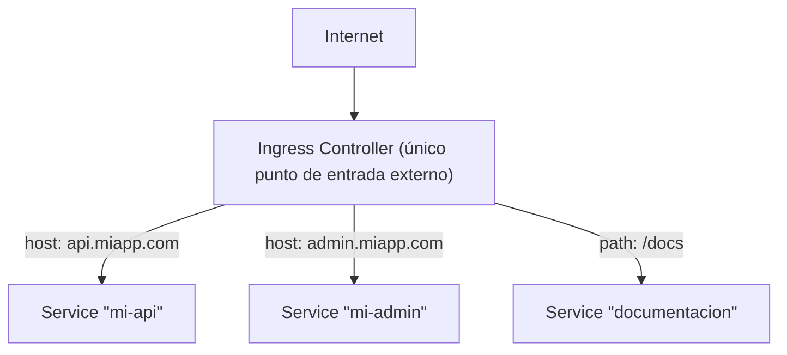
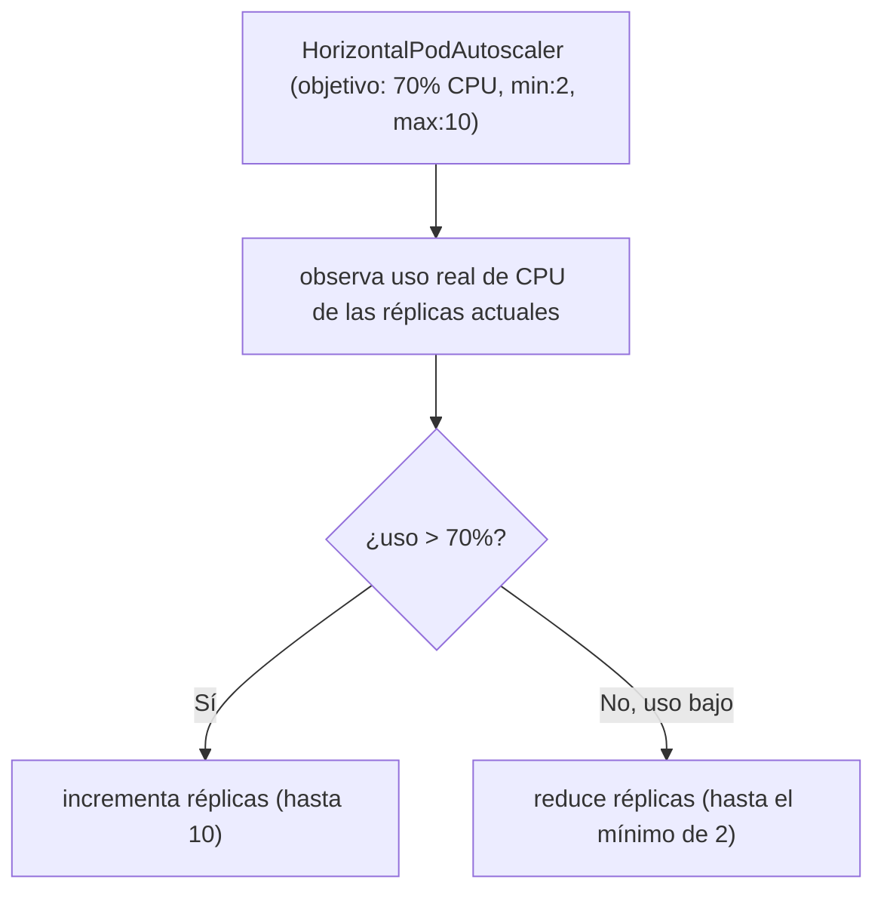
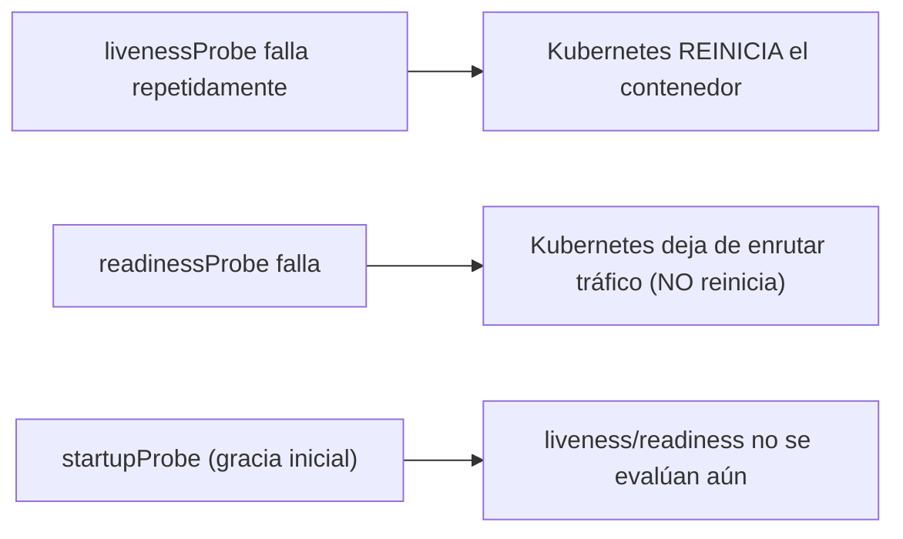
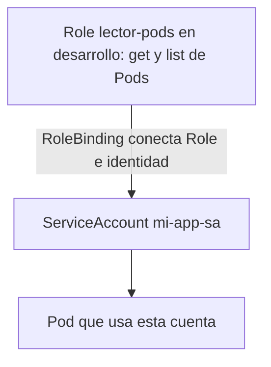
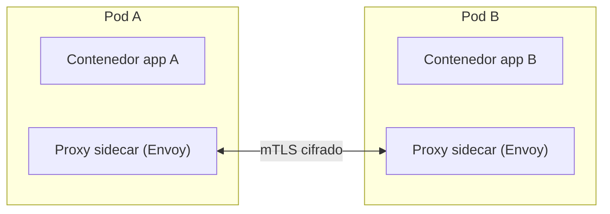
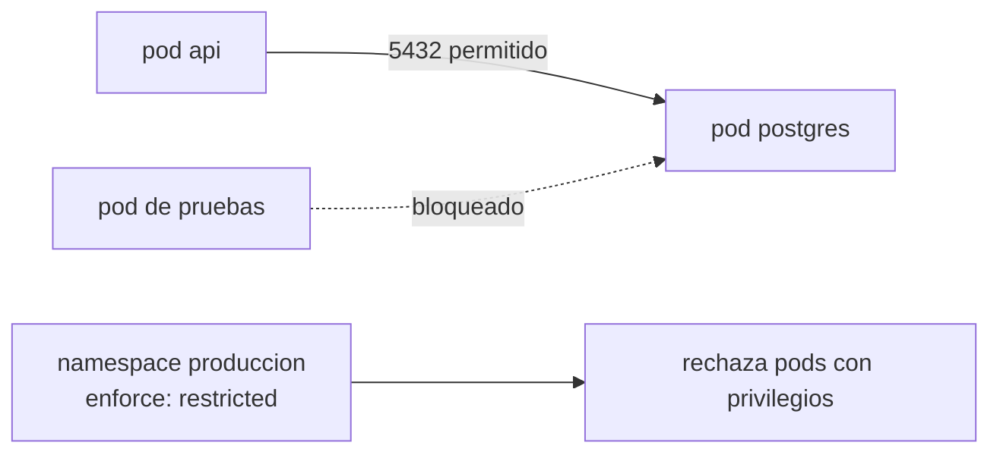

```mermaid
flowchart TD
    C["mi-chart/"] --> F1["Chart.yaml (metadatos)"]
    C --> F2["values.yaml: replicas 3, image tag 1.0"]
    C --> F3["templates/deployment.yaml (usa &#123;&#123; .Values.replicaCount &#125;&#125;)"]
    C -->|se instala con| H["helm install mi-api ./mi-chart --set replicaCount=5"]
```

# Módulo 7: Kubernetes avanzado — Helm e Ingress


## Aprende construyendo


### Tema 1: Helm charts y values · Avanzado · 25 min

<details open>
<summary><strong>Capa 1 — Lectura</strong></summary>

#### ► DE QUÉ TRATA
Al finalizar podrás empaquetar manifiestos de Kubernetes como un Helm chart parametrizable, desplegando el mismo chart en distintos entornos con valores distintos.

#### ► CÓMO FUNCIONA


</details>

<details>
<summary><strong>Capa 2 — Construcción</strong></summary>

#### Código y verificación


```bash
mkdir -p academia-devops/src/modulo7/helm-chart/templates
cd academia-devops/src/modulo7/helm-chart
```

Crea el archivo `Chart.yaml`:

```yaml
apiVersion: v2
name: mi-api
version: 0.1.0
```

Crea el archivo `values.yaml`:

```yaml
replicaCount: 1
image: node:22-alpine
```

Crea el archivo `templates/deployment.yaml`:

```yaml
apiVersion: apps/v1
kind: Deployment
metadata:
  name: mi-api
spec:
  replicas: {{ .Values.replicaCount }}
  selector: { matchLabels: { app: mi-api } }
  template:
    metadata: { labels: { app: mi-api } }
    spec:
      containers:
        - name: mi-api
          image: {{ .Values.image }}
          command: ["node", "-e", "require('http').createServer((q,r)=>r.end('ok')).listen(3000)"]
```

```bash
helm template mi-api . | grep -A1 "kind: Deployment"
```

```bash
kind create cluster --name helm-demo 2>/dev/null || true
helm install mi-api . --set replicaCount=3
kubectl get deployment mi-api -o jsonpath='{.spec.replicas}'
echo
helm upgrade mi-api . --set replicaCount=5
kubectl get deployment mi-api -o jsonpath='{.spec.replicas}'
```

</details>

### Tema 2: Ingress Controllers y reglas de enrutamiento · Avanzado · 25 min

<details open>
<summary><strong>Capa 1 — Lectura</strong></summary>

#### ► DE QUÉ TRATA
Al finalizar podrás exponer múltiples Services por dominio o ruta detrás de un único Ingress Controller, sin necesitar un LoadBalancer separado por servicio.

#### ► CÓMO FUNCIONA


</details>

<details>
<summary><strong>Capa 2 — Construcción</strong></summary>

#### Código y verificación


```bash
mkdir -p academia-devops/src/modulo7/ingress && cd academia-devops/src/modulo7/ingress
kubectl create deployment api --image=node:22-alpine -- node -e "require('http').createServer((q,r)=>r.end('soy la API')).listen(3000)"
kubectl expose deployment api --port=80 --target-port=3000
kubectl create deployment admin --image=node:22-alpine -- node -e "require('http').createServer((q,r)=>r.end('soy ADMIN')).listen(3000)"
kubectl expose deployment admin --port=80 --target-port=3000
```

Crea el archivo `ingress.yaml`:

```yaml
apiVersion: networking.k8s.io/v1
kind: Ingress
metadata:
  name: mi-ingress
  annotations:
    nginx.ingress.kubernetes.io/rewrite-target: /
spec:
  rules:
    - host: api.local
      http:
        paths:
          - path: /
            pathType: Prefix
            backend: { service: { name: api, port: { number: 80 } } }
    - host: admin.local
      http:
        paths:
          - path: /
            pathType: Prefix
            backend: { service: { name: admin, port: { number: 80 } } }
```

```bash
kubectl apply -f ingress.yaml
kubectl get ingress mi-ingress
```

```bash
kubectl describe ingress mi-ingress | grep -A6 Rules
```

</details>

### Tema 3: HorizontalPodAutoscaler · Avanzado · 25 min

<details open>
<summary><strong>Capa 1 — Lectura</strong></summary>

#### ► DE QUÉ TRATA
Al finalizar podrás configurar un HorizontalPodAutoscaler que ajusta automáticamente el número de réplicas según el uso real de CPU, con límites mínimo y máximo explícitos.

#### ► LA ANALOGÍA
**Conceptos clave:** HorizontalPodAutoscaler (HPA), métrica objetivo, escalado automático de réplicas, mínimo y máximo.

Un HPA ajusta el número de réplicas de un Deployment según una métrica observada, típicamente CPU. `kubectl autoscale deployment mi-api --cpu-percent=70 --min=2 --max=10` es el comando que mantiene el uso promedio alrededor del 70%, incrementando réplicas si se supera (hasta 10) y reduciendo si cae por debajo (hasta un mínimo de 2): `--cpu-percent` es la bandera que fija el umbral objetivo, y `--min`/`--max` son las banderas que fijan el rango de réplicas permitido. Depende de `metrics-server` instalado en el clúster; sin él, el HPA no tiene datos para decidir.

**Analogía:** un HPA es como un sistema automático de contratación temporal para un restaurante: si el número de comensales supera cierto umbral, contrata más meseros hasta un máximo razonable; si se vacía, reduce personal hasta un mínimo que garantiza atención básica.

**Diagrama:**



#### ► CÓMO FUNCIONA


</details>

<details>
<summary><strong>Capa 2 — Construcción</strong></summary>

#### Objetivo observable
Al finalizar podrás configurar un HorizontalPodAutoscaler que ajusta automáticamente el número de réplicas según el uso real de CPU, con límites mínimo y máximo explícitos.

**Conocimiento previo:** Temas 1 y 2 de este módulo; Módulo 6 (Deployment).

</details>

### Tema 4: Probes de liveness y readiness · Avanzado · 25 min

<details open>
<summary><strong>Capa 1 — Lectura</strong></summary>

#### ► DE QUÉ TRATA
Al finalizar podrás configurar liveness y readiness probes distintas para el mismo contenedor, entendiendo que una dispara un reinicio y la otra solo excluye tráfico temporalmente.

#### ► CÓMO FUNCIONA


</details>

<details>
<summary><strong>Capa 2 — Construcción</strong></summary>

#### Código y verificación


```bash
mkdir -p academia-devops/src/modulo7/probes && cd academia-devops/src/modulo7/probes
```

Crea el archivo `app.js`:

```js
const http = require('node:http');
let listo = false;
setTimeout(() => { listo = true; }, 5000);
http.createServer((req, res) => {
  if (req.url === '/live') { res.end('vivo'); return; }
  if (req.url === '/ready') {
    if (listo) { res.end('listo'); } else { res.writeHead(503).end('todavia no'); }
    return;
  }
  res.end('app');
}).listen(3000);
```

```bash
kubectl create configmap app-probes-src --from-file=app.js
```

Crea el archivo `pod.yaml`:

```yaml
apiVersion: v1
kind: Pod
metadata:
  name: con-probes
spec:
  containers:
    - name: app
      image: node:22-alpine
      command: ["node", "/app/app.js"]
      volumeMounts: [{ name: src, mountPath: /app }]
      livenessProbe:
        httpGet: { path: /live, port: 3000 }
        initialDelaySeconds: 2
        periodSeconds: 5
      readinessProbe:
        httpGet: { path: /ready, port: 3000 }
        periodSeconds: 2
  volumes:
    - name: src
      configMap: { name: app-probes-src }
```

```bash
kubectl apply -f pod.yaml
```

```bash
sleep 1 && kubectl get pod con-probes -o jsonpath='{.status.containerStatuses[0].ready}'
echo
sleep 8 && kubectl get pod con-probes -o jsonpath='{.status.containerStatuses[0].ready}'
echo
kubectl get pod con-probes -o jsonpath='{.status.containerStatuses[0].restartCount}'
```

</details>

### Tema 5: RBAC en Kubernetes · Avanzado · 25 min

<details open>
<summary><strong>Capa 1 — Lectura</strong></summary>

#### ► DE QUÉ TRATA
Al finalizar podrás crear un Role limitado a un namespace, vincularlo a una ServiceAccount con un RoleBinding, y confirmar que un Pod con esa identidad solo puede hacer exactamente lo permitido.

#### ► CÓMO FUNCIONA


</details>

<details>
<summary><strong>Capa 2 — Construcción</strong></summary>

#### Código y verificación


```bash
mkdir -p academia-devops/src/modulo7/rbac && cd academia-devops/src/modulo7/rbac
kubectl create serviceaccount lector-limitado
kubectl auth can-i list pods --as=system:serviceaccount:default:lector-limitado
```

Crea el archivo `rbac.yaml`:

```yaml
apiVersion: rbac.authorization.k8s.io/v1
kind: Role
metadata:
  name: lector-pods
rules:
  - apiGroups: [""]
    resources: ["pods"]
    verbs: ["get", "list"]
---
apiVersion: rbac.authorization.k8s.io/v1
kind: RoleBinding
metadata:
  name: lector-pods-binding
subjects:
  - kind: ServiceAccount
    name: lector-limitado
    namespace: default
roleRef:
  kind: Role
  name: lector-pods
  apiGroup: rbac.authorization.k8s.io
```

```bash
kubectl apply -f rbac.yaml
kubectl auth can-i list pods --as=system:serviceaccount:default:lector-limitado
kubectl auth can-i delete pods --as=system:serviceaccount:default:lector-limitado
```

</details>

### Tema 6: Service Mesh — Istio, Linkerd, Envoy y mTLS · Avanzado · 25 min

<details open>
<summary><strong>Capa 1 — Lectura</strong></summary>

#### ► DE QUÉ TRATA
Al finalizar podrás explicar cómo un proxy sidecar centraliza mTLS, reintentos y observabilidad entre servicios sin que el código de la aplicación las implemente directamente.

#### ► CÓMO FUNCIONA


</details>

<details>
<summary><strong>Capa 2 — Construcción</strong></summary>

#### Código y verificación


```bash
mkdir -p academia-devops/src/modulo7/service-mesh/nginx && cd academia-devops/src/modulo7/service-mesh
```

Crea el archivo `nginx/sidecar.conf`:

```text
server {
    listen 8443 ssl;
    ssl_certificate /etc/ssl/certs/demo.crt;
    ssl_certificate_key /etc/ssl/private/demo.key;
    location / { proxy_pass http://localhost:3000; }
}
```

Crea el archivo `pod-sidecar.yaml`:

```yaml
apiVersion: v1
kind: Pod
metadata:
  name: con-sidecar
  labels: { app: con-sidecar }
spec:
  containers:
    - name: app
      image: node:22-alpine
      command: ["node", "-e", "require('http').createServer((q,r)=>r.end('app real, solo accesible via sidecar')).listen(3000)"]
    - name: sidecar-proxy
      image: nginx:1.30-alpine
      ports: [{ containerPort: 8443 }]
```

```bash
kubectl apply -f pod-sidecar.yaml
kubectl get pod con-sidecar -o jsonpath='{.spec.containers[*].name}'
echo
```

</details>

### Tema 7: Estrategias de despliegue — Recreate vs RollingUpdate · Avanzado · 25 min

<details open>
<summary><strong>Capa 1 — Lectura</strong></summary>

#### ► DE QUÉ TRATA
Al finalizar vas a configurar explícitamente spec.strategy.type en un Deployment, comparando RollingUpdate (sin downtime) contra Recreate (downtime garantizado pero sin versiones mixtas simultáneas).

#### ► REGLA PRÁCTICA
Usa `RollingUpdate` (el default) cuando el servicio debe seguir respondiendo durante el despliegue y puede tolerar que versiones vieja y nueva convivan unos segundos; usa `Recreate` solo cuando esa convivencia es inaceptable (por ejemplo, un cambio de esquema incompatible que la versión vieja no puede leer) y el downtime del despliegue es un costo aceptado.

</details>

<details>
<summary><strong>Capa 2 — Construcción</strong></summary>

#### Código y verificación
```bash
mkdir -p academia-devops/src/modulo7/estrategia && cd academia-devops/src/modulo7/estrategia
```

Crea el archivo `deployment-recreate.yaml`:

```yaml
apiVersion: apps/v1
kind: Deployment
metadata: { name: mi-api }
spec:
  replicas: 3
  strategy:
    type: Recreate
  selector: { matchLabels: { app: mi-api } }
  template:
    metadata: { labels: { app: mi-api } }
    spec:
      containers:
        - name: mi-api
          image: node:22-alpine
          command: ["node", "-e", "require('http').createServer((q,r)=>r.end('v1')).listen(3000)"]
```

```bash
kubectl apply -f deployment-recreate.yaml
kubectl set image deployment/mi-api mi-api=node:24-alpine
kubectl get pods -w
```

</details>

### Tema 8: Políticas en Kubernetes: NetworkPolicy y Pod Security Admission · Avanzado · 45 min

<details open>
<summary><strong>Capa 1 — Lectura</strong></summary>

#### ► DE QUÉ TRATA
Necesitas un clúster con un plugin de red que aplique NetworkPolicy. kind lo hace de serie desde la versión 0.24.0 (agosto de 2024), que incorpora kube-network-policies; comprueba tu versión con kind version. Con minikube, usa minikube start --cni=calico, como en la demostración.

#### ► CÓMO FUNCIONA


</details>

<details>
<summary><strong>Capa 2 — Construcción</strong></summary>

#### Código y verificación


```yaml
apiVersion: v1
kind: Namespace
metadata:
  name: produccion
  labels:
    pod-security.kubernetes.io/enforce: restricted
```

```yaml
# 1) Denegar todo el tráfico de entrada en el namespace.
apiVersion: networking.k8s.io/v1
kind: NetworkPolicy
metadata: { name: denegar-todo, namespace: produccion }
spec:
  podSelector: {}
  policyTypes: [Ingress]
---
# 2) Permitir solo api -> postgres en 5432.
apiVersion: networking.k8s.io/v1
kind: NetworkPolicy
metadata: { name: api-a-postgres, namespace: produccion }
spec:
  podSelector: { matchLabels: { app: postgres } }
  policyTypes: [Ingress]
  ingress:
    - from: [ { podSelector: { matchLabels: { app: api } } } ]
      ports: [ { protocol: TCP, port: 5432 } ]
```

```bash
minikube start --cni=calico
kubectl apply -f academia-labs/devops/politicas/namespace.yaml -f academia-labs/devops/politicas/red.yaml
kubectl -n produccion run postgres --image=postgres:16 --labels=app=postgres --env=POSTGRES_PASSWORD=demo \
  --overrides='{"spec":{"securityContext":{"runAsNonRoot":true,"runAsUser":999,"seccompProfile":{"type":"RuntimeDefault"}},"containers":[{"name":"postgres","image":"postgres:16","env":[{"name":"POSTGRES_PASSWORD","value":"demo"}],"securityContext":{"allowPrivilegeEscalation":false,"capabilities":{"drop":["ALL"]}}}]}}'
kubectl -n produccion run privilegiado --image=busybox:1.36 --privileged -- sleep 3600
```

```text
El pod postgres se crea.
El pod privilegiado se rechaza: Error from server (Forbidden): pods "privilegiado" is forbidden: violates PodSecurity "restricted:latest": privileged (container "privilegiado" must not set securityContext.privileged=true) ...
Desde un pod sin la etiqueta app=api, `nc -zv postgres-ip 5432` no conecta; desde uno con app=api, sí.
```

</details>
