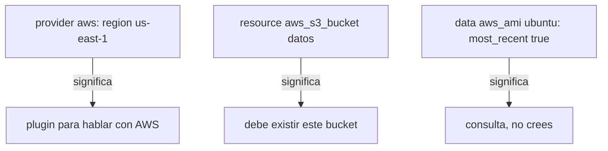
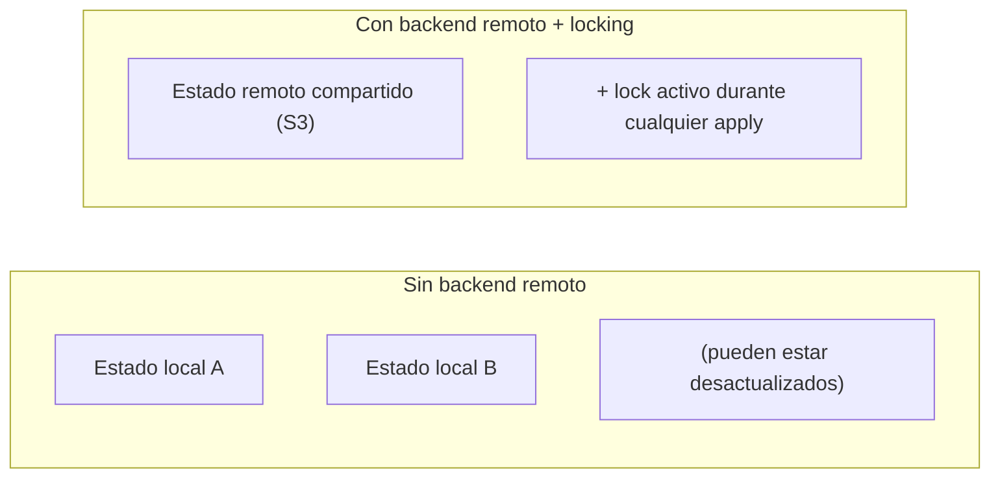
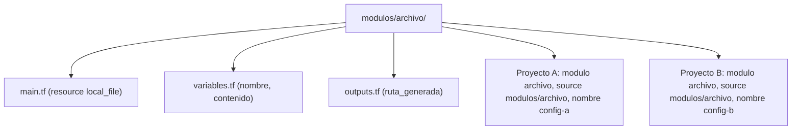
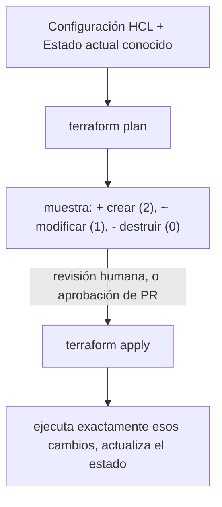
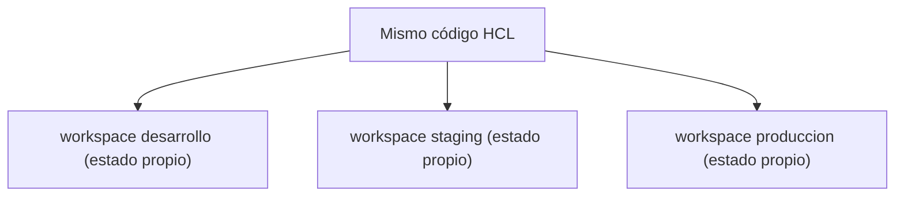
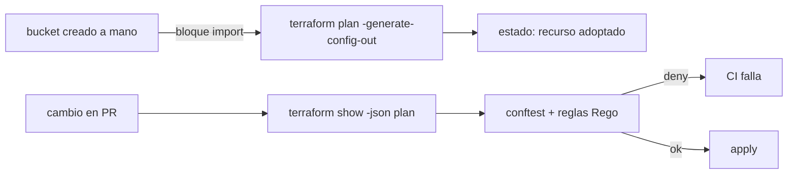

# Módulo 8: Infraestructura como código con Terraform


## Aprende construyendo


### Tema 1: Providers, resources y data sources · Avanzado · 25 min

<details open>
<summary><strong>Capa 1 — Lectura</strong></summary>

#### ► DE QUÉ TRATA
Al finalizar podrás declarar un provider, un resource y un data source en HCL, entendiendo la diferencia entre gestionar infraestructura y solo consultarla.

#### ► LA IDEA EN UNA FRASE
**Al finalizar podrás declarar un provider, un resource y un data source en HCL, entendiendo la diferencia entre gestionar infraestructura y solo consultarla.**

#### ► POR QUÉ EXISTE ESTO
Resuelve un problema real de diseño o implementación y evita decisiones a ciegas.

#### ► LA ANALOGÍA
Piensa en providers, resources y data sources como una herramienta de taller: útil cuando conoces su propósito y sus límites.
**Dónde se rompe la analogía:** en software, los efectos dependen del contexto, la escala y los trade-offs.

#### ► CÓMO FUNCIONA


#### ► LO QUE PUEDE SALIR MAL
| Síntoma | Causa probable | Arreglo |
|---|---|---|
| Providers, resources y data sources se aplica pero el resultado no mejora | Se usó sin medir el problema real | Mide antes y compara contra la alternativa simple |
| Aparece complejidad inesperada | Se adoptó la técnica sin comprender sus trade-offs | Vuelve a la sección de trade-offs y reduce el alcance |
| Falla en un caso límite | Se asumió un contexto que no se cumple | Prueba el caso límite y documenta cuándo NO usarlo |

#### ► TRADE-OFFS
| Opción | Cuándo usarla | Cuándo NO usarla |
|---|---|---|
| Usar Providers, resources y data sources | Cuando el problema coincide con su propósito y el beneficio es observable | Cuando agrega complejidad sin resolver un problema real |
| Alternativa más simple | Cuando el contexto es pequeño, estable o fácil de razonar | Cuando ya demostró no escalar o no cumplir el requisito |
| Postergar la decisión | Cuando falta evidencia del problema | Cuando el costo de esperar es mayor que el costo de probar |

#### ► CUÁNDO NO USAR ESTO
No uses providers, resources y data sources por defecto. Aplícalo cuando el problema lo justifique y puedas verificar el beneficio; si una alternativa más simple resuelve igual, prefiérela.

#### ► DE VUELTA A LA ANALOGÍA
Volviendo a la analogía: providers, resources y data sources funciona como el modelo inicial, pero recuerda dónde se rompe: en producción importan la evidencia, la escala y el costo de equivocarte.

#### ► LO QUE DEBES RECORDAR
- Providers, resources y data sources existe para resolver un problema específico.
- Mide antes de adoptar complejidad.
- Conoce el caso donde NO usarlo.
- Verifica con evidencia observable.

#### ► PREGUNTAS PARA PENSAR
1. ¿Qué problema concreto resuelve providers, resources y data sources en tu contexto?
2. ¿Cómo sabrías que providers, resources y data sources no está funcionando bien?
3. ¿Qué alternativa más simple considerarías antes de usar providers, resources y data sources?

</details>

<details>
<summary><strong>Capa 2 — Construcción</strong></summary>

#### Código y verificación


```bash
mkdir -p academia-devops/src/modulo8/providers-resources
cd academia-devops/src/modulo8/providers-resources
cat > main.tf <<'EOF'
terraform {
  required_providers {
    local = { source = "hashicorp/local", version = "~> 2.4" }
  }
}
provider "local" {}

resource "local_file" "config" {
  filename = "${path.module}/config-generado.txt"
  content  = "entorno=demo\nversion=1.0"
}

data "local_file" "leido" {
  filename = local_file.config.filename
}
EOF
terraform init
```

```bash
terraform apply -auto-approve
cat config-generado.txt
```

</details>

### Tema 2: State remoto y locking · Avanzado · 25 min

<details open>
<summary><strong>Capa 1 — Lectura</strong></summary>

#### ► DE QUÉ TRATA
Al finalizar podrás explicar por qué un backend remoto con locking es no negociable para trabajo en equipo con Terraform, y qué riesgo corre el estado sin él.

#### ► LA IDEA EN UNA FRASE
**Al finalizar podrás explicar por qué un backend remoto con locking es no negociable para trabajo en equipo con Terraform, y qué riesgo corre el estado sin él.**

#### ► POR QUÉ EXISTE ESTO
Resuelve un problema real de diseño o implementación y evita decisiones a ciegas.

#### ► LA ANALOGÍA
Piensa en state remoto y locking como una herramienta de taller: útil cuando conoces su propósito y sus límites.
**Dónde se rompe la analogía:** en software, los efectos dependen del contexto, la escala y los trade-offs.

#### ► CÓMO FUNCIONA


#### ► LO QUE PUEDE SALIR MAL
| Síntoma | Causa probable | Arreglo |
|---|---|---|
| State remoto y locking se aplica pero el resultado no mejora | Se usó sin medir el problema real | Mide antes y compara contra la alternativa simple |
| Aparece complejidad inesperada | Se adoptó la técnica sin comprender sus trade-offs | Vuelve a la sección de trade-offs y reduce el alcance |
| Falla en un caso límite | Se asumió un contexto que no se cumple | Prueba el caso límite y documenta cuándo NO usarlo |

#### ► TRADE-OFFS
| Opción | Cuándo usarla | Cuándo NO usarla |
|---|---|---|
| Usar State remoto y locking | Cuando el problema coincide con su propósito y el beneficio es observable | Cuando agrega complejidad sin resolver un problema real |
| Alternativa más simple | Cuando el contexto es pequeño, estable o fácil de razonar | Cuando ya demostró no escalar o no cumplir el requisito |
| Postergar la decisión | Cuando falta evidencia del problema | Cuando el costo de esperar es mayor que el costo de probar |

#### ► CUÁNDO NO USAR ESTO
No uses state remoto y locking por defecto. Aplícalo cuando el problema lo justifique y puedas verificar el beneficio; si una alternativa más simple resuelve igual, prefiérela.

#### ► DE VUELTA A LA ANALOGÍA
Volviendo a la analogía: state remoto y locking funciona como el modelo inicial, pero recuerda dónde se rompe: en producción importan la evidencia, la escala y el costo de equivocarte.

#### ► LO QUE DEBES RECORDAR
- State remoto y locking existe para resolver un problema específico.
- Mide antes de adoptar complejidad.
- Conoce el caso donde NO usarlo.
- Verifica con evidencia observable.

#### ► PREGUNTAS PARA PENSAR
1. ¿Qué problema concreto resuelve state remoto y locking en tu contexto?
2. ¿Cómo sabrías que state remoto y locking no está funcionando bien?
3. ¿Qué alternativa más simple considerarías antes de usar state remoto y locking?

</details>

<details>
<summary><strong>Capa 2 — Construcción</strong></summary>

#### Código y verificación


```bash
mkdir -p academia-devops/src/modulo8/state-local && cd academia-devops/src/modulo8/state-local
cat > main.tf <<'EOF'
terraform {
  required_providers { local = { source = "hashicorp/local", version = "~> 2.4" } }
}
resource "local_file" "compartido" {
  filename = "${path.module}/recurso-compartido.txt"
  content  = "version-1"
}
EOF
terraform init && terraform apply -auto-approve
cp terraform.tfstate estado-copia-persona-b.tfstate
```

```bash
sed -i 's/version-1/version-2-de-A/' main.tf
terraform apply -auto-approve
diff <(cat terraform.tfstate) <(cat estado-copia-persona-b.tfstate) | head -5
```

</details>

### Tema 3: Módulos reutilizables · Avanzado · 25 min

<details open>
<summary><strong>Capa 1 — Lectura</strong></summary>

#### ► DE QUÉ TRATA
Al finalizar podrás extraer infraestructura repetida en un módulo con variables de entrada y outputs, reutilizándola con distintos parámetros sin duplicar código.

#### ► LA IDEA EN UNA FRASE
**Al finalizar podrás extraer infraestructura repetida en un módulo con variables de entrada y outputs, reutilizándola con distintos parámetros sin duplicar código.**

#### ► POR QUÉ EXISTE ESTO
Resuelve un problema real de diseño o implementación y evita decisiones a ciegas.

#### ► LA ANALOGÍA
Piensa en módulos reutilizables como una herramienta de taller: útil cuando conoces su propósito y sus límites.
**Dónde se rompe la analogía:** en software, los efectos dependen del contexto, la escala y los trade-offs.

#### ► CÓMO FUNCIONA


#### ► LO QUE PUEDE SALIR MAL
| Síntoma | Causa probable | Arreglo |
|---|---|---|
| Módulos reutilizables se aplica pero el resultado no mejora | Se usó sin medir el problema real | Mide antes y compara contra la alternativa simple |
| Aparece complejidad inesperada | Se adoptó la técnica sin comprender sus trade-offs | Vuelve a la sección de trade-offs y reduce el alcance |
| Falla en un caso límite | Se asumió un contexto que no se cumple | Prueba el caso límite y documenta cuándo NO usarlo |

#### ► TRADE-OFFS
| Opción | Cuándo usarla | Cuándo NO usarla |
|---|---|---|
| Usar Módulos reutilizables | Cuando el problema coincide con su propósito y el beneficio es observable | Cuando agrega complejidad sin resolver un problema real |
| Alternativa más simple | Cuando el contexto es pequeño, estable o fácil de razonar | Cuando ya demostró no escalar o no cumplir el requisito |
| Postergar la decisión | Cuando falta evidencia del problema | Cuando el costo de esperar es mayor que el costo de probar |

#### ► CUÁNDO NO USAR ESTO
No uses módulos reutilizables por defecto. Aplícalo cuando el problema lo justifique y puedas verificar el beneficio; si una alternativa más simple resuelve igual, prefiérela.

#### ► DE VUELTA A LA ANALOGÍA
Volviendo a la analogía: módulos reutilizables funciona como el modelo inicial, pero recuerda dónde se rompe: en producción importan la evidencia, la escala y el costo de equivocarte.

#### ► LO QUE DEBES RECORDAR
- Módulos reutilizables existe para resolver un problema específico.
- Mide antes de adoptar complejidad.
- Conoce el caso donde NO usarlo.
- Verifica con evidencia observable.

#### ► PREGUNTAS PARA PENSAR
1. ¿Qué problema concreto resuelve módulos reutilizables en tu contexto?
2. ¿Cómo sabrías que módulos reutilizables no está funcionando bien?
3. ¿Qué alternativa más simple considerarías antes de usar módulos reutilizables?

</details>

<details>
<summary><strong>Capa 2 — Construcción</strong></summary>

#### Código y verificación


```bash
mkdir -p academia-devops/src/modulo8/modulos-demo/modulos/archivo-config
cd academia-devops/src/modulo8/modulos-demo
cat > modulos/archivo-config/variables.tf <<'EOF'
variable "nombre" { type = string }
variable "contenido" { type = string }
EOF
cat > modulos/archivo-config/main.tf <<'EOF'
resource "local_file" "este" {
  filename = "${path.root}/${var.nombre}.txt"
  content  = var.contenido
}
EOF
cat > modulos/archivo-config/outputs.tf <<'EOF'
output "ruta_generada" { value = local_file.este.filename }
EOF
cat > main.tf <<'EOF'
terraform {
  required_providers { local = { source = "hashicorp/local", version = "~> 2.4" } }
}
module "config_desarrollo" {
  source    = "./modulos/archivo-config"
  nombre    = "config-desarrollo"
  contenido = "entorno=desarrollo"
}
module "config_produccion" {
  source    = "./modulos/archivo-config"
  nombre    = "config-produccion"
  contenido = "entorno=produccion"
}
EOF
terraform init && terraform apply -auto-approve
```

```bash
cat config-desarrollo.txt
cat config-produccion.txt
terraform output
```

</details>

### Tema 4: terraform plan vs apply · Avanzado · 25 min

<details open>
<summary><strong>Capa 1 — Lectura</strong></summary>

#### ► DE QUÉ TRATA
Al finalizar podrás revisar exactamente qué cambiaría antes de aplicar cualquier cambio de infraestructura, distinguiendo creación, modificación y destrucción en el plan.

#### ► LA IDEA EN UNA FRASE
**Al finalizar podrás revisar exactamente qué cambiaría antes de aplicar cualquier cambio de infraestructura, distinguiendo creación, modificación y destrucción en el plan.**

#### ► POR QUÉ EXISTE ESTO
Resuelve un problema real de diseño o implementación y evita decisiones a ciegas.

#### ► LA ANALOGÍA
Piensa en terraform plan vs apply como una herramienta de taller: útil cuando conoces su propósito y sus límites.
**Dónde se rompe la analogía:** en software, los efectos dependen del contexto, la escala y los trade-offs.

#### ► CÓMO FUNCIONA


#### ► LO QUE PUEDE SALIR MAL
| Síntoma | Causa probable | Arreglo |
|---|---|---|
| terraform plan vs apply se aplica pero el resultado no mejora | Se usó sin medir el problema real | Mide antes y compara contra la alternativa simple |
| Aparece complejidad inesperada | Se adoptó la técnica sin comprender sus trade-offs | Vuelve a la sección de trade-offs y reduce el alcance |
| Falla en un caso límite | Se asumió un contexto que no se cumple | Prueba el caso límite y documenta cuándo NO usarlo |

#### ► TRADE-OFFS
| Opción | Cuándo usarla | Cuándo NO usarla |
|---|---|---|
| Usar terraform plan vs apply | Cuando el problema coincide con su propósito y el beneficio es observable | Cuando agrega complejidad sin resolver un problema real |
| Alternativa más simple | Cuando el contexto es pequeño, estable o fácil de razonar | Cuando ya demostró no escalar o no cumplir el requisito |
| Postergar la decisión | Cuando falta evidencia del problema | Cuando el costo de esperar es mayor que el costo de probar |

#### ► CUÁNDO NO USAR ESTO
No uses terraform plan vs apply por defecto. Aplícalo cuando el problema lo justifique y puedas verificar el beneficio; si una alternativa más simple resuelve igual, prefiérela.

#### ► DE VUELTA A LA ANALOGÍA
Volviendo a la analogía: terraform plan vs apply funciona como el modelo inicial, pero recuerda dónde se rompe: en producción importan la evidencia, la escala y el costo de equivocarte.

#### ► LO QUE DEBES RECORDAR
- terraform plan vs apply existe para resolver un problema específico.
- Mide antes de adoptar complejidad.
- Conoce el caso donde NO usarlo.
- Verifica con evidencia observable.

#### ► PREGUNTAS PARA PENSAR
1. ¿Qué problema concreto resuelve terraform plan vs apply en tu contexto?
2. ¿Cómo sabrías que terraform plan vs apply no está funcionando bien?
3. ¿Qué alternativa más simple considerarías antes de usar terraform plan vs apply?

</details>

<details>
<summary><strong>Capa 2 — Construcción</strong></summary>

#### Código y verificación


```bash
mkdir -p academia-devops/src/modulo8/plan-apply && cd academia-devops/src/modulo8/plan-apply
cat > main.tf <<'EOF'
terraform {
  required_providers { local = { source = "hashicorp/local", version = "~> 2.4" } }
}
resource "local_file" "a" { filename = "${path.module}/a.txt"; content = "version-1" }
resource "local_file" "b" { filename = "${path.module}/b.txt"; content = "se-eliminara" }
EOF
terraform init && terraform apply -auto-approve
```

```bash
cat > main.tf <<'EOF'
terraform {
  required_providers { local = { source = "hashicorp/local", version = "~> 2.4" } }
}
resource "local_file" "a" { filename = "${path.module}/a.txt"; content = "version-2-modificado" }
resource "local_file" "c" { filename = "${path.module}/c.txt"; content = "nuevo" }
EOF
terraform plan
```

</details>

### Tema 5: Workspaces para múltiples entornos · Avanzado · 25 min

<details open>
<summary><strong>Capa 1 — Lectura</strong></summary>

#### ► DE QUÉ TRATA
Al finalizar podrás mantener estados completamente separados para el mismo código de infraestructura, uno por entorno, usando workspaces de Terraform.

#### ► LA IDEA EN UNA FRASE
**Al finalizar podrás mantener estados completamente separados para el mismo código de infraestructura, uno por entorno, usando workspaces de Terraform.**

#### ► POR QUÉ EXISTE ESTO
Resuelve un problema real de diseño o implementación y evita decisiones a ciegas.

#### ► LA ANALOGÍA
Piensa en workspaces para múltiples entornos como una herramienta de taller: útil cuando conoces su propósito y sus límites.
**Dónde se rompe la analogía:** en software, los efectos dependen del contexto, la escala y los trade-offs.

#### ► CÓMO FUNCIONA


#### ► LO QUE PUEDE SALIR MAL
| Síntoma | Causa probable | Arreglo |
|---|---|---|
| Workspaces para múltiples entornos se aplica pero el resultado no mejora | Se usó sin medir el problema real | Mide antes y compara contra la alternativa simple |
| Aparece complejidad inesperada | Se adoptó la técnica sin comprender sus trade-offs | Vuelve a la sección de trade-offs y reduce el alcance |
| Falla en un caso límite | Se asumió un contexto que no se cumple | Prueba el caso límite y documenta cuándo NO usarlo |

#### ► TRADE-OFFS
| Opción | Cuándo usarla | Cuándo NO usarla |
|---|---|---|
| Usar Workspaces para múltiples entornos | Cuando el problema coincide con su propósito y el beneficio es observable | Cuando agrega complejidad sin resolver un problema real |
| Alternativa más simple | Cuando el contexto es pequeño, estable o fácil de razonar | Cuando ya demostró no escalar o no cumplir el requisito |
| Postergar la decisión | Cuando falta evidencia del problema | Cuando el costo de esperar es mayor que el costo de probar |

#### ► CUÁNDO NO USAR ESTO
No uses workspaces para múltiples entornos por defecto. Aplícalo cuando el problema lo justifique y puedas verificar el beneficio; si una alternativa más simple resuelve igual, prefiérela.

#### ► DE VUELTA A LA ANALOGÍA
Volviendo a la analogía: workspaces para múltiples entornos funciona como el modelo inicial, pero recuerda dónde se rompe: en producción importan la evidencia, la escala y el costo de equivocarte.

#### ► LO QUE DEBES RECORDAR
- Workspaces para múltiples entornos existe para resolver un problema específico.
- Mide antes de adoptar complejidad.
- Conoce el caso donde NO usarlo.
- Verifica con evidencia observable.

#### ► PREGUNTAS PARA PENSAR
1. ¿Qué problema concreto resuelve workspaces para múltiples entornos en tu contexto?
2. ¿Cómo sabrías que workspaces para múltiples entornos no está funcionando bien?
3. ¿Qué alternativa más simple considerarías antes de usar workspaces para múltiples entornos?

</details>

<details>
<summary><strong>Capa 2 — Construcción</strong></summary>

#### Código y verificación


```bash
mkdir -p academia-devops/src/modulo8/workspaces && cd academia-devops/src/modulo8/workspaces
cat > main.tf <<'EOF'
terraform {
  required_providers { local = { source = "hashicorp/local", version = "~> 2.4" } }
}
resource "local_file" "entorno" {
  filename = "${path.module}/entorno-${terraform.workspace}.txt"
  content  = "estoy corriendo en el workspace: ${terraform.workspace}"
}
EOF
terraform init
terraform workspace list
terraform apply -auto-approve
cat entorno-default.txt
```

```bash
terraform workspace new staging
terraform apply -auto-approve
cat entorno-staging.txt
terraform workspace list
terraform workspace select default
terraform state list
terraform workspace select staging
terraform state list
```

</details>

### Tema 6: Ansible — playbooks, roles, inventory y módulos · Avanzado · 25 min

<details open>
<summary><strong>Capa 1 — Lectura</strong></summary>

#### ► DE QUÉ TRATA
Al finalizar podrás escribir un playbook de Ansible que configura software dentro de una máquina ya aprovisionada, entendiendo la diferencia con el rol de Terraform.

#### ► LA IDEA EN UNA FRASE
**Al finalizar podrás escribir un playbook de Ansible que configura software dentro de una máquina ya aprovisionada, entendiendo la diferencia con el rol de Terraform.**

#### ► POR QUÉ EXISTE ESTO
Resuelve un problema real de diseño o implementación y evita decisiones a ciegas.

#### ► LA ANALOGÍA
Piensa en ansible — playbooks, roles, inventory y módulos como una herramienta de taller: útil cuando conoces su propósito y sus límites.
**Dónde se rompe la analogía:** en software, los efectos dependen del contexto, la escala y los trade-offs.

#### ► CÓMO FUNCIONA
1. Identifica el problema que ansible — playbooks, roles, inventory y módulos resuelve.
2. Observa sus componentes y relaciones.
3. Aplica la opción más simple que funcione.
4. Verifica el resultado y los límites.

#### ► LO QUE PUEDE SALIR MAL
| Síntoma | Causa probable | Arreglo |
|---|---|---|
| Ansible — playbooks, roles, inventory y módulos se aplica pero el resultado no mejora | Se usó sin medir el problema real | Mide antes y compara contra la alternativa simple |
| Aparece complejidad inesperada | Se adoptó la técnica sin comprender sus trade-offs | Vuelve a la sección de trade-offs y reduce el alcance |
| Falla en un caso límite | Se asumió un contexto que no se cumple | Prueba el caso límite y documenta cuándo NO usarlo |

#### ► TRADE-OFFS
| Opción | Cuándo usarla | Cuándo NO usarla |
|---|---|---|
| Usar Ansible — playbooks, roles, inventory y módulos | Cuando el problema coincide con su propósito y el beneficio es observable | Cuando agrega complejidad sin resolver un problema real |
| Alternativa más simple | Cuando el contexto es pequeño, estable o fácil de razonar | Cuando ya demostró no escalar o no cumplir el requisito |
| Postergar la decisión | Cuando falta evidencia del problema | Cuando el costo de esperar es mayor que el costo de probar |

#### ► CUÁNDO NO USAR ESTO
No uses ansible — playbooks, roles, inventory y módulos por defecto. Aplícalo cuando el problema lo justifique y puedas verificar el beneficio; si una alternativa más simple resuelve igual, prefiérela.

#### ► DE VUELTA A LA ANALOGÍA
Volviendo a la analogía: ansible — playbooks, roles, inventory y módulos funciona como el modelo inicial, pero recuerda dónde se rompe: en producción importan la evidencia, la escala y el costo de equivocarte.

#### ► LO QUE DEBES RECORDAR
- Ansible — playbooks, roles, inventory y módulos existe para resolver un problema específico.
- Mide antes de adoptar complejidad.
- Conoce el caso donde NO usarlo.
- Verifica con evidencia observable.

#### ► PREGUNTAS PARA PENSAR
1. ¿Qué problema concreto resuelve ansible — playbooks, roles, inventory y módulos en tu contexto?
2. ¿Cómo sabrías que ansible — playbooks, roles, inventory y módulos no está funcionando bien?
3. ¿Qué alternativa más simple considerarías antes de usar ansible — playbooks, roles, inventory y módulos?

</details>

<details>
<summary><strong>Capa 2 — Construcción</strong></summary>

#### Código y verificación
```
┌── Terraform (aprovisiona) ──────┐   ┌── Ansible (configura después) ──────┐
│ crea la máquina virtual, la red     │──▶│ instala paquetes, copia configuración, │
│ y el disco                            │   │ aplica hardening, etc.                    │
└─────────────────────────┘   └─────────────────────────┘
```

```bash
mkdir -p academia-devops/src/modulo8/ansible-demo && cd academia-devops/src/modulo8/ansible-demo
docker run -d --name maquina-objetivo alpine sleep 3600
cat > inventory.ini <<'EOF'
[web]
maquina-objetivo ansible_connection=docker
EOF
cat > playbook.yml <<'EOF'
- hosts: web
  tasks:
    - name: instalar curl
      community.general.apk:
        name: curl
        state: present
        update_cache: true
    - name: crear archivo de configuracion
      ansible.builtin.copy:
        content: "entorno=demo\n"
        dest: /etc/mi-app.conf
EOF
ansible-playbook -i inventory.ini playbook.yml
```

```bash
ansible-playbook -i inventory.ini playbook.yml
```

</details>

### Tema 7: Pulumi como alternativa a HCL · Avanzado · 25 min

<details open>
<summary><strong>Capa 1 — Lectura</strong></summary>

#### ► DE QUÉ TRATA
Al finalizar podrás explicar el compromiso entre usar HCL (Terraform) y un lenguaje de programación real (Pulumi) para infraestructura como código.

#### ► LA IDEA EN UNA FRASE
**Al finalizar podrás explicar el compromiso entre usar HCL (Terraform) y un lenguaje de programación real (Pulumi) para infraestructura como código.**

#### ► POR QUÉ EXISTE ESTO
Resuelve un problema real de diseño o implementación y evita decisiones a ciegas.

#### ► LA ANALOGÍA
Piensa en pulumi como alternativa a hcl como una herramienta de taller: útil cuando conoces su propósito y sus límites.
**Dónde se rompe la analogía:** en software, los efectos dependen del contexto, la escala y los trade-offs.

#### ► CÓMO FUNCIONA
1. Identifica el problema que pulumi como alternativa a hcl resuelve.
2. Observa sus componentes y relaciones.
3. Aplica la opción más simple que funcione.
4. Verifica el resultado y los límites.

#### ► LO QUE PUEDE SALIR MAL
| Síntoma | Causa probable | Arreglo |
|---|---|---|
| Pulumi como alternativa a HCL se aplica pero el resultado no mejora | Se usó sin medir el problema real | Mide antes y compara contra la alternativa simple |
| Aparece complejidad inesperada | Se adoptó la técnica sin comprender sus trade-offs | Vuelve a la sección de trade-offs y reduce el alcance |
| Falla en un caso límite | Se asumió un contexto que no se cumple | Prueba el caso límite y documenta cuándo NO usarlo |

#### ► TRADE-OFFS
| Opción | Cuándo usarla | Cuándo NO usarla |
|---|---|---|
| Usar Pulumi como alternativa a HCL | Cuando el problema coincide con su propósito y el beneficio es observable | Cuando agrega complejidad sin resolver un problema real |
| Alternativa más simple | Cuando el contexto es pequeño, estable o fácil de razonar | Cuando ya demostró no escalar o no cumplir el requisito |
| Postergar la decisión | Cuando falta evidencia del problema | Cuando el costo de esperar es mayor que el costo de probar |

#### ► CUÁNDO NO USAR ESTO
No uses pulumi como alternativa a hcl por defecto. Aplícalo cuando el problema lo justifique y puedas verificar el beneficio; si una alternativa más simple resuelve igual, prefiérela.

#### ► DE VUELTA A LA ANALOGÍA
Volviendo a la analogía: pulumi como alternativa a hcl funciona como el modelo inicial, pero recuerda dónde se rompe: en producción importan la evidencia, la escala y el costo de equivocarte.

#### ► LO QUE DEBES RECORDAR
- Pulumi como alternativa a HCL existe para resolver un problema específico.
- Mide antes de adoptar complejidad.
- Conoce el caso donde NO usarlo.
- Verifica con evidencia observable.

#### ► PREGUNTAS PARA PENSAR
1. ¿Qué problema concreto resuelve pulumi como alternativa a hcl en tu contexto?
2. ¿Cómo sabrías que pulumi como alternativa a hcl no está funcionando bien?
3. ¿Qué alternativa más simple considerarías antes de usar pulumi como alternativa a hcl?

</details>

<details>
<summary><strong>Capa 2 — Construcción</strong></summary>

#### Código y verificación
```
┌── Terraform (HCL) ──────────┐     ┌── Pulumi (TypeScript, Python, Go) ──┐
│ resource "aws_s3_bucket" "datos" {│     │ new aws.s3.Bucket("datos", {           │
│  bucket = "mi-app-datos"           │     │   bucket: "mi-app-datos"                 │
│ }                                     │     │ }); (tipado estático, bucles reales)      │
└─────────────────────────┘     └─────────────────────────────┘
```

```bash
mkdir -p academia-devops/src/modulo8/pulumi-vs-hcl && cd academia-devops/src/modulo8/pulumi-vs-hcl
mkdir hcl && cat > hcl/main.tf <<'EOF'
terraform {
  required_providers { local = { source = "hashicorp/local", version = "~> 2.4" } }
}
variable "entornos" { type = list(string); default = ["dev", "staging", "prod"] }
resource "local_file" "config" {
  for_each = toset(var.entornos)
  filename = "${path.module}/${each.key}.txt"
  content  = "entorno=${each.key}"
}
EOF
mkdir pulumi-style && cat > pulumi-style/generar.js <<'EOF'
// Equivalente conceptual en un lenguaje real (simulando lo que Pulumi haría con TypeScript)
const fs = require('node:fs');
const entornos = ["dev", "staging", "prod"]; // bucle real del lenguaje, no una construcción HCL específica
for (const entorno of entornos) {
  fs.writeFileSync(`${__dirname}/${entorno}.txt`, `entorno=${entorno}`);
  console.log(`generado: ${entorno}.txt`); // explica cada iteración mientras ocurre
}
EOF
(cd hcl && terraform init && terraform apply -auto-approve)
node pulumi-style/generar.js
```

</details>

### Tema 8: OpenTofu, plan y estado sin recursos cloud · Avanzado · 25 min

<details open>
<summary><strong>Capa 1 — Lectura</strong></summary>

#### ► DE QUÉ TRATA
Al finalizar podrás observar un cambio declarativo en un estado local antes de usar un proveedor cloud. Prerrequisitos: conceptos HCL y estado de este módulo; OpenTofu instalado desde su documentación oficial y tofu version funcionando. Este laboratorio no fue ejecutado en la rev…

#### ► LA IDEA EN UNA FRASE
**Al finalizar podrás observar un cambio declarativo en un estado local antes de usar un proveedor cloud.**

#### ► POR QUÉ EXISTE ESTO
Resuelve un problema real de diseño o implementación y evita decisiones a ciegas.

#### ► LA ANALOGÍA
Piensa en opentofu, plan y estado sin recursos cloud como una herramienta de taller: útil cuando conoces su propósito y sus límites.
**Dónde se rompe la analogía:** en software, los efectos dependen del contexto, la escala y los trade-offs.

#### ► CÓMO FUNCIONA
1. Identifica el problema que opentofu, plan y estado sin recursos cloud resuelve.
2. Observa sus componentes y relaciones.
3. Aplica la opción más simple que funcione.
4. Verifica el resultado y los límites.

#### ► LO QUE PUEDE SALIR MAL
| Síntoma | Causa probable | Arreglo |
|---|---|---|
| OpenTofu, plan y estado sin recursos cloud se aplica pero el resultado no mejora | Se usó sin medir el problema real | Mide antes y compara contra la alternativa simple |
| Aparece complejidad inesperada | Se adoptó la técnica sin comprender sus trade-offs | Vuelve a la sección de trade-offs y reduce el alcance |
| Falla en un caso límite | Se asumió un contexto que no se cumple | Prueba el caso límite y documenta cuándo NO usarlo |

#### ► TRADE-OFFS
| Opción | Cuándo usarla | Cuándo NO usarla |
|---|---|---|
| Usar OpenTofu, plan y estado sin recursos cloud | Cuando el problema coincide con su propósito y el beneficio es observable | Cuando agrega complejidad sin resolver un problema real |
| Alternativa más simple | Cuando el contexto es pequeño, estable o fácil de razonar | Cuando ya demostró no escalar o no cumplir el requisito |
| Postergar la decisión | Cuando falta evidencia del problema | Cuando el costo de esperar es mayor que el costo de probar |

#### ► CUÁNDO NO USAR ESTO
No uses opentofu, plan y estado sin recursos cloud por defecto. Aplícalo cuando el problema lo justifique y puedas verificar el beneficio; si una alternativa más simple resuelve igual, prefiérela.

#### ► DE VUELTA A LA ANALOGÍA
Volviendo a la analogía: opentofu, plan y estado sin recursos cloud funciona como el modelo inicial, pero recuerda dónde se rompe: en producción importan la evidencia, la escala y el costo de equivocarte.

#### ► LO QUE DEBES RECORDAR
- OpenTofu, plan y estado sin recursos cloud existe para resolver un problema específico.
- Mide antes de adoptar complejidad.
- Conoce el caso donde NO usarlo.
- Verifica con evidencia observable.

#### ► PREGUNTAS PARA PENSAR
1. ¿Qué problema concreto resuelve opentofu, plan y estado sin recursos cloud en tu contexto?
2. ¿Cómo sabrías que opentofu, plan y estado sin recursos cloud no está funcionando bien?
3. ¿Qué alternativa más simple considerarías antes de usar opentofu, plan y estado sin recursos cloud?

</details>

<details>
<summary><strong>Capa 2 — Construcción</strong></summary>

#### Código y verificación
```hcl
resource "terraform_data" "sensor" {
  # Solo información didáctica almacenada en el estado local.
  input = { nombre = "sensor-rutaflow", periodo_ms = 1000 }
}
output "sensor" {
  value = terraform_data.sensor.output
}
```

```bash
mkdir -p academia-tofu
cd academia-tofu
# Guarda main.tf aquí antes de inicializar.
tofu init
tofu fmt -check
tofu validate
tofu plan -out=plan-local
tofu apply plan-local
tofu output sensor
```

</details>

### Tema 9: terraform import y policy as code: adoptar recursos existentes y revisar planes con reglas · Avanzado · 45 min

<details open>
<summary><strong>Capa 1 — Lectura</strong></summary>

#### ► DE QUÉ TRATA
Usa Terraform 1.5 o superior y Conftest. Para no depender de la nube, trabaja con el proveedor AWS apuntando a un emulador local (LocalStack o Floci en el puerto 4566), como en el track de cloud.

#### ► LA IDEA EN UNA FRASE
**Usa Terraform 1.5 o superior y Conftest.**

#### ► POR QUÉ EXISTE ESTO
Resuelve un problema real de diseño o implementación y evita decisiones a ciegas.

#### ► LA ANALOGÍA
Piensa en terraform import y policy as code: adoptar recursos existentes y revisar planes con reglas como una herramienta de taller: útil cuando conoces su propósito y sus límites.
**Dónde se rompe la analogía:** en software, los efectos dependen del contexto, la escala y los trade-offs.

#### ► CÓMO FUNCIONA


#### ► LO QUE PUEDE SALIR MAL
| Síntoma | Causa probable | Arreglo |
|---|---|---|
| terraform import y policy as code: adoptar recursos existentes y revisar planes con reglas se aplica pero el resultado no mejora | Se usó sin medir el problema real | Mide antes y compara contra la alternativa simple |
| Aparece complejidad inesperada | Se adoptó la técnica sin comprender sus trade-offs | Vuelve a la sección de trade-offs y reduce el alcance |
| Falla en un caso límite | Se asumió un contexto que no se cumple | Prueba el caso límite y documenta cuándo NO usarlo |

#### ► TRADE-OFFS
| Opción | Cuándo usarla | Cuándo NO usarla |
|---|---|---|
| Usar terraform import y policy as code: adoptar recursos existentes y revisar planes con reglas | Cuando el problema coincide con su propósito y el beneficio es observable | Cuando agrega complejidad sin resolver un problema real |
| Alternativa más simple | Cuando el contexto es pequeño, estable o fácil de razonar | Cuando ya demostró no escalar o no cumplir el requisito |
| Postergar la decisión | Cuando falta evidencia del problema | Cuando el costo de esperar es mayor que el costo de probar |

#### ► CUÁNDO NO USAR ESTO
No uses terraform import y policy as code: adoptar recursos existentes y revisar planes con reglas por defecto. Aplícalo cuando el problema lo justifique y puedas verificar el beneficio; si una alternativa más simple resuelve igual, prefiérela.

#### ► DE VUELTA A LA ANALOGÍA
Volviendo a la analogía: terraform import y policy as code: adoptar recursos existentes y revisar planes con reglas funciona como el modelo inicial, pero recuerda dónde se rompe: en producción importan la evidencia, la escala y el costo de equivocarte.

#### ► LO QUE DEBES RECORDAR
- terraform import y policy as code: adoptar recursos existentes y revisar planes con reglas existe para resolver un problema específico.
- Mide antes de adoptar complejidad.
- Conoce el caso donde NO usarlo.
- Verifica con evidencia observable.

#### ► PREGUNTAS PARA PENSAR
1. ¿Qué problema concreto resuelve terraform import y policy as code: adoptar recursos existentes y revisar planes con reglas en tu contexto?
2. ¿Cómo sabrías que terraform import y policy as code: adoptar recursos existentes y revisar planes con reglas no está funcionando bien?
3. ¿Qué alternativa más simple considerarías antes de usar terraform import y policy as code: adoptar recursos existentes y revisar planes con reglas?

</details>

<details>
<summary><strong>Capa 2 — Construcción</strong></summary>

#### Código y verificación


```hcl
import {
  to = aws_s3_bucket.fotos
  id = "rutaflow-fotos"
}
```

```hcl
provider "aws" {
  region                      = "us-east-1"
  access_key                  = "test"
  secret_key                  = "test"
  skip_credentials_validation = true
  skip_requesting_account_id  = true
  s3_use_path_style           = true
  endpoints { s3 = "http://localhost:4566" } # emulador local
}
```

```rego
package main

import rego.v1

# Ningún bucket puede desactivar el bloqueo de acceso público.
deny contains mensaje if {
  some cambio in input.resource_changes
  cambio.type == "aws_s3_bucket_public_access_block"
  cambio.change.after.block_public_acls == false
  mensaje := sprintf("%s permite ACL públicas", [cambio.address])
}
```

```bash
aws --endpoint-url http://localhost:4566 s3 mb s3://rutaflow-fotos   # el recurso «creado a mano»
cd infra
terraform init
terraform plan -generate-config-out=generado.tf
terraform apply -auto-approve
terraform plan -out plan.out && terraform show -json plan.out > plan.json
conftest test plan.json --policy politicas
```

```text
terraform plan: «Plan: 1 to import, 0 to add, 0 to change, 0 to destroy.» y se crea generado.tf con resource "aws_s3_bucket" "fotos".
terraform apply: «Apply complete! Resources: 1 imported, 0 added, 0 changed, 0 destroyed.»
conftest test plan.json: «1 test, 1 passed, 0 warnings, 0 failures, 0 exceptions» mientras nadie desactive el bloqueo.
```

</details>
