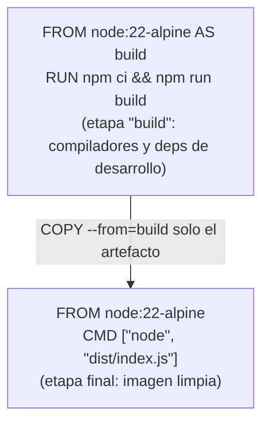
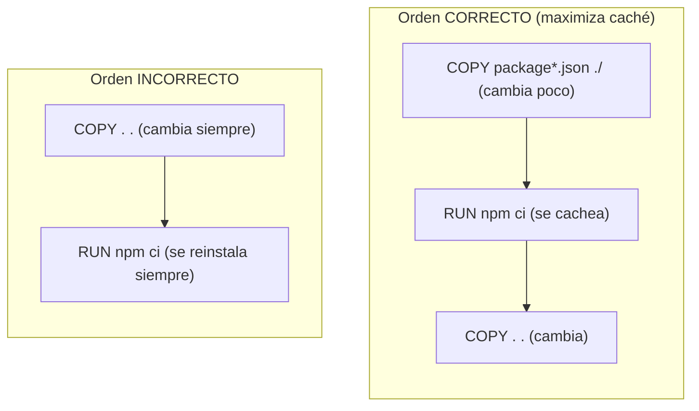
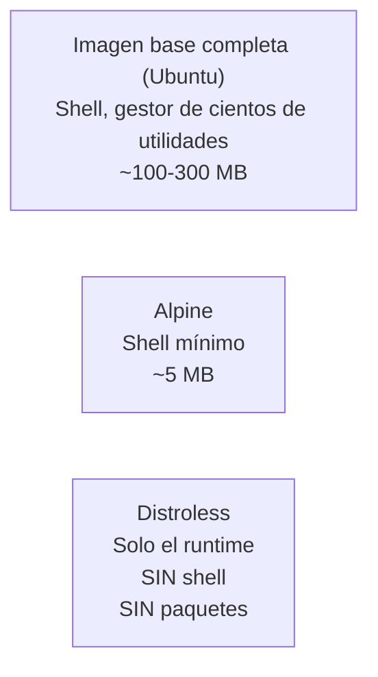
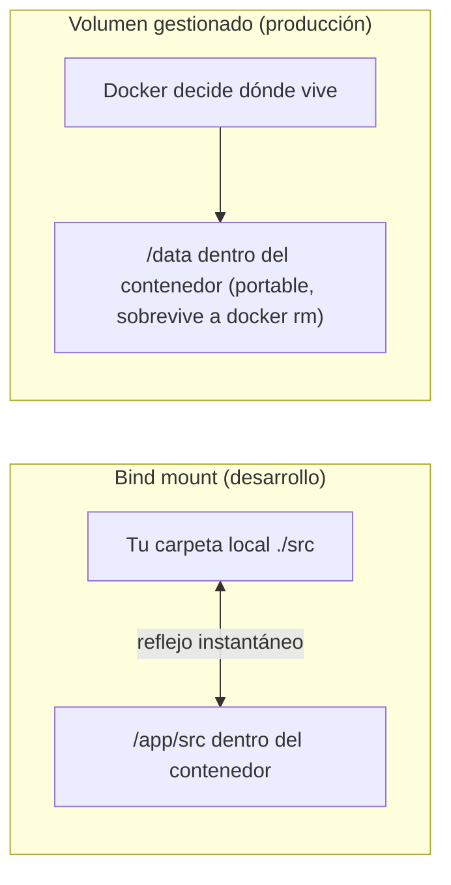
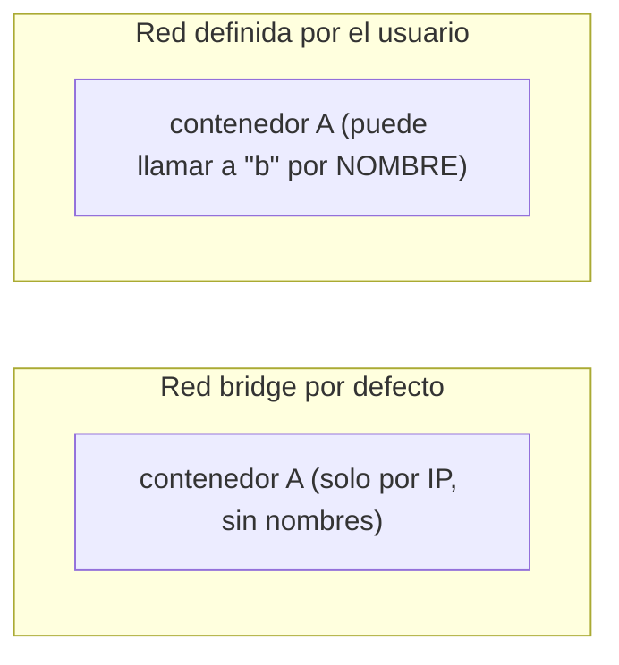
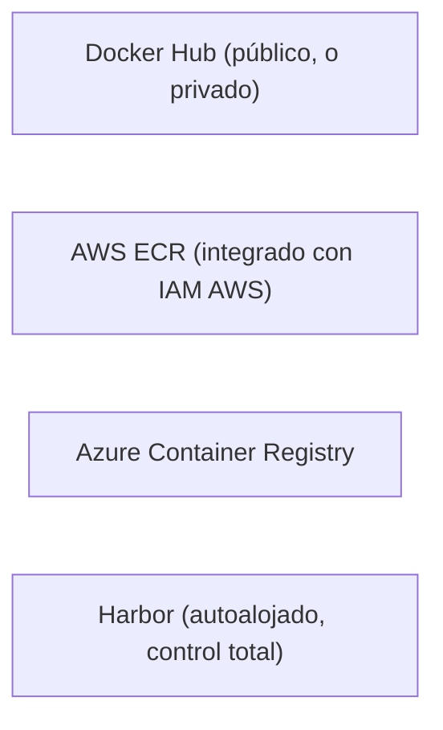
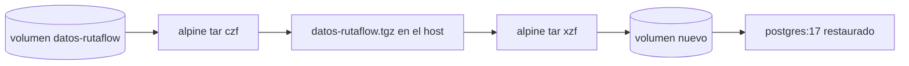
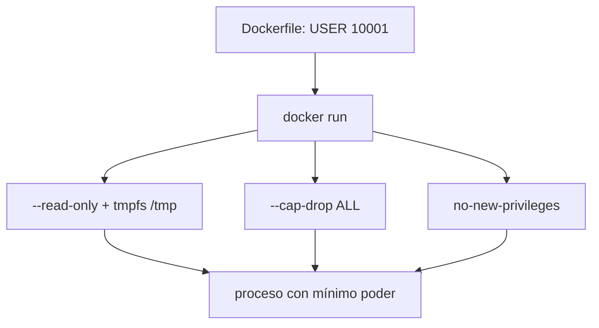
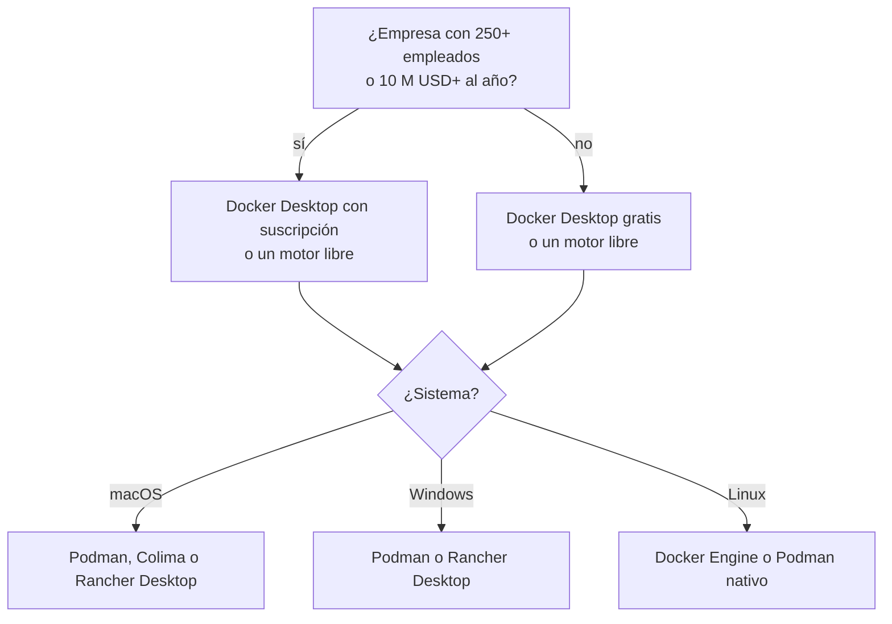

# Módulo 0: Docker — imágenes y buenas prácticas

> **Requisitos de este curso:** [Linux y terminal](/curso/linux). Lo que esos cursos enseñan aquí se usa sin volver a explicarlo; si algo no te suena, vuelve a su capítulo antes de seguir.


## Aprende construyendo


### Tema 1: Dockerfile multi-stage · Básico · 20 min

<details open>
<summary><strong>Capa 1 — Lectura</strong></summary>

#### ► DE QUÉ TRATA
Al finalizar podrás escribir un Dockerfile multi-stage que separa la compilación de la ejecución, reduciendo drásticamente el tamaño y la superficie de ataque de la imagen final.

#### ► CÓMO FUNCIONA


</details>

<details>
<summary><strong>Capa 2 — Construcción</strong></summary>

#### Código y verificación

```bash
mkdir -p academia-devops/src/modulo2/multistage
cd academia-devops/src/modulo2/multistage
```

Crea el archivo `package.json`:

```json
{"name":"api-demo","version":"1.0.0","scripts":{"build":"echo 'compilado' > dist-marker.txt"},"main":"index.js"}
```

```bash
docker run --rm -v "$(pwd)":/app -w /app node:22-alpine npm install --package-lock-only
mkdir dist && echo "console.log('API corriendo')" > index.js
```

Crea el archivo `Dockerfile.sinoptimizar`:

```dockerfile
FROM node:22
WORKDIR /app
COPY . .
RUN npm ci --omit=dev
CMD ["node", "index.js"]
```

```bash
docker build -f Dockerfile.sinoptimizar -t api-demo:sin-optimizar .
```

Crea el archivo `Dockerfile`:

```dockerfile
FROM node:22-alpine AS build
WORKDIR /app
COPY package*.json ./
RUN npm ci
COPY . .
RUN npm run build

FROM node:22-alpine
WORKDIR /app
COPY --from=build /app/dist-marker.txt ./
COPY --from=build /app/index.js ./
CMD ["node", "index.js"]
```

```bash
docker build -t api-demo:multistage .
docker images | grep api-demo
```

</details>

### Tema 2: Capas e invalidación de caché · Básico · 20 min

<details open>
<summary><strong>Capa 1 — Lectura</strong></summary>

#### ► DE QUÉ TRATA
Al finalizar podrás ordenar las instrucciones de un Dockerfile para maximizar la reutilización de caché entre builds sucesivos.

#### ► CÓMO FUNCIONA


</details>

<details>
<summary><strong>Capa 2 — Construcción</strong></summary>

#### Código y verificación


```bash
mkdir -p academia-devops/src/modulo2/cache-test && cd academia-devops/src/modulo2/cache-test
```

Crea el archivo `package.json`:

```json
{"name":"api-demo","version":"1.0.0","scripts":{"build":"echo compilado > dist-marker.txt"}}
```

```bash
docker run --rm -v "$(pwd)":/app -w /app node:22-alpine npm install --package-lock-only
echo "console.log('v1')" > index.js
```

Crea el archivo `Dockerfile`:

```dockerfile
FROM node:22-alpine AS build
WORKDIR /app
COPY package*.json ./
RUN npm ci
COPY . .
RUN npm run build
FROM node:22-alpine
WORKDIR /app
COPY --from=build /app/dist-marker.txt ./
CMD ["cat", "dist-marker.txt"]
```

```bash
docker build -t api-demo:cache-test .
echo "console.log('cambio de código, sin tocar package.json')" >> index.js
docker build -t api-demo:cache-test . 2>&1 | grep -E "CACHED|npm ci"
```

</details>

### Tema 3: Imágenes base distroless/alpine · Básico · 20 min

<details open>
<summary><strong>Capa 1 — Lectura</strong></summary>

#### ► DE QUÉ TRATA
Al finalizar podrás elegir entre una imagen base completa, Alpine o distroless según si priorizas comodidad de depuración o mínima superficie de ataque.

#### ► CÓMO FUNCIONA


</details>

<details>
<summary><strong>Capa 2 — Construcción</strong></summary>

#### Código y verificación


```bash
mkdir -p academia-devops/src/modulo2/imagenes-base
cd academia-devops/src/modulo2/imagenes-base
echo 'console.log("hola")' > app.js
for base in "node:22" "node:22-alpine" "gcr.io/distroless/nodejs22-debian12"; do
  echo "--- $base ---"
  docker run --rm -v "$(pwd)":/app -w /app "$base" node app.js 2>&1 || echo "(sin shell disponible para depurar interactivamente)"
done
docker images node:22 node:22-alpine --format "{{.Repository}}:{{.Tag}} {{.Size}}"
```

</details>

### Tema 4: Volúmenes vs bind mounts · Básico · 20 min

<details open>
<summary><strong>Capa 1 — Lectura</strong></summary>

#### ► DE QUÉ TRATA
Al finalizar podrás elegir entre un volumen gestionado por Docker y un bind mount según si necesitas persistencia portable o reflejo instantáneo de código local.

#### ► CÓMO FUNCIONA


#### ► REGLA PRÁCTICA
Usa bind mount cuando quieres ver reflejado al instante el código que editas en tu máquina (desarrollo local); usa un volumen gestionado cuando necesitas que los datos sobrevivan a `docker rm` y sean portables entre hosts, sin depender de una ruta específica de tu filesystem (bases de datos, uploads en producción).

</details>

<details>
<summary><strong>Capa 2 — Construcción</strong></summary>

#### Código y verificación

```bash
mkdir -p academia-devops/src/modulo2/volumenes
cd academia-devops/src/modulo2/volumenes
echo "console.log('version 1')" > app.js
docker run --rm -v "$(pwd)":/app -w /app node:22-alpine node app.js
echo "console.log('version 2, editado localmente')" > app.js
docker run --rm -v "$(pwd)":/app -w /app node:22-alpine node app.js
```

```bash
docker volume create datos-prueba
docker run --rm -v datos-prueba:/data alpine sh -c "echo 'dato persistente' > /data/registro.txt"
docker run --rm -v datos-prueba:/data alpine cat /data/registro.txt
```

</details>

### Tema 5: Redes en Docker · Básico · 20 min

<details open>
<summary><strong>Capa 1 — Lectura</strong></summary>

#### ► DE QUÉ TRATA
Al finalizar podrás crear una red Docker definida por el usuario y conectar contenedores entre sí usando resolución de nombres, en vez de direcciones IP frágiles.

#### ► CÓMO FUNCIONA


</details>

<details>
<summary><strong>Capa 2 — Construcción</strong></summary>

#### Código y verificación


```bash
mkdir -p academia-devops/src/modulo2/redes && cd academia-devops/src/modulo2/redes
docker network create demo-red
docker run -d --name servicio-a --network demo-red alpine sleep 300
docker run --rm --network demo-red alpine ping -c 2 servicio-a
```

</details>

### Tema 6: Registries — Docker Hub, AWS ECR, Azure Container Registry, Harbor · Básico · 20 min

<details open>
<summary><strong>Capa 1 — Lectura</strong></summary>

#### ► DE QUÉ TRATA
Al finalizar podrás elegir entre Docker Hub, un registry gestionado por proveedor cloud y un registry autoalojado (Harbor) según tus requisitos de integración e independencia.

#### ► CÓMO FUNCIONA


</details>

<details>
<summary><strong>Capa 2 — Construcción</strong></summary>

#### Código y verificación


```bash
mkdir -p academia-devops/src/modulo2/registry && cd academia-devops/src/modulo2/registry
docker run -d -p 5000:5000 --name registro-local registry:2
echo "console.log('imagen de prueba')" > app.js
printf 'FROM node:22-alpine\nCOPY app.js .\nCMD ["node","app.js"]\n' > Dockerfile
docker build -t localhost:5000/app-demo:v1 .
docker push localhost:5000/app-demo:v1
```

```bash
curl -s http://localhost:5000/v2/app-demo/tags/list
docker rmi localhost:5000/app-demo:v1
docker pull localhost:5000/app-demo:v1
```

</details>

### Tema 7: Operación diaria: inspect, stats, events y respaldo de volúmenes · Básico · 20 min

<details open>
<summary><strong>Capa 1 — Lectura</strong></summary>

#### ► DE QUÉ TRATA
Al finalizar podrás inspeccionar un contenedor y sus montajes, medir su consumo, revisar los eventos del motor de Docker y respaldar y restaurar un volumen con un contenedor auxiliar. Prerrequisito: Tema 4 de este módulo (volúmenes).

#### ► CÓMO FUNCIONA


</details>

<details>
<summary><strong>Capa 2 — Construcción</strong></summary>

#### Código y verificación


```bash
mkdir respaldo-volumenes && cd respaldo-volumenes
```

```bash
#!/usr/bin/env bash
# Operación diaria de un contenedor con volumen: inspeccionar, medir, respaldar y restaurar
set -euo pipefail

docker volume create datos-rutaflow >/dev/null
docker run -d --name bd-rutaflow -e POSTGRES_PASSWORD=dev -v datos-rutaflow:/var/lib/postgresql/data postgres:17 >/dev/null
until docker exec bd-rutaflow pg_isready -U postgres >/dev/null 2>&1; do sleep 1; done
docker exec bd-rutaflow psql -U postgres -qc "CREATE TABLE entrega(guia text); INSERT INTO entrega VALUES ('BO-1'),('BO-2');"

echo "--- inspección: dónde vive el volumen y con qué imagen corre"
docker inspect bd-rutaflow --format '{{.Config.Image}} {{range .Mounts}}{{.Name}} -> {{.Destination}}{{end}}'
echo "--- consumo instantáneo"
docker stats --no-stream --format '{{.Name}} CPU={{.CPUPerc}} MEM={{.MemUsage}}' bd-rutaflow

echo "--- respaldo del volumen con un contenedor auxiliar (la BD se detiene para un respaldo consistente)"
docker stop bd-rutaflow >/dev/null
docker run --rm -v datos-rutaflow:/origen:ro -v "$(pwd)":/respaldo alpine tar czf /respaldo/datos-rutaflow.tgz -C /origen .
ls -lh datos-rutaflow.tgz | awk '{print $5, $9}'

echo "--- desastre: se borran el contenedor y el volumen"
docker rm bd-rutaflow >/dev/null && docker volume rm datos-rutaflow >/dev/null

echo "--- restauración en un volumen nuevo"
docker volume create datos-rutaflow >/dev/null
docker run --rm -v datos-rutaflow:/destino -v "$(pwd)":/respaldo alpine tar xzf /respaldo/datos-rutaflow.tgz -C /destino
docker run -d --name bd-rutaflow -e POSTGRES_PASSWORD=dev -v datos-rutaflow:/var/lib/postgresql/data postgres:17 >/dev/null
until docker exec bd-rutaflow pg_isready -U postgres >/dev/null 2>&1; do sleep 1; done
docker exec bd-rutaflow psql -U postgres -Atc "SELECT count(*) || ' entregas restauradas' FROM entrega;"

docker rm -f bd-rutaflow >/dev/null && docker volume rm datos-rutaflow >/dev/null
```

```bash
bash respaldo.sh
docker events --since 10m --filter type=container --format '{{.Action}} {{.Actor.Attributes.name}}' --until "$(date +%s)"
```

```text
--- inspección: dónde vive el volumen y con qué imagen corre
postgres:17 datos-rutaflow -> /var/lib/postgresql/data
--- consumo instantáneo
bd-rutaflow CPU=0.05% MEM=38.2MiB / 7.6GiB
--- respaldo del volumen con un contenedor auxiliar (la BD se detiene para un respaldo consistente)
6.5M datos-rutaflow.tgz
--- desastre: se borran el contenedor y el volumen
--- restauración en un volumen nuevo
2 entregas restauradas
```

</details>

### Tema 8: Contenedores sin privilegios: usuario no root, sistema de archivos de solo lectura y capacidades mínimas · Avanzado · 45 min

<details open>
<summary><strong>Capa 1 — Lectura</strong></summary>

#### ► DE QUÉ TRATA
Necesitas Docker 24 o superior. Crea la carpeta academia-labs/devops/sin-privilegios con un servidor Node mínimo (server.js) y su Dockerfile.

#### ► CÓMO FUNCIONA


</details>

<details>
<summary><strong>Capa 2 — Construcción</strong></summary>

#### Código y verificación


```js
const http = require('node:http');
const fs = require('node:fs');

http.createServer((req, res) => {
  let escritura;
  try { fs.writeFileSync('/app/prueba.txt', 'x'); escritura = 'pude escribir en /app'; }
  catch (e) { escritura = `no puedo escribir en /app (${e.code})`; }
  fs.writeFileSync('/tmp/cache.txt', 'ok'); // /tmp es un tmpfs permitido
  res.end(`uid=${process.getuid()} · ${escritura} · /tmp ok\n`);
}).listen(8080);
```

```dockerfile
FROM node:22-alpine
WORKDIR /app
COPY server.js .
# Usuario sin privilegios con UID fijo (las políticas de Kubernetes revisan el número).
RUN addgroup -S -g 10001 app && adduser -S -u 10001 -G app app
USER 10001:10001
EXPOSE 8080
CMD ["node", "server.js"]
```

```bash
cd academia-labs/devops/sin-privilegios
docker build -t rutaflow/api-segura .
docker run -d --name api --read-only --tmpfs /tmp \
  --cap-drop ALL --security-opt no-new-privileges -p 8080:8080 rutaflow/api-segura
curl -s localhost:8080
docker exec api id
docker exec api sh -c 'touch /etc/hackeado' ; echo "código de salida: $?"
```

```text
uid=10001 · no puedo escribir en /app (EROFS) · /tmp ok
uid=10001(app) gid=10001(app) groups=10001(app)
touch: /etc/hackeado: Read-only file system
código de salida: 1
```

</details>

### Tema 9: Elegir el motor de contenedores local: Docker Desktop, Podman, Colima y Rancher Desktop · Avanzado · 35 min

<details open>
<summary><strong>Capa 1 — Lectura</strong></summary>

#### ► DE QUÉ TRATA
Usa Python 3.10 o superior para el script. Para probar un motor alternativo instala uno: brew install podman o brew install colima docker en macOS, o Rancher Desktop desde su página. Crea la carpeta academia-labs/devops/motor-local.

#### ► CÓMO FUNCIONA


</details>

<details>
<summary><strong>Capa 2 — Construcción</strong></summary>

#### Código y verificación


```python
"""Recomienda un motor de contenedores local según el equipo y la empresa.

Los datos de licencia vienen de las páginas oficiales (revisadas el 2026-11-18).
"""
from dataclasses import dataclass

# Docker Desktop es gratis para empresas con menos de 250 empleados Y menos de 10 M USD al año.
LIMITE_EMPLEADOS = 250
LIMITE_INGRESOS_MUSD = 10

# Sistemas donde corre cada motor.
MOTORES = {
    "Docker Desktop": {"macos", "windows", "linux"},
    "Podman": {"macos", "windows", "linux"},
    "Colima": {"macos", "linux"},
    "Rancher Desktop": {"macos", "windows", "linux"},
}


@dataclass
class Equipo:
    nombre: str
    so: str
    empleados: int
    ingresos_musd: float


def docker_desktop_gratis(equipo: Equipo) -> bool:
    return equipo.empleados < LIMITE_EMPLEADOS and equipo.ingresos_musd < LIMITE_INGRESOS_MUSD


def opciones(equipo: Equipo) -> list[str]:
    elegibles = []
    for nombre, sistemas in MOTORES.items():
        if equipo.so not in sistemas:
            continue
        if nombre == "Docker Desktop" and not docker_desktop_gratis(equipo):
            continue  # se puede usar, pero exige pagar una suscripción
        elegibles.append(nombre)
    return elegibles


EQUIPOS = [
    Equipo("estudiante", "macos", 1, 0),
    Equipo("RutaFlow (40 personas)", "windows", 40, 3),
    Equipo("empresa de 900 personas", "macos", 900, 120),
]

for equipo in EQUIPOS:
    lista = ", ".join(opciones(equipo))
    pago = "" if docker_desktop_gratis(equipo) else "  (Docker Desktop exige suscripción)"
    print(f"{equipo.nombre:<26} {equipo.so:<8} -> {lista}{pago}")
```

```bash
cd academia-labs/devops/motor-local
python3 elegir_runtime.py
# con el motor elegido instalado, comprueba que tu Compose funciona igual:
docker compose up -d && docker compose ps
```

```text
estudiante                 macos    -> Docker Desktop, Podman, Colima, Rancher Desktop
RutaFlow (40 personas)     windows  -> Docker Desktop, Podman, Rancher Desktop
empresa de 900 personas    macos    -> Podman, Colima, Rancher Desktop  (Docker Desktop exige suscripción)
```

</details>

### Tema 10: BuildKit y Buildx: builds más rápidos, secretos seguros y varias arquitecturas · Avanzado · 40 min

## Motivación

Cada cambio en el código de `api-pedidos` hace que Maven vuelva a descargar todas las dependencias dentro de `docker build`, y el build tarda cinco minutos. Además, el equipo trabaja con Mac de chip ARM y el servidor es x86: una imagen construida en el portátil no arranca en producción.

## Concepto

**BuildKit** es el motor de construcción de imágenes de Docker; viene activado por defecto desde Docker 23. Frente al motor antiguo:
- construye en paralelo las etapas independientes de un multi-stage;
- añade **montajes de caché** que sobreviven entre builds;
- permite pasar **secretos** al build sin que queden guardados en ninguna capa.

**Buildx** es el comando (`docker buildx`) para usar todas las funciones de BuildKit. La más importante: construir **imágenes multiplataforma**. Una sola etiqueta (`api-pedidos:1.0`) contiene variantes para `linux/amd64` y `linux/arm64`, y cada máquina descarga la suya.

## Ejemplo mínimo

**Archivo:** `Dockerfile`

```dockerfile
# syntax=docker/dockerfile:1
FROM maven:3.9-eclipse-temurin-21 AS build
WORKDIR /app
COPY pom.xml .
COPY src ./src
# La carpeta .m2 se guarda entre builds: las dependencias se descargan una sola vez
RUN --mount=type=cache,target=/root/.m2 \
    --mount=type=secret,id=maven_settings,target=/root/.m2/settings.xml \
    mvn -B -q package -DskipTests

FROM eclipse-temurin:21-jre
COPY --from=build /app/target/*.jar /app.jar
ENTRYPOINT ["java", "-jar", "/app.jar"]
```

```bash
# Build normal, pasando el settings.xml con credenciales del registro Maven privado
docker build --secret id=maven_settings,src=$HOME/.m2/settings.xml -t api-pedidos:1.0 .

# Build multiplataforma con Buildx (crea una vez un builder que lo soporte)
docker buildx create --name multi --use
docker buildx build --platform linux/amd64,linux/arm64 \
  -t registro.ejemplo.com/api-pedidos:1.0 --push .
docker buildx imagetools inspect registro.ejemplo.com/api-pedidos:1.0
```

El último comando lista las dos plataformas que contiene la etiqueta.

> **Nota de verificación.** Estos comandos siguen la documentación oficial de cada herramienta, pero no se ejecutaron al escribir el tema, porque el entorno de verificación no tiene Docker. Si alguno falla en tu versión, la salida del error te dirá qué opción cambió.

## Cómo funciona por dentro

- **`--mount=type=cache`:** monta una carpeta que BuildKit guarda fuera de la imagen. La capa sigue invalidándose cuando cambia `src`, pero Maven encuentra las dependencias ya descargadas en `/root/.m2`.
- **`--mount=type=secret`:** el archivo existe solo durante ese `RUN`. Un `COPY settings.xml` o un `ARG PASSWORD`, en cambio, quedan grabados en el historial de la imagen y cualquiera que la descargue puede leerlos con `docker history`.
- **Imágenes multiplataforma:** Buildx compila cada arquitectura (con emulación QEMU o con nodos nativos) y publica un **índice de imágenes** (*manifest list*) que apunta a cada variante. Por eso necesita `--push` o una salida a registro: el almacén local clásico de Docker no guarda índices multiplataforma.

## Reglas y casos límite

- **La línea `# syntax=docker/dockerfile:1`** fija la versión de la sintaxis del Dockerfile y habilita `--mount` en cualquier versión de Docker con BuildKit.
- **La emulación es lenta.** Compilar `arm64` en un x86 con QEMU puede tardar 5–10 veces más. En CI conviene usar runners nativos de cada arquitectura.
- **La caché de montaje es local al builder.** En CI efímera se pierde entre ejecuciones. Para conservarla se exporta con `--cache-to` y `--cache-from` (por ejemplo, `type=registry`).

## Compruébalo

1. Ejecuta `docker history api-pedidos:1.0` y busca el `settings.xml`. ¿Aparece? Repite con un `COPY settings.xml` y compara.
2. ¿Por qué `docker buildx build --platform linux/amd64,linux/arm64 -t api:1.0 --load .` falla con el almacén clásico de Docker?

### Tema 11: Seguridad de la cadena de contenedores: Docker Scout, Trivy y Falco · Avanzado · 40 min

## Motivación

La imagen de `api-pedidos` pasa las pruebas, pero se construyó sobre una base con una librería vulnerable publicada hace meses. Además, nadie se enteraría si alguien abriera una terminal dentro de un contenedor en producción. Hacen falta dos controles distintos: revisar la imagen **antes** de desplegarla y vigilar el contenedor **mientras corre**.

## Concepto

| Momento | Herramienta | Qué hace |
|---|---|---|
| Antes (build y CI) | **Trivy** (Aqua, código abierto) | Escanea la imagen, el sistema de archivos o un repositorio buscando vulnerabilidades conocidas (CVE), secretos y malas configuraciones. Puede romper el pipeline. |
| Antes (build y registro) | **Docker Scout** (Docker) | Analiza las CVE de la imagen y sus capas, y recomienda una imagen base mejor. Integrado en Docker Desktop y Docker Hub. |
| Durante (ejecución) | **Falco** (CNCF) | Observa las llamadas al sistema del kernel y alerta cuando un contenedor hace algo anómalo según sus reglas: abrir una shell, escribir en `/etc`, leer `/etc/shadow`. |

Una **CVE** es una vulnerabilidad registrada públicamente con un identificador (p. ej. `CVE-2024-XXXXX`) y una severidad: baja, media, alta o crítica. Los escáneres comparan las versiones de los paquetes de tu imagen con esas bases de datos.

## Ejemplo mínimo

```bash
# Trivy: falla (código de salida 1) si hay vulnerabilidades críticas
trivy image --severity HIGH,CRITICAL --exit-code 1 api-pedidos:1.0

# Docker Scout: resumen y recomendación de imagen base
docker scout quickview api-pedidos:1.0
docker scout cves --only-severity critical,high api-pedidos:1.0
docker scout recommendations api-pedidos:1.0
```

En el pipeline (módulo 4), el paso de Trivy va justo después del build y antes del push. Si encuentra una crítica, la imagen no llega al registro.

Falco se instala en el clúster con Helm y queda corriendo en cada nodo:

```bash
helm repo add falcosecurity https://falcosecurity.github.io/charts
helm install falco falcosecurity/falco --namespace falco --create-namespace
kubectl exec -it deploy/api-pedidos -- sh          # simula el ataque
kubectl logs -n falco -l app.kubernetes.io/name=falco | grep -i shell
```

El log muestra una alerta de la regla incluida *Terminal shell in container*, con el pod, la imagen y el comando.

> **Nota de verificación.** Estos comandos siguen la documentación oficial de cada herramienta, pero no se ejecutaron al escribir el tema, porque el entorno de verificación no tiene Docker. Si alguno falla en tu versión, la salida del error te dirá qué opción cambió.

## Reglas y casos límite

- **No todas las CVE son explotables.** Una vulnerabilidad en una librería que tu código nunca carga sigue saliendo en el informe. Se documenta la excepción (p. ej., en un archivo `.trivyignore` con el motivo) en lugar de ignorar el escáner.
- **La base de la imagen es la mayor fuente de CVE.** Cambiar a una base mínima (distroless o slim, Tema 3) suele eliminar más vulnerabilidades que cualquier parche.
- **Escanear una vez no basta.** Aparecen CVE nuevas cada día sobre imágenes que ya están desplegadas: programa escaneos periódicos del registro.
- **Falco detecta, no bloquea.** Sus alertas deben ir a un canal que alguien vigile (Slack, correo o un SIEM); si nadie las lee, no protegen.

## Compruébalo

1. Escanea con Trivy `eclipse-temurin:21-jre` y `gcr.io/distroless/java21-debian12`. ¿Cuál tiene menos CVE altas y por qué?
2. ¿En qué paso del pipeline pondrías Trivy para no gastar tiempo subiendo imágenes que luego se rechazan?

