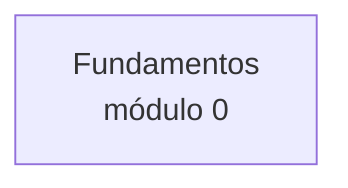
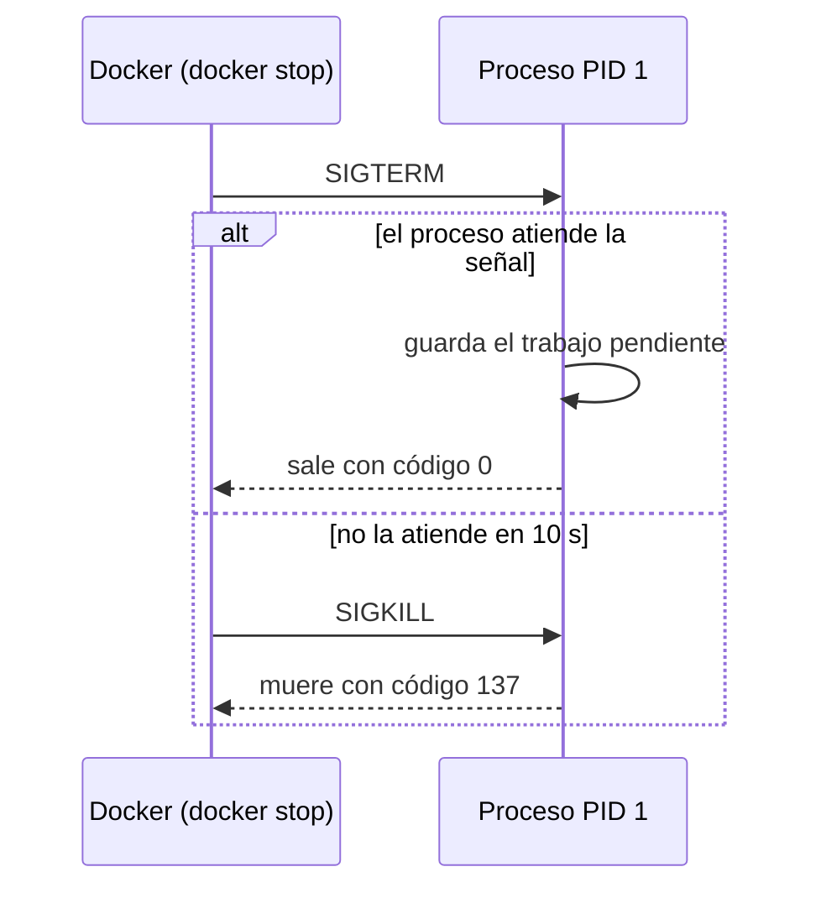
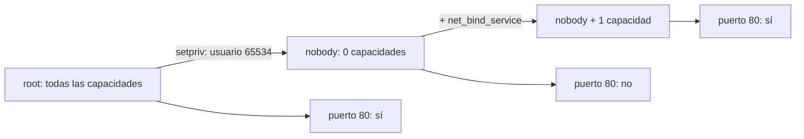
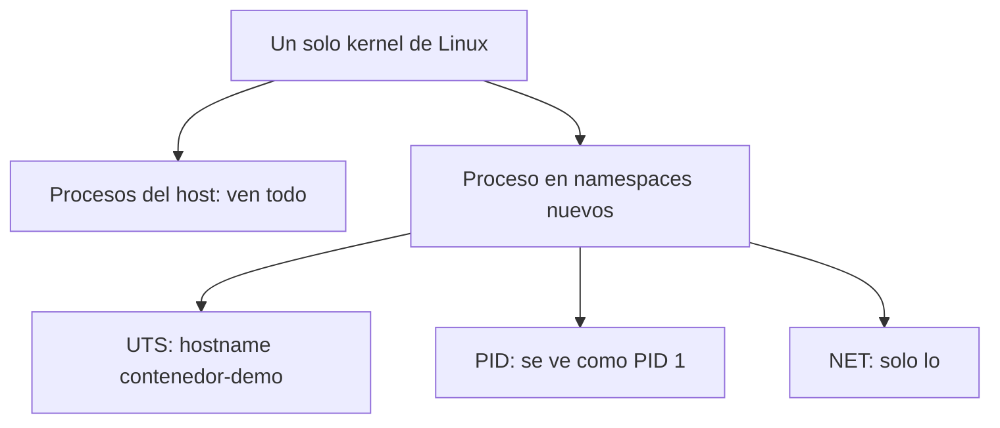
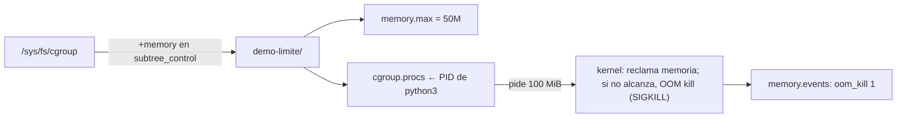
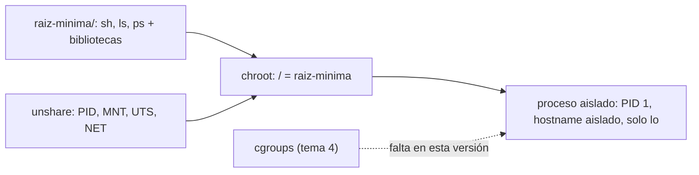

# Módulo 0: Linux que necesitas para entender un contenedor

Un contenedor no es una máquina virtual pequeña: es un proceso normal de Linux al que el kernel le muestra
una vista reducida del sistema y le pone límites. En este módulo construyes esa idea con tus manos, sin
Docker, para que en el módulo 1 cada comando de Docker tenga un significado concreto.

## Antes de comenzar: qué necesitas

- Un Linux con permisos de administrador: Ubuntu 22.04 o superior, Fedora, una máquina virtual o WSL 2 en
  Windows. En macOS usa una máquina virtual Linux (por ejemplo, con `multipass` o UTM): macOS no tiene
  namespaces ni cgroups.
- Una terminal y los programas `bash`, `python3`, `unshare`, `setpriv`, `ps` y `chroot`. Casi todas las
  distribuciones los traen; en Ubuntu, `sudo apt install util-linux procps python3`.
- Una carpeta de trabajo vacía: `mkdir -p ~/academia-docker && cd ~/academia-docker`.

Los ejemplos que crean namespaces o cgroups necesitan `sudo`. Hazlos en una máquina de práctica, no en un
servidor de producción.

## Ruta de proyecto progresivo desde carpeta vacía

El proyecto del curso es RutaFlow: una API de envíos, un worker que procesa entregas y una base de datos.
Cada módulo añade una pieza en la misma carpeta `~/academia-docker/rutaflow`, con un commit por tema:

| Módulo | Lo que RutaFlow gana |
|---|---|
| 0 | El worker responde bien a las señales y entiendes qué lo aísla y qué lo limita |
| 1–3 | La API y el worker viven en imágenes construidas con un Dockerfile propio |
| 4–7 | Builds rápidos y seguros, datos persistentes, red privada y Compose |
| 8–11 | Imagen firmada, endurecida, probada en CI y desplegada |

## Mapa de la ruta

«Docker de cero a experto» tiene, por ahora, 1 módulo publicado, de la etapa Fundamentos; los siguientes se agregan a medida que pasan la revisión.



| Módulo | Etapa | Qué aprendes |
|---|---|---|
| 0 | Fundamentos | [Linux que necesitas para entender un contenedor](/curso/docker/0) |

## Aprende construyendo

### Tema 1: Procesos, PID y señales: cómo se apaga bien un programa · Básico · 40 min

**Prerrequisitos:** saber abrir una terminal y ejecutar un script con `bash`. No necesitas Docker todavía.

#### Objetivo

Al terminar podrás explicar qué es un proceso y su PID, enviar SIGTERM y SIGKILL, y escribir un programa que guarda su trabajo antes de terminar.

#### Por qué importa

Cuando Docker detiene un contenedor, no lo «apaga»: le manda una señal a un proceso. Si ese proceso no la
atiende, Docker espera unos segundos y lo corta en seco. Un worker de RutaFlow cortado así puede dejar una
entrega a medio guardar. Entender las señales evita perder datos en cada despliegue.

#### Explicación

Un **proceso** es un programa en ejecución. El kernel le da un número único, el **PID**, y recuerda quién lo
creó, su proceso **padre**. El primer proceso del sistema tiene el PID 1.

Una **señal** es un aviso corto que el kernel entrega a un proceso. Las dos que más importan aquí son:

| Señal | Qué pide | ¿El proceso puede atenderla? | Código de salida típico |
|---|---|---|---|
| SIGTERM (15) | «Termina, por favor» | Sí: puede limpiar y salir | 0 si limpió; 143 si no la atendió (fuera de un contenedor; si es PID 1, la ignora) |
| SIGKILL (9) | Corte inmediato | No: el kernel lo mata | 137 |

El código 143 sale de 128 + 15, y 137 de 128 + 9: la shell suma 128 al número de la señal que mató al
proceso.

Dentro de un contenedor, tu programa suele ser el **PID 1**. `docker stop` le envía SIGTERM y, si no termina
en 10 segundos, le envía SIGKILL. Por eso el programa debe atender SIGTERM.

**Ojo: el PID 1 es especial.** El kernel no le aplica la acción por defecto de una señal si ese proceso no
instaló un manejador. Así que un PID 1 sin `trap` **ignora** SIGTERM: no sale con 143, sino que `docker stop`
espera los 10 segundos y lo mata con SIGKILL (137). Por eso existen `docker run --init` y `tini`, un PID 1
diminuto que reenvía las señales a tu programa. La señal y la espera también se pueden cambiar: `STOPSIGNAL`
en el Dockerfile, `docker run --stop-signal` y `docker stop -t <segundos>`.

**Analogía:** SIGTERM es el aviso de «cerramos en cinco minutos» en una tienda: los clientes terminan de pagar y salen. SIGKILL es apagar las luces de golpe. La analogía falla en que el proceso puede ignorar el aviso, pero nunca el apagón.

**Límite:** atender SIGTERM no protege contra un corte de energía ni contra SIGKILL. Los datos importantes también necesitan escrituras atómicas o una cola que reintente.



#### Ejemplo desde cero

Crea la carpeta `~/academia-docker/m0-senales` y entra en ella. Vas a escribir dos archivos.

Archivo `~/academia-docker/m0-senales/worker.sh`:

```bash
#!/usr/bin/env bash
# Un worker que limpia antes de salir cuando recibe SIGTERM.
limpiar() {
  echo "worker: SIGTERM recibido, guardo el trabajo pendiente y salgo"
  exit 0
}
trap limpiar TERM
echo "worker: arranqué"
while true; do sleep 0.2; done
```

Archivo `~/academia-docker/m0-senales/demo.sh`:

```bash
#!/usr/bin/env bash
# Lanza el worker dos veces: una lo detiene con SIGTERM y otra con SIGKILL.
bash worker.sh & pid=$!
sleep 0.5
echo "padre: envío SIGTERM (petición de apagado)"
kill -TERM "$pid"; wait "$pid"
echo "código de salida tras SIGTERM: $?"

bash worker.sh & pid=$!
sleep 0.5
echo "padre: envío SIGKILL (corte inmediato)"
kill -KILL "$pid"; wait "$pid" 2>/dev/null
echo "código de salida tras SIGKILL: $?"
```

Ejecútalo:

```bash
cd ~/academia-docker/m0-senales
bash demo.sh
```

**Explicación por bloques:**

`worker.sh` define la función `limpiar` y la conecta con `trap limpiar TERM`: cuando llegue SIGTERM, bash
ejecuta esa función en lugar de morir. El bucle `while` simula un trabajo que nunca termina solo.

`demo.sh` arranca el worker en segundo plano con `&` y guarda su PID en `$!`. Después de medio segundo le
envía SIGTERM con `kill -TERM`, y `wait` espera a que termine y entrega su código de salida en `$?`. La
segunda vez usa `kill -KILL`: el worker no alcanza a imprimir nada y el código es 137.


**Resultado esperado:**

```text
worker: arranqué
padre: envío SIGTERM (petición de apagado)
worker: SIGTERM recibido, guardo el trabajo pendiente y salgo
código de salida tras SIGTERM: 0
worker: arranqué
padre: envío SIGKILL (corte inmediato)
código de salida tras SIGKILL: 137
```

#### Fallo deliberado

Borra la línea `trap limpiar TERM` de `worker.sh` y vuelve a ejecutar `bash demo.sh`.

**Error esperado:** ya no aparece «SIGTERM recibido…» y la primera línea de código dice `código de salida tras SIGTERM: 143`.

**Diagnóstico:** sin `trap`, bash usa el comportamiento por defecto de SIGTERM: morir sin limpiar. El 143 (128 + 15) lo delata. En un contenedor, como PID 1, ni siquiera moriría: `docker stop` tardaría 10 s y acabaría en 137, sin limpiar. Vuelve a poner el `trap`.

#### Ejercicios

**Nivel 1 · Guiado.** Cambia el mensaje de `limpiar` para que también escriba la hora (`date +%T`) en un archivo `apagado.log`. Ejecuta la demo y muestra el archivo.

*Pista:* dentro de la función, usa `echo "..." >> apagado.log` antes del `exit 0`.

<details>
<summary>Ver solución</summary>

```bash
limpiar() {
  echo "worker: SIGTERM recibido, guardo el trabajo pendiente y salgo"
  echo "apagado ordenado a las $(date +%T)" >> apagado.log
  exit 0
}
```

Después de `bash demo.sh`, `cat apagado.log` muestra una línea con la hora. Con SIGKILL no se escribe nada:
por eso hay una sola línea aunque el worker se arrancó dos veces.

</details>

**Nivel 2 · Independiente.** Escribe `contador.py`, un programa en Python que cuente cada segundo y, al recibir SIGTERM, imprima «guardé N segundos» y salga con código 0. Pruébalo con `python3 contador.py & sleep 3; kill -TERM $!; wait $!; echo $?`.

<details>
<summary>Ver solución</summary>

Archivo `contador.py`:

```python
import signal, sys, time

segundos = 0

def al_terminar(numero, marco):
    print(f"guardé {segundos} segundos")
    sys.exit(0)

signal.signal(signal.SIGTERM, al_terminar)
while True:
    time.sleep(1)
    segundos += 1
```

La salida es «guardé 2 segundos» (o 3) y luego `0`. Si quitas `signal.signal(...)`, el código es 143.

</details>

**Nivel 3 · Reto.** Reto: cuando una shell lanza a tu programa como hijo (`sh -c "python3 contador.py; echo fin"`), la señal le llega a `sh`, no a Python. Demuéstralo y corrígelo sin cambiar el programa.

<details>
<summary>Ver rúbrica y solución</summary>

Demostración: `sh -c "python3 contador.py; echo fin" & sleep 3; kill -TERM $!; wait $!; echo $?`. Python
no imprime «guardé…» y la salida es 143, porque `sh` murió y Python quedó huérfano: sigue contando en
segundo plano. Termínalo con `pkill -f contador.py`.

El `; echo fin` importa: si la shell solo tiene un comando, bash (el `sh` de Fedora y Arch) hace `exec` de
ese comando por su cuenta y el problema no aparece. Con dos comandos ninguna shell lo hace, así que el
resultado es el mismo en Ubuntu y en Fedora. No confíes en ese `exec` implícito: depende de la shell.

Corrección: usar `exec` para que Python reemplace a la shell y reciba la señal directamente:
`sh -c "exec python3 contador.py"`. Rúbrica: demostraste el problema y terminaste el proceso huérfano
(1 punto), explicaste que la señal llega al proceso padre (1 punto) y lo corregiste con `exec` mostrando
«guardé…» y código 0 (2 puntos).
En el módulo 3 verás que esto mismo pasa con la forma «shell» de `CMD` en un Dockerfile.

</details>

#### Cierre

**Checklist de salida:**

- [ ] Explicas qué es un PID y qué es el proceso padre.
- [ ] Diferencias SIGTERM de SIGKILL y sabes cuál puede atender tu programa.
- [ ] Calculas el código de salida de un proceso muerto por una señal (128 + número).
- [ ] Reprodujiste el 143 al quitar el `trap` y lo corregiste.

**Errores comunes:** creer que `docker stop` apaga «la máquina», ignorar SIGTERM y confiar en que nunca llegará SIGKILL, y lanzar el programa desde una shell que no reenvía la señal.

**Siguiente paso:** en el tema 2 verás quién puede hacer qué dentro de Linux: usuarios, permisos y capacidades.

#### Proyecto integrador

Crea `~/academia-docker/rutaflow/worker/worker.py`: un worker que procese «entregas» (imprime una por segundo)
y que, al recibir SIGTERM, termine la entrega en curso y salga con código 0. Haz commit con el mensaje
`m0: worker con apagado ordenado`. Este worker es el que meterás en un contenedor en el módulo 3.

#### Fuentes

- [man 7 signal — señales de Linux](https://man7.org/linux/man-pages/man7/signal.7.html)
- [Docker — docker container stop](https://docs.docker.com/reference/cli/docker/container/stop/)

Consultadas el 2026-11-18.

### Tema 2: Usuarios, permisos y capacidades: qué puede hacer un proceso · Básico · 40 min

**Prerrequisitos:** tema 1 de este módulo. Saber qué es `sudo`.

#### Objetivo

Al terminar podrás leer el usuario y las capacidades efectivas de un proceso, explicar por qué root no es «todo o nada» y conceder solo el permiso que un programa necesita.

#### Por qué importa

Muchos contenedores corren como root sin necesitarlo. Si un atacante entra en uno de ellos, hereda todos esos
permisos. Linux divide los poderes de root en **capacidades** pequeñas, y Docker usa esa división para que tu
contenedor tenga solo lo que necesita.

#### Explicación

Cada proceso corre como un **usuario** (su UID) y un **grupo** (su GID). El usuario 0 es **root**. Los demás
usuarios quedan limitados por los permisos de cada archivo (dueño, grupo y otros) y, por defecto, no pueden abrir
puertos menores que 1024 (el umbral lo fija `net.ipv4.ip_unprivileged_port_start`).

Root no es un solo permiso. Linux lo divide en unas 40 **capacidades** independientes. Algunas:

| Capacidad | Qué permite |
|---|---|
| `net_bind_service` | abrir puertos por debajo del umbral (1024 por defecto; por ejemplo, el 80) |
| `chown` | cambiar el dueño de cualquier archivo |
| `net_admin` | configurar interfaces y reglas de red |
| `sys_admin` | muchísimas tareas de administración (montar, crear namespaces…): casi «ser root» |

El kernel guarda las capacidades **efectivas** de cada proceso en `/proc/<pid>/status`, en la línea `CapEff`,
como un número hexadecimal donde cada bit es una capacidad. Docker arranca los contenedores con un conjunto
reducido de capacidades y permite quitar o agregar más con `--cap-drop` y `--cap-add`.

**Analogía:** root es un llavero con todas las llaves del edificio; las capacidades son las llaves sueltas. Al portero le das solo la llave de la entrada, no el llavero. La analogía falla en que una sola llave muy amplia, como `sys_admin`, abre casi todas las puertas.

**Límite:** quitar capacidades reduce el daño, pero no reemplaza correr como usuario sin privilegios ni las demás capas de seguridad que verás en el módulo 9.



#### Ejemplo desde cero

Crea `~/academia-docker/m0-capacidades` y entra en ella. El script lee sus propias capacidades y prueba abrir el puerto 80.

Archivo `~/academia-docker/m0-capacidades/capacidades.py`:

```python
"""Muestra el usuario del proceso y sus capacidades efectivas de Linux."""
import os
import socket

# Nombres de algunas capacidades según su número de bit (ver «man 7 capabilities»).
NOMBRES = {0: "chown", 1: "dac_override", 8: "setpcap", 10: "net_bind_service",
           12: "net_admin", 21: "sys_admin"}


def capacidades_efectivas() -> int:
    with open("/proc/self/status") as estado:
        for linea in estado:
            if linea.startswith("CapEff:"):
                return int(linea.split()[1], 16)
    raise RuntimeError("el kernel no expone CapEff")


def puede_abrir_puerto_80() -> str:
    try:
        with socket.socket() as s:
            s.bind(("127.0.0.1", 80))
        return "sí"
    except PermissionError:
        return "no (PermissionError)"


mascara = capacidades_efectivas()
activas = [nombre for bit, nombre in NOMBRES.items() if mascara >> bit & 1]
print(f"uid={os.getuid()} capacidades efectivas: {bin(mascara).count('1')}")
print(f"  de la muestra tiene: {', '.join(activas) or 'ninguna'}")
print(f"  ¿puede abrir el puerto 80? {puede_abrir_puerto_80()}")
```

En Ubuntu 21.04 o superior tu carpeta personal tiene permisos 750 y `nobody` no puede leer el script, así que trabaja desde una copia en `/tmp`. Ejecútalo tres veces: como root, como el usuario sin privilegios `nobody` (UID 65534) y como `nobody` con una sola capacidad:

```bash
cp ~/academia-docker/m0-capacidades/capacidades.py /tmp/ && cd /tmp
sudo python3 capacidades.py
sudo setpriv --reuid=65534 --regid=65534 --clear-groups python3 capacidades.py
sudo setpriv --reuid=65534 --regid=65534 --clear-groups \
  --inh-caps +net_bind_service --ambient-caps +net_bind_service python3 capacidades.py
```

**Explicación por bloques:**

`capacidades_efectivas` lee la línea `CapEff` de `/proc/self/status` y convierte el hexadecimal en un número.
`NOMBRES` traduce algunos bits a nombres para no mostrar un número ilegible. `puede_abrir_puerto_80` intenta
ocupar el puerto 80 y captura el `PermissionError` que el kernel devuelve si falta la capacidad.

`setpriv` cambia el usuario (`--reuid`) y el grupo (`--regid`) antes de ejecutar Python. Con
`--inh-caps` y `--ambient-caps` le deja pasar una sola capacidad al programa.


**Resultado esperado:**

```text
uid=0 capacidades efectivas: <entre 38 y 41, según tu kernel>
  de la muestra tiene: chown, dac_override, setpcap, net_bind_service, net_admin, sys_admin
  ¿puede abrir el puerto 80? sí
uid=65534 capacidades efectivas: 0
  de la muestra tiene: ninguna
  ¿puede abrir el puerto 80? no (PermissionError)
uid=65534 capacidades efectivas: 1
  de la muestra tiene: net_bind_service
  ¿puede abrir el puerto 80? sí
```

El número de capacidades de root depende de la versión del kernel; el resto de líneas debe coincidir.

#### Fallo deliberado

En la tercera ejecución cambia `+net_bind_service` por `+net_admin` en las dos opciones.

**Error esperado:** el programa muestra `de la muestra tiene: net_admin` y `¿puede abrir el puerto 80? no (PermissionError)`.

**Diagnóstico:** cada capacidad cubre una sola cosa. `net_admin` configura la red, pero no abre puertos bajos. Pide la capacidad exacta que tu programa necesita, ni más ni menos.

#### Ejercicios

**Nivel 1 · Guiado.** Ejecuta `grep Cap /proc/self/status` como root y como `nobody` (con `setpriv`; trabaja desde `/tmp`). Explica la diferencia entre `CapEff` y `CapBnd`.

*Pista:* `man 7 capabilities` describe cada conjunto.

<details>
<summary>Ver solución</summary>

Como root, `CapEff` y `CapBnd` tienen casi todos los bits en 1. Como `nobody`, `CapEff` es 0, pero `CapBnd`
puede seguir alto. `CapEff` son las capacidades que el proceso usa ahora; `CapBnd` (bounding set) es el
techo máximo que podría llegar a tener. Docker recorta ambos en los contenedores.

</details>

**Nivel 2 · Independiente.** Escribe `quien_soy.sh`, que imprima el UID, el GID y si el usuario puede escribir en `/etc`. Pruébalo como root y como `nobody` (cópialo antes a `/tmp`: `nobody` no puede entrar en tu carpeta personal).

<details>
<summary>Ver solución</summary>

Archivo `quien_soy.sh`:

```bash
#!/usr/bin/env bash
echo "uid=$(id -u) gid=$(id -g)"
if [ -w /etc ]; then echo "puede escribir en /etc"; else echo "no puede escribir en /etc"; fi
```

Root ve «puede escribir»; `nobody` ve «no puede escribir». Por esto, en el módulo 9, tus imágenes correrán
con un usuario propio y no con root.

</details>

**Nivel 3 · Reto.** Reto: un servidor web debe escuchar en el puerto 80 sin correr como root. Propón dos formas de lograrlo y compara sus riesgos.

<details>
<summary>Ver rúbrica</summary>

Forma 1: correr como usuario sin privilegios con solo `net_bind_service` (como en el ejemplo; en Docker,
`--cap-drop ALL --cap-add NET_BIND_SERVICE`). Forma 2: escuchar en un puerto alto (8080) y publicarlo como
80 desde fuera (en Docker, `-p 80:8080`), sin ninguna capacidad extra.

Rúbrica: describes las dos formas (2 puntos), explicas que la forma 2 no necesita capacidades (1 punto) y
eliges con una razón (1 punto). La forma 2 es la más común en contenedores. Dato extra: dentro de un contenedor,
Docker (desde la 20.10) pone `net.ipv4.ip_unprivileged_port_start` en 0, así que un usuario sin privilegios
ya puede escuchar en el 80 sin `NET_BIND_SERVICE`; fuera de Docker, el umbral sigue en 1024.

</details>

#### Cierre

**Checklist de salida:**

- [ ] Lees el usuario y las capacidades efectivas de un proceso.
- [ ] Explicas por qué root no es un solo permiso.
- [ ] Concedes una sola capacidad a un programa y compruebas su efecto.
- [ ] Elegiste la capacidad correcta después del fallo deliberado.

**Errores comunes:** correr todo como root «porque funciona», agregar `sys_admin` para resolver un error puntual y confundir el bounding set con las capacidades efectivas.

**Siguiente paso:** en el tema 3 verás cómo el kernel le muestra a un proceso su propio nombre de host, sus propios procesos y su propia red: los namespaces.

#### Proyecto integrador

Copia el worker de RutaFlow del tema 1 a `/tmp` (para que `nobody` pueda leerlo), ejecútalo como `nobody` con
`setpriv` y anota en `rutaflow/NOTAS.md` que no
necesita ninguna capacidad. Esa nota será la base del `USER` de su Dockerfile.

#### Fuentes

- [man 7 capabilities](https://man7.org/linux/man-pages/man7/capabilities.7.html)
- [man 1 setpriv](https://man7.org/linux/man-pages/man1/setpriv.1.html)
- [Docker — Docker Engine security](https://docs.docker.com/engine/security/)

Consultadas el 2026-11-18.

### Tema 3: Namespaces: darle a un proceso su propia vista del sistema · Intermedio · 45 min

**Prerrequisitos:** temas 1 y 2 de este módulo.

#### Objetivo

Al terminar podrás crear namespaces UTS, PID y de red con `unshare`, y explicar qué ve un proceso dentro de cada uno.

#### Por qué importa

Cuando entras a un contenedor y ves que tu programa es el PID 1, que el nombre de host es otro y que solo hay
una red, no estás en otra máquina. Estás en **namespaces**. Saber crearlos a mano te deja diagnosticar
problemas que, vistos solo desde Docker, parecen magia.

#### Explicación

Un **namespace** envuelve un recurso global del kernel para que un grupo de procesos vea su propia copia.
Linux tiene varios tipos; los que usa un contenedor de Docker son (USER solo si activas `userns-remap` o Docker rootless):

| Namespace | Qué aísla | Qué ve el proceso dentro |
|---|---|---|
| UTS | nombre de host | su propio `hostname` |
| PID | números de proceso | él mismo es el PID 1 y solo ve a los procesos de su namespace |
| NET | interfaces, puertos y rutas | solo `lo`, y apagada (DOWN), hasta que alguien le conecte una red |
| MNT | puntos de montaje | sus propios montajes, como un `/proc` nuevo |
| USER | UID y GID | puede ser «root» dentro sin serlo fuera |
| IPC | memoria compartida y colas | sus propios objetos IPC |
| CGROUP | la vista de la jerarquía de cgroups | su propio `/sys/fs/cgroup` como raíz |

El comando `unshare` crea namespaces nuevos y ejecuta un programa dentro. Cada namespace aparece como un
enlace en `/proc/<pid>/ns/`. Existe además un namespace `time` que Docker no usa.

**Analogía:** un namespace es como los anteojos de realidad virtual de una sala: cada persona ve su propia escena, pero todas están en el mismo cuarto. La analogía falla en que el kernel sí es uno solo: todos comparten el mismo kernel, y por eso un contenedor no es una máquina virtual.

**Límite:** los namespaces esconden recursos, pero no limitan cuánto se usan: un proceso aislado puede consumir toda la memoria. Para eso están los cgroups del tema 4.



#### Ejemplo desde cero

Crea `~/academia-docker/m0-namespaces` y entra en ella. El script necesita `sudo` porque crear namespaces es una tarea de administración.

Archivo `~/academia-docker/m0-namespaces/namespaces.sh`:

```bash
#!/usr/bin/env bash
# Compara lo que ve un proceso normal con lo que ve un proceso en namespaces nuevos.
set -eu
antes=$(hostname)

echo "== namespace UTS: nombre de host propio"
unshare --uts sh -c 'hostname contenedor-demo; echo "dentro: $(hostname)"'
[ "$(hostname)" = "$antes" ] && echo "fuera: el nombre de host no cambió"

echo "== namespace PID: árbol de procesos propio"
echo "fuera, este script tiene PID $$ y ve todos los procesos del sistema"
unshare --pid --fork --mount-proc sh -c 'echo "dentro, procesos visibles:"; ps -e -o pid=,comm='

echo "== namespace de red: solo la interfaz de loopback"
unshare --net sh -c 'echo "interfaces dentro: $(tail -n +3 /proc/net/dev | cut -d: -f1 | tr -d " " | tr "\n" " ")"'
```

Ejecútalo:

```bash
cd ~/academia-docker/m0-namespaces
sudo bash namespaces.sh
```

**Explicación por bloques:**

El script guarda el nombre de host en `antes`. `unshare --uts` crea un namespace UTS nuevo: el `hostname`
que se cambia ahí no afecta al host, y la comprobación `[ "$(hostname)" = "$antes" ]` lo demuestra.

`unshare --pid --fork --mount-proc` crea un namespace PID y monta un `/proc` nuevo para que `ps` vea solo los
procesos de dentro: la shell es el PID 1. `--fork` hace falta porque el primer proceso del namespace debe ser
un hijo nuevo.

`unshare --net` crea un namespace de red vacío. `/proc/net/dev` lista las interfaces: dentro solo existe
`lo`, la interfaz de loopback.


**Resultado esperado:**

```text
== namespace UTS: nombre de host propio
dentro: contenedor-demo
fuera: el nombre de host no cambió
== namespace PID: árbol de procesos propio
fuera, este script tiene PID <un número grande> y ve todos los procesos del sistema
dentro, procesos visibles:
      1 sh
      2 ps
== namespace de red: solo la interfaz de loopback
interfaces dentro: lo
```

Tu PID «fuera» será otro número; lo importante es que dentro la shell es el PID 1. Si tu `/bin/sh` es bash (Fedora, Arch), puede que veas solo `1 ps`: bash reemplaza la shell por el último comando con un `exec` implícito. Es el mismo efecto del reto del tema 1.

#### Fallo deliberado

Quita `--mount-proc` de la línea del namespace PID y ejecuta de nuevo.

**Error esperado:** la lista «dentro, procesos visibles» muestra todos los procesos del host con sus PID altos.

**Diagnóstico:** el namespace PID sí se creó, pero `ps` lee `/proc`, y ese `/proc` sigue siendo el del host. Un contenedor necesita montar su propio `/proc`; Docker lo hace por ti. Vuelve a poner `--mount-proc`.

#### Ejercicios

**Nivel 1 · Guiado.** Ejecuta `ls -l /proc/self/ns` fuera y dentro de `sudo unshare --uts --net sh -c "ls -l /proc/self/ns"`. ¿Qué números cambian?

*Pista:* compara los números entre corchetes de `uts` y `net`.

<details>
<summary>Ver solución</summary>

Cambian los números de `uts` y `net`: son namespaces nuevos. Los de `pid`, `mnt`, `ipc` y `user` siguen
iguales porque no se pidieron. Ese número es el identificador del namespace; dos procesos con el mismo
número comparten ese namespace.

</details>

**Nivel 2 · Independiente.** Abre una shell en un namespace PID nuevo (`sudo unshare --pid --fork --mount-proc bash`), lanza `sleep 300 &` y, desde otra terminal, encuentra ese `sleep` con `ps -e`. ¿Qué PID tiene en cada lado?

<details>
<summary>Ver solución</summary>

Dentro, `sleep` tiene un PID pequeño (por ejemplo, 2). Fuera, el mismo proceso aparece con un PID grande.
Es el mismo proceso con dos números: el namespace solo traduce. Por eso `docker top` y `ps` del host
muestran PID distintos a los que ves con `docker exec ... ps`.

</details>

**Nivel 3 · Reto.** Reto: usa `nsenter` para entrar a los namespaces de un proceso que ya existe (el `sleep` del ejercicio anterior) y ejecutar `hostname` y `ps -e` dentro de ellos.

<details>
<summary>Ver rúbrica y solución</summary>

```bash
pid=$(pgrep -f 'sleep 300')                  # PID del sleep visto desde el host
sudo nsenter --target "$pid" --pid --mount --uts sh -c 'hostname; ps -e'
```

`pgrep -f 'sleep 300'` busca la línea de comando completa: `pgrep -n sleep` podría devolver otro `sleep` del
sistema. Verás el mismo `hostname` que en el host porque el ejercicio 2 no creó un namespace UTS: `nsenter`
entra en uno que es el del host. Con `ps -e` verás `1 bash`, el `sleep` y el propio `ps`.

Rúbrica: encuentras el PID del host (1 punto), entras a los namespaces correctos (2 puntos) y explicas que
`docker exec` hace lo mismo: ejecuta un proceso nuevo dentro de los namespaces del contenedor (1 punto).

</details>

#### Cierre

**Checklist de salida:**

- [ ] Nombras los namespaces que usa un contenedor y qué aísla cada uno.
- [ ] Creas namespaces UTS, PID y de red con `unshare`.
- [ ] Explicas por qué hace falta un `/proc` nuevo.
- [ ] Relacionas `nsenter` con `docker exec`.

**Errores comunes:** pensar que el contenedor tiene «su propio kernel», olvidar `--fork` o `--mount-proc` en el namespace PID, y creer que aislar es lo mismo que limitar.

**Siguiente paso:** en el tema 4 limitarás cuánta memoria puede usar un proceso con cgroups.

#### Proyecto integrador

Ejecuta el worker de RutaFlow dentro de un namespace PID nuevo y confirma que es el PID 1. Envíale SIGTERM
desde fuera con `sudo kill -TERM <pid del host>` y comprueba que sigue guardando su trabajo.

#### Fuentes

- [man 7 namespaces](https://man7.org/linux/man-pages/man7/namespaces.7.html)
- [man 1 unshare](https://man7.org/linux/man-pages/man1/unshare.1.html)
- [man 1 nsenter](https://man7.org/linux/man-pages/man1/nsenter.1.html)
- [Docker — Docker Engine security](https://docs.docker.com/engine/security/)

Consultadas el 2026-11-18.

### Tema 4: cgroups v2: limitar memoria y CPU de un proceso · Intermedio · 45 min

**Prerrequisitos:** temas 1 a 3 de este módulo. Un Linux con cgroup v2 (Ubuntu 22.04 o superior, Fedora 31 o superior). El ejercicio 1 usa `memory.peak`, que existe desde el kernel 5.19 (Ubuntu 24.04, o 22.04 con kernel HWE).

#### Objetivo

Al terminar podrás crear un cgroup v2, ponerle un límite de memoria, comprobar que el kernel mata al proceso que lo supera y leer el evento `oom_kill`.

#### Por qué importa

Sin límites, un contenedor con una fuga de memoria puede tumbar a todos los demás del mismo servidor. Las
opciones `--memory` y `--cpus` de Docker no son magia de Docker: escriben números en archivos de cgroups. Si
sabes leer esos archivos, sabes por qué un contenedor terminó con código 137.

#### Explicación

Un **cgroup** (control group) agrupa procesos para medir y limitar cuánto usan de CPU, memoria, procesos o
disco. En cgroup v2 todo es una sola jerarquía de carpetas bajo `/sys/fs/cgroup`, y cada ajuste es un archivo:

| Archivo | Para qué sirve |
|---|---|
| `cgroup.procs` | los PID que pertenecen al grupo; escribir un PID lo mueve ahí |
| `cgroup.subtree_control` | qué controladores (memoria, CPU…) se activan para los grupos hijos |
| `memory.max` | el máximo de memoria del grupo |
| `memory.events` | contadores, como `oom_kill`: cuántas veces el kernel mató un proceso por pasarse |
| `cpu.max` | cuánto tiempo de CPU puede usar el grupo en cada periodo |

Cuando el grupo llega a `memory.max`, el kernel no le niega memoria con un error. Primero intenta liberar
memoria (caché de archivos y swap). Si no puede, el **OOM killer** mata con SIGKILL a un proceso del grupo,
normalmente el que más usa, que no siempre es el que pidió la memoria. Si ese proceso es el principal del
contenedor, el contenedor termina con código 137; si muere un hijo, el contenedor puede seguir.
`memory.swap.max` solo existe si el kernel lleva la cuenta de la swap (lo normal en distribuciones actuales).

Para saber si tu sistema usa cgroup v2, comprueba si existe `/sys/fs/cgroup/cgroup.controllers`.

**Analogía:** un cgroup es el plan de datos de un celular: puedes hacer lo que quieras hasta llegar al límite, y ahí se corta. La analogía falla en que el kernel no te avisa antes: al pasar el límite de memoria, mata el proceso.

**Límite:** los cgroups limitan recursos, pero no esconden nada: un proceso limitado sigue viendo todo el sistema si no está en namespaces. Además, en cgroup v1 (sistemas viejos) los archivos tienen otros nombres.



#### Ejemplo desde cero

Crea `~/academia-docker/m0-cgroups` y entra en ella. Este ejemplo necesita `sudo` y un sistema con cgroup v2.

Archivo `~/academia-docker/m0-cgroups/limitar-memoria.sh`:

```bash
#!/usr/bin/env bash
# Limita la memoria de un proceso con cgroup v2. Necesita root y un host con cgroup v2.
set -eu
GRUPO=/sys/fs/cgroup/demo-limite
[ -f /sys/fs/cgroup/cgroup.controllers ] || { echo "este host no usa cgroup v2"; exit 1; }

# 1. Crear el grupo y activar el controlador de memoria para los grupos hijos.
mkdir -p "$GRUPO"
echo "+memory" > /sys/fs/cgroup/cgroup.subtree_control
echo 50M > "$GRUPO/memory.max"
echo 0 > "$GRUPO/memory.swap.max"
echo "límite: $(cat "$GRUPO/memory.max") bytes"

# 2. Meter un proceso en el grupo y pedirle 100 MiB.
sh -c "echo \$\$ > $GRUPO/cgroup.procs; exec python3 -c 'b = bytearray(100 * 1024 * 1024); print(\"reservé 100 MiB\")'" \
  || echo "código de salida: $?"

# 3. El kernel cuenta lo que pasó.
echo "eventos: $(grep '^oom_kill ' "$GRUPO/memory.events")"
rmdir "$GRUPO"
```

Ejecútalo:

```bash
cd ~/academia-docker/m0-cgroups
sudo bash limitar-memoria.sh
```

**Explicación por bloques:**

La primera línea útil comprueba que existe `cgroup.controllers`: si no, el sistema no usa cgroup v2 y el
script se detiene con un mensaje claro.

El bloque 1 crea la carpeta del grupo, activa el controlador de memoria para los hijos de la raíz y escribe
`50M` en `memory.max`. `memory.swap.max` en 0 evita que el kernel use swap para esquivar el límite.

El bloque 2 lanza una shell que escribe su propio PID (`$$`) en `cgroup.procs` y luego se reemplaza por
Python con `exec`, así Python hereda el grupo. Python intenta reservar 100 MiB; el kernel lo mata y la shell
externa imprime el código de salida. Antes, bash escribe en la salida de errores una línea como
`línea NN: NNNN Matado  sh -c …` (`Killed` si tu sistema está en inglés): es bash avisando que su hijo murió
por SIGKILL. El número de línea y el PID cambian en tu equipo.

El bloque 3 lee `memory.events` para comprobar que el kernel registró el OOM kill, y borra el grupo.

**Captura pendiente:** el entorno donde se generó este tema usa cgroup v1, así que la captura real no se pudo tomar aquí. Hay que tomarla en un Linux con cgroup v2 (Ubuntu 22.04 o superior) con `scripts/render_terminal_capture.py`.

**Resultado esperado:**

```text
límite: 52428800 bytes
limitar-memoria.sh: línea NN: NNNN Matado  sh -c '...'
código de salida: 137
eventos: oom_kill 1
```

#### Fallo deliberado

Borra la línea `echo 0 > "$GRUPO/memory.swap.max"` y ejecuta de nuevo en un sistema que tenga swap activo.

**Error esperado:** Python imprime `reservé 100 MiB` y el script termina sin código 137, o con `oom_kill 0`.

**Diagnóstico:** si `swapon --show` no muestra nada, no tienes swap y este fallo no cambia el resultado: es lo esperado. Con swap y sin límite de swap, el kernel mueve parte de la memoria a disco y el proceso no supera `memory.max`. El programa queda lento en lugar de morir. Docker hace algo parecido: `--memory` sin `--memory-swap` permite usar swap adicional. Limita también la swap cuando quieras un tope real.

#### Ejercicios

**Nivel 1 · Guiado.** Lee los archivos `memory.current` y `memory.peak` de un cgroup mientras Python reserva 30 MiB (por debajo del límite). ¿Qué valores ves?

*Pista:* el script del ejemplo borra su grupo al final, así que crea uno: `sudo mkdir /sys/fs/cgroup/ej1 && echo 50M | sudo tee /sys/fs/cgroup/ej1/memory.max`. Luego, desde una shell root (`sudo -s`), mueve esa shell con `echo $$ > /sys/fs/cgroup/ej1/cgroup.procs` y lanza `python3 -c "b=bytearray(30*1024*1024); import time; time.sleep(30)" &` dentro del grupo y lee los archivos desde otra terminal.

<details>
<summary>Ver solución</summary>

`memory.current` muestra cerca de 30 MiB más lo que usa el intérprete de Python, y `memory.peak` el máximo
alcanzado. Ambos están por debajo de `memory.max`, así que no hay OOM kill. Estos son los mismos números
que muestra `docker stats` en la columna de memoria. Si `memory.peak` no existe, tu kernel es anterior a la
5.19: mira solo `memory.current`.

</details>

**Nivel 2 · Independiente.** Limita la CPU de un grupo al 20 % de un núcleo escribiendo `20000 100000` en `cpu.max`, ejecuta un bucle infinito (`sh -c "while :; do :; done"`) dentro y mídelo con `top`.

<details>
<summary>Ver solución</summary>

Desde una shell root (`sudo -s`): activa el controlador con `echo +cpu > /sys/fs/cgroup/cgroup.subtree_control`,
crea el grupo con `mkdir /sys/fs/cgroup/ej2`, escribe el límite en `/sys/fs/cgroup/ej2/cpu.max` y mueve el
bucle con `echo <pid> > /sys/fs/cgroup/ej2/cgroup.procs`. Luego `cpu.max` con
`20000 100000` significa 20 000 µs de cada 100 000 µs: el 20 %. En `top`, el bucle se queda cerca del 20 %
en lugar del 100 %. Es lo que hace `docker run --cpus=0.2`.

</details>

**Nivel 3 · Reto.** Reto: un contenedor de RutaFlow termina con código 137 y nadie sabe por qué. Escribe un procedimiento de diagnóstico que distinga entre «lo mató el OOM killer» y «alguien ejecutó `docker kill`».

<details>
<summary>Ver rúbrica</summary>

Rúbrica: revisas `docker inspect --format '{{.State.OOMKilled}}' <contenedor>` (2 puntos); si es `false`,
buscas en `docker events` o en los registros quién envió SIGKILL (1 punto); explicas que 137 = 128 + 9 y
que ambas causas usan SIGKILL (1 punto). En el módulo 9 harás este diagnóstico con un contenedor real.

</details>

#### Cierre

**Checklist de salida:**

- [ ] Compruebas si un sistema usa cgroup v2.
- [ ] Creas un cgroup, le pones `memory.max` y mueves un proceso a él.
- [ ] Explicas por qué un proceso que se pasa del límite termina con 137.
- [ ] Relacionas `memory.max` y `cpu.max` con `--memory` y `--cpus` de Docker.

**Errores comunes:** olvidar limitar la swap, buscar los archivos de cgroup v1 en un sistema v2 y creer que el código 137 siempre significa falta de memoria.

**Siguiente paso:** en el tema 5 juntarás namespaces, un sistema de archivos mínimo y límites para aislar un proceso sin Docker.

#### Proyecto integrador

Ejecuta el worker de RutaFlow dentro de un cgroup con 64 MiB y anota en `rutaflow/NOTAS.md` cuánta memoria
usa en reposo (`memory.current`). Ese número será la base de su límite en Compose (módulo 7).

#### Fuentes

- [Linux kernel — Control Group v2](https://docs.kernel.org/admin-guide/cgroup-v2.html)
- [man 7 cgroups](https://man7.org/linux/man-pages/man7/cgroups.7.html)
- [Docker — Resource constraints](https://docs.docker.com/engine/containers/resource_constraints/)

Consultadas el 2026-11-18.

### Tema 5: Un contenedor sin Docker: namespaces, raíz propia y chroot · Intermedio · 45 min

**Prerrequisitos:** temas 1 a 4 de este módulo.

#### Objetivo

Al terminar podrás construir un sistema de archivos mínimo, ejecutar un proceso aislado en él con namespaces y `chroot`, y explicar qué parte de un contenedor real falta en tu versión.

#### Por qué importa

Este tema cierra el módulo: si puedes armar un «contenedor» a mano, Docker deja de ser una caja negra. Verás
que una imagen es, en el fondo, una carpeta con los archivos que el programa necesita, y que el resto lo pone
el kernel.

#### Explicación

Un contenedor junta tres piezas del kernel que ya conoces:

1. **Namespaces** (tema 3): el proceso ve su propio host, sus procesos y su red.
2. **Una raíz propia**: el proceso ve como `/` una carpeta que contiene solo sus archivos. La forma más vieja
   de lograrlo es `chroot`; Docker usa una más segura llamada `pivot_root`.
3. **cgroups** (tema 4): límites de memoria y CPU.

Para que un programa funcione en una raíz nueva, esa carpeta debe tener el programa y las **bibliotecas
compartidas** que usa. El comando `ldd` las lista. Esa carpeta es, en esencia, lo que Docker llama una
**imagen**: en el módulo 3 la construirás con un Dockerfile en lugar de copiar archivos a mano.

**Analogía:** armar un contenedor a mano es como montar una carpa de camping: llevas solo lo necesario (la raíz mínima), cierras la entrada (namespaces) y pones un límite de personas (cgroups). La analogía falla en que la carpa no tiene su propio suelo: comparte el kernel con todo el campamento.

**Límite:** esta versión casera no es segura para producción: `chroot` se puede evadir con privilegios, y no hay capacidades recortadas, ni seccomp, ni AppArmor. Sirve para entender, no para desplegar.



#### Ejemplo desde cero

Crea `~/academia-docker/m0-aislar` y entra en ella. El script crea la carpeta `raiz-minima` dentro.

Archivo `~/academia-docker/m0-aislar/aislar.sh`:

```bash
#!/usr/bin/env bash
# Construye un sistema de archivos mínimo y ejecuta un proceso aislado en él, sin Docker.
set -eu
RAIZ=raiz-minima
rm -rf "$RAIZ"; mkdir -p "$RAIZ"/{bin,proc}

# 1. Copia solo los programas que el proceso necesita y sus bibliotecas.
for programa in sh ls ps hostname cat cut tr; do
  ruta=$(command -v "$programa")
  cp "$ruta" "$RAIZ/bin/"
  for lib in $(ldd "$ruta" | grep -o '/[^ ]*'); do
    mkdir -p "$RAIZ$(dirname "$lib")"
    [ -e "$RAIZ$lib" ] || cp "$lib" "$RAIZ$lib"
  done
done
echo "sistema de archivos mínimo: $(find "$RAIZ" -type f | wc -l | tr -d ' ') archivos"

# 2. Namespaces nuevos (PID, montaje, host y red), /proc propio y chroot a la raíz mínima.
unshare --pid --fork --mount --uts --net --mount-proc="$RAIZ/proc" \
  chroot "$RAIZ" /bin/sh -c '
    hostname aislado
    echo "dentro: hostname=$(hostname)"
    echo "dentro: la raíz solo tiene: $(echo $(ls /))"
    echo "dentro: procesos visibles:"; ps -e -o pid=,comm=
    echo "dentro: interfaces de red: $(cut -d: -f1 /proc/net/dev | tr -d " " | tr "\n" " " | cut -d" " -f3-)"
  '
echo "fuera: el nombre de host sigue siendo $(hostname)"
```

Ejecútalo:

```bash
cd ~/academia-docker/m0-aislar
sudo bash aislar.sh
```

**Explicación por bloques:**

El bloque 1 crea `raiz-minima` con las carpetas `bin` y `proc`, copia siete programas y, para cada uno, usa
`ldd` para encontrar sus bibliotecas y copiarlas con la misma ruta. Sin ese paso, `sh` no arrancaría dentro.

El bloque 2 llama a `unshare` con cuatro namespaces nuevos y `--mount-proc` apuntando al `proc` de la raíz
mínima. Luego `chroot` cambia la raíz del proceso a esa carpeta y ejecuta `/bin/sh`, que ya es la copia de
dentro. La shell cambia el nombre de host y muestra lo que ve: su raíz, sus procesos y sus interfaces.

La última línea, ya fuera, comprueba que el nombre de host del equipo no cambió.


**Resultado esperado:**

```text
sistema de archivos mínimo: <unos 19> archivos
dentro: hostname=aislado
dentro: la raíz solo tiene: bin lib lib64 proc
dentro: procesos visibles:
      1 sh
<un número pequeño> ps
dentro: interfaces de red: lo
fuera: el nombre de host sigue siendo <el de tu equipo>
```

El número de archivos y el PID de `ps` dependen de tu distribución; la raíz, el PID 1 y la interfaz `lo` deben coincidir. En algunas distribuciones la raíz no tiene `lib64`.

#### Fallo deliberado

Comenta el bucle interno que copia las bibliotecas (`for lib in ...` hasta su `done`) y ejecuta de nuevo.

**Error esperado:** `chroot: failed to run command ‘/bin/sh’: No such file or directory`.

**Diagnóstico:** el archivo `/bin/sh` sí existe en la raíz mínima, pero el kernel no encuentra el cargador dinámico ni las bibliotecas que pide, y el error dice «No such file» de forma engañosa. Por eso las imágenes basadas en `scratch` necesitan programas estáticos. Vuelve a copiar las bibliotecas.

#### Ejercicios

**Nivel 1 · Guiado.** Agrega el programa `id` a la lista de `aislar.sh` y muéstralo dentro. ¿Con qué UID corre el proceso aislado?

*Pista:* solo agrega `id` al `for programa in ...` y una línea `echo "dentro: $(id -u)"`.

<details>
<summary>Ver solución</summary>

El proceso corre con UID 0: sigue siendo root, porque no se creó un namespace de usuario. Un contenedor de
Docker también es root por defecto si la imagen no define `USER`. En el módulo 9 verás cómo evitarlo.

</details>

**Nivel 2 · Independiente.** Combina este tema con el anterior: ejecuta `aislar.sh` dentro de un cgroup con `memory.max` de 20M y pide 50 MiB desde la shell aislada.

<details>
<summary>Ver solución</summary>

Crea el grupo (`sudo mkdir /sys/fs/cgroup/ej-aislar && echo 20M | sudo tee /sys/fs/cgroup/ej-aislar/memory.max`)
y mueve tu shell con `echo $$ | sudo tee /sys/fs/cgroup/ej-aislar/cgroup.procs` antes de ejecutar
`aislar.sh`: los hijos heredan el grupo. (`sudo echo $$ > …` falla: la redirección no se hace como root.) Para pedir memoria dentro, copia `python3` y sus bibliotecas a la
raíz mínima o usa `head -c 50M /dev/zero | tail` (copiando `head` y `tail`, y creando el dispositivo con `sudo mknod -m 666 raiz-minima/dev/zero c 1 5`: tipo
carácter, números 1 y 5 del kernel). Al terminar, saca tu shell del grupo con
`echo $$ | sudo tee /sys/fs/cgroup/cgroup.procs` y bórralo con `sudo rmdir /sys/fs/cgroup/ej-aislar`. El
proceso termina con 137 y `memory.events` muestra `oom_kill 1`: ya tienes las tres piezas de un contenedor.

</details>

**Nivel 3 · Reto.** Reto: compara tu contenedor casero con uno de Docker. Haz una tabla con cinco protecciones que Docker agrega y que tu versión no tiene, y explica qué ataque evita cada una.

<details>
<summary>Ver rúbrica</summary>

Protecciones que Docker aplica por defecto (elige cinco): capacidades recortadas (no puede montar ni
configurar red), seccomp (bloquea llamadas al sistema peligrosas), AppArmor o SELinux (limita archivos),
`pivot_root` en lugar de `chroot` (es mucho más difícil salir de la raíz que con `chroot`), y `/proc` y
`/sys` en parte enmascarados o de solo lectura (no puede tocar ajustes del kernel). Disponibles solo si las
activas: namespace de usuario (`userns-remap` o modo rootless; root dentro no es root fuera),
`--pids-limit` (evita una bomba de procesos), `--memory` y `--security-opt no-new-privileges`. Docker no fija
límite de PID ni de memoria por defecto.

Rúbrica: cinco protecciones correctas, distinguiendo las que vienen por defecto de las que hay que activar
(2 puntos), y un ataque concreto por cada una (2 puntos). Guarda la
tabla: la completarás en el módulo 9.

</details>

#### Cierre

**Checklist de salida:**

- [ ] Construyes una raíz mínima con un programa y sus bibliotecas.
- [ ] Ejecutas un proceso aislado con namespaces y `chroot`.
- [ ] Explicas que una imagen es, en esencia, una carpeta de archivos.
- [ ] Nombras protecciones de Docker que tu versión casera no tiene.

**Errores comunes:** olvidar las bibliotecas compartidas, creer que `chroot` es seguro por sí solo y pensar que un contenedor trae su propio kernel.

**Siguiente paso:** en el módulo 1 instalarás Docker y verás que `docker run` hace todo esto por ti, con más protecciones.

#### Proyecto integrador

Crea `rutaflow/raiz-worker/` con lo mínimo para ejecutar el worker de RutaFlow (intérprete y bibliotecas) y
ejecútalo aislado. Anota en `rutaflow/NOTAS.md` cuántos megabytes ocupa esa raíz: en el módulo 3 compararás ese
tamaño con la imagen que construyas.

#### Fuentes

- [man 2 chroot](https://man7.org/linux/man-pages/man2/chroot.2.html)
- [man 2 pivot_root](https://man7.org/linux/man-pages/man2/pivot_root.2.html)
- [man 1 unshare](https://man7.org/linux/man-pages/man1/unshare.1.html)
- [Docker — Docker Engine security](https://docs.docker.com/engine/security/)

Consultadas el 2026-11-18.

